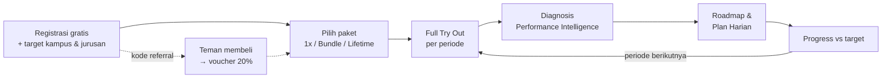
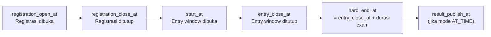
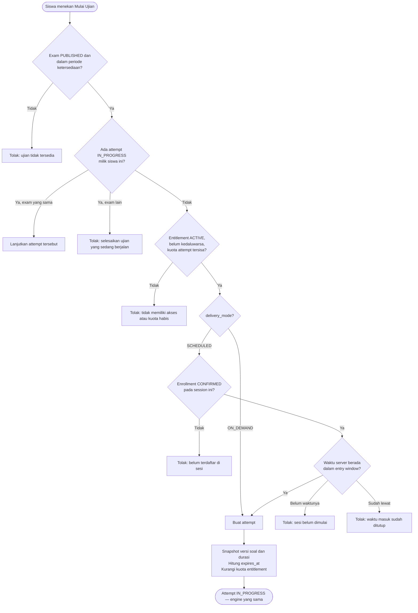
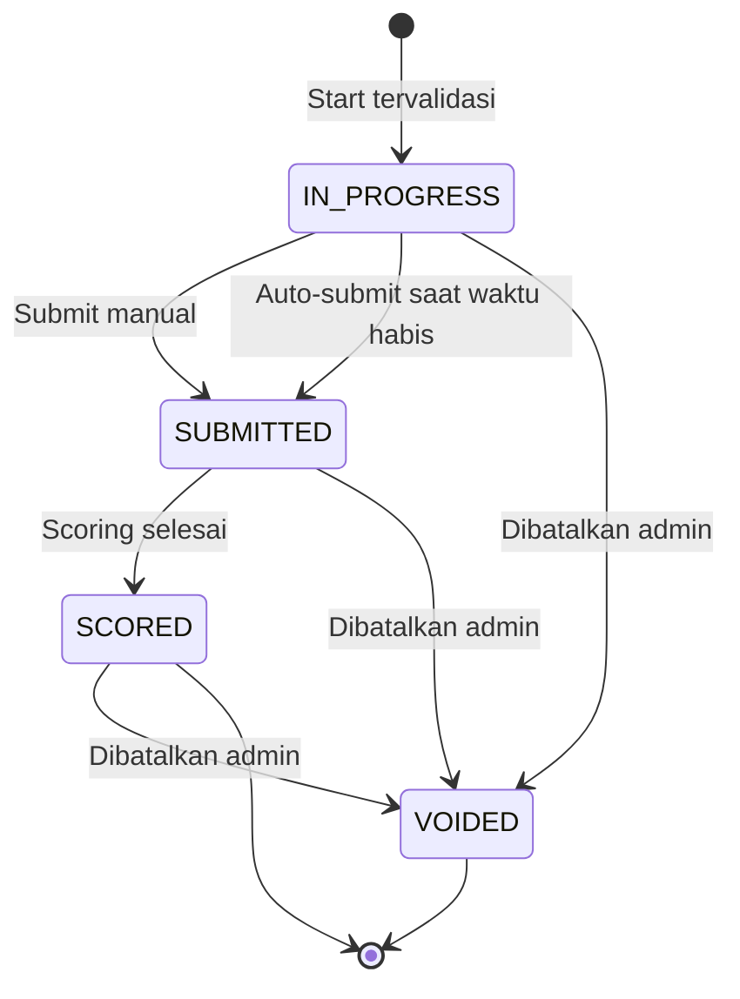
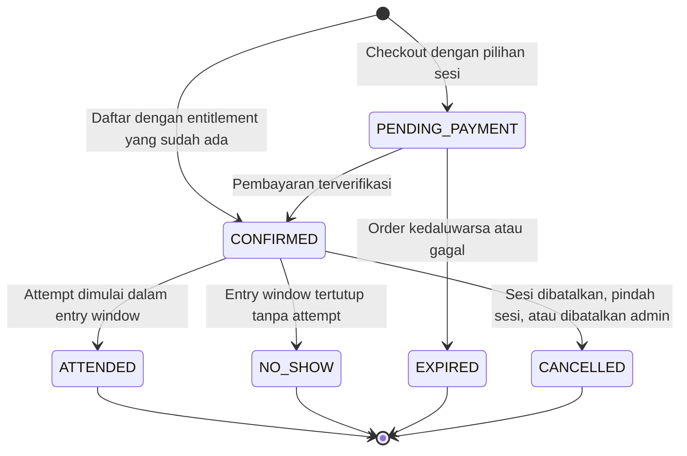
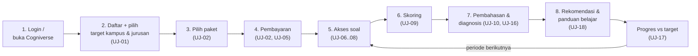
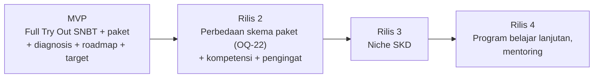
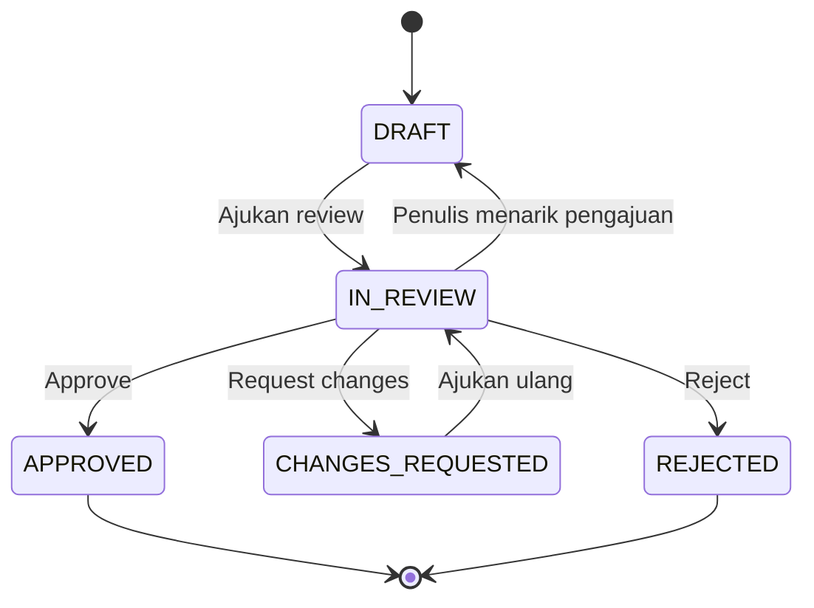
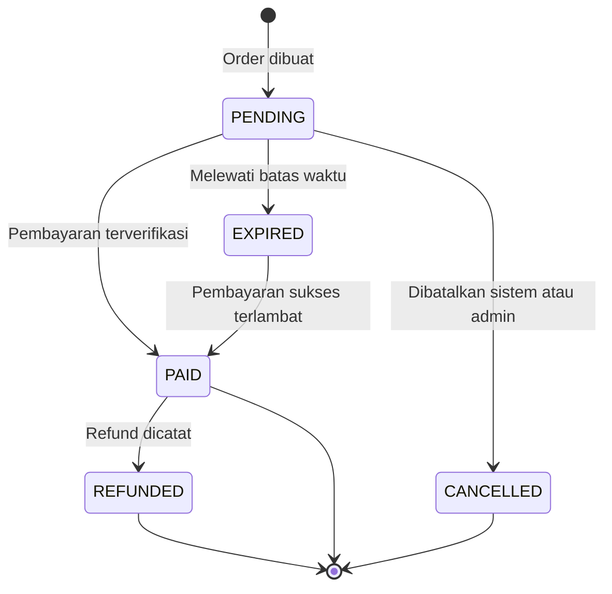

# DOCUMENT 01 — Cogniverse Product Requirements Document (PRD)

| Atribut | Nilai |
|---|---|
| Produk | Cogniverse — persiapan SNBT untuk siswa kelas 12, dari try out ke rencana belajar menuju kampus tujuan |
| Versi dokumen | **3.0** (Draft untuk persetujuan) — reposisi produk: Full Try Out berbayar dengan paket 1x, Bundle, dan Lifetime |
| Tanggal | 13 November 2026 |
| Status | **Proposed** — isi dokumen adalah usulan desain produk. Dampak v3.0 terhadap kode `cogniverse-platform` dicatat di Revision Summary Bagian 10 |
| Dokumen terkait | DOCUMENT 02 — Technical Design Document v3.0; DOCUMENT 03 — UI/UX Specification v3.0; Cogniverse Revision Summary |
| Bahasa | Bahasa Indonesia, dengan terminologi teknis, identifier, dan nama status dalam bahasa Inggris |

> **Catatan status fakta.** Harga paket (Rp35.000 / Rp79.000 / Rp150.000), target 1.000 audiens, dan aturan referral 3 orang / 20% adalah **keputusan pemilik produk** dan ditandai **[Established]**. Angka lain (jumlah soal, durasi, ambang analitik, target KPI turunan) adalah **usulan atau hipotesis**. Tidak ada data pasar, tingkat konversi, skor acuan kampus, atau klaim keaslian soal yang sudah divalidasi di dokumen ini (OQ-19, OQ-20). Keputusan yang diusulkan dokumen ini ditandai **[Proposed]**.

### Riwayat Versi

| Versi | Tanggal | Perubahan utama |
|---|---|---|
| 1.0 | 10 Nov 2026 | PRD awal: platform asesmen SNBT dengan Free Diagnostic, Premium Try Out, Bundle; model ujian hybrid |
| 2.0 | 11 Nov 2026 | Strategi *Try Out as Gateway*; taksonomi Free / Mini / Full Try Out dan Bundle; Performance Intelligence lima dimensi; Progress Tracking; tingkatan laporan BASIC/COMPLETE |
| 3.0 | 13 Nov 2026 | **Reposisi produk.** Target: siswa kelas 12; niche SNBT (MVP), SKD (roadmap). Produk tunggal **Full Try Out** per periode; Free Try Out, Mini Try Out, klaim gratis, dan laporan BASIC **dihapus**. Paket **1x (Try Out Umum)**, **Bundle (4 periode)**, **Lifetime (satu musim sampai H-7 SNBT)**. Freemium terbatas pada akun dan fitur non-ujian. Modul baru: **Target Kampus & Jurusan** (FR-TGT), **Roadmap Belajar & Plan Harian** (FR-RMP), **Paket & Kredit** (FR-PKG), **Referral** (FR-REF). Journey baru 8 langkah |

---

## Ringkasan Eksekutif

**Cogniverse membantu siswa kelas 12 lolos SNBT ke kampus dan jurusan tujuannya.** Siswa mengerjakan Full Try Out bergaya SNBT, lalu Cogniverse mengubah hasilnya menjadi empat hal yang bisa langsung dipakai: analisis kekuatan dan kelemahan beserta materi yang perlu dipahami, roadmap belajar dengan plan harian, progress tracker terhadap target skor kampus dan jurusan, dan latihan dari soal yang mengikuti pola SNBT 2023–2026.

| Aspek | Keputusan v3.0 |
|---|---|
| Target market | Siswa kelas 12 **[Established]** |
| Niche | SNBT untuk MVP; SKD di roadmap **[Established]** |
| Produk | **Full Try Out** — satu try out lengkap per periode **[Established]** |
| Paket | **Try Out Umum (1x)** Rp35.000 · **Bundle** Rp79.000 (akses 4 periode) · **Lifetime** Rp150.000 (semua periode dalam satu musim sampai H-7 SNBT) **[Established]** |
| Gratis (freemium) | Akun, pemilihan target kampus & jurusan, contoh laporan, kode referral. **Tidak ada try out gratis** **[Established]** |
| Referral | Ajak 3 teman yang membeli paket → voucher diskon 20% **[Established]**; mekanisme rinci di BR-REF **[Proposed]** |

**Journey utama [Established]:** *Login → Daftar dan pilih target kampus & jurusan → Pilih paket → Pembayaran → Akses soal → Skoring → Pembahasan dan diagnosis → Rekomendasi dan panduan belajar.*

Keputusan yang paling menentukan bentuk sistem:

1. **Satu examination engine untuk dua mode** — on-demand dan scheduled hanya berbeda pada gerbang akses (Bagian 5) **[Established sejak v1.0]**.
2. **Satu tipe exam** — `exam_type = FULL_TRYOUT`. Paket adalah *product*, bukan tipe exam: paket memberi **kredit try out** (1x, Bundle) atau **akses musim** (Lifetime) yang ditukar menjadi entitlement per exam (Bagian 2.11) **[Proposed]**.
3. **Performance Intelligence menjadi bahan rencana belajar** — diagnosis per topik dengan bukti (v2.0) kini menggerakkan Roadmap Belajar dan Plan Harian (FR-RMP); seluruh laporan berada pada satu tingkat (sebelumnya COMPLETE) **[Proposed]**.
4. **Target skor yang jujur** — siswa menetapkan target pribadi pada skala Cogniverse 0–1000; skor acuan kampus hanya ditampilkan bila admin memasukkannya **beserta sumber dan tahunnya**, dengan catatan bahwa skalanya tidak setara dengan skor resmi SNBT (BR-TGT) **[Proposed]**.
5. **Klaim "soal asli 2023–2026" ditahan** sampai sumber dan izinnya terverifikasi (OQ-19); sampai saat itu redaksi publik memakai "soal bergaya SNBT 2023–2026" **[Proposed]**.
6. **Integritas historis dan timer server-authoritative** dipertahankan dari v1.0.

Hitungan requirement setelah revisi ini dicantumkan di Bagian 7.18 dan diverifikasi skrip (Revision Summary Bagian 10).

---

## Daftar Isi

1. [Analisis Konteks, Ambiguitas, dan Risiko](#1-analisis-konteks-ambiguitas-dan-risiko)
2. [Product Overview, Strategi, dan Taksonomi Produk](#2-product-overview)
3. [Product Goals & Success Metrics](#3-product-goals--success-metrics)
4. [User Roles & Permissions](#4-user-roles--permissions)
5. [Model Ujian Hybrid: On-demand dan Scheduled](#5-model-ujian-hybrid-on-demand-dan-scheduled)
6. [Detailed User Journeys](#6-detailed-user-journeys)
7. [Functional Requirements](#7-functional-requirements)
8. [Business Rules](#8-business-rules)
9. [Non-Functional Requirements (tingkat produk)](#9-non-functional-requirements-tingkat-produk)
10. [MVP Scope](#10-mvp-scope)
11. [Edge Cases](#11-edge-cases)
12. [Product Roadmap](#12-product-roadmap)
13. [Asumsi, Keputusan, dan Open Questions](#13-asumsi-keputusan-dan-open-questions)
14. [Traceability Awal](#14-traceability-awal)
15. [Catatan Self-Review](#15-catatan-self-review)
- [Lampiran A — Glosarium](#lampiran-a--glosarium)
- [Lampiran B — Referensi Status (State Enumerations)](#lampiran-b--referensi-status-state-enumerations)

---

## 1. Analisis Konteks, Ambiguitas, dan Risiko

Bagian ini mendokumentasikan audit dan analisis: apa yang sudah diputuskan, apa yang berubah pada v2.0, apa yang belum jelas, dan bagaimana PRD ini menyikapinya.

> **Catatan v3.0.** Bagian 1.0–1.3 mencatat audit dan keputusan saat revisi v2.0 dan dibiarkan sebagai riwayat; butir yang tidak berlaku lagi ditandai. Perubahan v3.0 dirangkum di Riwayat Versi, Ringkasan Eksekutif, dan Revision Summary.

### 1.0 Audit PRD v1.0 terhadap Positioning Baru

Audit dilakukan sebelum revisi (Revision Workflow Step 1). Kesimpulan: arsitektur produk v1.0 — engine hybrid, akses dari server, integritas historis, bank soal ber-review — **tetap valid**. Yang berubah adalah identitas produk, taksonomi penawaran, dan kedudukan analitik dari "fitur hasil" menjadi **modul diferensiasi utama**.

| Kategori | Temuan pada v1.0 | Tindakan di v2.0 |
|---|---|---|
| **Tetap valid** | Model hybrid on-demand/scheduled pada satu engine (E-01, E-02); timer server-authoritative (E-03); autosave dan auto-submit (E-04); versioning dan snapshot (E-07, BR-LIF-02); review empat mata (PO-4); entitlement hanya dari server; result immutable dengan revisi; seluruh BR-PAY, BR-SCH, BR-CAP, BR-TMO | Dipertahankan tanpa perubahan makna |
| **Asumsi usang** | Produk diposisikan sebagai "Assessment Platform"; vision menyebut pembelajaran sebagai tujuan akhir platform asesmen | Positioning diganti: platform pendampingan dan pengembangan siswa; try out sebagai gateway (2.1–2.3, 2.10) |
| **Konflik dengan positioning baru** | "Free Diagnostic Test" sebagai produk gratis dengan tipe `DIAGNOSTIC`; "Premium Try Out" sebagai satu jenis | Diganti taksonomi **Free Try Out / Mini Try Out / Full Try Out / Bundle** (2.11). `DIAGNOSTIC` → `FREE_TRYOUT`; `TRYOUT` dipecah menjadi `MINI_TRYOUT` dan `FULL_TRYOUT` |
| **Konflik** | Rekomendasi belajar (FR-ANL-03) berprioritas P1, padahal diferensiasi bertumpu padanya | Rekomendasi area prioritas naik ke P0 (FR-PI-08) dengan batasan bukti |
| **Konflik** | Batas 1 attempt untuk tipe gratis dikunci di struktur data (`DIAGNOSTIC` ⇒ `max_attempts = 1`) | Menjadi **parameter produk** yang dapat dikonfigurasi (BR-FRE-03) |
| **Kurang** | Tidak ada dimensi kompetensi; analitik hanya per section dan topik | Taksonomi kompetensi (FR-QB-13..14) dan analisis kompetensi (FR-PI-04) |
| **Kurang** | Analisis perilaku pengerjaan hanya "analisis waktu" P1 | Dimensi Test-taking Behavior (FR-PI-05, FR-PI-06), termasuk pencatatan perubahan jawaban sejak MVP |
| **Kurang** | Tidak ada aturan kapan dua hasil boleh dibandingkan | Konsep *seri try out* dan BR-PRG |
| **Kurang** | Tidak ada pembedaan isi laporan gratis vs premium | Tingkatan laporan BASIC/COMPLETE (FR-PI-11, BR-FRE-05) |
| **Kurang** | Aturan privasi dan kepemilikan data hanya di NFR | Grup BR-PRV dan FR-PROF-06..07 |
| **Kurang** | Persona belum memuat jalur seleksi selain SNBT | Persona 3 (jalur lain) dan target pasar diperjelas |
| **Kurang** | KPI tanpa label hipotesis per baris; tidak ada KPI keterlibatan analitik dan minat mentoring | Bagian 3 ditulis ulang |
| **Utang audit v1.0** | Penajaman TDD P-01..P-11 dan temuan AU-01..AU-11 belum masuk PRD | Diserap pada BR terkait (dicatat di 13.2, D-26) |

### 1.1 Keputusan yang Sudah Final [Established]

| # | Keputusan | Implikasi pada PRD |
|---|---|---|
| E-01 | Dua mode ujian: on-demand dan scheduled | Bagian 5 mendefinisikan perbedaan gerbang akses secara eksplisit |
| E-02 | Kedua mode memakai examination engine yang sama | Satu modul Exam Engine (FR-ENG), satu lifecycle attempt (BR-LIF) |
| E-03 | Self-paced, countdown timer, server-authoritative | FR-TMR, BR-TMO |
| E-04 | Autosave, manual submit, auto-submit saat waktu habis | FR-TMR-03..09, BR-SUB, BR-TMO |
| E-05 | Attempt history dan automated scoring | FR-RES-04, FR-SCR |
| E-06 | Soal dari internal dan kontributor eksternal, wajib review & approval | FR-QB, FR-REV, FR-CTR |
| E-07 | Question versioning wajib | FR-QV, BR-QV |
| E-08 | Lima role dengan RBAC | Bagian 4 |
| E-09 | ~~Model bisnis freemium + transaksi: Free Try Out, Premium Try Out (Mini, Full), Bundle~~ **Diganti v3.0:** paket 1x / Bundle / Lifetime; freemium hanya akun dan fitur non-ujian | FR-PKG, FR-PAY, 2.9 |
| E-10 | AI adaptive learning, Personalized Learning, dan Mentoring bukan fitur MVP; arsitektur disiapkan agar dapat diperluas | Bagian 10.3, 12, FR-FUT |
| E-11 | Positioning: platform pendampingan dan pengembangan siswa dengan strategi *Try Out as Gateway* | Bagian 2.1–2.3, 2.10 |
| E-12 | Empat tahap ekosistem: Acquisition, Differentiation, Retention, Long-term Value | Bagian 2.10, 12 |
| E-13 | Performance Intelligence lima dimensi sebagai diferensiasi utama, dimulai dengan analitik berbasis aturan yang transparan; LLM opsional kelak dan tidak menggantikan scoring | Bagian 2.12, FR-PI, BR-PI |
| E-14 | ~~Parameter Free Try Out sebagai parameter yang dapat dikonfigurasi~~ **Tidak berlaku v3.0** (Free Try Out dihapus); parameter Full Try Out tetap dapat dikonfigurasi | FR-EXM-13 |
| E-15 | ~~Free Try Out memberi informasi yang bermakna~~ **Tidak berlaku v3.0**; prinsipnya dipertahankan: laporan tidak dikaburkan demi konversi | BR-PI |

### 1.2 Ambiguitas dan Cara Penyelesaiannya

| # | Ambiguitas | Penyelesaian dalam PRD | Sifat |
|---|---|---|---|
| A-01 | Apakah timer berlaku untuk seluruh ujian atau per subtes? | Engine mendukung dua `timing_mode`: `TOTAL` dan `PER_SECTION` (BR-DUR-01..03). Full Try Out SNBT memakai `PER_SECTION` | Proposed |
| A-02 | Model scoring: SNBT resmi memakai IRT, yang membutuhkan data kalibrasi | MVP memakai skor proporsional skala 0–1000 per subtes dengan disclaimer (BR-SCR-03, BR-SCR-08). IRT masuk Fase 2 | Proposed, lihat OQ-02 |
| A-03 | Tipe soal apa yang didukung MVP? | P0: pilihan ganda satu jawaban (5 opsi). P1: pilihan ganda kompleks dan isian singkat | Proposed, lihat OQ-03 |
| A-04 | Peserta scheduled yang masuk terlambat: durasi penuh atau dipotong? | Durasi penuh selama masuk dalam entry window (BR-SCH-05); batas akhir sesi dihitung dari penutupan entry window | Proposed |
| A-05 | Kapan kursi sesi dipesan relatif terhadap pembayaran? | Kursi ditahan (seat hold) saat order dibuat, dikonfirmasi saat pembayaran terverifikasi (BR-CAP-01..03) | Proposed |
| A-06 | Bagaimana Bundle dimodelkan, mengingat daftar entitas minimal tidak menyebut produk? | PRD memperkenalkan konsep **Product** (item yang dijual) yang berisi satu atau lebih exam. TDD perlu menambahkan entitas pendukungnya | Proposed; implikasi untuk TDD |
| A-07 | Apakah pembahasan (kunci + penjelasan) ditampilkan setelah ujian? | Ya, setelah hasil dipublikasikan; untuk scheduled baru setelah sesi berakhir bagi semua peserta (BR-PUB-04) | Proposed, lihat OQ-05 |
| A-08 | Kebijakan refund | Refund mandiri tidak ada di MVP. Refund hanya diproses manual oleh admin untuk kasus pembatalan sesi atau kegagalan sistem (BR-PAY-08, BR-CXL-03) | Proposed, lihat OQ-06 |
| A-09 | Bagaimana kontributor eksternal mendapat akun dan kompensasi? | Akun hanya melalui undangan Super Admin (FR-AUTH-06). Kompensasi di luar sistem untuk MVP | Proposed, lihat OQ-07 |
| A-10 | Jumlah attempt per pembelian | Default 1; on-demand dapat dikonfigurasi 1–5 per exam; scheduled selalu 1 (BR-ATT-01) | Proposed |
| A-11 | Apakah satu exam bisa on-demand sekaligus scheduled? | Tidak. Setiap exam memiliki tepat satu `delivery_mode`. Paket soal yang sama dapat dipakai ulang lewat duplikasi exam (FR-EXM-08) | Proposed |
| A-12 | Zona waktu | Disimpan UTC, ditampilkan dalam WIB dengan label zona (BR-AVL-05) | Proposed |

### 1.3 Risiko Produk dan Teknis

| # | Risiko | Dampak | Mitigasi di PRD |
|---|---|---|---|
| R-01 | Lonjakan peserta serentak di awal sesi scheduled | Autosave gagal, kepercayaan hilang | Kapasitas per sesi (BR-CAP), target beban di Bagian 9, entry window menyebar waktu mulai |
| R-02 | Kebocoran kunci jawaban | Hasil sesi scheduled tidak valid | FR-ENG-11, BR-PUB-04, pembatasan akses kontributor (FR-CTR-05) |
| R-03 | Kunci jawaban salah ditemukan setelah publikasi | Skor siswa salah, komplain massal | Prosedur koreksi + rescoring dengan revisi hasil (FR-QV-06, FR-SCR-05, EC-13) |
| R-04 | Pembayaran sukses tetapi akses tidak aktif | Komplain, beban CS | Webhook idempotent, rekonsiliasi manual (FR-PAY-08), entitlement transaksional (BR-ENT-01) |
| R-05 | Skor non-IRT dianggap "tidak akurat" oleh siswa | Kredibilitas turun | Disclaimer eksplisit, fokus pada analitik per topik, IRT di roadmap |
| R-06 | Pasokan soal berkualitas tidak mencukupi | Tidak bisa merilis try out baru | Workflow kontributor + review sejak MVP; metrik throughput review (Bagian 3.7) |
| R-07 | Pengguna di bawah umur dan kepatuhan UU PDP | Risiko hukum | Persetujuan eksplisit (FR-PROF-04), minimisasi data, OQ-08 |
| R-08 | Koneksi tidak stabil dan perangkat mobile kelas bawah | Ujian terganggu | Autosave dengan antrean offline (FR-TMR-05), resume (FR-ENG-07), UI ujian yang ringan |
| R-09 | Scope creep ke fitur learning/AI | MVP terlambat | Batas MVP tegas di Bagian 10; FR-FUT hanya didefinisikan |
| R-10 | Insight yang berlebihan atau keliru merusak kepercayaan | Diferensiasi berbalik menjadi kelemahan | BR-PI-02..05, templat bahasa ditinjau (FR-PI-12), label pengamatan/dugaan |
| R-11 | Tanpa try out gratis, pengunjung ragu membayar sebelum merasakan produk (v3.0) | Registration-to-paid rendah | Contoh laporan dan contoh roadmap berlabel di halaman publik; harga masuk Rp35.000; referral; KPI registration-to-paid dipantau (3.5) |
| R-12 | Perbandingan progres antar try out yang tidak sebanding | Siswa salah menyimpulkan kemajuan | Seri try out dan BR-PRG |
| R-13 | Tag topik/kompetensi yang tidak konsisten | Analitik menyesatkan | Taksonomi dikelola Content Editor; tag wajib sebelum review; KPI taxonomy coverage |

---

## 2. Product Overview

### 2.1 Product Vision

Menjadi pendamping persiapan seleksi masuk perguruan tinggi yang paling jelas arahnya bagi siswa kelas 12: setiap siswa tahu posisinya, tahu jarak ke kampus dan jurusan tujuannya, dan tahu apa yang harus dipelajari hari ini.

### 2.2 Product Mission

Mengubah hasil try out menjadi rencana belajar yang jujur dan dapat dijalankan: diagnosis berbasis bukti, roadmap menuju hari SNBT, plan harian yang realistis, dan pelacakan kemajuan terhadap target yang dipilih siswa sendiri.

### 2.3 Product Positioning

| Aspek | Pernyataan |
|---|---|
| Untuk | Siswa kelas 12 yang mempersiapkan SNBT **[Established]** |
| Yang | Sudah punya kampus dan jurusan tujuan, tetapi tidak tahu harus belajar apa, berapa banyak, dan apakah persiapannya cukup |
| Cogniverse adalah | Platform Full Try Out SNBT yang berlanjut menjadi rencana belajar |
| Yang | Mendiagnosis kekuatan dan kelemahan per topik, menyusun roadmap dan plan harian sampai hari ujian, dan melacak progres terhadap target skor |
| Berbeda dari | Platform try out yang berhenti pada skor dan ranking, dan bimbel yang rencana belajarnya sama untuk semua siswa |
| Karena | Rencana belajar disusun dari jawaban siswa sendiri, setiap rekomendasi menunjuk soal yang mendasarinya, dan target dipilih siswa sejak mendaftar |

**Try out tetap pintu masuk, tetapi berbayar.** v3.0 menghapus Free Try Out: nilai produk ditunjukkan sebelum membeli lewat contoh laporan, contoh roadmap, dan penjelasan paket di halaman publik, bukan lewat ujian gratis **[Established]**.

### 2.4 Problem Statement

| Masalah | Siapa yang mengalami | Akibat |
|---|---|---|
| Try out online umumnya berhenti di angka skor dan ranking | Siswa kelas 12 | Siswa tahu "berapa", tetapi tidak tahu "kenapa" dan "harus belajar apa" |
| Rencana belajar generik tidak memperhitungkan kelemahan pribadi dan sisa waktu sampai SNBT | Siswa kelas 12 | Waktu habis untuk materi yang sudah dikuasai; materi lemah tertinggal |
| Siswa tidak tahu seberapa jauh posisinya dari target kampus dan jurusan | Siswa kelas 12 | Motivasi naik-turun; keputusan pilihan jurusan tanpa dasar |
| Hasil antar try out tidak terhubung, dan sering dibandingkan walau tingkat kesulitannya berbeda | Siswa | Kesimpulan progres yang menyesatkan |
| Pengalaman ujian tidak andal (jawaban hilang, timer tidak konsisten) | Siswa | Hasil tidak mencerminkan kemampuan |
| Kualitas soal tidak terkontrol dan tidak terlacak | Penyelenggara, siswa | Kunci salah, soal tidak relevan, tidak bisa diaudit |

### 2.5 Target Market

| Segmen | Deskripsi | Prioritas |
|---|---|---|
| **Primer** | Siswa kelas 12 SMA/MA/SMK yang mempersiapkan **SNBT** **[Established]** | MVP |
| Sekunder | Lulusan gap-year yang mempersiapkan SNBT ulang | Dapat memakai produk yang sama; tidak menjadi dasar keputusan desain |
| Niche berikutnya | Peserta **SKD** (seleksi sekolah kedinasan/CPNS) **[Established]** | Roadmap (FR-FUT-08); bank soal, struktur subtes, dan target terpisah |
| Internal | Exam Admin, Content Editor, Super Admin, Tutor/Kontributor | MVP |
| Di luar cakupan | Orang tua dan sekolah sebagai pembeli, siswa kelas 10–11 | Belum direncanakan |

Target bisnis awal: **1.000 audiens untuk paket Try Out Umum** **[Established]** — ditafsirkan sebagai 1.000 pembeli paket Try Out Umum; definisi dan periode pengukurannya dikonfirmasi di OQ-23. Ukuran pasar tidak diperkirakan karena belum ada riset pasar yang tervalidasi.

### 2.6 User Personas

Persona disusun dari asumsi tim produk, **belum** dari riset pengguna (OQ-13).

**Persona 1 — Nadia, siswi kelas 12 (target utama)**

| Aspek | Deskripsi |
|---|---|
| Profil | 17 tahun, SMA negeri di kota tier-2; target Kedokteran di PTN pilihan; perangkat utama smartphone Android |
| Kebutuhan | Tahu jarak skornya ke target; tahu materi apa yang dipelajari minggu ini dan hari ini |
| Pain point | Skor try out naik-turun tanpa tahu sebabnya; rencana belajar dari bimbel sama untuk semua siswa |
| Motivasi | Lolos jurusan pilihan pertama |
| Hasil yang diharapkan | Setelah try out pertama: 3–5 topik prioritas, roadmap sampai hari SNBT, dan daftar tugas hari ini; setelah beberapa periode: melihat skornya mendekati target |
| Perilaku beli | Sensitif harga; membandingkan Rp35.000 untuk satu try out dengan Rp79.000 untuk empat; membayar dengan QRIS atau e-wallet; mau mengajak teman bila ada diskon |

**Persona 2 — Raka, siswa kelas 12 yang serius sejak awal**

| Aspek | Deskripsi |
|---|---|
| Profil | 17 tahun, mulai persiapan sejak awal kelas 12; target Teknik Informatika |
| Kebutuhan | Try out rutin setiap periode sampai hari ujian; progres yang dapat dibandingkan |
| Pain point | Membeli try out satu per satu terasa mahal dan mudah terlewat |
| Hasil yang diharapkan | Akses semua periode musim ini; tren skor antar periode dalam seri yang sebanding |
| Perilaku beli | Kandidat paket Lifetime |

**Persona 3 — Bu Sinta, tutor kontributor** · **Persona 4 — Dimas, Exam Admin** · **Persona 5 — Laras, Content Editor**

Tidak berubah dari v2.0, kecuali Dimas kini merakit Full Try Out per periode, mengelola paket dan harga, mengatur tanggal SNBT musim berjalan, dan memasukkan data acuan kampus beserta sumbernya; Laras juga memelihara **panduan materi per topik** yang dipakai roadmap (FR-RMP-05).

### 2.7 Value Proposition — Empat Nilai Unik

| # | Nilai unik **[Established]** | Apa yang siswa dapat | Modul | Status data |
|---|---|---|---|---|
| UV-1 | **Analisis kelemahan dan kelebihan + panduan materi** | Topik kuat, cukup, dan perlu ditingkatkan dengan bukti; untuk setiap topik prioritas, ringkasan materi yang perlu dipahami | FR-PI, FR-RMP-05 | Tersedia (aturan v2.0) |
| UV-2 | **Roadmap belajar + plan harian** | Fase belajar per minggu sampai H-1 SNBT; tugas harian dengan perkiraan waktu yang dapat dicentang | FR-RMP | Baru |
| UV-3 | **Progress tracker + target skor kampus & jurusan** | Tren skor antar periode dan jarak ke target pribadi; skor acuan kampus bila datanya tersedia | FR-PRG, FR-TGT | Data acuan kampus belum ada sumbernya (OQ-20) |
| UV-4 | **Soal asli 2023–2026** | Latihan dari soal yang mengikuti SNBT 2023–2026 | FR-QB | **Klaim ditahan** sampai sumber dan izin terverifikasi (OQ-19); redaksi sementara "soal bergaya SNBT 2023–2026" |

| Untuk | Nilai yang ditawarkan |
|---|---|
| Siswa (gratis) | Akun, target kampus & jurusan, contoh laporan dan contoh roadmap, kode referral |
| Siswa (berpaket) | Full Try Out per periode, laporan Performance Intelligence lengkap, roadmap dan plan harian, progress tracker |
| Kontributor | Jalur pengajuan soal yang jelas dengan umpan balik terstruktur |
| Tim internal | Bank soal terkontrol, paket dan pembayaran, publikasi hasil, data acuan kampus yang tercatat sumbernya |

### 2.8 Product Differentiation

Diferensiasi Cogniverse adalah **rangkaian yang tidak terputus dari jawaban ke rencana belajar**: Performance Intelligence (v2.0) menghasilkan diagnosis berbukti; Roadmap dan Plan Harian menerjemahkan diagnosis menjadi jadwal; Progress Tracker menunjukkan apakah jadwal itu bekerja terhadap target.

| Dimensi | Pertanyaan siswa | MVP v3.0 |
|---|---|---|
| 1. Performance Overview | "Bagaimana hasilku?" | P0 |
| 2. Capability Analysis | "Di subtes dan topik mana aku kuat atau lemah?" | P0 (subtes, topik); P1 (kompetensi) |
| 3. Test-taking Behavior | "Bagaimana caraku mengerjakan?" | P0 |
| 4. Progress & Target | "Apakah aku membaik dan seberapa jauh dari target?" | **P0** (naik dari P1) |
| 5. Development Recommendations | "Apa yang harus kupelajari?" | P0, kini berlanjut ke **Roadmap & Plan Harian** (P0) |

Batasan analitik dari v2.0 tetap berlaku: satu try out tidak dapat mendiagnosis kemampuan secara utuh; pengamatan dibedakan dari dugaan; tidak ada diagnosis psikologis; aturan transparan, tanpa LLM pada MVP (BR-PI).

### 2.9 Business Model

| Paket (product) | Isi | Harga **[Established]** | Peran |
|---|---|---|---|
| **Try Out Umum (1x)** | 1 kredit = akses satu Full Try Out periode pilihan | **Rp35.000** | Titik masuk; target 1.000 audiens |
| **Bundle** | 4 kredit = akses empat periode | **Rp79.000** | Nilai order lebih tinggi; mendorong progres antar periode |
| **Lifetime** | Akses semua Full Try Out dalam satu musim SNBT sampai **H-7 SNBT** | **Rp150.000** | Retensi sepanjang musim |
| **Referral** | Ajak 3 teman yang membeli paket → voucher diskon 20% untuk pembelian berikutnya | Diskon | Akuisisi dari mulut ke mulut |
| Freemium | Akun, target, contoh laporan dan roadmap, kode referral | Gratis | Registrasi sebelum membeli |
| SKD | Produk serupa untuk niche SKD | Roadmap | Perluasan pasar |

**Perbedaan isi antar paket selain jumlah periode** (mis. kedalaman laporan, fitur roadmap) **belum ditetapkan dan dibahas di fase berikutnya** (OQ-22). Sampai keputusan itu, ketiga paket memberi fitur yang sama per try out; yang berbeda hanya jumlah dan masa akses periode **[Proposed]**.

Nama "Lifetime" dipertahankan sesuai keputusan pemilik produk, tetapi setiap tampilan harga wajib menulis cakupannya secara eksplisit ("semua try out musim SNBT {tahun}, berlaku sampai {tanggal H-7}") agar tidak menyesatkan (BR-PKG-04, OQ-21).

Semua harga dalam IDR, bilangan bulat rupiah, dikonfigurasi admin (bukan konstanta kode).

### 2.9a Product Scope

**Dalam cakupan MVP v3.0:** registrasi dan profil siswa; pemilihan target kampus & jurusan; katalog Full Try Out per periode; paket 1x/Bundle/Lifetime dengan order dan pembayaran; kredit dan akses musim; entitlement; pelaksanaan ujian; scoring; hasil, pembahasan, dan laporan Performance Intelligence; roadmap belajar dan plan harian; progress tracker dan target; referral dan voucher; bank soal dengan versioning, review, taksonomi, dan panduan materi per topik; dashboard admin dan kontributor; notifikasi email transaksional.

**Di luar cakupan MVP:** Free Try Out dan Mini Try Out (dihapus v3.0); konten SKD; video pembelajaran; mentoring; kelas live; forum; aplikasi native; proctoring; AI tutor; penjelasan berbasis LLM; subscription; penjualan B2B.

### 2.10 Product Strategy — Dari Try Out ke Rencana Belajar

| Strategi | Isi | Pengungkit produk | Bukti (KPI, 3.5) |
|---|---|---|---|
| **Acquisition** | Halaman publik menjelaskan empat nilai unik dengan contoh laporan dan contoh roadmap; referral mendorong ajakan antar teman | Registrasi gratis + target; kode referral | Visitor-to-registration; referral share |
| **Monetization** | Paket sederhana tiga pilihan; Bundle dan Lifetime lebih hemat per periode | Kredit dan akses musim | Registration-to-paid; package mix |
| **Activation** | Momen "aha": membaca diagnosis dan menerima roadmap + tugas hari ini | Laporan + roadmap otomatis setelah try out pertama | Roadmap activation rate |
| **Retention** | Siswa kembali setiap hari untuk plan harian dan setiap periode untuk try out | Plan harian, progres vs target | Daily plan completion; repeat assessment |

**Yang sengaja tidak dilakukan:** hitung mundur palsu, label kemampuan dari data yang tidak cukup, skor acuan kampus tanpa sumber, dan klaim "soal asli" tanpa bukti.

### 2.11 Taksonomi Produk

Definisi kanonik untuk ketiga dokumen. **[Proposed]**

| Konsep | Definisi | Tipe data |
|---|---|---|
| **Full Try Out** | Simulasi SNBT lengkap dengan subtes terstruktur dan timer per subtes | `exam_type = FULL_TRYOUT` (satu-satunya nilai) |
| **Periode try out** | Satu Full Try Out yang dirilis pada jadwal tertentu (mis. "Periode 3 — Februari") | Satu `exam` dalam seri musim |
| **Musim (season)** | Seri try out untuk satu tahun SNBT, dengan tanggal SNBT yang ditetapkan admin | `exam_series` + `exam_series.exam_date` |
| **Paket Try Out Umum (1x)** | Product yang memberi 1 kredit | `product_type = SINGLE`, `tryout_credits = 1` |
| **Paket Bundle** | Product yang memberi 4 kredit | `product_type = BUNDLE`, `tryout_credits = 4` |
| **Paket Lifetime** | Product yang memberi akses semua periode satu musim sampai H-7 | `product_type = LIFETIME`, terikat `series_id` |
| **Kredit try out** | Hak menukar satu periode menjadi entitlement | `package_grants` (`kind = CREDITS`) |
| **Akses musim** | Hak otomatis atas semua periode musim sampai H-7 SNBT | `package_grants` (`kind = SEASON_PASS`) |
| **Voucher referral** | Diskon 20% untuk satu order | `vouchers` |

Laporan Performance Intelligence memakai **satu tingkat** (isi setara `COMPLETE` v2.0) untuk semua paket sampai OQ-22 diputuskan.

### 2.12 Performance Intelligence — Definisi Lima Dimensi

Tidak berubah dari v2.0, kecuali: (1) tidak ada lagi tingkat BASIC — semua kolom "BASIC" pada v2.0 tidak berlaku; (2) dimensi 4 menambahkan **jarak ke target pribadi** (FR-TGT-04); (3) dimensi 5 menjadi masukan Roadmap & Plan Harian (FR-RMP-02).

| Dimensi | Metrik | Sumber data | Jenis keluaran |
|---|---|---|---|
| **1. Performance Overview** | Skor total dan per subtes (0–1000), akurasi, distribusi benar/salah/kosong, durasi | Result | Pengamatan |
| **2. Capability Analysis** | Akurasi per subtes, topik (klasifikasi), kompetensi (P1) | Skor section/topik/kompetensi | Pengamatan + klasifikasi berbasis ambang |
| **3. Test-taking Behavior** | Waktu per subtes, soal kosong dan posisinya, akurasi per kesulitan, perubahan jawaban | Jawaban per butir | Pengamatan; dugaan berlabel |
| **4. Progress & Target** | Perubahan skor antar periode dalam satu musim; jarak ke target pribadi | Snapshot performa, target | Pengamatan, hanya bila sebanding (BR-PRG) |
| **5. Development Recommendations** | Area prioritas (maks. 5) dengan bukti; panduan materi; roadmap | Insight dimensi 2–3 | Rekomendasi berbasis aturan |

**Pengamatan vs dugaan** tetap seperti v2.0 (`kind = OBSERVATION | INFERENCE`).

### 2.13 Product Modules

| Modul produk | Prefix FR | Status |
|---|---|---|
| Authentication & Student Profile | FR-AUTH, FR-PROF | MVP |
| **Target Kampus & Jurusan** | **FR-TGT** | **MVP (baru v3.0)** |
| Try Out Catalog | FR-CAT, FR-EXM | MVP |
| **Paket & Kredit** | **FR-PKG**, FR-PAY, FR-ENT | **MVP (baru v3.0)** |
| **Referral & Voucher** | **FR-REF** | **MVP (baru v3.0)** |
| Exam Engine | FR-ENG, FR-TMR | MVP |
| Question Bank | FR-QB, FR-QV, FR-REV, FR-CTR | MVP |
| Scoring & Results | FR-SCR, FR-RES | MVP |
| Performance Intelligence | FR-PI | MVP |
| **Roadmap Belajar & Plan Harian** | **FR-RMP** | **MVP (baru v3.0)** |
| Progress Tracking | FR-PRG | **MVP** (tampilan naik ke P0) |
| Admin & Content Management | FR-ADM, FR-EXM, FR-NTF | MVP |
| Free Try Out, Mini Try Out | — | **Dihapus v3.0** |
| SKD | FR-FUT-08 | Roadmap |
| Mentoring, University Preparation | FR-FUT-05..07 | Masa depan |

---

## 3. Product Goals & Success Metrics

> **Semua target angka di bagian ini adalah hipotesis** (label **H**) yang belum divalidasi data apa pun. Target dikalibrasi setelah 4–8 minggu data produksi. Baris berlabel **Pantau** belum diberi target.

### 3.1 Business Objectives

| ID | Objective |
|---|---|
| BO-1 | Mencapai 1.000 audiens paket Try Out Umum **[Established]** (definisi OQ-23) (Acquisition + Monetization) |
| BO-2 | Memvalidasi kesediaan membayar untuk Full Try Out yang berlanjut ke roadmap belajar; mengukur bauran paket 1x / Bundle / Lifetime (Monetization) |
| BO-3 | Membuktikan bahwa Performance Intelligence dibaca dan dipercaya — menjadi alasan memilih Cogniverse (Differentiation) |
| BO-4 | Menunjukkan bahwa siswa kembali mengerjakan asesmen berikutnya (Retention) |
| BO-5 | Mengukur minat awal terhadap pembelajaran terpersonalisasi dan mentoring sebelum membangunnya (Long-term value) |
| BO-6 | Menjalankan try out terjadwal tanpa insiden kritis dan membangun bank soal tervalidasi |

### 3.2 User Objectives

| ID | Objective |
|---|---|
| UO-1 | Siswa menyelesaikan ujian tanpa kehilangan jawaban atau waktu karena masalah platform |
| UO-2 | Setelah try out pertama, siswa memahami hasilnya dan menerima roadmap serta tugas hari ini yang masuk akal |
| UO-3 | Setelah beberapa periode, siswa melihat jarak skornya ke target pribadi dan apakah jarak itu mengecil |
| UO-4 | Siswa dapat melihat apakah ia membaik antar try out yang sebanding |
| UO-5 | Kontributor mengetahui status dan alasan keputusan atas setiap soal yang diajukan |

### 3.3 Product Objectives

| ID | Objective |
|---|---|
| PO-1 | Satu examination engine melayani mode on-demand dan scheduled |
| PO-2 | Tidak ada akses berbayar tanpa pembayaran terverifikasi, dan tidak ada pembayaran terverifikasi tanpa akses |
| PO-3 | Setiap hasil dan setiap insight dapat direkonstruksi dari versi soal, jawaban, dan versi aturan yang tersimpan |
| PO-4 | Setiap soal yang tampil di ujian telah direview orang yang bukan penulisnya |
| PO-5 | Tidak ada insight yang ditampilkan tanpa bukti data yang memenuhi ambang minimum |

### 3.4 Definisi Event

Nama event final ditetapkan di TDD 9.7.

| Event | Terjadi ketika |
|---|---|
| `visitor_session` | Pengunjung unik membuka halaman publik |
| `catalog_viewed` / `tryout_detail_viewed` | Katalog / halaman detail try out dibuka (atribut `exam_type`) |
| `user_registered` / `email_verified` | Akun siswa dibuat / email terverifikasi |
| `entitlement_created` | Entitlement dibuat (atribut `source`, `exam_type`) |
| `order_created` / `order_paid` / `order_expired` | Perubahan status order (atribut `product_type`) |
| `enrollment_confirmed` | Enrollment sesi menjadi `CONFIRMED` |
| `attempt_started` / `attempt_submitted` | Attempt dibuat / dikumpulkan (atribut `exam_type`, `submission_type`) |
| `result_published` / `result_viewed` | Hasil tersedia / pertama kali dibuka |
| `report_viewed` | Laporan Performance Intelligence dibuka (atribut `report_tier`, `section` yang dilihat) |
| `insight_expanded` | Siswa membuka rincian bukti sebuah insight |
| `recommendation_clicked` | Siswa mengikuti tautan rekomendasi (atribut `recommendation_type`) |
| `review_viewed` | Pembahasan dibuka |
| `progress_viewed` | Halaman progres dibuka (atribut jumlah attempt sebanding) |
| `interest_registered` | Siswa mendaftarkan minat pada program pembelajaran/mentoring (FR-FUT-01) |

### 3.5 KPI dan Cara Perhitungan

**Acquisition**

| KPI | Rumus | Target |
|---|---|---|
| Visitor-to-registration rate | `user_registered` unik ÷ `visitor_session` unik, per periode | H: ≥ 8% |
| Registration-to-paid | Siswa dengan ≥ 1 `order_paid` dalam 14 hari sejak registrasi ÷ siswa teregistrasi pada kohort | H: ≥ 15% |
| Registrasi per kanal | `user_registered` per sumber UTM | Pantau |

**Activation**

| KPI | Rumus | Target |
|---|---|---|
| Activation rate (utama) | Siswa yang mencapai `report_viewed` atas attempt pertamanya dalam 7 hari sejak registrasi ÷ siswa teregistrasi pada kohort | H: ≥ 35% |
| First try out completion | Attempt pertama siswa terkumpul dengan rasio terjawab ≥ 80% ÷ attempt pertama dimulai | H: ≥ 80% |
| Time to first report | Median `user_registered` → `report_viewed` pertama | H: ≤ 1 hari |

**Engagement**

| KPI | Rumus | Target |
|---|---|---|
| Review engagement | Attempt dengan `review_viewed` pada ≥ 5 soal ÷ attempt dengan `result_viewed` | H: ≥ 40% |
| Weekly active students | Siswa unik dengan `attempt_started`, `report_viewed`, atau `progress_viewed` dalam 7 hari | Pantau |

**Conversion**

| KPI | Rumus | Target |
|---|---|---|
| Roadmap activation | Siswa yang mencentang ≥ 1 tugas plan harian dalam 7 hari sejak laporan pertama ÷ siswa dengan laporan pertama | H: ≥ 40% |
| Checkout completion rate | `order_paid` ÷ `order_created` (berbayar) | H: ≥ 60% |
| Payment success latency | p95 notifikasi pembayaran sukses diterima → entitlement aktif | H: ≤ 10 detik |
| Mix produk | Order `PAID` per `exam_type`/`product_type` | Pantau |
| Bundle share | Order `PAID` berisi bundle ÷ seluruh order `PAID` | H: ≥ 20% |

**Retention**

| KPI | Rumus | Target |
|---|---|---|
| Repeat assessment rate | Siswa dengan ≥ 2 attempt terkumpul pada exam berbeda dalam 60 hari ÷ siswa dengan ≥ 1 attempt terkumpul | H: ≥ 30% |
| Comparable progress rate | Siswa dengan ≥ 2 attempt sebanding (satu seri) ÷ siswa berbayar | H: ≥ 40% |
| Repeat purchase rate | Siswa dengan ≥ 2 `order_paid` dalam satu musim ÷ siswa dengan ≥ 1 `order_paid` | H: ≥ 25% |

**Performance Intelligence engagement**

| KPI | Rumus | Target |
|---|---|---|
| Report engagement | Attempt dengan `report_viewed` ÷ attempt dengan `result_viewed` | H: ≥ 60% |
| Insight depth | Laporan dengan ≥ 1 `insight_expanded` ÷ laporan dibuka | H: ≥ 30% |
| Recommendation follow-through | Laporan dengan ≥ 1 `recommendation_clicked` ÷ laporan dibuka | H: ≥ 25% |
| Insight usefulness (survei mikro) | Proporsi jawaban "Ya" pada pertanyaan "Apakah insight ini membantu?" (P1) | Pantau |

**Long-term mentoring conversion (proxy, sebelum modul dibangun)**

| KPI | Rumus | Target |
|---|---|---|
| Learning & mentoring interest rate | Siswa dengan `interest_registered` ÷ siswa dengan ≥ 2 attempt terkumpul | Pantau (data untuk keputusan tahap 3–4) |
| Interest by segment | `interest_registered` per status siswa dan subtes terlemah | Pantau |

**Operasional ujian dan konten**

| KPI | Rumus | Target |
|---|---|---|
| Autosave success rate | Simpan jawaban berhasil ÷ diterima server | H: ≥ 99,5% |
| Exam incident rate | Attempt di-void atau diberi attempt tambahan karena gangguan sistem ÷ seluruh attempt | H: ≤ 0,5% |
| Scheduled show-up rate | `ATTENDED` ÷ (`ATTENDED` + `NO_SHOW`) per sesi | H: ≥ 80% |
| Review turnaround time | Median `IN_REVIEW` → keputusan | H: ≤ 3 hari kerja |
| Post-publication key error rate | Soal dikoreksi kuncinya setelah dipakai ÷ soal yang pernah dipakai | H: ≤ 0,5% |
| Taxonomy coverage | Soal `APPROVED` dengan topik (dan kompetensi, P1) ÷ seluruh soal `APPROVED` | H: 100% topik; ≥ 90% kompetensi |

### 3.6 North Star Metric

**Jumlah laporan Performance Intelligence yang dibuka per minggu atas attempt yang selesai** — attempt `SCORED` dengan `report_viewed`. Metrik ini menggabungkan pemakaian inti (asesmen selesai) dengan diferensiasi (insight benar-benar dibaca). Metrik pendamping: Comparable progress rate (retensi bermakna).

---

## 4. User Roles & Permissions

### 4.1 Deskripsi Role

| Role | Deskripsi | Tanggung jawab utama | Cara memperoleh akun |
|---|---|---|---|
| **Student** | Siswa peserta ujian | Mengelola profil, mengklaim/membeli ujian, mendaftar sesi, mengerjakan ujian, melihat hasil | Registrasi mandiri |
| **Tutor / Contributor** | Penulis soal eksternal | Membuat draft soal, mengajukan review, merevisi sesuai catatan | Undangan Super Admin |
| **Content Editor** | Editor akademik internal | Mengelola taksonomi, menulis soal, meninjau dan memutuskan pengajuan, mengoreksi soal | Dibuat oleh Super Admin |
| **Exam Admin** | Pengelola operasional ujian | Merakit dan memublikasikan exam, mengelola sesi dan peserta, memantau pembayaran, mengelola publikasi hasil | Dibuat oleh Super Admin |
| **Super Admin** | Pemilik sistem | Mengelola pengguna dan role, konfigurasi sistem, tindakan berisiko tinggi (refund, void attempt, grant/revoke entitlement), seluruh kewenangan role lain | Dibuat saat provisioning sistem |

**Guest** (pengunjung belum login) bukan role RBAC, tetapi dicantumkan di matriks untuk kejelasan.

Prinsip RBAC:

1. Seorang pengguna staf dapat memiliki lebih dari satu role (misalnya Content Editor + Exam Admin). Akun Student tidak digabung dengan role staf. **[Proposed]**
2. Seluruh pemeriksaan izin dilakukan di server; menyembunyikan tombol di UI bukan kontrol akses.
3. Selain izin role, berlaku **resource ownership**: Student hanya mengakses datanya sendiri; Contributor hanya mengakses soal miliknya.
4. Pemisahan tugas: penulis soal tidak boleh menyetujui soalnya sendiri (BR-QV-04).

### 4.2 Role-Permission Matrix

Legenda: ✅ diizinkan · 🔒 hanya atas data milik sendiri · ⚠️ diizinkan dengan syarat (lihat catatan) · — tidak diizinkan.

| Kapabilitas | Guest | Student | Contributor | Content Editor | Exam Admin | Super Admin |
|---|:-:|:-:|:-:|:-:|:-:|:-:|
| **Publik & akun** | | | | | | |
| Melihat katalog dan detail exam | ✅ | ✅ | ✅ | ✅ | ✅ | ✅ |
| Registrasi sebagai Student | ✅ | — | — | — | — | — |
| Mengelola profil sendiri | — | 🔒 | 🔒 | 🔒 | 🔒 | 🔒 |
| **Commerce & akses** | | | | | | |
| Tukar kredit / akses musim menjadi entitlement | — | 🔒 | — | — | — | — |
| Membuat order dan membayar | — | 🔒 | — | — | — | — |
| Melihat riwayat transaksi | — | 🔒 | — | — | ✅ | ✅ |
| Melihat seluruh order dan pembayaran | — | — | — | — | ✅ | ✅ |
| Rekonsiliasi status pembayaran dengan gateway | — | — | — | — | ✅ | ✅ |
| Mencatat refund | — | — | — | — | — | ✅ |
| Grant / revoke entitlement | — | — | — | — | ⚠️¹ | ✅ |
| **Sesi & enrollment** | | | | | | |
| Mendaftar ke sesi | — | 🔒 | — | — | — | — |
| Membuat, mengubah, memublikasikan sesi | — | — | — | — | ✅ | ✅ |
| Membatalkan / menjadwal ulang sesi | — | — | — | — | ✅ | ✅ |
| Melihat dan mengekspor daftar peserta | — | — | — | — | ✅ | ✅ |
| **Pelaksanaan ujian** | | | | | | |
| Memulai attempt dan mengerjakan ujian | — | 🔒 | — | — | — | — |
| Melihat hasil, laporan, pembahasan | — | 🔒 | — | — | — | — |
| Melihat hasil seluruh peserta, ekspor | — | — | — | — | ✅ | ✅ |
| Void attempt / memberi attempt tambahan | — | — | — | — | ⚠️¹ | ✅ |
| Mengatur publikasi hasil | — | — | — | — | ✅ | ✅ |
| Memicu rescoring | — | — | — | — | ⚠️² | ✅ |
| **Bank soal** | | | | | | |
| Membuat dan mengedit draft soal | — | — | 🔒 | ✅ | — | ✅ |
| Mengajukan soal untuk review | — | — | 🔒 | ✅ | — | ✅ |
| Melihat seluruh bank soal termasuk kunci | — | — | — | ✅ | ⚠️³ | ✅ |
| Review: approve / request changes / reject | — | — | — | ⚠️⁴ | — | ⚠️⁴ |
| Mengelola subject dan topic | — | — | — | ✅ | — | ✅ |
| Retire soal | — | — | — | ✅ | — | ✅ |
| Mengoreksi kunci soal yang sudah dipakai | — | — | — | ⚠️⁴ | — | ✅ |
| **Exam** | | | | | | |
| Membuat dan mengedit exam (draft) | — | — | — | — | ✅ | ✅ |
| Menetapkan harga dan product/bundle | — | — | — | — | ✅ | ✅ |
| Publish / unpublish / archive exam | — | — | — | — | ✅ | ✅ |
| **Administrasi** | | | | | | |
| Mengelola pengguna staf dan role | — | — | — | — | — | ✅ |
| Suspend / aktifkan kembali akun | — | — | — | — | ⚠️⁵ | ✅ |
| Melihat audit log | — | — | — | — | — | ✅ |
| Mengubah konfigurasi sistem | — | — | — | — | — | ✅ |
| Melihat dashboard analitik bisnis | — | — | — | — | ✅ | ✅ |

Catatan:

1. Exam Admin boleh melakukannya dengan wajib mengisi alasan; tindakan tercatat di audit log. Jika entitlement berasal dari order yang sudah di-refund, hanya Super Admin.
2. Exam Admin memicu rescoring hanya setelah koreksi kunci disetujui (versi baru berstatus `APPROVED`).
3. Exam Admin melihat isi soal `APPROVED` untuk keperluan merakit exam; tidak dapat mengedit.
4. Hanya jika pengguna tersebut bukan penulis versi soal yang ditinjau (BR-QV-04).
5. Exam Admin hanya boleh men-suspend akun Student; akun staf hanya oleh Super Admin.

---

## 5. Model Ujian Hybrid: On-demand dan Scheduled

Bagian ini adalah rujukan utama untuk perilaku dua mode ujian. Journey (Bagian 6), requirement (Bagian 7), dan business rule (Bagian 8) mengacu ke sini.

### 5.1 Prinsip Unifikasi

Kedua mode berbagi **seluruh** hal berikut: struktur exam (section dan soal), pembuatan attempt, snapshot soal, timer, autosave, submission, scoring, hasil, dan laporan. Perbedaannya **hanya** pada tiga hal:

1. **Gerbang akses** — apa yang harus dipenuhi sebelum attempt boleh dibuat.
2. **Jendela waktu mulai** — kapan attempt boleh dimulai.
3. **Kebijakan publikasi hasil** — kapan skor dan pembahasan boleh dilihat.

Konsekuensi desain: tidak boleh ada jalur kode, tabel, atau layar pengerjaan ujian yang terpisah per mode. Mode adalah atribut exam (`delivery_mode`), bukan jenis engine.

### 5.2 Konsep Inti

| Konsep | Definisi | Berlaku untuk |
|---|---|---|
| **Exam** | Definisi ujian: metadata, `exam_type` (2.11), seri, section, daftar versi soal, durasi, aturan attempt, `delivery_mode`, `timing_mode` | Keduanya |
| **Product** | Item yang dijual di katalog. Berisi satu exam (single) atau beberapa exam (bundle), dengan satu harga | Keduanya |
| **Entitlement** | Hak seorang siswa untuk mengerjakan satu exam, dengan kuota attempt dan masa berlaku | Keduanya |
| **Session** | Jadwal pelaksanaan sebuah exam scheduled: periode registrasi, waktu mulai, entry window, kapasitas, kebijakan publikasi hasil | Scheduled saja |
| **Enrollment** | Pendaftaran seorang siswa pada satu session; menempati satu kursi | Scheduled saja |
| **Attempt** | Satu kali pengerjaan exam oleh seorang siswa, dengan timer individual | Keduanya |
| **Result** | Hasil scoring sebuah attempt; immutable, dapat memiliki revisi | Keduanya |

### 5.3 Perbandingan Mode

| Aspek | On-demand | Scheduled |
|---|---|---|
| Syarat membuat attempt | Entitlement `ACTIVE` dengan kuota tersisa | Entitlement `ACTIVE` dengan kuota tersisa **dan** enrollment `CONFIRMED` pada session terkait |
| Kapan boleh mulai | Kapan saja dalam periode ketersediaan exam dan masa berlaku entitlement | Hanya dalam entry window session: `start_at` ≤ sekarang ≤ `entry_close_at` |
| Kapasitas | Tidak terbatas | Terbatas per session (`capacity`) |
| Timer | Individual, dimulai saat attempt dibuat | Individual, dimulai saat attempt dibuat; durasi penuh selama masuk dalam entry window |
| Jumlah attempt | 1–5 per entitlement, dikonfigurasi per exam (default 1) | Selalu 1 per entitlement |
| Publikasi skor | Segera setelah scoring | `IMMEDIATE` atau `AT_TIME` (`result_publish_at`), dikonfigurasi per session |
| Publikasi pembahasan | Bersamaan dengan skor | Setelah skor terbit **dan** setelah `hard_end_at` session |
| Ranking / percentile | Tidak ada | Antar peserta session (P1) |
| Kehilangan kesempatan | Entitlement kedaluwarsa | Tidak masuk hingga `entry_close_at` → `NO_SHOW`; boleh mendaftar ke session lain selama entitlement berlaku |
| Pembatalan oleh penyelenggara | Unpublish/archive exam | Pembatalan atau penjadwalan ulang session |

### 5.4 Garis Waktu Session Scheduled

Aturan urutan (ditegakkan saat session disimpan, BR-SCH-01):

- `registration_open_at` < `registration_close_at` ≤ `entry_close_at`
- `start_at` < `entry_close_at`
- `hard_end_at` dihitung sistem, tidak diisi admin
- `result_publish_at` kosong (mode `IMMEDIATE`) atau ≥ `hard_end_at` (mode `AT_TIME`)

`registration_close_at` boleh lebih lambat dari `start_at`; ini memungkinkan pendaftaran "menit terakhir" selama entry window masih terbuka. Default usulan: `registration_close_at = start_at`, `entry_close_at = start_at + 30 menit`.

Halaman instruksi dapat dibuka peserta kapan saja setelah enrollment `CONFIRMED`, tetapi tombol mulai baru aktif pada `start_at` menurut waktu server. (v2.0: batas ruang tunggu 30 menit dihapus, AU-02.)

### 5.5 Alur Keputusan "Mulai Ujian" (Unified Start)

Satu proses server yang sama memvalidasi permintaan mulai untuk kedua mode (FR-ENG-01).

### 5.6 Lifecycle Attempt (berlaku untuk kedua mode)

`submission_type` mencatat cara pengumpulan: `MANUAL` atau `AUTO_TIMEOUT`. Rincian di BR-LIF.

### 5.7 Lifecycle Enrollment (scheduled saja)

### 5.8 Tiga Jalur Masuk ke Session

| Jalur | Urutan | Kapan kursi ditempati |
|---|---|---|
| **A. Beli langsung dengan sesi** | Pilih sesi → checkout → bayar | Saat order dibuat (seat hold, enrollment `PENDING_PAYMENT`); menjadi `CONFIRMED` saat pembayaran terverifikasi |
| **B. Sudah punya entitlement** (dari bundle, admin grant, atau setelah `NO_SHOW`/pembatalan sesi) | Pilih sesi → konfirmasi | Langsung `CONFIRMED` |
| ~~C. Exam scheduled gratis~~ **[Dihapus v3.0]** | — | Tidak ada exam gratis; jalur A dan B berlaku |

Pada ketiga jalur, alokasi kursi bersifat atomik terhadap kapasitas (BR-CAP-02).

### 5.9 Mode Timer

| `timing_mode` | Perilaku | Penggunaan |
|---|---|---|
| `TOTAL` | Satu countdown untuk seluruh exam; siswa bebas berpindah antar section dan soal | Latihan internal; Full Try Out SNBT memakai `PER_SECTION` |
| `PER_SECTION` | Section dikerjakan berurutan; tiap section punya countdown sendiri; setelah section berakhir (waktu habis atau diakhiri siswa) tidak dapat dibuka lagi; sisa waktu tidak dibawa ke section berikutnya | Full Try Out simulasi SNBT |

`timing_mode` independen dari `delivery_mode`: keempat kombinasi valid dan dilayani engine yang sama.

**Referensi struktur SNBT (perlu diverifikasi setiap tahun terhadap publikasi resmi SNPMB — bukan fakta yang diverifikasi dokumen ini):** tujuh subtes — Penalaran Umum, Pengetahuan dan Pemahaman Umum, Pemahaman Bacaan dan Menulis, Pengetahuan Kuantitatif, Literasi dalam Bahasa Indonesia, Literasi dalam Bahasa Inggris, Penalaran Matematika — masing-masing dengan jumlah soal dan alokasi waktu sendiri. Engine tidak boleh meng-hardcode struktur ini; jumlah section, jumlah soal, dan durasi adalah konfigurasi exam.

### 5.10 Tipe Try Out terhadap Mode Pengiriman dan Mode Timer

Tipe try out (2.11) adalah dimensi produk; `delivery_mode` dan `timing_mode` adalah dimensi teknis. Engine memperlakukan semua kombinasi yang valid secara identik.

| `exam_type` | `ON_DEMAND` | `SCHEDULED` | `timing_mode` yang lazim | Catatan |
|---|:-:|:-:|---|---|
| `FULL_TRYOUT` | ✓ | ✓ | `PER_SECTION` | Simulasi SNBT memakai timer per subtes |

**Contoh konfigurasi yang diharapkan** (ilustrasi, bukan kewajiban):

| Contoh | Tipe | Mode | Timer | Soal / durasi |
|---|---|---|---|---|
| Full Try Out SNBT #1 (seri "SNBT 2027") | `FULL_TRYOUT` | Scheduled | `PER_SECTION` | Mengikuti struktur SNBT terkini |
| Bundle "3× Full Try Out SNBT 2027" | Product `BUNDLE` | Mengikuti exam | — | Tiga Full Try Out dalam satu seri |

---

## 6. Detailed User Journeys

Konvensi: setiap journey memiliki ID `UJ-xx`. Rujukan `FR-…` mengarah ke Bagian 7, `BR-…` ke Bagian 8, `EC-…` ke Bagian 11.

### 6.0 Peta Journey Siswa End-to-end

Journey utama v3.0 mengikuti delapan langkah dari pemilik produk **[Established]**.

| # | Langkah | Journey | Momen produk |
|---|---|---|---|
| 1 | Login | UJ-01 | Masuk atau mulai daftar |
| 2 | Daftar + target kampus & jurusan | UJ-01 | Target dipilih sejak awal (FR-TGT) |
| 3 | Pilih paket | UJ-02 | Tiga paket dengan cakupan yang jelas (FR-PKG) |
| 4 | Pembayaran | UJ-02, UJ-05 | Voucher referral dapat dipakai (FR-REF) |
| 5 | Akses soal | UJ-06..08 | Kredit ditukar menjadi akses periode; ujian andal |
| 6 | Skoring | UJ-09 | Skor langsung keluar |
| 7 | Pembahasan & diagnosis | UJ-10, UJ-16 | Insight berbukti |
| 8 | Rekomendasi & panduan belajar | UJ-18 | Roadmap + plan harian otomatis |

### UJ-01 — Registrasi, Onboarding, dan Pemilihan Target

| Elemen | Uraian |
|---|---|
| Actor | Guest → Student |
| Trigger | Pengunjung menekan "Daftar" dari halaman publik, halaman paket, atau tautan referral |
| Preconditions | Email belum terdaftar |
| Requirement terkait | FR-AUTH-01..04, FR-AUTH-09, FR-PROF-01, FR-PROF-03, FR-PROF-04, FR-TGT-01..03, FR-REF-02, FR-NTF-01 |

**Main flow**

1. Pengunjung mengisi nama lengkap, email, dan password; kode referral terisi otomatis bila datang dari tautan referral (dapat diubah atau dikosongkan); menyetujui Syarat & Ketentuan dan Kebijakan Privasi.
2. Sistem membuat akun Student, mencatat referral bila kodenya valid (FR-REF-02), dan mengirim email verifikasi.
3. Onboarding langkah 1: status (kelas 12 / gap-year), asal sekolah, tahun lulus, provinsi.
4. Onboarding langkah 2: **pilih kampus dan jurusan tujuan** (wajib satu, opsional pilihan kedua) dan **target skor pribadi** pada skala 0–1000 (opsional; dapat diisi kemudian). Bila data acuan kampus tersedia, ditampilkan bersama sumbernya (BR-TGT-02).
5. Siswa diarahkan ke Ringkasan, yang menonjolkan langkah berikutnya: **Pilih paket**.
6. Siswa membuka tautan verifikasi; akun terverifikasi.

**Alternative flow**

- A1. Kampus atau jurusan tidak ada di daftar: siswa memilih "Lainnya" dan mengetik nama; tersimpan tanpa data acuan (FR-TGT-01).
- A2. Registrasi dipicu dari halaman paket: setelah onboarding, siswa dikembalikan ke halaman paket.
- A3. Kode referral tidak valid atau milik sendiri: registrasi tetap berhasil, referral tidak dicatat, pesan netral.

**Error scenarios**

- E1. Email sudah terdaftar → arahkan ke login atau reset password.
- E2. Password tidak memenuhi kebijakan → validasi per kolom.
- E3. Tautan verifikasi kedaluwarsa → tawarkan kirim ulang.

**Expected outcome:** akun Student terverifikasi dengan profil lengkap dan minimal satu target kampus & jurusan, siap memilih paket.

### UJ-02 — Memilih Paket dan Membayar

| Elemen | Uraian |
|---|---|
| Actor | Student |
| Trigger | Siswa menekan "Pilih paket" dari Ringkasan, halaman paket, atau detail try out |
| Preconditions | Login; email terverifikasi; profil dan target lengkap |
| Requirement terkait | FR-PKG-01..06, FR-PAY-01..06, FR-REF-04..05, BR-PKG-01..07, BR-REF-03..05 |

**Main flow**

1. Siswa melihat tiga paket: Try Out Umum (1x) Rp35.000, Bundle Rp79.000 (4 periode), Lifetime Rp150.000 (semua periode musim {tahun} sampai {tanggal H-7}). Setiap kartu menyebut jumlah periode, masa berlaku, dan harga per periode.
2. Siswa memilih paket; halaman checkout menampilkan ringkasan dan **voucher referral yang tersedia** (bila ada) yang dapat dipakai.
3. Sistem membuat order `PENDING` dengan subtotal, diskon voucher, dan total, lalu membuat pembayaran di penyedia (OQ-T1).
4. Setelah pembayaran terkonfirmasi lewat webhook, sistem membuat **package grant**: kredit (1x: 1, Bundle: 4) atau akses musim (Lifetime) (FR-PKG-03).
5. Siswa diarahkan ke daftar try out; periode yang terbuka dapat dimulai dengan menukar satu kredit (FR-PKG-04) atau langsung (akses musim).

**Alternative flow**

- A1. Siswa sudah memiliki akses musim untuk musim yang sama: pembelian Lifetime kedua ditolak dengan penjelasan (BR-PKG-05).
- A2. Kredit tersisa dan periode baru terbit: siswa diberi tahu di Ringkasan.
- A3. Pembayaran kedaluwarsa: order `EXPIRED`, voucher kembali tersedia.

**Error scenarios**

- E1. Harga berubah setelah order dibuat → order memakai harga saat dibuat (snapshot).
- E2. Webhook ganda → idempotent; satu grant per order item.

**Expected outcome:** siswa memiliki kredit atau akses musim dan dapat langsung mengerjakan Full Try Out periode yang terbuka.

### UJ-03 — Pembelian Exam On-demand

| Elemen | Uraian |
|---|---|
| Actor | Student |
| Trigger | Siswa menekan "Beli" pada product single on-demand atau bundle |
| Preconditions | Login; email terverifikasi; product aktif dan exam di dalamnya `PUBLISHED` |
| Requirement terkait | FR-PAY-01, FR-PAY-12, FR-EXM-04, FR-EXM-05, BR-PAY-01, BR-PAY-05 |

**Main flow**

1. Siswa membuka katalog, memilih product, dan membaca detail: isi, durasi, jumlah soal, jumlah attempt, masa akses, harga.
2. Siswa menekan "Beli". Sistem menampilkan ringkasan pesanan.
3. Siswa mengonfirmasi. Sistem membuat order `PENDING` dengan snapshot harga dan batas waktu pembayaran.
4. Lanjut ke UJ-05 (Pembayaran dan Enrollment).

**Alternative flow**

- A1. Bundle: ringkasan menampilkan seluruh exam dalam bundle. Jika bundle berisi exam scheduled, siswa diberi tahu bahwa sesi dipilih setelah pembayaran (Jalur B di 5.8).
- A2. Siswa sudah memiliki order `PENDING` yang belum kedaluwarsa untuk product yang sama → sistem membuka order tersebut, tidak membuat yang baru.
- A3. Siswa belum login → diarahkan ke login/registrasi, lalu kembali ke halaman product.

**Error scenarios**

- E1. Siswa masih memiliki entitlement `ACTIVE` berkuota untuk exam on-demand yang sama → pembelian ditolak dan diarahkan ke "Ujian Saya".
- E2. Bundle yang sebagian exam-nya sudah dimiliki siswa → sistem menampilkan peringatan sebelum order dibuat; siswa harus mengonfirmasi secara eksplisit (tidak ada potongan harga otomatis di MVP).
- E3. Product dinonaktifkan atau harga berubah sebelum order dibuat → ringkasan dimuat ulang dengan data terbaru.

**Expected outcome:** order `PENDING` dengan harga ter-snapshot, siap dibayar.

### UJ-04 — Registrasi Exam Scheduled

| Elemen | Uraian |
|---|---|
| Actor | Student |
| Trigger | Siswa menekan "Daftar Sesi" pada exam scheduled |
| Preconditions | Login; email terverifikasi; ada session `PUBLISHED` dengan registrasi terbuka dan kursi tersedia |
| Requirement terkait | FR-SES-04, FR-SES-08..10, BR-SCH-03, BR-SCH-04, BR-CAP-01..03 |

**Main flow (Jalur A — belum punya entitlement, exam berbayar)**

1. Siswa membuka detail exam scheduled; sistem menampilkan daftar session beserta waktu (WIB), sisa kursi, dan batas registrasi.
2. Siswa memilih satu session dan menekan "Daftar".
3. Sistem memeriksa periode registrasi dan kapasitas, lalu secara atomik membuat order `PENDING` dan enrollment `PENDING_PAYMENT` (kursi ditahan).
4. Sistem menampilkan batas waktu pembayaran (lebih pendek dari order biasa, BR-PAY-02) dan melanjutkan ke UJ-05.
5. Setelah pembayaran terverifikasi, enrollment menjadi `CONFIRMED`; siswa menerima email konfirmasi berisi jadwal.

**Alternative flow**

- A1. **Jalur B — sudah punya entitlement:** langkah 3 langsung membuat enrollment `CONFIRMED` tanpa order.
- ~~A2. Jalur C — exam scheduled gratis~~ **[Dihapus v3.0]**.
- A3. (P1) Pindah sesi: siswa dengan enrollment `CONFIRMED` memilih session lain sebelum `registration_close_at` session asal; enrollment lama `CANCELLED`, yang baru `CONFIRMED`, dalam satu transaksi (BR-SCH-07).

**Error scenarios**

- E1. Kursi habis saat siswa menekan "Daftar" → pesan "sesi penuh" dan tawaran session lain (EC-07).
- E2. Registrasi sudah ditutup atau belum dibuka → tombol nonaktif; permintaan langsung ke server ditolak.
- E3. Siswa sudah memiliki enrollment aktif untuk exam yang sama → ditolak, diarahkan ke enrollment yang ada (BR-SCH-04).
- E4. Order kedaluwarsa sebelum dibayar → enrollment `EXPIRED`, kursi dilepas.

**Expected outcome:** siswa memiliki enrollment `CONFIRMED` pada tepat satu session, atau kursi yang ditahan dilepas tanpa sisa.

### UJ-05 — Pembayaran dan Enrollment

| Elemen | Uraian |
|---|---|
| Actor | Student; Payment Gateway (sistem eksternal) |
| Trigger | Order `PENDING` dibuat (dari UJ-03 atau UJ-04) |
| Preconditions | Order `PENDING` belum kedaluwarsa |
| Requirement terkait | FR-PAY-02..05, FR-PAY-11, FR-ENT-01, FR-ENT-06, BR-PAY-03..07, BR-ENT-01 |

**Main flow**

1. Sistem membuat transaksi di payment gateway dan menampilkan instruksi/halaman pembayaran.
2. Siswa membayar dengan metode pilihannya.
3. Payment gateway mengirim notifikasi (webhook) ke server Cogniverse.
4. Server memverifikasi tanda tangan notifikasi, mencocokkan order dan nominal, serta mengonfirmasi status transaksi ke gateway.
5. Dalam **satu transaksi database**: payment menjadi `SETTLED`, order menjadi `PAID`, entitlement dibuat untuk setiap exam dalam order, dan enrollment `PENDING_PAYMENT` (jika ada) menjadi `CONFIRMED`.
6. Sistem mengirim email bukti pembayaran (dan konfirmasi sesi bila ada).
7. Halaman status order — yang memantau status dari server — menampilkan "Pembayaran berhasil" dan tombol menuju "Ujian Saya".

**Alternative flow**

- A1. Siswa menutup halaman sebelum membayar: order tetap `PENDING`; dapat dilanjutkan dari Riwayat Transaksi hingga batas waktu.
- A2. Siswa kembali dari halaman gateway sebelum webhook tiba: halaman status menampilkan "Menunggu konfirmasi pembayaran" dan memperbarui otomatis. **Parameter redirect dari gateway tidak pernah dipakai untuk mengaktifkan akses** (BR-PAY-03).
- A3. Order senilai Rp0 tidak ada: akses tanpa pembayaran hanya lewat grant admin (FR-PKG-07).

**Error scenarios**

- E1. Pembayaran gagal/ditolak → payment `FAILED`; order tetap `PENDING` sampai kedaluwarsa dan siswa dapat mencoba lagi.
- E2. Batas waktu terlewati → order `EXPIRED`, payment `EXPIRED`, kursi yang ditahan dilepas.
- E3. Webhook duplikat → diproses sekali; yang berikutnya dijawab sukses tanpa efek (EC-03).
- E4. Tanda tangan tidak valid atau nominal tidak cocok → tidak mengubah status; dicatat dan ditandai untuk tinjauan (BR-PAY-06).
- E5. Webhook tidak pernah tiba → Exam Admin menjalankan rekonsiliasi (FR-PAY-08), yang melewati jalur verifikasi yang sama.
- E6. Pembayaran sukses tiba setelah order `EXPIRED` → tetap dihormati (BR-PAY-07, EC-06).

**Expected outcome:** order `PAID` selalu disertai entitlement (dan enrollment `CONFIRMED` bila memilih sesi); order yang tidak dibayar tidak meninggalkan akses maupun kursi.

### UJ-06 — Pelaksanaan Ujian

| Elemen | Uraian |
|---|---|
| Actor | Student |
| Trigger | Siswa menekan "Mulai" dari "Ujian Saya" |
| Preconditions | Lolos seluruh validasi di diagram 5.5 |
| Requirement terkait | FR-ENG-01..14, FR-TMR-01, FR-TMR-02, FR-TMR-08, BR-LIF, BR-DUR |

**Main flow**

1. Sistem menampilkan halaman instruksi: struktur section, jumlah soal, durasi, mode timer, larangan, dan peringatan bahwa timer tidak dapat dihentikan.
2. Siswa mencentang pernyataan siap dan menekan "Mulai Ujian".
3. Server memvalidasi (5.5), membuat attempt `IN_PROGRESS`, men-snapshot versi soal dan durasi, menghitung `expires_at`, dan mengurangi kuota entitlement.
4. Antarmuka ujian tampil: soal, opsi jawaban, timer, navigasi nomor soal, status simpan.
5. Siswa menjawab, berpindah soal (berikutnya/sebelumnya/lompat lewat grid), menandai soal ragu-ragu, atau menghapus jawaban.
6. Setiap perubahan jawaban disimpan otomatis (UJ-07).
7. Siswa mengumpulkan (UJ-07) atau waktu habis (UJ-08).

**Alternative flow**

- A1. **`PER_SECTION`:** siswa hanya melihat soal section aktif. Ia dapat mengakhiri section lebih awal dengan konfirmasi; saat waktu section habis, sistem otomatis pindah ke section berikutnya. Section yang sudah lewat terkunci.
- A2. **Refresh atau membuka ulang:** attempt dilanjutkan dengan jawaban tersimpan dan sisa waktu dari server (EC-02).
- A3. **Scheduled, tiba sebelum `start_at`:** halaman instruksi menampilkan hitung mundur menuju waktu mulai; tombol mulai aktif pada `start_at`.
- A4. **Pindah perangkat:** sesi di perangkat baru mengambil alih; perangkat lama terkunci dengan pesan (EC-04).

**Error scenarios**

- E1. Validasi mulai gagal → pesan spesifik sesuai cabang di 5.5.
- E2. Koneksi putus saat mengerjakan → banner offline; jawaban diantrekan lokal; timer tetap berjalan (EC-01).
- E3. Soal gagal dimuat (gambar rusak, data tidak valid) → siswa dapat melanjutkan soal lain dan melaporkan; ditangani menurut EC-12.
- E4. Dua permintaan mulai bersamaan → hanya satu attempt terbentuk (EC-05).

**Expected outcome:** satu attempt `IN_PROGRESS` per siswa dengan snapshot konten yang tidak berubah dan timer yang konsisten di semua perangkat.

### UJ-07 — Pengumpulan Jawaban dan Autosave

| Elemen | Uraian |
|---|---|
| Actor | Student; sistem |
| Trigger | Siswa memilih/mengubah/menghapus jawaban, atau menekan "Kumpulkan" |
| Preconditions | Attempt `IN_PROGRESS` milik siswa, belum melewati tenggat |
| Requirement terkait | FR-TMR-03..05, FR-TMR-07, FR-TMR-09, FR-ENG-09, BR-SUB |

**Main flow — autosave**

1. Siswa memilih opsi jawaban. Antarmuka langsung menampilkan pilihan dan status "Menyimpan…".
2. Klien mengirim jawaban dengan nomor urut (sequence) per soal.
3. Server memvalidasi kepemilikan, status attempt, tenggat, dan bahwa soal termasuk dalam snapshot attempt (dan section aktif pada `PER_SECTION`), lalu menyimpan satu record jawaban per soal.
4. Server mengembalikan konfirmasi beserta waktu server; status menjadi "Tersimpan".

**Main flow — submit manual**

5. Siswa menekan "Kumpulkan". Sistem menampilkan konfirmasi: jumlah terjawab, belum terjawab, ditandai ragu-ragu, dan peringatan bahwa tindakan ini final.
6. Siswa mengonfirmasi. Klien memastikan antrean simpan kosong, lalu mengirim permintaan submit.
7. Server mengubah attempt menjadi `SUBMITTED` dengan `submission_type = MANUAL` dan memicu scoring (UJ-09).
8. Siswa diarahkan ke halaman konfirmasi/hasil.

**Alternative flow**

- A1. Simpan gagal karena jaringan: klien mengantre dan mencoba ulang otomatis; status "Belum tersimpan — mencoba lagi".
- A2. Siswa membatalkan dialog konfirmasi: kembali ke ujian tanpa perubahan.
- A3. `PER_SECTION`: "Akhiri Subtes" memakai konfirmasi serupa; submit akhir terjadi pada section terakhir.
- A4. Masih ada jawaban belum tersinkron saat submit: dialog menampilkan peringatan dan mencoba sinkronisasi dulu; siswa dapat tetap mengumpulkan dengan jawaban yang sudah tersimpan di server.

**Error scenarios**

- E1. Jawaban tiba setelah tenggat + grace → ditolak; klien menampilkan bahwa waktu telah habis (BR-TMO-03).
- E2. Permintaan simpan duplikat atau usang (sequence lebih rendah) → diabaikan dengan respons sukses (BR-SUB-05).
- E3. Submit ganda (klik ganda, dua tab) → idempotent; hasil yang sama dikembalikan (EC-11).
- E4. Attempt bukan milik siswa, atau sesi perangkat sudah diambil alih → ditolak.

**Expected outcome:** tepat satu jawaban terakhir per soal tersimpan di server; attempt terkumpul tepat satu kali.

### UJ-08 — Waktu Ujian Habis

| Elemen | Uraian |
|---|---|
| Actor | Sistem (server); Student sebagai penerima |
| Trigger | Waktu server mencapai tenggat section atau `expires_at` attempt |
| Preconditions | Attempt `IN_PROGRESS` |
| Requirement terkait | FR-TMR-06..08, FR-ENG-10, BR-TMO, BR-DUR-03 |

**Main flow**

1. Klien menampilkan peringatan pada sisa 5 menit dan 1 menit.
2. Saat countdown klien mencapai nol, klien mengunci input, mengirim sisa antrean, dan meminta status ke server.
3. Server — terlepas dari apakah klien online — mengubah attempt menjadi `SUBMITTED` dengan `submission_type = AUTO_TIMEOUT` menggunakan jawaban yang sudah tersimpan.
4. Scoring dipicu (UJ-09).
5. Siswa melihat pesan "Waktu habis — jawabanmu telah dikumpulkan otomatis".

**Alternative flow**

- A1. `PER_SECTION`, bukan section terakhir: saat tenggat section tercapai, section dikunci dan section berikutnya dimulai otomatis; attempt tetap `IN_PROGRESS`.
- A2. Siswa offline saat waktu habis: server tetap melakukan auto-submit melalui proses latar; ketika siswa kembali, ia melihat status terkumpul.
- A3. Siswa tidak pernah kembali: hasil tetap dibuat dan tersedia di riwayat.

**Error scenarios**

- E1. Jam perangkat siswa tidak akurat → tidak berpengaruh; countdown dihitung dari waktu server (BR-TMO-01).
- E2. Submit manual dan auto-submit terjadi nyaris bersamaan → yang diproses pertama menang; lainnya tanpa efek (EC-10, EC-11).
- E3. Proses latar tertunda → attempt tetap tidak menerima jawaban setelah tenggat karena validasi dilakukan pada setiap permintaan simpan, bukan bergantung pada proses latar.

**Expected outcome:** tidak ada attempt yang tetap `IN_PROGRESS` melewati tenggatnya; tidak ada jawaban yang diterima setelah tenggat.

### UJ-09 — Pembuatan Hasil (Result Generation)

| Elemen | Uraian |
|---|---|
| Actor | Sistem |
| Trigger | Attempt menjadi `SUBMITTED` |
| Preconditions | Snapshot versi soal attempt tersedia |
| Requirement terkait | FR-SCR-01..04, FR-SCR-08, FR-RES-02, BR-SCR, BR-PUB |

**Main flow**

1. Server mengambil kunci jawaban dari versi soal yang di-snapshot attempt.
2. Untuk setiap soal: tentukan benar / salah / tidak dijawab.
3. Hitung per section: jumlah benar, salah, kosong, raw score, skor skala.
4. Hitung total: skor total, akurasi, tingkat penyelesaian; hitung agregasi per topik.
5. Simpan result (revisi 1) dan skor per section; attempt menjadi `SCORED`.
6. Tentukan status publikasi: on-demand → `PUBLISHED`; scheduled → sesuai kebijakan session (BR-PUB-02).
7. Jika terbit, kirim notifikasi "hasil tersedia".

**Alternative flow**

- A1. Scheduled dengan `AT_TIME`: result tersimpan `PENDING_PUBLICATION`; diterbitkan otomatis pada `result_publish_at`.
- A2. (P1) Setelah `hard_end_at` session: sistem menghitung ranking dan percentile antar peserta.
- A3. Rescoring setelah koreksi kunci: membuat revisi baru, revisi lama ditandai superseded (FR-SCR-05).

**Error scenarios**

- E1. Scoring gagal (kesalahan sistem) → attempt tetap `SUBMITTED`; dicoba ulang otomatis; tim diberi peringatan. Siswa melihat "Hasil sedang diproses".
- E2. Soal dalam snapshot tidak memiliki kunci valid → ditangani menurut EC-12; attempt tidak boleh menghasilkan skor diam-diam yang salah.

**Expected outcome:** setiap attempt `SUBMITTED` memperoleh tepat satu result revisi 1 yang dapat direproduksi dari jawaban dan versi soal.

### UJ-10 — Melihat Laporan Performa (Performance Report)

| Elemen | Uraian |
|---|---|
| Actor | Student |
| Trigger | Siswa membuka hasil dari notifikasi, halaman pasca-submit, atau riwayat |
| Preconditions | Result berstatus `PUBLISHED`; attempt milik siswa; pemrosesan Performance Intelligence selesai (FR-PI-07) |
| Requirement terkait | FR-RES-01..03, FR-PI-01..12, BR-PUB-03, BR-PUB-04, BR-SCR-08, BR-PI-01..08 |

**Main flow** (urutan informasi mengikuti UI/UX 5.9)

1. **Performance Overview**: skor total, akurasi, distribusi benar/salah/kosong, waktu pengerjaan, disclaimer skor.
2. **Per subtes**: skor skala dan akurasi setiap section.
3. **Capability Analysis**: topik dikelompokkan "Perlu ditingkatkan", "Cukup", "Kuat", dan "Data belum cukup"; (P1) kompetensi.
4. **Test-taking Behavior**: waktu per section terhadap alokasi, soal kosong dan posisinya; (COMPLETE) akurasi per tingkat kesulitan, perubahan jawaban, soal dengan waktu ekstrem.
5. **Kekuatan dan area perbaikan**: insight berlabel *Pengamatan* atau *Dugaan*, masing-masing dapat dibuka untuk melihat buktinya.
6. **Langkah berikutnya**: area prioritas dengan tautan ke pembahasan soal terkait; (COMPLETE, P1) rekomendasi asesmen berikutnya.
7. Siswa membuka pembahasan per soal.

**Alternative flow**

- A1. Hasil belum terbit (scheduled `AT_TIME`): "Hasil akan diumumkan pada {waktu}" tanpa skor.
- A2. Skor terbit tetapi session belum `hard_end_at`: laporan tampil; pembahasan terkunci dengan keterangan waktu buka.
- A3. Result direvisi: laporan dibuat ulang dari revisi terkini dengan keterangan perubahan (BR-PI-06).
- A5. Pemrosesan insight belum selesai: Overview dan per subtes tampil; bagian insight menampilkan "Sedang menyiapkan analisis" dan memuat ulang otomatis.

**Error scenarios**

- E1. Result milik orang lain → "tidak ditemukan".
- E2. Attempt `VOIDED` → status dibatalkan tanpa skor dan tanpa insight.
- E3. Pemrosesan insight gagal → Overview dan per subtes tetap tampil; bagian insight menampilkan pesan dan dicoba ulang sistem.

**Expected outcome:** siswa memahami posisinya per subtes dan topik, mengetahui bagaimana cara mengerjakannya memengaruhi hasil, dan tahu langkah berikutnya beserta alasannya.

### UJ-11 — Riwayat Ujian

| Elemen | Uraian |
|---|---|
| Actor | Student |
| Trigger | Siswa membuka menu "Riwayat Ujian" |
| Preconditions | Login |
| Requirement terkait | FR-RES-04, FR-PRG-06, FR-ENT-05, BR-OND-04 |

**Main flow**

1. Sistem menampilkan daftar attempt siswa, terbaru di atas: nama exam, tipe, seri, mode, tanggal, status, skor (jika terbit).
2. Siswa memfilter berdasarkan status atau tipe exam.
3. Siswa memilih satu attempt untuk membuka hasilnya (UJ-10).

**Alternative flow**

- A1. Attempt `IN_PROGRESS`: baris menampilkan sisa waktu dan tombol "Lanjutkan".
- A2. Hasil belum terbit: baris menampilkan "Menunggu pengumuman" beserta waktunya.
- A3. Exam telah diarsipkan: riwayat dan hasilnya tetap dapat dibuka.

**Error scenarios**

- E1. Belum ada attempt → empty state dengan ajakan memilih paket.
- E2. Gagal memuat → pesan kesalahan dengan tombol coba lagi.

**Expected outcome:** siswa dapat menemukan dan membuka kembali setiap ujian yang pernah dikerjakannya.

### UJ-12 — Pengajuan Soal oleh Kontributor

| Elemen | Uraian |
|---|---|
| Actor | Tutor / Contributor |
| Trigger | Kontributor menekan "Buat Soal" |
| Preconditions | Akun kontributor aktif; perjanjian kontributor telah disetujui (FR-CTR-08) |
| Requirement terkait | FR-CTR-01..05, FR-QB-02..04, FR-QB-06, FR-QB-07, FR-REV-01, BR-QV-08 |

**Main flow**

1. Kontributor memilih subject dan topic, lalu mengisi teks soal (dengan gambar/rumus bila perlu), opsi jawaban, kunci, penjelasan, tingkat kesulitan, dan cognitive level.
2. Sistem menyimpan sebagai versi 1 berstatus `DRAFT`. Kontributor dapat menyimpan dan melanjutkan kapan saja.
3. Kontributor melihat pratinjau tampilan siswa.
4. Kontributor menekan "Ajukan Review". Sistem menjalankan validasi kelengkapan.
5. Versi berubah menjadi `IN_REVIEW` dan terkunci dari pengeditan. Soal masuk antrean review.
6. Kontributor memantau status di "Status Pengajuan".

**Alternative flow**

- A1. Hasil review `CHANGES_REQUESTED`: kontributor membaca catatan, merevisi versi yang sama, dan mengajukan ulang.
- A2. Hasil review `REJECTED`: versi terkunci permanen; kontributor melihat alasannya.
- A3. Kontributor menarik pengajuan sebelum ditinjau: versi kembali ke `DRAFT`.

**Error scenarios**

- E1. Validasi gagal (kunci belum dipilih, opsi kurang, penjelasan kosong, tag belum lengkap) → daftar kekurangan ditampilkan; status tetap `DRAFT`.
- E2. Unggahan gambar gagal atau melebihi batas ukuran/format → pesan spesifik.
- E3. Kontributor mencoba membuka soal milik orang lain → ditolak.

**Expected outcome:** versi soal yang lengkap berada di antrean review dan tidak dapat diubah selama ditinjau.

### UJ-13 — Review dan Persetujuan Soal

| Elemen | Uraian |
|---|---|
| Actor | Content Editor (atau Super Admin) |
| Trigger | Ada versi soal berstatus `IN_REVIEW` |
| Preconditions | Reviewer bukan penulis versi tersebut |
| Requirement terkait | FR-REV-01..07, FR-QV-01..03, BR-QV-01, BR-QV-04 |

**Main flow**

1. Reviewer membuka antrean review, difilter per subject/topic/penulis/umur pengajuan.
2. Reviewer membuka satu pengajuan: isi soal, kunci, penjelasan, tag, pratinjau tampilan siswa, dan riwayat review sebelumnya.
3. Reviewer memutuskan:
   - **Approve** → versi menjadi `APPROVED`, immutable, dan dapat dipakai di exam.
   - **Request changes** → wajib mengisi catatan; versi menjadi `CHANGES_REQUESTED` dan kembali dapat diedit penulis.
   - **Reject** → wajib mengisi alasan; versi menjadi `REJECTED`.
4. Sistem mencatat keputusan, reviewer, waktu, dan catatan; penulis diberi notifikasi.

**Alternative flow**

- A1. Perbaikan atas soal yang sudah `APPROVED`: editor membuat versi baru (`DRAFT`) dari versi terakhir; versi baru melewati review oleh orang lain. Versi lama tetap berlaku di exam yang memakainya (BR-QV-05).
- A2. (P1) Reviewer melakukan perbaikan minor sendiri: sistem membuat versi baru atas nama reviewer, yang harus disetujui reviewer lain.
- A3. Koreksi kunci jawaban atas soal yang sudah dipakai di attempt → mengikuti prosedur EC-13.

**Error scenarios**

- E1. Reviewer adalah penulis versi → tombol keputusan tidak tersedia; permintaan ke server ditolak.
- E2. Dua reviewer memutuskan versi yang sama bersamaan → keputusan pertama berlaku; yang kedua mendapat pesan bahwa status telah berubah.
- E3. Subject/topic versi tersebut dinonaktifkan sejak pengajuan → approve ditolak sampai tag diperbaiki.

**Expected outcome:** setiap versi `APPROVED` memiliki jejak review oleh orang yang bukan penulisnya dan tidak dapat diubah lagi.

### UJ-14 — Publikasi Exam oleh Admin

| Elemen | Uraian |
|---|---|
| Actor | Exam Admin |
| Trigger | Admin menekan "Buat Exam" |
| Preconditions | Tersedia cukup versi soal `APPROVED` |
| Requirement terkait | FR-EXM-01..12, FR-SES-01..03, FR-QV-05, BR-AVL, BR-SCH-01 |

**Main flow**

1. Admin mengisi metadata: judul, deskripsi, tipe (`FULL_TRYOUT`), musim, `delivery_mode`, `timing_mode`, periode ketersediaan, batas attempt, masa akses. Sistem menampilkan peringatan bila jumlah soal atau durasi di luar parameter produk (FR-EXM-13).
2. Admin menambahkan section: nama, urutan, durasi (untuk `PER_SECTION`), instruksi.
3. Admin mencari soal `APPROVED` berdasarkan subject/topic/kesulitan dan menambahkannya ke section; sistem menyematkan (pin) versi spesifik.
4. Admin memastikan exam masuk musim aktif; harga tidak diatur per exam karena akses lewat paket (FR-PKG-01).
5. Admin melihat pratinjau exam seperti tampilan siswa.
6. Admin menekan "Publish". Sistem menjalankan validasi publikasi (FR-EXM-06).
7. Exam menjadi `PUBLISHED`, strukturnya terkunci, dan muncul di katalog sesuai periode ketersediaan.
8. **Jika `SCHEDULED`:** admin membuat satu atau lebih session (waktu, kapasitas, kebijakan publikasi hasil) dan memublikasikannya; siswa baru dapat mendaftar setelah ada session `PUBLISHED` dengan registrasi terbuka.

**Alternative flow**

- A1. Admin menyimpan sebagai `DRAFT` dan melanjutkan nanti.
- A2. Perlu perubahan setelah publish, belum ada attempt maupun entitlement berbayar: admin melakukan unpublish, mengedit, lalu publish ulang.
- A3. Perlu perubahan setelah ada attempt: struktur tidak dapat diubah; admin menduplikasi exam menjadi exam baru (P1), atau memakai prosedur koreksi kunci.
- A4. Versi soal yang lebih baru tersedia saat exam masih `DRAFT`: sistem menandainya; admin memilih memperbarui pin atau tidak.

**Error scenarios**

- E1. Validasi publikasi gagal → daftar masalah: section kosong, durasi nol, versi soal bukan `APPROVED`, soal `RETIRED`, soal ganda dalam exam, harga belum ditetapkan, periode ketersediaan tidak valid.
- E2. Validasi session gagal → urutan waktu tidak valid, kapasitas nol, atau `hard_end_at` melewati `available_until` exam.
- E3. Admin tanpa izin mencoba publish → ditolak.

**Expected outcome:** exam `PUBLISHED` dengan konten terkunci dan teraudit; untuk scheduled, minimal satu session terbuka untuk registrasi.

### UJ-15 — Penemuan Pertama dan Eksplorasi Katalog

| Elemen | Uraian |
|---|---|
| Actor | Guest |
| Trigger | Pengunjung tiba dari pencarian, media sosial, atau rujukan teman |
| Preconditions | — |
| Requirement terkait | FR-CAT-01..05 |

**Main flow**

1. Pengunjung membuka beranda: proposisi nilai untuk siswa kelas 12, empat nilai unik, contoh laporan dan contoh roadmap berlabel contoh, dan ajakan **Daftar gratis**.
2. Pengunjung membuka katalog: Free, Mini, Full Try Out, dan Bundle dengan filter tipe, mode, dan harga.
3. Pengunjung membuka halaman paket atau detail try out periode: struktur subtes, durasi, jadwal, dan paket yang memberi akses.
4. Pengunjung menekan ajakan utama dan diarahkan ke registrasi dengan tujuan kembali ke halaman tersebut (UJ-01 A2).

**Alternative flow**

- A1. Pengunjung membandingkan paket 1x, Bundle, dan Lifetime di halaman paket (FR-CAT-03).
- A2. Katalog kosong untuk filter tertentu → empty state dengan saran filter lain.

**Error scenarios**

- E1. Detail try out yang sudah ditarik → halaman "tidak tersedia" dengan tautan katalog.

**Expected outcome:** pengunjung memahami apa yang akan ia dapat dari Full Try Out dan roadmapnya, lalu mendaftar dan memilih target.

### UJ-16 — Eksplorasi Performance Intelligence

| Elemen | Uraian |
|---|---|
| Actor | Student |
| Trigger | Siswa membuka bagian insight pada laporan atau menekan "Lihat bukti" |
| Preconditions | Laporan tersedia (UJ-10) |
| Requirement terkait | FR-PI-03..10, FR-PI-12, BR-PI-01..08 |

**Main flow**

1. Siswa memilih sebuah insight, mis. "Akurasi Geometri 2 dari 6 soal".
2. Sistem menampilkan bukti: daftar soal yang mendasari, status jawaban, waktu, dan tingkat kesulitan; untuk insight *Dugaan*, juga pengamatan yang mendasarinya dan pernyataan keterbatasan.
3. Siswa menekan "Pelajari soal-soal ini" dan diarahkan ke pembahasan yang sudah difilter ke topik tersebut.
4. (COMPLETE) Siswa melihat rekomendasi asesmen berikutnya beserta alasannya, lalu membuka detail try out tersebut.

**Alternative flow**

- A1. Siswa menandai insight "membantu / tidak membantu" (P1, survei mikro).

**Error scenarios**

- E1. Pembahasan belum tersedia (scheduled sebelum `hard_end_at`) → tautan menampilkan waktu buka.

**Expected outcome:** siswa memercayai insight karena dapat menelusuri buktinya, dan tahu tindakan konkret berikutnya.

### UJ-17 — Pelacakan Progres

| Elemen | Uraian |
|---|---|
| Actor | Student |
| Trigger | Siswa membuka menu "Progres" atau ajakan setelah attempt kedua dalam satu seri |
| Preconditions | Login; ≥ 1 attempt `SCORED` |
| Requirement terkait | FR-PRG-01..05, FR-RES-04, BR-PRG-01..06 |

**Main flow**

1. Sistem menampilkan riwayat asesmen, dikelompokkan per seri.
2. Untuk seri dengan ≥ 2 attempt sebanding, sistem menampilkan tren skor total, per subtes, dan akurasi topik yang muncul di kedua attempt.
3. Siswa memilih dua attempt untuk dibandingkan berdampingan.
4. Sistem menandai perubahan yang melebihi ambang sebagai "naik" atau "turun", dan perubahan kecil sebagai "relatif sama".

**Alternative flow**

- A1. Hanya satu attempt atau attempt tidak sebanding: sistem menjelaskan mengapa perbandingan tidak ditampilkan dan menyarankan try out dalam seri yang sama.
- A2. Siswa menekan "Jelajahi Learning & Mentoring": halaman informasi program masa depan dengan formulir minat (FR-FUT-01, P1).

**Error scenarios**

- E1. Salah satu attempt di-void → dikeluarkan dari tren dengan keterangan.

**Expected outcome:** siswa melihat apakah ia membaik berdasarkan perbandingan yang adil.

### UJ-18 — Roadmap Belajar dan Plan Harian

| Elemen | Uraian |
|---|---|
| Actor | Student |
| Trigger | Analisis result selesai; atau siswa membuka Roadmap/Ringkasan |
| Preconditions | Minimal satu result terkini dengan analisis `COMPLETED` |
| Requirement terkait | FR-RMP-01..07, FR-TGT-06, BR-RMP-01..05 |

**Main flow**

1. Setelah analisis try out selesai, sistem menyusun roadmap dari topik prioritas, selisih ke target, dan sisa waktu sampai SNBT.
2. Ringkasan menampilkan "Hari ini": 2–4 tugas dengan perkiraan menit.
3. Siswa membuka panduan materi topik, mengulang pembahasan soal terkait, lalu mencentang tugas.
4. Halaman Roadmap menampilkan fase per minggu dan persentase tugas selesai.
5. Setelah try out periode berikutnya, roadmap diperbarui; tugas lama tetap tercatat.

**Alternative / error**

- A1. Tanggal SNBT belum ditetapkan → horizon 8 minggu dengan keterangan (FR-RMP-03).
- A2. Siswa mengubah waktu belajar harian → plan dibangun ulang mulai hari ini (FR-RMP-07).
- E1. Analisis gagal → roadmap belum dibuat; pesan "Roadmap disusun setelah analisis selesai."

**Expected outcome:** siswa tahu apa yang dipelajari hari ini dan minggu ini, dan alasannya menunjuk pada hasil try out.

### UJ-19 — Mengajak Teman (Referral)

| Elemen | Uraian |
|---|---|
| Actor | Student |
| Trigger | Siswa membuka halaman Referral |
| Requirement terkait | FR-REF-01..06, BR-REF-01..05 |

**Main flow:** siswa menyalin tautan → teman mendaftar dengan kode → teman membeli paket (referral qualified) → setelah 3 qualified, siswa menerima voucher 20% dan email → voucher dipakai di checkout berikutnya.

**Expected outcome:** pengajak mendapat diskon yang adil dan dapat dilacak tanpa melihat data pribadi temannya.

### UJ-20 — Memantau Jarak ke Target

| Elemen | Uraian |
|---|---|
| Actor | Student |
| Trigger | Siswa membuka Progres atau Ringkasan |
| Requirement terkait | FR-TGT-01..05, FR-PRG-01..06, BR-TGT-01..04 |

**Main flow:** Progres menampilkan target (kampus, jurusan, target skor pribadi), skor terbaru dan tren per periode dalam musim, selisih ke target, dan skor acuan bila bersumber. Siswa dapat mengubah target; perubahan tidak memengaruhi hasil lama.

**Expected outcome:** siswa tahu seberapa jauh dari target pribadinya, tanpa angka acuan yang tidak bersumber.

---

## 7. Functional Requirements

**Konvensi**

- ID: `FR-<MODUL>-<nn>`. ID bersifat stabil; requirement yang dihapus tidak dipakai ulang nomornya.
- Prioritas: **P0** = wajib untuk rilis MVP; **P1** = segera setelah MVP (Post-MVP); **P2** = roadmap.
- Role: ST = Student, CT = Contributor, CE = Content Editor, EA = Exam Admin, SA = Super Admin, SYS = sistem. Super Admin selalu mewarisi kewenangan role lain kecuali dibatasi BR-QV-04.
- Dependensi merujuk FR lain atau business rule (BR).
- Acceptance criteria (AC) ditulis agar dapat diuji langsung oleh QA.

### 7.1 Authentication dan User Management (FR-AUTH)

| ID | Deskripsi | Role | Prioritas | Dependensi | Acceptance Criteria |
|---|---|---|---|---|---|
| FR-AUTH-01 | Registrasi Student dengan nama, email, dan password | Guest | P0 | FR-PROF-04 | (1) Akun dibuat dengan role Student dan status belum terverifikasi. (2) Email unik tanpa membedakan huruf besar/kecil. (3) Password minimal 8 karakter dan disimpan sebagai hash; tidak pernah ditampilkan atau dicatat di log. (4) Registrasi ditolak jika persetujuan S&K belum dicentang. |
| FR-AUTH-02 | Verifikasi email melalui tautan sekali pakai | ST | P0 | FR-AUTH-01, FR-NTF-01 | (1) Tautan berlaku 24 jam dan hanya sekali pakai. (2) Kirim ulang dibatasi maksimal 1 kali per 60 detik dan 5 kali per hari. (3) Tanpa verifikasi, pembuatan order dan penukaran kredit ditolak server. |
| FR-AUTH-03 | Login, logout, dan pengelolaan sesi login | Semua | P0 | — | (1) Login berhasil hanya dengan kredensial valid pada akun aktif. (2) Pesan gagal login tidak mengungkap apakah email terdaftar. (3) Logout mengakhiri sesi di perangkat tersebut. (4) Sesi berakhir otomatis setelah masa tidak aktif — Student 30 hari, staf dan kontributor 8 jam (P-11) — kecuali selama attempt `IN_PROGRESS`. |
| FR-AUTH-04 | Reset password melalui email | Semua | P0 | FR-NTF-01 | (1) Permintaan reset selalu menampilkan pesan yang sama, terdaftar atau tidak. (2) Tautan berlaku 60 menit, sekali pakai. (3) Setelah reset berhasil, seluruh sesi login lain diakhiri. |
| FR-AUTH-05 | Penegakan RBAC di server untuk setiap operasi | SYS | P0 | Bagian 4.2 | (1) Setiap endpoint non-publik memeriksa autentikasi, role, dan kepemilikan resource. (2) Permintaan tanpa izin ditolak walau dikirim langsung tanpa UI. (3) Matriks 4.2 terpenuhi 100% pada uji otorisasi. |
| FR-AUTH-06 | Pembuatan akun staf dan kontributor melalui undangan | SA | P0 | FR-NTF-01 | (1) SA mengisi email dan satu atau lebih role. (2) Penerima menetapkan password lewat tautan undangan yang berlaku 7 hari. (3) Tidak ada jalur registrasi publik untuk role non-Student. (4) Perubahan role tercatat di audit log. |
| FR-AUTH-07 | Suspend dan aktivasi kembali akun | SA, EA (hanya Student) | P0 | FR-ADM-04 | (1) Akun ter-suspend tidak dapat login dan sesi aktifnya diakhiri. (2) Wajib mengisi alasan. (3) Data historis akun tidak dihapus. (4) Perilaku terhadap attempt berjalan mengikuti EC-17. |
| FR-AUTH-08 | Login dan registrasi dengan Google | Guest, ST | P1 | FR-AUTH-01 | (1) Akun baru via Google langsung berstatus terverifikasi. (2) Jika email Google sama dengan akun yang ada, akun ditautkan setelah pengguna membuktikan kepemilikan akun tersebut. (3) Hanya untuk role Student. |
| FR-AUTH-09 | Pembatasan percobaan autentikasi | SYS | P0 | — | (1) Setelah 5 kali gagal login berturut-turut pada satu akun, login ditunda sementara dengan jeda yang meningkat. (2) Registrasi, kirim ulang verifikasi, dan reset password dibatasi per alamat IP dan per email. (3) Pesan pembatasan menyebut kapan dapat mencoba lagi. |
| FR-AUTH-10 | Permintaan penghapusan akun dan data pribadi | ST | P1 | OQ-08 | (1) Siswa dapat mengajukan penghapusan dari halaman profil. (2) Data pribadi dihapus atau dianonimkan dalam tenggat yang ditetapkan kebijakan privasi; catatan transaksi dipertahankan sesuai kewajiban hukum. (3) Data attempt yang dianonimkan tetap dapat dipakai untuk statistik soal. |

### 7.2 Student Profile (FR-PROF)

| ID | Deskripsi | Role | Prioritas | Dependensi | Acceptance Criteria |
|---|---|---|---|---|---|
| FR-PROF-01 | Profil siswa: nama lengkap, status (kelas 12 / gap-year), asal sekolah, tahun lulus, provinsi, nomor ponsel (opsional) | ST | P0 | FR-AUTH-01 | (1) Kolom wajib tervalidasi. (2) Asal sekolah berupa teks bebas di MVP. (3) Profil hanya dapat dilihat dan diubah pemiliknya serta EA/SA (baca saja). |
| FR-PROF-02 | Target PTN dan program studi (maksimal 2 pilihan) | ST | P1 | FR-PROF-01 | (1) Pilihan dari daftar referensi yang dikelola admin. (2) Dapat diubah kapan saja. (3) Tidak memengaruhi scoring. |
| FR-PROF-03 | Alur onboarding setelah registrasi | ST | P0 | FR-PROF-01 | (1) Ditampilkan sekali setelah registrasi. (2) Dapat dilewati, tetapi profil wajib lengkap sebelum klaim atau order pertama. (3) Setelah selesai, siswa kembali ke halaman asal bila registrasi dipicu dari halaman exam. |
| FR-PROF-04 | Persetujuan Syarat & Ketentuan dan Kebijakan Privasi | ST | P0 | — | (1) Versi dokumen dan waktu persetujuan tersimpan per pengguna. (2) Jika dokumen diperbarui, pengguna diminta menyetujui ulang pada login berikutnya sebelum dapat bertransaksi. |
| FR-PROF-05 | Ubah profil dan ganti password | Semua | P0 | FR-AUTH-03 | (1) Ganti password mewajibkan password lama. (2) Ganti email mewajibkan verifikasi email baru; email lama mendapat pemberitahuan. |
| FR-PROF-06 | Ekspor data milik siswa (profil, riwayat attempt, hasil, insight) | ST | P1 | BR-PRV-05 | (1) Siswa meminta ekspor dari halaman profil. (2) Berkas JSON/CSV tersedia lewat tautan berumur pendek. (3) Permintaan tercatat di audit log. |

### 7.3 Question Bank (FR-QB)

| ID | Deskripsi | Role | Prioritas | Dependensi | Acceptance Criteria |
|---|---|---|---|---|---|
| FR-QB-01 | Pengelolaan taksonomi subject dan topic | CE | P0 | — | (1) Topic berada di bawah tepat satu subject. (2) Subject/topic yang sudah dipakai soal tidak dapat dihapus, hanya dinonaktifkan. (3) Yang nonaktif tidak dapat dipilih untuk soal baru tetapi tetap tampil pada soal dan laporan lama. |
| FR-QB-02 | Pembuatan soal pilihan ganda satu jawaban dengan rich text, gambar, dan notasi matematika | CT, CE | P0 | FR-QB-07 | (1) Teks soal dan opsi mendukung format dasar, gambar sisipan, dan rumus. (2) Jumlah opsi 4 atau 5; default 5. (3) Tepat satu opsi ditandai benar. (4) Draft dapat disimpan dalam keadaan belum lengkap. |
| FR-QB-03 | Metadata soal: subject, topic, tingkat kesulitan (mudah/sedang/sulit), cognitive level | CT, CE | P0 | FR-QB-01 | (1) Keempat metadata wajib sebelum pengajuan review. (2) Metadata menjadi bagian dari versi soal sehingga ikut ter-versi. (3) Metadata ini adalah dasar Performance Intelligence; Content Editor memeriksanya saat review. |
| FR-QB-04 | Penjelasan (pembahasan) per soal | CT, CE | P0 | FR-QB-02 | (1) Mendukung format yang sama dengan teks soal. (2) Wajib terisi sebelum versi dapat di-approve. (3) Tidak pernah dikirim ke siswa sebelum syarat BR-PUB-04 terpenuhi. |
| FR-QB-05 | Pencarian dan filter bank soal | CE, EA | P0 | FR-QB-03 | (1) Filter: subject, topic, kesulitan, status versi, penulis, rentang tanggal. (2) Pencarian teks pada isi soal. (3) Hasil berpaginasi. (4) EA hanya melihat versi `APPROVED`. |
| FR-QB-06 | Pratinjau soal seperti tampilan siswa | CT, CE, EA | P0 | FR-ENG-04 | (1) Pratinjau memakai komponen render yang sama dengan antarmuka ujian. (2) Tersedia tampilan desktop dan mobile. |
| FR-QB-07 | Unggah gambar untuk soal, opsi, dan penjelasan | CT, CE | P0 | — | (1) Format PNG, JPEG, WebP; ukuran maksimal 2 MB per berkas. (2) Berkas di luar ketentuan ditolak dengan pesan spesifik. (3) Gambar yang dirujuk versi `APPROVED` tidak dapat dihapus atau ditimpa; di MVP tidak ada operasi hapus/timpa aset sama sekali (P-06). |
| FR-QB-08 | Tipe soal tambahan: pilihan ganda kompleks (benar/salah per pernyataan) dan isian singkat | CT, CE | P1 | FR-SCR-01 | (1) Setiap tipe memiliki aturan validasi dan scoring terdefinisi sebelum diaktifkan. (2) Penambahan tipe tidak mengubah hasil attempt lama. |
| FR-QB-09 | Stimulus bersama (satu bacaan untuk beberapa soal) | CE | P1 | FR-QB-02 | (1) Stimulus memiliki versioning sendiri. (2) Soal-soal dalam satu stimulus dijaga berurutan dalam exam. |
| FR-QB-10 | Impor soal massal dari berkas templat | CE | P1 | FR-QB-02 | (1) Impor memvalidasi setiap baris dan melaporkan kesalahan per baris. (2) Soal hasil impor masuk sebagai `DRAFT`, tidak pernah langsung `APPROVED`. |
| FR-QB-11 | Retire soal | CE | P0 | BR-QV-06 | (1) Soal `RETIRED` tidak dapat ditambahkan ke exam baru. (2) Exam `PUBLISHED` yang sudah memakainya tidak terpengaruh. (3) Wajib mengisi alasan. |
| FR-QB-12 | Informasi pemakaian soal (exam mana memakai versi mana) | CE, EA | P1 | FR-QV-05 | (1) Halaman soal menampilkan daftar exam beserta versi yang disematkan dan status exam. |
| FR-QB-13 | Taksonomi kompetensi (mis. penalaran deduktif, interpretasi data, pemahaman kosakata) | CE | P1 | OQ-14 | (1) Kompetensi memiliki kode unik, nama, deskripsi, dan status aktif. (2) Kompetensi tidak terikat satu subject. (3) Kompetensi yang sudah dipakai versi soal tidak dapat dihapus, hanya dinonaktifkan. |
| FR-QB-14 | Penandaan kompetensi pada versi soal (0..n, maksimal 3) | CT, CE | P1 | FR-QB-13 | (1) Tag kompetensi ikut ter-versi. (2) Bila kebijakan diaktifkan, minimal satu kompetensi wajib sebelum pengajuan review. |

### 7.4 Question Versioning (FR-QV)

| ID | Deskripsi | Role | Prioritas | Dependensi | Acceptance Criteria |
|---|---|---|---|---|---|
| FR-QV-01 | Setiap perubahan atas soal yang sudah `APPROVED` membuat versi baru | CE, CT (pemilik) | P0 | BR-QV-02 | (1) Versi baru bernomor urut berikutnya, berstatus `DRAFT`, disalin dari versi terakhir. (2) Hanya boleh ada satu versi yang belum diputuskan (`DRAFT`/`IN_REVIEW`/`CHANGES_REQUESTED`) per soal pada satu waktu. |
| FR-QV-02 | Versi `APPROVED` bersifat immutable | SYS | P0 | BR-QV-01 | (1) Tidak ada operasi yang mengubah isi, opsi, kunci, penjelasan, atau metadata versi `APPROVED`. (2) Upaya mengubah ditolak server. |
| FR-QV-03 | Riwayat versi per soal | CE, CT (pemilik) | P0 | FR-QV-01 | (1) Menampilkan nomor versi, status, penulis, reviewer, dan waktu. (2) Setiap versi dapat dibuka dalam mode baca. |
| FR-QV-04 | Perbandingan antar versi (diff) | CE | P1 | FR-QV-03 | (1) Menandai perbedaan teks soal, opsi, kunci, dan penjelasan antara dua versi. |
| FR-QV-05 | Exam menyematkan (pin) versi soal yang spesifik | EA, SYS | P0 | BR-QV-03, BR-QV-05 | (1) Exam menyimpan rujukan ke versi, bukan ke soal. (2) Hanya versi `APPROVED` yang dapat disematkan. (3) Terbitnya versi baru tidak mengubah exam `PUBLISHED`. (4) Pada exam `DRAFT`, sistem menandai jika ada versi lebih baru dan menyediakan aksi memperbarui pin. |
| FR-QV-06 | Koreksi kunci jawaban atas soal yang sudah dipakai di attempt | CE, EA, SA | P0 | FR-SCR-05, BR-QV-07 | (1) Koreksi dilakukan sebagai versi baru yang ditandai sebagai koreksi atas versi tertentu dan melewati review. (2) Setelah `APPROVED`, EA/SA dapat menerapkan koreksi ke exam terdampak dan memicu rescoring. (3) Sistem menampilkan jumlah attempt terdampak sebelum konfirmasi. (4) Seluruh langkah tercatat di audit log. |
| FR-QV-07 | Anulir soal pada exam (soal dikeluarkan dari perhitungan skor) | EA, SA | P1 | FR-SCR-06 | (1) Wajib mengisi alasan. (2) Memicu rescoring sesuai BR-SCR-07. (3) Soal yang dianulir ditandai jelas di pembahasan siswa. |

### 7.5 Content Review (FR-REV)

| ID | Deskripsi | Role | Prioritas | Dependensi | Acceptance Criteria |
|---|---|---|---|---|---|
| FR-REV-01 | Pengajuan versi soal untuk review | CT, CE | P0 | BR-QV-08 | (1) Validasi kelengkapan dijalankan; kegagalan menampilkan daftar kekurangan. (2) Status menjadi `IN_REVIEW` dan versi terkunci dari edit. (3) Penulis dapat menarik pengajuan selama belum ada keputusan. |
| FR-REV-02 | Antrean review | CE | P0 | FR-REV-01 | (1) Menampilkan semua versi `IN_REVIEW`, terlama di atas secara default. (2) Filter subject, topic, penulis. (3) Versi yang ditulis reviewer sendiri ditandai dan tidak dapat diputuskan olehnya. |
| FR-REV-03 | Keputusan review: approve, request changes, reject | CE, SA | P0 | FR-REV-02 | (1) Request changes dan reject wajib menyertakan catatan. (2) Transisi status mengikuti Lampiran B.1. (3) Keputusan atas versi yang statusnya sudah berubah ditolak. |
| FR-REV-04 | Pemisahan tugas: penulis tidak dapat memutuskan versinya sendiri | SYS | P0 | BR-QV-04 | (1) Server menolak keputusan review jika reviewer sama dengan penulis versi, apa pun role-nya, termasuk Super Admin. |
| FR-REV-05 | Riwayat review per versi | CE, CT (pemilik) | P0 | FR-REV-03 | (1) Menyimpan setiap keputusan: reviewer, waktu, keputusan, catatan. (2) Riwayat tidak dapat diubah atau dihapus. |
| FR-REV-06 | Notifikasi hasil review ke penulis | SYS | P0 | FR-NTF-01 | (1) Email terkirim pada setiap keputusan, memuat status dan tautan ke soal. (2) Catatan reviewer dapat dibaca di dashboard penulis. |
| FR-REV-07 | Perbaikan minor oleh reviewer | CE | P1 | FR-QV-01, FR-REV-04 | (1) Menghasilkan versi baru atas nama reviewer. (2) Versi tersebut wajib diputuskan reviewer lain. |

### 7.6 Exam Management (FR-EXM)

| ID | Deskripsi | Role | Prioritas | Dependensi | Acceptance Criteria |
|---|---|---|---|---|---|
| FR-EXM-01 | Pembuatan exam dengan metadata: judul, deskripsi, tipe (`FULL_TRYOUT` — satu-satunya tipe sejak v3.0), `delivery_mode`, `timing_mode`, seri/musim | EA | P0 | Bagian 2.11, 5 | (1) Exam baru berstatus `DRAFT`. (2) `delivery_mode` dan `timing_mode` wajib dipilih; `PER_SECTION` disarankan agar menyerupai SNBT. (3) Tipe selalu `FULL_TRYOUT`. (4) Exam tidak lagi diberi harga sendiri; akses lewat paket (FR-PKG). |
| FR-EXM-02 | Pengelolaan section: nama, urutan, durasi, instruksi | EA | P0 | BR-DUR-01 | (1) Minimal satu section. (2) Pada `PER_SECTION`, setiap section wajib berdurasi > 0. (3) Pada `TOTAL`, durasi diisi di tingkat exam. (4) Urutan section dapat diatur ulang selama `DRAFT`. |
| FR-EXM-03 | Penambahan soal ke section dari versi `APPROVED` | EA | P0 | FR-QB-05, FR-QV-05 | (1) Satu soal hanya boleh muncul sekali dalam satu exam. (2) Urutan soal dalam section dapat diatur. (3) Soal `RETIRED` tidak dapat ditambahkan. (4) Ringkasan komposisi (jumlah per topic dan kesulitan) ditampilkan. |
| FR-EXM-04 | ~~Penetapan product single dan harga per exam~~ **[Dihapus v3.0]** — digantikan paket platform (FR-PKG-01) | — | — | — | Exam tidak dijual satuan; harga ada pada paket. |
| FR-EXM-05 | ~~Product bundle berisi daftar exam~~ **[Dihapus v3.0]** — Bundle kini paket 4 kredit (FR-PKG-01) | — | — | — | — |
| FR-EXM-06 | Validasi publikasi exam | EA, SYS | P0 | FR-EXM-01..03, FR-EXM-10 | Publish ditolak dengan daftar masalah jika: (1) ada section tanpa soal; (2) durasi tidak valid; (3) ada versi bukan `APPROVED` atau soal `RETIRED`; (4) ada soal ganda; (5) periode ketersediaan tidak valid atau sudah lewat; (6) exam belum masuk musim aktif. |
| FR-EXM-07 | Unpublish dan archive exam | EA | P0 | BR-AVL-04, BR-CXL-05 | (1) Unpublish menghentikan pembelian/klaim baru dan menyembunyikan dari katalog. (2) Entitlement yang sudah ada tetap dapat dipakai. (3) Archive hanya untuk exam tanpa attempt `IN_PROGRESS`. (4) Hasil dan riwayat tetap dapat diakses siswa. |
| FR-EXM-08 | Duplikasi exam | EA | P1 | FR-EXM-01..03 | (1) Menghasilkan exam `DRAFT` baru dengan section dan pin versi soal yang sama. (2) Session, harga, entitlement, dan attempt tidak ikut disalin. |
| FR-EXM-09 | Penguncian struktur exam setelah publikasi | SYS | P0 | BR-LIF-02 | (1) Pada exam `PUBLISHED`, section, soal, durasi, `timing_mode`, dan `delivery_mode` tidak dapat diubah. (2) Yang masih dapat diubah: judul, deskripsi, harga (order baru), perpanjangan `available_until`. (3) Setelah ada attempt atau entitlement, unpublish tidak membuka kembali struktur untuk diedit. |
| FR-EXM-10 | Konfigurasi ketersediaan dan akses: `available_from`, `available_until`, `max_attempts`, `access_duration_days` | EA | P0 | BR-AVL-01, BR-ATT-01, BR-OND-02 | (1) `available_from` < `available_until`. (2) `max_attempts` 1–5 untuk on-demand; dipaksa 1 untuk scheduled. (3) `access_duration_days` opsional. (4) `available_until` tidak dapat dimajukan lebih awal dari `hard_end_at` session mana pun atau saat masih ada entitlement aktif tanpa persetujuan SA. |
| FR-EXM-11 | Pratinjau exam | EA | P0 | FR-QB-06 | (1) Menampilkan exam lengkap seperti tampilan siswa tanpa membuat attempt, entitlement, atau result. |
| FR-EXM-12 | Daftar dan pencarian exam di admin | EA | P0 | — | (1) Filter status, tipe, seri, `delivery_mode`. (2) Menampilkan jumlah entitlement, attempt, dan session per exam. |
| FR-EXM-13 | Parameter produk try out yang dapat dikonfigurasi | EA, SA | P0 | BR-PKG-06 | (1) Nilai default (rentang jumlah soal dan durasi Full Try Out, ambang analitik) tersimpan sebagai pengaturan sistem. (2) Validasi publikasi menampilkan **peringatan** (bukan penolakan) bila di luar rentang. (3) Publikasi dengan peringatan memerlukan konfirmasi eksplisit dan tercatat di audit log. |
| FR-EXM-14 | Musim try out (seri) | EA | P0 | BR-PRG-01, BR-PKG-04 | (1) EA membuat musim (nama, tahun SNBT, **tanggal SNBT**, cetak biru, skema skor). (2) Setiap Full Try Out periode dimasukkan ke satu musim sebelum publikasi. (3) Keanggotaan terkunci setelah ada attempt. (4) Tanggal SNBT dipakai akses Lifetime (H-7) dan roadmap (FR-RMP-03). |

### 7.7 Exam Sessions dan Enrollment (FR-SES)

| ID | Deskripsi | Role | Prioritas | Dependensi | Acceptance Criteria |
|---|---|---|---|---|---|
| FR-SES-01 | Pembuatan session untuk exam `SCHEDULED` | EA | P0 | BR-SCH-01 | (1) Kolom: nama, `registration_open_at`, `registration_close_at`, `start_at`, `entry_close_at`, `capacity`, mode publikasi hasil, `result_publish_at`. (2) Session hanya dapat dibuat pada exam ber-`delivery_mode` `SCHEDULED`. (3) `hard_end_at` dihitung sistem dan ditampilkan. |
| FR-SES-02 | Validasi dan publikasi session | EA, SYS | P0 | FR-SES-01, FR-EXM-06 | (1) Urutan waktu sesuai BR-SCH-01. (2) `capacity` ≥ 1. (3) Exam induk harus `PUBLISHED`. (4) `hard_end_at` ≤ `available_until` exam. (5) Session `DRAFT` tidak terlihat siswa. |
| FR-SES-03 | Pengelolaan kapasitas | EA | P0 | BR-CAP-04 | (1) Kapasitas dapat dinaikkan kapan saja sebelum `entry_close_at`. (2) Tidak dapat diturunkan di bawah jumlah kursi terisi. (3) Sisa kursi tampil akurat bagi siswa dan admin. |
| FR-SES-04 | Daftar session bagi siswa beserta fase berjalan | ST, Guest | P0 | BR-AVL-05 | (1) Menampilkan waktu dalam WIB, sisa kursi, dan fase: belum buka, registrasi buka, registrasi tutup, berlangsung, selesai, dibatalkan. (2) Fase diturunkan dari waktu server. |
| FR-SES-05 | Penjadwalan ulang session | EA | P0 | BR-CXL-04, FR-NTF-01 | (1) Hanya sebelum `start_at` lama. (2) Wajib mengisi alasan. (3) Seluruh peserta `CONFIRMED` menerima email jadwal baru. (4) Validasi BR-SCH-01 dijalankan ulang. |
| FR-SES-06 | Pembatalan session | EA | P0 | BR-CXL-01..03, FR-NTF-01 | (1) Wajib mengisi alasan. (2) Ditolak jika sudah ada attempt pada session tersebut. (3) Semua enrollment aktif menjadi `CANCELLED`; kursi yang ditahan dilepas; entitlement tetap berlaku. (4) Peserta menerima email berisi pilihan tindak lanjut. |
| FR-SES-07 | Daftar peserta per session dan ekspor CSV | EA | P0 | — | (1) Menampilkan nama, email, status enrollment, status attempt. (2) Filter status. (3) Ekspor mencatat pelaku di audit log. |
| FR-SES-08 | Enrollment dengan entitlement yang sudah dimiliki (Jalur B) | ST | P0 | BR-SCH-03, BR-SCH-04, BR-CAP-02 | (1) Enrollment langsung `CONFIRMED` jika registrasi terbuka dan kursi tersedia. (2) Ditolak jika siswa memiliki enrollment aktif lain untuk exam yang sama. (3) Email konfirmasi terkirim. |
| FR-SES-09 | Seat hold saat checkout (Jalur A) | ST, SYS | P0 | FR-PAY-01, BR-CAP-01..03, BR-PAY-02 | (1) Order dan enrollment `PENDING_PAYMENT` dibuat dalam satu transaksi. (2) Kursi yang ditahan ikut dihitung terhadap kapasitas. (3) Saat order `EXPIRED`/`CANCELLED`, enrollment menjadi `EXPIRED` dan kursi dilepas. (4) Saat order `PAID`, enrollment menjadi `CONFIRMED`. |
| FR-SES-10 | ~~Klaim dan enrollment exam scheduled gratis (Jalur C)~~ **[Dihapus v3.0]** | — | — | — | — |
| FR-SES-11 | Penandaan kehadiran: `ATTENDED` dan `NO_SHOW` | SYS | P0 | BR-SCH-06 | (1) Enrollment menjadi `ATTENDED` saat attempt dibuat. (2) Enrollment `CONFIRMED` tanpa attempt menjadi `NO_SHOW` setelah `entry_close_at`. (3) `NO_SHOW` tidak mengurangi kuota attempt entitlement. |
| FR-SES-12 | Pengingat session melalui email | SYS | P0 | FR-NTF-01 | (1) Terkirim 24 jam dan 1 jam sebelum `start_at` kepada peserta `CONFIRMED`. (2) Tidak terkirim untuk session `CANCELLED`. (3) Setelah reschedule, pengingat mengikuti jadwal baru. |
| FR-SES-13 | Pindah session oleh siswa | ST | P1 | BR-SCH-07 | (1) Hanya sebelum `registration_close_at` session asal. (2) Session tujuan harus berregistrasi terbuka dan memiliki kursi. (3) Pelepasan kursi lama dan pengambilan kursi baru terjadi dalam satu transaksi. |
| FR-SES-14 | Pemantauan session berjalan | EA | P1 | — | (1) Menampilkan jumlah peserta: belum masuk, sedang mengerjakan, sudah mengumpulkan. (2) Data diperbarui tanpa memuat ulang halaman. |
| FR-SES-15 | Penambahan peserta secara manual oleh admin | EA, SA | P1 | FR-ENT-03, BR-CAP-02 | (1) Membuat entitlement `ADMIN_GRANT` dan enrollment `CONFIRMED`. (2) Tetap tunduk pada kapasitas. (3) Wajib alasan; tercatat di audit log. |

### 7.8 Exam Engine (FR-ENG)

| ID | Deskripsi | Role | Prioritas | Dependensi | Acceptance Criteria |
|---|---|---|---|---|---|
| FR-ENG-01 | Validasi mulai ujian terpadu untuk kedua mode | SYS | P0 | Bagian 5.5, BR-AVL-02, BR-AVL-03, BR-ATT-03 | (1) Seluruh cabang diagram 5.5 diimplementasikan di server dalam satu proses. (2) Setiap penolakan mengembalikan kode alasan yang berbeda. (3) Tidak ada jalur pembuatan attempt lain di luar proses ini. |
| FR-ENG-02 | Halaman instruksi dan konfirmasi mulai | ST | P0 | FR-ENG-01 | (1) Menampilkan struktur section, jumlah soal, durasi, mode timer, dan aturan. (2) Tombol mulai aktif hanya setelah siswa mencentang pernyataan siap. (3) Untuk scheduled sebelum `start_at`, menampilkan hitung mundur dan tombol nonaktif. |
| FR-ENG-03 | Pembuatan attempt dengan snapshot | SYS | P0 | BR-LIF-02, BR-ATT-02 | (1) Attempt menyimpan daftar versi soal berurutan, durasi per section/total, dan konfigurasi scoring saat itu. (2) `expires_at` dihitung dan disimpan. (3) Kuota entitlement berkurang 1 dalam transaksi yang sama. (4) Dua permintaan mulai bersamaan menghasilkan tepat satu attempt. |
| FR-ENG-04 | Penyajian soal: teks, gambar, rumus, opsi | ST | P0 | FR-QB-02 | (1) Soal tampil identik dengan pratinjau. (2) Gambar dapat diperbesar. (3) Kegagalan memuat satu gambar tidak menghalangi pengerjaan soal lain. |
| FR-ENG-05 | Navigasi soal: berikutnya, sebelumnya, grid nomor dengan status | ST | P0 | — | (1) Grid membedakan: belum dijawab, dijawab, ragu-ragu, sedang dibuka. (2) Perpindahan soal tidak menghilangkan jawaban. (3) Pada `PER_SECTION`, grid hanya menampilkan soal section aktif. |
| FR-ENG-06 | Penanda ragu-ragu | ST | P0 | FR-ENG-05 | (1) Dapat diaktifkan/dinonaktifkan per soal, terlepas dari sudah dijawab atau belum. (2) Tersimpan di server dan bertahan setelah refresh. (3) Tidak memengaruhi scoring. |
| FR-ENG-07 | Melanjutkan attempt setelah refresh, tutup browser, atau koneksi putus | ST | P0 | BR-DUR-04 | (1) Siswa kembali ke soal terakhir dengan seluruh jawaban dan penanda tersimpan. (2) Sisa waktu berasal dari server. (3) Tidak ada attempt baru yang terbentuk. |
| FR-ENG-08 | Satu sesi perangkat aktif per attempt | SYS | P0 | BR-LIF-04 | (1) Membuka attempt di perangkat/tab baru mengambil alih sesi. (2) Sesi lama menolak penyimpanan berikutnya dan menampilkan pesan pengambilalihan. (3) Timer tidak terpengaruh. |
| FR-ENG-09 | Submit manual dengan konfirmasi | ST | P0 | BR-SUB-01..03 | (1) Dialog menampilkan jumlah terjawab, kosong, dan ragu-ragu. (2) Submit hanya terjadi setelah konfirmasi eksplisit. (3) Setelah berhasil, attempt tidak dapat dibuka dalam mode pengerjaan. |
| FR-ENG-10 | Alur section berurutan pada `PER_SECTION` | ST, SYS | P0 | BR-DUR-03, BR-SUB-06, BR-TMO-05 | (1) Hanya section aktif yang dapat diakses. (2) "Akhiri Subtes" memerlukan konfirmasi dan tidak dapat dibatalkan. (3) Saat tenggat section tercapai, section berikutnya dimulai otomatis. (4) Server menolak penyimpanan jawaban untuk section yang tidak aktif. |
| FR-ENG-11 | Kunci jawaban dan penjelasan tidak pernah dikirim selama ujian | SYS | P0 | BR-PUB-04 | (1) Tidak ada respons untuk siswa selama attempt `IN_PROGRESS` yang memuat penanda opsi benar atau penjelasan. (2) Diverifikasi dengan uji otomatis atas seluruh respons ujian. |
| FR-ENG-12 | Menghapus jawaban | ST | P0 | FR-TMR-03 | (1) Siswa dapat mengosongkan jawaban; soal kembali berstatus belum dijawab. (2) Penghapusan tersimpan otomatis seperti perubahan jawaban. |
| FR-ENG-13 | Antarmuka ujian dapat dipakai di browser mobile | ST | P0 | — | (1) Seluruh fungsi ujian dapat dilakukan pada lebar layar 360 px tanpa gulir horizontal. (2) Timer dan status simpan selalu terlihat. (3) Target sentuh opsi jawaban memadai untuk jari. |
| FR-ENG-14 | Pencatatan waktu per soal | SYS | P0 | — | (1) Akumulasi waktu soal dibuka tersimpan per soal per attempt; dilaporkan kumulatif oleh klien dan disimpan sebagai nilai terbesar (P-08). (2) Pencatatan tidak memengaruhi timer maupun scoring. (3) Kegagalan pencatatan tidak mengganggu ujian. *Tampilan*: FR-PI-05 (P0) dan FR-PI-06 (P1). |
| FR-ENG-15 | Pencatatan perpindahan tab/jendela | SYS | P2 | — | (1) Tercatat sebagai event pada attempt. (2) Tidak ada sanksi otomatis. |
| FR-ENG-16 | Pengacakan urutan soal dan opsi per attempt | SYS | P2 | FR-ENG-03 | (1) Urutan acak tersimpan dalam snapshot attempt. (2) Pembahasan menampilkan urutan yang dilihat siswa. |
| FR-ENG-17 | Pencatatan perubahan jawaban | SYS | P0 | FR-TMR-03 | (1) Setiap penyimpanan yang mengganti opsi terpilih (bukan pengosongan pertama atau penanda ragu-ragu) menambah hitungan perubahan pada jawaban tersebut. (2) Opsi pertama yang dipilih tersimpan agar arah perubahan dapat dihitung. (3) Tidak memengaruhi scoring. |

### 7.9 Timer dan Autosave (FR-TMR)

| ID | Deskripsi | Role | Prioritas | Dependensi | Acceptance Criteria |
|---|---|---|---|---|---|
| FR-TMR-01 | Tenggat ditentukan server | SYS | P0 | BR-TMO-01, BR-DUR-02, BR-DUR-03 | (1) `expires_at` attempt dan tenggat section disimpan di server saat dibuat/dimulai. (2) Tidak ada input klien yang dapat mengubah tenggat. |
| FR-TMR-02 | Countdown klien tersinkron dengan server | ST | P0 | FR-TMR-01 | (1) Countdown dihitung dari tenggat dan waktu server, bukan jam perangkat. (2) Disinkronkan ulang saat halaman dimuat, saat tab aktif kembali, saat koneksi pulih, dan setiap 60 detik (P-09). (3) Selisih tampilan terhadap server ≤ 2 detik pada koneksi normal. |
| FR-TMR-03 | Autosave pada setiap perubahan jawaban | ST, SYS | P0 | BR-SUB-05 | (1) Perubahan jawaban dikirim ke server dalam ≤ 2 detik tanpa aksi tambahan dari siswa. (2) Server menyimpan tepat satu record per attempt-soal. (3) Respons memuat konfirmasi dan waktu server. |
| FR-TMR-04 | Indikator status simpan | ST | P0 | FR-TMR-03 | (1) Menampilkan salah satu: "Menyimpan…", "Tersimpan", "Belum tersimpan — mencoba lagi", "Offline". (2) Selalu terlihat di antarmuka ujian. (3) Diumumkan ke pembaca layar saat berubah menjadi gagal. |
| FR-TMR-05 | Antrean lokal dan percobaan ulang saat offline | ST | P0 | FR-TMR-03 | (1) Jawaban yang gagal terkirim disimpan lokal di perangkat dan dikirim ulang otomatis saat koneksi pulih. (2) Antrean bertahan setelah refresh pada perangkat yang sama. (3) Urutan per soal terjaga melalui sequence. (4) Siswa tetap dapat menjawab dan bernavigasi pada soal yang sudah termuat. |
| FR-TMR-06 | Auto-submit saat waktu habis, dijalankan server | SYS | P0 | BR-TMO-02, BR-TMO-04 | (1) Attempt melewati `expires_at` menjadi `SUBMITTED` dengan `AUTO_TIMEOUT` tanpa bergantung pada klien. (2) Target: diproses ≤ 60 detik setelah tenggat. (3) Jawaban yang tersimpan sebelum tenggat seluruhnya ikut dinilai. |
| FR-TMR-07 | Penolakan jawaban dan submit yang terlambat | SYS | P0 | BR-TMO-03 | (1) Permintaan simpan yang diterima server setelah tenggat + grace ditolak dengan kode alasan khusus. (2) Validasi dilakukan pada setiap permintaan, tidak bergantung pada proses auto-submit. |
| FR-TMR-08 | Peringatan sisa waktu | ST | P0 | FR-TMR-02 | (1) Peringatan visual pada sisa 5 menit dan 1 menit (per section pada `PER_SECTION`). (2) Peringatan tidak menutupi soal dan tidak memerlukan tindakan untuk ditutup. (3) Diumumkan ke pembaca layar. |
| FR-TMR-09 | Penyimpanan jawaban bersifat idempotent | SYS | P0 | BR-SUB-05 | (1) Permintaan yang sama dikirim berulang menghasilkan keadaan akhir yang sama. (2) Permintaan dengan sequence lebih rendah dari yang tersimpan tidak menimpa jawaban lebih baru. |

### 7.10 Payment dan Order Management (FR-PAY)

| ID | Deskripsi | Role | Prioritas | Dependensi | Acceptance Criteria |
|---|---|---|---|---|---|
| FR-PAY-01 | Pembuatan order paket | ST | P0 | BR-PAY-01, BR-PAY-02, FR-PKG-02 | (1) Order menyimpan snapshot nama paket, jenis, harga, jumlah kredit atau musim. (2) Status awal `PENDING` dengan `expires_at`. (3) Satu order berisi tepat satu paket. (4) Hanya untuk akun terverifikasi dengan profil dan target lengkap. (5) Voucher referral (FR-REF-05) tercatat sebagai `discount_amount`. |
| FR-PAY-02 | Inisiasi pembayaran melalui payment gateway | ST, SYS | P0 | FR-PAY-01 | (1) Transaksi gateway dibuat dengan nominal sama dengan order dan batas waktu sama dengan `expires_at` order. (2) Siswa menerima instruksi/halaman pembayaran. (3) Kegagalan menghubungi gateway menampilkan pesan dan memungkinkan coba lagi tanpa membuat order baru. |
| FR-PAY-03 | Pemrosesan notifikasi pembayaran (webhook) yang terverifikasi dan idempotent | SYS | P0 | BR-PAY-03, BR-PAY-04, BR-PAY-06 | (1) Notifikasi dengan tanda tangan tidak valid ditolak dan dicatat. (2) Status dikonfirmasi ke gateway sebelum order diubah. (3) Nominal harus sama dengan order. (4) Notifikasi yang sama diproses tepat sekali. (5) Setiap notifikasi mentah disimpan untuk audit. |
| FR-PAY-04 | Halaman status order | ST | P0 | FR-PAY-03 | (1) Status diambil dari server dan diperbarui otomatis saat menunggu. (2) Tidak ada parameter URL yang dapat mengubah status tampilan menjadi berhasil. (3) Saat `PAID`, menampilkan sisa kredit atau masa akses musim dan tautan ke daftar try out. |
| FR-PAY-05 | Kedaluwarsa order | SYS | P0 | BR-PAY-02 | (1) Order `PENDING` melewati `expires_at` menjadi `EXPIRED`. (2) Seat hold terkait dilepas. (3) Order `EXPIRED` tidak dapat dibayar ulang; siswa membuat order baru. |
| FR-PAY-06 | Riwayat transaksi siswa | ST | P0 | FR-PAY-01 | (1) Menampilkan seluruh order milik siswa dengan status, nominal, tanggal. (2) Order `PENDING` memiliki aksi "Lanjutkan Pembayaran". |
| FR-PAY-07 | Daftar dan detail order/pembayaran bagi admin | EA, SA | P0 | — | (1) Filter status, rentang tanggal, product; pencarian email atau nomor order. (2) Detail menampilkan linimasa status dan notifikasi gateway yang diterima. (3) Ekspor CSV. |
| FR-PAY-08 | Rekonsiliasi manual status pembayaran | EA, SA | P0 | FR-PAY-03 | (1) Admin memicu pengecekan status ke gateway untuk satu order. (2) Hasilnya diproses melalui logika yang sama dengan webhook, termasuk idempotency. (3) Admin tidak dapat menandai `PAID` secara manual tanpa konfirmasi gateway. (4) Tercatat di audit log. |
| FR-PAY-09 | Pencatatan refund | SA | P1 | BR-PAY-08 | (1) Order `PAID` dapat ditandai `REFUNDED` dengan alasan dan referensi refund. (2) Entitlement terkait diperlakukan sesuai BR-PAY-08. (3) Eksekusi pengembalian dana dilakukan di luar sistem. |
| FR-PAY-10 | ~~Kode promo umum~~ **[Dihapus v3.0]** untuk MVP — diskon MVP hanya voucher referral (FR-REF-05); kode promo umum kembali dipertimbangkan setelah MVP | — | — | — | — |
| FR-PAY-11 | Email bukti pembayaran | SYS | P0 | FR-NTF-01 | (1) Terkirim sekali saat order menjadi `PAID`. (2) Memuat nomor order, product, nominal, waktu. (3) Notifikasi duplikat tidak menghasilkan email duplikat. |
| FR-PAY-12 | Pencegahan order dan pembelian ganda | SYS | P0 | BR-PAY-05, BR-PKG-05 | (1) Jika ada order `PENDING` belum kedaluwarsa untuk paket yang sama, sistem mengembalikan order tersebut. (2) Pembelian Lifetime ditolak bila siswa sudah memiliki akses musim aktif untuk musim yang sama. (3) Pembelian 1x/Bundle saat masih ada akses musim aktif memerlukan konfirmasi peringatan. |

### 7.11 Entitlement Management (FR-ENT)

| ID | Deskripsi | Role | Prioritas | Dependensi | Acceptance Criteria |
|---|---|---|---|---|---|
| FR-ENT-01 | Pembuatan package grant saat pembayaran terverifikasi | SYS | P0 | FR-PAY-03, FR-PKG-03 | (1) Terjadi dalam transaksi yang sama dengan perubahan order menjadi `PAID`. (2) Jika pembuatan grant gagal, order tidak menjadi `PAID`. (3) Pemrosesan ulang tidak menghasilkan grant ganda. (4) Entitlement per exam dibuat saat penukaran (FR-ENT-02). |
| FR-ENT-02 | Penukaran kredit atau akses musim menjadi entitlement exam | ST, SYS | P0 | FR-PKG-04, BR-PKG-02..04 | (1) Dengan akses musim valid, entitlement dibuat otomatis tanpa memakai kredit. (2) Tanpa akses musim, satu kredit dipakai dan tercatat pada grant. (3) Penukaran berulang untuk exam yang sama tidak memakai kredit lagi. (4) Sumber entitlement `PACKAGE`; klaim gratis `FREE_CLAIM` dihapus v3.0. |
| FR-ENT-03 | Grant dan revoke entitlement oleh admin | SA, EA | P0 | FR-ADM-04, BR-ENT-05, BR-ATT-04 | (1) Grant membuat entitlement bersumber `ADMIN_GRANT` atau menambah kuota attempt entitlement yang ada. (2) Revoke mencegah attempt baru tanpa menghapus riwayat. (3) Keduanya wajib alasan dan tercatat di audit log. |
| FR-ENT-04 | Pemeriksaan masa berlaku dan kuota | SYS | P0 | BR-OND-02, BR-ENT-04 | (1) Entitlement dianggap dapat dipakai jika `ACTIVE`, sekarang ≤ `valid_until`, dan attempt terpakai < `max_attempts`. (2) Pemeriksaan dilakukan server pada saat mulai ujian. |
| FR-ENT-05 | Halaman "Asesmen Saya" | ST | P0 | FR-ENT-04 | (1) Menampilkan seluruh entitlement siswa dengan status turunan: siap dikerjakan, perlu pilih sesi, terjadwal, sedang berlangsung, selesai, kedaluwarsa. (2) Satu aksi utama per baris. (3) Menampilkan sisa attempt, batas akses, sisa kredit, dan masa akses musim. |
| FR-ENT-06 | ~~Pemecahan bundle menjadi entitlement per exam~~ **[Dihapus v3.0]** — Bundle memberi kredit (FR-PKG-03) | — | — | — | — |
| FR-ENT-07 | Pengingat entitlement akan kedaluwarsa | SYS | P2 | FR-NTF-01 | (1) Email dikirim 3 hari sebelum `valid_until` jika masih ada kuota attempt. |

### 7.12 Exam Scoring (FR-SCR)

| ID | Deskripsi | Role | Prioritas | Dependensi | Acceptance Criteria |
|---|---|---|---|---|---|
| FR-SCR-01 | Scoring otomatis setelah attempt terkumpul | SYS | P0 | BR-SCR-01, BR-SCR-02 | (1) Kunci diambil dari versi soal dalam snapshot attempt. (2) Target: hasil tersedia ≤ 5 detik setelah submit manual pada beban normal. (3) Kegagalan scoring dicoba ulang otomatis dan memicu peringatan. |
| FR-SCR-02 | Skor per section | SYS | P0 | BR-SCR-03 | (1) Tersimpan per section: benar, salah, kosong, raw score, skor maksimum, skor skala. (2) Jumlah benar + salah + kosong = jumlah soal section yang dinilai. |
| FR-SCR-03 | Metrik total: skor total, akurasi, tingkat penyelesaian, durasi pengerjaan | SYS | P0 | BR-SCR-04, BR-SCR-05 | (1) Perhitungan mengikuti rumus BR-SCR. (2) Pembagian dengan nol ditangani (akurasi = 0 jika tidak ada jawaban). |
| FR-SCR-04 | Result bersifat immutable dengan revisi | SYS | P0 | BR-SCR-06 | (1) Result tidak pernah diubah setelah dibuat. (2) Koreksi menghasilkan revisi baru; tepat satu revisi ditandai terkini. (3) Revisi lama tetap tersimpan dan dapat dilihat admin. |
| FR-SCR-05 | Rescoring setelah koreksi kunci | EA, SA, SYS | P0 | FR-QV-06, BR-PUB-05 | (1) Dijalankan per exam atas semua attempt `SCORED` yang memuat soal terdampak. (2) Menghasilkan revisi baru hanya bagi attempt yang skornya berubah. (3) Siswa terdampak menerima notifikasi. (4) Dapat dijalankan ulang tanpa menghasilkan revisi ganda. |
| FR-SCR-06 | Scoring dengan soal dianulir | SYS | P1 | FR-QV-07, BR-SCR-07 | (1) Soal dianulir dikeluarkan dari pembilang dan penyebut. (2) Skor maksimum section menyesuaikan. |
| FR-SCR-07 | Ranking dan percentile per session | SYS | P1 | BR-SCR-09 | (1) Dihitung setelah `hard_end_at` atas attempt `SCORED` non-`VOIDED`. (2) Skor sama memperoleh ranking sama. (3) Dihitung ulang setelah rescoring. |
| FR-SCR-08 | Agregasi per topik | SYS | P0 | FR-QB-03 | (1) Per topik tersimpan atau dapat dihitung: jumlah soal, benar, salah, kosong, akurasi. (2) Memakai tag topik dari versi soal dalam snapshot, bukan tag terkini. |

### 7.13 Result Dashboard (FR-RES)

| ID | Deskripsi | Role | Prioritas | Dependensi | Acceptance Criteria |
|---|---|---|---|---|---|
| FR-RES-01 | Halaman ringkasan hasil | ST | P0 | FR-SCR-03 | (1) Menampilkan skor total, akurasi, benar/salah/kosong, durasi, cara pengumpulan. (2) Menampilkan disclaimer BR-SCR-08. (3) Hanya dapat dibuka pemilik attempt. |
| FR-RES-02 | Pengendalian publikasi hasil | SYS, EA | P0 | BR-PUB-01..03 | (1) Result `PENDING_PUBLICATION` tidak mengembalikan skor apa pun ke siswa. (2) Publikasi `AT_TIME` terjadi otomatis pada `result_publish_at`. (3) EA dapat mengubah `result_publish_at` selama belum terbit, dengan batasan BR-SCH-01. |
| FR-RES-03 | Pembahasan: jawaban siswa, kunci, dan penjelasan per soal | ST | P0 | BR-PUB-04 | (1) Hanya tersedia setelah syarat BR-PUB-04 terpenuhi. (2) Menampilkan versi soal yang dikerjakan siswa. (3) Dapat difilter: semua, salah, kosong, ragu-ragu. |
| FR-RES-04 | Riwayat ujian | ST | P0 | — | (1) Daftar seluruh attempt milik siswa dengan tipe, status, dan skor terbit. (2) Tetap tersedia walau exam di-unpublish atau diarsipkan. (3) Berpaginasi. (4) Pengelompokan per seri: FR-PRG-06. |
| FR-RES-05 | Notifikasi hasil terbit | SYS | P0 | FR-NTF-01 | (1) Email terkirim saat result menjadi `PUBLISHED`. (2) Tidak memuat skor di badan email; hanya tautan. |
| FR-RES-06 | Unduh laporan hasil dalam PDF | ST | P2 | FR-RES-01 | (1) Memuat ringkasan dan rincian per section. |
| FR-RES-07 | Kartu hasil untuk dibagikan | ST | P2 | FR-RES-01 | (1) Siswa memilih data yang ditampilkan. (2) Tidak memuat data pribadi selain nama tampilan. |

### 7.14 Performance Intelligence (FR-PI)

Menggantikan modul FR-ANL v1.0. ID FR-ANL tidak dipakai lagi; pemetaannya: ANL-01 → PI-02, ANL-02 → PI-03, ANL-03 → PI-08, ANL-04 → PRG-02, ANL-05 → PI-05/PI-06, ANL-06 → PI-13, ANL-07 → PI-15.

| ID | Deskripsi | Role | Prioritas | Dependensi | Acceptance Criteria |
|---|---|---|---|---|---|
| FR-PI-01 | **Performance Overview**: skor total, akurasi, tingkat penyelesaian, distribusi benar/salah/kosong total dan per section, durasi | ST | P0 | FR-SCR-02, FR-SCR-03 | (1) Seluruh angka berasal dari result terkini. (2) Distribusi ditampilkan dengan angka, bukan hanya grafik. |
| FR-PI-02 | **Capability — per subtes**: skor skala dan akurasi setiap section, dapat dibandingkan antar section | ST | P0 | FR-SCR-02 | (1) Urutan section mengikuti exam. (2) Informasi tidak hanya lewat warna. |
| FR-PI-03 | **Capability — per topik** dengan klasifikasi Kuat / Cukup / Perlu ditingkatkan / Data belum cukup | ST | P0 | FR-SCR-08, BR-PI-02 | (1) Akurasi topik = benar ÷ jumlah soal topik. (2) Klasifikasi hanya bila jumlah soal ≥ ambang minimum. (3) Ambang dapat dikonfigurasi. |
| FR-PI-04 | **Capability — per kompetensi** | ST | P1 | FR-QB-13, FR-QB-14 | (1) Agregasi melalui tag kompetensi versi soal pada snapshot. (2) Soal dengan beberapa kompetensi dihitung di setiap kompetensinya. (3) Aturan ambang sama dengan FR-PI-03. |
| FR-PI-05 | **Test-taking Behavior — dasar**: durasi total, waktu per section terhadap alokasi, jumlah dan posisi soal kosong (mis. terkumpul di akhir section) | ST | P0 | FR-ENG-14, FR-TMR-01 | (1) Waktu per section dihitung dari `started_at`/`ended_at` section. (2) Posisi soal kosong dilaporkan per kuartil urutan soal. COMPLETE: semua butir. |
| FR-PI-06 | **Test-taking Behavior — lanjutan**: median waktu per soal, soal dengan waktu ekstrem (relatif terhadap median siswa itu sendiri), akurasi per tingkat kesulitan, jumlah perubahan jawaban dan arah perubahannya (salah→benar, benar→salah) | ST | P1 | FR-ENG-14, FR-ENG-17 | (1) Data waktu dinyatakan indikatif (P-08). (2) Arah perubahan hanya dihitung bila riwayat perubahan tersedia. (3) Hanya pada COMPLETE. |
| FR-PI-07 | **Pembuatan insight berbasis aturan** setelah scoring | SYS | P0 | FR-SCR-01, BR-PI-01..08 | (1) Dijalankan otomatis setelah result terbuat; target ≤ 10 detik pada beban normal. (2) Setiap insight menyimpan kode aturan, versi aturan, `kind` (`OBSERVATION`/`INFERENCE`), dimensi, dan bukti (ID soal, angka). (3) Insight tidak dibuat bila bukti di bawah ambang. (4) Dapat dijalankan ulang secara idempotent untuk result yang sama. (5) Kegagalan tidak menghalangi tampilan skor. |
| FR-PI-08 | **Development Recommendations — area prioritas** | ST | P0 | FR-PI-03, FR-PI-07 | (1) Maksimal 5 area, diurutkan dari akurasi terendah dengan jumlah soal sebagai pemutus seri. (2) Setiap rekomendasi menyebut dasar datanya. (3) Tidak memakai model AI. (4) Area dengan data di bawah ambang tidak direkomendasikan sebagai prioritas. |
| FR-PI-09 | **Rekomendasi asesmen berikutnya** | ST | P1 | FR-PI-08, FR-CAT-01 | (1) Menyarankan maksimal 2 exam yang dapat diakses/dibeli dan yang memuat soal pada area prioritas, atau exam berikutnya dalam seri yang sama. (2) Tidak menyarankan exam yang sudah habis kuotanya. (3) Alasan ditampilkan. |
| FR-PI-10 | **Aktivitas latihan yang direkomendasikan** (MVP: mempelajari pembahasan soal terkait) | ST | P0 | FR-RES-03, FR-PI-08 | (1) Setiap area prioritas memiliki tautan ke pembahasan yang terfilter pada soal area tersebut. (2) Bila pembahasan belum tersedia (BR-PUB-04), tautan menampilkan waktu buka. (3) Modul latihan terstruktur adalah FR-FUT-03. |
| FR-PI-11 | ~~Tingkatan laporan BASIC/COMPLETE~~ **[Dihapus v3.0]** — laporan satu tingkat untuk semua paket sampai OQ-22 | — | — | — | — |
| FR-PI-12 | **Pedoman bahasa insight** | SYS, CE | P0 | BR-PI-03, BR-PI-04 | (1) Teks insight berasal dari templat yang ditinjau Content Editor, bukan teks bebas. (2) Templat `INFERENCE` wajib memakai kata kemungkinan ("dapat", "mungkin") dan menyebut pengamatan dasarnya. (3) Tidak ada templat yang menyatakan kemampuan intelektual, kepribadian, atau potensi. (4) Setiap laporan memuat disclaimer skor dan keterbatasan analisis. |
| FR-PI-13 | Ranking dan percentile per session | ST | P1 | FR-SCR-07 | (1) Menampilkan ranking, percentile, rata-rata session. (2) Tanpa identitas peserta lain. |
| FR-PI-14 | Penjelasan insight berbahasa alami berbasis LLM | ST | P2 | FR-PI-07 | (1) Hanya menjelaskan insight yang sudah ada; tidak membuat skor, klasifikasi, atau rekomendasi baru. (2) Diberi label "dibuat AI". (3) Masukan hanya data agregat attempt itu, tanpa data identitas. (4) Dapat dimatikan. |
| FR-PI-15 | Analisis kesenjangan terhadap target PTN | ST | P2 | FR-PROF-02 | (1) Memerlukan data rujukan tervalidasi; tidak dirilis tanpa itu. |
| FR-PI-16 | Umpan balik "insight ini membantu?" | ST | P1 | FR-PI-07 | (1) Satu ketukan per insight. (2) Tidak memengaruhi isi insight; hanya untuk evaluasi templat. |

### 7.14a Progress Tracking (FR-PRG)

| ID | Deskripsi | Role | Prioritas | Dependensi | Acceptance Criteria |
|---|---|---|---|---|---|
| FR-PRG-01 | Penyimpanan snapshot performa per result | SYS | P0 | FR-PI-07 | (1) Setiap result terkini menghasilkan snapshot skor total, per section, per topik (dan per kompetensi bila ada) beserta seri dan skema skor. (2) Snapshot append-only; revisi result menandai snapshot lama tidak berlaku. (3) Attempt `VOIDED` tidak menghasilkan snapshot yang berlaku. |
| FR-PRG-02 | Dashboard progres: tren skor total dan per subtes dalam satu seri | ST | P0 | FR-PRG-01, BR-PRG-01 | (1) Hanya attempt sebanding (BR-PRG-01). (2) Minimal 2 titik data. (3) Sumbu nilai dimulai dari 0. |
| FR-PRG-03 | Perbandingan dua attempt berdampingan | ST | P0 | FR-PRG-01 | (1) Hanya attempt sebanding. (2) Selisih di bawah ambang ditampilkan "relatif sama" (BR-PRG-03). |
| FR-PRG-04 | Progres per topik | ST | P0 | FR-PRG-01 | (1) Hanya topik yang memenuhi ambang soal di kedua attempt. |
| FR-PRG-05 | Penjelasan ketidaksebandingan | ST | P0 | BR-PRG-02 | (1) Bila attempt tidak sebanding, sistem menjelaskan alasannya dan menyarankan exam dalam seri yang sama. |
| FR-PRG-06 | Riwayat asesmen dikelompokkan per seri | ST | P0 | FR-RES-04 | (1) Riwayat menampilkan seri setiap attempt. (2) Attempt tanpa seri tampil sebagai "Tidak berseri". |

### 7.14b Try Out Catalog (FR-CAT)

| ID | Deskripsi | Role | Prioritas | Dependensi | Acceptance Criteria |
|---|---|---|---|---|---|
| FR-CAT-01 | Katalog Full Try Out per periode | Semua | P0 | FR-EXM-14, BR-AVL-01 | (1) Menampilkan periode musim berjalan: terbuka, akan datang, selesai. (2) Hanya exam `PUBLISHED` dalam musim aktif. (3) Dapat diakses tanpa login; bila login, status akses (kredit, akses musim, entitlement). |
| FR-CAT-02 | Halaman detail try out periode | Semua | P0 | FR-CAT-01 | (1) Menampilkan struktur subtes, jumlah soal, durasi, mode timer, jadwal periode, musim. (2) Scheduled: daftar sesi (FR-SES-04). (3) Bila login: aksi utama sesuai akses — **Mulai** (akses musim), **Pakai 1 kredit**, **Pilih paket**. |
| FR-CAT-03 | Halaman paket dan harga | Semua | P0 | FR-PKG-01 | (1) Tiga paket dengan harga, jumlah periode, masa berlaku, dan harga per periode. (2) Lifetime menyebut musim dan tanggal berakhir (H-7) secara eksplisit (BR-PKG-04). (3) Tidak memuat klaim yang belum terverifikasi (OQ-19, OQ-20). |
| FR-CAT-04 | Halaman publik statis: beranda dan tentang | Semua | P0 | — | (1) Beranda memuat empat nilai unik, contoh laporan dan contoh roadmap berlabel contoh, paket, dan ajakan **Daftar gratis**. (2) Konten dikelola lewat rilis kode di MVP. |
| FR-CAT-05 | Halaman status sistem: tidak ditemukan, kesalahan, akses ditolak | Semua | P0 | — | (1) Setiap halaman menyertakan langkah berikutnya. (Menutup AU-03.) |

### 7.14c Paket dan Kredit (FR-PKG)

| ID | Deskripsi | Role | Prioritas | Dependensi | Acceptance Criteria |
|---|---|---|---|---|---|
| FR-PKG-01 | Pengelolaan paket: Try Out Umum (1x), Bundle, Lifetime | EA, SA | P0 | Bagian 2.9, 2.11 | (1) Paket memiliki nama, jenis (`SINGLE`/`BUNDLE`/`LIFETIME`), harga rupiah bulat > 0, jumlah kredit (1x: 1, Bundle: 4) atau musim (Lifetime), status, periode penjualan. (2) Harga awal Rp35.000 / Rp79.000 / Rp150.000 **[Established]**. (3) Perubahan harga hanya berlaku untuk order baru. (4) Lifetime wajib terikat pada satu musim dengan tanggal SNBT. |
| FR-PKG-02 | Halaman pemilihan paket | ST | P0 | FR-PKG-01, FR-CAT-03 | (1) Menampilkan paket `ACTIVE` dengan harga per periode. (2) Bila siswa memiliki voucher, ditunjukkan total setelah diskon. (3) Menandai paket yang sudah dimiliki (akses musim aktif). |
| FR-PKG-03 | Pembuatan package grant setelah order `PAID` | SYS | P0 | FR-ENT-01, BR-PKG-01 | (1) 1x/Bundle: grant `CREDITS` dengan jumlah kredit snapshot. (2) Lifetime: grant `SEASON_PASS` berlaku sampai `tanggal SNBT − 7 hari` pukul 23.59 WIB. (3) Satu grant per order item. |
| FR-PKG-04 | Penukaran kredit menjadi akses periode | ST | P0 | FR-ENT-02, BR-PKG-02 | (1) Siswa memilih periode yang terbuka lalu mengonfirmasi "Pakai 1 kredit". (2) Konfirmasi menyebut sisa kredit sebelum dan sesudah. (3) Kredit dari grant yang paling cepat berakhir dipakai lebih dulu. (4) Penukaran atomik: tidak ada kredit terpakai tanpa entitlement. |
| FR-PKG-05 | Saldo kredit dan akses musim | ST | P0 | FR-PKG-03 | (1) Ringkasan dan halaman Asesmen Saya menampilkan sisa kredit, masa berlaku kredit, dan masa akses musim. |
| FR-PKG-06 | Masa berlaku kredit | SYS | P0 | BR-PKG-03 | (1) Kredit berlaku sampai akhir musim tempat ia dibeli (tanggal SNBT). (2) Kredit kedaluwarsa tidak dapat ditukar dan ditampilkan apa adanya. |
| FR-PKG-07 | Grant paket oleh admin | SA | P1 | FR-ENT-03 | (1) SA dapat memberi kredit atau akses musim dengan alasan; tercatat di audit log. |

### 7.14d Referral dan Voucher (FR-REF)

| ID | Deskripsi | Role | Prioritas | Dependensi | Acceptance Criteria |
|---|---|---|---|---|---|
| FR-REF-01 | Kode referral per siswa | ST, SYS | P0 | — | (1) Setiap Student memiliki satu kode unik (huruf kapital + angka, 6–10 karakter) dan tautan berbagi. (2) Kode tidak memuat data pribadi. |
| FR-REF-02 | Pencatatan referral saat registrasi | SYS | P0 | FR-AUTH-01, BR-REF-01 | (1) Kode valid pada registrasi membuat relasi referral. (2) Satu siswa hanya dapat direferensikan sekali. (3) Kode milik sendiri ditolak. |
| FR-REF-03 | Kualifikasi referral | SYS | P0 | FR-PAY-03, BR-REF-02 | (1) Referral menjadi *qualified* ketika siswa yang diajak menyelesaikan order `PAID` pertamanya. (2) Order yang di-refund membatalkan kualifikasi bila voucher belum dipakai (BR-REF-05). |
| FR-REF-04 | Penerbitan voucher | SYS | P0 | BR-REF-03 | (1) Setiap kelipatan **3 referral qualified** menerbitkan satu voucher diskon **20%** untuk pengajak **[Established]**. (2) Penerbitan idempotent. (3) Notifikasi email kepada pengajak. |
| FR-REF-05 | Pemakaian voucher di checkout | ST | P0 | FR-PAY-01, BR-REF-04 | (1) Satu voucher per order. (2) Diskon = 20% × subtotal, dibulatkan ke bawah ke rupiah. (3) Voucher terkunci saat order `PENDING`; kembali tersedia bila order kedaluwarsa atau dibatalkan; terpakai saat `PAID`. |
| FR-REF-06 | Halaman referral siswa | ST | P0 | FR-REF-01..05 | (1) Menampilkan kode, tautan, jumlah teman terdaftar, jumlah qualified, sisa menuju voucher berikutnya, dan voucher yang dimiliki. (2) Tidak menampilkan nama atau email teman yang diajak (BR-PRV). |

### 7.14e Target Kampus dan Jurusan (FR-TGT)

| ID | Deskripsi | Role | Prioritas | Dependensi | Acceptance Criteria |
|---|---|---|---|---|---|
| FR-TGT-01 | Pemilihan target kampus dan jurusan | ST | P0 | FR-PROF-01 | (1) Wajib satu target saat onboarding; opsional target kedua. (2) Pencarian kampus dan program studi dari daftar referensi; tersedia "Lainnya" dengan isian bebas. (3) Dapat diubah kapan saja; riwayat perubahan disimpan. |
| FR-TGT-02 | Target skor pribadi | ST | P0 | BR-TGT-01 | (1) Siswa mengisi target skor pada skala Cogniverse 0–1000 (kelipatan 10). (2) Opsional saat onboarding; Ringkasan mengingatkan bila kosong. |
| FR-TGT-03 | Data acuan kampus dan jurusan | EA, SA | P0 | BR-TGT-02 | (1) Admin mengelola daftar kampus dan program studi. (2) Skor acuan opsional dan **wajib** disertai sumber (nama/URL) dan tahun data. (3) Tanpa sumber, skor acuan tidak dapat disimpan. |
| FR-TGT-04 | Jarak ke target | ST | P0 | FR-PRG-01, FR-TGT-02 | (1) Ringkasan dan Progres menampilkan skor terbaru, target pribadi, dan selisihnya. (2) Selisih hanya dihitung terhadap target pribadi pada skala yang sama (BR-TGT-03). |
| FR-TGT-05 | Tampilan skor acuan | ST | P0 | FR-TGT-03 | (1) Bila tersedia, skor acuan tampil dengan sumber, tahun, dan catatan bahwa skala Cogniverse tidak setara skor resmi SNBT. (2) Bila tidak tersedia: "Data acuan untuk program ini belum tersedia." |
| FR-TGT-06 | Target dalam roadmap | SYS | P0 | FR-RMP-02 | (1) Selisih target menentukan intensitas roadmap (BR-RMP-02). |

### 7.14f Roadmap Belajar dan Plan Harian (FR-RMP)

| ID | Deskripsi | Role | Prioritas | Dependensi | Acceptance Criteria |
|---|---|---|---|---|---|
| FR-RMP-01 | Pembuatan roadmap otomatis setelah analisis selesai | SYS | P0 | FR-PI-08, BR-RMP-01 | (1) Setiap result terkini dengan analisis `COMPLETED` membuat roadmap baru; roadmap sebelumnya menjadi `SUPERSEDED`. (2) Deterministik untuk masukan yang sama. |
| FR-RMP-02 | Isi roadmap | ST | P0 | FR-TGT-04 | (1) Roadmap dibagi menjadi fase mingguan dari hari ini sampai H-1 SNBT (maks. 16 minggu ditampilkan). (2) Fase awal memprioritaskan topik "perlu ditingkatkan", lalu "cukup", lalu pemantapan dan simulasi. (3) Setiap fase menyebut topik, alasan (insight sumber), dan target akurasi topik. |
| FR-RMP-03 | Horizon roadmap | SYS | P0 | FR-EXM-14 | (1) Horizon = sisa hari sampai tanggal SNBT musim aktif. (2) Bila tanggal SNBT belum ditetapkan admin: horizon 8 minggu dengan keterangan "tanggal SNBT belum diumumkan" **[Proposed]**. |
| FR-RMP-04 | Plan harian | ST | P0 | FR-RMP-02, BR-RMP-03 | (1) Untuk 7 hari ke depan, sistem membuat tugas harian dengan perkiraan menit: pelajari panduan materi, ulangi pembahasan soal topik terkait, latihan soal yang salah, dan pengingat try out periode berikutnya. (2) Total menit per hari mengikuti waktu belajar harian pilihan siswa (30/60/90/120; default 60). (3) Siswa mencentang tugas selesai; status tersimpan. |
| FR-RMP-05 | Panduan materi per topik | CE | P0 | FR-QB | (1) Content Editor mengelola ringkasan materi dan poin yang perlu dipahami per topik. (2) Topik tanpa panduan ditampilkan dengan tautan ke pembahasan saja. |
| FR-RMP-06 | Halaman Roadmap dan Hari Ini | ST | P0 | FR-RMP-01..05 | (1) Ringkasan menampilkan tugas hari ini. (2) Halaman Roadmap menampilkan fase, topik, dan progres penyelesaian tugas. |
| FR-RMP-07 | Penyesuaian waktu belajar | ST | P0 | FR-RMP-04 | (1) Mengubah menit harian membangun ulang plan untuk hari ini dan seterusnya; tugas yang sudah selesai tetap tercatat. |
| FR-RMP-08 | Contoh roadmap publik | Semua | P0 | FR-CAT-04 | (1) Beranda menampilkan contoh roadmap berlabel "Contoh" yang memakai komponen asli dengan data ilustrasi. |

### 7.15 Admin Dashboard (FR-ADM)

| ID | Deskripsi | Role | Prioritas | Dependensi | Acceptance Criteria |
|---|---|---|---|---|---|
| FR-ADM-01 | Ringkasan operasional | EA, SA | P1 | — | (1) Menampilkan registrasi, order `PAID`, pendapatan, attempt dimulai/selesai per periode. (2) Menampilkan session mendatang dan antrean review. |
| FR-ADM-02 | Pengelolaan pengguna | SA, EA (baca; suspend Student) | P0 | FR-AUTH-06, FR-AUTH-07 | (1) Daftar dengan pencarian nama/email dan filter role/status. (2) Detail siswa menampilkan entitlement, enrollment, attempt, order. (3) Perubahan role hanya oleh SA. |
| FR-ADM-03 | Pengelolaan hasil | EA, SA | P0 | FR-SCR-04 | (1) Daftar result per exam atau session dengan filter status publikasi. (2) Ekspor CSV. (3) Detail menampilkan seluruh revisi result. |
| FR-ADM-04 | Audit logging atas tindakan sensitif | SYS | P0 | — | (1) Mencatat pelaku, waktu, jenis tindakan, objek, nilai sebelum/sesudah yang relevan, dan alasan bila diwajibkan. (2) Minimal mencakup: perubahan role, suspend, keputusan review, publish/unpublish exam, perubahan session, grant/revoke entitlement, void attempt, rescoring, rekonsiliasi pembayaran, refund, ekspor data. (3) Catatan tidak dapat diubah atau dihapus melalui aplikasi. |
| FR-ADM-05 | Penampil audit log | SA | P1 | FR-ADM-04 | (1) Filter pelaku, jenis tindakan, objek, rentang waktu. |
| FR-ADM-06 | Analitik bisnis: funnel dan pendapatan | EA, SA | P1 | Bagian 3.5 | (1) Menampilkan KPI Bagian 3.5 yang dapat dihitung dari data sistem. (2) Dapat difilter per periode. |
| FR-ADM-07 | Pengaturan sistem | SA | P1 | — | (1) Mengubah nilai default: batas waktu order, grace simpan jawaban, ambang analitik (BR-PI-02, BR-PRG-03), parameter produk try out (FR-EXM-13), jadwal pengingat. (2) Perubahan hanya berlaku untuk objek baru dan tercatat di audit log. Di MVP nilai-nilai ini ditetapkan lewat konfigurasi deployment. |
| FR-ADM-08 | Intervensi attempt: void dan pemberian attempt tambahan | SA, EA | P0 | BR-ATT-04, BR-ATT-05, FR-ENT-03 | (1) Void wajib alasan dan mengubah attempt menjadi `VOIDED`. (2) Result attempt `VOIDED` tidak tampil sebagai skor dan dikeluarkan dari ranking dan tren. (3) Pemberian attempt tambahan menaikkan kuota entitlement sebesar 1. (4) Tercatat di audit log. |

### 7.16 Contributor Management (FR-CTR)

| ID | Deskripsi | Role | Prioritas | Dependensi | Acceptance Criteria |
|---|---|---|---|---|---|
| FR-CTR-01 | Dashboard "Soal Saya" | CT | P0 | — | (1) Menampilkan seluruh soal milik kontributor dengan status versi terakhir. (2) Filter status dan subject. |
| FR-CTR-02 | Membuat dan mengedit draft soal milik sendiri | CT | P0 | FR-QB-02..04, FR-QB-07 | (1) Hanya versi `DRAFT` dan `CHANGES_REQUESTED` yang dapat diedit. (2) Versi `IN_REVIEW`, `APPROVED`, `REJECTED` hanya-baca. |
| FR-CTR-03 | Status pengajuan dan catatan review | CT | P0 | FR-REV-05 | (1) Menampilkan status terkini dan seluruh catatan reviewer per versi. (2) Identitas reviewer ditampilkan sebagai role, bukan nama. |
| FR-CTR-04 | Revisi dan pengajuan ulang | CT | P0 | FR-REV-01 | (1) Dari `CHANGES_REQUESTED`, kontributor mengedit versi yang sama lalu mengajukan ulang. (2) Riwayat catatan sebelumnya dipertahankan. |
| FR-CTR-05 | Isolasi akses kontributor | SYS | P0 | FR-AUTH-05 | (1) Kontributor tidak dapat melihat soal pengguna lain, exam, data siswa, hasil, atau pembayaran. (2) Diverifikasi dengan uji otorisasi pada seluruh endpoint bank soal. |
| FR-CTR-06 | Statistik kontribusi | CT, CE | P1 | — | (1) Jumlah diajukan, disetujui, direvisi, ditolak per periode. |
| FR-CTR-07 | Pencatatan kompensasi kontributor | SA | P2 | OQ-07 | (1) Bergantung pada skema kompensasi yang belum diputuskan. |
| FR-CTR-08 | Persetujuan perjanjian kontributor | CT | P0 | FR-AUTH-06 | (1) Kontributor wajib menyetujui perjanjian (hak atas konten, orisinalitas, kerahasiaan) sebelum membuat soal pertama. (2) Versi perjanjian dan waktu persetujuan tersimpan. |

### 7.17 Notifikasi (FR-NTF)

Modul pendukung lintas-fitur; ditambahkan karena dirujuk oleh banyak requirement di atas.

| ID | Deskripsi | Role | Prioritas | Dependensi | Acceptance Criteria |
|---|---|---|---|---|---|
| FR-NTF-01 | Email transaksional | SYS | P0 | — | (1) Jenis email: verifikasi email, reset password, undangan staf/kontributor, bukti pembayaran, konfirmasi enrollment, pengingat session, perubahan/pembatalan session, hasil terbit, hasil diperbarui (rescoring), keputusan review, pembayaran diterima tetapi perlu memilih sesi (AU-11). (2) Kegagalan kirim dicoba ulang dan tidak menggagalkan proses bisnis pemicunya. (3) Setiap email memiliki kunci pencegah kirim ganda untuk peristiwa yang sama. |
| FR-NTF-02 | Pusat notifikasi dalam aplikasi | ST, CT | P1 | FR-NTF-01 | (1) Menampilkan notifikasi yang sama dengan email non-keamanan. (2) Status sudah/belum dibaca. |

### 7.17a Future Modules (FR-FUT)

Didefinisikan agar arah arsitektur jelas. **Tidak dibangun di MVP** kecuali FR-FUT-01 (P1).

| ID | Deskripsi | Role | Prioritas | Dependensi | Acceptance Criteria |
|---|---|---|---|---|---|
| FR-FUT-01 | Halaman "Learning & Mentoring" (informasi program tahap 3–4) dan pendaftaran minat | ST | P1 | FR-PI-08 | (1) Halaman menyatakan jelas bahwa program belum tersedia. (2) Siswa dapat mendaftar minat per jenis program sekali; dapat dibatalkan. (3) Data minat menyimpan area prioritas terakhir siswa untuk segmentasi. (4) Tidak ada pembayaran. |
| FR-FUT-02 | Learning programs lanjutan (video, kelas) di atas Roadmap & Plan Harian | ST | P2 | FR-RMP | Roadmap dan plan harian berbasis aturan sudah P0 di v3.0 (FR-RMP); program pembelajaran lanjutan ditetapkan kemudian |
| FR-FUT-03 | Practice modules per topik/kompetensi dengan bank soal latihan terpisah dari ujian | ST | P2 | Taksonomi, bank soal | Ditetapkan saat tahap 3 dirancang |
| FR-FUT-04 | Rekomendasi adaptif | SYS | P2 | Jawaban per butir, statistik butir | Ditetapkan saat tahap 3 dirancang |
| FR-FUT-05 | Mentor management (profil, ketersediaan, penugasan) | SA | P2 | Role baru `MENTOR` | Ditetapkan saat tahap 4 dirancang |
| FR-FUT-06 | Student mentoring (sesi, catatan, akses mentor ke laporan atas izin siswa) | ST, Mentor | P2 | BR-PRV-04 | Ditetapkan saat tahap 4 dirancang |
| FR-FUT-07 | University preparation lanjutan (jalur, tenggat, strategi pilihan jurusan) | ST | P2 | FR-TGT | Target kampus & jurusan sudah P0 di v3.0 (FR-TGT); fitur lanjutan ditetapkan kemudian |
| FR-FUT-08 | Niche SKD: bank soal, struktur subtes, musim, dan target instansi | ST, EA | P2 | Bagian 2.5 | Ditetapkan saat niche SKD dirancang **[Established sebagai arah]** |

### 7.18 Rekapitulasi

Dihitung otomatis dari tabel Bagian 7. Requirement bertanda **[Dihapus v3.0]** tidak dihitung: FR-EXM-04, FR-EXM-05, FR-SES-10, FR-PAY-10, FR-ENT-06, FR-PI-11.

| Modul | P0 | P1 | P2 | Total |
|---|:-:|:-:|:-:|:-:|
| FR-AUTH | 8 | 2 | 0 | 10 |
| FR-PROF | 4 | 2 | 0 | 6 |
| FR-QB | 8 | 6 | 0 | 14 |
| FR-QV | 5 | 2 | 0 | 7 |
| FR-REV | 6 | 1 | 0 | 7 |
| FR-EXM | 11 | 1 | 0 | 12 |
| FR-SES | 11 | 3 | 0 | 14 |
| FR-ENG | 15 | 0 | 2 | 17 |
| FR-TMR | 9 | 0 | 0 | 9 |
| FR-PAY | 10 | 1 | 0 | 11 |
| FR-ENT | 5 | 0 | 1 | 6 |
| FR-SCR | 6 | 2 | 0 | 8 |
| FR-RES | 5 | 0 | 2 | 7 |
| FR-PI | 8 | 5 | 2 | 15 |
| FR-PRG | 6 | 0 | 0 | 6 |
| FR-CAT | 5 | 0 | 0 | 5 |
| FR-PKG | 6 | 1 | 0 | 7 |
| FR-REF | 6 | 0 | 0 | 6 |
| FR-TGT | 6 | 0 | 0 | 6 |
| FR-RMP | 8 | 0 | 0 | 8 |
| FR-ADM | 4 | 4 | 0 | 8 |
| FR-CTR | 6 | 1 | 1 | 8 |
| FR-NTF | 1 | 1 | 0 | 2 |
| FR-FUT | 0 | 1 | 7 | 8 |
| **Total** | **159** | **33** | **15** | **207** |

---

## 8. Business Rules

Seluruh business rule di bagian ini **wajib ditegakkan di server**. Validasi di frontend hanya untuk kenyamanan pengguna. Nilai numerik bertanda *(default)* dapat dikonfigurasi dan merupakan asumsi (Bagian 13.1).

### 8.1 Exam Availability (BR-AVL)

| ID | Aturan |
|---|---|
| BR-AVL-01 | Exam tampil di katalog dan dapat diklaim/dibeli hanya jika berstatus `PUBLISHED` dan waktu server berada dalam [`available_from`, `available_until`]. |
| BR-AVL-02 | Attempt on-demand hanya dapat dimulai dalam periode ketersediaan exam dan masa berlaku entitlement. |
| BR-AVL-03 | Attempt scheduled hanya dapat dimulai dalam entry window session tempat siswa memiliki enrollment `CONFIRMED`: `start_at` ≤ waktu server ≤ `entry_close_at`. |
| BR-AVL-04 | Unpublish menghentikan klaim dan pembelian baru serta menyembunyikan exam dari katalog. Entitlement yang sudah ada tetap dapat dipakai hingga `valid_until`. |
| BR-AVL-05 | Semua waktu disimpan dalam UTC dan ditampilkan dalam WIB (Asia/Jakarta) disertai label zona waktu. Semua perbandingan waktu memakai waktu server. |

### 8.2 Exam Duration (BR-DUR)

| ID | Aturan |
|---|---|
| BR-DUR-01 | Setiap exam memiliki tepat satu `timing_mode`: `TOTAL` atau `PER_SECTION`. Nilainya tidak dapat diubah setelah exam `PUBLISHED`. |
| BR-DUR-02 | `TOTAL`: `expires_at` = waktu mulai attempt + durasi exam. Siswa bebas berpindah antar section. |
| BR-DUR-03 | `PER_SECTION`: section dikerjakan berurutan. Tenggat section = waktu mulai section + durasi section. Section yang telah berakhir tidak dapat dibuka kembali. Sisa waktu section tidak dibawa ke section berikutnya. `expires_at` attempt = waktu mulai + jumlah seluruh durasi section, sebagai batas atas; nilainya diperbarui (hanya menyusut) saat section diakhiri lebih awal (P-02). |
| BR-DUR-04 | Timer tidak pernah berhenti atau dijeda — tidak karena koneksi putus, refresh, pindah perangkat, maupun logout. |
| BR-DUR-05 | Durasi di-snapshot ke attempt saat dibuat. Perubahan konfigurasi sesudahnya tidak memengaruhi attempt yang sudah ada. |

### 8.3 Attempt Limitations (BR-ATT)

| ID | Aturan |
|---|---|
| BR-ATT-01 | Kuota attempt per entitlement ditentukan `max_attempts` exam saat entitlement dibuat: on-demand 1–5 (default 1); scheduled selalu 1. |
| BR-ATT-02 | Kuota terpakai saat attempt **dibuat**, bukan saat dikumpulkan. Attempt yang ditinggalkan tetap menghabiskan kuota. |
| BR-ATT-03 | Seorang siswa hanya boleh memiliki satu attempt `IN_PROGRESS` pada satu waktu, lintas seluruh exam. |
| BR-ATT-04 | Attempt tambahan hanya dapat diberikan admin dengan alasan tertulis dan tercatat di audit log. |
| BR-ATT-05 | Void attempt tidak otomatis mengembalikan kuota. Admin memutuskan secara eksplisit apakah attempt pengganti diberikan. |

### 8.4 On-demand Access Policies (BR-OND)

| ID | Aturan |
|---|---|
| BR-OND-01 | Akses on-demand mensyaratkan entitlement `ACTIVE` yang belum kedaluwarsa dan masih memiliki kuota. |
| BR-OND-02 | `valid_until` entitlement = yang lebih awal antara `available_until` exam dan (waktu entitlement dibuat + `access_duration_days`, bila diatur). |
| BR-OND-03 | Attempt yang dimulai sebelum `valid_until` boleh diselesaikan hingga `expires_at`-nya walau entitlement kedaluwarsa di tengah pengerjaan. |
| BR-OND-04 | Akses siswa ke hasil, laporan, dan pembahasan atas attempt miliknya tidak dibatasi masa berlaku entitlement maupun status exam. |
| BR-OND-05 | ~~Exam gratis diklaim tanpa order~~ **[Dihapus v3.0]**. Entitlement on-demand dibuat dari penukaran kredit atau akses musim (BR-PKG-02, BR-PKG-04), mensyaratkan email terverifikasi dan profil serta target lengkap. Satu entitlement per akun per exam. |

### 8.5 Scheduled Session Policies (BR-SCH)

| ID | Aturan |
|---|---|
| BR-SCH-01 | Session terikat pada tepat satu exam `SCHEDULED`. Urutan waktu wajib: `registration_open_at` < `registration_close_at` ≤ `entry_close_at`; `start_at` < `entry_close_at`; `result_publish_at` kosong atau ≥ `hard_end_at`; `hard_end_at` ≤ `available_until` exam. |
| BR-SCH-02 | `hard_end_at` = `entry_close_at` + total durasi exam. Dihitung sistem. |
| BR-SCH-03 | Enrollment mensyaratkan: session `PUBLISHED`, waktu server dalam periode registrasi, kursi tersedia, dan entitlement yang dapat dipakai (dari kredit atau akses musim). |
| BR-SCH-04 | Seorang siswa hanya boleh memiliki satu enrollment aktif (`PENDING_PAYMENT` atau `CONFIRMED`) per exam, dan paling banyak satu enrollment per session di antara enrollment berstatus selain `EXPIRED`/`CANCELLED` (P-01). |
| BR-SCH-05 | Peserta yang memulai dalam entry window memperoleh durasi penuh, berapa pun menit keterlambatannya terhadap `start_at`. |
| BR-SCH-06 | Enrollment `CONFIRMED` tanpa attempt menjadi `NO_SHOW` setelah `entry_close_at`. Kuota attempt tidak terpakai; siswa boleh mendaftar ke session lain dari exam yang sama selama entitlement berlaku. Tidak ada refund untuk `NO_SHOW`. |
| BR-SCH-07 | (P1) Siswa boleh pindah session sebelum `registration_close_at` session asal ke session lain yang registrasinya terbuka dan memiliki kursi. |
| BR-SCH-08 | Karena exam harus `PUBLISHED` sebelum session dipublikasikan, konten yang dikerjakan seluruh peserta satu session dijamin identik. |

### 8.6 Enrollment Capacity (BR-CAP)

| ID | Aturan |
|---|---|
| BR-CAP-01 | Kursi terisi = jumlah enrollment `CONFIRMED` + `ATTENDED` + `PENDING_PAYMENT` yang ordernya belum kedaluwarsa. `NO_SHOW` tetap dihitung terisi (kursi sudah tidak dapat dipakai). |
| BR-CAP-02 | Alokasi kursi bersifat atomik: dalam kondisi permintaan serentak, jumlah kursi terisi tidak pernah melebihi `capacity`. |
| BR-CAP-03 | Seat hold berakhir bersama ordernya. Kursi dilepas saat enrollment menjadi `EXPIRED` atau `CANCELLED`. |
| BR-CAP-04 | Kapasitas dapat dinaikkan sebelum `entry_close_at`; tidak dapat diturunkan di bawah kursi terisi. |
| BR-CAP-05 | Tidak ada daftar tunggu (waitlist) di MVP. |

### 8.7 Payment Verification (BR-PAY)

| ID | Aturan |
|---|---|
| BR-PAY-01 | Order menyimpan snapshot harga dan isi product saat dibuat. Perubahan harga sesudahnya tidak memengaruhi order tersebut. |
| BR-PAY-02 | Batas waktu order: 24 jam *(default)*. Untuk order dengan seat hold: 60 menit *(default)* atau hingga `registration_close_at`, mana yang lebih awal. |
| BR-PAY-03 | Order menjadi `PAID` **hanya** melalui notifikasi gateway yang (a) bertanda tangan valid, (b) statusnya dikonfirmasi ke gateway, dan (c) nominalnya sama dengan order. Redirect browser, parameter URL, atau permintaan dari frontend tidak pernah mengubah status pembayaran maupun mengaktifkan akses. |
| BR-PAY-04 | Pemrosesan notifikasi bersifat idempotent: satu transaksi gateway menghasilkan paling banyak satu perubahan menuju `PAID` dan satu set entitlement. |
| BR-PAY-05 | Seorang siswa memiliki paling banyak satu order `PENDING` per product. Pembelian product single ditolak jika siswa masih memiliki entitlement yang dapat dipakai untuk exam tersebut; pembelian ulang diizinkan setelah kuota habis atau entitlement kedaluwarsa. |
| BR-PAY-06 | Notifikasi dengan nominal tidak cocok atau order tidak dikenal tidak mengubah status apa pun, dicatat, dan memunculkan peringatan untuk tinjauan manual. |
| BR-PAY-07 | Pembayaran yang terkonfirmasi sukses setelah order `EXPIRED` tetap dihormati: order menjadi `PAID` dan entitlement dibuat. Jika order memiliki seat hold yang sudah dilepas, sistem mencoba mengalokasikan ulang kursi; bila penuh, entitlement tetap dibuat tanpa enrollment dan siswa diberi tahu untuk memilih session lain atau mengajukan refund. Perlakuan yang sama berlaku untuk order `CANCELLED` karena session dibatalkan saat pembayaran berjalan (P-07). |
| BR-PAY-08 | Refund diproses manual. Menandai order `REFUNDED` me-revoke entitlement terkait yang belum memiliki attempt. Jika sudah ada attempt, keputusan revoke memerlukan Super Admin dan riwayat attempt tidak dihapus. |
| BR-PAY-09 | Mata uang IDR dalam rupiah bulat. Harga tampil sudah final (termasuk pajak bila berlaku). Biaya metode pembayaran, bila dibebankan ke pembeli, ditampilkan sebelum konfirmasi order. |

### 8.8 Entitlement Creation (BR-ENT)

| ID | Aturan |
|---|---|
| BR-ENT-01 | Entitlement hanya dapat dibuat oleh dua sumber: penukaran package grant (`PACKAGE`) atau pemberian admin (`ADMIN_GRANT`). Package grant dari pembayaran dibuat dalam transaksi yang sama dengan perubahan status order. Sumber `FREE_CLAIM` dihapus v3.0; `PURCHASE` per exam tidak dipakai lagi. |
| BR-ENT-02 | Satu item order menghasilkan tepat satu entitlement per exam di dalamnya. Bundle menghasilkan satu entitlement per exam dalam snapshot bundle. |
| BR-ENT-03 | Entitlement melekat pada akun pembeli dan tidak dapat dipindahtangankan. |
| BR-ENT-04 | Status tersimpan: `ACTIVE`, `REVOKED`. Status turunan (dihitung saat dibaca): *exhausted* jika kuota habis; *expired* jika melewati `valid_until`. |
| BR-ENT-05 | Revoke mencegah attempt baru dan membatalkan enrollment aktif terkait, tetapi tidak menghapus attempt, result, atau riwayat. Attempt `IN_PROGRESS` saat revoke ditangani menurut EC-20. |

### 8.9 Attempt Lifecycle (BR-LIF)

| ID | Aturan |
|---|---|
| BR-LIF-01 | Status attempt dan transisinya mengikuti diagram 5.6. Tidak ada transisi mundur. |
| BR-LIF-02 | Saat dibuat, attempt men-snapshot: daftar versi soal beserta urutannya, struktur dan durasi section, `timing_mode`, dan konfigurasi scoring. Attempt tidak pernah membaca konfigurasi exam terkini untuk keperluan pengerjaan maupun scoring. |
| BR-LIF-03 | Di MVP urutan soal dan opsi sama untuk semua peserta sebuah exam. |
| BR-LIF-04 | Satu attempt hanya memiliki satu sesi perangkat aktif. Sesi terbaru mengambil alih; sesi lama tidak dapat menyimpan jawaban. |
| BR-LIF-05 | Jawaban pada attempt berstatus `SUBMITTED`, `SCORED`, atau `VOIDED` tidak dapat diubah oleh siapa pun. |

### 8.10 Timeout Behavior (BR-TMO)

| ID | Aturan |
|---|---|
| BR-TMO-01 | Waktu server adalah satu-satunya acuan. Timer di klien hanya tampilan. |
| BR-TMO-02 | Saat `expires_at` tercapai, attempt dikumpulkan otomatis dengan jawaban yang tersimpan di server; `submission_type = AUTO_TIMEOUT`. |
| BR-TMO-03 | Jawaban yang diterima server setelah tenggat + grace 5 detik *(default)* ditolak. Grace hanya mengakomodasi permintaan yang sedang dalam perjalanan; tidak ditampilkan sebagai tambahan waktu. Auto-submit memproses attempt pada `expires_at` + grace, sedangkan `submitted_at` dicatat sebagai `expires_at` (P-04). |
| BR-TMO-04 | Auto-submit dijalankan server tanpa bergantung pada kehadiran klien, dengan target ≤ 60 detik setelah tenggat. |
| BR-TMO-05 | `PER_SECTION`: saat tenggat section tercapai, section dikunci dan section berikutnya dimulai pada saat itu juga. Tenggat section terakhir memicu auto-submit. |

### 8.11 Submission Behavior (BR-SUB)

| ID | Aturan |
|---|---|
| BR-SUB-01 | Submit manual memerlukan konfirmasi eksplisit yang menampilkan jumlah soal belum dijawab. |
| BR-SUB-02 | Submit bersifat idempotent: permintaan berulang atas attempt yang sudah terkumpul mengembalikan keadaan yang sama tanpa efek tambahan. |
| BR-SUB-03 | Setelah terkumpul, attempt tidak dapat dibuka kembali untuk dikerjakan. |
| BR-SUB-04 | Soal tidak dijawab diperbolehkan; submit tidak mensyaratkan semua soal terjawab. |
| BR-SUB-05 | Tersimpan tepat satu jawaban per attempt-soal. Penulisan memakai aturan *last-write-wins* berdasarkan nomor urut klien per soal; permintaan dengan nomor urut lebih rendah atau sama diabaikan dengan respons sukses. |
| BR-SUB-06 | `PER_SECTION`: mengakhiri section lebih awal memerlukan konfirmasi dan tidak dapat dibatalkan. |

### 8.12 Scoring Rules (BR-SCR)

| ID | Aturan |
|---|---|
| BR-SCR-01 | Scoring dilakukan otomatis di server memakai kunci dari versi soal dalam snapshot attempt. Satu-satunya pengecualian: jika koreksi kunci telah diterapkan pada exam (BR-QV-07), kunci dari versi koreksi yang dipakai, dan result mencatat versi tersebut. |
| BR-SCR-02 | Per soal: benar = bobot soal (default 1); salah = 0; tidak dijawab = 0. Tidak ada pengurangan nilai. |
| BR-SCR-03 | Skor skala section = (raw score section ÷ skor maksimum section) × 1000, disimpan dengan dua desimal, ditampilkan sebagai bilangan bulat. |
| BR-SCR-04 | Skor total = rata-rata aritmetika skor skala seluruh section. |
| BR-SCR-05 | Akurasi = benar ÷ soal dijawab (0 jika tidak ada yang dijawab). Tingkat penyelesaian = soal dijawab ÷ total soal. |
| BR-SCR-06 | Result immutable. Perubahan skor karena koreksi hanya melalui revisi baru; tepat satu revisi berstatus terkini per attempt. |
| BR-SCR-07 | (P1) Soal dianulir dikeluarkan dari raw score dan skor maksimum section. |
| BR-SCR-08 | Setiap tampilan skor menyertakan disclaimer: skor adalah estimasi internal Cogniverse, tidak memakai metode penilaian resmi SNBT, dan bukan prediksi kelulusan. |
| BR-SCR-09 | (P1) Ranking dan percentile hanya untuk session scheduled, dihitung setelah `hard_end_at` atas attempt `SCORED` non-`VOIDED`; skor sama mendapat ranking sama. |

**Contoh perhitungan (BR-SCR-02..05).** Exam dengan 2 section. Section A: 20 soal, 14 benar, 4 salah, 2 kosong → raw 14, skala 700,00. Section B: 30 soal, 18 benar, 12 salah, 0 kosong → raw 18, skala 600,00. Skor total = (700 + 600) ÷ 2 = 650. Akurasi = 32 ÷ 48 = 66,7%. Tingkat penyelesaian = 48 ÷ 50 = 96%.

### 8.13 Question Versioning (BR-QV)

| ID | Aturan |
|---|---|
| BR-QV-01 | Versi `APPROVED` tidak dapat diubah dalam bentuk apa pun. |
| BR-QV-02 | Perubahan atas soal yang memiliki versi `APPROVED` selalu membuat versi baru bernomor berikutnya. |
| BR-QV-03 | Exam merujuk versi soal tertentu, dan hanya versi `APPROVED`. |
| BR-QV-04 | Reviewer yang memutuskan suatu versi tidak boleh sama dengan penulis versi tersebut. Berlaku untuk semua role. |
| BR-QV-05 | Exam `PUBLISHED` tidak otomatis mengikuti versi soal yang lebih baru. |
| BR-QV-06 | Soal yang pernah dirujuk exam atau attempt tidak dapat dihapus; hanya dapat di-`RETIRED`. |
| BR-QV-07 | Koreksi kunci atas soal yang sudah dipakai attempt dilakukan melalui versi baru yang disetujui, lalu diterapkan ke exam terdampak dengan rescoring. Snapshot attempt tetap menyimpan versi asli; result revisi baru mencatat versi koreksi yang dipakai menilai. Jawaban dibandingkan lewat label opsi (A–E); versi koreksi wajib memiliki himpunan label opsi yang sama, dan koreksi yang mengubah jumlah opsi ditangani sebagai anulir (P-03). |
| BR-QV-08 | Syarat pengajuan review soal pilihan ganda satu jawaban: teks soal terisi; 4 atau 5 opsi terisi dan tidak ada yang identik; tepat satu kunci; penjelasan terisi; subject, topic, kesulitan, dan cognitive level terisi. |

### 8.14 Result Publication (BR-PUB)

| ID | Aturan |
|---|---|
| BR-PUB-01 | On-demand: result dipublikasikan segera setelah scoring selesai. |
| BR-PUB-02 | Scheduled: mengikuti konfigurasi session — `IMMEDIATE` (segera setelah scoring) atau `AT_TIME` (pada `result_publish_at`). |
| BR-PUB-03 | Sebelum publikasi, siswa hanya melihat status "terkumpul" dan waktu pengumuman. Tidak ada skor, jumlah benar, maupun kunci yang dikirim. |
| BR-PUB-04 | Pembahasan (kunci dan penjelasan) tersedia hanya jika result sudah `PUBLISHED` **dan**, untuk scheduled, waktu server ≥ `hard_end_at` session. Ini mencegah peserta yang selesai lebih awal membocorkan kunci ke peserta yang masih mengerjakan. |
| BR-PUB-05 | Rescoring yang mengubah skor menerbitkan revisi baru dan mengirim notifikasi kepada siswa terdampak, disertai penjelasan singkat. |

### 8.15 Exam Cancellation dan Rescheduling (BR-CXL)

| ID | Aturan |
|---|---|
| BR-CXL-01 | Session hanya dapat dibatalkan oleh Exam Admin atau Super Admin dengan alasan tertulis, dan hanya jika belum ada attempt pada session tersebut. |
| BR-CXL-02 | Pembatalan session mengubah seluruh enrollment aktif menjadi `CANCELLED` dan melepas seat hold. Entitlement **tetap berlaku** sehingga siswa dapat mendaftar ke session lain. Order `PENDING` dengan seat hold pada session tersebut dibatalkan. |
| BR-CXL-03 | Siswa terdampak pembatalan atau penjadwalan ulang berhak mengajukan refund dalam 7 hari *(default)* sejak notifikasi, selama entitlement belum dipakai. Refund diproses manual (BR-PAY-08). |
| BR-CXL-04 | Penjadwalan ulang hanya sebelum `start_at` lama, wajib beralasan, dan memicu notifikasi ke seluruh peserta `CONFIRMED`. Enrollment tetap `CONFIRMED` pada jadwal baru kecuali siswa pindah atau mengajukan refund. |
| BR-CXL-05 | Jika exam ditarik (unpublish/archive) sebelum `available_until` sementara masih ada entitlement berbayar yang belum dipakai, admin wajib menawarkan pengganti setara atau refund. Sistem menampilkan jumlah entitlement terdampak sebelum konfirmasi. |
| BR-CXL-06 | Tidak ada pembatalan atau refund atas inisiatif siswa di MVP, kecuali diwajibkan hukum. Ketentuan ini dicantumkan di S&K dan ringkasan order. |

### 8.16 Package Access (BR-PKG) — menggantikan BR-FRE

BR-FRE-01..06 (Free Try Out) **dihapus pada v3.0** bersama tipe `FREE_TRYOUT`. Rujukan BR-FRE di bagian lain dokumen ini hanya bermakna historis.

| ID | Aturan |
|---|---|
| BR-PKG-01 | Akses Full Try Out hanya melalui paket berbayar (1x, Bundle, Lifetime) atau grant admin. Tidak ada try out gratis **[Established]**. |
| BR-PKG-02 | Satu kredit = satu entitlement untuk satu exam periode. Kredit tidak dapat dipecah, dipindahtangankan, atau diuangkan. |
| BR-PKG-03 | Kredit 1x dan Bundle berlaku sampai tanggal SNBT musim tempat paket dibeli **[Proposed]**. |
| BR-PKG-04 | Akses Lifetime mencakup **semua** Full Try Out dalam satu musim yang `available_from`-nya ≤ `tanggal SNBT − 7 hari`, dan berakhir pada `tanggal SNBT − 7 hari` 23.59 WIB **[Established: "1 periode hingga H-7 SNBT"]**. Setiap tampilan harga wajib menyebut musim dan tanggal berakhir. |
| BR-PKG-05 | Satu akun hanya dapat memiliki satu akses musim aktif per musim. |
| BR-PKG-06 | Perbedaan fitur antar paket selain jumlah dan masa akses periode belum ditetapkan (OQ-22); sampai saat itu ketiga paket memberi laporan, roadmap, dan progress tracker yang sama. |
| BR-PKG-07 | Harga paket adalah snapshot pada order; perubahan harga tidak memengaruhi order `PENDING` atau `PAID`. |

### 8.16a Referral (BR-REF)

| ID | Aturan |
|---|---|
| BR-REF-01 | Kode referral hanya dapat dipakai saat registrasi akun baru; satu akun hanya dapat direferensikan sekali; kode sendiri tidak berlaku. |
| BR-REF-02 | Referral *qualified* bila akun yang diajak menyelesaikan order `PAID` pertamanya **[Proposed]** — dipilih agar diskon tidak dapat diperoleh dari akun palsu yang hanya mendaftar. |
| BR-REF-03 | Setiap 3 referral qualified menerbitkan 1 voucher diskon 20% untuk pengajak **[Established: "kode referral 3 orang disc 20%"]**. Apakah teman yang diajak juga mendapat diskon belum ditetapkan (OQ-24); MVP tidak memberi diskon kepada yang diajak. |
| BR-REF-04 | Voucher berlaku 90 hari sejak terbit **[Proposed]**, untuk satu order paket apa pun, tidak dapat digabung dengan voucher lain. |
| BR-REF-05 | Refund order yang membuat referral qualified membatalkan kualifikasinya; voucher yang sudah terpakai tidak ditarik kembali. |

### 8.16b Target (BR-TGT)

| ID | Aturan |
|---|---|
| BR-TGT-01 | Target skor pribadi memakai skala Cogniverse 0–1000 yang sama dengan skor try out. |
| BR-TGT-02 | Skor acuan kampus/jurusan hanya boleh ditampilkan bila tercatat sumber dan tahun datanya. Cogniverse tidak membuat atau memperkirakan skor acuan sendiri (OQ-20). |
| BR-TGT-03 | Skor acuan dari sumber luar tidak dibandingkan langsung secara numerik dengan skor Cogniverse, karena metode penilaiannya berbeda (BR-SCR-08); acuan ditampilkan sebagai konteks berlabel. |
| BR-TGT-04 | Target tidak memengaruhi skor, insight, atau klasifikasi topik; target hanya memengaruhi tampilan jarak dan intensitas roadmap. |

### 8.16c Roadmap dan Plan Harian (BR-RMP)

| ID | Aturan |
|---|---|
| BR-RMP-01 | Roadmap disusun dari result terkini dengan analisis `COMPLETED`; tanpa result, Ringkasan menampilkan contoh roadmap berlabel "Contoh". |
| BR-RMP-02 | Urutan topik: klasifikasi "perlu ditingkatkan" (akurasi naik), lalu "cukup", lalu "kuat"; topik dengan data kurang dari ambang minimum masuk fase pemantapan. Bila selisih ke target > 150 poin, jumlah topik prioritas per minggu ditambah satu **[Proposed]**. |
| BR-RMP-03 | Total perkiraan menit tugas per hari tidak melebihi waktu belajar harian pilihan siswa. |
| BR-RMP-04 | Roadmap dan plan harian adalah saran belajar berbasis aturan, bukan jaminan kelulusan; setiap halaman memuat kalimat tersebut. |
| BR-RMP-05 | Status centang tugas milik siswa dan tidak memengaruhi skor atau analisis. |

### 8.17 Performance Analysis (BR-PI)

| ID | Aturan |
|---|---|
| BR-PI-01 | Seluruh analisis dihitung dari result **terkini** dan snapshot soal attempt; tag topik/kompetensi diambil dari versi soal yang dikerjakan, bukan tag terkini. |
| BR-PI-02 | Klasifikasi topik/kompetensi dan rekomendasi hanya dibuat bila jumlah soal pada area tersebut ≥ ambang minimum (default 3). Di bawah ambang, data ditampilkan sebagai pengamatan tanpa label. |
| BR-PI-03 | Setiap insight berjenis `OBSERVATION` atau `INFERENCE`. `INFERENCE` wajib merujuk ≥ 1 `OBSERVATION` dan memakai bahasa kemungkinan. |
| BR-PI-04 | Dilarang: klaim tentang kecerdasan, bakat, kepribadian, potensi, kondisi psikologis, atau peluang kelulusan; label permanen ("kamu lemah di …"); perbandingan dengan siswa lain kecuali ranking session (FR-PI-13). |
| BR-PI-05 | Insight dan rekomendasi dihasilkan oleh aturan deterministik yang ber-versi. Hasil yang sama dengan versi aturan yang sama selalu menghasilkan insight yang sama. |
| BR-PI-06 | Revisi result (rescoring) membangkitkan ulang insight, rekomendasi, dan snapshot untuk revisi baru. Insight revisi lama disimpan dan tidak lagi ditampilkan. |
| BR-PI-07 | Attempt `VOIDED` tidak memiliki insight, rekomendasi, maupun snapshot yang berlaku. |
| BR-PI-08 | Komponen AI generatif (bila kelak ada, FR-PI-14) hanya boleh menjelaskan insight yang sudah dihasilkan aturan; tidak boleh mengubah skor, klasifikasi, atau urutan rekomendasi. |
| BR-PI-09 | Data waktu per soal dan perubahan jawaban bersifat indikatif (dilaporkan klien). Insight berbasis data ini selalu berjenis `INFERENCE` bila menafsirkan sebab. |

### 8.18 Progress Comparison (BR-PRG)

| ID | Aturan |
|---|---|
| BR-PRG-01 | Dua attempt **sebanding** bila: exam berada dalam seri yang sama, memakai skema skor yang sama, keduanya `SCORED` dan tidak `VOIDED`, dan memakai revisi result terkini. |
| BR-PRG-02 | Attempt yang tidak sebanding tidak ditampilkan dalam satu grafik tren atau perbandingan berdampingan. Sistem menjelaskan alasannya. |
| BR-PRG-03 | Perubahan skor subtes kurang dari ambang (default 50 poin skala) atau akurasi kurang dari 10 poin persentase ditampilkan "relatif sama". Ambang dapat dikonfigurasi. |
| BR-PRG-04 | Progres per topik hanya untuk topik yang memenuhi ambang minimum soal di kedua attempt. |
| BR-PRG-05 | Exam dimasukkan ke seri oleh Exam Admin sebelum publikasi; keanggotaan seri tidak dapat diubah setelah ada attempt. |
| BR-PRG-06 | Attempt ulang pada exam yang sama (bila `max_attempts` > 1) sebanding satu sama lain, dengan keterangan bahwa soalnya identik. |

### 8.19 Privacy and Data Ownership (BR-PRV)

| ID | Aturan |
|---|---|
| BR-PRV-01 | Data asesmen (jawaban, hasil, insight, progres) adalah milik siswa. Cogniverse memprosesnya untuk menyediakan layanan, menjaga kualitas soal, dan analitik agregat. |
| BR-PRV-02 | Data seorang siswa hanya dapat dilihat siswa itu sendiri dan staf dengan kebutuhan operasional (EA, SA) — tidak oleh kontributor dan Content Editor. Setiap akses staf ke data individual yang diekspor tercatat di audit log. |
| BR-PRV-03 | Analitik untuk kebutuhan internal (kualitas soal, KPI) memakai data agregat atau tanpa identitas. |
| BR-PRV-04 | Tidak ada pembagian data individual kepada pihak ketiga (orang tua, sekolah, mentor) tanpa persetujuan eksplisit siswa per penerima, yang dapat dicabut. Di MVP tidak ada fitur berbagi semacam itu. |
| BR-PRV-05 | Siswa dapat meminta ekspor data (FR-PROF-06, P1) dan penghapusan akun (FR-AUTH-10, P1). Penghapusan menganonimkan identitas; catatan transaksi disimpan sesuai kewajiban hukum. |
| BR-PRV-06 | Data yang dikirim ke penyedia AI (bila kelak ada) tidak memuat identitas pribadi dan memerlukan persetujuan terpisah. |
| BR-PRV-07 | Pengguna di bawah 18 tahun mengikuti ketentuan hasil OQ-08 sebelum rilis publik. |

---

## 9. Non-Functional Requirements (tingkat produk)

Target berikut adalah ekspektasi produk sebagai masukan TDD; rancangan pencapaiannya menjadi tanggung jawab DOCUMENT 02. Semua angka adalah usulan (A-NFR).

| ID | Area | Requirement |
|---|---|---|
| NFR-01 | Kapasitas | Mendukung 1.000 attempt `IN_PROGRESS` serentak pada rilis MVP tanpa penurunan autosave, dengan jalur peningkatan ke 5.000 tanpa perubahan arsitektur |
| NFR-02 | Kinerja autosave | p95 waktu respons simpan jawaban ≤ 500 ms pada beban NFR-01 |
| NFR-03 | Kinerja halaman | Antarmuka ujian dapat dipakai dalam ≤ 3 detik pada koneksi seluler 4G kelas menengah; perpindahan antar soal terasa instan (soal section sudah termuat) |
| NFR-04 | Ketersediaan | 99,5% per bulan; tidak ada pemeliharaan terencana dalam rentang session scheduled |
| NFR-05 | Ketahanan data | Tidak ada jawaban yang sudah dikonfirmasi "Tersimpan" boleh hilang. Backup harian dengan kemampuan pemulihan ke titik waktu tertentu |
| NFR-06 | Keamanan | Kunci jawaban tidak pernah terekspos ke siswa sebelum waktunya; password di-hash; seluruh komunikasi terenkripsi; data siswa terisolasi antar akun |
| NFR-07 | Privasi | Pengumpulan data pribadi minimal; persetujuan tercatat; mendukung ekspor dan penghapusan (FR-PROF-06, FR-AUTH-10); aturan BR-PRV; selaras dengan UU PDP (OQ-08) |
| NFR-08 | Kompatibilitas | Dua versi mayor terakhir Chrome, Safari, Firefox, Edge; Chrome Android dan Safari iOS; lebar layar minimum 360 px |
| NFR-09 | Aksesibilitas | Mengacu pada WCAG 2.2 AA sejauh praktis, dengan prioritas pada antarmuka ujian |
| NFR-10 | Auditabilitas | Setiap result dapat direkonstruksi dari jawaban + versi soal; setiap tindakan sensitif tercatat (FR-ADM-04) |
| NFR-11 | Bahasa | Antarmuka dalam Bahasa Indonesia. Konten soal dapat berbahasa Indonesia atau Inggris sesuai subtes |
| NFR-12 | Observabilitas | Kegagalan autosave, scoring, pemrosesan insight, webhook, dan auto-submit terukur dan memicu peringatan kepada tim |
| NFR-13 | Integritas data analitik | Insight, rekomendasi, dan snapshot dapat dibangkitkan ulang secara deterministik dari result dan versi aturan; tidak ada insight tanpa rujukan bukti |
| NFR-14 | Kinerja analitik | Laporan lengkap tersedia ≤ 10 detik setelah submit manual pada beban normal (H); halaman progres dimuat ≤ 2 detik untuk ≤ 50 attempt |
| NFR-15 | Skalabilitas | Pemrosesan Performance Intelligence berjalan di pekerjaan latar sehingga lonjakan submit di akhir session scheduled tidak memperlambat jalur ujian |
| NFR-16 | Maintainability | Aturan insight, ambang, dan templat bahasa terpisah dari kode scoring dan ber-versi; menambah aturan tidak memerlukan perubahan skema |
| NFR-17 | Ekstensibilitas | Modul tahap 3–4 dapat ditambahkan sebagai modul baru di monolit tanpa mengubah tabel inti asesmen |

---

## 10. MVP Scope

**Alur MVP v3.0 [Established]:** *Login → Daftar dan pilih target kampus & jurusan → Pilih paket → Pembayaran → Akses soal → Skoring → Pembahasan dan diagnosis → Rekomendasi dan panduan belajar.* Fitur masuk MVP hanya jika tanpanya alur ini tidak berjalan ujung ke ujung, atau jika diperlukan untuk integritas data, keamanan, kepatuhan, atau operasi minimum.

### 10.1 Must-have MVP (P0)

| Area | Cakupan |
|---|---|
| Discover | Beranda dengan empat nilai unik, contoh laporan dan roadmap, halaman paket, katalog periode (FR-CAT) |
| Akun, profil, target | Registrasi (dengan kode referral), verifikasi email, login, reset password, RBAC; onboarding profil + **target kampus & jurusan + target skor** (FR-TGT) |
| Paket & pembayaran | Paket 1x / Bundle / Lifetime, order, satu payment gateway, webhook, kedaluwarsa, rekonsiliasi, bukti bayar, **kredit dan akses musim** (FR-PKG) |
| Referral | Kode, pencatatan, kualifikasi, voucher 20%, pemakaian di checkout (FR-REF) |
| Full Try Out | Tipe `FULL_TRYOUT`, musim dengan tanggal SNBT, periode, mode on-demand dan scheduled |
| Bank soal | Taksonomi, versioning, review empat mata, koreksi kunci, kontributor, **panduan materi per topik** |
| Engine | Seperti v2.0 |
| Scoring & hasil | Seperti v2.0 |
| Performance Intelligence | Satu tingkat laporan (setara COMPLETE v2.0) |
| **Roadmap & Plan Harian** | Roadmap mingguan sampai SNBT, plan harian 7 hari, centang tugas, waktu belajar harian (FR-RMP) |
| **Progress & target** | Snapshot, tren per musim, perbandingan dua periode, jarak ke target (FR-PRG, FR-TGT) |
| Admin | Pengguna, hasil, order, paket, musim, data acuan kampus, audit log |
| Notifikasi | Email transaksional + voucher referral terbit |

### 10.2 Post-MVP (P1)

Analisis kompetensi; perilaku pengerjaan lanjutan; ranking session; umpan balik insight; ekspor data; penghapusan akun mandiri; login Google; grant paket oleh admin lewat UI; kode promo umum; pengaturan sistem lewat UI; pengingat plan harian (email/WhatsApp).

### 10.3 Future Roadmap (P2 dan seterusnya)

**Niche SKD** (FR-FUT-08); penjelasan insight berbasis LLM; program pembelajaran lanjutan di atas roadmap; mentoring; scoring IRT; subscription; aplikasi mobile; penjualan institusional.

### 10.4 Secara Eksplisit Bukan MVP

| Dikecualikan | Alasan |
|---|---|
| Free Try Out dan Mini Try Out | Dihapus v3.0 **[Established]** |
| Klaim "soal asli" di materi publik | Menunggu bukti sumber dan izin (OQ-19) |
| Skor acuan kampus buatan Cogniverse | BR-TGT-02 |
| LLM/AI generatif | BR-PI-08 |
| Konten SKD | Niche berikutnya |
| Scoring IRT, proctoring, refund otomatis, aplikasi native | Sama dengan v2.0 |

### 10.5 Rekap P0 per Alur MVP

| Langkah alur | Requirement P0 kunci |
|---|---|
| 1–2. Login, daftar, target | FR-AUTH-01..04, 09; FR-PROF-01, 03, 04; FR-TGT-01..03; FR-REF-01, 02 |
| 3. Pilih paket | FR-CAT-01..04; FR-PKG-01, 02 |
| 4. Pembayaran | FR-PAY-01..08, 11, 12; FR-PKG-03; FR-REF-05 |
| 5. Akses soal | FR-PKG-04..06; FR-ENT-02, 04, 05; FR-ENG; FR-TMR |
| 6. Skoring | FR-SCR-01..05, 08 |
| 7. Pembahasan & diagnosis | FR-RES-01..05; FR-PI-01..03, 05, 07, 08, 10, 12 |
| 8. Rekomendasi & panduan belajar | FR-RMP-01..08; FR-PRG-01..06; FR-TGT-04..06 |

---

## 11. Edge Cases

Setiap edge case menetapkan perilaku yang diharapkan. EC-01 s.d. EC-13 adalah kasus yang diminta secara eksplisit pada v1.0; EC-14 s.d. EC-20 kasus tambahan v1.0; EC-21 s.d. EC-24 ditambahkan pada v2.0 untuk Performance Intelligence dan progres.

| ID | Kasus | Perilaku yang diharapkan | Rujukan |
|---|---|---|---|
| EC-01 | **Koneksi internet putus** saat ujian | Banner "Offline" muncul. Timer tetap berjalan (di klien dan server). Siswa tetap dapat menjawab soal yang sudah termuat; jawaban diantrekan lokal dan dikirim otomatis saat koneksi pulih, selama belum melewati tenggat. Jika tenggat terlewati saat masih offline, server mengumpulkan otomatis dengan jawaban yang sudah sampai; jawaban yang hanya ada di antrean lokal **tidak dinilai** dan siswa diberi tahu. Tidak ada kompensasi waktu otomatis; kasus gangguan dari sisi platform ditangani via FR-ADM-08 | FR-TMR-05, BR-DUR-04, BR-TMO-03 |
| EC-02 | **Refresh browser** atau tab tertutup | Attempt dilanjutkan pada soal terakhir dengan jawaban dan penanda dari server, digabung dengan antrean lokal yang belum terkirim. Sisa waktu dari server. Tidak ada attempt baru | FR-ENG-07, FR-TMR-02 |
| EC-03 | **Webhook pembayaran duplikat** | Notifikasi pertama diproses; berikutnya dikenali dan dijawab sukses tanpa efek. Tidak ada entitlement, enrollment, atau email ganda. Notifikasi yang datang tidak berurutan (misalnya "pending" setelah "settled") tidak menurunkan status | BR-PAY-04, FR-PAY-03, FR-PAY-11 |
| EC-04 | **Sesi browser bersamaan** (dua tab atau dua perangkat) pada attempt yang sama | Sesi yang dibuka terakhir menjadi aktif. Sesi lama menampilkan "Ujian dibuka di perangkat lain" dan tidak dapat menyimpan. Jawaban yang sudah tersimpan tidak hilang. Timer tidak berubah | FR-ENG-08, BR-LIF-04 |
| EC-05 | **Attempt ganda** (klik ganda "Mulai", dua tab, permintaan ulang otomatis) | Tepat satu attempt terbentuk dan kuota berkurang tepat satu. Permintaan lainnya menerima attempt yang sama. Memulai exam lain saat ada attempt `IN_PROGRESS` ditolak | FR-ENG-03, BR-ATT-03 |
| EC-06 | **Pembayaran pending atau gagal** | *Pending:* order tetap `PENDING`, tanpa akses; halaman status menampilkan instruksi dan sisa waktu. *Gagal:* payment `FAILED`; siswa dapat mencoba lagi pada order yang sama sampai kedaluwarsa. *Kedaluwarsa:* order `EXPIRED`, seat hold dilepas. *Sukses terlambat:* dihormati sesuai BR-PAY-07 | FR-PAY-04, FR-PAY-05, BR-PAY-07 |
| EC-07 | **Kapasitas session tercapai** | Session menampilkan "Penuh"; tombol daftar nonaktif. Jika dua siswa berebut kursi terakhir, tepat satu berhasil; yang lain menerima pesan "sesi penuh" tanpa order terbentuk dan ditawari session lain. Kursi yang dilepas karena order kedaluwarsa langsung tersedia kembali | BR-CAP-02, FR-SES-09 |
| EC-08 | **Pembatalan session** | Hanya jika belum ada attempt. Enrollment aktif → `CANCELLED`; order `PENDING` terkait dibatalkan; entitlement tetap berlaku. Peserta menerima email berisi alasan, daftar session alternatif, dan cara mengajukan refund. Pengingat untuk session tersebut dihentikan | FR-SES-06, BR-CXL-01..03 |
| EC-09 | **Entitlement kedaluwarsa** | Sebelum mulai: mulai ditolak; "Ujian Saya" menampilkan "Kedaluwarsa". Saat attempt berjalan: attempt boleh diselesaikan. Setelahnya: hasil dan pembahasan tetap dapat diakses. Enrollment aktif pada session yang jatuh setelah `valid_until` tidak mungkin terjadi karena BR-SCH-01 membatasi `hard_end_at` ≤ `available_until` | BR-OND-02..04 |
| EC-10 | **Timer habis** | Server mengumpulkan otomatis; klien mengunci input dan menampilkan pemberitahuan. Jawaban yang tiba setelah tenggat + grace ditolak. Berlaku sama baik siswa online maupun offline | FR-TMR-06, FR-TMR-07, BR-TMO |
| EC-11 | **Submit bersamaan** (klik ganda, dua tab, atau submit manual bertepatan dengan auto-submit) | Tepat satu transisi ke `SUBMITTED`; `submission_type` mengikuti yang diproses pertama. Permintaan lain menerima keadaan akhir yang sama. Tepat satu result revisi 1 terbentuk | BR-SUB-02, FR-SCR-04 |
| EC-12 | **Data soal tidak valid** | *Pencegahan:* validasi saat pengajuan review, saat approve, dan saat publish exam. *Jika tetap ditemukan saat ujian* (gambar hilang, tampilan rusak): siswa dapat melanjutkan soal lain dan melaporkan; admin menilai dampaknya dan dapat menganulir soal (P1) atau memberi attempt pengganti. *Jika ditemukan saat scoring* (kunci tidak ada): scoring attempt dihentikan, attempt tetap `SUBMITTED`, tim diberi peringatan; tidak ada skor yang diterbitkan sampai diselesaikan | FR-EXM-06, FR-QV-07, FR-ADM-08 |
| EC-13 | **Kunci jawaban salah ditemukan setelah publikasi** | (1) Content Editor membuat versi koreksi; direview orang lain. (2) Setelah `APPROVED`, Exam Admin menerapkan koreksi ke exam terdampak; sistem menampilkan jumlah attempt terdampak. (3) Attempt baru memakai versi koreksi; attempt `IN_PROGRESS` tetap memakai snapshot-nya dan dinilai dengan kunci koreksi saat scoring. (4) Rescoring membuat revisi result baru bagi attempt yang skornya berubah; revisi lama tersimpan. (5) Ranking dihitung ulang. (6) Siswa terdampak menerima notifikasi. (7) Semua langkah tercatat di audit log | FR-QV-06, FR-SCR-05, BR-QV-07, BR-PUB-05 |
| EC-14 | Pembayaran sukses terlambat dan session sudah penuh | Entitlement dibuat tanpa enrollment. Siswa menerima email dan melihat status "perlu pilih sesi", dengan pilihan session lain atau pengajuan refund | BR-PAY-07 |
| EC-15 | Exam di-unpublish saat ada attempt berjalan | Attempt berjalan tidak terpengaruh dan dinilai normal. Archive ditolak selama masih ada attempt `IN_PROGRESS` | FR-EXM-07 |
| EC-16 | Jam perangkat siswa salah atau diubah | Tidak berpengaruh pada tenggat. Countdown dihitung dari selisih terhadap waktu server dan dikoreksi pada sinkronisasi berikutnya | BR-TMO-01, FR-TMR-02 |
| EC-17 | Akun siswa di-suspend saat attempt berjalan | Sesi login diakhiri; siswa tidak dapat melanjutkan. Timer tetap berjalan dan attempt dikumpulkan otomatis saat tenggat. Admin dapat melakukan void | FR-AUTH-07, FR-ADM-08 |
| EC-18 | Jadwal baru hasil reschedule tidak cocok bagi siswa | Siswa dapat pindah ke session lain (P1; di MVP melalui bantuan admin) atau mengajukan refund sesuai BR-CXL-03 | BR-CXL-04 |
| EC-19 | Soal di-retire atau mendapat versi baru saat exam masih `DRAFT` | Exam `DRAFT` menandai soal tersebut. Publish ditolak jika masih memuat soal `RETIRED`; versi lama yang masih `APPROVED` tetap boleh dipakai | FR-EXM-06, FR-QV-05 |
| EC-20 | Refund atau revoke diminta setelah attempt dimulai | Attempt `IN_PROGRESS` tidak dihentikan paksa oleh revoke; ia berjalan sampai selesai atau di-void secara terpisah. Keputusan refund memerlukan Super Admin. Riwayat tidak dihapus | BR-PAY-08, BR-ENT-05 |
| EC-21 | Pemrosesan insight gagal setelah scoring berhasil | Skor, per subtes, dan pembahasan tetap tampil; bagian insight menampilkan "sedang disiapkan"; sistem mencoba ulang dan memicu peringatan | FR-PI-07, NFR-12 |
| EC-22 | Rescoring mengubah klasifikasi topik | Insight, rekomendasi, dan snapshot dibangkitkan ulang untuk revisi baru; notifikasi revisi menyebut bahwa analisis ikut diperbarui | BR-PI-06, BR-PUB-05 |
| EC-23 | Siswa memiliki beberapa attempt dari seri berbeda | Tidak ada grafik tren gabungan; halaman progres menjelaskan alasannya dan menampilkan riwayat per seri | BR-PRG-02, FR-PRG-05 |
| EC-24 | Komposisi exam hanya memuat 1–2 soal untuk sebuah topik | Topik ditampilkan sebagai pengamatan tanpa klasifikasi dan tidak masuk rekomendasi prioritas | BR-PI-02 |

---

## 12. Product Roadmap

Roadmap disusun per kapabilitas dan syarat keluar, bukan tanggal (OQ-10, OQ-25).

| Rilis | Kapabilitas | Syarat keluar |
|---|---|---|
| **MVP** | Seluruh P0: Full Try Out per periode; paket 1x/Bundle/Lifetime dengan pembayaran; referral; target kampus & jurusan; Performance Intelligence; roadmap dan plan harian; progres vs target | Satu musim berjalan dengan ≥ 2 periode tanpa insiden kritis; registration-to-paid dan roadmap activation terukur; progres menuju 1.000 audiens Try Out Umum terlacak |
| **Rilis 2** | Perbedaan skema paket (OQ-22); kompetensi; perilaku lanjutan; pengingat plan harian; ranking session; umpan balik insight | Keputusan OQ-22 diterapkan; retensi harian terukur |
| **Rilis 3** | **Niche SKD** (FR-FUT-08) | Bank soal dan struktur SKD siap; musim SKD pertama berjalan |
| **Rilis 4** | Program belajar lanjutan, mentoring, penjelasan LLM opsional | Ditetapkan berdasarkan hasil Rilis 2–3 |

**Prinsip antar-rilis:** MVP hanya menyiapkan data dan titik ekstensi untuk rilis berikutnya; tidak membangun fitur rilis berikutnya lebih awal.

---

## 13. Asumsi, Keputusan, dan Open Questions

### 13.1 Asumsi

Asumsi adalah usulan untuk hal non-kritis yang belum diputuskan. Bila ada yang keliru, bagian terkait PRD perlu direvisi sebelum TDD difinalkan.

| ID | Asumsi | Memengaruhi |
|---|---|---|
| A-01 | Tim pengembang kecil; rilis MVP menargetkan satu musim persiapan SNBT | Bagian 10 |
| A-02 | Peserta mengakses terutama lewat browser mobile dengan koneksi tidak selalu stabil | FR-ENG-13, FR-TMR-05 |
| A-03 | Satu payment gateway Indonesia (pilihan Midtrans/Xendit diputuskan di TDD) yang mendukung QRIS, virtual account, dan e-wallet, serta menyediakan notifikasi bertanda tangan dan API cek status | FR-PAY-02, FR-PAY-03, FR-PAY-08 |
| A-04 | Batas waktu order 24 jam; order dengan seat hold 60 menit | BR-PAY-02 |
| A-05 | Grace penerimaan jawaban 5 detik | BR-TMO-03 |
| A-06 | Default entry window 30 menit; halaman instruksi dapat dibuka kapan saja setelah enrollment `CONFIRMED` | Bagian 5.4 |
| A-07 | Pengingat session H-24 jam dan H-1 jam | FR-SES-12 |
| A-08 | Ambang klasifikasi topik/kompetensi: ≥ 80% kuat, < 50% perlu ditingkatkan, minimum 3 soal | FR-PI-03, FR-PI-04, BR-PI-02 |
| A-09 | Email menjadi satu-satunya kanal notifikasi di MVP (tanpa WhatsApp/SMS) | FR-NTF-01 |
| A-10 | Verifikasi email wajib sebelum klaim atau pembelian | FR-AUTH-02, BR-OND-05 |
| A-11 | Akun staf dan akun Student terpisah; satu staf dapat memiliki beberapa role | Bagian 4.1 |
| A-12 | Harga ditampilkan final; perlakuan pajak mengikuti nasihat keuangan/hukum | BR-PAY-09 |
| A-13 | Tidak ada bobot berbeda antar soal di MVP (bobot default 1), tetapi model data mengizinkan bobot | BR-SCR-02 |
| A-14 | Pembahasan boleh diakses siswa tanpa batas waktu setelah terbit | BR-OND-04 |
| A-15 | ~~Parameter Free/Mini Try Out awal~~ **Tidak berlaku v3.0**; parameter Full Try Out awal: 60–160 soal, 120–200 menit (peringatan, bukan penolakan) | 2.11, FR-EXM-13 |
| A-16 | Ambang "relatif sama" pada progres: 50 poin skala per subtes atau 10 poin persentase akurasi | BR-PRG-03 |
| A-17 | Pembahasan diberikan pada semua Full Try Out untuk semua paket | OQ-05, OQ-22 |
| A-18 | Persona 1–6 adalah asumsi tim produk, belum hasil riset pengguna | 2.6, OQ-13 |
| A-19 | Laporan lengkap tersedia ≤ 10 detik setelah submit pada beban normal | NFR-14 |
| A-KPI | Seluruh target KPI Bagian 3 adalah hipotesis awal | Bagian 3 |
| A-NFR | Target NFR Bagian 9 adalah usulan berdasarkan skala awal yang diperkirakan, bukan hasil pengukuran | Bagian 9 |

### 13.2 Keputusan yang Diusulkan PRD Ini

| ID | Keputusan | Alasan | Alternatif yang ditolak |
|---|---|---|---|
| D-01 | `delivery_mode` adalah atribut exam; satu exam satu mode | Aturan attempt, harga, dan publikasi hasil berbeda per mode; mencampurnya dalam satu exam memperumit entitlement | Satu exam melayani kedua mode sekaligus |
| D-02 | `timing_mode` `TOTAL` dan `PER_SECTION` keduanya P0 | Simulasi SNBT tanpa timer per subtes kehilangan kredibilitas; menambahkannya belakangan mengubah model attempt | Hanya `TOTAL` di MVP |
| D-03 | Konsep Product memisahkan "yang dijual" dari "yang dikerjakan" | Bundle dan harga tidak boleh mengubah definisi exam | Harga melekat langsung pada exam |
| D-04 | ~~Exam gratis memakai klaim tanpa order~~ **Diganti v3.0:** tidak ada exam gratis; akses lewat package grant | — | — |
| D-05 | Seat hold saat order dibuat | Mencegah siswa membayar lalu kehabisan kursi | Kursi dialokasikan setelah pembayaran |
| D-06 | Peserta scheduled mendapat durasi penuh dalam entry window | Konsisten dengan timer individual; satu aturan tenggat untuk kedua mode | Semua peserta berakhir pada jam yang sama |
| D-07 | `NO_SHOW` tidak menghabiskan kuota attempt | Mengurangi komplain dan beban CS; risiko penimbunan kursi dibatasi BR-SCH-04 | `NO_SHOW` menghanguskan entitlement |
| D-08 | Pembahasan scheduled ditahan sampai `hard_end_at` | Mencegah kebocoran kunci antar peserta dalam session yang sama | Pembahasan terbit bersama skor |
| D-09 | Result immutable dengan revisi | Memenuhi integritas historis sekaligus memungkinkan koreksi | Menimpa skor |
| D-10 | Koreksi kunci P0, anulir soal P1 | Kesalahan kunci hampir pasti terjadi; anulir dapat ditangani sementara lewat koreksi + komunikasi | Keduanya P1 |
| D-11 | Satu attempt `IN_PROGRESS` per siswa secara global | Menyederhanakan engine dan mencegah penyalahgunaan | Dibatasi per exam saja |
| D-12 | Pemisahan tugas review berlaku juga bagi Super Admin | Menjaga PO-4 tanpa pengecualian | Super Admin boleh menyetujui soalnya sendiri |
| D-13 | Refund manual di luar sistem; sistem hanya mencatat (P1) | Volume awal kecil; mengurangi risiko integrasi | Refund otomatis via gateway |
| D-14 | Skor skala proporsional 0–1000 dengan disclaimer | Dapat dihitung tanpa data kalibrasi; mudah dijelaskan | Mengklaim skor setara SNBT |
| D-15 | Waktu per soal dicatat sejak MVP walau tampilannya P1 | Data tidak dapat dikumpulkan mundur | Menunda pencatatan ke Fase 2 |
| D-16 | Positioning platform pengembangan siswa dengan strategi *Try Out as Gateway* | Instruksi strategi v2.0 (E-11) | Tetap sebagai platform asesmen |
| D-17 | `exam_type` hanya `FULL_TRYOUT` (v3.0); paket adalah `product_type` `SINGLE`/`BUNDLE`/`LIFETIME` yang memberi kredit atau akses musim | Memisahkan apa yang dikerjakan dari cara dijual; penukaran kredit membuat siswa memilih periode sendiri | Tipe Free/Mini v2.0; product per exam |
| D-18 | Parameter Full Try Out sebagai pengaturan sistem dengan peringatan publish | Menghindari migrasi skema saat kebijakan berubah | Constraint database |
| D-19 | ~~Tingkatan laporan BASIC/COMPLETE~~ **[Dihapus v3.0]** — satu tingkat laporan sampai OQ-22 | — | — |
| D-20 | Performance Intelligence deterministik berbasis aturan ber-versi; tanpa AI di MVP | E-13; dapat diaudit dan direproduksi (PO-3) | LLM sebagai penghasil insight |
| D-21 | Setiap insight berlabel `OBSERVATION` atau `INFERENCE` dengan bukti tersimpan | Batasan analitik [Established]; membangun kepercayaan | Insight naratif tanpa bukti |
| D-22 | Perbandingan progres hanya dalam seri try out yang sama | Mencegah kesimpulan dari exam yang tingkat kesulitannya berbeda | Membandingkan semua attempt; menormalkan skor lintas exam (butuh IRT) |
| D-23 | Skema kompetensi disiapkan di MVP; penandaan dan analisisnya P1 | Kerangka kompetensi belum disepakati (OQ-14); menghindari tag yang tidak konsisten | Kompetensi wajib sejak MVP |
| D-24 | Snapshot performa dan pencatatan perubahan jawaban sejak MVP walau tampilan P1 | Data tidak dapat dikumpulkan mundur (melanjutkan D-15) | Menunda ke rilis 2 |
| D-25 | Modul tahap 3–4 tidak memiliki tabel di MVP; hanya pendaftaran minat (P1) | Tidak overengineer; minat diukur dulu | Membuat skema learning/mentoring sekarang |
| D-26 | Penajaman TDD P-01..P-11 dan temuan AU-01..AU-11 diserap ke PRD v2.0 | Revisi menyeluruh v2.0 adalah saat yang tepat untuk menutup utang audit v1.0 | Membiarkan PRD tertinggal dari TDD |
| D-27 | Rekomendasi area prioritas naik ke P0 | Diferensiasi utama; aturan sederhana dan murah | Tetap P1 seperti v1.0 |
| D-28 | Tanpa ranking/percentile di luar session terjadwal | Peserta on-demand tidak mengerjakan dalam kondisi sebanding | Ranking global |
| D-29 | Paket memberi kredit (1x: 1, Bundle: 4) atau akses musim (Lifetime), ditukar per periode | Siswa memilih periode; order dan entitlement tetap sederhana | Bundle berisi daftar exam tetap |
| D-30 | Referral qualified saat teman membeli, bukan saat mendaftar | Mencegah diskon dari akun palsu | Hitung saat registrasi |
| D-31 | Target skor pribadi pada skala Cogniverse; acuan kampus hanya bila bersumber | Kejujuran angka (BR-TGT) | Memperkirakan passing grade sendiri |
| D-32 | Roadmap dan plan harian berbasis aturan deterministik dari hasil PI | Dapat dijelaskan dan diuji; tanpa LLM | Rencana generik; LLM |

### 13.3 Open Questions

Pertanyaan berprioritas Tinggi sebaiknya dijawab sebelum pengembangan modul terkait. Untuk masing-masing, PRD sudah mengambil posisi default sehingga pekerjaan tidak terhenti.

| ID | Pertanyaan | Posisi default PRD | Dampak bila berubah | Prioritas |
|---|---|---|---|---|
| OQ-01 | Apakah timer per subtes (`PER_SECTION`) disetujui sebagai P0? | Ya (D-02) | Jika tidak: FR-ENG-10, BR-DUR-03, BR-TMO-05 turun ke P1; model attempt lebih sederhana | **Tinggi** |
| OQ-02 | Apakah skor proporsional 0–1000 dapat diterima untuk MVP, atau diperlukan pendekatan lain (misalnya pembobotan berdasarkan tingkat kesulitan)? | Proporsional (D-14) | Mengubah BR-SCR-03/04 dan struktur result | **Tinggi** |
| OQ-03 | Apakah soal pilihan ganda satu jawaban cukup untuk try out perdana, mengingat SNBT juga memuat pilihan ganda kompleks dan isian? | Cukup untuk MVP; tipe lain P1 | Jika tidak: FR-QB-08 naik ke P0; menambah cakupan editor, engine, scoring | **Tinggi** |
| OQ-04 | Berapa perkiraan peserta serentak terbesar pada session pertama? | 1.000 (NFR-01) | Menentukan pilihan infrastruktur dan uji beban di TDD | **Tinggi** |
| OQ-05 | Apakah pembahasan lengkap (kunci + penjelasan) diberikan pada semua paket? Apakah risiko penyebaran soal dapat diterima? | Ya untuk semua paket (A-17) | Bila pembahasan dibedakan per paket: bagian dari OQ-22 | **Tinggi** |
| OQ-06 | Kebijakan refund resmi: kondisi, tenggat, dan siapa penyetuju? | BR-CXL-03, BR-CXL-06, BR-PAY-08 | Mengubah S&K dan FR-PAY-09 | Sedang |
| OQ-07 | Skema kompensasi kontributor (per soal disetujui, royalti, atau lainnya) dan kepemilikan hak cipta soal? | Di luar sistem; hak dialihkan lewat perjanjian (FR-CTR-08) | Menentukan FR-CTR-07 dan isi perjanjian | Sedang |
| OQ-08 | Kewajiban UU PDP untuk pengguna di bawah 18 tahun: apakah diperlukan persetujuan orang tua/wali, dan bagaimana mekanismenya? | Persetujuan pengguna saja; perlu tinjauan hukum sebelum rilis | Dapat menambah langkah pada UJ-01 dan data profil | Sedang (pemblokir rilis, bukan pemblokir desain) |
| OQ-09 | ~~Harga Premium Try Out dan Bundle~~ **Ditutup v3.0:** Rp35.000 / Rp79.000 / Rp150.000 **[Established]**. Masih terbuka: apakah biaya pembayaran dibebankan ke pembeli | BR-PAY-09 | Rendah |
| OQ-10 | Tanggal target rilis relatif terhadap kalender SNBT, dan ukuran tim? | Tidak diasumsikan | Dapat memaksa pemangkasan P0 (kandidat pertama: bundle, `PER_SECTION`) | Sedang |
| OQ-11 | ~~Batas attempt dan jumlah Free Try Out per akun~~ | **Ditutup v3.0:** Free Try Out dihapus | — | — |
| OQ-12 | Apakah diperlukan kanal WhatsApp untuk pengingat session, mengingat kebiasaan pengguna sasaran? | Email saja di MVP (A-09) | Menambah integrasi dan persetujuan nomor ponsel | Rendah |
| OQ-13 | Apakah persona dan pain point (2.6) sesuai kenyataan siswa? | Asumsi tim (A-18) | Dapat mengubah prioritas dimensi Performance Intelligence | **Tinggi** |
| OQ-14 | Kerangka kompetensi apa yang dipakai (jumlah, definisi, pemetaan ke subtes SNBT dan jalur lain)? | Belum ditetapkan; skema siap, fitur P1 (D-23) | Menentukan FR-QB-13/14 dan FR-PI-04 | Sedang |
| OQ-15 | ~~Isi laporan BASIC vs COMPLETE~~ | **Ditutup v3.0:** laporan satu tingkat; perbedaan paket dibahas di OQ-22 | — | — |
| OQ-16 | Bagaimana seri try out dirancang agar benar-benar sebanding (cetak biru, kalibrasi kesulitan)? | Kesetaraan dijaga tim akademik lewat cetak biru seri; tanpa equating statistik di MVP | Menentukan keandalan Progress Tracking; equating butuh IRT | Sedang |
| OQ-17 | ~~Mini Try Out gratis atau berbayar~~ | **Ditutup v3.0:** Mini Try Out dihapus | — | — |
| OQ-18 | Ambang "relatif sama" pada progres dan minimum soal per topik — apakah perlu disesuaikan per subtes? | Satu nilai global (A-08, A-16) | Pengaturan analitik | Rendah |
| OQ-19 | **Sumber "soal asli 2023–2026"**: apakah soal berasal dari rilis resmi, rekonstruksi peserta, atau arsip berlisensi; apakah ada izin memakai dan memasarkannya sebagai "asli"? | Klaim ditahan; redaksi "soal bergaya SNBT 2023–2026"; metadata `source_year` dan `source_type` pada soal (TDD) | Menentukan UV-4 dan risiko hukum/kepercayaan | **Tinggi** |
| OQ-20 | **Sumber data skor acuan kampus dan jurusan** (nama sumber, tahun, metode) | Tidak ada data; fitur menampilkan target pribadi saja sampai data bersumber dimasukkan admin (BR-TGT-02) | Menentukan kelengkapan UV-3 | **Tinggi** |
| OQ-21 | Nama "Lifetime" untuk akses satu musim sampai H-7: apakah dipertahankan atau diganti (mis. "Season Pass")? | Dipertahankan sesuai pemilik produk, dengan cakupan tertulis eksplisit (BR-PKG-04) | Risiko persepsi menyesatkan | Sedang |
| OQ-22 | **Perbedaan skema paket** selain jumlah periode (laporan, roadmap, fitur lain) | Dibahas fase berikutnya **[Established]**; sementara fitur sama | Menentukan BR-PKG-06, FR-PI | **Tinggi** |
| OQ-23 | Definisi "target 1.000 audiens" untuk Try Out Umum: pembeli, peserta, atau pendaftar; dalam periode berapa? | Ditafsirkan 1.000 pembeli paket Try Out Umum per musim | Menentukan KPI 3.5 | Sedang |
| OQ-24 | Referral: apakah teman yang diajak juga mendapat diskon; apakah 3 orang dihitung saat daftar atau saat membeli; apakah voucher berlaku untuk semua paket? | Dihitung saat membeli; hanya pengajak; semua paket (BR-REF-02..04) | Menentukan biaya akuisisi | Sedang |
| OQ-25 | Tanggal SNBT 2027 dan jadwal periode try out (jumlah periode per musim) | Diisi admin per musim; roadmap memakai horizon 8 minggu bila kosong (FR-RMP-03) | Menentukan akses Lifetime dan roadmap | Sedang |
| OQ-26 | Butir ke-3 model bisnis dibiarkan kosong oleh pemilik produk | Tidak diasumsikan | — | Rendah |

---

## 14. Traceability Awal

Matriks lengkap *PRD Requirement → Technical Module → Database Entity → API Endpoint → UI Screen → Test Case* ada di TDD Bagian 11 dan UI/UX Bagian 11. Tabel berikut adalah lapisan pertama: keterhubungan internal PRD. Kolom "Entitas data yang diperlukan" adalah **kebutuhan konseptual** sebagai masukan TDD, bukan desain skema.

| Journey | Functional requirement utama | Business rule utama | Edge case | Entitas data yang diperlukan (konseptual) |
|---|---|---|---|---|
| UJ-01 Registrasi & onboarding | FR-AUTH-01..04, 09; FR-PROF-01, 03, 04 | BR-OND-05 | — | user, role, student profile, consent |
| UJ-02 Pilih paket dan bayar | FR-PKG-01..04; FR-PAY-01..06; FR-REF-05 | BR-PKG-01..07; BR-REF-03..05 | EC-05 | product, order, payment, package_grant, voucher |
| UJ-03 Pembelian on-demand | FR-PAY-01, 12; FR-EXM-04, 05 | BR-PAY-01, 02, 05 | EC-06 | product, order, order item |
| UJ-04 Registrasi scheduled | FR-SES-04, 08..10 | BR-SCH-03, 04; BR-CAP-01..03 | EC-07, EC-14 | session, enrollment, order |
| UJ-05 Pembayaran & enrollment | FR-PAY-02..05, 08, 11; FR-ENT-01, 06 | BR-PAY-03..07; BR-ENT-01, 02 | EC-03, EC-06, EC-14 | payment, catatan notifikasi gateway, entitlement, enrollment |
| UJ-06 Pelaksanaan ujian | FR-ENG-01..14; FR-TMR-01, 02, 08 | BR-LIF-01..05; BR-DUR-01..05; BR-ATT-02, 03 | EC-01, 02, 04, 05, 16, 17 | attempt, snapshot soal attempt, status section attempt |
| UJ-07 Jawaban & autosave | FR-TMR-03..05, 07, 09; FR-ENG-09, 12 | BR-SUB-01..06 | EC-01, EC-11 | attempt answer |
| UJ-08 Waktu habis | FR-TMR-06..08; FR-ENG-10 | BR-TMO-01..05 | EC-10, EC-11 | attempt |
| UJ-09 Pembuatan hasil | FR-SCR-01..05, 08; FR-RES-02 | BR-SCR-01..06; BR-PUB-01..03 | EC-12, EC-13 | result (dengan revisi), skor section, agregasi topik |
| UJ-10 Laporan performa | FR-RES-01, 03; FR-PI-01..03, 05, 07, 08, 10..12 | BR-PUB-03, 04; BR-SCR-08; BR-PI-01..09 | EC-13, EC-21, EC-22, EC-24 | result, skor section/topik, metrik perilaku, insight, rekomendasi |
| UJ-15 Penemuan & katalog | FR-CAT-01..05 | BR-AVL-01 | — | product, exam, seri |
| UJ-16 Eksplorasi insight | FR-PI-03..10, 12, 16 | BR-PI-02..05, 09 | EC-24 | insight, rekomendasi, jawaban |
| UJ-17 Progres | FR-PRG-01..06; FR-FUT-01 | BR-PRG-01..06 | EC-23 | snapshot performa, seri, minat program |
| UJ-11 Riwayat ujian | FR-RES-04; FR-ENT-05 | BR-OND-04 | EC-09, EC-15 | attempt, result |
| UJ-12 Pengajuan soal | FR-CTR-01..05, 08; FR-QB-02..04, 06, 07; FR-REV-01 | BR-QV-08 | EC-12 | question, question version, option, aset gambar |
| UJ-13 Review & persetujuan | FR-REV-02..06; FR-QV-01..03, 06 | BR-QV-01, 02, 04, 07 | EC-13 | question review, question version |
| UJ-14 Publikasi exam | FR-EXM-01..07, 09..12; FR-SES-01..03, 05..07; FR-QV-05 | BR-AVL-01..05; BR-SCH-01, 02; BR-CXL-01..05 | EC-08, 15, 18, 19 | exam, section, exam question, session, product |
| Lintas-journey (operasional) | FR-AUTH-05..07; FR-ADM-02..04, 08; FR-ENT-03, 04; FR-NTF-01; FR-QB-01, 05, 11; FR-PAY-06, 07; FR-SES-11, 12; FR-CTR-05 | BR-ATT-04, 05; BR-ENT-03..05; BR-PAY-08, 09 | EC-17, EC-20 | audit log, notification |

**Implikasi untuk TDD yang melampaui daftar entitas minimal di master prompt** (perlu ditambahkan atau dijustifikasi di DOCUMENT 02):

1. **Product dan isi product** — diperlukan oleh FR-EXM-04/05 dan FR-ENT-06 (D-03).
2. **Snapshot soal per attempt** — diperlukan oleh BR-LIF-02; dapat berupa tabel tersendiri atau dipenuhi oleh rujukan yang terkunci.
3. **Status section per attempt** — diperlukan oleh BR-DUR-03 untuk `PER_SECTION`.
4. **Revisi result** — diperlukan oleh BR-SCR-06.
5. **Agregasi skor per topik** — diperlukan oleh FR-SCR-08 (tersimpan atau dihitung).
6. **Catatan notifikasi gateway mentah** — diperlukan oleh FR-PAY-03 AC (5).
7. **Catatan persetujuan (S&K, perjanjian kontributor)** — diperlukan oleh FR-PROF-04 dan FR-CTR-08.
8. **Notifications** — dijustifikasi oleh FR-NTF-01 AC (3) (pencegahan kirim ganda); pusat notifikasi dalam aplikasi baru P1.
9. **(v2.0) Seri try out** — FR-EXM-14, BR-PRG-01.
10. **(v2.0) Kompetensi dan tag kompetensi per versi soal** — FR-QB-13/14.
11. **(v2.0) Skor kompetensi dan metrik perilaku per result** — FR-PI-04..06.
12. **(v2.0) Insight dan rekomendasi** dengan kode aturan, versi, jenis, dan bukti — FR-PI-07, FR-PI-08, BR-PI-05.
13. **(v2.0) Snapshot performa** — FR-PRG-01.
14. **(v2.0) Pengaturan sistem** — FR-EXM-13, FR-ADM-07.
15. **(v2.0) Pendaftaran minat program** — FR-FUT-01.
16. **(v2.0) Riwayat perubahan jawaban** (hitungan dan opsi pertama) — FR-ENG-17.

**Requirement tanpa pemetaan (unresolved):** tidak ada pada lapisan PRD. FR-CTR-07, FR-PI-15, dan FR-FUT-02..07 sengaja ditunda karena bergantung pada OQ-07, data rujukan eksternal, dan keputusan tahap 3–4. Matriks lintas dokumen lengkap ada di TDD Bagian 11 dan UI/UX Bagian 11.

---

## 15. Catatan Self-Review

Pemeriksaan berikut dilakukan atas dokumen ini sebelum diserahkan.

| # | Pemeriksaan | Hasil |
|---|---|---|
| 1 | Seluruh subbagian 4.1–4.9 master prompt tercakup | Ya: 4.1→Bagian 2; 4.2→3; 4.3→4; 4.4→6; 4.5→7; 4.6→8; 4.7→10; 4.8→11; 4.9→12 |
| 2 | 14 journey masing-masing memiliki actor, trigger, preconditions, main flow, alternative flow, error scenarios, expected outcome | Ya |
| 3 | 16 modul functional requirement tercakup, setiap FR memiliki ID, deskripsi, role, prioritas, dependensi, acceptance criteria | Ya; ditambah satu modul pendukung (FR-NTF) |
| 4 | 15 topik business rule tercakup | Ya (BR-AVL s.d. BR-CXL) |
| 5 | 13 edge case yang diminta tercakup | Ya (EC-01..13), ditambah 7 kasus temuan |
| 6 | Setiap rujukan `FR-`, `BR-`, `EC-`, `OQ-` menunjuk ID yang terdefinisi | Diverifikasi dengan pemeriksaan otomatis atas berkas |
| 7 | Tidak ada ID ganda | Diverifikasi dengan pemeriksaan otomatis |
| 8 | Rekapitulasi jumlah FR per prioritas cocok dengan tabel | Diverifikasi dengan penghitungan otomatis |
| 9 | Nama status konsisten antara Bagian 5, 7, 8, 11, dan Lampiran B | Diperiksa |
| 10 | Aturan konsistensi master prompt no. 6–10 tercermin | No. 6: pembuka Bagian 8. No. 7: Bagian 5.1, FR-ENG-01. No. 8: BR-PAY-03, FR-PAY-04. No. 9: BR-QV-01, BR-LIF-05, BR-SCR-06. No. 10: Bagian 10.4, prinsip antar-fase Bagian 12 |
| 11 | Tidak ada klaim implementasi yang sudah ada; usulan dibedakan dari keputusan final | Ya: penanda [Established]/[Proposed], Bagian 13 |

**Pemeriksaan tambahan v2.0 (Final Quality Gate)**

| # | Pemeriksaan | Hasil |
|---|---|---|
| 12 | Positioning konsisten *Try Out as Gateway* | Ya: Ringkasan, 2.1–2.3, 2.10; tidak ada lagi penyebutan "Assessment Platform" sebagai identitas produk |
| 13 | ~~Free Try Out sebagai produk akuisisi~~ v3.0: akuisisi lewat registrasi gratis, contoh laporan/roadmap, dan referral | Ya: 2.9, 2.10, FR-REF, FR-CAT-04 |
| 14 | Paket berbayar memiliki proposisi monetisasi yang jelas | Ya: 2.9, FR-PKG, FR-CAT-03 |
| 15 | Performance Intelligence adalah diferensiator yang bermakna dan terbatas oleh bukti | Ya: 2.8, 2.12, FR-PI, BR-PI |
| 16 | Personalized Learning dan Mentoring diposisikan sebagai tahap masa depan | Ya: 2.13, 10.3, 12, FR-FUT |
| 17 | Requirement dapat diuji | Setiap FR P0/P1 memiliki AC; FR-FUT-02..07 (P2) sengaja tanpa AC rinci |
| 18 | Tidak ada data pasar atau tolok ukur yang diklaim tervalidasi | Ya: seluruh target berlabel H; persona berlabel asumsi |
| 19 | Rujukan ID valid dan tidak ganda; rekap jumlah FR cocok | Diverifikasi dengan pemeriksaan otomatis |

**Keterbatasan yang diketahui**

- Struktur dan metode penilaian SNBT disebut hanya sebagai rujukan umum dan belum diverifikasi terhadap publikasi resmi tahun berjalan.
- Target KPI dan NFR belum didukung data; perlu dikalibrasi.
- Aspek hukum (UU PDP untuk pengguna di bawah umur, pajak, ketentuan refund) memerlukan tinjauan profesional dan tidak diselesaikan oleh dokumen ini.
- Templat insight, roadmap, dan plan harian belum diuji dengan siswa (OQ-13); perbedaan skema paket belum diputuskan (OQ-22).
- Kesetaraan antar exam dalam satu seri dijaga lewat cetak biru, bukan equating statistik (OQ-16).

---

## Lampiran A — Glosarium

| Istilah | Definisi |
|---|---|
| SNBT | Seleksi Nasional Berdasarkan Tes, jalur seleksi masuk perguruan tinggi negeri berbasis ujian |
| Subtes | Bagian ujian SNBT; di Cogniverse direpresentasikan sebagai **section** |
| Exam | Definisi sebuah ujian di Cogniverse |
| Section | Bagian dari exam yang berisi sekumpulan soal, opsional dengan durasi sendiri |
| Product | Item yang dijual: single (satu exam) atau bundle (beberapa exam) |
| Entitlement | Hak seorang siswa untuk mengerjakan satu exam |
| Session | Jadwal pelaksanaan exam scheduled |
| Enrollment | Pendaftaran siswa pada sebuah session |
| Seat hold | Kursi yang ditahan sementara menunggu pembayaran |
| Entry window | Rentang waktu peserta boleh memulai attempt pada session |
| Attempt | Satu kali pengerjaan exam oleh seorang siswa |
| Snapshot | Salinan rujukan konten dan konfigurasi yang dikunci saat attempt dibuat |
| Result | Hasil penilaian sebuah attempt |
| Revisi result | Versi baru result akibat rescoring; versi lama tetap tersimpan |
| Question | Identitas sebuah soal yang menaungi satu atau lebih versi |
| Question version | Isi soal pada satu titik waktu; immutable setelah disetujui |
| Pin | Rujukan exam ke versi soal tertentu |
| Pembahasan | Tampilan jawaban siswa, kunci, dan penjelasan per soal setelah ujian |
| Rescoring | Penilaian ulang attempt setelah koreksi kunci atau anulir soal |
| Timing mode | Cara timer diterapkan: `TOTAL` atau `PER_SECTION` |
| Delivery mode | Cara exam diakses: `ON_DEMAND` atau `SCHEDULED` |
| Grace | Toleransi singkat penerimaan jawaban setelah tenggat untuk permintaan yang sedang dikirim |
| Idempotent | Operasi yang diulang menghasilkan keadaan akhir yang sama |
| Full Try Out | Simulasi komprehensif (`FULL_TRYOUT`) |
| Paket Try Out Umum / Bundle / Lifetime | Product berbayar yang memberi 1 kredit / 4 kredit / akses musim sampai H-7 SNBT |
| Seri try out | Kelompok exam yang dirancang sebanding; dasar perbandingan progres |
| Performance Intelligence | Modul yang mengubah hasil menjadi insight lima dimensi dan rekomendasi |
| Insight | Pernyataan analitik berbukti; berjenis pengamatan (`OBSERVATION`) atau dugaan (`INFERENCE`) |
| Kredit try out / akses musim | Hak menukar satu periode / hak otomatis atas semua periode musim (`package_grants`) |
| Kompetensi | Kemampuan lintas topik (mis. penalaran deduktif) yang ditandai pada versi soal |
| Snapshot performa | Catatan skor dan akurasi per dimensi untuk satu result, dipakai Progress Tracking |
| Gateway | Peran try out sebagai pintu masuk ke ekosistem Cogniverse |

---

## Lampiran B — Referensi Status (State Enumerations)

Nama status di bawah ini adalah rujukan kanonik untuk DOCUMENT 02 dan 03.

### B.1 Question Version

Status tingkat soal (question): `ACTIVE`, `RETIRED`.

### B.2 Order dan Payment

Status payment: `PENDING`, `SETTLED`, `FAILED`, `EXPIRED`, `REFUNDED`. Satu order dapat memiliki lebih dari satu payment (percobaan ulang), tetapi paling banyak satu yang `SETTLED`.

### B.3 Ringkasan Seluruh Status

| Objek | Status tersimpan | Status turunan / catatan |
|---|---|---|
| Question | `ACTIVE`, `RETIRED` | — |
| Question version | `DRAFT`, `IN_REVIEW`, `CHANGES_REQUESTED`, `APPROVED`, `REJECTED` | — |
| Exam | `DRAFT`, `PUBLISHED`, `UNPUBLISHED`, `ARCHIVED` | "Tersedia" jika `PUBLISHED` dan dalam periode ketersediaan |
| Session | `DRAFT`, `PUBLISHED`, `CANCELLED` | Fase turunan dari waktu: belum buka, registrasi buka, registrasi tutup, berlangsung, selesai |
| Enrollment | `PENDING_PAYMENT`, `CONFIRMED`, `ATTENDED`, `NO_SHOW`, `EXPIRED`, `CANCELLED` | Lihat 5.7 |
| Order | `PENDING`, `PAID`, `EXPIRED`, `CANCELLED`, `REFUNDED` | Lihat B.2 |
| Payment | `PENDING`, `SETTLED`, `FAILED`, `EXPIRED`, `REFUNDED` | — |
| Entitlement | `ACTIVE`, `REVOKED` | *exhausted*, *expired* (BR-ENT-04). Sumber: `PACKAGE`, `ADMIN_GRANT` (v3.0) |
| Attempt | `IN_PROGRESS`, `SUBMITTED`, `SCORED`, `VOIDED` | `submission_type`: `MANUAL`, `AUTO_TIMEOUT`. Lihat 5.6 |
| Result | `PENDING_PUBLICATION`, `PUBLISHED` | Nomor revisi; penanda revisi terkini |
| Exam type | `FULL_TRYOUT` | Satu nilai sejak v3.0 |
| Product type | `SINGLE`, `BUNDLE` | — |
| Insight | Jenis: `OBSERVATION`, `INFERENCE`. Dimensi: `OVERVIEW`, `CAPABILITY`, `BEHAVIOR`, `PROGRESS`, `RECOMMENDATION` | Berlaku hanya untuk result terkini |
| Klasifikasi topik/kompetensi | `STRONG`, `ADEQUATE`, `NEEDS_IMPROVEMENT`, `null` (data belum cukup) | Kuat · Cukup · Perlu ditingkatkan · Data belum cukup |
| Learning recommendation | `ACTIVE`, `SUPERSEDED`, `DISMISSED` | Tipe: `REVIEW_EXPLANATIONS`, `PRACTICE_AREA`, `TAKE_ASSESSMENT` |
| Program interest | `ACTIVE`, `WITHDRAWN` | P1 |

---

*Akhir DOCUMENT 01 v2.0. Turunan teknis: TDD v2.0; turunan antarmuka: UI/UX Specification v2.0; ringkasan perubahan: Cogniverse Revision Summary.*
