# DOCUMENT 02 — Cogniverse Technical Design Document (TDD)

| Atribut | Nilai |
|---|---|
| Produk | Cogniverse — persiapan SNBT untuk siswa kelas 12, dari try out ke rencana belajar |
| Versi dokumen | **3.0** (Draft untuk persetujuan) — paket 1x/Bundle/Lifetime, referral, target, roadmap |
| Tanggal | 13 November 2026 |
| Status | **Proposed**. Fakta terverifikasi: migrasi v3.0 (`db/migrations/0006_v3_packages_roadmap.sql`, 3.5b) dieksekusi pada PostgreSQL 16 berisi data v2.0 (`scripts/verify-migration-v3.mjs`); status implementasi kode dicatat di Revision Summary Bagian 10 |
| Dokumen induk | DOCUMENT 01 — Cogniverse PRD v3.0 |
| Dokumen terkait | DOCUMENT 03 — UI/UX Specification v3.0; Cogniverse Revision Summary |
| Bahasa | Bahasa Indonesia; identifier, SQL, dan kontrak API dalam bahasa Inggris |

> **Dasar penurunan.** TDD v3.0 diturunkan dari PRD v3.0. Rujukan `FR-…`, `BR-…`, `EC-…`, `UJ-…`, `OQ-…`, `NFR-…` menunjuk ke PRD. Bagian yang tidak disebut di Riwayat Versi v3.0 tidak berubah dari v2.0, kecuali rujukan Free/Mini Try Out yang ditandai **[Dihapus v3.0]**.

### Riwayat Versi

| Versi | Tanggal | Perubahan utama |
|---|---|---|
| 1.0 | 10 Nov 2026 | Rancangan awal: modular monolith, 37 tabel, 100 endpoint, engine hybrid |
| 2.0 | 11 Nov 2026 | Taksonomi `FREE_TRYOUT`/`MINI_TRYOUT`/`FULL_TRYOUT`; seri; modul PerformanceIntelligence (6.6); 50 tabel; 122 endpoint |
| 3.0 | 13 Nov 2026 | `exam_type` hanya `FULL_TRYOUT`; musim (`exam_series.exam_date`); **paket** sebagai product (`SINGLE`/`BUNDLE`/`LIFETIME`) yang menghasilkan **package grant** (kredit atau akses musim) dan entitlement `PACKAGE`; referral + voucher; target kampus & jurusan; panduan materi; roadmap & plan harian. Modul baru **Packages**, **Referral**, **Targets**, **StudyPlanner**. 10 tabel baru (60 total); 24 endpoint baru, 9 diubah, 4 dihapus (lihat 4.22); simulator pembayaran khusus pengembangan; klaim gratis dan laporan BASIC dihapus |

---

## Ringkasan Eksekutif

**Arsitektur tetap modular monolith** — Next.js (web) dan NestJS (api + worker) di atas PostgreSQL 16. v3.0 menambah empat modul tanpa mengubah engine ujian, scoring, atau pipeline Performance Intelligence.

**Perubahan teknis terpenting v3.0:**

1. **Akses lewat package grant.** Order paket yang `PAID` membuat satu baris `package_grants`: `CREDITS` (1x: 1, Bundle: 4) atau `SEASON_PASS` (Lifetime, berlaku sampai `exam_date − 7 hari`). Entitlement per exam baru dibuat saat siswa **menukar** kredit atau saat akses musim dipakai (6.7.2). Unique index parsial menjamin satu entitlement `PACKAGE` per siswa per exam dan satu akses musim aktif per musim.
2. **Satu tipe exam.** `exams_type_check` = `FULL_TRYOUT`; FK komposit seri dipertahankan sehingga musim tetap menjadi kunci perbandingan progres (BR-PRG-01).
3. **Referral yang tidak dapat dipalsukan dengan mendaftar.** Referral menjadi *qualified* hanya dalam transaksi yang sama dengan order `PAID` pertama akun yang diajak; voucher diterbitkan idempotent per kelipatan tiga (`vouchers_batch_key`).
4. **Target yang jujur di tingkat skema.** `study_programs_reference_check` menolak skor acuan tanpa sumber dan tahun (BR-TGT-02); target pribadi divalidasi 0–1000 kelipatan 10.
5. **Roadmap deterministik.** `StudyPlanner` membangun `study_plans` + `study_plan_items` dari result terkini, insight, target, dan tanggal SNBT dengan aturan ber-versi `rmp-2026.11` (6.7.4); dijalankan setelah analisis PI `COMPLETED`.

**Cakupan dokumen:** 60 tabel (DDL v2.0 3.5 + migrasi v3.0 3.5b), 142 endpoint REST, 19 modul backend, 110 test case kritis aktif (97 dari v2.0, 6 dihapus, 16 baru), dan matriks keterlacakan untuk requirement P0 PRD v3.0.

**Keputusan yang dibutuhkan sebelum produksi:** payment gateway (OQ-T1) — sampai diputuskan, pembayaran hanya dapat diuji lewat simulator pengembangan yang **wajib dimatikan** di produksi (TD-12); sumber soal (OQ-19) dan data acuan kampus (OQ-20).

---

## Daftar Isi

1. [Technical Overview](#1-technical-overview)
2. [System Architecture](#2-system-architecture)
3. [Database Design dan Final ERD](#3-database-design-dan-final-erd)
4. [API Design](#4-api-design)
5. [Authorization & Security](#5-authorization--security)
6. [Core Business Logic Implementation](#6-core-business-logic-implementation)
7. [Performance & Scalability](#7-performance--scalability)
8. [Testing Strategy](#8-testing-strategy)
9. [Deployment Architecture](#9-deployment-architecture)
10. [Penajaman terhadap PRD (status v2.0)](#10-penajaman-terhadap-prd)
11. [Traceability Matrix](#11-traceability-matrix)
12. [Asumsi, Keputusan, dan Open Questions](#12-asumsi-keputusan-dan-open-questions)
13. [Catatan Self-Review](#13-catatan-self-review)

---

## 1. Technical Overview

### 1.0 Audit TDD v1.0 terhadap PRD v2.0

| Kategori | Temuan | Tindakan v2.0 |
|---|---|---|
| Tetap valid | Modular monolith, pemisahan `api`/`worker`, engine (6.1–6.3), payment (6.4), scoring dan rescoring (6.5), keamanan (5), deployment (9) | Dipertahankan |
| Perlu diubah | `exams.exam_type` (`DIAGNOSTIC`/`TRYOUT`) dan constraint satu attempt untuk diagnostic | Taksonomi tiga nilai + constraint baru (3.5); parameter ke `system_settings` |
| Perlu diubah | Modul `Analytics` hanya-baca tanpa tabel | Diganti modul `PerformanceIntelligence` yang memiliki 8 tabel dan pipeline sendiri (2.6, 6.6) |
| Perlu diubah | Scoring langsung menandai selesai; tidak ada tahap analisis | Scoring menjadwalkan pekerjaan `result.analyze` (6.5.1, 6.6) |
| Kurang | Kompetensi, seri, metrik perilaku, insight, rekomendasi, snapshot, pengaturan sistem, minat program, ekspor data | 13 tabel baru (3.4) |
| Kurang | Pencatatan perubahan jawaban | Kolom `first_selected_option_id`, `answer_change_count` dan perubahan pernyataan simpan (6.2) |
| Kurang | Matriks izin per resource; tes otorisasi untuk data analitik | 5.3a, TC-AUTHZ |
| Utang audit | AU-02 (`WAITING_ROOM_MINUTES`), AU-05 (`activeAttempt` pada EP-ENT-01), AU-06 (`isFlagged`, `isCorrected` pada EP-RES-02) | Diterapkan |
| Belum terverifikasi di v1.0 | DDL belum pernah dijalankan | DDL v1.0 terbukti berjalan tanpa perubahan saat tonggak 1; DDL v2.0 dan migrasi v1→v2 dijalankan dan lolos (3.5, 3.10) |

### 1.1 Technical Objectives

| ID | Objective | Sumber PRD |
|---|---|---|
| TO-1 | Tidak ada jawaban berstatus "Tersimpan" yang hilang | NFR-05, UO-1 |
| TO-2 | Tidak ada jawaban diterima setelah tenggat; tidak ada attempt `IN_PROGRESS` melewati tenggatnya lebih dari 60 detik | BR-TMO-03, BR-TMO-04 |
| TO-3 | Order `PAID` ⇔ entitlement ada; tidak pernah salah satunya saja | PO-2, BR-ENT-01 |
| TO-4 | Kursi terisi tidak pernah melebihi kapasitas pada kondisi serentak | BR-CAP-02 |
| TO-5 | Kunci jawaban tidak pernah keluar ke klien siswa sebelum syarat BR-PUB-04 terpenuhi | FR-ENG-11, NFR-06 |
| TO-6 | Setiap result dapat direproduksi dari jawaban + versi soal | PO-3, NFR-10 |
| TO-7 | 1.000 attempt serentak dengan p95 simpan jawaban ≤ 500 ms; jalur ke 5.000 tanpa perubahan arsitektur | NFR-01, NFR-02 |
| TO-8 | Dapat dibangun dan dioperasikan oleh tim kecil | A-01 |
| TO-9 | Setiap insight, rekomendasi, dan snapshot dapat dibangkitkan ulang secara deterministik dari result dan versi aturan | PO-3, NFR-13, BR-PI-05 |
| TO-10 | Skor terbit walau analisis gagal; laporan lengkap ≤ 10 detik setelah submit pada beban normal | EC-21, NFR-14 |
| TO-11 | Tidak ada data analitik seorang siswa yang dapat dibaca siswa lain atau kontributor | BR-PRV-02, NFR-06 |

### 1.2 Architecture Principles

1. **Modular monolith.** Satu basis kode backend, satu database, satu unit deploy logis (dijalankan sebagai dua proses: `api` dan `worker`). Batas modul ditegakkan di tingkat kode, bukan jaringan.
2. **Server-authoritative.** Semua business rule PRD Bagian 8 ditegakkan di backend. Frontend adalah klien yang tidak dipercaya.
3. **Database sebagai penjaga invarian.** Aturan "tidak boleh ganda" dan "tidak boleh melebihi" diwujudkan sebagai constraint; kode aplikasi menangani pelanggaran constraint sebagai hasil normal dari kondisi balapan (race), bukan sebagai error tak terduga.
4. **Idempotent by design.** Setiap operasi yang dapat terulang (start, simpan jawaban, submit, webhook, pekerjaan latar) menghasilkan keadaan akhir yang sama.
5. **Immutable history.** Konten yang sudah dipakai dan hasil yang sudah terbit tidak pernah di-`UPDATE`; koreksi berupa baris baru.
6. **Proses latar tidak menjadi syarat kebenaran.** Antrean mempercepat dan merapikan; bila antrean mati, sistem tetap benar (hanya lebih lambat) karena setiap proses memiliki *sweeper* berbasis database.
7. **Antarmuka (port) untuk layanan eksternal.** Payment gateway, email, dan object storage diakses lewat antarmuka sehingga penyedia dapat diganti tanpa menyentuh logika bisnis.
8. **Tidak membangun untuk masa depan yang belum diminta.** Tidak ada microservice, event bus, CQRS, atau multi-tenant. Yang disiapkan untuk tahap berikutnya hanya pengumpulan data dan titik ekstensi (PRD Bagian 12, D-25).
9. **Analitik deterministik dan dapat diaudit.** Performance Intelligence adalah aturan ber-versi di atas data yang tersimpan; tidak ada model statistik atau AI yang menghasilkan skor, klasifikasi, atau rekomendasi (PRD E-13, BR-PI-05).

### 1.3 System Boundaries

**Di dalam sistem:** aplikasi web (publik, siswa, admin, kontributor), REST API, pekerjaan latar, database, penyimpanan berkas gambar soal.

**Di luar sistem (terintegrasi):** payment gateway, penyedia email transaksional, object storage + CDN, penyedia pemantauan error, alat analitik web untuk event kunjungan (`visitor_session`, PRD 3.4).

**Di luar cakupan:** eksekusi refund (dilakukan di dashboard gateway; sistem hanya mencatat, FR-PAY-09 P1), proctoring, modul Personalized Learning dan Mentoring (FR-FUT, tahap 3–4), LLM, aplikasi native.

### 1.4 Technology Stack

| Lapisan | Pilihan | Catatan |
|---|---|---|
| Bahasa | TypeScript (strict) di frontend dan backend | Satu bahasa untuk tim kecil; kontrak dibagi lewat paket bersama |
| Frontend | Next.js (App Router), React, Tailwind CSS | SSR/SSG untuk halaman publik (SEO katalog); client component untuk antarmuka ujian |
| State & data klien | TanStack Query untuk data server; store lokal ringan untuk state ujian; IndexedDB untuk antrean jawaban offline | FR-TMR-05 |
| Render rumus | KaTeX | FR-QB-02; dirender di klien dari delimiter LaTeX |
| Backend | NestJS, REST, modul per domain | Bagian 2.5 |
| Validasi & kontrak | Zod schema di paket `contracts`, dipakai backend (validasi) dan frontend (tipe); OpenAPI dihasilkan dari schema | Satu sumber kebenaran kontrak |
| Akses data | **v2.0: SQL berparameter melalui driver `pg`** (lihat 1.4a; menutup OQ-T4). v1.0 mengusulkan Prisma untuk CRUD | Migrasi SQL ditulis tangan untuk index parsial, `CHECK`, FK komposit, trigger |
| Database | PostgreSQL 16 | Ekstensi: `citext`, `pg_trgm` |
| Antrean & cache | Redis + BullMQ | Pekerjaan tertunda (timeout, kedaluwarsa order, pengingat), rate limiting, cache DTO exam |
| Payment gateway | Midtrans (Snap) melalui `PaymentGatewayPort` | Bagian 2.6; detail integrasi wajib diverifikasi terhadap dokumentasi Midtrans terkini |
| Object storage | Penyimpanan S3-compatible + CDN | Gambar soal |
| Email | Penyedia email transaksional melalui `MailerPort` | Penyedia spesifik: OQ-T3 |
| Autentikasi | Dikelola sendiri di modul Identity (Argon2id, JWT access token, refresh token berotasi) | Bagian 5.1; Google OAuth P1 |
| Observabilitas | Log JSON terstruktur, pelacakan error, metrik, dan tracing berbasis OpenTelemetry | Bagian 7.9 |
| Pengujian | Vitest/Jest (unit), Testcontainers PostgreSQL (integrasi), Playwright (E2E), k6 (beban) | Bagian 8 |
| Monorepo | pnpm workspace + Turborepo | `apps/web`, `apps/api`, `packages/contracts`, `packages/ui` |

Versi mayor spesifik pustaka ditetapkan saat inisialisasi repositori memakai rilis stabil terkini; dokumen ini tidak mengunci nomor versi selain PostgreSQL.

### 1.4a Evaluasi Technology Stack (v2.0)

Evaluasi ini memakai bukti dari implementasi tonggak 1 (`cogniverse-platform`, dibangun dari TDD v1.0). Fakta yang diverifikasi dibedakan dari usulan.

| Komponen | Keputusan v2.0 | Bukti / alasan |
|---|---|---|
| Next.js + React + Tailwind | **Dipertahankan** | Terverifikasi: tonggak 1 membangun seluruh layar siswa, ujian, dan staf; antarmuka ujian berjalan dengan antrean offline dan sinkronisasi waktu server |
| NestJS (REST) | **Dipertahankan** | Terverifikasi: 26 + 30 + 7 pemeriksaan uji asap API lolos, termasuk balapan mulai dan submit |
| PostgreSQL 16 | **Dipertahankan** | Terverifikasi: DDL v1.0 berjalan tanpa perubahan; DDL v2.0 (50 tabel, 43 trigger) dan migrasi v1→v2 berjalan |
| Akses data (OQ-T4) | **Diputuskan: SQL berparameter melalui driver `pg`** dengan helper repositori per modul; Prisma tidak dipakai | Tonggak 1 menunjukkan seluruh jalur kritis dan sebagian besar CRUD nyaman ditulis sebagai SQL; skema memakai banyak FK komposit, index parsial, dan trigger yang tidak dimodelkan baik oleh ORM. Risiko: tanpa pembangkit tipe. Mitigasi: tipe DTO dari paket `contracts` dan uji integrasi |
| Redis + BullMQ | **Dipertahankan untuk produksi**; tonggak 1 berjalan dengan sweeper saja | Pipeline Performance Intelligence menambah satu jenis pekerjaan; sweeper tetap jaring pengaman |
| Zod di `packages/contracts` | **Dipertahankan** | Terverifikasi dipakai bersama api dan web |
| LLM | **Tidak ada di MVP** | E-13 PRD; titik ekstensi di 6.6.8 |
| Penyimpanan analitik | **Tabel PostgreSQL biasa**, bukan data warehouse | Volume MVP kecil; snapshot terindeks cukup untuk progres. Warehouse dipertimbangkan saat analitik agregat lintas siswa diperlukan |

### 1.5 Technical Constraints

| ID | Constraint | Dampak |
|---|---|---|
| TC-1 | Tim kecil, satu musim SNBT | Monolith; layanan terkelola (managed) untuk database dan Redis |
| TC-2 | Pengguna dominan mobile dengan koneksi tidak stabil | Payload ujian dimuat sekali per section; antrean offline; tidak bergantung pada WebSocket |
| TC-3 | Lonjakan serentak di awal sesi scheduled | Jalur start dan simpan jawaban dioptimalkan; uji beban wajib sebelum sesi pertama |
| TC-4 | Data pribadi siswa, sebagian di bawah umur | Region penyimpanan di Indonesia bila memungkinkan; minimisasi data; OQ-08 |
| TC-5 | Notifikasi pembayaran datang asinkron dan dapat terduplikasi atau tidak berurutan | Mesin status pembayaran monoton dan idempotent |

### 1.6 Architecture Decisions dan Rationale

| ID | Keputusan | Rationale | Alternatif ditolak |
|---|---|---|---|
| AD-01 | Next.js + NestJS + PostgreSQL | Bagian 2.2 | Next.js + Supabase |
| AD-02 | REST + polling ringan untuk status; tanpa WebSocket di MVP | Autosave berbasis request/response sudah memenuhi kebutuhan; WebSocket menambah beban operasional pada koneksi mobile | WebSocket untuk timer/autosave |
| AD-03 | Kolom status memakai `TEXT` + `CHECK`, bukan tipe `ENUM` PostgreSQL | Penambahan nilai cukup dengan mengganti constraint; tidak ada batasan `ALTER TYPE` | `CREATE TYPE … AS ENUM` |
| AD-04 | Primary key UUID dihasilkan aplikasi (UUIDv7), dengan `gen_random_uuid()` sebagai default cadangan | UUIDv7 terurut waktu sehingga lebih ramah index pada tabel bervolume besar | UUIDv4 acak; bigint serial |
| AD-05 | Snapshot attempt sebagai tabel `attempt_questions` | Memenuhi BR-LIF-02 secara eksplisit; scoring tidak membaca konfigurasi exam terkini | Mengandalkan `exam_questions` yang terkunci |
| AD-06 | Status section per attempt direkonsiliasi secara *lazy* dan deterministik | Tenggat section berikutnya dapat dihitung dari tenggat sebelumnya tanpa pekerjaan terjadwal per section | Satu pekerjaan tertunda per section |
| AD-07 | Kursi sesi sebagai counter `seats_taken` dengan `CHECK (seats_taken <= capacity)` | Alokasi atomik dengan satu `UPDATE` bersyarat | `COUNT(*)` enrollment di dalam transaksi serializable |
| AD-08 | Tabel `notifications` sekaligus berfungsi sebagai outbox email | Pencegahan kirim ganda (FR-NTF-01) dan pengiriman yang tahan kegagalan tanpa infrastruktur tambahan | Mengirim email langsung di dalam request |
| AD-09 | Idempotency memakai kunci alami + constraint; tanpa tabel idempotency generik | Setiap operasi kritis sudah memiliki identitas alami; tabel generik tidak memiliki justifikasi produk tersendiri | Tabel `idempotency_keys` |
| AD-10 | Konten soal disimpan sebagai HTML yang disanitasi di server, rumus sebagai LaTeX berdelimiter | Render sederhana dan sama antara pratinjau dan ujian (FR-QB-06) | JSON editor proprietari |
| AD-11 | Jawaban dan kunci dibandingkan lewat `option_key` (A–E), bukan ID opsi | Memungkinkan koreksi kunci lewat versi baru (BR-QV-07) tanpa memetakan ulang jawaban lama | Membandingkan `option_id` |
| AD-12 | Waktu acuan adalah jam database (`now()`) | Satu sumber waktu untuk semua instance API dan worker (BR-TMO-01) | Jam proses aplikasi |
| AD-13 | Hasil aturan PI melekat pada `result_analyses`, terpisah dari result | Versi aturan baru dapat dijalankan tanpa mengubah result immutable | Kolom insight di `exam_results` |
| AD-14 | Agregat deterministik (skor kompetensi, metrik perilaku, snapshot) ditulis dalam transaksi scoring | Konsisten dengan result yang sama; tidak ada jendela di mana result ada tanpa agregatnya | Menghitung saat dibaca (mahal untuk progres) |
| AD-15 | Parameter produk dan ambang analitik di tabel `system_settings` | Kebijakan dapat berubah tanpa migrasi atau deploy (FR-EXM-13) | Variabel lingkungan; constraint database |
| AD-16 | Seri try out sebagai entitas dengan FK komposit `(series_id, exam_type)` | Menjamin seri hanya berisi tipe yang sama; dasar BR-PRG-01 | Label teks bebas pada exam |
| AD-17 | Akses data memakai SQL berparameter tanpa ORM | Bukti tonggak 1 (1.4a) | Prisma |

---

## 2. System Architecture

### 2.1 Gaya Arsitektur

Modular monolith dengan dua proses dari satu basis kode backend:

- **`api`** — melayani HTTP, tanpa state, dapat diskalakan horizontal.
- **`worker`** — menjalankan pekerjaan BullMQ dan sweeper terjadwal.

Keduanya mengimpor modul domain yang sama. Tidak ada komunikasi jaringan antar modul; modul berinteraksi lewat *service interface* yang diekspor secara eksplisit. Aturan dependensi (Bagian 2.5) diperiksa otomatis di CI dengan aturan lint batas modul.

### 2.2 Perbandingan Opsi: Next.js + Supabase vs Next.js + NestJS + PostgreSQL

| Kriteria | A. Next.js + Supabase | B. Next.js + NestJS + PostgreSQL |
|---|---|---|
| **Kecepatan awal** | Sangat cepat: auth, storage, dan API CRUD tersedia langsung | Lebih lambat 2–3 minggu di awal: auth, RBAC, dan kerangka modul dibangun sendiri |
| **Logika transaksional** (start attempt, alokasi kursi, webhook → entitlement) | Harus ditulis sebagai fungsi PL/pgSQL (RPC) atau Edge Function; transaksi multi-langkah dari klien tidak tersedia | Transaksi eksplisit di kode TypeScript; mudah dibaca, diuji, dan di-debug |
| **Proteksi kunci jawaban** | RLS bekerja per baris; menyembunyikan kolom `is_correct` membutuhkan view/pemisahan tabel dan disiplin tinggi. Satu policy keliru = kebocoran | DTO siswa dibangun oleh serializer khusus yang tidak pernah memuat kunci; diuji otomatis (FR-ENG-11) |
| **Otorisasi** | Tersebar di puluhan RLS policy; aturan seperti "reviewer ≠ penulis" dan "pembahasan setelah `hard_end_at`" sulit diekspresikan dan diuji | Guard + policy di satu lapisan; uji otorisasi berbasis matriks role |
| **Pekerjaan latar** (auto-submit, kedaluwarsa order, pengingat, rescoring) | Perlu `pg_cron` + Edge Function atau layanan terpisah; observabilitas terbatas | BullMQ di proses worker dengan retry, prioritas, dan pemantauan |
| **Pengujian** | Menguji RLS dan fungsi SQL memerlukan perkakas tersendiri; logika terbagi antara SQL dan TypeScript | Unit + integrasi dalam satu bahasa terhadap PostgreSQL nyata |
| **Reliabilitas beban puncak** | Bergantung pada batas paket dan API gateway penyedia; ruang tuning terbatas | Kendali penuh atas pooling, query, dan skala instance |
| **Kompleksitas operasional** | Rendah (sebagian besar terkelola) | Sedang: dua layanan + Redis, dimitigasi dengan layanan terkelola |
| **Ketergantungan vendor** | Tinggi pada auth dan RLS Supabase | Rendah; PostgreSQL standar |
| **Maintainability jangka panjang** | Menurun seiring logika bisnis bertambah di SQL/policy | Stabil; batas modul jelas; siap dipecah bila kelak diperlukan |

**Rekomendasi: Opsi B — Next.js + NestJS + PostgreSQL.**

Alasan: nilai Supabase ada pada CRUD cepat, sedangkan risiko Cogniverse berada pada bagian yang *bukan* CRUD. Dari 117 requirement P0, yang paling mahal bila salah — timer, autosave, kursi, pembayaran, proteksi kunci, scoring — semuanya menuntut transaksi multi-langkah dan pemeriksaan otorisasi kontekstual. Dengan Opsi A, bagian tersebut tetap harus ditulis sebagai kode server (RPC/Edge Function), sehingga penghematan waktu hanya berlaku untuk bagian yang termurah, dengan harga logika yang terbelah dua.

Biaya Opsi B (auth dibangun sendiri, satu layanan tambahan) nyata tetapi terbatas dan satu kali.

**Catatan:** PostgreSQL terkelola milik penyedia mana pun — termasuk Supabase yang dipakai **hanya sebagai database** — tetap kompatibel dengan rancangan ini. Karena otorisasi berada di NestJS, **RLS policy tidak diwajibkan**; Bagian 5.11 menjelaskan lapisan pertahanan di tingkat database yang tetap dipakai.

### 2.3 System Context Diagram

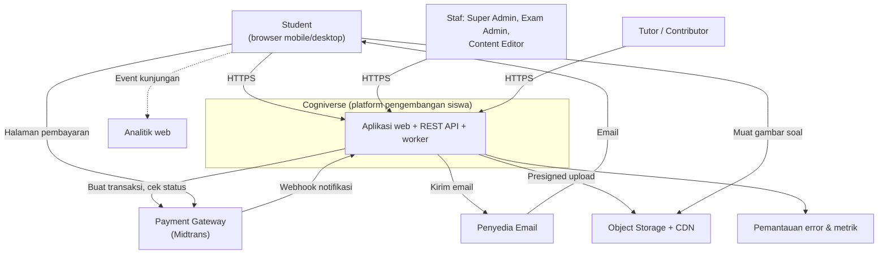

### 2.4 Container Architecture Diagram

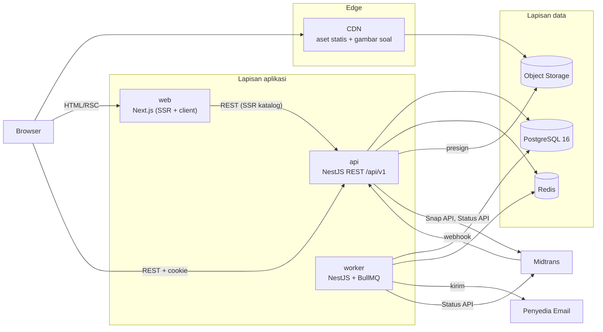

| Container | Tanggung jawab | Skala |
|---|---|---|
| `web` | Render halaman publik (SSR/ISR), shell aplikasi siswa/admin/kontributor, antarmuka ujian | Horizontal; tanpa state |
| `api` | Seluruh endpoint REST, autentikasi, otorisasi, validasi, transaksi | Horizontal; tanpa state |
| `worker` | Auto-submit, kedaluwarsa order, publikasi hasil terjadwal, no-show, pengingat, kirim email, rescoring, sweeper | 1–2 instance; pekerjaan idempotent sehingga aman dijalankan ganda |
| PostgreSQL | Sumber kebenaran tunggal | Vertikal; pooling koneksi; read replica bila kelak perlu |
| Redis | Antrean BullMQ, rate limit, cache DTO | Instance terkelola tunggal |
| Object Storage + CDN | Gambar soal | Terkelola |

Browser memanggil `api` secara langsung pada subdomain yang sama situsnya (misalnya `app.` dan `api.` di bawah satu domain terdaftar) sehingga cookie `SameSite=Lax` berlaku (Bagian 5.1). Server Next.js memanggil `api` hanya untuk render halaman publik.

### 2.5 Component Architecture (Modul Backend)

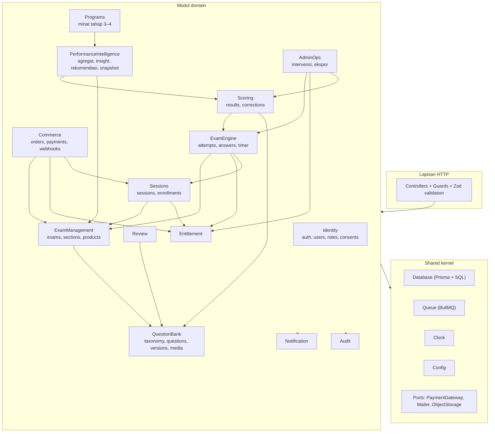

**Aturan dependensi:** panah menunjukkan arah yang diizinkan. `Identity`, `Notification`, dan `Audit` boleh dipakai semua modul dan tidak bergantung pada modul domain lain. Tidak ada dependensi melingkar. Modul hanya mengakses tabel miliknya; data modul lain diperoleh lewat service modul pemilik — kecuali query baca gabungan pada `Analytics` dan `AdminOps`, yang bersifat hanya-baca.

### 2.6 Module Responsibilities

| Modul | Tanggung jawab | Tabel yang dimiliki | FR PRD |
|---|---|---|---|
| **Identity** | Registrasi, verifikasi email, login, refresh, reset password, undangan, RBAC guard, suspend, profil siswa, persetujuan, ekspor data | `users`, `roles`, `user_roles`, `student_profiles`, `auth_sessions`, `auth_tokens`, `user_consents`, `data_export_requests` | FR-AUTH, FR-PROF, FR-CTR-08 |
| **QuestionBank** | Taksonomi (subject, topic, kompetensi), soal, versi, opsi, tag kompetensi, unggah gambar, pratinjau, pencarian, retire | `subjects`, `topics`, `competencies`, `questions`, `question_versions`, `question_options`, `question_competencies`, `media_assets` | FR-QB, FR-QV-01..03, FR-CTR-01/02/05 |
| **Review** | Pengajuan, antrean, keputusan, pemisahan tugas | `question_reviews` | FR-REV, FR-CTR-03/04 |
| **ExamManagement** | Exam dan taksonomi try out, seri, section, pin versi soal, validasi publikasi dengan peringatan parameter, penguncian, product dan bundle, katalog | `exams`, `exam_series`, `exam_sections`, `exam_questions`, `products`, `product_exams` | FR-EXM, FR-CAT, FR-QV-05 |
| **Sessions** | Session, kapasitas, enrollment tiga jalur, reschedule, pembatalan, no-show, daftar peserta | `exam_sessions`, `exam_enrollments` | FR-SES |
| **Commerce** | Order, inisiasi pembayaran, webhook, rekonsiliasi, kedaluwarsa | `orders`, `order_items`, `order_item_exams`, `payments`, `payment_webhook_events` | FR-PAY |
| **Packages** *(v3.0)* | Paket per musim, package grant dari order `PAID`, penukaran kredit/akses musim menjadi entitlement `PACKAGE`, saldo akses | `package_grants` (+ kolom paket di `products`, `order_items`) | FR-PKG, FR-ENT-01/02 |
| **Referral** *(v3.0)* | Kode referral, pencatatan saat registrasi, kualifikasi saat order `PAID`, penerbitan dan reservasi voucher | `referrals`, `vouchers` (+ `users.referral_code`, `orders.voucher_id`) | FR-REF |
| **Targets** *(v3.0)* | Referensi kampus & program studi dengan sumber, target siswa, jarak ke target | `universities`, `study_programs`, `student_targets` | FR-TGT |
| **StudyPlanner** *(v3.0)* | Panduan materi per topik, pembangkitan roadmap dan plan harian, centang tugas, preferensi waktu belajar | `topic_guides`, `study_plans`, `study_plan_items` (+ `student_profiles.daily_study_minutes`) | FR-RMP |
| **Entitlement** | Pembuatan (pembayaran/klaim/grant), pemeriksaan kuota dan masa berlaku, revoke, "Ujian Saya" | `entitlements` | FR-ENT |
| **ExamEngine** | Validasi start terpadu, snapshot, penyajian soal aman, simpan jawaban, rekonsiliasi section, submit, auto-submit, sesi perangkat | `exam_attempts`, `attempt_sections`, `attempt_questions`, `attempt_answers` | FR-ENG, FR-TMR |
| **Scoring** | Scoring, skor section dan topik, revisi result, publikasi, koreksi kunci, rescoring, pembahasan | `exam_results`, `result_section_scores`, `result_topic_scores`, `exam_key_corrections` | FR-SCR, FR-RES-01..03, FR-QV-06 |
| **PerformanceIntelligence** (v2.0) | Agregasi kompetensi, metrik perilaku, snapshot progres (dalam transaksi scoring), mesin aturan, insight, rekomendasi, laporan dan progres siswa | `result_competency_scores`, `result_behavior_metrics`, `result_analyses`, `performance_insights`, `learning_recommendations`, `insight_feedback`, `student_performance_snapshots` | FR-PI, FR-PRG, FR-RES-04 |
| **Configuration** (v2.0) | Pengaturan sistem: parameter produk dan ambang analitik | `system_settings` | FR-EXM-13, FR-ADM-07 |
| **Programs** (v2.0) | Pendaftaran minat program tahap 3–4; titik masuk modul Learning/Mentoring kelak | `program_interests` | FR-FUT-01 |
| **Notification** | Outbox email, templat, pencegahan kirim ganda, retry | `notifications` | FR-NTF-01 |
| **Audit** | Pencatatan tindakan sensitif | `audit_logs` | FR-ADM-04 |
| **AdminOps** | Pengelolaan pengguna dan hasil, void attempt, attempt tambahan, ekspor | — (mengorkestrasi modul lain) | FR-ADM-02/03/08 |

Setiap dari 50 tabel dimiliki tepat satu modul; setiap modul menopang minimal satu kelompok FR. Tidak ada modul tanpa justifikasi produk. Modul `Analytics` v1.0 (hanya-baca) digantikan `PerformanceIntelligence`.

### 2.7 Data Flow Diagram — Alur Inti

**(a) Pembelian sampai akses aktif (UJ-03, UJ-05)**

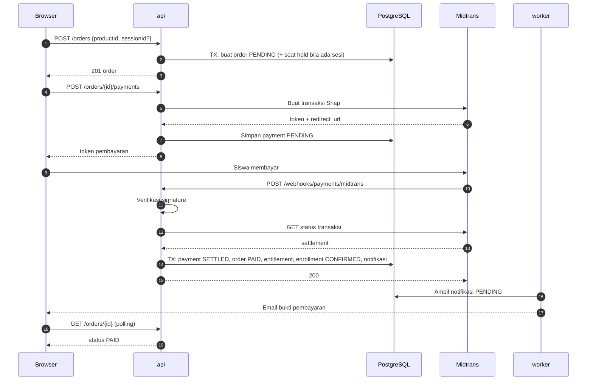

**(b) Pengerjaan ujian (UJ-06 s.d. UJ-09)**

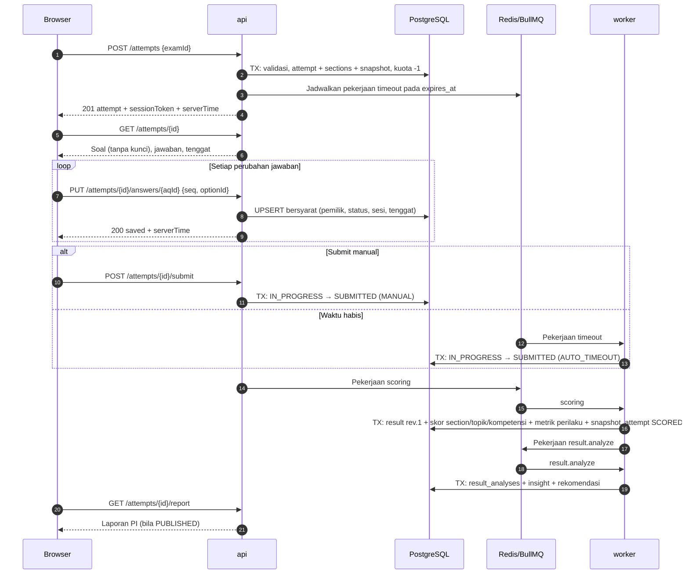

### 2.8 External Service Integrations

| Layanan | Port | Operasi | Penanganan kegagalan |
|---|---|---|---|
| **Payment gateway (Midtrans)** | `PaymentGatewayPort` | `createTransaction`, `getTransactionStatus`, `verifyNotificationSignature` | Timeout 10 detik; kegagalan `createTransaction` mengembalikan error yang dapat dicoba ulang tanpa membuat order baru (FR-PAY-02). Webhook yang gagal diproses dijawab non-2xx agar gateway mengirim ulang; sweeper rekonsiliasi memeriksa order `PENDING` yang mendekati kedaluwarsa |
| **Email** | `MailerPort` | `send(template, to, payload)` | Outbox dengan retry eksponensial hingga 5 kali; kegagalan tidak membatalkan transaksi bisnis (FR-NTF-01) |
| **Object storage** | `ObjectStoragePort` | `createPresignedUpload`, `headObject` | Unggahan langsung dari browser; API memverifikasi ukuran dan tipe lewat `headObject` sebelum mencatat aset |
| **Pemantauan error** | SDK | Tangkap exception + konteks `requestId` | Tidak memblokir request |
| **Analitik web** | Skrip klien | Event kunjungan dan funnel halaman publik | Tidak memuat data pribadi; tidak dimuat di antarmuka ujian |

**Pemilihan payment gateway.** Midtrans dan Xendit sama-sama mendukung QRIS, virtual account, dan e-wallet serta menyediakan notifikasi dan API cek status (asumsi A-03 PRD). Usulan: **Midtrans Snap**, karena alur halaman pembayaran siap pakai mengurangi cakupan UI dan model notifikasinya (signature + Status API) cocok langsung dengan BR-PAY-03. Biaya transaksi dan syarat komersial tidak dievaluasi di dokumen ini dan harus dibandingkan sebelum kontrak (OQ-T1). `PaymentGatewayPort` menjaga agar penggantian ke Xendit hanya menyentuh satu adapter.

---

## 3. Database Design dan Final ERD

### 3.1 Konvensi

| Aspek | Konvensi |
|---|---|
| Penamaan | `snake_case`; tabel jamak; FK bernama `<entitas>_id` |
| Primary key | `id UUID`, dihasilkan aplikasi sebagai UUIDv7; default `gen_random_uuid()` sebagai cadangan (AD-04) |
| Waktu | `TIMESTAMPTZ`, disimpan UTC; `created_at` di semua tabel, `updated_at` pada tabel yang dapat berubah (diisi trigger) |
| Uang | `NUMERIC(14,2)` + `currency CHAR(3)`; untuk IDR ditegakkan tanpa pecahan lewat `CHECK` (BR-PAY-09) |
| Status | `TEXT` + `CHECK` (AD-03); nilai sama persis dengan PRD Lampiran B |
| Email | `CITEXT` (unik tanpa membedakan huruf besar/kecil, FR-AUTH-01) |
| Penghapusan | Tidak ada *hard delete* pada data bisnis. FK memakai `ON DELETE RESTRICT` (default) kecuali anak yang murni komposisi dari induk yang masih draft |
| Konsistensi lintas tabel | FK komposit dipakai bila anak harus berada pada induk yang sama (misalnya soal exam harus berada pada section milik exam yang sama) |
| Normalisasi | 3NF. Denormalisasi yang disengaja dicatat di 3.9 |

### 3.2 ERD — Gambaran Relasi Keseluruhan

Diagram ini menampilkan seluruh 50 tabel dan relasinya (13 tabel v2.0 di bagian akhir). Atribut ditampilkan pada ERD per domain (3.3); daftar kolom lengkap dan otoritatif ada pada DDL (3.5).

```mermaid
erDiagram
    users ||--o{ user_roles : has
    roles ||--o{ user_roles : grants
    users ||--o| student_profiles : has
    users ||--o{ auth_sessions : owns
    users ||--o{ auth_tokens : owns
    users ||--o{ user_consents : gives

    subjects ||--o{ topics : contains
    users ||--o{ questions : authors
    questions ||--o{ question_versions : has
    question_versions ||--o{ question_options : has
    question_versions ||--o{ question_reviews : receives
    users ||--o{ question_reviews : decides
    topics ||--o{ question_versions : tags
    users ||--o{ media_assets : uploads

    exams ||--o{ exam_sections : has
    exam_sections ||--o{ exam_questions : contains
    question_versions ||--o{ exam_questions : pinned_by
    exams ||--o{ exam_sessions : scheduled_as
    exam_sessions ||--o{ exam_enrollments : has
    users ||--o{ exam_enrollments : enrolls

    products ||--o{ product_exams : includes
    exams ||--o{ product_exams : sold_in
    users ||--o{ orders : places
    orders ||--o{ order_items : contains
    products ||--o{ order_items : sold_as
    order_items ||--o{ order_item_exams : snapshots
    orders ||--o{ payments : paid_by
    payments ||--o{ payment_webhook_events : notified_by
    order_items ||--o{ entitlements : grants
    users ||--o{ entitlements : holds
    exams ||--o{ entitlements : accessed_via
    entitlements ||--o{ exam_enrollments : used_by
    orders ||--o{ exam_enrollments : holds_seat_for

    entitlements ||--o{ exam_attempts : consumed_by
    exam_enrollments ||--o| exam_attempts : attended_as
    users ||--o{ exam_attempts : takes
    exam_attempts ||--o{ attempt_sections : has
    attempt_sections ||--o{ attempt_questions : contains
    exam_questions ||--o{ attempt_questions : snapshotted_as
    attempt_questions ||--o| attempt_answers : answered_by
    question_options ||--o{ attempt_answers : selected_in

    exam_attempts ||--o{ exam_results : scored_as
    exam_results ||--o{ result_section_scores : has
    exam_results ||--o{ result_topic_scores : has
    exam_questions ||--o{ exam_key_corrections : corrected_by
    exam_key_corrections ||--o{ exam_results : causes_revision

    users ||--o{ audit_logs : performs
    users ||--o{ notifications : receives

    competencies ||--o{ question_competencies : tags
    question_versions ||--o{ question_competencies : tagged_with
    exam_series ||--o{ exams : groups
    exam_results ||--o{ result_competency_scores : has
    competencies ||--o{ result_competency_scores : aggregated_as
    exam_results ||--o| result_behavior_metrics : has
    exam_results ||--o{ result_analyses : analyzed_by
    result_analyses ||--o{ performance_insights : produces
    result_analyses ||--o{ learning_recommendations : produces
    performance_insights ||--o{ learning_recommendations : justifies
    performance_insights ||--o{ insight_feedback : rated_by
    exam_results ||--o{ student_performance_snapshots : snapshotted_as
    exam_series ||--o{ student_performance_snapshots : compares
    users ||--o{ program_interests : registers
    users ||--o{ data_export_requests : requests
    users ||--o{ system_settings : updates
```

### 3.3 ERD per Domain

**Identity & Access**

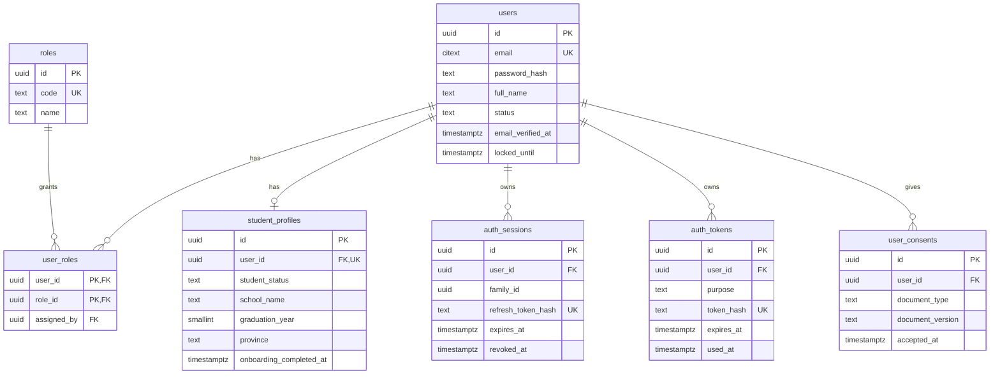

**Question Bank**

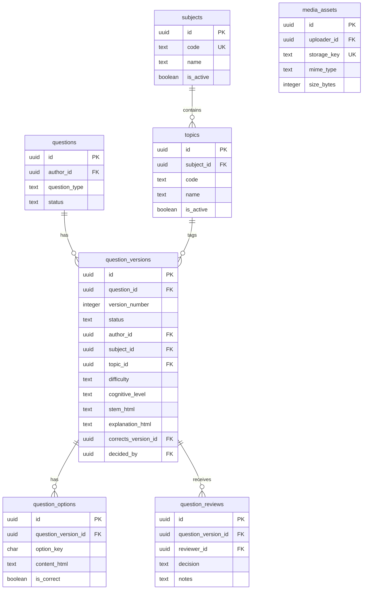

**Examination & Commerce**

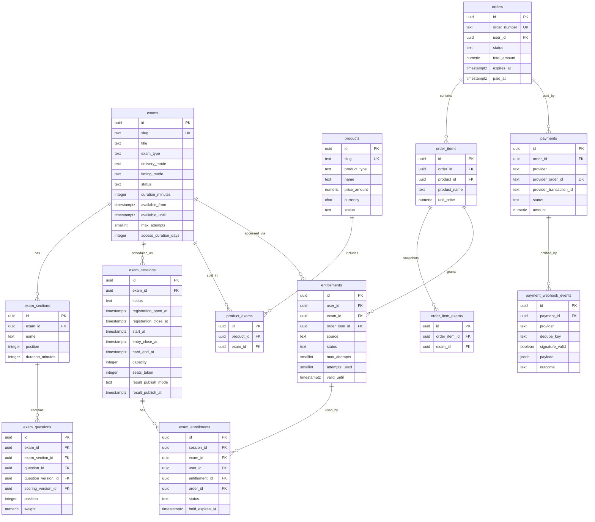

**Examination Execution & Operations**

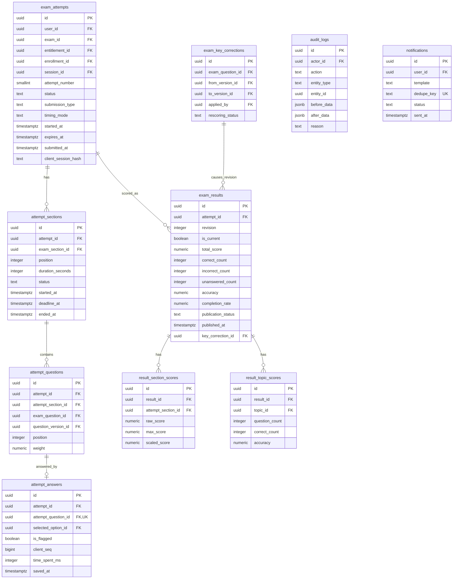

**Performance Intelligence, Konfigurasi, dan Jembatan Tahap 3–4 (v2.0)**

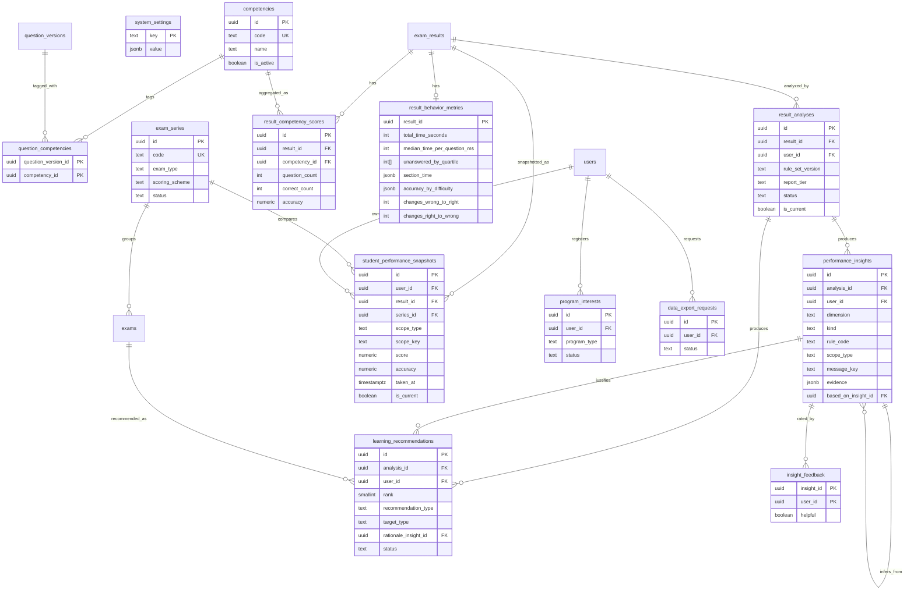

### 3.4 Katalog Tabel

Kolom, tipe, nullability, dan default tercantum lengkap pada DDL (3.5). Tabel berikut merangkum tujuan, kunci, relasi, dan justifikasi produk setiap tabel. Tabel bertanda ★ adalah tambahan di luar daftar minimal master prompt; justifikasinya dicantumkan.

**Identity & Access**

| Tabel | Tujuan | Kunci unik | Relasi (FK) | Justifikasi PRD |
|---|---|---|---|---|
| `users` | Akun semua role | `email` | `suspended_by → users` | FR-AUTH-01/03/07 |
| `roles` | Daftar role RBAC | `code` | — | Bagian 4 PRD |
| `user_roles` | Penugasan role (banyak-ke-banyak) | PK (`user_id`, `role_id`) | `users`, `roles`, `assigned_by → users` | FR-AUTH-05/06 |
| `student_profiles` | Data profil siswa | `user_id` | `users` (1:1) | FR-PROF-01/03 |
| `auth_sessions` ★ | Refresh token berotasi per perangkat | `refresh_token_hash` | `users`, `replaced_by_id → auth_sessions` | FR-AUTH-03/04 (logout, akhiri semua sesi) |
| `auth_tokens` ★ | Token sekali pakai: verifikasi email, reset password, undangan | `token_hash` | `users` | FR-AUTH-02/04/06 |
| `user_consents` ★ | Bukti persetujuan S&K, privasi, perjanjian kontributor | (`user_id`, `document_type`, `document_version`) | `users` | FR-PROF-04, FR-CTR-08 |

**Question Bank**

| Tabel | Tujuan | Kunci unik | Relasi (FK) | Justifikasi PRD |
|---|---|---|---|---|
| `subjects` | Subtes/mata uji | `code` | — | FR-QB-01 |
| `topics` | Topik di bawah subject | (`subject_id`, `code`) | `subjects` | FR-QB-01, FR-SCR-08 |
| `questions` | Identitas soal lintas versi | — | `author_id → users` | FR-QB-02/11 |
| `question_versions` | Isi soal pada satu versi; immutable setelah diputuskan | (`question_id`, `version_number`); satu versi terbuka per soal | `questions`, `users`, `subjects`, `topics`, `corrects_version_id → question_versions` | FR-QV-01..03, BR-QV-01/02 |
| `question_options` | Opsi jawaban dan kunci | (`question_version_id`, `option_key`); satu `is_correct` per versi | `question_versions` | FR-QB-02, BR-QV-08 |
| `question_reviews` | Riwayat keputusan review (append-only) | — | `question_versions`, `reviewer_id → users` | FR-REV-03/05 |
| `media_assets` ★ | Metadata gambar soal | `storage_key` | `uploader_id → users` | FR-QB-07 |
| `competencies` ◆ | Taksonomi kompetensi lintas subject | `code` | — | FR-QB-13, FR-PI-04 |
| `question_competencies` ◆ | Tag kompetensi per versi soal (ikut ter-versi) | PK (`question_version_id`, `competency_id`) | `question_versions` (cascade untuk draf), `competencies` | FR-QB-14 |

**Examination**

| Tabel | Tujuan | Kunci unik | Relasi (FK) | Justifikasi PRD |
|---|---|---|---|---|
| `exam_series` ◆ | Seri try out yang dirancang sebanding | `code`; (`id`, `exam_type`) | `created_by → users` | FR-EXM-14, BR-PRG-01 |
| `exams` | Definisi exam; `exam_type` v2.0 tiga nilai | `slug` | `created_by`, `published_by → users`; (`series_id`, `exam_type`) → `exam_series` | FR-EXM-01/10/14 |
| `exam_sections` | Section/subtes dalam exam | (`exam_id`, `position`) | `exams` | FR-EXM-02 |
| `exam_questions` | Pin versi soal ke section | (`exam_id`, `question_id`); (`exam_section_id`, `position`) | `exams`, `exam_sections`, `questions`, `question_versions` (pin dan scoring) | FR-EXM-03, FR-QV-05, BR-QV-03 |
| `exam_sessions` | Jadwal exam scheduled, kapasitas | — | `exams`, `created_by → users` | FR-SES-01..06 |
| `exam_enrollments` | Pendaftaran siswa pada session | Satu aktif per (`user_id`, `exam_id`); satu non-terminal per (`user_id`, `session_id`) | `exam_sessions`, `exams`, `users`, `entitlements`, `orders` | FR-SES-08..11, BR-SCH-04 |

**Commerce**

| Tabel | Tujuan | Kunci unik | Relasi (FK) | Justifikasi PRD |
|---|---|---|---|---|
| `products` ★ | Item yang dijual (single/bundle) dan harga | `slug` | `created_by → users` | FR-EXM-04/05, D-03 PRD |
| `product_exams` ★ | Isi product | (`product_id`, `exam_id`) | `products`, `exams` | FR-EXM-05 |
| `orders` | Pesanan | `order_number`; (`user_id`, `idempotency_key`) | `users` | FR-PAY-01/05 |
| `order_items` | Baris pesanan dengan snapshot harga | (`order_id`, `product_id`) | `orders`, `products` | BR-PAY-01 |
| `order_item_exams` ★ | Snapshot daftar exam dalam item | (`order_item_id`, `exam_id`) | `order_items`, `exams` | FR-PAY-01 AC (1), FR-ENT-06 |
| `payments` | Percobaan pembayaran pada gateway | `provider_order_id`; satu `SETTLED` dan satu `PENDING` per order | `orders` | FR-PAY-02/03, BR-PAY-04 |
| `payment_webhook_events` ★ | Notifikasi gateway mentah | — | `payments` | FR-PAY-03 AC (5) |
| `entitlements` | Hak akses siswa atas exam | (`order_item_id`, `exam_id`); v3.0: satu `PACKAGE` per (`user_id`, `exam_id`); `FREE_CLAIM` hanya historis | `users`, `exams`, `order_items`, `package_grants` | FR-ENT, BR-ENT-01 |

**Examination Execution**

| Tabel | Tujuan | Kunci unik | Relasi (FK) | Justifikasi PRD |
|---|---|---|---|---|
| `exam_attempts` | Satu pengerjaan exam | Satu `IN_PROGRESS` per `user_id`; (`entitlement_id`, `attempt_number`); `enrollment_id` | `users`, `exams`, `entitlements`, `exam_enrollments`, `exam_sessions` | FR-ENG-03, BR-ATT-03, BR-LIF |
| `attempt_sections` ★ | Status dan tenggat section per attempt | (`attempt_id`, `position`) | `exam_attempts`, `exam_sections` | BR-DUR-03, FR-ENG-10 |
| `attempt_questions` ★ | Snapshot soal attempt (immutable) | (`attempt_id`, `question_version_id`); (`attempt_section_id`, `position`) | `exam_attempts`, `attempt_sections`, `exam_questions`, `question_versions` | BR-LIF-02 |
| `attempt_answers` | Jawaban terkini per soal | `attempt_question_id` | `exam_attempts`, `attempt_questions`, `question_options` | FR-TMR-03, BR-SUB-05 |
| `exam_results` | Result per attempt dengan revisi | (`attempt_id`, `revision`); satu `is_current` per attempt | `exam_attempts`, `users`, `exams`, `exam_sessions`, `exam_key_corrections` | FR-SCR-03/04, BR-SCR-06 |
| `result_section_scores` | Skor per section | (`result_id`, `attempt_section_id`) | `exam_results`, `attempt_sections` | FR-SCR-02 |
| `result_topic_scores` ★ | Agregasi per topik | (`result_id`, `topic_id`) | `exam_results`, `subjects`, `topics` | FR-SCR-08, FR-PI-03 |
| `exam_key_corrections` ★ | Catatan penerapan koreksi kunci dan status rescoring | — | `exams`, `exam_questions`, `question_versions`, `users` | FR-QV-06, FR-SCR-05 |

**Performance Intelligence (v2.0)**

| Tabel | Tujuan | Kunci unik | Relasi (FK) | Justifikasi PRD |
|---|---|---|---|---|
| `result_competency_scores` ◆ | Agregasi per kompetensi | (`result_id`, `competency_id`) | `exam_results`, `competencies` | FR-PI-04 |
| `result_behavior_metrics` ◆ | Metrik perilaku pengerjaan | PK `result_id` | `exam_results` | FR-PI-05/06 |
| `result_analyses` ◆ | Satu eksekusi aturan per result per versi | (`result_id`, `rule_set_version`); satu `is_current` per result | `exam_results`, `users` | FR-PI-07, BR-PI-05/06 |
| `performance_insights` ◆ | Insight berbukti, append-only | — | `result_analyses`, `users`, taksonomi, `attempt_sections`, dirinya (`based_on`) | FR-PI-07, BR-PI-03 |
| `learning_recommendations` ◆ | Rekomendasi area, aktivitas, asesmen | (`analysis_id`, `recommendation_type`, `rank`) | `result_analyses`, `users`, taksonomi, `exams`, `performance_insights` | FR-PI-08..10 |
| `insight_feedback` ◆ | Umpan balik siswa per insight (P1) | PK (`insight_id`, `user_id`) | `performance_insights`, `users` | FR-PI-16 |
| `student_performance_snapshots` ◆ | Snapshot skor/akurasi per dimensi untuk progres | (`result_id`, `scope_type`, `scope_key`) | `users`, `exam_results`, `exam_attempts`, `exams`, `exam_series`, taksonomi | FR-PRG-01 |

**Configuration, Privacy & Programs (v2.0)**

| Tabel | Tujuan | Kunci unik | Relasi (FK) | Justifikasi PRD |
|---|---|---|---|---|
| `system_settings` ◆ | Parameter produk dan ambang analitik | PK `key` | `updated_by → users` | FR-EXM-13, FR-ADM-07 |
| `program_interests` ◆ | Minat program tahap 3–4 (P1) | (`user_id`, `program_type`) | `users` | FR-FUT-01 |
| `data_export_requests` ◆ | Permintaan ekspor data (P1) | — | `users` | FR-PROF-06, BR-PRV-05 |

◆ = tabel baru v2.0.

### 3.4a Tinjauan Kebutuhan Entitas (v2.0)

Daftar entitas minimal master prompt v2.0 dibandingkan dengan skema. Semua entitas yang diminta ada. Entitas tambahan dipertahankan karena alasan berikut; tidak ada yang dihapus.

| Entitas tambahan | Mengapa tetap diperlukan |
|---|---|
| `auth_sessions`, `auth_tokens`, `user_consents` | Rotasi refresh token, token sekali pakai, bukti persetujuan (FR-AUTH-03/04, FR-PROF-04) |
| `media_assets` | Gambar soal (FR-QB-07) |
| `exam_series` | Dasar perbandingan progres yang adil (BR-PRG-01) |
| `products`, `product_exams`, `order_item_exams` | Bundle dan snapshot isi order (D-03, FR-ENT-06) |
| `payment_webhook_events` | Jejak notifikasi gateway mentah (FR-PAY-03) |
| `attempt_sections`, `attempt_questions` | Timer per subtes dan snapshot attempt (BR-DUR-03, BR-LIF-02) |
| `result_topic_scores`, `result_competency_scores`, `result_behavior_metrics` | Dimensi Capability dan Behavior dihitung sekali dalam transaksi scoring (AD-14) |
| `result_analyses` | Versi aturan dan status analisis tanpa mengubah result (AD-13) |
| `exam_key_corrections` | Koreksi kunci dan rescoring (FR-QV-06) |
| `insight_feedback`, `program_interests`, `data_export_requests` | P1; tabel kecil yang mencegah penyimpanan data tersebut di tempat yang salah |
| `system_settings` | Parameter yang dapat dikonfigurasi (E-14) |

**Yang sengaja tidak dibuat:** tabel learning program, practice module, learning plan, mentor, dan sesi mentoring (tahap 3–4, D-25). Perluasannya: modul baru dengan tabel sendiri yang merujuk `users`, `learning_recommendations`, dan `student_performance_snapshots`; role `MENTOR` ditambahkan lewat perluasan `roles_code_check`.

**Operations**

| Tabel | Tujuan | Kunci unik | Relasi (FK) | Justifikasi PRD |
|---|---|---|---|---|
| `audit_logs` | Jejak tindakan sensitif (append-only) | — | `actor_id → users` | FR-ADM-04 |
| `notifications` | Outbox email + pencegahan kirim ganda | `dedupe_key` | `users` | FR-NTF-01 AC (2)(3) |

### 3.4b Tabel Baru dan Perubahan Skema v3.0

DDL lengkapnya adalah migrasi 0006 (3.5b). Ringkasan:

| Tabel / perubahan | Tujuan | Kunci dan constraint penting | PRD |
|---|---|---|---|
| `exams.exam_type` | Satu tipe | `exams_type_check: exam_type = 'FULL_TRYOUT'` | 2.11 |
| `exam_series.exam_date` | Tanggal SNBT musim | Dipakai akses Lifetime dan horizon roadmap | FR-EXM-14 |
| `products` (+`is_package`, `tryout_credits`, `series_id`, `display_order`) | Paket per musim | `products_package_check`; `products_package_type_series_key` (satu paket aktif per jenis per musim) | FR-PKG-01 |
| `order_items` (+`tryout_credits`, `series_id`) | Snapshot paket | `order_items_type_check` + `LIFETIME` | FR-PAY-01 |
| `payments.provider` | `DEV_SIMULATED` untuk pengembangan | Ditolak di produksi oleh kode (TD-12) | — |
| **`package_grants`** | Kredit atau akses musim dari order atau grant admin | `package_grants_order_item_key`; `package_grants_one_pass_key` (BR-PKG-05); `package_grants_credits_check` | FR-PKG-03..06 |
| `entitlements` (+`package_grant_id`, sumber `PACKAGE`) | Akses per exam dari penukaran | `entitlements_package_user_exam_key` (penukaran tidak ganda) | FR-ENT-02 |
| `users.referral_code` | Kode referral | Unik; `^[A-Z0-9]{6,10}$` | FR-REF-01 |
| **`referrals`** | Relasi pengajak–yang diajak | `referrals_referred_key` (BR-REF-01); `referrals_self_check` | FR-REF-02/03 |
| **`vouchers`** | Diskon 20% | `vouchers_batch_key` (penerbitan idempotent); status `AVAILABLE`/`RESERVED`/`USED`/`EXPIRED` | FR-REF-04/05 |
| `orders.voucher_id` | Voucher pada order | — | FR-REF-05 |
| **`universities`**, **`study_programs`** | Referensi kampus/prodi + skor acuan bersumber | `study_programs_reference_check` (BR-TGT-02) | FR-TGT-03 |
| **`student_targets`** | Target siswa (prioritas 1–2) | `student_targets_priority_key`; `student_targets_score_check` | FR-TGT-01/02 |
| `student_profiles.daily_study_minutes` | Waktu belajar harian | 30/60/90/120 | FR-RMP-04 |
| **`topic_guides`** | Panduan materi per topik | PK `topic_id` | FR-RMP-05 |
| **`study_plans`**, **`study_plan_items`** | Roadmap dan tugas harian | `study_plans_active_key` (satu roadmap aktif per siswa); `study_plan_items_position_key` | FR-RMP-01..07 |

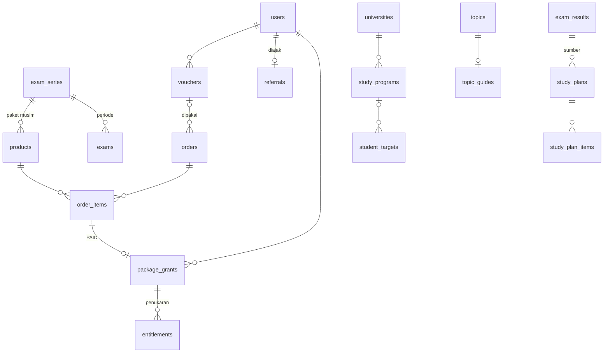

### 3.5 PostgreSQL SQL DDL

> **Catatan v3.0.** DDL di bagian ini adalah **skema v2.0** (50 tabel) apa adanya, termasuk constraint Free/Mini Try Out. Skema v3.0 = DDL ini + migrasi 0006 (3.5b), yang mengubah `exam_type`, constraint terkait, sumber entitlement, dan menambah 10 tabel.

DDL berikut adalah spesifikasi kolom yang otoritatif. Constraint didefinisikan bersama tabelnya; index non-unik dikumpulkan di 3.6; trigger di 3.7. Skrip ditulis untuk PostgreSQL 16 dan **belum dijalankan terhadap database nyata** — eksekusi dan perbaikan sintaks minor menjadi bagian dari migrasi pertama (Bagian 3.10).

```sql
-- =====================================================================
-- 0. EXTENSIONS & HELPER FUNCTIONS
-- =====================================================================
CREATE EXTENSION IF NOT EXISTS citext;
CREATE EXTENSION IF NOT EXISTS pg_trgm;

CREATE OR REPLACE FUNCTION set_updated_at() RETURNS trigger
LANGUAGE plpgsql AS $$
BEGIN
  NEW.updated_at := now();
  RETURN NEW;
END;
$$;

CREATE OR REPLACE FUNCTION forbid_mutation() RETURNS trigger
LANGUAGE plpgsql AS $$
BEGIN
  RAISE EXCEPTION '% on table % is not allowed', TG_OP, TG_TABLE_NAME
    USING ERRCODE = 'restrict_violation';
END;
$$;

-- =====================================================================
-- 1. IDENTITY & ACCESS
-- =====================================================================
CREATE TABLE users (
  id                 UUID        PRIMARY KEY DEFAULT gen_random_uuid(),
  email              CITEXT      NOT NULL,
  password_hash      TEXT,                              -- NULL selama status INVITED
  full_name          TEXT        NOT NULL,
  status             TEXT        NOT NULL DEFAULT 'ACTIVE',
  email_verified_at  TIMESTAMPTZ,
  failed_login_count INTEGER     NOT NULL DEFAULT 0,
  locked_until       TIMESTAMPTZ,
  last_login_at      TIMESTAMPTZ,
  suspended_at       TIMESTAMPTZ,
  suspended_by       UUID        REFERENCES users(id),
  suspension_reason  TEXT,
  created_at         TIMESTAMPTZ NOT NULL DEFAULT now(),
  updated_at         TIMESTAMPTZ NOT NULL DEFAULT now(),
  CONSTRAINT users_email_key UNIQUE (email),
  CONSTRAINT users_status_check
    CHECK (status IN ('INVITED','ACTIVE','SUSPENDED','DELETED')),
  CONSTRAINT users_full_name_check CHECK (length(btrim(full_name)) > 0),
  CONSTRAINT users_password_required_check
    CHECK (status = 'INVITED' OR status = 'DELETED' OR password_hash IS NOT NULL),
  CONSTRAINT users_suspension_check
    CHECK (status <> 'SUSPENDED' OR (suspended_at IS NOT NULL AND suspension_reason IS NOT NULL))
);

CREATE TABLE roles (
  id         UUID        PRIMARY KEY DEFAULT gen_random_uuid(),
  code       TEXT        NOT NULL,
  name       TEXT        NOT NULL,
  created_at TIMESTAMPTZ NOT NULL DEFAULT now(),
  CONSTRAINT roles_code_key UNIQUE (code),
  CONSTRAINT roles_code_check
    CHECK (code IN ('STUDENT','CONTRIBUTOR','CONTENT_EDITOR','EXAM_ADMIN','SUPER_ADMIN'))
);

CREATE TABLE user_roles (
  user_id     UUID        NOT NULL REFERENCES users(id),
  role_id     UUID        NOT NULL REFERENCES roles(id),
  assigned_by UUID        REFERENCES users(id),
  assigned_at TIMESTAMPTZ NOT NULL DEFAULT now(),
  PRIMARY KEY (user_id, role_id)
);

CREATE TABLE student_profiles (
  id                      UUID        PRIMARY KEY DEFAULT gen_random_uuid(),
  user_id                 UUID        NOT NULL REFERENCES users(id),
  student_status          TEXT,
  school_name             TEXT,
  graduation_year         SMALLINT,
  province                TEXT,
  phone                   TEXT,
  onboarding_completed_at TIMESTAMPTZ,                  -- NOT NULL = profil lengkap (FR-PROF-03)
  created_at              TIMESTAMPTZ NOT NULL DEFAULT now(),
  updated_at              TIMESTAMPTZ NOT NULL DEFAULT now(),
  CONSTRAINT student_profiles_user_id_key UNIQUE (user_id),
  CONSTRAINT student_profiles_status_check
    CHECK (student_status IS NULL OR student_status IN ('GRADE_12','GAP_YEAR')),
  CONSTRAINT student_profiles_graduation_year_check
    CHECK (graduation_year IS NULL OR graduation_year BETWEEN 2000 AND 2100),
  CONSTRAINT student_profiles_complete_check
    CHECK (onboarding_completed_at IS NULL OR
           (student_status IS NOT NULL AND school_name IS NOT NULL
            AND graduation_year IS NOT NULL AND province IS NOT NULL))
);

CREATE TABLE auth_sessions (
  id                 UUID        PRIMARY KEY DEFAULT gen_random_uuid(),
  user_id            UUID        NOT NULL REFERENCES users(id),
  family_id          UUID        NOT NULL,              -- rantai rotasi refresh token
  refresh_token_hash TEXT        NOT NULL,
  expires_at         TIMESTAMPTZ NOT NULL,
  last_used_at       TIMESTAMPTZ,
  revoked_at         TIMESTAMPTZ,
  revoked_reason     TEXT,
  replaced_by_id     UUID        REFERENCES auth_sessions(id),
  user_agent         TEXT,
  ip                 INET,
  created_at         TIMESTAMPTZ NOT NULL DEFAULT now(),
  CONSTRAINT auth_sessions_refresh_token_hash_key UNIQUE (refresh_token_hash)
);

CREATE TABLE auth_tokens (
  id         UUID        PRIMARY KEY DEFAULT gen_random_uuid(),
  user_id    UUID        NOT NULL REFERENCES users(id),
  purpose    TEXT        NOT NULL,
  token_hash TEXT        NOT NULL,
  new_email  CITEXT,                                    -- hanya untuk EMAIL_CHANGE
  expires_at TIMESTAMPTZ NOT NULL,
  used_at    TIMESTAMPTZ,
  created_at TIMESTAMPTZ NOT NULL DEFAULT now(),
  CONSTRAINT auth_tokens_token_hash_key UNIQUE (token_hash),
  CONSTRAINT auth_tokens_purpose_check
    CHECK (purpose IN ('EMAIL_VERIFICATION','PASSWORD_RESET','INVITATION','EMAIL_CHANGE'))
);

CREATE TABLE user_consents (
  id               UUID        PRIMARY KEY DEFAULT gen_random_uuid(),
  user_id          UUID        NOT NULL REFERENCES users(id),
  document_type    TEXT        NOT NULL,
  document_version TEXT        NOT NULL,
  accepted_at      TIMESTAMPTZ NOT NULL DEFAULT now(),
  ip               INET,
  CONSTRAINT user_consents_unique UNIQUE (user_id, document_type, document_version),
  CONSTRAINT user_consents_type_check
    CHECK (document_type IN ('TERMS','PRIVACY','CONTRIBUTOR_AGREEMENT'))
);

-- =====================================================================
-- 2. QUESTION BANK
-- =====================================================================
CREATE TABLE subjects (
  id         UUID        PRIMARY KEY DEFAULT gen_random_uuid(),
  code       TEXT        NOT NULL,
  name       TEXT        NOT NULL,
  position   INTEGER     NOT NULL DEFAULT 0,
  is_active  BOOLEAN     NOT NULL DEFAULT TRUE,
  created_at TIMESTAMPTZ NOT NULL DEFAULT now(),
  updated_at TIMESTAMPTZ NOT NULL DEFAULT now(),
  CONSTRAINT subjects_code_key UNIQUE (code)
);

CREATE TABLE topics (
  id         UUID        PRIMARY KEY DEFAULT gen_random_uuid(),
  subject_id UUID        NOT NULL REFERENCES subjects(id),
  code       TEXT        NOT NULL,
  name       TEXT        NOT NULL,
  is_active  BOOLEAN     NOT NULL DEFAULT TRUE,
  created_at TIMESTAMPTZ NOT NULL DEFAULT now(),
  updated_at TIMESTAMPTZ NOT NULL DEFAULT now(),
  CONSTRAINT topics_subject_code_key UNIQUE (subject_id, code),
  CONSTRAINT topics_id_subject_key   UNIQUE (id, subject_id)   -- target FK komposit
);

-- (v2.0) Taksonomi kompetensi lintas subject (FR-QB-13)
CREATE TABLE competencies (
  id          UUID        PRIMARY KEY DEFAULT gen_random_uuid(),
  code        TEXT        NOT NULL,
  name        TEXT        NOT NULL,
  description TEXT        NOT NULL DEFAULT '',
  is_active   BOOLEAN     NOT NULL DEFAULT TRUE,
  created_at  TIMESTAMPTZ NOT NULL DEFAULT now(),
  updated_at  TIMESTAMPTZ NOT NULL DEFAULT now(),
  CONSTRAINT competencies_code_key UNIQUE (code),
  CONSTRAINT competencies_name_check CHECK (length(btrim(name)) > 0)
);

CREATE TABLE questions (
  id             UUID        PRIMARY KEY DEFAULT gen_random_uuid(),
  author_id      UUID        NOT NULL REFERENCES users(id),
  question_type  TEXT        NOT NULL DEFAULT 'SINGLE_CHOICE',
  status         TEXT        NOT NULL DEFAULT 'ACTIVE',
  retired_at     TIMESTAMPTZ,
  retired_by     UUID        REFERENCES users(id),
  retired_reason TEXT,
  created_at     TIMESTAMPTZ NOT NULL DEFAULT now(),
  updated_at     TIMESTAMPTZ NOT NULL DEFAULT now(),
  CONSTRAINT questions_type_check   CHECK (question_type IN ('SINGLE_CHOICE')),
  CONSTRAINT questions_status_check CHECK (status IN ('ACTIVE','RETIRED')),
  CONSTRAINT questions_retired_check
    CHECK (status <> 'RETIRED' OR (retired_at IS NOT NULL AND retired_reason IS NOT NULL))
);

CREATE TABLE question_versions (
  id                  UUID        PRIMARY KEY DEFAULT gen_random_uuid(),
  question_id         UUID        NOT NULL REFERENCES questions(id),
  version_number      INTEGER     NOT NULL,
  status              TEXT        NOT NULL DEFAULT 'DRAFT',
  author_id           UUID        NOT NULL REFERENCES users(id),
  subject_id          UUID        REFERENCES subjects(id),
  topic_id            UUID,
  difficulty          TEXT,
  cognitive_level     TEXT,
  stem_html           TEXT        NOT NULL DEFAULT '',
  stem_plain          TEXT        NOT NULL DEFAULT '',     -- teks polos untuk pencarian
  explanation_html    TEXT        NOT NULL DEFAULT '',
  corrects_version_id UUID        REFERENCES question_versions(id),  -- versi yang dikoreksi (BR-QV-07)
  submitted_at        TIMESTAMPTZ,
  decided_at          TIMESTAMPTZ,
  decided_by          UUID        REFERENCES users(id),
  created_at          TIMESTAMPTZ NOT NULL DEFAULT now(),
  updated_at          TIMESTAMPTZ NOT NULL DEFAULT now(),
  CONSTRAINT question_versions_number_key UNIQUE (question_id, version_number),
  CONSTRAINT question_versions_id_question_key UNIQUE (id, question_id),  -- target FK komposit
  CONSTRAINT question_versions_topic_fk
    FOREIGN KEY (topic_id, subject_id) REFERENCES topics (id, subject_id),
  CONSTRAINT question_versions_number_check CHECK (version_number > 0),
  CONSTRAINT question_versions_status_check
    CHECK (status IN ('DRAFT','IN_REVIEW','CHANGES_REQUESTED','APPROVED','REJECTED')),
  CONSTRAINT question_versions_difficulty_check
    CHECK (difficulty IS NULL OR difficulty IN ('EASY','MEDIUM','HARD')),
  CONSTRAINT question_versions_cognitive_check
    CHECK (cognitive_level IS NULL OR cognitive_level IN
           ('REMEMBER','UNDERSTAND','APPLY','ANALYZE','EVALUATE','CREATE')),
  -- BR-QV-08: metadata dan isi wajib lengkap sebelum masuk review
  CONSTRAINT question_versions_complete_check
    CHECK (status NOT IN ('IN_REVIEW','APPROVED') OR
           (subject_id IS NOT NULL AND topic_id IS NOT NULL
            AND difficulty IS NOT NULL AND cognitive_level IS NOT NULL
            AND length(btrim(stem_plain)) > 0
            AND length(btrim(explanation_html)) > 0)),
  -- BR-QV-04: pemutus tidak boleh penulis
  CONSTRAINT question_versions_four_eyes_check
    CHECK (decided_by IS NULL OR decided_by <> author_id),
  CONSTRAINT question_versions_decided_check
    CHECK (status NOT IN ('APPROVED','REJECTED')
           OR (decided_by IS NOT NULL AND decided_at IS NOT NULL))
);

-- FR-QV-01: paling banyak satu versi yang belum diputuskan per soal
CREATE UNIQUE INDEX question_versions_one_open_idx
  ON question_versions (question_id)
  WHERE status IN ('DRAFT','IN_REVIEW','CHANGES_REQUESTED');

CREATE TABLE question_options (
  id                  UUID        PRIMARY KEY DEFAULT gen_random_uuid(),
  question_version_id UUID        NOT NULL REFERENCES question_versions(id) ON DELETE CASCADE,
  option_key          CHAR(1)     NOT NULL,
  content_html        TEXT        NOT NULL,
  is_correct          BOOLEAN     NOT NULL DEFAULT FALSE,
  created_at          TIMESTAMPTZ NOT NULL DEFAULT now(),
  updated_at          TIMESTAMPTZ NOT NULL DEFAULT now(),
  CONSTRAINT question_options_key_key UNIQUE (question_version_id, option_key),
  CONSTRAINT question_options_id_version_key UNIQUE (id, question_version_id),
  CONSTRAINT question_options_key_check CHECK (option_key IN ('A','B','C','D','E'))
);

-- BR-QV-08: paling banyak satu kunci per versi
-- ("tepat satu" dan "4–5 opsi" divalidasi aplikasi saat pengajuan review)
CREATE UNIQUE INDEX question_options_one_correct_idx
  ON question_options (question_version_id) WHERE is_correct;

-- (v2.0) Tag kompetensi per versi soal (FR-QB-14); ikut ter-versi, dijaga trigger seperti opsi
CREATE TABLE question_competencies (
  question_version_id UUID        NOT NULL REFERENCES question_versions(id) ON DELETE CASCADE,
  competency_id       UUID        NOT NULL REFERENCES competencies(id),
  created_at          TIMESTAMPTZ NOT NULL DEFAULT now(),
  PRIMARY KEY (question_version_id, competency_id)
);

CREATE TABLE question_reviews (
  id                  UUID        PRIMARY KEY DEFAULT gen_random_uuid(),
  question_version_id UUID        NOT NULL REFERENCES question_versions(id),
  reviewer_id         UUID        NOT NULL REFERENCES users(id),
  decision            TEXT        NOT NULL,
  notes               TEXT,
  created_at          TIMESTAMPTZ NOT NULL DEFAULT now(),
  CONSTRAINT question_reviews_decision_check
    CHECK (decision IN ('APPROVED','CHANGES_REQUESTED','REJECTED')),
  CONSTRAINT question_reviews_notes_check
    CHECK (decision = 'APPROVED' OR length(btrim(coalesce(notes, ''))) > 0)
);

CREATE TABLE media_assets (
  id              UUID        PRIMARY KEY DEFAULT gen_random_uuid(),
  uploader_id     UUID        NOT NULL REFERENCES users(id),
  storage_key     TEXT        NOT NULL,
  mime_type       TEXT        NOT NULL,
  size_bytes      INTEGER     NOT NULL,
  checksum_sha256 TEXT,
  status          TEXT        NOT NULL DEFAULT 'PENDING',
  created_at      TIMESTAMPTZ NOT NULL DEFAULT now(),
  CONSTRAINT media_assets_storage_key_key UNIQUE (storage_key),
  CONSTRAINT media_assets_mime_check
    CHECK (mime_type IN ('image/png','image/jpeg','image/webp')),
  CONSTRAINT media_assets_size_check CHECK (size_bytes BETWEEN 1 AND 2097152),
  CONSTRAINT media_assets_status_check CHECK (status IN ('PENDING','READY'))
);

-- =====================================================================
-- 3. EXAMINATION
-- =====================================================================
-- (v2.0) Seri try out: kelompok exam yang dirancang sebanding (FR-EXM-14, BR-PRG-01)
CREATE TABLE exam_series (
  id             UUID        PRIMARY KEY DEFAULT gen_random_uuid(),
  code           TEXT        NOT NULL,
  name           TEXT        NOT NULL,
  description    TEXT        NOT NULL DEFAULT '',   -- cetak biru: struktur, komposisi kesulitan
  exam_type      TEXT        NOT NULL,
  scoring_scheme TEXT        NOT NULL DEFAULT 'PROPORTIONAL_V1',
  status         TEXT        NOT NULL DEFAULT 'ACTIVE',
  created_by     UUID        NOT NULL REFERENCES users(id),
  created_at     TIMESTAMPTZ NOT NULL DEFAULT now(),
  updated_at     TIMESTAMPTZ NOT NULL DEFAULT now(),
  CONSTRAINT exam_series_code_key UNIQUE (code),
  CONSTRAINT exam_series_id_type_key UNIQUE (id, exam_type),   -- target FK komposit
  CONSTRAINT exam_series_type_check CHECK (exam_type IN ('MINI_TRYOUT','FULL_TRYOUT')),
  CONSTRAINT exam_series_scheme_check CHECK (scoring_scheme IN ('PROPORTIONAL_V1')),
  CONSTRAINT exam_series_status_check CHECK (status IN ('ACTIVE','ARCHIVED'))
);

CREATE TABLE exams (
  id                   UUID        PRIMARY KEY DEFAULT gen_random_uuid(),
  slug                 TEXT        NOT NULL,
  title                TEXT        NOT NULL,
  description          TEXT        NOT NULL DEFAULT '',
  instructions_html    TEXT        NOT NULL DEFAULT '',
  exam_type            TEXT        NOT NULL,           -- v2.0: FREE_TRYOUT | MINI_TRYOUT | FULL_TRYOUT
  series_id            UUID,                           -- v2.0: seri (FR-EXM-14)
  delivery_mode        TEXT        NOT NULL,
  timing_mode          TEXT        NOT NULL,
  status               TEXT        NOT NULL DEFAULT 'DRAFT',
  duration_minutes     INTEGER,                         -- wajib untuk timing_mode TOTAL
  available_from       TIMESTAMPTZ,
  available_until      TIMESTAMPTZ,
  max_attempts         SMALLINT    NOT NULL DEFAULT 1,
  access_duration_days INTEGER,
  created_by           UUID        NOT NULL REFERENCES users(id),
  published_at         TIMESTAMPTZ,
  published_by         UUID        REFERENCES users(id),
  archived_at          TIMESTAMPTZ,
  created_at           TIMESTAMPTZ NOT NULL DEFAULT now(),
  updated_at           TIMESTAMPTZ NOT NULL DEFAULT now(),
  CONSTRAINT exams_slug_key UNIQUE (slug),
  CONSTRAINT exams_type_check
    CHECK (exam_type IN ('FREE_TRYOUT','MINI_TRYOUT','FULL_TRYOUT')),
  -- v2.0: seri hanya untuk tipe yang sama dengan seri (FK komposit)
  CONSTRAINT exams_series_fk
    FOREIGN KEY (series_id, exam_type) REFERENCES exam_series (id, exam_type),
  -- BR-FRE-01: Free Try Out selalu on-demand
  CONSTRAINT exams_free_mode_check
    CHECK (exam_type <> 'FREE_TRYOUT' OR delivery_mode = 'ON_DEMAND'),
  CONSTRAINT exams_delivery_check CHECK (delivery_mode IN ('ON_DEMAND','SCHEDULED')),
  CONSTRAINT exams_timing_check   CHECK (timing_mode IN ('TOTAL','PER_SECTION')),
  CONSTRAINT exams_status_check
    CHECK (status IN ('DRAFT','PUBLISHED','UNPUBLISHED','ARCHIVED')),
  CONSTRAINT exams_duration_check
    CHECK (duration_minutes IS NULL OR duration_minutes > 0),
  CONSTRAINT exams_total_duration_required_check
    CHECK (status = 'DRAFT' OR timing_mode <> 'TOTAL' OR duration_minutes IS NOT NULL),
  CONSTRAINT exams_availability_check
    CHECK (status = 'DRAFT' OR
           (available_from IS NOT NULL AND available_until IS NOT NULL
            AND available_from < available_until)),
  -- BR-ATT-01, BR-FRE-03 (batas atas struktural; nilai default berasal dari system_settings)
  CONSTRAINT exams_max_attempts_check CHECK (max_attempts BETWEEN 1 AND 5),
  CONSTRAINT exams_scheduled_single_attempt_check
    CHECK (delivery_mode = 'ON_DEMAND' OR max_attempts = 1),
  CONSTRAINT exams_free_attempts_check
    CHECK (exam_type <> 'FREE_TRYOUT' OR max_attempts <= 3),
  CONSTRAINT exams_access_days_check
    CHECK (access_duration_days IS NULL OR access_duration_days > 0)
);

CREATE TABLE exam_sections (
  id                UUID        PRIMARY KEY DEFAULT gen_random_uuid(),
  exam_id           UUID        NOT NULL REFERENCES exams(id) ON DELETE CASCADE,
  name              TEXT        NOT NULL,
  position          INTEGER     NOT NULL,
  duration_minutes  INTEGER,                            -- wajib untuk timing_mode PER_SECTION
  instructions_html TEXT        NOT NULL DEFAULT '',
  created_at        TIMESTAMPTZ NOT NULL DEFAULT now(),
  updated_at        TIMESTAMPTZ NOT NULL DEFAULT now(),
  CONSTRAINT exam_sections_position_key
    UNIQUE (exam_id, position) DEFERRABLE INITIALLY DEFERRED,
  CONSTRAINT exam_sections_id_exam_key UNIQUE (id, exam_id),
  CONSTRAINT exam_sections_position_check CHECK (position > 0),
  CONSTRAINT exam_sections_duration_check
    CHECK (duration_minutes IS NULL OR duration_minutes > 0)
);

CREATE TABLE exam_questions (
  id                  UUID         PRIMARY KEY DEFAULT gen_random_uuid(),
  exam_id             UUID         NOT NULL,
  exam_section_id     UUID         NOT NULL,
  question_id         UUID         NOT NULL REFERENCES questions(id),
  question_version_id UUID         NOT NULL,            -- versi yang disematkan (BR-QV-03)
  scoring_version_id  UUID,                             -- versi koreksi kunci, bila ada (BR-QV-07)
  position            INTEGER      NOT NULL,
  weight              NUMERIC(6,2) NOT NULL DEFAULT 1,
  created_at          TIMESTAMPTZ  NOT NULL DEFAULT now(),
  updated_at          TIMESTAMPTZ  NOT NULL DEFAULT now(),
  CONSTRAINT exam_questions_section_fk
    FOREIGN KEY (exam_section_id, exam_id)
    REFERENCES exam_sections (id, exam_id) ON DELETE CASCADE,
  CONSTRAINT exam_questions_version_fk
    FOREIGN KEY (question_version_id, question_id)
    REFERENCES question_versions (id, question_id),
  CONSTRAINT exam_questions_scoring_version_fk
    FOREIGN KEY (scoring_version_id, question_id)
    REFERENCES question_versions (id, question_id),
  -- FR-EXM-03: satu soal hanya sekali dalam satu exam
  CONSTRAINT exam_questions_unique_question UNIQUE (exam_id, question_id),
  CONSTRAINT exam_questions_position_key
    UNIQUE (exam_section_id, position) DEFERRABLE INITIALLY DEFERRED,
  CONSTRAINT exam_questions_position_check CHECK (position > 0),
  CONSTRAINT exam_questions_weight_check   CHECK (weight > 0)
);

CREATE TABLE exam_sessions (
  id                    UUID        PRIMARY KEY DEFAULT gen_random_uuid(),
  exam_id               UUID        NOT NULL REFERENCES exams(id),
  name                  TEXT        NOT NULL,
  status                TEXT        NOT NULL DEFAULT 'DRAFT',
  registration_open_at  TIMESTAMPTZ NOT NULL,
  registration_close_at TIMESTAMPTZ NOT NULL,
  start_at              TIMESTAMPTZ NOT NULL,
  entry_close_at        TIMESTAMPTZ NOT NULL,
  hard_end_at           TIMESTAMPTZ NOT NULL,           -- dihitung aplikasi (BR-SCH-02)
  capacity              INTEGER     NOT NULL,
  seats_taken           INTEGER     NOT NULL DEFAULT 0,
  result_publish_mode   TEXT        NOT NULL DEFAULT 'IMMEDIATE',
  result_publish_at     TIMESTAMPTZ,
  results_published_at  TIMESTAMPTZ,
  no_show_processed_at  TIMESTAMPTZ,
  cancelled_at          TIMESTAMPTZ,
  cancelled_by          UUID        REFERENCES users(id),
  cancel_reason         TEXT,
  created_by            UUID        NOT NULL REFERENCES users(id),
  created_at            TIMESTAMPTZ NOT NULL DEFAULT now(),
  updated_at            TIMESTAMPTZ NOT NULL DEFAULT now(),
  CONSTRAINT exam_sessions_id_exam_key UNIQUE (id, exam_id),
  CONSTRAINT exam_sessions_status_check
    CHECK (status IN ('DRAFT','PUBLISHED','CANCELLED')),
  -- BR-SCH-01
  CONSTRAINT exam_sessions_time_order_check
    CHECK (registration_open_at < registration_close_at
           AND registration_close_at <= entry_close_at
           AND start_at < entry_close_at
           AND entry_close_at < hard_end_at),
  CONSTRAINT exam_sessions_publish_mode_check
    CHECK (result_publish_mode IN ('IMMEDIATE','AT_TIME')),
  CONSTRAINT exam_sessions_publish_at_check
    CHECK ((result_publish_mode = 'IMMEDIATE' AND result_publish_at IS NULL)
        OR (result_publish_mode = 'AT_TIME'
            AND result_publish_at IS NOT NULL
            AND result_publish_at >= hard_end_at)),
  -- BR-CAP-02, BR-CAP-04
  CONSTRAINT exam_sessions_capacity_check CHECK (capacity >= 1),
  CONSTRAINT exam_sessions_seats_check    CHECK (seats_taken BETWEEN 0 AND capacity),
  CONSTRAINT exam_sessions_cancel_check
    CHECK (status <> 'CANCELLED' OR (cancelled_at IS NOT NULL AND cancel_reason IS NOT NULL))
);

-- =====================================================================
-- 4. COMMERCE
-- =====================================================================
CREATE TABLE products (
  id             UUID          PRIMARY KEY DEFAULT gen_random_uuid(),
  slug           TEXT          NOT NULL,
  product_type   TEXT          NOT NULL,
  name           TEXT          NOT NULL,
  description    TEXT          NOT NULL DEFAULT '',
  price_amount   NUMERIC(14,2) NOT NULL,
  currency       CHAR(3)       NOT NULL DEFAULT 'IDR',
  status         TEXT          NOT NULL DEFAULT 'DRAFT',
  sale_starts_at TIMESTAMPTZ,
  sale_ends_at   TIMESTAMPTZ,
  created_by     UUID          NOT NULL REFERENCES users(id),
  created_at     TIMESTAMPTZ   NOT NULL DEFAULT now(),
  updated_at     TIMESTAMPTZ   NOT NULL DEFAULT now(),
  CONSTRAINT products_slug_key UNIQUE (slug),
  CONSTRAINT products_type_check   CHECK (product_type IN ('SINGLE','BUNDLE')),
  CONSTRAINT products_status_check CHECK (status IN ('DRAFT','ACTIVE','INACTIVE')),
  CONSTRAINT products_currency_check CHECK (currency = 'IDR'),
  -- BR-PAY-09: rupiah bulat; harga 0 = gratis (hanya SINGLE)
  CONSTRAINT products_price_check
    CHECK (price_amount >= 0 AND price_amount = trunc(price_amount)),
  CONSTRAINT products_bundle_paid_check
    CHECK (product_type <> 'BUNDLE' OR price_amount > 0),
  CONSTRAINT products_sale_window_check
    CHECK (sale_starts_at IS NULL OR sale_ends_at IS NULL OR sale_starts_at < sale_ends_at)
);

CREATE TABLE product_exams (
  id         UUID        PRIMARY KEY DEFAULT gen_random_uuid(),
  product_id UUID        NOT NULL REFERENCES products(id) ON DELETE CASCADE,
  exam_id    UUID        NOT NULL REFERENCES exams(id),
  position   INTEGER     NOT NULL DEFAULT 1,
  created_at TIMESTAMPTZ NOT NULL DEFAULT now(),
  CONSTRAINT product_exams_unique UNIQUE (product_id, exam_id)
);

CREATE TABLE orders (
  id               UUID          PRIMARY KEY DEFAULT gen_random_uuid(),
  order_number     TEXT          NOT NULL,
  user_id          UUID          NOT NULL REFERENCES users(id),
  status           TEXT          NOT NULL DEFAULT 'PENDING',
  currency         CHAR(3)       NOT NULL DEFAULT 'IDR',
  subtotal_amount  NUMERIC(14,2) NOT NULL,
  discount_amount  NUMERIC(14,2) NOT NULL DEFAULT 0,
  total_amount     NUMERIC(14,2) NOT NULL,
  expires_at       TIMESTAMPTZ   NOT NULL,
  paid_at          TIMESTAMPTZ,
  cancelled_at     TIMESTAMPTZ,
  cancel_reason    TEXT,
  refunded_at      TIMESTAMPTZ,
  refunded_by      UUID          REFERENCES users(id),
  refund_reference TEXT,
  refund_reason    TEXT,
  idempotency_key  TEXT,
  created_at       TIMESTAMPTZ   NOT NULL DEFAULT now(),
  updated_at       TIMESTAMPTZ   NOT NULL DEFAULT now(),
  CONSTRAINT orders_order_number_key UNIQUE (order_number),
  CONSTRAINT orders_idempotency_key UNIQUE (user_id, idempotency_key),
  CONSTRAINT orders_status_check
    CHECK (status IN ('PENDING','PAID','EXPIRED','CANCELLED','REFUNDED')),
  CONSTRAINT orders_currency_check CHECK (currency = 'IDR'),
  CONSTRAINT orders_amounts_check
    CHECK (subtotal_amount > 0 AND discount_amount >= 0
           AND total_amount = subtotal_amount - discount_amount
           AND total_amount > 0
           AND total_amount = trunc(total_amount)),
  CONSTRAINT orders_paid_check
    CHECK (status NOT IN ('PAID','REFUNDED') OR paid_at IS NOT NULL)
);

CREATE TABLE order_items (
  id           UUID          PRIMARY KEY DEFAULT gen_random_uuid(),
  order_id     UUID          NOT NULL REFERENCES orders(id),
  product_id   UUID          NOT NULL REFERENCES products(id),
  product_type TEXT          NOT NULL,                  -- snapshot
  product_name TEXT          NOT NULL,                  -- snapshot (BR-PAY-01)
  unit_price   NUMERIC(14,2) NOT NULL,                  -- snapshot
  quantity     SMALLINT      NOT NULL DEFAULT 1,
  line_total   NUMERIC(14,2) NOT NULL,
  created_at   TIMESTAMPTZ   NOT NULL DEFAULT now(),
  CONSTRAINT order_items_unique_product UNIQUE (order_id, product_id),
  CONSTRAINT order_items_type_check CHECK (product_type IN ('SINGLE','BUNDLE')),
  CONSTRAINT order_items_quantity_check CHECK (quantity = 1),
  CONSTRAINT order_items_amount_check
    CHECK (unit_price > 0 AND line_total = unit_price * quantity)
);

CREATE TABLE order_item_exams (
  id            UUID        PRIMARY KEY DEFAULT gen_random_uuid(),
  order_item_id UUID        NOT NULL REFERENCES order_items(id),
  exam_id       UUID        NOT NULL REFERENCES exams(id),
  created_at    TIMESTAMPTZ NOT NULL DEFAULT now(),
  CONSTRAINT order_item_exams_unique UNIQUE (order_item_id, exam_id)
);

CREATE TABLE payments (
  id                      UUID          PRIMARY KEY DEFAULT gen_random_uuid(),
  order_id                UUID          NOT NULL REFERENCES orders(id),
  provider                TEXT          NOT NULL DEFAULT 'MIDTRANS',
  provider_order_id       TEXT          NOT NULL,       -- ID yang dikirim ke gateway
  provider_transaction_id TEXT,                         -- ID dari gateway
  status                  TEXT          NOT NULL DEFAULT 'PENDING',
  amount                  NUMERIC(14,2) NOT NULL,
  currency                CHAR(3)       NOT NULL DEFAULT 'IDR',
  payment_method          TEXT,
  checkout_token          TEXT,
  checkout_url            TEXT,
  expires_at              TIMESTAMPTZ   NOT NULL,
  settled_at              TIMESTAMPTZ,
  failed_at               TIMESTAMPTZ,
  failure_reason          TEXT,
  raw_status              JSONB,                        -- respons Status API terakhir
  created_at              TIMESTAMPTZ   NOT NULL DEFAULT now(),
  updated_at              TIMESTAMPTZ   NOT NULL DEFAULT now(),
  CONSTRAINT payments_provider_order_id_key UNIQUE (provider_order_id),
  CONSTRAINT payments_provider_txn_key UNIQUE (provider, provider_transaction_id),
  CONSTRAINT payments_provider_check CHECK (provider IN ('MIDTRANS')),
  CONSTRAINT payments_status_check
    CHECK (status IN ('PENDING','SETTLED','FAILED','EXPIRED','REFUNDED')),
  CONSTRAINT payments_amount_check CHECK (amount > 0),
  CONSTRAINT payments_settled_check
    CHECK (status NOT IN ('SETTLED','REFUNDED') OR settled_at IS NOT NULL)
);

-- BR-PAY-04: paling banyak satu pembayaran berhasil per order
CREATE UNIQUE INDEX payments_one_settled_idx
  ON payments (order_id) WHERE status IN ('SETTLED','REFUNDED');
-- paling banyak satu percobaan aktif per order
CREATE UNIQUE INDEX payments_one_pending_idx
  ON payments (order_id) WHERE status = 'PENDING';

CREATE TABLE payment_webhook_events (
  id                UUID        PRIMARY KEY DEFAULT gen_random_uuid(),
  provider          TEXT        NOT NULL,
  dedupe_key        TEXT        NOT NULL,   -- provider:transaction_id:transaction_status
  provider_order_id TEXT,
  payment_id        UUID        REFERENCES payments(id),
  signature_valid   BOOLEAN     NOT NULL,
  payload           JSONB       NOT NULL,
  outcome           TEXT        NOT NULL DEFAULT 'RECEIVED',
  error_message     TEXT,
  received_at       TIMESTAMPTZ NOT NULL DEFAULT now(),
  processed_at      TIMESTAMPTZ,
  CONSTRAINT payment_webhook_events_outcome_check
    CHECK (outcome IN ('RECEIVED','APPLIED','IGNORED_DUPLICATE','IGNORED_STALE',
                       'REJECTED_SIGNATURE','REJECTED_MISMATCH','UNKNOWN_ORDER','ERROR'))
);

CREATE TABLE entitlements (
  id            UUID        PRIMARY KEY DEFAULT gen_random_uuid(),
  user_id       UUID        NOT NULL REFERENCES users(id),
  exam_id       UUID        NOT NULL REFERENCES exams(id),
  source        TEXT        NOT NULL,
  order_item_id UUID        REFERENCES order_items(id),
  status        TEXT        NOT NULL DEFAULT 'ACTIVE',
  max_attempts  SMALLINT    NOT NULL,
  attempts_used SMALLINT    NOT NULL DEFAULT 0,
  valid_until   TIMESTAMPTZ NOT NULL,                   -- BR-OND-02
  granted_by    UUID        REFERENCES users(id),
  grant_reason  TEXT,
  revoked_at    TIMESTAMPTZ,
  revoked_by    UUID        REFERENCES users(id),
  revoke_reason TEXT,
  created_at    TIMESTAMPTZ NOT NULL DEFAULT now(),
  updated_at    TIMESTAMPTZ NOT NULL DEFAULT now(),
  -- BR-ENT-02 + idempotency pembuatan dari pembayaran
  CONSTRAINT entitlements_order_item_exam_key UNIQUE (order_item_id, exam_id),
  CONSTRAINT entitlements_source_check
    CHECK (source IN ('PURCHASE','FREE_CLAIM','ADMIN_GRANT')),
  CONSTRAINT entitlements_status_check CHECK (status IN ('ACTIVE','REVOKED')),
  CONSTRAINT entitlements_attempts_check
    CHECK (max_attempts >= 1 AND attempts_used BETWEEN 0 AND max_attempts),
  CONSTRAINT entitlements_purchase_check
    CHECK (source <> 'PURCHASE' OR order_item_id IS NOT NULL),
  CONSTRAINT entitlements_grant_check
    CHECK (source <> 'ADMIN_GRANT' OR (granted_by IS NOT NULL AND grant_reason IS NOT NULL)),
  CONSTRAINT entitlements_revoke_check
    CHECK (status <> 'REVOKED' OR (revoked_at IS NOT NULL AND revoke_reason IS NOT NULL))
);

-- BR-OND-05: satu klaim gratis per akun per exam
CREATE UNIQUE INDEX entitlements_one_free_claim_idx
  ON entitlements (user_id, exam_id) WHERE source = 'FREE_CLAIM';

-- (didefinisikan setelah orders & entitlements karena FK)
CREATE TABLE exam_enrollments (
  id              UUID        PRIMARY KEY DEFAULT gen_random_uuid(),
  session_id      UUID        NOT NULL,
  exam_id         UUID        NOT NULL,
  user_id         UUID        NOT NULL REFERENCES users(id),
  entitlement_id  UUID        REFERENCES entitlements(id),
  order_id        UUID        REFERENCES orders(id),
  status          TEXT        NOT NULL,
  hold_expires_at TIMESTAMPTZ,
  confirmed_at    TIMESTAMPTZ,
  cancelled_at    TIMESTAMPTZ,
  cancel_reason   TEXT,
  created_at      TIMESTAMPTZ NOT NULL DEFAULT now(),
  updated_at      TIMESTAMPTZ NOT NULL DEFAULT now(),
  CONSTRAINT exam_enrollments_session_fk
    FOREIGN KEY (session_id, exam_id) REFERENCES exam_sessions (id, exam_id),
  CONSTRAINT exam_enrollments_status_check
    CHECK (status IN ('PENDING_PAYMENT','CONFIRMED','ATTENDED','NO_SHOW','EXPIRED','CANCELLED')),
  CONSTRAINT exam_enrollments_hold_check
    CHECK (status <> 'PENDING_PAYMENT' OR (order_id IS NOT NULL AND hold_expires_at IS NOT NULL)),
  CONSTRAINT exam_enrollments_entitlement_check
    CHECK (status NOT IN ('CONFIRMED','ATTENDED','NO_SHOW') OR entitlement_id IS NOT NULL)
);

-- BR-SCH-04: satu enrollment aktif per siswa per exam
CREATE UNIQUE INDEX exam_enrollments_one_active_per_exam_idx
  ON exam_enrollments (user_id, exam_id)
  WHERE status IN ('PENDING_PAYMENT','CONFIRMED');
-- BR-SCH-04: satu enrollment non-terminal-gagal per siswa per session
CREATE UNIQUE INDEX exam_enrollments_one_per_session_idx
  ON exam_enrollments (user_id, session_id)
  WHERE status NOT IN ('EXPIRED','CANCELLED');

-- =====================================================================
-- 5. EXAMINATION EXECUTION
-- =====================================================================
CREATE TABLE exam_attempts (
  id                        UUID        PRIMARY KEY DEFAULT gen_random_uuid(),
  user_id                   UUID        NOT NULL REFERENCES users(id),
  exam_id                   UUID        NOT NULL REFERENCES exams(id),
  entitlement_id            UUID        NOT NULL REFERENCES entitlements(id),
  enrollment_id             UUID        REFERENCES exam_enrollments(id),
  session_id                UUID        REFERENCES exam_sessions(id),
  attempt_number            SMALLINT    NOT NULL,
  status                    TEXT        NOT NULL DEFAULT 'IN_PROGRESS',
  submission_type           TEXT,
  timing_mode               TEXT        NOT NULL,       -- snapshot (BR-LIF-02)
  total_questions           INTEGER     NOT NULL,
  started_at                TIMESTAMPTZ NOT NULL DEFAULT now(),
  expires_at                TIMESTAMPTZ NOT NULL,       -- tenggat akhir (BR-DUR-02/03)
  submitted_at              TIMESTAMPTZ,
  scored_at                 TIMESTAMPTZ,
  client_session_hash       TEXT,                       -- sesi perangkat aktif (BR-LIF-04)
  client_session_started_at TIMESTAMPTZ,
  voided_at                 TIMESTAMPTZ,
  voided_by                 UUID        REFERENCES users(id),
  void_reason               TEXT,
  created_at                TIMESTAMPTZ NOT NULL DEFAULT now(),
  updated_at                TIMESTAMPTZ NOT NULL DEFAULT now(),
  CONSTRAINT exam_attempts_number_key UNIQUE (entitlement_id, attempt_number),
  CONSTRAINT exam_attempts_enrollment_key UNIQUE (enrollment_id),
  CONSTRAINT exam_attempts_status_check
    CHECK (status IN ('IN_PROGRESS','SUBMITTED','SCORED','VOIDED')),
  CONSTRAINT exam_attempts_submission_type_check
    CHECK (submission_type IS NULL OR submission_type IN ('MANUAL','AUTO_TIMEOUT')),
  CONSTRAINT exam_attempts_timing_check CHECK (timing_mode IN ('TOTAL','PER_SECTION')),
  CONSTRAINT exam_attempts_expiry_check CHECK (expires_at > started_at),
  CONSTRAINT exam_attempts_submitted_check
    CHECK (status NOT IN ('SUBMITTED','SCORED')
           OR (submitted_at IS NOT NULL AND submission_type IS NOT NULL)),
  CONSTRAINT exam_attempts_in_progress_check
    CHECK (status <> 'IN_PROGRESS' OR submitted_at IS NULL),
  CONSTRAINT exam_attempts_void_check
    CHECK (status <> 'VOIDED' OR (voided_at IS NOT NULL AND void_reason IS NOT NULL)),
  CONSTRAINT exam_attempts_session_pair_check
    CHECK ((enrollment_id IS NULL) = (session_id IS NULL))
);

-- BR-ATT-03: satu attempt IN_PROGRESS per siswa, lintas exam
CREATE UNIQUE INDEX exam_attempts_one_in_progress_idx
  ON exam_attempts (user_id) WHERE status = 'IN_PROGRESS';

CREATE TABLE attempt_sections (
  id               UUID        PRIMARY KEY DEFAULT gen_random_uuid(),
  attempt_id       UUID        NOT NULL REFERENCES exam_attempts(id),
  exam_section_id  UUID        NOT NULL REFERENCES exam_sections(id),
  name             TEXT        NOT NULL,                -- snapshot
  position         INTEGER     NOT NULL,
  duration_seconds INTEGER     NOT NULL,                -- snapshot (BR-DUR-05)
  question_count   INTEGER     NOT NULL,
  status           TEXT        NOT NULL DEFAULT 'PENDING',
  started_at       TIMESTAMPTZ,
  deadline_at      TIMESTAMPTZ,
  ended_at         TIMESTAMPTZ,
  end_reason       TEXT,
  created_at       TIMESTAMPTZ NOT NULL DEFAULT now(),
  updated_at       TIMESTAMPTZ NOT NULL DEFAULT now(),
  CONSTRAINT attempt_sections_position_key UNIQUE (attempt_id, position),
  CONSTRAINT attempt_sections_id_attempt_key UNIQUE (id, attempt_id),
  CONSTRAINT attempt_sections_status_check CHECK (status IN ('PENDING','ACTIVE','ENDED')),
  CONSTRAINT attempt_sections_duration_check CHECK (duration_seconds > 0),
  CONSTRAINT attempt_sections_end_reason_check
    CHECK (end_reason IS NULL OR end_reason IN ('MANUAL','TIMEOUT','ATTEMPT_SUBMITTED','VOIDED')),
  CONSTRAINT attempt_sections_active_check
    CHECK (status = 'PENDING' OR (started_at IS NOT NULL AND deadline_at IS NOT NULL)),
  CONSTRAINT attempt_sections_ended_check
    CHECK (status <> 'ENDED' OR (ended_at IS NOT NULL AND end_reason IS NOT NULL))
);

CREATE TABLE attempt_questions (
  id                  UUID         PRIMARY KEY DEFAULT gen_random_uuid(),
  attempt_id          UUID         NOT NULL,
  attempt_section_id  UUID         NOT NULL,
  exam_question_id    UUID         NOT NULL REFERENCES exam_questions(id),
  question_version_id UUID         NOT NULL REFERENCES question_versions(id),
  position            INTEGER      NOT NULL,            -- urutan dalam section
  weight              NUMERIC(6,2) NOT NULL,            -- snapshot
  created_at          TIMESTAMPTZ  NOT NULL DEFAULT now(),
  CONSTRAINT attempt_questions_section_fk
    FOREIGN KEY (attempt_section_id, attempt_id)
    REFERENCES attempt_sections (id, attempt_id),
  CONSTRAINT attempt_questions_version_key UNIQUE (attempt_id, question_version_id),
  CONSTRAINT attempt_questions_position_key UNIQUE (attempt_section_id, position),
  CONSTRAINT attempt_questions_id_attempt_key UNIQUE (id, attempt_id),
  CONSTRAINT attempt_questions_weight_check CHECK (weight > 0)
);

CREATE TABLE attempt_answers (
  id                  UUID        PRIMARY KEY DEFAULT gen_random_uuid(),
  attempt_id          UUID        NOT NULL,
  attempt_question_id UUID        NOT NULL,
  selected_option_id  UUID        REFERENCES question_options(id),  -- NULL = dikosongkan
  first_selected_option_id UUID   REFERENCES question_options(id),  -- v2.0: opsi pertama (FR-ENG-17)
  answer_change_count INTEGER     NOT NULL DEFAULT 0,               -- v2.0: penggantian opsi (FR-ENG-17)
  is_flagged          BOOLEAN     NOT NULL DEFAULT FALSE,
  client_seq          BIGINT      NOT NULL,             -- BR-SUB-05
  time_spent_ms       INTEGER     NOT NULL DEFAULT 0,   -- FR-ENG-14
  answered_at         TIMESTAMPTZ,
  saved_at            TIMESTAMPTZ NOT NULL DEFAULT now(),
  created_at          TIMESTAMPTZ NOT NULL DEFAULT now(),
  CONSTRAINT attempt_answers_question_fk
    FOREIGN KEY (attempt_question_id, attempt_id)
    REFERENCES attempt_questions (id, attempt_id),
  -- BR-SUB-05: tepat satu record jawaban per attempt-soal
  CONSTRAINT attempt_answers_one_per_question UNIQUE (attempt_question_id),
  CONSTRAINT attempt_answers_seq_check  CHECK (client_seq >= 0),
  CONSTRAINT attempt_answers_time_check CHECK (time_spent_ms >= 0),
  CONSTRAINT attempt_answers_changes_check CHECK (answer_change_count >= 0)
);

CREATE TABLE exam_key_corrections (
  id               UUID        PRIMARY KEY DEFAULT gen_random_uuid(),
  exam_id          UUID        NOT NULL REFERENCES exams(id),
  exam_question_id UUID        NOT NULL REFERENCES exam_questions(id),
  from_version_id  UUID        NOT NULL REFERENCES question_versions(id),
  to_version_id    UUID        NOT NULL REFERENCES question_versions(id),
  reason           TEXT        NOT NULL,
  applied_by       UUID        NOT NULL REFERENCES users(id),
  applied_at       TIMESTAMPTZ NOT NULL DEFAULT now(),
  rescoring_status TEXT        NOT NULL DEFAULT 'PENDING',
  attempts_affected INTEGER,
  results_revised  INTEGER,
  completed_at     TIMESTAMPTZ,
  error_message    TEXT,
  created_at       TIMESTAMPTZ NOT NULL DEFAULT now(),
  updated_at       TIMESTAMPTZ NOT NULL DEFAULT now(),
  CONSTRAINT exam_key_corrections_status_check
    CHECK (rescoring_status IN ('PENDING','RUNNING','COMPLETED','FAILED')),
  CONSTRAINT exam_key_corrections_versions_check CHECK (from_version_id <> to_version_id),
  CONSTRAINT exam_key_corrections_reason_check CHECK (length(btrim(reason)) > 0)
);

CREATE TABLE exam_results (
  id                 UUID         PRIMARY KEY DEFAULT gen_random_uuid(),
  attempt_id         UUID         NOT NULL REFERENCES exam_attempts(id),
  revision           INTEGER      NOT NULL DEFAULT 1,
  is_current         BOOLEAN      NOT NULL DEFAULT TRUE,
  user_id            UUID         NOT NULL REFERENCES users(id),        -- denormalisasi
  exam_id            UUID         NOT NULL REFERENCES exams(id),        -- denormalisasi
  session_id         UUID         REFERENCES exam_sessions(id),         -- denormalisasi
  total_score        NUMERIC(7,2) NOT NULL,             -- BR-SCR-04
  total_questions    INTEGER      NOT NULL,
  correct_count      INTEGER      NOT NULL,
  incorrect_count    INTEGER      NOT NULL,
  unanswered_count   INTEGER      NOT NULL,
  accuracy           NUMERIC(5,4) NOT NULL,             -- BR-SCR-05, 0..1
  completion_rate    NUMERIC(5,4) NOT NULL,             -- BR-SCR-05, 0..1
  duration_seconds   INTEGER      NOT NULL,
  publication_status TEXT         NOT NULL DEFAULT 'PENDING_PUBLICATION',
  published_at       TIMESTAMPTZ,
  revision_reason    TEXT,
  key_correction_id  UUID         REFERENCES exam_key_corrections(id),
  created_at         TIMESTAMPTZ  NOT NULL DEFAULT now(),
  CONSTRAINT exam_results_revision_key UNIQUE (attempt_id, revision),
  CONSTRAINT exam_results_revision_check CHECK (revision >= 1),
  CONSTRAINT exam_results_score_check CHECK (total_score BETWEEN 0 AND 1000),
  CONSTRAINT exam_results_counts_check
    CHECK (correct_count >= 0 AND incorrect_count >= 0 AND unanswered_count >= 0
           AND correct_count + incorrect_count + unanswered_count = total_questions),
  CONSTRAINT exam_results_ratio_check
    CHECK (accuracy BETWEEN 0 AND 1 AND completion_rate BETWEEN 0 AND 1),
  CONSTRAINT exam_results_publication_check
    CHECK (publication_status IN ('PENDING_PUBLICATION','PUBLISHED')),
  CONSTRAINT exam_results_published_check
    CHECK (publication_status <> 'PUBLISHED' OR published_at IS NOT NULL),
  CONSTRAINT exam_results_revision_reason_check
    CHECK (revision = 1 OR revision_reason IS NOT NULL)
);

-- BR-SCR-06: tepat satu revisi terkini per attempt
CREATE UNIQUE INDEX exam_results_one_current_idx
  ON exam_results (attempt_id) WHERE is_current;

CREATE TABLE result_section_scores (
  id                 UUID         PRIMARY KEY DEFAULT gen_random_uuid(),
  result_id          UUID         NOT NULL REFERENCES exam_results(id),
  attempt_section_id UUID         NOT NULL REFERENCES attempt_sections(id),
  section_name       TEXT         NOT NULL,
  position           INTEGER      NOT NULL,
  question_count     INTEGER      NOT NULL,
  correct_count      INTEGER      NOT NULL,
  incorrect_count    INTEGER      NOT NULL,
  unanswered_count   INTEGER      NOT NULL,
  raw_score          NUMERIC(8,2) NOT NULL,
  max_score          NUMERIC(8,2) NOT NULL,
  scaled_score       NUMERIC(7,2) NOT NULL,             -- BR-SCR-03
  created_at         TIMESTAMPTZ  NOT NULL DEFAULT now(),
  CONSTRAINT result_section_scores_unique UNIQUE (result_id, attempt_section_id),
  CONSTRAINT result_section_scores_counts_check
    CHECK (correct_count + incorrect_count + unanswered_count = question_count),
  CONSTRAINT result_section_scores_score_check
    CHECK (max_score > 0 AND raw_score BETWEEN 0 AND max_score
           AND scaled_score BETWEEN 0 AND 1000)
);

CREATE TABLE result_topic_scores (
  id               UUID         PRIMARY KEY DEFAULT gen_random_uuid(),
  result_id        UUID         NOT NULL REFERENCES exam_results(id),
  subject_id       UUID         NOT NULL REFERENCES subjects(id),
  topic_id         UUID         NOT NULL REFERENCES topics(id),
  question_count   INTEGER      NOT NULL,
  correct_count    INTEGER      NOT NULL,
  incorrect_count  INTEGER      NOT NULL,
  unanswered_count INTEGER      NOT NULL,
  accuracy         NUMERIC(5,4) NOT NULL,               -- benar / jumlah soal topik (FR-PI-03)
  created_at       TIMESTAMPTZ  NOT NULL DEFAULT now(),
  CONSTRAINT result_topic_scores_unique UNIQUE (result_id, topic_id),
  CONSTRAINT result_topic_scores_counts_check
    CHECK (question_count > 0
           AND correct_count + incorrect_count + unanswered_count = question_count)
);

-- =====================================================================
-- 6. OPERATIONS
-- =====================================================================
CREATE TABLE audit_logs (
  id          UUID        PRIMARY KEY DEFAULT gen_random_uuid(),
  actor_id    UUID        REFERENCES users(id),         -- NULL = sistem
  actor_roles TEXT[]      NOT NULL DEFAULT '{}',
  action      TEXT        NOT NULL,                     -- mis. 'EXAM_PUBLISHED'
  entity_type TEXT        NOT NULL,
  entity_id   UUID,
  before_data JSONB,
  after_data  JSONB,
  reason      TEXT,
  request_id  TEXT,
  ip          INET,
  user_agent  TEXT,
  created_at  TIMESTAMPTZ NOT NULL DEFAULT now()
);

CREATE TABLE notifications (
  id              UUID        PRIMARY KEY DEFAULT gen_random_uuid(),
  user_id         UUID        REFERENCES users(id),
  channel         TEXT        NOT NULL DEFAULT 'EMAIL',
  template        TEXT        NOT NULL,
  recipient       CITEXT      NOT NULL,
  dedupe_key      TEXT        NOT NULL,   -- mis. 'ORDER_PAID:<order_id>'
  payload         JSONB       NOT NULL DEFAULT '{}',
  status          TEXT        NOT NULL DEFAULT 'PENDING',
  attempt_count   INTEGER     NOT NULL DEFAULT 0,
  next_attempt_at TIMESTAMPTZ NOT NULL DEFAULT now(),
  sent_at         TIMESTAMPTZ,
  last_error      TEXT,
  created_at      TIMESTAMPTZ NOT NULL DEFAULT now(),
  updated_at      TIMESTAMPTZ NOT NULL DEFAULT now(),
  CONSTRAINT notifications_dedupe_key UNIQUE (dedupe_key),
  CONSTRAINT notifications_channel_check CHECK (channel IN ('EMAIL')),
  CONSTRAINT notifications_status_check
    CHECK (status IN ('PENDING','SENDING','SENT','FAILED'))
);

-- =====================================================================
-- 7. PERFORMANCE INTELLIGENCE (v2.0)
-- =====================================================================
-- Agregasi per kompetensi: deterministik dari result (seperti result_topic_scores)
CREATE TABLE result_competency_scores (
  id               UUID         PRIMARY KEY DEFAULT gen_random_uuid(),
  result_id        UUID         NOT NULL REFERENCES exam_results(id),
  competency_id    UUID         NOT NULL REFERENCES competencies(id),
  question_count   INTEGER      NOT NULL,
  correct_count    INTEGER      NOT NULL,
  incorrect_count  INTEGER      NOT NULL,
  unanswered_count INTEGER      NOT NULL,
  accuracy         NUMERIC(5,4) NOT NULL,              -- benar / jumlah soal kompetensi
  created_at       TIMESTAMPTZ  NOT NULL DEFAULT now(),
  CONSTRAINT result_competency_scores_unique UNIQUE (result_id, competency_id),
  CONSTRAINT result_competency_scores_counts_check
    CHECK (question_count > 0
           AND correct_count + incorrect_count + unanswered_count = question_count),
  CONSTRAINT result_competency_scores_accuracy_check CHECK (accuracy BETWEEN 0 AND 1)
);

-- Metrik perilaku pengerjaan per result (FR-PI-05/06): deterministik dari data attempt
CREATE TABLE result_behavior_metrics (
  result_id                  UUID         PRIMARY KEY REFERENCES exam_results(id),
  total_time_seconds         INTEGER      NOT NULL,   -- submitted_at - started_at
  recorded_time_ms           BIGINT       NOT NULL,   -- Σ time_spent_ms (indikatif, BR-PI-09)
  median_time_per_question_ms INTEGER,                -- atas soal yang pernah dibuka
  slow_question_count        INTEGER      NOT NULL DEFAULT 0,  -- waktu > 3 × median siswa
  unanswered_by_quartile     INTEGER[]    NOT NULL,   -- 4 elemen: kuartil urutan soal dalam section
  section_time               JSONB        NOT NULL,   -- [{attemptSectionId, position, usedSeconds, allottedSeconds, unanswered}]
  accuracy_by_difficulty     JSONB        NOT NULL,   -- {"EASY":{"n":..,"correct":..}, "MEDIUM":.., "HARD":..}
  answer_changes_total       INTEGER      NOT NULL DEFAULT 0,
  changes_wrong_to_right     INTEGER      NOT NULL DEFAULT 0,
  changes_right_to_wrong     INTEGER      NOT NULL DEFAULT 0,
  created_at                 TIMESTAMPTZ  NOT NULL DEFAULT now(),
  CONSTRAINT result_behavior_metrics_quartile_check CHECK (cardinality(unanswered_by_quartile) = 4),
  CONSTRAINT result_behavior_metrics_nonneg_check
    CHECK (total_time_seconds >= 0 AND recorded_time_ms >= 0 AND slow_question_count >= 0
           AND answer_changes_total >= 0 AND changes_wrong_to_right >= 0 AND changes_right_to_wrong >= 0)
);

-- Satu eksekusi aturan Performance Intelligence atas satu result (BR-PI-05, BR-PI-06)
CREATE TABLE result_analyses (
  id               UUID        PRIMARY KEY DEFAULT gen_random_uuid(),
  result_id        UUID        NOT NULL REFERENCES exam_results(id),
  user_id          UUID        NOT NULL REFERENCES users(id),        -- denormalisasi untuk isolasi
  rule_set_version TEXT        NOT NULL,                             -- mis. 'pi-rules-2026.11'
  report_tier      TEXT        NOT NULL,                             -- BASIC | COMPLETE (FR-PI-11)
  status           TEXT        NOT NULL DEFAULT 'PENDING',
  is_current       BOOLEAN     NOT NULL DEFAULT FALSE,
  run_count        INTEGER     NOT NULL DEFAULT 0,
  started_at       TIMESTAMPTZ,
  completed_at     TIMESTAMPTZ,
  error_message    TEXT,
  created_at       TIMESTAMPTZ NOT NULL DEFAULT now(),
  updated_at       TIMESTAMPTZ NOT NULL DEFAULT now(),
  CONSTRAINT result_analyses_version_key UNIQUE (result_id, rule_set_version),
  CONSTRAINT result_analyses_tier_check CHECK (report_tier IN ('BASIC','COMPLETE')),
  CONSTRAINT result_analyses_status_check
    CHECK (status IN ('PENDING','RUNNING','COMPLETED','FAILED')),
  CONSTRAINT result_analyses_current_check CHECK (NOT is_current OR status = 'COMPLETED'),
  CONSTRAINT result_analyses_completed_check
    CHECK (status <> 'COMPLETED' OR completed_at IS NOT NULL)
);

-- Tepat satu analisis terkini per result
CREATE UNIQUE INDEX result_analyses_one_current_idx
  ON result_analyses (result_id) WHERE is_current;

-- Insight berbukti (FR-PI-07, BR-PI-03): append-only
CREATE TABLE performance_insights (
  id                  UUID        PRIMARY KEY DEFAULT gen_random_uuid(),
  analysis_id         UUID        NOT NULL REFERENCES result_analyses(id),
  user_id             UUID        NOT NULL REFERENCES users(id),
  dimension           TEXT        NOT NULL,
  kind                TEXT        NOT NULL,
  rule_code           TEXT        NOT NULL,                  -- mis. 'OBS-CAP-01'
  scope_type          TEXT        NOT NULL,
  subject_id          UUID        REFERENCES subjects(id),
  topic_id            UUID        REFERENCES topics(id),
  competency_id       UUID        REFERENCES competencies(id),
  attempt_section_id  UUID        REFERENCES attempt_sections(id),
  difficulty          TEXT,
  classification      TEXT,
  min_report_tier     TEXT        NOT NULL,                  -- tingkatan minimum yang menampilkan
  message_key         TEXT        NOT NULL,                  -- kunci templat bahasa (FR-PI-12)
  params              JSONB       NOT NULL DEFAULT '{}',     -- nilai untuk templat
  evidence            JSONB       NOT NULL,                  -- {attemptQuestionIds:[...], metrics:{...}}
  based_on_insight_id UUID        REFERENCES performance_insights(id),
  display_order       INTEGER     NOT NULL DEFAULT 0,
  created_at          TIMESTAMPTZ NOT NULL DEFAULT now(),
  CONSTRAINT performance_insights_dimension_check
    CHECK (dimension IN ('OVERVIEW','CAPABILITY','BEHAVIOR','PROGRESS','RECOMMENDATION')),
  CONSTRAINT performance_insights_kind_check CHECK (kind IN ('OBSERVATION','INFERENCE')),
  CONSTRAINT performance_insights_scope_check
    CHECK (scope_type IN ('ATTEMPT','SECTION','SUBJECT','TOPIC','COMPETENCY','DIFFICULTY')),
  CONSTRAINT performance_insights_tier_check CHECK (min_report_tier IN ('BASIC','COMPLETE')),
  CONSTRAINT performance_insights_difficulty_check
    CHECK (difficulty IS NULL OR difficulty IN ('EASY','MEDIUM','HARD')),
  CONSTRAINT performance_insights_classification_check
    CHECK (classification IS NULL OR classification IN ('STRONG','ADEQUATE','NEEDS_IMPROVEMENT')),
  -- BR-PI-03: dugaan wajib merujuk pengamatan
  CONSTRAINT performance_insights_inference_check
    CHECK (kind = 'OBSERVATION' OR based_on_insight_id IS NOT NULL),
  CONSTRAINT performance_insights_evidence_check CHECK (jsonb_typeof(evidence) = 'object')
);

-- Rekomendasi pengembangan (FR-PI-08..10)
CREATE TABLE learning_recommendations (
  id                    UUID        PRIMARY KEY DEFAULT gen_random_uuid(),
  analysis_id           UUID        NOT NULL REFERENCES result_analyses(id),
  user_id               UUID        NOT NULL REFERENCES users(id),
  rank                  SMALLINT    NOT NULL,
  recommendation_type   TEXT        NOT NULL,
  target_type           TEXT        NOT NULL,
  subject_id            UUID        REFERENCES subjects(id),
  topic_id              UUID        REFERENCES topics(id),
  competency_id         UUID        REFERENCES competencies(id),
  recommended_exam_id   UUID        REFERENCES exams(id),
  rationale_insight_id  UUID        NOT NULL REFERENCES performance_insights(id),
  rule_code             TEXT        NOT NULL,
  min_report_tier       TEXT        NOT NULL,
  message_key           TEXT        NOT NULL,
  params                JSONB       NOT NULL DEFAULT '{}',
  status                TEXT        NOT NULL DEFAULT 'ACTIVE',
  dismissed_at          TIMESTAMPTZ,
  created_at            TIMESTAMPTZ NOT NULL DEFAULT now(),
  updated_at            TIMESTAMPTZ NOT NULL DEFAULT now(),
  CONSTRAINT learning_recommendations_rank_key UNIQUE (analysis_id, recommendation_type, rank),
  CONSTRAINT learning_recommendations_rank_check CHECK (rank BETWEEN 1 AND 10),
  CONSTRAINT learning_recommendations_type_check
    CHECK (recommendation_type IN ('PRIORITY_AREA','REVIEW_EXPLANATIONS','TAKE_ASSESSMENT')),
  CONSTRAINT learning_recommendations_target_check
    CHECK (target_type IN ('SUBJECT','TOPIC','COMPETENCY','EXAM')),
  CONSTRAINT learning_recommendations_target_ref_check
    CHECK ((target_type = 'SUBJECT'    AND subject_id IS NOT NULL)
        OR (target_type = 'TOPIC'      AND topic_id IS NOT NULL)
        OR (target_type = 'COMPETENCY' AND competency_id IS NOT NULL)
        OR (target_type = 'EXAM'       AND recommended_exam_id IS NOT NULL)),
  CONSTRAINT learning_recommendations_tier_check CHECK (min_report_tier IN ('BASIC','COMPLETE')),
  CONSTRAINT learning_recommendations_status_check
    CHECK (status IN ('ACTIVE','SUPERSEDED','DISMISSED')),
  CONSTRAINT learning_recommendations_dismissed_check
    CHECK (status <> 'DISMISSED' OR dismissed_at IS NOT NULL)
);

-- Umpan balik siswa atas insight (FR-PI-16, P1)
CREATE TABLE insight_feedback (
  insight_id UUID        NOT NULL REFERENCES performance_insights(id),
  user_id    UUID        NOT NULL REFERENCES users(id),
  helpful    BOOLEAN     NOT NULL,
  created_at TIMESTAMPTZ NOT NULL DEFAULT now(),
  updated_at TIMESTAMPTZ NOT NULL DEFAULT now(),
  PRIMARY KEY (insight_id, user_id)
);

-- Snapshot performa untuk Progress Tracking (FR-PRG-01): append-only, hanya is_current yang berubah
CREATE TABLE student_performance_snapshots (
  id             UUID         PRIMARY KEY DEFAULT gen_random_uuid(),
  user_id        UUID         NOT NULL REFERENCES users(id),
  result_id      UUID         NOT NULL REFERENCES exam_results(id),
  attempt_id     UUID         NOT NULL REFERENCES exam_attempts(id),
  exam_id        UUID         NOT NULL REFERENCES exams(id),
  series_id      UUID         REFERENCES exam_series(id),     -- snapshot dari exam saat dinilai
  scoring_scheme TEXT         NOT NULL,
  scope_type     TEXT         NOT NULL,
  scope_key      TEXT         NOT NULL,     -- 'total' | posisi section | id topik/kompetensi
  scope_label    TEXT         NOT NULL,     -- nama section/topik saat dinilai
  subject_id     UUID         REFERENCES subjects(id),
  topic_id       UUID         REFERENCES topics(id),
  competency_id  UUID         REFERENCES competencies(id),
  score          NUMERIC(7,2),               -- skala 0–1000 (OVERALL, SECTION)
  accuracy       NUMERIC(5,4) NOT NULL,
  question_count INTEGER      NOT NULL,
  correct_count  INTEGER      NOT NULL,
  taken_at       TIMESTAMPTZ  NOT NULL,      -- submitted_at attempt
  is_current     BOOLEAN      NOT NULL DEFAULT TRUE,
  created_at     TIMESTAMPTZ  NOT NULL DEFAULT now(),
  CONSTRAINT student_performance_snapshots_unique UNIQUE (result_id, scope_type, scope_key),
  CONSTRAINT student_performance_snapshots_scope_check
    CHECK (scope_type IN ('OVERALL','SECTION','TOPIC','COMPETENCY')),
  CONSTRAINT student_performance_snapshots_scheme_check
    CHECK (scoring_scheme IN ('PROPORTIONAL_V1')),
  CONSTRAINT student_performance_snapshots_score_check
    CHECK (score IS NULL OR score BETWEEN 0 AND 1000),
  CONSTRAINT student_performance_snapshots_counts_check
    CHECK (question_count > 0 AND correct_count BETWEEN 0 AND question_count
           AND accuracy BETWEEN 0 AND 1)
);

-- =====================================================================
-- 8. CONFIGURATION, PRIVACY & FUTURE-STAGE BRIDGE (v2.0)
-- =====================================================================
-- Parameter produk dan ambang analitik (FR-EXM-13, FR-ADM-07)
CREATE TABLE system_settings (
  key         TEXT        PRIMARY KEY,
  value       JSONB       NOT NULL,
  description TEXT        NOT NULL DEFAULT '',
  updated_by  UUID        REFERENCES users(id),
  created_at  TIMESTAMPTZ NOT NULL DEFAULT now(),
  updated_at  TIMESTAMPTZ NOT NULL DEFAULT now(),
  CONSTRAINT system_settings_key_check CHECK (key ~ '^[a-z][a-z0-9_.]*$')
);

-- Pendaftaran minat program tahap 3–4 (FR-FUT-01, P1)
CREATE TABLE program_interests (
  id           UUID        PRIMARY KEY DEFAULT gen_random_uuid(),
  user_id      UUID        NOT NULL REFERENCES users(id),
  program_type TEXT        NOT NULL,
  status       TEXT        NOT NULL DEFAULT 'ACTIVE',
  context      JSONB       NOT NULL DEFAULT '{}',   -- area prioritas terakhir, status siswa
  created_at   TIMESTAMPTZ NOT NULL DEFAULT now(),
  updated_at   TIMESTAMPTZ NOT NULL DEFAULT now(),
  CONSTRAINT program_interests_unique UNIQUE (user_id, program_type),
  CONSTRAINT program_interests_type_check
    CHECK (program_type IN ('PERSONALIZED_LEARNING','MENTORING','UNIVERSITY_PREPARATION')),
  CONSTRAINT program_interests_status_check CHECK (status IN ('ACTIVE','WITHDRAWN'))
);

-- Permintaan ekspor data siswa (FR-PROF-06, BR-PRV-05; P1)
CREATE TABLE data_export_requests (
  id           UUID        PRIMARY KEY DEFAULT gen_random_uuid(),
  user_id      UUID        NOT NULL REFERENCES users(id),
  status       TEXT        NOT NULL DEFAULT 'PENDING',
  storage_key  TEXT,
  expires_at   TIMESTAMPTZ,
  completed_at TIMESTAMPTZ,
  error_message TEXT,
  created_at   TIMESTAMPTZ NOT NULL DEFAULT now(),
  updated_at   TIMESTAMPTZ NOT NULL DEFAULT now(),
  CONSTRAINT data_export_requests_status_check
    CHECK (status IN ('PENDING','PROCESSING','READY','EXPIRED','FAILED')),
  CONSTRAINT data_export_requests_ready_check
    CHECK (status <> 'READY' OR (storage_key IS NOT NULL AND expires_at IS NOT NULL))
);
```

### 3.5b Migrasi v3.0 — `0006_v3_packages_roadmap.sql`

Disalin apa adanya dari `cogniverse-platform/db/migrations/0006_v3_packages_roadmap.sql`. **Terverifikasi** pada PostgreSQL 16 berisi data v2.0 (Free, Mini, dan Full Try Out; entitlement `FREE_CLAIM`) dengan `scripts/verify-migration-v3.mjs`: seluruh exam menjadi `FULL_TRYOUT`, product per exam menjadi `INACTIVE`, 60 tabel, dan constraint kunci (tipe exam, skor acuan tanpa sumber, target bukan kelipatan 10, referral diri sendiri) menolak data tidak valid.

```sql
-- Migrasi v2.0 -> v3.0 (TDD v3.0 3.5b): reposisi produk.
-- Full Try Out satu-satunya tipe; paket 1x / Bundle / Lifetime dengan kredit dan akses musim;
-- referral + voucher; target kampus & jurusan; panduan materi; roadmap dan plan harian.

-- ----------------------------------------------------------------- 1. Tipe exam: hanya FULL_TRYOUT
ALTER TABLE exams DROP CONSTRAINT exams_series_fk;
ALTER TABLE exams DROP CONSTRAINT exams_type_check;
ALTER TABLE exams DROP CONSTRAINT exams_free_mode_check;
ALTER TABLE exams DROP CONSTRAINT exams_free_attempts_check;
ALTER TABLE exam_series DROP CONSTRAINT exam_series_type_check;
-- Data v2.0: Free dan Mini Try Out dijadikan FULL_TRYOUT; Exam Admin meninjau dan mengarsipkan
-- exam lama yang tidak sesuai cetak biru Full Try Out (3.10).
UPDATE exam_series SET exam_type = 'FULL_TRYOUT' WHERE exam_type <> 'FULL_TRYOUT';
UPDATE exams SET exam_type = 'FULL_TRYOUT' WHERE exam_type <> 'FULL_TRYOUT';
ALTER TABLE exams ADD CONSTRAINT exams_type_check CHECK (exam_type = 'FULL_TRYOUT');
ALTER TABLE exam_series ADD CONSTRAINT exam_series_type_check CHECK (exam_type = 'FULL_TRYOUT');
ALTER TABLE exams ADD CONSTRAINT exams_series_fk
  FOREIGN KEY (series_id, exam_type) REFERENCES exam_series (id, exam_type);

-- Musim: tanggal SNBT (dasar akses Lifetime H-7 dan horizon roadmap)
ALTER TABLE exam_series ADD COLUMN exam_date DATE;

-- Laporan satu tingkat
UPDATE result_analyses SET report_tier = 'COMPLETE' WHERE report_tier <> 'COMPLETE';
ALTER TABLE result_analyses ALTER COLUMN report_tier SET DEFAULT 'COMPLETE';

-- ----------------------------------------------------------------- 2. Paket (products)
ALTER TABLE products DROP CONSTRAINT products_type_check;
ALTER TABLE products ADD CONSTRAINT products_type_check CHECK (product_type IN ('SINGLE','BUNDLE','LIFETIME'));
ALTER TABLE products ADD COLUMN is_package BOOLEAN NOT NULL DEFAULT FALSE;
ALTER TABLE products ADD COLUMN tryout_credits SMALLINT;
ALTER TABLE products ADD COLUMN series_id UUID REFERENCES exam_series(id);
ALTER TABLE products ADD COLUMN display_order SMALLINT NOT NULL DEFAULT 0;
ALTER TABLE products ADD CONSTRAINT products_package_check CHECK (
  (NOT is_package AND product_type <> 'LIFETIME' AND tryout_credits IS NULL)
  OR (is_package AND series_id IS NOT NULL AND price_amount > 0 AND (
        (product_type = 'LIFETIME' AND tryout_credits IS NULL)
     OR (product_type IN ('SINGLE','BUNDLE') AND tryout_credits BETWEEN 1 AND 20))));
-- Product per exam (v1.0/v2.0) tidak dijual lagi
UPDATE products SET status = 'INACTIVE' WHERE NOT is_package AND status = 'ACTIVE';
CREATE UNIQUE INDEX products_package_type_series_key ON products (series_id, product_type)
  WHERE is_package AND status = 'ACTIVE';

ALTER TABLE order_items DROP CONSTRAINT order_items_type_check;
ALTER TABLE order_items ADD CONSTRAINT order_items_type_check CHECK (product_type IN ('SINGLE','BUNDLE','LIFETIME'));
ALTER TABLE order_items ADD COLUMN tryout_credits SMALLINT;           -- snapshot
ALTER TABLE order_items ADD COLUMN series_id UUID REFERENCES exam_series(id);  -- snapshot

-- Simulator pembayaran khusus pengembangan; gateway produksi = OQ-T1
ALTER TABLE payments DROP CONSTRAINT payments_provider_check;
ALTER TABLE payments ADD CONSTRAINT payments_provider_check CHECK (provider IN ('MIDTRANS','DEV_SIMULATED'));

-- ----------------------------------------------------------------- 3. Package grants + entitlement
CREATE TABLE package_grants (
  id            UUID        PRIMARY KEY DEFAULT gen_random_uuid(),
  user_id       UUID        NOT NULL REFERENCES users(id),
  order_item_id UUID        REFERENCES order_items(id),
  kind          TEXT        NOT NULL,                       -- CREDITS | SEASON_PASS
  series_id     UUID        NOT NULL REFERENCES exam_series(id),
  credits_total SMALLINT,
  credits_used  SMALLINT    NOT NULL DEFAULT 0,
  valid_until   TIMESTAMPTZ NOT NULL,
  status        TEXT        NOT NULL DEFAULT 'ACTIVE',
  granted_by    UUID        REFERENCES users(id),
  grant_reason  TEXT,
  created_at    TIMESTAMPTZ NOT NULL DEFAULT now(),
  updated_at    TIMESTAMPTZ NOT NULL DEFAULT now(),
  CONSTRAINT package_grants_order_item_key UNIQUE (order_item_id),
  CONSTRAINT package_grants_kind_check CHECK (kind IN ('CREDITS','SEASON_PASS')),
  CONSTRAINT package_grants_status_check CHECK (status IN ('ACTIVE','REVOKED')),
  CONSTRAINT package_grants_credits_check CHECK (
    (kind = 'CREDITS' AND credits_total >= 1 AND credits_used BETWEEN 0 AND credits_total)
    OR (kind = 'SEASON_PASS' AND credits_total IS NULL AND credits_used = 0)),
  CONSTRAINT package_grants_source_check CHECK (order_item_id IS NOT NULL OR (granted_by IS NOT NULL AND grant_reason IS NOT NULL))
);
CREATE INDEX package_grants_user_idx ON package_grants (user_id, status, valid_until);
-- BR-PKG-05: satu akses musim aktif per akun per musim
CREATE UNIQUE INDEX package_grants_one_pass_key ON package_grants (user_id, series_id)
  WHERE kind = 'SEASON_PASS' AND status = 'ACTIVE';

ALTER TABLE entitlements DROP CONSTRAINT entitlements_source_check;
-- FREE_CLAIM dipertahankan hanya untuk baris historis v2.0; kode v3.0 tidak membuatnya lagi
ALTER TABLE entitlements ADD CONSTRAINT entitlements_source_check
  CHECK (source IN ('PURCHASE','FREE_CLAIM','ADMIN_GRANT','PACKAGE'));
ALTER TABLE entitlements ADD COLUMN package_grant_id UUID REFERENCES package_grants(id);
ALTER TABLE entitlements ADD CONSTRAINT entitlements_package_check
  CHECK (source <> 'PACKAGE' OR package_grant_id IS NOT NULL);
-- FR-ENT-02 (3): penukaran berulang tidak memakai kredit lagi
CREATE UNIQUE INDEX entitlements_package_user_exam_key ON entitlements (user_id, exam_id)
  WHERE source = 'PACKAGE';

-- ----------------------------------------------------------------- 4. Referral + voucher
ALTER TABLE users ADD COLUMN referral_code TEXT;
ALTER TABLE users ADD CONSTRAINT users_referral_code_key UNIQUE (referral_code);
ALTER TABLE users ADD CONSTRAINT users_referral_code_check
  CHECK (referral_code IS NULL OR referral_code ~ '^[A-Z0-9]{6,10}$');

CREATE TABLE referrals (
  id                  UUID        PRIMARY KEY DEFAULT gen_random_uuid(),
  referrer_id         UUID        NOT NULL REFERENCES users(id),
  referred_id         UUID        NOT NULL REFERENCES users(id),
  code_used           TEXT        NOT NULL,
  qualified_at        TIMESTAMPTZ,
  qualifying_order_id UUID        REFERENCES orders(id),
  disqualified_at     TIMESTAMPTZ,
  created_at          TIMESTAMPTZ NOT NULL DEFAULT now(),
  updated_at          TIMESTAMPTZ NOT NULL DEFAULT now(),
  CONSTRAINT referrals_referred_key UNIQUE (referred_id),          -- BR-REF-01
  CONSTRAINT referrals_self_check CHECK (referrer_id <> referred_id),
  CONSTRAINT referrals_qualified_check CHECK (qualified_at IS NULL OR qualifying_order_id IS NOT NULL)
);
CREATE INDEX referrals_referrer_idx ON referrals (referrer_id) WHERE qualified_at IS NOT NULL AND disqualified_at IS NULL;

CREATE TABLE vouchers (
  id                UUID        PRIMARY KEY DEFAULT gen_random_uuid(),
  user_id           UUID        NOT NULL REFERENCES users(id),
  source            TEXT        NOT NULL DEFAULT 'REFERRAL',
  batch_no          INTEGER     NOT NULL,                   -- voucher ke-n dari kelipatan 3 referral
  percent_off       SMALLINT    NOT NULL,
  status            TEXT        NOT NULL DEFAULT 'AVAILABLE',
  reserved_order_id UUID        REFERENCES orders(id),
  used_order_id     UUID        REFERENCES orders(id),
  expires_at        TIMESTAMPTZ NOT NULL,
  used_at           TIMESTAMPTZ,
  created_at        TIMESTAMPTZ NOT NULL DEFAULT now(),
  updated_at        TIMESTAMPTZ NOT NULL DEFAULT now(),
  CONSTRAINT vouchers_batch_key UNIQUE (user_id, source, batch_no),  -- penerbitan idempotent
  CONSTRAINT vouchers_source_check CHECK (source IN ('REFERRAL')),
  CONSTRAINT vouchers_percent_check CHECK (percent_off BETWEEN 1 AND 100),
  CONSTRAINT vouchers_status_check CHECK (status IN ('AVAILABLE','RESERVED','USED','EXPIRED')),
  CONSTRAINT vouchers_reserved_check CHECK (status <> 'RESERVED' OR reserved_order_id IS NOT NULL),
  CONSTRAINT vouchers_used_check CHECK (status <> 'USED' OR (used_order_id IS NOT NULL AND used_at IS NOT NULL))
);
CREATE INDEX vouchers_user_idx ON vouchers (user_id, status);
ALTER TABLE orders ADD COLUMN voucher_id UUID REFERENCES vouchers(id);

-- ----------------------------------------------------------------- 5. Target kampus & jurusan
CREATE TABLE universities (
  id         UUID        PRIMARY KEY DEFAULT gen_random_uuid(),
  name       TEXT        NOT NULL,
  short_name TEXT,
  province   TEXT,
  is_active  BOOLEAN     NOT NULL DEFAULT TRUE,
  created_at TIMESTAMPTZ NOT NULL DEFAULT now(),
  updated_at TIMESTAMPTZ NOT NULL DEFAULT now(),
  CONSTRAINT universities_name_key UNIQUE (name)
);
CREATE TABLE study_programs (
  id               UUID         PRIMARY KEY DEFAULT gen_random_uuid(),
  university_id    UUID         NOT NULL REFERENCES universities(id),
  name             TEXT         NOT NULL,
  reference_score  NUMERIC(7,2),                -- skala sumber, BUKAN skala Cogniverse (BR-TGT-03)
  reference_source TEXT,
  reference_year   SMALLINT,
  is_active        BOOLEAN      NOT NULL DEFAULT TRUE,
  created_at       TIMESTAMPTZ  NOT NULL DEFAULT now(),
  updated_at       TIMESTAMPTZ  NOT NULL DEFAULT now(),
  CONSTRAINT study_programs_name_key UNIQUE (university_id, name),
  -- BR-TGT-02: tanpa sumber dan tahun, skor acuan tidak dapat disimpan
  CONSTRAINT study_programs_reference_check CHECK (
    reference_score IS NULL OR (reference_source IS NOT NULL AND length(trim(reference_source)) > 0
                                AND reference_year BETWEEN 2000 AND 2100))
);
CREATE TABLE student_targets (
  id                    UUID        PRIMARY KEY DEFAULT gen_random_uuid(),
  user_id               UUID        NOT NULL REFERENCES users(id),
  priority              SMALLINT    NOT NULL,
  study_program_id      UUID        REFERENCES study_programs(id),
  custom_university     TEXT,
  custom_program        TEXT,
  personal_target_score SMALLINT,
  created_at            TIMESTAMPTZ NOT NULL DEFAULT now(),
  updated_at            TIMESTAMPTZ NOT NULL DEFAULT now(),
  CONSTRAINT student_targets_priority_key UNIQUE (user_id, priority),
  CONSTRAINT student_targets_priority_check CHECK (priority IN (1, 2)),
  CONSTRAINT student_targets_choice_check CHECK (
    study_program_id IS NOT NULL OR (custom_university IS NOT NULL AND custom_program IS NOT NULL)),
  CONSTRAINT student_targets_score_check CHECK (
    personal_target_score IS NULL OR (personal_target_score BETWEEN 0 AND 1000 AND personal_target_score % 10 = 0))
);
ALTER TABLE student_profiles ADD COLUMN daily_study_minutes SMALLINT NOT NULL DEFAULT 60;
ALTER TABLE student_profiles ADD CONSTRAINT student_profiles_minutes_check
  CHECK (daily_study_minutes IN (30, 60, 90, 120));

-- ----------------------------------------------------------------- 6. Panduan materi + roadmap
CREATE TABLE topic_guides (
  topic_id   UUID        PRIMARY KEY REFERENCES topics(id),
  summary    TEXT        NOT NULL,
  key_points JSONB       NOT NULL DEFAULT '[]',
  updated_by UUID        REFERENCES users(id),
  created_at TIMESTAMPTZ NOT NULL DEFAULT now(),
  updated_at TIMESTAMPTZ NOT NULL DEFAULT now(),
  CONSTRAINT topic_guides_points_check CHECK (jsonb_typeof(key_points) = 'array')
);
CREATE TABLE study_plans (
  id               UUID        PRIMARY KEY DEFAULT gen_random_uuid(),
  user_id          UUID        NOT NULL REFERENCES users(id),
  result_id        UUID        NOT NULL REFERENCES exam_results(id),
  rule_set_version TEXT        NOT NULL,
  status           TEXT        NOT NULL DEFAULT 'ACTIVE',
  start_date       DATE        NOT NULL,
  end_date         DATE        NOT NULL,
  exam_date        DATE,                         -- NULL = tanggal SNBT belum ditetapkan (FR-RMP-03)
  daily_minutes    SMALLINT    NOT NULL,
  target_score     SMALLINT,
  current_score    NUMERIC(7,2) NOT NULL,
  phases           JSONB       NOT NULL,
  created_at       TIMESTAMPTZ NOT NULL DEFAULT now(),
  updated_at       TIMESTAMPTZ NOT NULL DEFAULT now(),
  CONSTRAINT study_plans_status_check CHECK (status IN ('ACTIVE','SUPERSEDED')),
  CONSTRAINT study_plans_dates_check CHECK (start_date <= end_date),
  CONSTRAINT study_plans_phases_check CHECK (jsonb_typeof(phases) = 'array')
);
CREATE UNIQUE INDEX study_plans_active_key ON study_plans (user_id) WHERE status = 'ACTIVE';
CREATE TABLE study_plan_items (
  id           UUID        PRIMARY KEY DEFAULT gen_random_uuid(),
  plan_id      UUID        NOT NULL REFERENCES study_plans(id),
  user_id      UUID        NOT NULL REFERENCES users(id),
  plan_date    DATE        NOT NULL,
  position     SMALLINT    NOT NULL,
  kind         TEXT        NOT NULL,
  topic_id     UUID        REFERENCES topics(id),
  title        TEXT        NOT NULL,
  detail       TEXT        NOT NULL DEFAULT '',
  est_minutes  SMALLINT    NOT NULL,
  status       TEXT        NOT NULL DEFAULT 'TODO',
  completed_at TIMESTAMPTZ,
  created_at   TIMESTAMPTZ NOT NULL DEFAULT now(),
  updated_at   TIMESTAMPTZ NOT NULL DEFAULT now(),
  CONSTRAINT study_plan_items_position_key UNIQUE (plan_id, plan_date, position),
  CONSTRAINT study_plan_items_kind_check CHECK (kind IN ('GUIDE','REVIEW','PRACTICE','TRYOUT')),
  CONSTRAINT study_plan_items_status_check CHECK (status IN ('TODO','DONE')),
  CONSTRAINT study_plan_items_done_check CHECK (status <> 'DONE' OR completed_at IS NOT NULL),
  CONSTRAINT study_plan_items_minutes_check CHECK (est_minutes BETWEEN 5 AND 240)
);
CREATE INDEX study_plan_items_user_date_idx ON study_plan_items (user_id, plan_date);

-- ----------------------------------------------------------------- 7. updated_at + pengaturan
DO $$
DECLARE t TEXT;
BEGIN
  FOREACH t IN ARRAY ARRAY['package_grants','referrals','vouchers','universities','study_programs',
                           'student_targets','topic_guides','study_plans','study_plan_items'] LOOP
    EXECUTE format('CREATE TRIGGER %I BEFORE UPDATE ON %I FOR EACH ROW EXECUTE FUNCTION set_updated_at()',
      t || '_set_updated_at', t);
  END LOOP;
END $$;

DELETE FROM system_settings WHERE key LIKE 'tryout.free.%' OR key LIKE 'tryout.mini.%';
INSERT INTO system_settings (key, value, description) VALUES
  ('tryout.full.question_count_range', '{"min":60,"max":160}', 'Rentang jumlah soal Full Try Out; di luar rentang = peringatan publish'),
  ('tryout.full.duration_minutes_range', '{"min":120,"max":200}', 'Rentang durasi Full Try Out (menit); peringatan publish'),
  ('referral.qualify_threshold', '3', 'Jumlah referral qualified per voucher (BR-REF-03)'),
  ('referral.discount_percent', '20', 'Persen diskon voucher referral (BR-REF-03)'),
  ('referral.voucher_valid_days', '90', 'Masa berlaku voucher referral dalam hari (BR-REF-04)'),
  ('roadmap.default_horizon_weeks', '8', 'Horizon roadmap bila tanggal SNBT belum ditetapkan (FR-RMP-03)'),
  ('roadmap.rule_set_version', '"rmp-2026.11"', 'Versi aturan roadmap'),
  ('lifetime.days_before_exam', '7', 'Akses Lifetime berakhir H-n sebelum tanggal SNBT (BR-PKG-04)'),
  ('payments.dev_simulator_enabled', 'true', 'Simulator pembayaran pengembangan; WAJIB false di produksi')
ON CONFLICT (key) DO NOTHING;
```

### 3.6 Index Definitions


Unique index dan index dari constraint `UNIQUE`/`PRIMARY KEY` sudah tercakup di 3.5. Berikut index tambahan untuk FK dan pola query.

```sql
-- Identity
CREATE INDEX user_roles_role_idx          ON user_roles (role_id);
CREATE INDEX users_status_idx             ON users (status) WHERE status <> 'ACTIVE';
CREATE INDEX users_name_trgm_idx          ON users USING gin (full_name gin_trgm_ops);
CREATE INDEX auth_sessions_user_idx       ON auth_sessions (user_id) WHERE revoked_at IS NULL;
CREATE INDEX auth_sessions_family_idx     ON auth_sessions (family_id);
CREATE INDEX auth_tokens_user_purpose_idx ON auth_tokens (user_id, purpose) WHERE used_at IS NULL;

-- Question bank
CREATE INDEX topics_subject_idx              ON topics (subject_id);
CREATE INDEX questions_author_idx            ON questions (author_id);
CREATE INDEX question_versions_question_idx  ON question_versions (question_id, version_number DESC);
CREATE INDEX question_versions_review_queue_idx
  ON question_versions (submitted_at) WHERE status = 'IN_REVIEW';
CREATE INDEX question_versions_filter_idx
  ON question_versions (status, subject_id, topic_id, difficulty);
CREATE INDEX question_versions_author_idx    ON question_versions (author_id, status);
CREATE INDEX question_versions_stem_trgm_idx
  ON question_versions USING gin (stem_plain gin_trgm_ops);
CREATE INDEX question_reviews_version_idx    ON question_reviews (question_version_id, created_at);
CREATE INDEX question_reviews_reviewer_idx   ON question_reviews (reviewer_id);

-- Examination
CREATE INDEX exams_catalog_idx
  ON exams (available_from, available_until) WHERE status = 'PUBLISHED';
CREATE INDEX exam_questions_section_idx      ON exam_questions (exam_section_id, position);
CREATE INDEX exam_questions_version_idx      ON exam_questions (question_version_id);
CREATE INDEX exam_sessions_exam_idx          ON exam_sessions (exam_id, start_at);
CREATE INDEX exam_sessions_publish_due_idx
  ON exam_sessions (result_publish_at)
  WHERE result_publish_mode = 'AT_TIME' AND results_published_at IS NULL AND status = 'PUBLISHED';
CREATE INDEX exam_sessions_no_show_due_idx
  ON exam_sessions (entry_close_at)
  WHERE no_show_processed_at IS NULL AND status = 'PUBLISHED';
CREATE INDEX exam_enrollments_session_idx    ON exam_enrollments (session_id, status);
CREATE INDEX exam_enrollments_user_idx       ON exam_enrollments (user_id, created_at DESC);
CREATE INDEX exam_enrollments_order_idx      ON exam_enrollments (order_id) WHERE order_id IS NOT NULL;
CREATE INDEX exam_enrollments_entitlement_idx
  ON exam_enrollments (entitlement_id) WHERE entitlement_id IS NOT NULL;

-- Commerce
CREATE INDEX product_exams_exam_idx          ON product_exams (exam_id);
CREATE INDEX products_active_idx             ON products (product_type) WHERE status = 'ACTIVE';
CREATE INDEX orders_user_idx                 ON orders (user_id, created_at DESC);
CREATE INDEX orders_status_created_idx       ON orders (status, created_at DESC);
CREATE INDEX orders_expiry_due_idx           ON orders (expires_at) WHERE status = 'PENDING';
CREATE INDEX order_items_product_idx         ON order_items (product_id);
CREATE INDEX order_item_exams_exam_idx       ON order_item_exams (exam_id);
CREATE INDEX payments_order_idx              ON payments (order_id, created_at DESC);
CREATE INDEX payment_webhook_events_dedupe_idx ON payment_webhook_events (dedupe_key);
CREATE INDEX payment_webhook_events_order_idx
  ON payment_webhook_events (provider_order_id, received_at);
CREATE INDEX entitlements_user_idx           ON entitlements (user_id, exam_id);
CREATE INDEX entitlements_exam_idx           ON entitlements (exam_id) WHERE status = 'ACTIVE';

-- Execution
CREATE INDEX exam_attempts_user_idx          ON exam_attempts (user_id, started_at DESC);
CREATE INDEX exam_attempts_exam_idx          ON exam_attempts (exam_id, status);
CREATE INDEX exam_attempts_session_idx       ON exam_attempts (session_id) WHERE session_id IS NOT NULL;
CREATE INDEX exam_attempts_timeout_due_idx   ON exam_attempts (expires_at) WHERE status = 'IN_PROGRESS';
CREATE INDEX exam_attempts_scoring_due_idx   ON exam_attempts (submitted_at) WHERE status = 'SUBMITTED';
CREATE INDEX attempt_questions_exam_question_idx ON attempt_questions (exam_question_id);
CREATE INDEX attempt_answers_attempt_idx     ON attempt_answers (attempt_id);
CREATE INDEX exam_results_user_idx           ON exam_results (user_id, created_at DESC) WHERE is_current;
CREATE INDEX exam_results_exam_idx           ON exam_results (exam_id, publication_status) WHERE is_current;
CREATE INDEX exam_results_session_idx
  ON exam_results (session_id, total_score DESC) WHERE is_current AND session_id IS NOT NULL;
CREATE INDEX result_topic_scores_topic_idx   ON result_topic_scores (topic_id);
CREATE INDEX exam_key_corrections_exam_idx   ON exam_key_corrections (exam_id, applied_at DESC);

-- Operations
CREATE INDEX audit_logs_entity_idx           ON audit_logs (entity_type, entity_id, created_at DESC);
CREATE INDEX audit_logs_actor_idx            ON audit_logs (actor_id, created_at DESC);
CREATE INDEX audit_logs_action_idx           ON audit_logs (action, created_at DESC);
CREATE INDEX notifications_dispatch_idx      ON notifications (next_attempt_at) WHERE status = 'PENDING';
CREATE INDEX notifications_user_idx          ON notifications (user_id, created_at DESC);

-- (v2.0) Taksonomi, seri, dan Performance Intelligence
CREATE INDEX question_competencies_competency_idx ON question_competencies (competency_id);
CREATE INDEX exams_series_idx                ON exams (series_id) WHERE series_id IS NOT NULL;
CREATE INDEX exams_type_status_idx           ON exams (exam_type, status);
CREATE INDEX result_competency_scores_comp_idx ON result_competency_scores (competency_id);
CREATE INDEX result_analyses_due_idx         ON result_analyses (created_at) WHERE status IN ('PENDING','FAILED');
CREATE INDEX performance_insights_analysis_idx ON performance_insights (analysis_id, dimension, display_order);
CREATE INDEX performance_insights_user_idx   ON performance_insights (user_id, created_at DESC);
CREATE INDEX learning_recommendations_analysis_idx ON learning_recommendations (analysis_id, recommendation_type, rank);
CREATE INDEX learning_recommendations_user_active_idx
  ON learning_recommendations (user_id, created_at DESC) WHERE status = 'ACTIVE';
CREATE INDEX snapshots_user_series_idx
  ON student_performance_snapshots (user_id, series_id, scope_type, scope_key, taken_at)
  WHERE is_current;
CREATE INDEX snapshots_user_taken_idx
  ON student_performance_snapshots (user_id, taken_at DESC) WHERE is_current;
CREATE INDEX snapshots_result_idx            ON student_performance_snapshots (result_id);
CREATE INDEX program_interests_type_idx      ON program_interests (program_type, status);
CREATE INDEX data_export_requests_user_idx   ON data_export_requests (user_id, created_at DESC);
```

### 3.7 Trigger: `updated_at` dan Immutability

```sql
-- 3.7.1 updated_at
DO $$
DECLARE t TEXT;
BEGIN
  FOREACH t IN ARRAY ARRAY[
    'users','student_profiles','subjects','topics','questions','question_versions',
    'question_options','exams','exam_sections','exam_questions','exam_sessions',
    'exam_enrollments','products','orders','payments','entitlements','exam_attempts',
    'attempt_sections','exam_key_corrections','notifications',
    -- v2.0
    'competencies','exam_series','result_analyses','learning_recommendations',
    'insight_feedback','system_settings','program_interests','data_export_requests']
  LOOP
    EXECUTE format(
      'CREATE TRIGGER %I BEFORE UPDATE ON %I FOR EACH ROW EXECUTE FUNCTION set_updated_at()',
      t || '_set_updated_at', t);
  END LOOP;
END $$;

-- 3.7.2 Versi soal: immutable setelah diputuskan; terkunci selama review (BR-QV-01)
CREATE OR REPLACE FUNCTION guard_question_version() RETURNS trigger
LANGUAGE plpgsql AS $$
BEGIN
  IF TG_OP = 'DELETE' THEN
    IF OLD.status <> 'DRAFT' THEN
      RAISE EXCEPTION 'question_version % cannot be deleted in status %', OLD.id, OLD.status
        USING ERRCODE = 'restrict_violation';
    END IF;
    RETURN OLD;
  END IF;

  IF OLD.status IN ('APPROVED','REJECTED') THEN
    RAISE EXCEPTION 'question_version % is immutable (status %)', OLD.id, OLD.status
      USING ERRCODE = 'restrict_violation';
  END IF;

  IF OLD.status = 'IN_REVIEW' AND
     (NEW.stem_html, NEW.stem_plain, NEW.explanation_html, NEW.subject_id,
      NEW.topic_id, NEW.difficulty, NEW.cognitive_level)
     IS DISTINCT FROM
     (OLD.stem_html, OLD.stem_plain, OLD.explanation_html, OLD.subject_id,
      OLD.topic_id, OLD.difficulty, OLD.cognitive_level) THEN
    RAISE EXCEPTION 'question_version % content is locked during review', OLD.id
      USING ERRCODE = 'restrict_violation';
  END IF;

  IF (NEW.question_id, NEW.version_number, NEW.author_id)
     IS DISTINCT FROM (OLD.question_id, OLD.version_number, OLD.author_id) THEN
    RAISE EXCEPTION 'question_version identity columns are immutable'
      USING ERRCODE = 'restrict_violation';
  END IF;
  RETURN NEW;
END;
$$;

CREATE TRIGGER question_versions_guard
  BEFORE UPDATE OR DELETE ON question_versions
  FOR EACH ROW EXECUTE FUNCTION guard_question_version();

-- 3.7.3 Opsi: hanya dapat diubah saat versi induk DRAFT / CHANGES_REQUESTED
CREATE OR REPLACE FUNCTION guard_question_option() RETURNS trigger
LANGUAGE plpgsql AS $$
DECLARE v_status TEXT;
BEGIN
  SELECT status INTO v_status FROM question_versions
   WHERE id = COALESCE(NEW.question_version_id, OLD.question_version_id);
  -- v_status NULL = versi induk sedang dihapus (cascade dari DRAFT): diizinkan
  IF v_status IS NOT NULL AND v_status NOT IN ('DRAFT','CHANGES_REQUESTED') THEN
    RAISE EXCEPTION 'options of question_version in status % are immutable', v_status
      USING ERRCODE = 'restrict_violation';
  END IF;
  RETURN COALESCE(NEW, OLD);
END;
$$;

CREATE TRIGGER question_options_guard
  BEFORE INSERT OR UPDATE OR DELETE ON question_options
  FOR EACH ROW EXECUTE FUNCTION guard_question_option();

-- (v2.0) Tag kompetensi mengikuti aturan yang sama dengan opsi
CREATE TRIGGER question_competencies_guard
  BEFORE INSERT OR UPDATE OR DELETE ON question_competencies
  FOR EACH ROW EXECUTE FUNCTION guard_question_option();

-- 3.7.4 Append-only: riwayat review, snapshot attempt, skor, audit log
CREATE TRIGGER question_reviews_immutable
  BEFORE UPDATE OR DELETE ON question_reviews
  FOR EACH ROW EXECUTE FUNCTION forbid_mutation();
CREATE TRIGGER attempt_questions_immutable
  BEFORE UPDATE OR DELETE ON attempt_questions
  FOR EACH ROW EXECUTE FUNCTION forbid_mutation();
CREATE TRIGGER result_section_scores_immutable
  BEFORE UPDATE OR DELETE ON result_section_scores
  FOR EACH ROW EXECUTE FUNCTION forbid_mutation();
CREATE TRIGGER result_topic_scores_immutable
  BEFORE UPDATE OR DELETE ON result_topic_scores
  FOR EACH ROW EXECUTE FUNCTION forbid_mutation();
CREATE TRIGGER audit_logs_immutable
  BEFORE UPDATE OR DELETE ON audit_logs
  FOR EACH ROW EXECUTE FUNCTION forbid_mutation();
-- (v2.0) Turunan result dan insight bersifat append-only (BR-PI-05/06)
CREATE TRIGGER result_competency_scores_immutable
  BEFORE UPDATE OR DELETE ON result_competency_scores
  FOR EACH ROW EXECUTE FUNCTION forbid_mutation();
CREATE TRIGGER result_behavior_metrics_immutable
  BEFORE UPDATE OR DELETE ON result_behavior_metrics
  FOR EACH ROW EXECUTE FUNCTION forbid_mutation();
CREATE TRIGGER performance_insights_immutable
  BEFORE UPDATE OR DELETE ON performance_insights
  FOR EACH ROW EXECUTE FUNCTION forbid_mutation();

-- (v2.0) Snapshot: hanya is_current TRUE → FALSE yang diizinkan
CREATE OR REPLACE FUNCTION guard_performance_snapshot() RETURNS trigger
LANGUAGE plpgsql AS $$
BEGIN
  IF TG_OP = 'DELETE' THEN
    RAISE EXCEPTION 'snapshot rows cannot be deleted' USING ERRCODE = 'restrict_violation';
  END IF;
  IF (to_jsonb(NEW) - 'is_current') IS DISTINCT FROM (to_jsonb(OLD) - 'is_current')
     OR (NOT OLD.is_current AND NEW.is_current) THEN
    RAISE EXCEPTION 'snapshot % is immutable', OLD.id USING ERRCODE = 'restrict_violation';
  END IF;
  RETURN NEW;
END;
$$;

CREATE TRIGGER student_performance_snapshots_guard
  BEFORE UPDATE OR DELETE ON student_performance_snapshots
  FOR EACH ROW EXECUTE FUNCTION guard_performance_snapshot();

-- (v2.0) Rekomendasi: hanya status (dan dismissed_at, updated_at) yang boleh berubah
CREATE OR REPLACE FUNCTION guard_learning_recommendation() RETURNS trigger
LANGUAGE plpgsql AS $$
BEGIN
  IF TG_OP = 'DELETE' THEN
    RAISE EXCEPTION 'recommendations cannot be deleted' USING ERRCODE = 'restrict_violation';
  END IF;
  IF (to_jsonb(NEW) - 'status' - 'dismissed_at' - 'updated_at')
     IS DISTINCT FROM (to_jsonb(OLD) - 'status' - 'dismissed_at' - 'updated_at') THEN
    RAISE EXCEPTION 'recommendation % is immutable', OLD.id USING ERRCODE = 'restrict_violation';
  END IF;
  RETURN NEW;
END;
$$;

CREATE TRIGGER learning_recommendations_guard
  BEFORE UPDATE OR DELETE ON learning_recommendations
  FOR EACH ROW EXECUTE FUNCTION guard_learning_recommendation();

-- 3.7.5 Result: hanya is_current dan publikasi yang boleh berubah (BR-SCR-06)
CREATE OR REPLACE FUNCTION guard_exam_result() RETURNS trigger
LANGUAGE plpgsql AS $$
BEGIN
  IF TG_OP = 'DELETE' THEN
    RAISE EXCEPTION 'exam_results rows cannot be deleted' USING ERRCODE = 'restrict_violation';
  END IF;
  IF (to_jsonb(NEW) - 'is_current' - 'publication_status' - 'published_at')
     IS DISTINCT FROM
     (to_jsonb(OLD) - 'is_current' - 'publication_status' - 'published_at') THEN
    RAISE EXCEPTION 'exam_result % is immutable', OLD.id USING ERRCODE = 'restrict_violation';
  END IF;
  IF OLD.publication_status = 'PUBLISHED' AND NEW.publication_status <> 'PUBLISHED' THEN
    RAISE EXCEPTION 'exam_result % cannot be unpublished', OLD.id
      USING ERRCODE = 'restrict_violation';
  END IF;
  IF NOT OLD.is_current AND NEW.is_current THEN
    RAISE EXCEPTION 'superseded exam_result % cannot become current again', OLD.id
      USING ERRCODE = 'restrict_violation';
  END IF;
  RETURN NEW;
END;
$$;

CREATE TRIGGER exam_results_guard
  BEFORE UPDATE OR DELETE ON exam_results
  FOR EACH ROW EXECUTE FUNCTION guard_exam_result();

-- 3.7.6 Jawaban: tidak dapat diubah setelah attempt terkumpul (BR-LIF-05)
-- Lapisan kedua; lapisan pertama adalah kondisi pada pernyataan simpan (6.2).
CREATE OR REPLACE FUNCTION guard_attempt_answer() RETURNS trigger
LANGUAGE plpgsql AS $$
DECLARE v_status TEXT;
BEGIN
  SELECT status INTO v_status FROM exam_attempts
   WHERE id = COALESCE(NEW.attempt_id, OLD.attempt_id);
  IF v_status <> 'IN_PROGRESS' THEN
    RAISE EXCEPTION 'answers of attempt in status % are immutable', v_status
      USING ERRCODE = 'restrict_violation';
  END IF;
  RETURN COALESCE(NEW, OLD);
END;
$$;

CREATE TRIGGER attempt_answers_guard
  BEFORE INSERT OR UPDATE OR DELETE ON attempt_answers
  FOR EACH ROW EXECUTE FUNCTION guard_attempt_answer();
```

Trigger 3.7.6 menambah satu pembacaan primary key `exam_attempts` per penyimpanan jawaban. Biayanya kecil dibanding nilainya sebagai jaminan BR-LIF-05; bila uji beban (7.7) menunjukkan sebaliknya, trigger ini adalah kandidat pertama untuk dihapus karena kondisi yang sama sudah ditegakkan pada pernyataan simpan.

### 3.8 Seed Data Examples

> **Catatan v3.0.** Contoh di bawah memakai skema v2.0 (Free Try Out). Seed pengembangan v3.0 ada di `db/seed/seed.mjs`: satu musim, tiga Full Try Out periode, tiga paket, data kampus tanpa skor acuan, dan panduan materi contoh.

Data berikut adalah **contoh** untuk lingkungan pengembangan. Daftar subject dan topic mengikuti penamaan subtes SNBT yang umum dan wajib diverifikasi tim akademik sebelum dipakai di produksi. Akun Super Admin pertama dibuat lewat skrip provisioning yang membaca kredensial dari secret manager — bukan lewat SQL seed.

```sql
-- Roles (wajib di semua lingkungan; bagian dari migrasi, bukan seed opsional)
INSERT INTO roles (id, code, name) VALUES
  ('00000000-0000-7000-8000-000000000001', 'STUDENT',        'Student'),
  ('00000000-0000-7000-8000-000000000002', 'CONTRIBUTOR',    'Tutor / Contributor'),
  ('00000000-0000-7000-8000-000000000003', 'CONTENT_EDITOR', 'Content Editor'),
  ('00000000-0000-7000-8000-000000000004', 'EXAM_ADMIN',     'Exam Admin'),
  ('00000000-0000-7000-8000-000000000005', 'SUPER_ADMIN',    'Super Admin')
ON CONFLICT (code) DO NOTHING;

-- (v2.0) Konfigurasi sistem esensial (wajib di semua lingkungan; migrasi 0006)
-- Parameter produk (FR-EXM-13, PRD 2.11) dan ambang analitik (BR-PI-02, BR-PRG-03)
INSERT INTO system_settings (key, value, description) VALUES
  ('tryout.free.question_count_range', '{"min":15,"max":25}', 'Rentang jumlah soal Free Try Out; di luar rentang = peringatan publish'),
  ('tryout.free.duration_minutes_range', '{"min":20,"max":30}', 'Rentang durasi Free Try Out; peringatan publish'),
  ('tryout.free.default_max_attempts', '1', 'Default max_attempts exam FREE_TRYOUT (1-3)'),
  ('tryout.free.max_claims_per_account', 'null', 'Batas jumlah Free Try Out per akun; null = tidak dibatasi'),
  ('tryout.mini.question_count_range', '{"min":10,"max":60}', 'Rentang jumlah soal Mini Try Out; peringatan publish'),
  ('analytics.min_questions_for_classification', '3', 'Minimum soal per topik/kompetensi untuk klasifikasi dan rekomendasi'),
  ('analytics.strong_threshold', '0.8', 'Akurasi minimum klasifikasi STRONG'),
  ('analytics.weak_threshold', '0.5', 'Akurasi di bawah nilai ini = NEEDS_IMPROVEMENT'),
  ('analytics.rule_set_version', '"pi-rules-2026.11"', 'Versi aturan Performance Intelligence yang aktif'),
  ('progress.same_score_delta', '50', 'Selisih skor skala di bawah nilai ini = relatif sama'),
  ('progress.same_accuracy_delta', '0.10', 'Selisih akurasi di bawah nilai ini = relatif sama')
ON CONFLICT (key) DO NOTHING;

-- Subjects (contoh)
INSERT INTO subjects (id, code, name, position) VALUES
  ('10000000-0000-7000-8000-000000000001', 'PU',  'Penalaran Umum', 1),
  ('10000000-0000-7000-8000-000000000002', 'PPU', 'Pengetahuan dan Pemahaman Umum', 2),
  ('10000000-0000-7000-8000-000000000003', 'PBM', 'Pemahaman Bacaan dan Menulis', 3),
  ('10000000-0000-7000-8000-000000000004', 'PK',  'Pengetahuan Kuantitatif', 4),
  ('10000000-0000-7000-8000-000000000005', 'LBI', 'Literasi dalam Bahasa Indonesia', 5),
  ('10000000-0000-7000-8000-000000000006', 'LBE', 'Literasi dalam Bahasa Inggris', 6),
  ('10000000-0000-7000-8000-000000000007', 'PM',  'Penalaran Matematika', 7);

-- Topics (contoh sebagian)
INSERT INTO topics (id, subject_id, code, name) VALUES
  ('11000000-0000-7000-8000-000000000001', '10000000-0000-7000-8000-000000000001', 'PU-IND', 'Penalaran Induktif'),
  ('11000000-0000-7000-8000-000000000002', '10000000-0000-7000-8000-000000000001', 'PU-DED', 'Penalaran Deduktif'),
  ('11000000-0000-7000-8000-000000000003', '10000000-0000-7000-8000-000000000004', 'PK-ALJ', 'Aljabar'),
  ('11000000-0000-7000-8000-000000000004', '10000000-0000-7000-8000-000000000004', 'PK-GEO', 'Geometri');

-- Pengguna contoh (hanya dev; hash di bawah adalah placeholder, bukan hash valid)
INSERT INTO users (id, email, password_hash, full_name, status, email_verified_at) VALUES
  ('20000000-0000-7000-8000-000000000001', 'editor@example.test',  '<argon2id-hash>', 'Laras Editor',  'ACTIVE', now()),
  ('20000000-0000-7000-8000-000000000002', 'tutor@example.test',   '<argon2id-hash>', 'Sinta Tutor',   'ACTIVE', now()),
  ('20000000-0000-7000-8000-000000000003', 'admin@example.test',   '<argon2id-hash>', 'Dimas Admin',   'ACTIVE', now()),
  ('20000000-0000-7000-8000-000000000004', 'student@example.test', '<argon2id-hash>', 'Nadia Student', 'ACTIVE', now());

INSERT INTO user_roles (user_id, role_id) VALUES
  ('20000000-0000-7000-8000-000000000001', '00000000-0000-7000-8000-000000000003'),
  ('20000000-0000-7000-8000-000000000002', '00000000-0000-7000-8000-000000000002'),
  ('20000000-0000-7000-8000-000000000003', '00000000-0000-7000-8000-000000000004'),
  ('20000000-0000-7000-8000-000000000004', '00000000-0000-7000-8000-000000000001');

INSERT INTO student_profiles (user_id, student_status, school_name, graduation_year, province, onboarding_completed_at)
VALUES ('20000000-0000-7000-8000-000000000004', 'GRADE_12', 'SMA Negeri 1 Contoh', 2027, 'Jawa Barat', now());

-- Satu soal: dibuat tutor (DRAFT) → opsi → diajukan → disetujui editor
INSERT INTO questions (id, author_id) VALUES
  ('30000000-0000-7000-8000-000000000001', '20000000-0000-7000-8000-000000000002');

INSERT INTO question_versions
  (id, question_id, version_number, status, author_id, subject_id, topic_id,
   difficulty, cognitive_level, stem_html, stem_plain, explanation_html)
VALUES
  ('31000000-0000-7000-8000-000000000001', '30000000-0000-7000-8000-000000000001', 1, 'DRAFT',
   '20000000-0000-7000-8000-000000000002',
   '10000000-0000-7000-8000-000000000004', '11000000-0000-7000-8000-000000000003',
   'EASY', 'APPLY',
   '<p>Jika \(2x + 3 = 11\), nilai \(x\) adalah …</p>',
   'Jika 2x + 3 = 11, nilai x adalah …',
   '<p>\(2x = 8\) sehingga \(x = 4\).</p>');

INSERT INTO question_options (question_version_id, option_key, content_html, is_correct) VALUES
  ('31000000-0000-7000-8000-000000000001', 'A', '<p>2</p>', FALSE),
  ('31000000-0000-7000-8000-000000000001', 'B', '<p>3</p>', FALSE),
  ('31000000-0000-7000-8000-000000000001', 'C', '<p>4</p>', TRUE),
  ('31000000-0000-7000-8000-000000000001', 'D', '<p>5</p>', FALSE),
  ('31000000-0000-7000-8000-000000000001', 'E', '<p>7</p>', FALSE);

UPDATE question_versions SET status = 'IN_REVIEW', submitted_at = now()
 WHERE id = '31000000-0000-7000-8000-000000000001';

INSERT INTO question_reviews (question_version_id, reviewer_id, decision)
VALUES ('31000000-0000-7000-8000-000000000001', '20000000-0000-7000-8000-000000000001', 'APPROVED');

UPDATE question_versions
   SET status = 'APPROVED', decided_at = now(),
       decided_by = '20000000-0000-7000-8000-000000000001'
 WHERE id = '31000000-0000-7000-8000-000000000001';

-- Free Try Out dengan satu section dan satu soal
INSERT INTO exams (id, slug, title, exam_type, delivery_mode, timing_mode, status,
                   duration_minutes, max_attempts, created_by)
VALUES ('40000000-0000-7000-8000-000000000001', 'free-tryout-snbt-contoh',
        'Free Try Out SNBT (Contoh)', 'FREE_TRYOUT', 'ON_DEMAND', 'TOTAL', 'DRAFT',
        30, 1, '20000000-0000-7000-8000-000000000003');

INSERT INTO exam_sections (id, exam_id, name, position) VALUES
  ('41000000-0000-7000-8000-000000000001', '40000000-0000-7000-8000-000000000001',
   'Pengetahuan Kuantitatif', 1);

INSERT INTO exam_questions (exam_id, exam_section_id, question_id, question_version_id, position)
VALUES ('40000000-0000-7000-8000-000000000001', '41000000-0000-7000-8000-000000000001',
        '30000000-0000-7000-8000-000000000001', '31000000-0000-7000-8000-000000000001', 1);

INSERT INTO products (id, slug, product_type, name, price_amount, status, created_by)
VALUES ('50000000-0000-7000-8000-000000000001', 'free-tryout-snbt-contoh', 'SINGLE',
        'Free Try Out SNBT (Contoh)', 0, 'ACTIVE', '20000000-0000-7000-8000-000000000003');

INSERT INTO product_exams (product_id, exam_id)
VALUES ('50000000-0000-7000-8000-000000000001', '40000000-0000-7000-8000-000000000001');

UPDATE exams
   SET status = 'PUBLISHED', published_at = now(),
       published_by = '20000000-0000-7000-8000-000000000003',
       available_from = now(), available_until = now() + INTERVAL '180 days'
 WHERE id = '40000000-0000-7000-8000-000000000001';
```

Urutan pernyataan seed sengaja mengikuti alur bisnis (draft → review → approve → publish) agar seluruh `CHECK` dan trigger ikut teruji saat seed dijalankan.

### 3.9 Database Integrity Considerations

**Invarian dan mekanisme penjaganya**

| Invarian | Mekanisme | Sumber PRD |
|---|---|---|
| Email unik tanpa membedakan huruf | `CITEXT` + `UNIQUE` | FR-AUTH-01 |
| Reviewer ≠ penulis | `question_versions_four_eyes_check` + pemeriksaan aplikasi | BR-QV-04 |
| Versi disetujui tidak berubah | Trigger `guard_question_version`, `guard_question_option` | BR-QV-01 |
| Satu versi terbuka per soal | Index parsial `question_versions_one_open_idx` | FR-QV-01 |
| Paling banyak satu kunci per versi | Index parsial `question_options_one_correct_idx` | BR-QV-08 |
| Soal tidak ganda dalam exam | `exam_questions_unique_question` | FR-EXM-03 |
| Versi yang di-pin milik soal yang benar | FK komposit (`question_version_id`, `question_id`) | BR-QV-03 |
| Urutan waktu session | `exam_sessions_time_order_check`, `…_publish_at_check` | BR-SCH-01 |
| Kursi ≤ kapasitas | `exam_sessions_seats_check` + `UPDATE` bersyarat | BR-CAP-02 |
| Satu enrollment aktif per exam | Index parsial `exam_enrollments_one_active_per_exam_idx` | BR-SCH-04 |
| Satu pembayaran berhasil per order | Index parsial `payments_one_settled_idx` | BR-PAY-04 |
| Entitlement tidak ganda per item order | `entitlements_order_item_exam_key` | BR-ENT-02 |
| ~~Satu klaim gratis per akun per exam~~ v3.0: satu entitlement `PACKAGE` per akun per exam | Index parsial `entitlements_package_user_exam_key` (0006) | FR-ENT-02 |
| Kuota attempt tidak terlampaui | `entitlements_attempts_check` | BR-ATT-01 |
| Satu attempt `IN_PROGRESS` per siswa | Index parsial `exam_attempts_one_in_progress_idx` | BR-ATT-03 |
| Satu attempt per enrollment | `exam_attempts_enrollment_key` | BR-ATT-01 |
| Satu jawaban per soal per attempt | `attempt_answers_one_per_question` | BR-SUB-05 |
| Jawaban menunjuk soal dalam attempt yang sama | FK komposit (`attempt_question_id`, `attempt_id`) | FR-TMR-03 |
| Snapshot attempt tidak berubah | Trigger `attempt_questions_immutable` | BR-LIF-02 |
| Jawaban terkunci setelah submit | Kondisi pernyataan simpan + trigger `guard_attempt_answer` | BR-LIF-05 |
| Result immutable, satu revisi terkini | Trigger `guard_exam_result` + index parsial `exam_results_one_current_idx` | BR-SCR-06 |
| Audit log tidak dapat diubah | Trigger `forbid_mutation` + hak akses role DB | FR-ADM-04 |
| Email tidak terkirim ganda | `notifications_dedupe_key` | FR-NTF-01 |

**Invarian yang ditegakkan di aplikasi (tidak dapat diekspresikan sebagai constraint sederhana)**

| Invarian | Mekanisme |
|---|---|
| Tepat satu kunci dan 4–5 opsi saat pengajuan review | Validasi service sebelum transisi ke `IN_REVIEW`, dalam transaksi dengan `SELECT … FOR UPDATE` pada versi |
| Satu order `PENDING` per siswa per product (BR-PAY-05) | `pg_advisory_xact_lock` pada kunci (`user_id`, `product_id`) lalu pemeriksaan order yang ada |
| Satu product `SINGLE` per exam | Dibuat otomatis oleh service saat exam dibuat; tidak ada endpoint yang membuat product `SINGLE` kedua |
| Struktur exam terkunci setelah `PUBLISHED` (FR-EXM-09) | Service menolak perubahan; diuji pada TC-EXM-03 |
| `hard_end_at` ≤ `available_until` exam | Validasi saat menyimpan session dan saat mengubah `available_until` |
| Opsi yang dipilih milik versi soal yang benar | Kondisi `JOIN` pada pernyataan simpan (6.2) |
| Versi koreksi mempertahankan himpunan `option_key` | Validasi saat menerapkan koreksi (6.5) |

**Denormalisasi yang disengaja**

| Kolom | Alasan |
|---|---|
| `exam_enrollments.exam_id` | Memungkinkan index unik parsial per (`user_id`, `exam_id`); konsistensi dijaga FK komposit ke `exam_sessions` |
| `exam_sessions.seats_taken` | Alokasi kursi atomik tanpa `COUNT(*)`; direkonsiliasi oleh sweeper harian terhadap jumlah enrollment |
| `exam_results.user_id`, `exam_id`, `session_id` | Query riwayat, daftar hasil admin, dan ranking tanpa join ke attempt |
| `order_items.product_name`, `unit_price`, `product_type`; `order_item_exams` | Snapshot harga dan isi (BR-PAY-01) |
| `attempt_sections.name`, `duration_seconds`; `attempt_questions.weight` | Snapshot attempt (BR-LIF-02, BR-DUR-05) |
| `question_versions.stem_plain` | Pencarian teks tanpa mengurai HTML |

**Tingkat isolasi transaksi.** Default `READ COMMITTED`. Kebenaran pada kondisi serentak tidak bergantung pada `SERIALIZABLE`, melainkan pada (a) penguncian baris eksplisit `SELECT … FOR UPDATE` pada baris induk yang relevan, (b) `UPDATE` bersyarat yang memeriksa jumlah baris terdampak, dan (c) unique constraint. Pelanggaran unique (`23505`) pada jalur start, klaim, dan webhook ditangani sebagai "sudah ada" dan mengembalikan objek yang ada.

**Urutan penguncian** untuk mencegah deadlock: `orders` → `payments` → `exam_sessions` → `entitlements` → `exam_enrollments` → `exam_attempts`. Semua transaksi multi-tabel mengikuti urutan ini.

### 3.10 Migration Strategy

| Aspek | Strategi |
|---|---|
| Perkakas | Prisma Migrate dengan berkas migrasi SQL yang ditinjau manual. Skema Prisma menjadi sumber tipe; index parsial, `CHECK`, FK komposit, dan trigger ditulis langsung di SQL migrasi |
| Migrasi awal | Dipecah per domain mengikuti urutan 3.5 agar mudah ditinjau: `0001_extensions_helpers`, `0002_identity`, `0003_question_bank`, `0004_examination`, `0005_commerce`, `0006_execution`, `0007_operations`, `0008_triggers`, `0009_seed_roles` |
| Arah | Hanya maju (*forward-only*) di staging dan produksi; kesalahan diperbaiki dengan migrasi baru. Rollback dilakukan lewat pemulihan backup hanya untuk kegagalan katastrofik |
| Kompatibilitas | Pola *expand → migrate → contract*: (1) tambah kolom/tabel yang kompatibel mundur, (2) deploy kode yang menulis ke keduanya, (3) backfill, (4) hapus yang lama pada rilis berikutnya. Setiap migrasi harus aman dijalankan saat versi kode sebelumnya masih melayani trafik |
| Operasi berisiko | `CREATE INDEX CONCURRENTLY` untuk tabel besar; `ALTER TABLE … ADD CONSTRAINT … NOT VALID` lalu `VALIDATE CONSTRAINT` terpisah; `lock_timeout` dan `statement_timeout` disetel pada sesi migrasi |
| Eksekusi | Langkah CI/CD tersendiri sebelum deploy aplikasi (9.4), memakai role database khusus migrasi. Aplikasi tidak menjalankan migrasi saat start |
| Jendela larangan | Tidak ada migrasi yang menyentuh tabel `exam_attempts`, `attempt_*`, atau `exam_sessions` dalam rentang 2 jam sebelum `start_at` hingga `hard_end_at` session mana pun (NFR-04) |
| Verifikasi | CI menjalankan seluruh migrasi dari nol pada PostgreSQL sementara + seed 3.8 + uji integrasi; pemeriksaan *drift* antara skema Prisma dan database |
| Data rujukan | `roles` dimasukkan lewat migrasi (idempotent). Subject/topic dikelola lewat aplikasi (FR-QB-01), bukan migrasi |
| Penambahan nilai status | Ganti `CHECK` dalam satu migrasi: `DROP CONSTRAINT` + `ADD CONSTRAINT … NOT VALID` + `VALIDATE` |
| **Migrasi v1.0 → v2.0** (terverifikasi) | Berkas `cogniverse-platform/db/migrations/0005_v2_realignment.sql` (453 baris) dibangkitkan dari DDL ini: (1) buat `competencies`, `question_competencies`, `exam_series`; (2) `exams`: hapus `exams_type_check` dan `exams_single_attempt_check`, tambah `series_id`, petakan `DIAGNOSTIC → FREE_TRYOUT` dan `TRYOUT → FULL_TRYOUT`, pasang constraint v2.0; (3) `attempt_answers`: tambah `first_selected_option_id`, `answer_change_count` tanpa backfill (riwayat lama tidak diketahui); (4) tabel PI, konfigurasi, dan program; (5) index; (6) trigger; (7) `system_settings`. **Dijalankan** pada salinan skema tonggak 1 berisi data contoh: lolos, dua exam terpetakan, dua constraint baru menolak data tidak valid (skrip `scripts/verify-migration-v2.mjs`). Setelah migrasi, Exam Admin mengklasifikasi ulang exam pendek menjadi `MINI_TRYOUT` dan menempatkan exam ke seri. Kode aplikasi tonggak 1 masih memakai nilai v1.0 dan **harus diperbarui bersamaan** (Revision Summary) |
| **Migrasi v2.0 → v3.0** (terverifikasi) | `db/migrations/0006_v3_packages_roadmap.sql` (3.5b) diuji pada data v2.0 dengan `scripts/verify-migration-v3.mjs` dalam transaksi yang di-rollback. Free/Mini Try Out dikonversi menjadi `FULL_TRYOUT`; Exam Admin meninjau dan mengarsipkan exam yang tidak sesuai cetak biru. Product per exam dinonaktifkan; entitlement `FREE_CLAIM` lama tetap dapat dipakai sampai `valid_until` |
| Kebutuhan P1 yang sudah diketahui | Ranking/percentile (kolom baru di `exam_results` — memerlukan penyesuaian `guard_exam_result`), anulir soal (`exam_questions.is_annulled`), kode promo (tabel baru). Tidak dibuat sekarang agar skema MVP tidak memuat kolom mati |

---

## 4. API Design

### 4.1 Konvensi Umum

| Aspek | Konvensi |
|---|---|
| Base path | `/api/v1` |
| Format | JSON (`application/json; charset=utf-8`); nama properti `camelCase`; waktu ISO 8601 UTC (`2027-02-14T02:00:00Z`); uang sebagai bilangan bulat rupiah (`"amount": 49000`) |
| Autentikasi | Cookie `httpOnly` (Bagian 5.1). Endpoint bertanda **Publik** tidak memerlukan login |
| Otorisasi | Kolom "Role" menyebut role minimum. `ST` Student, `CT` Contributor, `CE` Content Editor, `EA` Exam Admin, `SA` Super Admin. `SA` selalu diizinkan kecuali disebut lain. "pemilik" berarti resource harus milik pemanggil |
| ID | UUID pada path dan body |
| Pagination (offset) | `?page=1&pageSize=20` (maks. 100). Respons: `{ "data": [...], "meta": { "page": 1, "pageSize": 20, "totalItems": 134, "totalPages": 7 } }` |
| Pagination (cursor) | Untuk daftar besar yang terus bertambah (audit log, webhook event): `?cursor=<opaque>&limit=50` → `meta: { "nextCursor": "…" }` |
| Sorting | `?sort=-createdAt,title` (awalan `-` = menurun). Hanya kolom yang didaftarkan per endpoint |
| Filtering | Parameter query bernama, misalnya `?status=PUBLISHED&subjectId=…`; rentang waktu `?from=…&to=…`; pencarian teks `?q=…` |
| Idempotency | `PUT`/`DELETE` idempotent secara alami. `POST` yang membuat objek memakai kunci alami (Bagian 6); `POST /orders` juga menerima header `Idempotency-Key` |
| Korelasi | Setiap respons memuat header `X-Request-Id`; nilainya ikut di badan error dan log |
| Waktu server | Respons endpoint ujian memuat `serverTime` untuk sinkronisasi timer (FR-TMR-02) |
| Cache | Endpoint terautentikasi: `Cache-Control: no-store`. Katalog publik: `public, max-age=60` |
| Ekspor | `?format=csv` pada endpoint daftar admin tertentu mengembalikan `text/csv` dan mencatat audit log |

**Format error (seragam untuk semua endpoint)**

```json
{
  "error": {
    "code": "VALIDATION_FAILED",
    "message": "Data yang dikirim tidak valid.",
    "details": [
      { "field": "email", "issue": "INVALID_FORMAT", "message": "Format email tidak valid." }
    ],
    "requestId": "01JCF3W8Q2M7Z5T0N4R6YB1KXE"
  }
}
```

`code` adalah konstanta stabil untuk logika klien; `message` berbahasa Indonesia dan aman ditampilkan; `details` opsional.

**Kode status dan pemakaiannya**

| Status | Pemakaian |
|---|---|
| 200 | Berhasil (baca, ubah, aksi idempotent yang sudah pernah terjadi) |
| 201 | Objek baru dibuat |
| 202 | Diterima untuk diproses di latar (rescoring) |
| 204 | Berhasil tanpa badan respons |
| 400 | `VALIDATION_FAILED`, `MALFORMED_REQUEST` |
| 401 | `UNAUTHENTICATED`, `SESSION_EXPIRED`, `INVALID_CREDENTIALS` |
| 403 | `FORBIDDEN`, `EMAIL_NOT_VERIFIED`, `PROFILE_INCOMPLETE`, `CONSENT_REQUIRED`, `ACCOUNT_SUSPENDED`, `SELF_REVIEW_FORBIDDEN` |
| 404 | `NOT_FOUND` — juga dipakai bila resource ada tetapi bukan milik pemanggil (tidak membocorkan keberadaan) |
| 409 | Konflik keadaan: lihat katalog di bawah |
| 410 | `TOKEN_EXPIRED_OR_USED` |
| 422 | Aturan bisnis tidak terpenuhi dengan daftar masalah: `PUBLISH_VALIDATION_FAILED`, `SUBMISSION_INCOMPLETE` |
| 423 | `ATTEMPT_SESSION_TAKEN_OVER` |
| 429 | `RATE_LIMITED` (dengan header `Retry-After`) |
| 500 | `INTERNAL_ERROR` |
| 502/503 | `PAYMENT_GATEWAY_UNAVAILABLE`, `SERVICE_UNAVAILABLE` |

**Katalog kode error domain (409 kecuali disebut lain)**

| Kelompok | Kode |
|---|---|
| Exam & akses | `EXAM_NOT_AVAILABLE`, `NO_ENTITLEMENT`, `ENTITLEMENT_EXPIRED`, `ATTEMPT_LIMIT_REACHED`, `ANOTHER_ATTEMPT_IN_PROGRESS`, `ALREADY_ENTITLED` |
| Session | `NOT_ENROLLED`, `SESSION_NOT_STARTED`, `ENTRY_WINDOW_CLOSED`, `REGISTRATION_CLOSED`, `SESSION_FULL`, `ALREADY_ENROLLED`, `SESSION_HAS_ATTEMPTS`, `SESSION_CANCELLED` |
| Attempt | `ATTEMPT_NOT_IN_PROGRESS`, `ATTEMPT_EXPIRED`, `SECTION_NOT_ACTIVE`, `QUESTION_NOT_IN_ATTEMPT`, `INVALID_OPTION` |
| Hasil | `RESULT_NOT_PUBLISHED`, `REVIEW_NOT_AVAILABLE_YET`, `RESULT_PROCESSING`, `ATTEMPT_VOIDED` |
| Commerce | `PRODUCT_NOT_PURCHASABLE`, `ORDER_NOT_PAYABLE`, `ORDER_EXPIRED`, `BUNDLE_OVERLAP_CONFIRMATION_REQUIRED` |
| Akun | `EMAIL_ALREADY_REGISTERED`, `ROLE_COMBINATION_INVALID`, `LAST_SUPER_ADMIN` |
| Konten | `VERSION_NOT_EDITABLE`, `VERSION_STATUS_CHANGED`, `OPEN_VERSION_EXISTS`, `QUESTION_RETIRED`, `TAXONOMY_IN_USE` |
| Exam admin | `EXAM_STRUCTURE_LOCKED`, `EXAM_HAS_IN_PROGRESS_ATTEMPTS`, `CAPACITY_BELOW_SEATS_TAKEN`, `CORRECTION_INCOMPATIBLE` |

### 4.2 Authentication

| ID | Method & URL | Tujuan | Role | Request | Respons | Validasi utama | Status |
|---|---|---|---|---|---|---|---|
| EP-AUTH-01 | `POST /auth/register` | Registrasi Student | Publik | `fullName`, `email`, `password`, `acceptedTermsVersion`, `acceptedPrivacyVersion` | 201 `{ user }` + cookie sesi | Email valid dan belum terdaftar; password ≥ 8 karakter; versi S&K = versi berlaku | 201, 400, 409, 429 |
| EP-AUTH-02 | `POST /auth/verify-email` | Verifikasi email | Publik | `token` | 200 `{ verified: true }` | Token ada, belum dipakai, belum kedaluwarsa | 200, 410 |
| EP-AUTH-03 | `POST /auth/verify-email/resend` | Kirim ulang verifikasi | Login | — | 204 | Maks. 1/60 detik dan 5/hari | 204, 429 |
| EP-AUTH-04 | `POST /auth/login` | Login | Publik | `email`, `password` | 200 `{ user }` + cookie | Kredensial cocok; akun `ACTIVE`; tidak terkunci | 200, 401, 403, 429 |
| EP-AUTH-05 | `POST /auth/refresh` | Rotasi token | Cookie refresh | — | 204 + cookie baru | Refresh token valid dan belum dicabut; deteksi pemakaian ulang | 204, 401 |
| EP-AUTH-06 | `POST /auth/logout` | Logout perangkat ini | Login | — | 204 | — | 204 |
| EP-AUTH-07 | `POST /auth/password/forgot` | Minta reset password | Publik | `email` | 204 (selalu) | Rate limit per email dan IP | 204, 429 |
| EP-AUTH-08 | `POST /auth/password/reset` | Setel password baru | Publik | `token`, `newPassword` | 204 | Token valid; kebijakan password | 204, 400, 410 |
| EP-AUTH-09 | `POST /auth/invitations/accept` | Aktivasi akun undangan | Publik | `token`, `fullName`, `password` | 200 `{ user }` + cookie | Token valid; akun `INVITED` | 200, 400, 410 |

**Contoh — EP-AUTH-01**

```json
// Request
{
  "fullName": "Nadia Putri",
  "email": "nadia@example.com",
  "password": "kataSandi#2027",
  "acceptedTermsVersion": "2026-11",
  "acceptedPrivacyVersion": "2026-11"
}
```

```json
// 201 Created
{
  "user": {
    "id": "0193a6c2-7b1e-7c44-9a52-3f0c1d2e4a10",
    "email": "nadia@example.com",
    "fullName": "Nadia Putri",
    "roles": ["STUDENT"],
    "emailVerified": false,
    "profileComplete": false
  }
}
```

```json
// 409 Conflict
{ "error": { "code": "EMAIL_ALREADY_REGISTERED",
             "message": "Email ini sudah terdaftar. Silakan masuk atau atur ulang kata sandi.",
             "requestId": "01JCF3W8Q2M7Z5T0N4R6YB1KXE" } }
```

### 4.3 Users

| ID | Method & URL | Tujuan | Role | Request | Respons | Validasi utama | Status |
|---|---|---|---|---|---|---|---|
| EP-USR-01 | `GET /users/me` | Profil dan status akun pemanggil | Login | — | `{ user, studentProfile?, pendingConsents[] }` | — | 200 |
| EP-USR-02 | `PATCH /users/me` | Ubah nama / minta ganti email | Login | `fullName?`, `newEmail?` | `{ user }` | Email baru unik; ganti email memerlukan verifikasi | 200, 400, 409 |
| EP-USR-03 | `PUT /users/me/student-profile` | Simpan profil siswa / selesaikan onboarding | ST | `studentStatus`, `schoolName`, `graduationYear`, `province`, `phone?` | `{ studentProfile }` | Kolom wajib; tahun 2000–2100 | 200, 400 |
| EP-USR-04 | `POST /users/me/password` | Ganti password | Login | `currentPassword`, `newPassword` | 204 | Password lama cocok | 204, 400, 401 |
| EP-USR-05 | `POST /users/me/consents` | Setujui dokumen | Login | `documentType`, `documentVersion` | 201 | Versi = versi berlaku | 201, 400 |
| EP-USR-06 | `GET /admin/users` | Daftar pengguna | EA, SA | `q`, `role`, `status`, pagination, `sort` | Daftar berpaginasi | — | 200 |
| EP-USR-07 | `GET /admin/users/{userId}` | Detail pengguna + ringkasan entitlement, enrollment, attempt, order | EA, SA | — | `{ user, studentProfile?, summary }` | — | 200, 404 |
| EP-USR-08 | `POST /admin/users/invitations` | Undang staf/kontributor | SA | `email`, `roles[]` | 201 `{ user }` | Role bukan `STUDENT`; email belum terdaftar | 201, 400, 409 |
| EP-USR-09 | `PUT /admin/users/{userId}/roles` | Ganti role staf | SA | `roles[]` | `{ user }` | Tidak mencampur `STUDENT` dengan role staf; tidak mencabut `SUPER_ADMIN` terakhir | 200, 400, 409 |
| EP-USR-10 | `POST /admin/users/{userId}/suspend` | Suspend akun | SA; EA (hanya Student) | `reason` | `{ user }` | Alasan wajib; EA tidak boleh suspend staf | 200, 400, 403 |
| EP-USR-11 | `POST /admin/users/{userId}/reactivate` | Aktifkan kembali | SA; EA (hanya Student) | `reason` | `{ user }` | Akun berstatus `SUSPENDED` | 200, 409 |

### 4.4 Questions (Bank Soal dan Taksonomi)

Kontributor memakai endpoint yang sama dengan Content Editor; server membatasi hasil dan akses pada soal milik pemanggil (FR-CTR-05).

| ID | Method & URL | Tujuan | Role | Request | Respons | Validasi utama | Status |
|---|---|---|---|---|---|---|---|
| EP-QST-01 | `GET /subjects` | Daftar subject beserta topic | CT, CE, EA | `includeInactive?` | `{ data: [{ id, code, name, topics[] }] }` | — | 200 |
| EP-QST-02 | `POST /subjects` | Buat subject | CE | `code`, `name`, `position?` | 201 | `code` unik | 201, 400, 409 |
| EP-QST-03 | `PATCH /subjects/{subjectId}` | Ubah / nonaktifkan subject | CE | `name?`, `position?`, `isActive?` | 200 | — | 200, 404 |
| EP-QST-04 | `POST /subjects/{subjectId}/topics` | Buat topic | CE | `code`, `name` | 201 | `code` unik dalam subject | 201, 400, 409 |
| EP-QST-05 | `PATCH /topics/{topicId}` | Ubah / nonaktifkan topic | CE | `name?`, `isActive?` | 200 | — | 200, 404 |
| EP-QST-06 | `GET /questions` | Cari soal | CT (milik sendiri), CE, EA (hanya `APPROVED`) | `q`, `subjectId`, `topicId`, `difficulty`, `versionStatus`, `authorId`, `from`, `to`, pagination, `sort` | Daftar: soal + ringkasan versi terakhir | — | 200 |
| EP-QST-07 | `POST /questions` | Buat soal + versi 1 `DRAFT` | CT, CE | Isi versi (boleh belum lengkap) | 201 `{ question, version }` | CT wajib sudah menyetujui perjanjian kontributor | 201, 400, 403 |
| EP-QST-08 | `GET /questions/{questionId}` | Detail soal + daftar versi | CT (pemilik), CE, EA | — | `{ question, versions[] }` | — | 200, 404 |
| EP-QST-09 | `GET /question-versions/{versionId}` | Isi lengkap satu versi termasuk kunci | CT (pemilik), CE; EA (hanya `APPROVED`) | — | `{ version, options[] }` | — | 200, 404 |
| EP-QST-10 | `PUT /question-versions/{versionId}` | Simpan isi versi | CT (pemilik), CE | `subjectId`, `topicId`, `difficulty`, `cognitiveLevel`, `stemHtml`, `explanationHtml`, `options[]` | `{ version, options[] }` | Status `DRAFT`/`CHANGES_REQUESTED`; HTML disanitasi; topic milik subject | 200, 400, 409 |
| EP-QST-11 | `POST /questions/{questionId}/versions` | Buat versi baru dari versi `APPROVED` terakhir | CE; CT (pemilik) | `correctsVersionId?` | 201 `{ version }` | Tidak ada versi terbuka; soal `ACTIVE` | 201, 409 |
| EP-QST-12 | `DELETE /question-versions/{versionId}` | Hapus draft | CT (pemilik), CE | — | 204 | Status `DRAFT` dan belum pernah diajukan | 204, 409 |
| EP-QST-13 | `POST /questions/{questionId}/retire` | Retire soal | CE | `reason` | `{ question }` | Alasan wajib | 200, 400 |
| EP-QST-14 | `POST /media/uploads` | Minta URL unggah gambar | CT, CE | `fileName`, `mimeType`, `sizeBytes` | 201 `{ assetId, uploadUrl, publicUrl, expiresAt }` | PNG/JPEG/WebP; ≤ 2 MB | 201, 400 |
| EP-QST-15 | `POST /media/uploads/{assetId}/complete` | Konfirmasi unggahan | CT (pemilik), CE | — | `{ asset }` | Objek ada; ukuran dan tipe sesuai | 200, 400, 404 |
| EP-QST-16 | `GET /question-versions/{versionId}/preview` | Pratinjau tampilan siswa (tanpa kunci) | CT (pemilik), CE, EA | — | DTO soal siswa | — | 200, 404 |

**Contoh — EP-QST-10**

```json
// PUT /api/v1/question-versions/31000000-0000-7000-8000-000000000001
{
  "subjectId": "10000000-0000-7000-8000-000000000004",
  "topicId": "11000000-0000-7000-8000-000000000003",
  "difficulty": "EASY",
  "cognitiveLevel": "APPLY",
  "stemHtml": "<p>Jika \\(2x + 3 = 11\\), nilai \\(x\\) adalah …</p>",
  "explanationHtml": "<p>\\(2x = 8\\) sehingga \\(x = 4\\).</p>",
  "options": [
    { "key": "A", "contentHtml": "<p>2</p>", "isCorrect": false },
    { "key": "B", "contentHtml": "<p>3</p>", "isCorrect": false },
    { "key": "C", "contentHtml": "<p>4</p>", "isCorrect": true },
    { "key": "D", "contentHtml": "<p>5</p>", "isCorrect": false },
    { "key": "E", "contentHtml": "<p>7</p>", "isCorrect": false }
  ]
}
```

```json
// 409 Conflict
{ "error": { "code": "VERSION_NOT_EDITABLE",
             "message": "Versi soal ini sedang ditinjau atau sudah diputuskan sehingga tidak dapat diubah.",
             "requestId": "01JCF4A0B9…" } }
```

### 4.5 Question Reviews

| ID | Method & URL | Tujuan | Role | Request | Respons | Validasi utama | Status |
|---|---|---|---|---|---|---|---|
| EP-REV-01 | `POST /question-versions/{versionId}/submit` | Ajukan review | CT (pemilik), CE (penulis) | — | `{ version }` | BR-QV-08 lengkap; status `DRAFT`/`CHANGES_REQUESTED` | 200, 409, 422 |
| EP-REV-02 | `POST /question-versions/{versionId}/withdraw` | Tarik pengajuan | Penulis | — | `{ version }` | Status `IN_REVIEW` | 200, 409 |
| EP-REV-03 | `GET /reviews/queue` | Antrean review | CE | `subjectId`, `topicId`, `authorId`, pagination, `sort` (default `submittedAt`) | Daftar + penanda `isOwn` | — | 200 |
| EP-REV-04 | `POST /question-versions/{versionId}/reviews` | Putuskan review | CE, SA | `decision`, `notes?`, `expectedStatus` | 201 `{ review, version }` | Reviewer ≠ penulis; status masih `IN_REVIEW`; catatan wajib selain approve; subject/topic aktif saat approve | 201, 400, 403, 409 |
| EP-REV-05 | `GET /question-versions/{versionId}/reviews` | Riwayat review | CT (pemilik), CE | — | `{ data: [review] }` (untuk CT, reviewer ditampilkan sebagai role) | — | 200, 404 |

**Contoh — EP-REV-04**

```json
// Request
{ "decision": "CHANGES_REQUESTED",
  "notes": "Opsi B dan D sama-sama dapat dibenarkan. Mohon perjelas batasan pada soal.",
  "expectedStatus": "IN_REVIEW" }
```

```json
// 201 Created
{
  "review": { "id": "0193a6d0-…", "decision": "CHANGES_REQUESTED",
              "notes": "Opsi B dan D sama-sama dapat dibenarkan. Mohon perjelas batasan pada soal.",
              "createdAt": "2026-12-01T03:12:45Z" },
  "version": { "id": "31000000-0000-7000-8000-000000000001", "status": "CHANGES_REQUESTED" }
}
```

```json
// 403 Forbidden
{ "error": { "code": "SELF_REVIEW_FORBIDDEN",
             "message": "Anda tidak dapat memutuskan review atas soal yang Anda tulis sendiri.",
             "requestId": "01JCF4B7…" } }
```

### 4.6 Exams (Katalog, Pengelolaan Exam, Product)

| ID | Method & URL | Tujuan | Role | Request | Respons | Validasi utama | Status |
|---|---|---|---|---|---|---|---|
| EP-EXM-01 | `GET /catalog/products` | Katalog product yang dapat dibeli/diklaim | Publik | `type`, `examType`, `deliveryMode`, pagination | Daftar product + ringkasan exam | Hanya product `ACTIVE` dengan seluruh exam tersedia (BR-AVL-01) | 200 |
| EP-EXM-02 | `GET /catalog/products/{slug}` | Detail product | Publik | — | `{ product, exams[] }` — tiap exam: section, jumlah soal, durasi, mode, attempt, masa akses; bila login: `ownership` | — | 200, 404 |
| EP-EXM-03 | `GET /admin/exams` | Daftar exam | EA | `status`, `examType`, `deliveryMode`, `q`, pagination, `sort` | Daftar + jumlah entitlement/attempt/session | — | 200 |
| EP-EXM-04 | `POST /admin/exams` | Buat exam `DRAFT` (+ product `SINGLE`) | EA | `title`, `description`, `examType`, `deliveryMode`, `timingMode` | 201 `{ exam }` | Kombinasi tipe–mode valid | 201, 400 |
| EP-EXM-05 | `GET /admin/exams/{examId}` | Detail exam lengkap | EA | — | `{ exam, sections[], questions[], product, staleVersions[] }` | — | 200, 404 |
| EP-EXM-06 | `PATCH /admin/exams/{examId}` | Ubah metadata dan konfigurasi akses | EA | `title?`, `description?`, `instructionsHtml?`, `durationMinutes?`, `availableFrom?`, `availableUntil?`, `maxAttempts?`, `accessDurationDays?` | `{ exam }` | Setelah `PUBLISHED` hanya kolom yang diizinkan FR-EXM-09; batas `availableUntil` (FR-EXM-10) | 200, 400, 409 |
| EP-EXM-07 | `PUT /admin/exams/{examId}/sections` | Ganti susunan section | EA | `sections[]: { id?, name, durationMinutes?, instructionsHtml? }` (urutan = posisi) | `{ sections[] }` | Exam `DRAFT`/`UNPUBLISHED` tanpa entitlement; durasi wajib pada `PER_SECTION` | 200, 400, 409 |
| EP-EXM-08 | `PUT /admin/exams/{examId}/sections/{sectionId}/questions` | Ganti daftar soal section | EA | `items[]: { questionVersionId, weight? }` (urutan = posisi) | `{ questions[], composition }` | Versi `APPROVED`; soal `ACTIVE`; tidak ganda dalam exam | 200, 400, 409 |
| EP-EXM-09 | `POST /admin/exams/{examId}/publish` | Validasi dan publikasikan | EA | `dryRun?` | `{ exam }` atau daftar masalah | Seluruh pemeriksaan FR-EXM-06 | 200, 422 |
| EP-EXM-10 | `POST /admin/exams/{examId}/unpublish` | Tarik dari katalog | EA | `reason`, `acknowledgeAffected?` | `{ exam, affectedEntitlements }` | Bila ada entitlement berbayar belum terpakai, wajib `acknowledgeAffected` (BR-CXL-05) | 200, 409 |
| EP-EXM-11 | `POST /admin/exams/{examId}/archive` | Arsipkan | EA | `reason` | `{ exam }` | Tidak ada attempt `IN_PROGRESS` | 200, 409 |
| EP-EXM-12 | `GET /admin/exams/{examId}/preview` | Pratinjau seperti siswa | EA | — | DTO exam siswa (tanpa kunci) | Tidak membuat data apa pun | 200 |
| EP-EXM-13 | ~~`PUT /admin/exams/{examId}/pricing`~~ **[Dihapus v3.0]** — harga ada pada paket (EP-PKG-05/06) | — | — | — | — | — | — |
| EP-EXM-14 | `POST /admin/exams/{examId}/refresh-pins` | Perbarui pin ke versi `APPROVED` terbaru | EA | `examQuestionIds[]` | `{ updated[] }` | Exam `DRAFT` | 200, 409 |
| EP-EXM-15 | `GET /admin/products` | Daftar product | EA | `type`, `status`, pagination | Daftar | — | 200 |
| EP-EXM-16 | ~~`POST /admin/products`~~ **[Dihapus v3.0]** — digantikan EP-PKG-05 | — | — | — | — | — | — |
| EP-EXM-17 | ~~`PATCH /admin/products/{productId}`~~ **[Dihapus v3.0]** — digantikan EP-PKG-06 | — | — | — | — | — | — |

**Contoh — EP-EXM-09 gagal validasi**

```json
// 422 Unprocessable Entity
{
  "error": {
    "code": "PUBLISH_VALIDATION_FAILED",
    "message": "Exam belum dapat dipublikasikan.",
    "details": [
      { "field": "sections[2]", "issue": "SECTION_EMPTY",
        "message": "Subtes \"Penalaran Matematika\" belum memiliki soal." },
      { "field": "questions[14]", "issue": "QUESTION_RETIRED",
        "message": "Soal nomor 14 pada subtes \"Penalaran Umum\" sudah di-retire." },
      { "field": "pricing", "issue": "PRICE_NOT_SET",
        "message": "Harga belum ditetapkan." }
    ],
    "requestId": "01JCF4G2…"
  }
}
```

### 4.7 Exam Sessions

| ID | Method & URL | Tujuan | Role | Request | Respons | Validasi utama | Status |
|---|---|---|---|---|---|---|---|
| EP-SES-01 | `GET /exams/{examId}/sessions` | Daftar session bagi siswa | Publik | `phase?` | `{ data: [{ id, name, startAt, entryCloseAt, registrationOpenAt, registrationCloseAt, seatsRemaining, phase, myEnrollment? }], serverTime }` | Hanya `PUBLISHED` dan `CANCELLED` | 200, 404 |
| EP-SES-02 | `GET /admin/exams/{examId}/sessions` | Daftar session (admin) | EA | `status`, pagination | Daftar + hitungan peserta per status | — | 200 |
| EP-SES-03 | `POST /admin/exams/{examId}/sessions` | Buat session `DRAFT` | EA | `name`, `registrationOpenAt`, `registrationCloseAt`, `startAt`, `entryCloseAt`, `capacity`, `resultPublishMode`, `resultPublishAt?` | 201 `{ session }` (dengan `hardEndAt`) | Exam `SCHEDULED`; BR-SCH-01 | 201, 400, 409 |
| EP-SES-04 | `PATCH /admin/sessions/{sessionId}` | Ubah session `DRAFT`, atau kapasitas/nama session `PUBLISHED` | EA | Kolom yang diubah | `{ session }` | Kapasitas ≥ `seatsTaken`; waktu pada session `PUBLISHED` hanya lewat EP-SES-06 | 200, 400, 409 |
| EP-SES-05 | `POST /admin/sessions/{sessionId}/publish` | Publikasikan session | EA | — | `{ session }` | Exam `PUBLISHED`; `hardEndAt` ≤ `availableUntil` | 200, 409, 422 |
| EP-SES-06 | `POST /admin/sessions/{sessionId}/reschedule` | Jadwal ulang | EA | Waktu baru + `reason` | `{ session, notifiedCount }` | Sebelum `startAt` lama; BR-SCH-01; alasan wajib | 200, 400, 409 |
| EP-SES-07 | `POST /admin/sessions/{sessionId}/cancel` | Batalkan session | EA | `reason` | `{ session, cancelledEnrollments }` | Belum ada attempt (BR-CXL-01) | 200, 400, 409 |
| EP-SES-08 | `GET /admin/sessions/{sessionId}/participants` | Daftar peserta / ekspor | EA | `status`, `q`, pagination, `format=csv` | Daftar: nama, email, status enrollment, status attempt | — | 200 |
| EP-SES-09 | `PATCH /admin/sessions/{sessionId}/result-publication` | Ubah kebijakan/waktu publikasi hasil | EA | `resultPublishMode`, `resultPublishAt?` | `{ session }` | Hasil belum terbit; `resultPublishAt` ≥ `hardEndAt` | 200, 400, 409 |

### 4.8 Enrollment

Jalur A (beli dengan sesi) memakai EP-ORD-01 dengan `sessionId`. Endpoint di bawah melayani Jalur B dan C (PRD 5.8).

| ID | Method & URL | Tujuan | Role | Request | Respons | Validasi utama | Status |
|---|---|---|---|---|---|---|---|
| EP-ENR-01 | `POST /sessions/{sessionId}/enrollments` | Daftar ke session dengan entitlement yang ada (v3.0: jalur klaim gratis dihapus) | ST | — | 201 `{ enrollment, entitlement }` | BR-SCH-03, BR-SCH-04; kursi tersedia; email terverifikasi; profil lengkap | 201, 403, 409 |
| EP-ENR-02 | `GET /users/me/enrollments` | Enrollment milik siswa | ST | `status`, pagination | Daftar + ringkasan session | — | 200 |

**Contoh — EP-ENR-01**

```json
// 201 Created
{
  "enrollment": {
    "id": "0193a7f1-2c40-7d11-8e3a-51b0c2d4e6f8",
    "sessionId": "0193a700-…", "examId": "0193a6ff-…",
    "status": "CONFIRMED", "confirmedAt": "2027-02-01T05:20:11Z"
  },
  "entitlement": { "id": "0193a6fa-…", "source": "PURCHASE", "attemptsRemaining": 1 }
}
```

```json
// 409 Conflict — kursi terakhir diambil peserta lain
{ "error": { "code": "SESSION_FULL",
             "message": "Sesi ini sudah penuh. Silakan pilih sesi lain.",
             "requestId": "01JCF4K9…" } }
```

### 4.9 Exam Attempts

| ID | Method & URL | Tujuan | Role | Request | Respons | Validasi utama | Status |
|---|---|---|---|---|---|---|---|
| EP-ATT-01 | `GET /exams/{examId}/start-eligibility` | Data halaman instruksi + kelayakan mulai | ST | — | `{ exam: { title, timingMode, sections[], totalQuestions, totalDurationSeconds, instructionsHtml }, eligibility: { canStart, reasonCode?, startsAt?, entryCloseAt?, resumableAttemptId? }, serverTime }` | Menjalankan validasi 5.5 tanpa efek samping | 200, 404 |
| EP-ATT-02 | `POST /attempts` | **Mulai atau lanjutkan** attempt (satu-satunya pintu pembuatan attempt) | ST | `examId` | 201 (baru) / 200 (lanjut) `{ attempt, sessionToken, serverTime }` | Seluruh cabang PRD 5.5 (Bagian 6.1) | 200, 201, 403, 409 |
| EP-ATT-03 | `GET /attempts/{attemptId}` | Keadaan lengkap attempt untuk antarmuka ujian | ST (pemilik) | Header `X-Attempt-Session` | `{ attempt, sections[], questions[], answers[], serverTime }` — soal **tanpa** kunci dan penjelasan | Attempt `IN_PROGRESS`; rekonsiliasi section dijalankan lebih dulu | 200, 404, 409, 423 |
| EP-ATT-04 | `GET /attempts/{attemptId}/status` | Sinkronisasi ringan: status, tenggat, waktu server | ST (pemilik) | — | `{ status, activeSectionId, sectionDeadlineAt, expiresAt, serverTime }` | — | 200, 404 |
| EP-ATT-05 | `POST /attempts/{attemptId}/sections/{attemptSectionId}/end` | Akhiri subtes lebih awal (`PER_SECTION`) | ST (pemilik) | Header sesi | `{ attempt, sections[], serverTime }` | Section berstatus `ACTIVE`; idempotent bila sudah `ENDED` | 200, 409, 423 |
| EP-ATT-06 | `POST /attempts/{attemptId}/submit` | Kumpulkan attempt | ST (pemilik) | — | `{ attempt: { status, submissionType, submittedAt }, resultAvailability }` | Idempotent; bila sudah terkumpul mengembalikan keadaan yang sama | 200, 404 |
| EP-ATT-07 | `GET /users/me/attempts` | Riwayat ujian | ST | `status`, `examType`, pagination | Daftar: exam, mode, tanggal, status, skor bila terbit, `resultPublishAt` bila menunggu | — | 200 |

**Contoh — EP-ATT-02**

```json
// Request
{ "examId": "0193a6ff-10aa-7b20-9c31-aa01bb02cc03" }
```

```json
// 201 Created
{
  "attempt": {
    "id": "0193a810-4e2f-7a90-b6c1-0d9e8f7a6b5c",
    "examId": "0193a6ff-10aa-7b20-9c31-aa01bb02cc03",
    "status": "IN_PROGRESS",
    "timingMode": "PER_SECTION",
    "attemptNumber": 1,
    "startedAt": "2027-02-14T02:03:17Z",
    "expiresAt": "2027-02-14T05:18:17Z",
    "activeSectionId": "0193a810-4e30-7001-8a00-000000000001",
    "sectionDeadlineAt": "2027-02-14T02:33:17Z"
  },
  "sessionToken": "b2c1f0d4a8e94c37…",
  "serverTime": "2027-02-14T02:03:17.412Z"
}
```

```json
// 409 Conflict — contoh penolakan
{ "error": { "code": "ENTRY_WINDOW_CLOSED",
             "message": "Waktu masuk sesi ini sudah ditutup.",
             "details": [ { "field": "entryCloseAt", "issue": "PASSED",
                            "message": "Ditutup pada 14 Feb 2027 09.30 WIB." } ],
             "requestId": "01JCF5A1…" } }
```

**Contoh — EP-ATT-03 (dipersingkat)**

```json
{
  "attempt": { "id": "0193a810-…", "status": "IN_PROGRESS", "timingMode": "PER_SECTION",
               "expiresAt": "2027-02-14T05:18:17Z" },
  "sections": [
    { "id": "0193a810-4e30-7001-8a00-000000000001", "name": "Penalaran Umum", "position": 1,
      "status": "ACTIVE", "durationSeconds": 1800, "questionCount": 30,
      "startedAt": "2027-02-14T02:03:17Z", "deadlineAt": "2027-02-14T02:33:17Z" },
    { "id": "0193a810-4e30-7001-8a00-000000000002", "name": "Pengetahuan Kuantitatif",
      "position": 2, "status": "PENDING", "durationSeconds": 1200, "questionCount": 20 }
  ],
  "questions": [
    { "id": "0193a810-5000-7002-8b00-000000000001",
      "sectionId": "0193a810-4e30-7001-8a00-000000000001", "position": 1,
      "stemHtml": "<p>…</p>",
      "options": [ { "id": "0193a001-…", "key": "A", "contentHtml": "<p>…</p>" },
                   { "id": "0193a002-…", "key": "B", "contentHtml": "<p>…</p>" } ] }
  ],
  "answers": [
    { "questionId": "0193a810-5000-7002-8b00-000000000001",
      "selectedOptionId": "0193a002-…", "isFlagged": false, "clientSeq": 3 }
  ],
  "serverTime": "2027-02-14T02:10:02.118Z"
}
```

Pada `PER_SECTION`, `questions` hanya memuat soal section `ACTIVE`; soal section `PENDING` belum dikirim, dan section `ENDED` tidak dikirim lagi (FR-ENG-10). Properti `isCorrect` dan `explanationHtml` **tidak ada** pada skema respons ini.

### 4.10 Answer Submission

| ID | Method & URL | Tujuan | Role | Request | Respons | Validasi utama | Status |
|---|---|---|---|---|---|---|---|
| EP-ANS-01 | `PUT /attempts/{attemptId}/answers/{attemptQuestionId}` | Simpan satu jawaban (autosave) | ST (pemilik) | Header `X-Attempt-Session`; `clientSeq`, `selectedOptionId` (null = kosongkan), `isFlagged`, `timeSpentMs` | `{ saved, questionId, clientSeq, savedAt, serverTime }` | Bagian 6.2 | 200, 404, 409, 423 |
| EP-ANS-02 | `POST /attempts/{attemptId}/answers/batch` | Simpan banyak jawaban (pengosongan antrean offline) | ST (pemilik) | Header sesi; `items[]` (maks. 200) berisi struktur EP-ANS-01 + `questionId` | `{ results[]: { questionId, saved, code? }, serverTime }` | Tiap item divalidasi seperti EP-ANS-01; kegagalan satu item tidak menggagalkan lainnya | 200, 404, 409, 423 |

**Contoh — EP-ANS-01**

```json
// Request
{ "clientSeq": 4, "selectedOptionId": "0193a003-…", "isFlagged": true, "timeSpentMs": 48200 }
```

```json
// 200 OK — tersimpan
{ "saved": true, "questionId": "0193a810-5000-7002-8b00-000000000001",
  "clientSeq": 4, "savedAt": "2027-02-14T02:11:40.902Z",
  "serverTime": "2027-02-14T02:11:40.903Z" }
```

```json
// 200 OK — permintaan usang/duplikat (BR-SUB-05); klien menganggapnya sukses
{ "saved": false, "questionId": "0193a810-5000-7002-8b00-000000000001",
  "clientSeq": 6, "savedAt": "2027-02-14T02:11:52.115Z",
  "serverTime": "2027-02-14T02:11:53.004Z" }
```

```json
// 409 Conflict — melewati tenggat + grace (BR-TMO-03)
{ "error": { "code": "ATTEMPT_EXPIRED",
             "message": "Waktu ujian telah habis. Jawaban ini tidak dapat disimpan.",
             "requestId": "01JCF5C3…" } }
```

```json
// 423 Locked — sesi diambil alih perangkat lain (BR-LIF-04)
{ "error": { "code": "ATTEMPT_SESSION_TAKEN_OVER",
             "message": "Ujian ini sedang dibuka di perangkat lain.",
             "requestId": "01JCF5C9…" } }
```

### 4.11 Scoring dan Results

| ID | Method & URL | Tujuan | Role | Request | Respons | Validasi utama | Status |
|---|---|---|---|---|---|---|---|
| EP-RES-01 | `GET /attempts/{attemptId}/result` | Ringkasan hasil + rincian section + analisis topik | ST (pemilik) | — | Lihat contoh | Result terkini `PUBLISHED`; bila belum → 409 dengan `publishAt` | 200, 404, 409 |
| EP-RES-02 | `GET /attempts/{attemptId}/review` | Pembahasan per soal | ST (pemilik) | `filter=all\|incorrect\|unanswered\|flagged`, `sectionId?` | `{ data: [{ position, sectionName, stemHtml, options[] (dengan isCorrect), selectedOptionKey, correctOptionKey, outcome, explanationHtml, timeSpentMs }] }` | BR-PUB-04 | 200, 404, 409 |
| EP-RES-03 | `GET /admin/results` | Daftar hasil / ekspor | EA | `examId` atau `sessionId` (wajib salah satu), `publicationStatus`, pagination, `sort`, `format=csv` | Daftar result terkini | — | 200, 400 |
| EP-RES-04 | `GET /admin/attempts/{attemptId}` | Detail attempt + seluruh revisi result | EA | — | `{ attempt, sections[], results[] }` | — | 200, 404 |
| EP-RES-05 | `POST /admin/exams/{examId}/key-corrections` | Terapkan koreksi kunci dan mulai rescoring | EA | `examQuestionId`, `toVersionId`, `reason`, `confirmAffectedCount?` | 202 `{ correction, affectedAttempts }` (tanpa `confirmAffectedCount` → hanya pratinjau jumlah terdampak) | Versi tujuan `APPROVED`, milik soal yang sama, `correctsVersionId` terisi, himpunan `option_key` identik | 200, 202, 409, 422 |
| EP-RES-06 | `GET /admin/key-corrections/{correctionId}` | Status rescoring | EA | — | `{ correction }` | — | 200, 404 |

**Contoh — EP-RES-01**

```json
{
  "attempt": { "id": "0193a810-…", "examTitle": "Try Out SNBT #1", "deliveryMode": "SCHEDULED",
               "submissionType": "MANUAL", "submittedAt": "2027-02-14T05:02:44Z" },
  "result": {
    "revision": 1, "isRevised": false,
    "totalScore": 650, "totalQuestions": 50,
    "correctCount": 32, "incorrectCount": 16, "unansweredCount": 2,
    "accuracy": 0.6667, "completionRate": 0.96, "durationSeconds": 10767,
    "publishedAt": "2027-02-14T12:00:00Z",
    "disclaimer": "Skor ini adalah estimasi internal Cogniverse, tidak memakai metode penilaian resmi SNBT, dan bukan prediksi kelulusan."
  },
  "sections": [
    { "name": "Penalaran Umum", "position": 1, "questionCount": 20,
      "correctCount": 14, "incorrectCount": 4, "unansweredCount": 2,
      "scaledScore": 700, "accuracy": 0.7778 },
    { "name": "Pengetahuan Kuantitatif", "position": 2, "questionCount": 30,
      "correctCount": 18, "incorrectCount": 12, "unansweredCount": 0,
      "scaledScore": 600, "accuracy": 0.6 }
  ],
  "topics": [
    { "subjectName": "Pengetahuan Kuantitatif", "topicName": "Aljabar",
      "questionCount": 8, "correctCount": 7, "accuracy": 0.875, "classification": "STRONG" },
    { "subjectName": "Pengetahuan Kuantitatif", "topicName": "Geometri",
      "questionCount": 6, "correctCount": 2, "accuracy": 0.3333, "classification": "NEEDS_IMPROVEMENT" },
    { "subjectName": "Penalaran Umum", "topicName": "Penalaran Deduktif",
      "questionCount": 2, "correctCount": 1, "accuracy": 0.5, "classification": null }
  ],
  "review": { "available": true, "availableAt": null }
}
```

```json
// 409 Conflict — hasil belum diumumkan (BR-PUB-03): tidak ada skor apa pun
{ "error": { "code": "RESULT_NOT_PUBLISHED",
             "message": "Hasil akan diumumkan pada 14 Feb 2027 19.00 WIB.",
             "details": [ { "field": "publishAt", "issue": "PENDING",
                            "message": "2027-02-14T12:00:00Z" } ],
             "requestId": "01JCF5F0…" } }
```

Nilai contoh di atas konsisten dengan contoh perhitungan PRD 8.12.

### 4.12 Orders

| ID | Method & URL | Tujuan | Role | Request | Respons | Validasi utama | Status |
|---|---|---|---|---|---|---|---|
| EP-ORD-01 | `POST /orders` | Buat order (dengan seat hold bila `sessionId` diisi) | ST | Header `Idempotency-Key?`; `productId`, `sessionId?`, `confirmOverlap?` | 201 (baru) / 200 (order `PENDING` yang sama) `{ order }` | Bagian 6.4.1 | 200, 201, 403, 409 |
| EP-ORD-02 | `GET /users/me/orders` | Riwayat transaksi | ST | `status`, pagination | Daftar order | — | 200 |
| EP-ORD-03 | `GET /orders/{orderId}` | Status order (dipakai halaman status untuk polling) | ST (pemilik) | — | `{ order, payment?, entitlements[], enrollment? }` | — | 200, 404 |
| EP-ORD-04 | `GET /admin/orders` | Daftar order | EA | `status`, `productId`, `from`, `to`, `q` (email/nomor order), pagination, `sort`, `format=csv` | Daftar | — | 200 |
| EP-ORD-05 | `GET /admin/orders/{orderId}` | Detail order + linimasa + notifikasi gateway | EA | — | `{ order, items[], payments[], webhookEvents[], entitlements[], enrollment? }` | — | 200, 404 |

**Contoh — EP-ORD-01**

```json
// Request (Jalur A: beli try out scheduled dengan sesi)
{ "productId": "0193a6f0-…", "sessionId": "0193a700-…" }
```

```json
// 201 Created
{
  "order": {
    "id": "0193a7c0-9a11-7e55-8f02-4b6d8a0c2e41",
    "orderNumber": "CV-20270201-7K3QX9",
    "status": "PENDING",
    "currency": "IDR",
    "totalAmount": 49000,
    "expiresAt": "2027-02-01T06:20:11Z",
    "items": [ { "productId": "0193a6f0-…", "productName": "Try Out SNBT #1",
                 "unitPrice": 49000, "exams": [ { "id": "0193a6ff-…", "title": "Try Out SNBT #1" } ] } ],
    "seatHold": { "sessionId": "0193a700-…", "enrollmentId": "0193a7c0-…",
                  "holdExpiresAt": "2027-02-01T06:20:11Z" }
  }
}
```

```json
// 409 Conflict — bundle tumpang tindih; klien menampilkan peringatan lalu mengirim ulang dengan confirmOverlap: true
{ "error": { "code": "BUNDLE_OVERLAP_CONFIRMATION_REQUIRED",
             "message": "Kamu sudah memiliki akses ke 1 dari 3 try out dalam paket ini.",
             "details": [ { "field": "examIds", "issue": "ALREADY_ENTITLED",
                            "message": "Try Out SNBT #1" } ],
             "requestId": "01JCF5H8…" } }
```

### 4.13 Payments

| ID | Method & URL | Tujuan | Role | Request | Respons | Validasi utama | Status |
|---|---|---|---|---|---|---|---|
| EP-PAY-01 | `POST /orders/{orderId}/payments` | Buat (atau pakai ulang) transaksi pembayaran | ST (pemilik) | — | 201/200 `{ payment: { id, status, checkoutToken, checkoutUrl, expiresAt } }` | Order `PENDING` dan belum kedaluwarsa; pakai ulang payment `PENDING` yang ada | 200, 201, 409, 502 |
| EP-PAY-02 | `POST /webhooks/payments/midtrans` | Terima notifikasi gateway | Publik (verifikasi signature) | Payload gateway | 200 `{ "received": true }` | Bagian 6.4.2 | 200, 401, 500 |
| EP-PAY-03 | `POST /admin/orders/{orderId}/reconcile` | Cek status ke gateway dan terapkan | EA | — | `{ order, payment, applied }` | Melewati logika yang sama dengan webhook | 200, 404, 502 |

**Contoh — EP-PAY-02** (bentuk payload mengikuti dokumentasi Midtrans; nama field wajib diverifikasi saat integrasi)

```json
// Request dari gateway
{
  "transaction_id": "9aed5972-5b6a-401e-894b-a32c91ed1a3a",
  "order_id": "CV-20270201-7K3QX9-1",
  "status_code": "200",
  "gross_amount": "49000.00",
  "transaction_status": "settlement",
  "payment_type": "qris",
  "fraud_status": "accept",
  "signature_key": "c1f0…(SHA-512)…"
}
```

```json
// 200 OK — dijawab sama untuk notifikasi pertama maupun duplikat
{ "received": true }
```

Respons non-2xx hanya untuk signature tidak valid (401) dan kegagalan internal (500, agar gateway mengirim ulang).

### 4.14 Entitlements

| ID | Method & URL | Tujuan | Role | Request | Respons | Validasi utama | Status |
|---|---|---|---|---|---|---|---|
| EP-ENT-01 | `GET /users/me/entitlements` | "Ujian Saya" | ST | `state?`, pagination | Daftar dengan `state` turunan: `READY`, `NEEDS_SESSION`, `SCHEDULED`, `IN_PROGRESS`, `COMPLETED`, `EXPIRED`, `REVOKED`; `attemptsRemaining`, `validUntil`, `primaryAction` | — | 200 |
| EP-ENT-02 | ~~`POST /exams/{examId}/claim`~~ **[Dihapus v3.0]** — digantikan EP-PKG-03 | — | — | — | — | — | — |
| EP-ENT-03 | `POST /admin/entitlements` | Grant entitlement | EA, SA | `userId`, `examId`, `reason`, `validUntil?` | 201 `{ entitlement }` | Alasan wajib; exam `PUBLISHED` | 201, 400, 404 |
| EP-ENT-04 | `POST /admin/entitlements/{entitlementId}/revoke` | Revoke | EA; SA bila berasal dari order `REFUNDED` atau sudah ada attempt | `reason` | `{ entitlement, cancelledEnrollments }` | Alasan wajib | 200, 400, 403 |
| EP-ENT-05 | `POST /admin/entitlements/{entitlementId}/extra-attempt` | Tambah 1 kuota attempt | EA, SA | `reason` | `{ entitlement }` | Alasan wajib (BR-ATT-04) | 200, 400 |

**Contoh — EP-ENT-01 (satu baris)**

```json
{ "id": "0193a6fa-…", "exam": { "id": "0193a6ff-…", "title": "Try Out SNBT #1",
    "deliveryMode": "SCHEDULED", "timingMode": "PER_SECTION" },
  "source": "PURCHASE", "state": "SCHEDULED",
  "attemptsRemaining": 1, "validUntil": "2027-04-30T16:59:59Z",
  "enrollment": { "sessionName": "Sesi Minggu Pagi", "startAt": "2027-02-14T02:00:00Z",
                  "entryCloseAt": "2027-02-14T02:30:00Z" },
  "primaryAction": "OPEN_INSTRUCTIONS" }
```

### 4.15 Admin Operations

| ID | Method & URL | Tujuan | Role | Request | Respons | Validasi utama | Status |
|---|---|---|---|---|---|---|---|
| EP-ADM-01 | `POST /admin/attempts/{attemptId}/void` | Void attempt | EA, SA | `reason`, `grantReplacement` (boolean) | `{ attempt, entitlement }` | Alasan wajib; attempt belum `VOIDED` | 200, 400, 409 |
| EP-ADM-02 | `GET /admin/audit-logs` *(P1 — FR-ADM-05)* | Penampil audit log | SA | `actorId`, `action`, `entityType`, `entityId`, `from`, `to`, cursor | Daftar | — | 200 |
| EP-ADM-03 | `GET /health/live`, `GET /health/ready` | Pemeriksaan kesehatan untuk platform | Publik (jaringan internal) | — | `{ status }` | `ready` memeriksa database dan Redis | 200, 503 |

### 4.17 Try Out Catalog dan Seri (v2.0)

Endpoint katalog EP-EXM-01/02 tetap dipakai; respons diperluas (bawah). Seri dikelola Exam Admin.

| ID | Method & URL | Tujuan | Role | Request | Respons | Validasi utama | Status |
|---|---|---|---|---|---|---|---|
| EP-SER-01 | `GET /admin/series` | Daftar seri | EA | `examType?`, `status?` | `{ data: [{ id, code, name, examType, scoringScheme, status, examCount }] }` | — | 200 |
| EP-SER-02 | `POST /admin/series` | Buat seri | EA | `code`, `name`, `description`, `examType` (`FULL_TRYOUT`), `examDate?` (v3.0) | 201 `{ series }` | `code` unik | 201, 400, 409 |
| EP-SER-03 | `PATCH /admin/series/{seriesId}` | Ubah nama/deskripsi, arsipkan | EA | `name?`, `description?`, `status?` | `{ series }` | `examType` dan `scoringScheme` tidak dapat diubah | 200, 400, 404 |
| EP-SET-01 | `GET /settings/public` | Parameter yang perlu diketahui klien (mis. ambang klasifikasi untuk legenda) | Publik | — | `{ analytics: { minQuestions, strong, weak } }` | Hanya kunci yang ditandai publik | 200 |
| EP-SET-02 | `GET /admin/settings` | Seluruh pengaturan sistem | SA, EA (baca) | — | `{ data: [{ key, value, description, updatedAt }] }` | — | 200 |
| EP-SET-03 | `PUT /admin/settings/{key}` | Ubah pengaturan (P1, FR-ADM-07) | SA | `value`, `reason` | `{ setting }` | Skema nilai per kunci; tercatat di audit log; berlaku untuk objek baru | 200, 400, 404 |

**Perubahan pada endpoint v1.0 (katalog dan exam admin)**

| Endpoint | Perubahan v2.0 |
|---|---|
| EP-EXM-01 `GET /catalog/products` | v3.0: lihat 4.22 — Full Try Out periode dengan `periodState` dan `access`; `reportTier` selalu `COMPLETE` |
| EP-EXM-02 `GET /catalog/products/{slug}` | Ditambah `reportTier`, `reportContents[]` (bagian laporan yang tersedia, FR-CAT-03), `series` |
| EP-EXM-04 `POST /admin/exams` | v3.0: `examType` selalu `FULL_TRYOUT`; `seriesId` (musim) |
| EP-EXM-06 `PATCH /admin/exams/{examId}` | Menerima `seriesId` (hanya sebelum ada attempt, BR-PRG-05) |
| EP-EXM-09 `POST /admin/exams/{examId}/publish` | Respons memuat `warnings[]` parameter produk (FR-EXM-13). Publikasi dengan peringatan memerlukan `confirmWarnings: true`; tanpa itu → 422 `PUBLISH_WARNINGS_UNCONFIRMED` |
| EP-EXM-13 `PUT /admin/exams/{examId}/pricing` | **[Dihapus v3.0]** |

### 4.18 Performance Intelligence (v2.0)

| ID | Method & URL | Tujuan | Role | Request | Respons | Validasi utama | Status |
|---|---|---|---|---|---|---|---|
| EP-PI-01 | `GET /attempts/{attemptId}/report` | Laporan Performance Intelligence lengkap sesuai tingkatan | ST (pemilik) | — | Lihat contoh | Result terkini `PUBLISHED`; attempt bukan `VOIDED`; analisis terkini | 200, 404, 409 |
| EP-PI-02 | `GET /attempts/{attemptId}/insights/{insightId}` | Bukti sebuah insight | ST (pemilik) | — | `{ insight, evidence: { questions: [{ number, sectionName, topicName, difficulty, outcome, timeSpentMs }] , metrics }, basedOn? }` | Insight milik analisis terkini attempt; **tanpa** kunci jawaban (kunci hanya via EP-RES-02) | 200, 404 |
| EP-PI-03 | `PUT /insights/{insightId}/feedback` | Umpan balik "membantu?" (P1) | ST (pemilik) | `helpful` | 204 | Insight milik pemanggil | 204, 404 |
| EP-PI-04 | `POST /recommendations/{recommendationId}/dismiss` | Sembunyikan rekomendasi (P1) | ST (pemilik) | — | `{ recommendation }` | Status `ACTIVE` | 200, 404, 409 |
| EP-PI-05 | `GET /admin/results/{resultId}/analysis` | Status analisis dan ringkasan aturan | EA, SA | — | `{ analyses: [{ ruleSetVersion, status, isCurrent, runCount, error }] }` | — | 200, 404 |
| EP-PI-06 | `POST /admin/results/{resultId}/analysis/rerun` | Jalankan ulang analisis (versi aturan aktif) | EA, SA | `reason` | 202 `{ analysis }` | Alasan wajib; tercatat di audit log | 202, 400, 404 |

**Contoh — EP-PI-01 (format v2.0, dipersingkat).** Sejak v3.0 `reportTier` selalu `COMPLETE`, `lockedSections` selalu kosong, dan `examType` selalu `FULL_TRYOUT`; struktur lainnya sama.

```json
{
  "attempt": { "id": "0193a810-…", "examTitle": "Free Try Out SNBT", "examType": "FREE_TRYOUT", "submittedAt": "2027-01-10T07:31:02Z" },
  "reportTier": "BASIC",
  "analysisStatus": "COMPLETED",
  "overview": { "totalScore": 476, "accuracy": 0.6, "completionRate": 0.86, "correctCount": 9,
                "incorrectCount": 6, "unansweredCount": 6, "totalQuestions": 21, "durationSeconds": 1712 },
  "sections": [ { "name": "Penalaran Umum", "position": 1, "scaledScore": 667, "correctCount": 2, "questionCount": 3, "accuracy": 0.6667 } ],
  "topics": [ { "topicName": "Aljabar", "subjectName": "Pengetahuan Kuantitatif", "questionCount": 3,
                "correctCount": 0, "accuracy": 0, "classification": "NEEDS_IMPROVEMENT" } ],
  "behavior": { "durationSeconds": 1712, "unansweredCount": 6 },
  "insights": [
    { "id": "0193a9…", "dimension": "CAPABILITY", "kind": "OBSERVATION", "ruleCode": "OBS-CAP-01",
      "text": "Di topik Aljabar, 0 dari 3 soal sudah benar (0%).", "hasEvidence": true }
  ],
  "recommendations": [
    { "id": "0193aa…", "type": "PRIORITY_AREA", "rank": 1, "target": { "type": "TOPIC", "name": "Aljabar" },
      "text": "Prioritaskan Aljabar: akurasimu 0% dari 3 soal.",
      "actions": [ { "type": "REVIEW_EXPLANATIONS", "href": "/app/hasil/0193a810-…/pembahasan?topik=…" } ] }
  ],
  "lockedSections": [ { "key": "behavior.detail", "title": "Analisis cara mengerjakan",
                        "description": "Waktu per soal, pola kesulitan, dan perubahan jawaban tersedia pada Mini dan Full Try Out." } ],
  "disclaimer": "Skor ini adalah estimasi internal Cogniverse, tidak memakai metode penilaian resmi SNBT, dan bukan prediksi kelulusan.",
  "limitations": "Analisis didasarkan pada satu asesmen singkat dan tidak menggambarkan kemampuanmu secara utuh."
}
```

Bila `analysisStatus` belum `COMPLETED`, `overview`, `sections`, dan `topics` tetap dikirim; `insights` dan `recommendations` kosong dan klien memuat ulang (UJ-10 A5).

### 4.19 Progress Tracking (v2.0)

| ID | Method & URL | Tujuan | Role | Request | Respons | Validasi utama | Status |
|---|---|---|---|---|---|---|---|
| EP-PRG-01 | `GET /users/me/progress` | Ringkasan per seri dan tren | ST | `seriesId?` | `{ series: [{ id, name, attempts: [{ attemptId, examTitle, takenAt, totalScore }], trend: { overall: [...], sections: [{ position, label, points: [...] }] } }], unseriesAttempts: [...] }` | Hanya snapshot `is_current`; tren hanya bila ≥ 2 attempt (P1) | 200 |
| EP-PRG-02 | `GET /users/me/progress/compare` | Bandingkan dua attempt (P1) | ST | `a`, `b` (attemptId) | `{ comparable: true, rows: [{ scopeType, label, a, b, delta, label: 'UP'\|'DOWN'\|'SAME' }] }` atau `{ comparable: false, reason }` | BR-PRG-01..04; kedua attempt milik pemanggil | 200, 404 |

**Perubahan pada endpoint v1.0 (hasil dan riwayat)**

| Endpoint | Perubahan v2.0 |
|---|---|
| EP-ATT-07 `GET /users/me/attempts` | Setiap item memuat `examType`, `series { id, name } \| null` (FR-PRG-06) |
| EP-ENT-01 `GET /users/me/entitlements` | Item `IN_PROGRESS` memuat `activeAttempt: { id, expiresAt, sectionDeadlineAt }` (AU-05) |
| EP-RES-02 `GET /attempts/{id}/review` | Setiap item memuat `isFlagged`, `isCorrected`, `topicName`; filter tambahan `topicId` untuk tautan rekomendasi (AU-06, FR-PI-10) |
| EP-ANS-01 / EP-ANS-02 | Kontrak tidak berubah; server mencatat `first_selected_option_id` dan `answer_change_count` (6.2) |

### 4.20 Kompetensi, Minat Program, dan Ekspor Data (v2.0)

| ID | Method & URL | Tujuan | Role | Request | Respons | Validasi utama | Status |
|---|---|---|---|---|---|---|---|
| EP-CMP-01 | `GET /competencies` | Daftar kompetensi (P1) | CT, CE, EA | `includeInactive?` | `{ data: [{ id, code, name, description, isActive }] }` | — | 200 |
| EP-CMP-02 | `POST /competencies` | Buat kompetensi (P1) | CE | `code`, `name`, `description` | 201 | `code` unik | 201, 400, 409 |
| EP-CMP-03 | `PATCH /competencies/{id}` | Ubah / nonaktifkan (P1) | CE | `name?`, `description?`, `isActive?` | 200 | Tidak dapat dihapus bila dipakai | 200, 404 |
| EP-INT-01 | `GET /users/me/program-interests` | Minat program saya (P1) | ST | — | `{ data: [{ programType, status }] }` | — | 200 |
| EP-INT-02 | `PUT /users/me/program-interests/{programType}` | Daftar minat (P1) | ST | — | `{ interest }` | `programType` valid; idempotent | 200 |
| EP-INT-03 | `DELETE /users/me/program-interests/{programType}` | Tarik minat (P1) | ST | — | 204 | — | 204 |
| EP-USR-12 | `POST /users/me/data-exports` | Minta ekspor data (P1) | ST | — | 202 `{ request }` | Maks. 1 permintaan aktif; 3 per 30 hari | 202, 429 |
| EP-USR-13 | `GET /users/me/data-exports/{id}` | Status dan tautan unduh (P1) | ST (pemilik) | — | `{ request, downloadUrl? }` | Tautan bertanda tangan 15 menit | 200, 404 |

**Perubahan EP-QST-10:** body menerima `competencyIds[]` (0–3, P1); tag mengikuti aturan edit versi (trigger `question_competencies_guard`).

### 4.21 Ringkasan Kode Error Baru (v2.0)

| Kode | Status | Pemakaian |
|---|---|---|
| `PUBLISH_WARNINGS_UNCONFIRMED` | 422 | Publikasi exam dengan peringatan parameter tanpa `confirmWarnings` |
| `SERIES_LOCKED` | 409 | Mengubah seri exam yang sudah memiliki attempt |
| `SERIES_TYPE_MISMATCH` | 400 | Exam dimasukkan ke seri bertipe lain |
| `ANALYSIS_NOT_READY` | 409 | (Internal admin) menjalankan ulang analisis yang sedang berjalan |
| `NOT_COMPARABLE` | 200 (`comparable: false`) | Bukan error; alasan dikirim dalam badan respons |
| `EXPORT_ALREADY_PENDING` | 409 | Permintaan ekspor kedua saat masih diproses |

### 4.22 Paket, Referral, Target, dan Roadmap (v3.0)

**Endpoint diubah:**

| ID | Perubahan |
|---|---|
| EP-AUTH-01 | Menerima `referralCode?`; kode valid membuat baris `referrals` dalam transaksi registrasi; kode tidak valid diabaikan tanpa error (UJ-01 A3) |
| EP-USR-03 | Onboarding selesai hanya bila profil **dan** minimal satu `student_targets` ada; respons memuat `targets[]` |
| EP-EXM-01 | Katalog mengembalikan Full Try Out periode musim aktif dengan `periodState` (`OPEN`/`UPCOMING`/`CLOSED`) dan, bila login, `access` (`ENTITLED`/`SEASON_PASS`/`CREDIT_AVAILABLE`/`NONE`) |
| EP-EXM-02 | Detail periode; tanpa harga per exam |
| EP-EXM-04 | `examType` selalu `FULL_TRYOUT`; tidak membuat product `SINGLE` per exam |
| EP-ORD-01 | Body `{ productId, voucherId? }`; hanya product `is_package`; menyimpan snapshot `tryout_credits`/`series_id`; voucher berubah `RESERVED` |
| EP-ORD-03 | Saat `PAID` memuat `grant { kind, creditsTotal, validUntil }` |
| EP-ENT-01 | "Asesmen Saya"; menambah `access { credits, seasonPass }` |
| EP-SER-02/03 | Menerima `examDate` (tanggal SNBT musim) |

**Endpoint dihapus:** EP-ENT-02 (`POST /exams/{examId}/claim`), EP-EXM-13 (harga per exam), EP-EXM-16/17 (bundle berisi exam; digantikan EP-PKG-05/06). Respons EP-PI-01 tetap memuat `reportTier`, selalu `COMPLETE`.

**Endpoint baru:**

| ID | Method & Path | Tujuan | Role | Request | Response | Validasi / error |
|---|---|---|---|---|---|---|
| EP-PKG-01 | `GET /packages` | Paket aktif musim berjalan | Publik | — | `{ season: { id, name, examDate, lifetimeEndsAt }, data: [{ id, type, name, priceAmount, tryoutCredits, pricePerPeriod, validUntil }] }` | — |
| EP-PKG-02 | `GET /users/me/access` | Saldo kredit dan akses musim | ST | — | `{ credits: { available, grants[] }, seasonPass: { validUntil } \| null }` | — |
| EP-PKG-03 | `POST /exams/{examId}/redeem` | Tukar kredit / pakai akses musim | ST | `{ useCredit: true }` (wajib bila tanpa akses musim) | 201/200 `{ entitlement, creditsRemaining }` | `NO_ACCESS` 402; `EXAM_NOT_AVAILABLE`; `CREDIT_CONFIRMATION_REQUIRED` 409; idempotent |
| EP-PKG-04 | `GET /admin/packages` | Daftar paket | EA | `seriesId?` | Daftar | — |
| EP-PKG-05 | `POST /admin/packages` | Buat paket musim | EA | `{ seriesId, type, name, priceAmount, tryoutCredits? }` | 201 | `products_package_check`; satu aktif per jenis per musim |
| EP-PKG-06 | `PATCH /admin/packages/{id}` | Ubah harga/nama/status | EA | `{ name?, priceAmount?, status? }` | `{ package }` | Harga berlaku untuk order baru |
| EP-PKG-07 | `POST /admin/package-grants` | Grant kredit/akses musim | SA | `{ userId, seriesId, kind, credits?, reason }` | 201 | Audit log (FR-PKG-07, P1) |
| EP-PAY-04 | `POST /orders/{orderId}/dev-pay` | **Simulator** penyelesaian pembayaran | ST (pemilik) | `{ outcome: 'SETTLED' \| 'FAILED' }` | `{ order }` | **404 bila `NODE_ENV=production` atau `payments.dev_simulator_enabled=false`** (TD-12); diproses lewat jalur yang sama dengan webhook |
| EP-REF-01 | `GET /users/me/referral` | Kode, tautan, hitungan, voucher | ST | — | `{ code, shareUrl, registered, qualified, nextVoucherIn, vouchers[] }` | Tidak memuat identitas teman (FR-REF-06) |
| EP-REF-02 | `GET /referral-codes/{code}` | Cek kode saat registrasi | Publik | — | `{ valid }` | Rate limit 20/menit/IP; tanpa nama pemilik |
| EP-VOU-01 | `GET /users/me/vouchers` | Voucher yang dapat dipakai | ST | `status?` | Daftar | — |
| EP-TGT-01 | `GET /universities` | Cari kampus | Login | `q`, `limit` | Daftar | — |
| EP-TGT-02 | `GET /universities/{id}/programs` | Program studi + acuan bersumber | Login | `q?` | `[{ id, name, reference: { score, source, year } \| null }]` | — |
| EP-TGT-03 | `GET /users/me/targets` | Target siswa + jarak | ST | — | `{ targets[], latestScore, gap }` | — |
| EP-TGT-04 | `PUT /users/me/targets` | Simpan target | ST | `{ targets: [{ priority, studyProgramId? \| customUniversity+customProgram, personalTargetScore? }] }` | `{ targets }` | Prioritas 1 wajib; skor 0–1000 kelipatan 10; audit `TARGET_CHANGED` |
| EP-TGT-05 | `POST /admin/study-programs` | Tambah prodi | EA | `{ universityId, name, reference? }` | 201 | `REFERENCE_SOURCE_REQUIRED` 400 |
| EP-TGT-06 | `PATCH /admin/study-programs/{id}` | Ubah acuan | EA | `{ reference: { score, source, year } \| null }` | `{ program }` | Sama |
| EP-TGT-07 | `POST /admin/universities` | Tambah kampus | EA | `{ name, shortName?, province? }` | 201 | Nama unik |
| EP-RMP-01 | `GET /users/me/roadmap` | Roadmap aktif | ST | — | `{ plan: { id, startDate, endDate, examDate, examDateKnown, dailyMinutes, targetScore, currentScore, phases[], progress } \| null, sample? }` | Tanpa result: `plan: null` + contoh berlabel |
| EP-RMP-02 | `GET /users/me/plan` | Tugas harian | ST | `from?`, `days?` (≤ 7) | `{ days: [{ date, items: [{ id, kind, title, detail, estMinutes, topic?, status, link }] }] }` | — |
| EP-RMP-03 | `PATCH /users/me/plan/items/{id}` | Centang / batalkan | ST (pemilik) | `{ done: boolean }` | `{ item }` | Hanya item milik plan aktif |
| EP-RMP-04 | `PUT /users/me/study-preferences` | Waktu belajar harian | ST | `{ dailyMinutes: 30\|60\|90\|120 }` | `{ plan }` (dibangun ulang mulai hari ini) | — |
| EP-RMP-05 | `GET /topics/{topicId}/guide` | Panduan materi | ST | — | `{ topic, summary, keyPoints[] } \| 404` | — |
| EP-RMP-06 | `PUT /admin/topics/{topicId}/guide` | Kelola panduan | CE | `{ summary, keyPoints[] }` | `{ guide }` | Teks polos; ≤ 12 poin |

**Kode error baru v3.0:** `NO_ACCESS` (402, tidak ada kredit/akses musim), `CREDIT_CONFIRMATION_REQUIRED` (409), `SEASON_PASS_EXISTS` (409, BR-PKG-05), `VOUCHER_NOT_AVAILABLE` (409), `REFERENCE_SOURCE_REQUIRED` (400), `TARGET_REQUIRED` (403, order/penukaran sebelum target diisi), `NO_ACTIVE_SEASON` (409).

### 4.16 Pemetaan Endpoint ke Journey


Setiap endpoint menopang minimal satu journey atau proses sistem PRD.

| Journey / proses | Endpoint |
|---|---|
| UJ-01 Registrasi & onboarding | EP-AUTH-01..08, EP-USR-01..05 |
| UJ-02 Pilih paket dan bayar | EP-PKG-01, EP-VOU-01, EP-ORD-01/03, EP-PAY-01/02/04, EP-PKG-03 |
| UJ-03 Pembelian on-demand | EP-EXM-01/02, EP-ORD-01 |
| UJ-04 Registrasi scheduled | EP-SES-01, EP-ORD-01, EP-ENR-01/02 |
| UJ-05 Pembayaran & enrollment | EP-PAY-01/02/03, EP-ORD-02/03 |
| UJ-06 Pelaksanaan ujian | EP-ATT-01..05 |
| UJ-07 Jawaban & autosave | EP-ANS-01/02, EP-ATT-06 |
| UJ-08 Waktu habis | EP-ATT-04 + proses latar (6.3) |
| UJ-09 Pembuatan hasil | Proses latar (6.5), EP-RES-05/06 |
| UJ-10 Laporan performa | EP-RES-01/02 |
| UJ-11 Riwayat ujian | EP-ATT-07, EP-ENT-01 |
| UJ-12 Pengajuan soal | EP-QST-01, 06..12, 14..16, EP-REV-01/02/05, EP-USR-05 |
| UJ-13 Review & persetujuan | EP-REV-03/04/05, EP-QST-09/11/13 |
| UJ-14 Publikasi exam | EP-EXM-03..17, EP-SES-02..09, EP-QST-06 |
| UJ-10 Laporan (v2.0) | EP-PI-01, EP-PI-02, EP-RES-01/02 |
| UJ-15 Penemuan & katalog | EP-EXM-01/02, EP-SET-01 |
| UJ-16 Eksplorasi insight | EP-PI-02, EP-PI-03, EP-PI-04, EP-RES-02 |
| UJ-17 Progres | EP-PRG-01, EP-PRG-02, EP-ATT-07, EP-INT-01..03 |
| Operasional v2.0 | EP-SER-01..03, EP-SET-02/03, EP-PI-05/06, EP-CMP-01..03, EP-USR-12/13 |
| Operasional admin | EP-USR-06..11, EP-ORD-04/05, EP-ENT-03..05, EP-RES-03/04, EP-ADM-01..03, EP-AUTH-09, EP-QST-02..05 |

---

## 5. Authorization & Security

### 5.1 Authentication Mechanism

| Aspek | Rancangan |
|---|---|
| Kredensial | Email + password. Hash **Argon2id** dengan parameter mengikuti rekomendasi OWASP terkini; parameter disimpan dalam hash sehingga dapat dinaikkan tanpa migrasi |
| Pembawa sesi | Dua cookie `HttpOnly; Secure; SameSite=Lax`, domain induk bersama `web` dan `api`. Token tidak pernah disimpan di `localStorage` |
| Verifikasi email, reset password, undangan | Token acak 256-bit sekali pakai; hanya hash SHA-256 yang disimpan di `auth_tokens`; masa berlaku 24 jam / 60 menit / 7 hari (FR-AUTH-02/04/06) |
| Pembatasan percobaan | `failed_login_count` + `locked_until` dengan jeda meningkat setelah 5 kegagalan (FR-AUTH-09), ditambah rate limit per IP (5.9) |
| Pesan | Login gagal dan permintaan reset tidak mengungkap apakah email terdaftar |
| Google OAuth | P1 (FR-AUTH-08); ditambahkan sebagai strategi kedua pada modul Identity tanpa mengubah model sesi |

### 5.2 Access Token dan Refresh Token Strategy

| | Access token | Refresh token |
|---|---|---|
| Bentuk | JWT bertanda tangan (asimetris), klaim: `sub`, `roles`, `sid` (id `auth_sessions`), `iat`, `exp` | String acak 256-bit; hanya hash yang disimpan di `auth_sessions` |
| Masa berlaku | 15 menit | Student: 30 hari sejak pemakaian terakhir. Staf dan kontributor: 8 jam sejak pemakaian terakhir |
| Cookie | `cv_at`, `Path=/api` | `cv_rt`, `Path=/api/v1/auth` |
| Pembaruan | Klien memanggil EP-AUTH-05 saat menerima 401 `SESSION_EXPIRED` atau sebelum kedaluwarsa | **Rotasi setiap pemakaian**: token lama dicabut, token baru diterbitkan dalam `family_id` yang sama |
| Deteksi pencurian | — | Pemakaian token yang sudah dirotasi mencabut seluruh keluarga dan memaksa login ulang |
| Pencabutan segera | Daftar cabut di Redis berisi `sid`/`userId` dengan TTL 15 menit, diperiksa pada setiap request | `revoked_at` diisi |

Pencabutan segera dipicu oleh: logout, reset/ganti password (semua sesi lain), suspend akun (FR-AUTH-07), dan perubahan role.

**Selama ujian (FR-AUTH-03 AC 4).** Antarmuka ujian memperbarui access token di latar sebelum kedaluwarsa. Bila pembaruan gagal karena jaringan, jawaban tetap masuk antrean lokal; setelah koneksi pulih klien memperbarui token lalu mengosongkan antrean. Sesi login siswa tidak berakhir karena tidak aktif selama ia memiliki attempt `IN_PROGRESS`.

### 5.3 API Authorization

Tiga lapis, semuanya di server:

1. **`AuthGuard` global (deny by default).** Semua route memerlukan access token valid kecuali yang ditandai `@Public()`. Daftar route publik diperiksa oleh uji otomatis agar tidak bertambah tanpa sengaja.
2. **`RolesGuard`.** Decorator `@Roles(...)` pada setiap handler; role dibaca dari token dan dicocokkan dengan kolom "Role" Bagian 4.
3. **Policy di service.** Aturan kontekstual yang tidak dapat diputuskan dari role saja: kepemilikan resource, reviewer ≠ penulis, batasan Exam Admin atas akun staf, syarat verifikasi email/profil/persetujuan, dan gerbang publikasi hasil.

**Matriks RBAC ringkas per kelompok resource** (rincian per tindakan: PRD 4.2; per endpoint: Bagian 4)

| Resource | Student | Contributor | Content Editor | Exam Admin | Super Admin |
|---|---|---|---|---|---|
| Profil & akun sendiri | Baca/tulis milik sendiri | Milik sendiri | Milik sendiri | Milik sendiri | Milik sendiri |
| Pengguna lain | — | — | — | Baca; suspend Student | Penuh |
| Subject & topic | — | Baca | Penuh | Baca | Penuh |
| Soal & versi | — | Milik sendiri | Penuh | Baca `APPROVED` | Penuh |
| Keputusan review | — | — | Bila bukan penulis | — | Bila bukan penulis |
| Exam, section, product | Baca katalog | — | — | Penuh | Penuh |
| Session & peserta | Baca; daftar milik sendiri | — | — | Penuh | Penuh |
| Order & payment | Milik sendiri | — | — | Baca semua; rekonsiliasi | Penuh + refund |
| Entitlement | Milik sendiri | — | — | Grant/revoke terbatas | Penuh |
| Attempt & jawaban | Milik sendiri | — | — | Baca; void | Baca; void |
| Result & pembahasan | Milik sendiri (setelah terbit) | — | — | Baca semua; publikasi; rescoring | Penuh |
| Audit log | — | — | — | — | Baca |

### 5.3a Matriks Izin per Resource (v2.0)

`R` baca, `W` tulis/ubah, `D` putuskan/hapus, `O` hanya milik sendiri, `A` hanya versi `APPROVED`, `—` tidak ada akses. Super Admin mewarisi semua kecuali keputusan review atas soalnya sendiri (BR-QV-04). Seluruh izin ditegakkan di guard API dan, untuk data siswa, juga di klausa `WHERE user_id = :caller` pada query.

| Resource | Student | Contributor | Content Editor | Exam Admin | Super Admin |
|---|---|---|---|---|---|
| Profil siswa | RW (O) | — | — | R | R |
| Katalog, detail try out | R | R | R | R | R |
| Seri try out | — (via katalog) | — | R | RW | RW |
| Pengaturan sistem | R (publik) | — | — | R | RW |
| Paket & harga | R | R | R | RW | RW |
| Package grant, kredit, akses musim | R (O) | — | — | R | RW |
| Referral & voucher | R (O) | — | — | R | R |
| Kampus & program studi (acuan) | R | — | R | RW | RW |
| Target siswa | RW (O) | — | — | R | R |
| Panduan materi topik | R | R | RW | R | RW |
| Roadmap & plan harian | RW (O) | — | — | — | R |
| Subject, topic, kompetensi | — | R | RW | R | RW |
| Soal dan versi | — | RW (O) | RWD | R (A) | RWD |
| Kunci jawaban versi | — | R (O) | R | R (A) | R |
| Keputusan review | — | — | D (bukan soal sendiri) | — | D (bukan soal sendiri) |
| Exam, section, pin soal, harga | — | — | — | RW | RW |
| Session, peserta | R (publik) | — | — | RW | RW |
| Order, payment | RW (O) | — | — | R, rekonsiliasi | R, rekonsiliasi, refund |
| Entitlement | R (O), tukar kredit | — | — | R, grant, revoke | R, grant, revoke |
| Attempt dan jawaban | RW (O, selama `IN_PROGRESS`) | — | — | R, void | R, void |
| Result dan skor turunan | R (O, bila `PUBLISHED`) | — | — | R | R |
| Pembahasan (kunci + penjelasan) | R (O, BR-PUB-04) | — | — | R | R |
| Insight, rekomendasi | R (O); feedback, dismiss (O) | — | — | R (dukungan), rerun | R, rerun |
| Snapshot progres | R (O) | — | — | — (agregat via analitik admin, P1) | — (agregat) |
| Minat program | RW (O) | — | — | R (agregat) | R |
| Ekspor data | W, R (O) | — | — | — | R (status), tercatat |
| Audit log | — | — | — | — | R |

**Isolasi data analitik.** Tabel PI menyimpan `user_id` terdenormalisasi (`result_analyses`, `performance_insights`, `learning_recommendations`, `student_performance_snapshots`, `program_interests`) agar setiap query siswa dapat dibatasi tanpa join ke attempt. Endpoint siswa yang menerima ID (`insightId`, `recommendationId`, `attemptId`) selalu memverifikasi kepemilikan dan menjawab 404 bila bukan milik pemanggil (5.4). Bukti insight (EP-PI-02) tidak pernah memuat kunci jawaban; kunci hanya keluar lewat EP-RES-02 setelah gerbang BR-PUB-04.

**Uji otorisasi wajib** (TC-AUTHZ-01..06, Bagian 8.2): siswa A tidak dapat membaca laporan, insight, rekomendasi, progres, atau ekspor siswa B; kontributor tidak dapat membaca data siswa mana pun; Exam Admin tidak dapat membaca kunci versi non-`APPROVED`; seluruh endpoint siswa menolak tanpa sesi.

### 5.4 Resource Ownership Validation

- Setiap query atas resource milik pengguna menyertakan pemilik sebagai bagian dari predikat (`WHERE id = $1 AND user_id = $currentUser`), bukan memuat lalu membandingkan. Dengan demikian kelalaian pemeriksaan menghasilkan "tidak ditemukan", bukan kebocoran.
- Akses ke resource milik orang lain dijawab **404**, bukan 403 (UJ-10 E1).
- ID pada body tidak pernah dipercaya untuk menentukan pemilik; pemilik selalu diambil dari token.
- Uji otorisasi (8.4) menjalankan setiap endpoint ber-ID dengan pengguna kedua dan mengharapkan 404.

### 5.5 Student Data Isolation

- Endpoint siswa hanya berada di bawah `/users/me/…`, `/attempts/{id}…`, `/orders/{id}…`, dan `/sessions/{id}/enrollments` — seluruhnya di-scope ke pemilik.
- Tidak ada endpoint siswa yang mengembalikan data siswa lain; ranking (P1) hanya akan menampilkan posisi dan agregat tanpa identitas (FR-PI-13).
- Ekspor data siswa hanya untuk Exam Admin/Super Admin dan selalu tercatat di audit log.
- Log aplikasi tidak memuat email, nama, isi jawaban, atau token; pengguna dirujuk dengan ID.

### 5.6 Admin Access Restrictions

- Tindakan berisiko mewajibkan `reason` dan menulis audit log dalam transaksi yang sama dengan perubahan (5.14).
- Pembatasan khusus: perubahan role, refund, dan revoke atas entitlement yang sudah dipakai hanya untuk Super Admin; Exam Admin tidak dapat men-suspend staf; Super Admin terakhir tidak dapat dicabut.
- Admin **tidak dapat** menandai order `PAID` tanpa konfirmasi gateway (FR-PAY-08) dan tidak dapat mengubah jawaban, skor, atau versi soal yang disetujui — bukan hanya karena tidak ada endpoint, tetapi karena trigger database menolaknya.
- Sesi staf lebih pendek (8 jam tidak aktif). Autentikasi dua faktor untuk staf direkomendasikan sebelum rilis produksi (OQ-T5).

### 5.7 Contributor Permissions

- Kontributor hanya mengakses soal dengan `questions.author_id = currentUser` (FR-CTR-05); pencarian EP-QST-06 dipaksa memakai filter ini di server.
- Dapat mengedit hanya versi `DRAFT`/`CHANGES_REQUESTED` miliknya (FR-CTR-02); ditegakkan service dan trigger.
- Tidak memiliki akses ke exam, session, siswa, order, hasil, maupun antrean review.
- Melihat catatan review tanpa identitas reviewer (FR-CTR-03).
- Wajib memiliki baris `user_consents` bertipe `CONTRIBUTOR_AGREEMENT` versi berlaku sebelum EP-QST-07 diterima (FR-CTR-08).

### 5.8 Question Answer-Key Protection

Pertahanan berlapis agar FR-ENG-11 dan BR-PUB-04 tidak bergantung pada satu titik:

| Lapis | Mekanisme |
|---|---|
| 1. Query terpisah | Repository memiliki dua metode berbeda: `findStudentView` (tidak men-`SELECT` `is_correct` maupun `explanation_html`) dan `findAuthoringView`. Endpoint ujian hanya dapat memanggil yang pertama |
| 2. Skema respons eksplisit | DTO siswa didefinisikan sebagai Zod schema `.strict()`; serializer membuang properti di luar skema. Tidak ada entity ORM yang dikembalikan langsung |
| 3. Uji kontrak otomatis | Uji yang memanggil seluruh endpoint ber-role Student selama attempt `IN_PROGRESS` dan gagal bila respons memuat kunci `isCorrect`, `correctOptionKey`, atau `explanationHtml` (TC-SEC-04) |
| 4. Gerbang pembahasan | EP-RES-02 memeriksa: result terkini `PUBLISHED` **dan** (bukan scheduled **atau** `now() >= hard_end_at`) |
| 5. Hasil sebelum terbit | EP-RES-01 untuk result `PENDING_PUBLICATION` tidak memuat angka apa pun (BR-PUB-03) |
| 6. Cache terpisah | DTO siswa dan data authoring memakai kunci cache berbeda; hanya DTO siswa yang di-cache |
| 7. Gambar soal | Kunci objek acak (UUID) tanpa listing direktori; URL tidak dapat ditebak dari ID soal |
| 8. Log & error | Isi soal dan kunci tidak pernah masuk log atau pelaporan error |
| 9. Akses internal | Hanya Content Editor, Super Admin, dan penulis yang membaca kunci; Exam Admin membaca versi `APPROVED` untuk merakit exam (PRD 4.2 catatan 3) |

Risiko yang tersisa dan diterima: staf internal yang berwenang dapat membocorkan soal; mitigasinya organisasi (perjanjian, audit ekspor), bukan teknis.

### 5.9 Payment Webhook Signature Validation

1. Endpoint menerima **raw body**; ukuran dibatasi 64 KB.
2. Signature dihitung ulang sesuai skema gateway — untuk Midtrans: `SHA512(order_id + status_code + gross_amount + ServerKey)` — dan dibandingkan dengan perbandingan *constant-time*. Skema ini wajib diverifikasi terhadap dokumentasi terkini saat integrasi.
3. Signature tidak valid → 401, dicatat di `payment_webhook_events` dengan `outcome = REJECTED_SIGNATURE`; tidak ada status yang berubah.
4. Signature valid **belum cukup**: status diambil ulang dari Status API gateway memakai `provider_order_id` milik kita (BR-PAY-03 b). Keputusan didasarkan pada jawaban API ini, bukan pada isi notifikasi.
5. Nominal dari gateway harus sama dengan `payments.amount` (BR-PAY-03 c, BR-PAY-06).
6. `ServerKey` hanya ada di secret manager; lingkungan sandbox dan produksi memakai kunci berbeda.
7. Endpoint dikecualikan dari CSRF dan dari rate limit per pengguna, tetapi tetap memiliki rate limit global dan — bila gateway menerbitkan daftar IP — allowlist di tingkat jaringan.

### 5.10 Rate Limiting

Diimplementasikan dengan penghitung jendela geser di Redis; batas adalah nilai awal dan dapat dikonfigurasi.

| Kelompok | Kunci | Batas awal |
|---|---|---|
| Login | IP; email | 10/menit per IP; 5 gagal berturut-turut per akun → jeda meningkat |
| Registrasi | IP | 5/jam |
| Kirim ulang verifikasi, lupa password | email; IP | 1/60 detik dan 5/hari per email; 10/jam per IP |
| API umum terautentikasi | userId | 120/menit |
| Simpan jawaban (EP-ANS-01/02) | attemptId | 120/menit (cukup untuk pengosongan antrean offline) |
| Mulai attempt, buat order, klaim, enrollment | userId | 10/menit |
| Katalog publik | IP | 120/menit |
| Webhook | global | 600/menit |
| Ekspor CSV admin | userId | 10/jam |

Respons 429 menyertakan `Retry-After`. Batas simpan jawaban sengaja longgar: menolak jawaban sah lebih merugikan daripada menerima permintaan berlebih.

### 5.11 Input Validation

- **Skema.** Setiap body, query, dan path divalidasi Zod sebelum mencapai service; properti tak dikenal ditolak; panjang string, rentang angka, dan ukuran array dibatasi.
- **HTML soal.** Disanitasi di server saat ditulis dengan *allowlist* tag (`p`, `br`, `strong`, `em`, `u`, `sub`, `sup`, `ul`, `ol`, `li`, `table` dan turunannya, `img`, `span`), atribut terbatas, dan `img[src]` hanya dari domain CDN Cogniverse. Skrip, event handler, `style`, dan `iframe` dibuang.
- **Rumus.** Disimpan sebagai LaTeX di dalam delimiter; dirender KaTeX dengan `trust: false` dan batas ukuran ekspansi makro.
- **Unggahan.** Tipe dan ukuran divalidasi dua kali: saat meminta URL (deklarasi klien) dan saat konfirmasi (`headObject` + pemeriksaan *magic bytes*). SVG tidak diterima.
- **Paginasi & sort.** `pageSize` dibatasi 100; kolom `sort` dan `filter` dicocokkan dengan daftar yang diizinkan per endpoint.
- **Aturan bisnis.** Divalidasi ulang di service dan, bila mungkin, oleh constraint database (3.9).

### 5.12 SQL Injection Prevention

- Semua query melalui Prisma atau SQL berparameter (`$queryRaw` dengan *tagged template*). Penggabungan string untuk membentuk SQL dilarang dan dicegah aturan lint (`$queryRawUnsafe`/`$executeRawUnsafe` diblokir).
- Nama kolom untuk sort/filter tidak pernah diambil dari input; dipetakan dari enum ke identifier yang sudah ditentukan.
- Role database aplikasi tidak memiliki hak DDL (5.15).

### 5.13 XSS dan CSRF Protection

**XSS**

- React meng-*escape* keluaran secara default. `dangerouslySetInnerHTML` hanya dipakai oleh satu komponen (`RichContent`) yang menerima HTML hasil sanitasi server; pemakaian di tempat lain diblokir lint.
- **Content Security Policy** ketat: `default-src 'self'`; `script-src` dengan nonce; `img-src` terbatas pada domain sendiri dan CDN; `frame-ancestors 'none'`; `connect-src` terbatas pada API dan gateway pembayaran.
- Header tambahan: `X-Content-Type-Options: nosniff`, `Referrer-Policy: strict-origin-when-cross-origin`, HSTS.
- Cookie `HttpOnly` sehingga token tidak terbaca skrip.

**CSRF**

- `SameSite=Lax` pada cookie sesi.
- Semua endpoint yang mengubah keadaan memakai metode non-`GET` dan **wajib** membawa header kustom `X-CV-Client: web`; permintaan lintas-origin dengan header kustom memicu preflight CORS yang ditolak untuk origin tak terdaftar.
- Server memvalidasi header `Origin` terhadap allowlist pada setiap permintaan yang mengubah keadaan.
- CORS: `Access-Control-Allow-Origin` berisi origin `web` yang eksak (bukan wildcard) dengan `Allow-Credentials: true`.
- Webhook dikecualikan (tanpa cookie; diautentikasi signature).

### 5.14 Audit Logging

Entri audit ditulis **di dalam transaksi yang sama** dengan perubahan yang diauditnya, sehingga tidak ada perubahan tanpa jejak maupun jejak tanpa perubahan.

| Kelompok | `action` yang dicatat |
|---|---|
| Identity | `USER_INVITED`, `USER_ROLES_CHANGED`, `USER_SUSPENDED`, `USER_REACTIVATED` |
| Konten | `QUESTION_REVIEW_DECIDED`, `QUESTION_RETIRED`, `TAXONOMY_CHANGED` |
| Exam | `EXAM_PUBLISHED`, `EXAM_UNPUBLISHED`, `EXAM_ARCHIVED`, `EXAM_ACCESS_CHANGED`, `PRODUCT_PRICE_CHANGED`, `PRODUCT_STATUS_CHANGED` |
| Session | `SESSION_PUBLISHED`, `SESSION_RESCHEDULED`, `SESSION_CANCELLED`, `SESSION_CAPACITY_CHANGED`, `RESULT_PUBLICATION_CHANGED` |
| Commerce | `PAYMENT_RECONCILED`, `ORDER_REFUNDED`, `PAYMENT_MISMATCH_FLAGGED` |
| Entitlement & attempt | `ENTITLEMENT_GRANTED`, `ENTITLEMENT_REVOKED`, `EXTRA_ATTEMPT_GRANTED`, `ATTEMPT_VOIDED` |
| Scoring | `KEY_CORRECTION_APPLIED`, `RESCORING_COMPLETED` |
| Data | `DATA_EXPORTED` (jenis, filter, jumlah baris) |

Setiap entri memuat pelaku, role saat itu, objek, nilai sebelum/sesudah yang relevan (tanpa data sensitif seperti kunci jawaban atau hash), alasan, `request_id`, IP, dan user agent (FR-ADM-04). Tabel dilindungi trigger `forbid_mutation` dan pembatasan hak role database.

### 5.15 Pertahanan di Tingkat Database (Pengganti RLS)

Karena Supabase tidak direkomendasikan dan seluruh akses data melewati `api`/`worker`, **Row Level Security tidak diaktifkan**: RLS memerlukan identitas pengguna akhir di tingkat koneksi database, sedangkan aplikasi memakai *connection pool* dengan satu role. Mengaktifkannya menambah kompleksitas tanpa menutup jalur serangan yang nyata pada arsitektur ini. Sebagai gantinya:

| Role database | Hak | Dipakai oleh |
|---|---|---|
| `cv_migrator` | DDL penuh | Langkah migrasi CI/CD saja |
| `cv_app` | `SELECT/INSERT/UPDATE/DELETE` pada tabel bisnis; **tanpa** `UPDATE/DELETE/TRUNCATE` pada `audit_logs`, `question_reviews`, `payment_webhook_events` (kecuali kolom pemrosesan); tanpa DDL | `api`, `worker` |
| `cv_readonly` | `SELECT` pada view analitik yang tidak memuat kunci jawaban maupun hash | Analisis data internal |

Ditambah trigger immutability (3.7) dan constraint (3.9) yang berlaku bagi siapa pun yang menulis ke database, termasuk skrip operasional.

Bila kelak diputuskan memakai akses langsung klien-ke-database (misalnya Supabase client), keputusan ini harus ditinjau ulang dan RLS policy untuk setiap tabel menjadi wajib.

### 5.16 Perlindungan Data Pribadi

- Data pribadi yang dikumpulkan dibatasi pada PRD FR-PROF-01; tidak ada NIK, NISN, alamat, atau tanggal lahir di MVP.
- Enkripsi saat transit (TLS) dan saat tersimpan (fitur penyedia database dan object storage).
- Backup dienkripsi dan aksesnya dibatasi.
- Persetujuan dicatat per versi dokumen (`user_consents`).
- Penghapusan akun (FR-AUTH-10, P1) akan menganonimkan `users` dan `student_profiles` serta mempertahankan data transaksi dan attempt tanpa identitas.
- Kewajiban bagi pengguna di bawah umur menunggu OQ-08 PRD.

---

## 6. Core Business Logic Implementation

Pseudocode di bawah ini menggambarkan urutan, batas transaksi, dan kondisi yang wajib; bukan kode final.

### 6.1 Exam Initialization — `POST /attempts`

Satu proses untuk kedua mode (FR-ENG-01). Seluruh langkah 2–11 berada dalam **satu transaksi**.

```text
startOrResumeAttempt(userId, examId):
  1. Muat exam + sections (dari cache DTO; status dan waktu diperiksa ulang ke DB di langkah 4).

  BEGIN
  2. existing := SELECT * FROM exam_attempts
                 WHERE user_id = :userId AND status = 'IN_PROGRESS' FOR UPDATE
     jika existing ada:
        jika existing.exam_id = examId:
            reconcileSections(existing)                        -- 6.3.2
            jika masih IN_PROGRESS:
                rotasi client_session_hash; COMMIT; return 200 (lanjut, sesi diambil alih)
        selain itu: ROLLBACK; 409 ANOTHER_ATTEMPT_IN_PROGRESS  -- BR-ATT-03

  3. ent := SELECT * FROM entitlements
            WHERE user_id = :userId AND exam_id = :examId AND status = 'ACTIVE'
              AND valid_until >= now() AND attempts_used < max_attempts
            ORDER BY valid_until ASC LIMIT 1 FOR UPDATE
     jika tidak ada: diagnosa → NO_ENTITLEMENT | ENTITLEMENT_EXPIRED | ATTEMPT_LIMIT_REACHED

  4. exam := SELECT … FROM exams WHERE id = :examId
     syarat: status = 'PUBLISHED' atau 'UNPUBLISHED' (BR-AVL-04)
             dan available_from <= now() <= available_until     -- BR-AVL-02
     gagal → EXAM_NOT_AVAILABLE

  5. jika exam.delivery_mode = 'SCHEDULED':                     -- BR-AVL-03
        enr := SELECT e.*, s.start_at, s.entry_close_at, s.status AS session_status
               FROM exam_enrollments e JOIN exam_sessions s ON s.id = e.session_id
               WHERE e.user_id = :userId AND e.exam_id = :examId AND e.status = 'CONFIRMED'
               FOR UPDATE OF e
        tidak ada                     → NOT_ENROLLED
        session_status = 'CANCELLED'  → SESSION_CANCELLED
        now() <  start_at             → SESSION_NOT_STARTED
        now() >  entry_close_at       → ENTRY_WINDOW_CLOSED

  6. Hitung durasi:
        TOTAL:       total := exam.duration_minutes * 60
        PER_SECTION: total := Σ section.duration_minutes * 60
     expires_at := now() + total                                 -- BR-DUR-02/03

  7. INSERT exam_attempts (…, attempt_number = ent.attempts_used + 1,
                           timing_mode, total_questions, started_at = now(), expires_at,
                           enrollment_id, session_id, client_session_hash)
     pelanggaran unik exam_attempts_one_in_progress_idx (race) →
        ROLLBACK; ulangi dari langkah 2 sekali (akan menemukan attempt yang ada)

  8. INSERT attempt_sections untuk setiap section (snapshot name, position, duration, question_count):
        TOTAL:       semua status 'ACTIVE', started_at = now(), deadline_at = expires_at
        PER_SECTION: section pertama 'ACTIVE' (started_at = now(), deadline_at = now() + durasi);
                     sisanya 'PENDING'

  9. INSERT attempt_questions
        SELECT …, COALESCE(eq.scoring_version_id, eq.question_version_id), eq.position, eq.weight
        FROM exam_questions eq WHERE eq.exam_id = :examId        -- BR-LIF-02, EC-13 (3)

 10. UPDATE entitlements SET attempts_used = attempts_used + 1 WHERE id = ent.id   -- BR-ATT-02
 11. jika scheduled: UPDATE exam_enrollments SET status = 'ATTENDED' WHERE id = enr.id  -- FR-SES-11
  COMMIT

 12. Jadwalkan pekerjaan `attempt.timeout` pada expires_at + grace (best effort; sweeper menjamin).
 13. return 201 { attempt, sessionToken, serverTime }
```

Catatan desain:

- **Penguncian baris entitlement** (langkah 3) menserialkan dua permintaan mulai untuk exam yang sama; **unique index parsial** (langkah 7) menangani dua permintaan untuk exam berbeda. Keduanya bersama-sama memenuhi EC-05.
- Entitlement dengan `valid_until` terdekat dipakai lebih dulu bila siswa memiliki lebih dari satu.
- `sessionToken` adalah string acak; yang disimpan hanya hash-nya (`client_session_hash`). Token dikirim klien pada header `X-Attempt-Session` di setiap panggilan ujian.
- Langkah 2 membuat "lanjutkan" dan "ambil alih sesi" menjadi operasi yang sama (FR-ENG-07, FR-ENG-08).
- `EP-ATT-01` menjalankan pemeriksaan 2–5 tanpa penguncian dan tanpa penulisan untuk mengisi halaman instruksi.

### 6.2 Answer Submission — `PUT /attempts/{id}/answers/{attemptQuestionId}`

Seluruh validasi dan penulisan terjadi dalam **satu pernyataan SQL**, sehingga tidak ada celah waktu antara pemeriksaan dan penulisan.

```sql
INSERT INTO attempt_answers
  (id, attempt_id, attempt_question_id, selected_option_id, first_selected_option_id, is_flagged,
   client_seq, time_spent_ms, answered_at, saved_at)
SELECT :newId, a.id, aq.id, :optionId, :optionId, :isFlagged,
       :clientSeq, :timeSpentMs,
       CASE WHEN :optionId IS NULL THEN NULL ELSE now() END, now()
FROM exam_attempts a
JOIN attempt_questions aq ON aq.attempt_id = a.id AND aq.id = :attemptQuestionId
JOIN attempt_sections  s  ON s.id = aq.attempt_section_id
WHERE a.id = :attemptId
  AND a.user_id = :userId                               -- kepemilikan
  AND a.status = 'IN_PROGRESS'                          -- status attempt
  AND a.client_session_hash = :sessionHash              -- satu sesi perangkat (BR-LIF-04)
  AND (s.status = 'ACTIVE'
       OR (s.status = 'ENDED' AND s.end_reason = 'TIMEOUT'))   -- masih dalam grace
  AND now() <= s.deadline_at + make_interval(secs => :graceSeconds)  -- BR-TMO-03
  AND (:optionId IS NULL OR EXISTS (
        SELECT 1 FROM question_options o
        WHERE o.id = :optionId
          AND o.question_version_id = aq.question_version_id))  -- opsi milik soal ini
ON CONFLICT (attempt_question_id) DO UPDATE
  SET selected_option_id = EXCLUDED.selected_option_id,
      -- v2.0 (FR-ENG-17): opsi pertama dan hitungan penggantian opsi
      first_selected_option_id = COALESCE(attempt_answers.first_selected_option_id,
                                          EXCLUDED.selected_option_id),
      answer_change_count = attempt_answers.answer_change_count
        + CASE WHEN attempt_answers.selected_option_id IS NOT NULL
                AND EXCLUDED.selected_option_id IS NOT NULL
                AND attempt_answers.selected_option_id <> EXCLUDED.selected_option_id
               THEN 1 ELSE 0 END,
      is_flagged         = EXCLUDED.is_flagged,
      client_seq         = EXCLUDED.client_seq,
      time_spent_ms      = GREATEST(attempt_answers.time_spent_ms, EXCLUDED.time_spent_ms),
      answered_at        = EXCLUDED.answered_at,
      saved_at           = now()
  WHERE attempt_answers.client_seq < EXCLUDED.client_seq        -- last-write-wins (BR-SUB-05)
RETURNING client_seq, saved_at;
```

Penanganan hasil:

| Hasil | Arti | Respons |
|---|---|---|
| 1 baris | Tersimpan | 200 `saved: true` |
| 0 baris | Ditolak **atau** usang | Jalankan satu query diagnosa (hanya pada jalur ini) lalu petakan: attempt tidak ada/bukan milik → 404; status bukan `IN_PROGRESS` → 409 `ATTEMPT_NOT_IN_PROGRESS`; hash sesi berbeda → 423 `ATTEMPT_SESSION_TAKEN_OVER`; melewati tenggat → 409 `ATTEMPT_EXPIRED`; section belum/tidak aktif → 409 `SECTION_NOT_ACTIVE`; opsi tidak sah → 409 `INVALID_OPTION`; selain itu (sequence ≤ tersimpan) → 200 `saved: false` |

Sifat yang diperoleh:

- **Idempotent** (FR-TMR-09): permintaan yang sama dikirim ulang jatuh ke cabang "usang" dan dijawab 200.
- **Tanpa duplikat** (BR-SUB-05): `ON CONFLICT` pada unique constraint.
- **Tenggat tidak bergantung pada proses latar** (FR-TMR-07): kondisi waktu ada pada pernyataan itu sendiri.
- **Penanda ragu-ragu dan waktu per soal** (FR-ENG-06, FR-ENG-14) ikut dalam penulisan yang sama; perubahan penanda saja tetap menaikkan `clientSeq`.

**Sisi klien (FR-TMR-03..05).**

1. Setiap perubahan menaikkan `clientSeq` per soal dan menulis ke IndexedDB **sebelum** mengirim.
2. Pengiriman di-*debounce* 300 ms per soal; permintaan untuk soal yang sama digabung (yang terakhir menang).
3. Gagal jaringan → status "Belum tersimpan — mencoba lagi"; retry dengan backoff eksponensial (1, 2, 4, … maks. 15 detik) dan segera saat event `online`.
4. Setelah koneksi pulih, antrean dikosongkan lewat EP-ANS-02 dalam satu permintaan.
5. Entri dihapus dari IndexedDB hanya setelah server menjawab 200 untuk `clientSeq` tersebut.
6. Respons 409 `ATTEMPT_EXPIRED` / `ATTEMPT_NOT_IN_PROGRESS` menghentikan retry, membuang antrean, dan mengarahkan ke halaman status; 423 mengunci antarmuka dengan pesan pengambilalihan.

### 6.3 Timer dan Timeout

#### 6.3.1 Prinsip

- **Tenggat adalah data**, bukan penghitung: `attempt_sections.deadline_at` dan `exam_attempts.expires_at` ditulis saat attempt/section dimulai dan tidak pernah dihitung dari jam klien (FR-TMR-01).
- **Jam acuan tunggal** adalah `now()` PostgreSQL (AD-12).
- **Klien hanya menampilkan.** Dari setiap respons ujian klien mengambil `serverTime`, menghitung `offset = serverTime − waktuLokal` (dikoreksi setengah waktu bolak-balik permintaan), dan menampilkan `deadlineAt − (waktuLokalMonoton + offset)`. Penghitungan memakai jam monoton (`performance.now()`), sehingga perubahan jam perangkat tidak berpengaruh (EC-16). Sinkronisasi ulang dilakukan saat halaman dimuat, saat tab kembali aktif, saat koneksi pulih, dan tiap 60 detik lewat EP-ATT-04.

#### 6.3.2 Rekonsiliasi Section (`PER_SECTION`) — AD-06

Status section diturunkan secara deterministik dari tenggat; fungsi berikut dipanggil di awal setiap operasi yang menyentuh attempt (EP-ATT-02/03/04/05/06) dan oleh pekerjaan timeout. Karena section berikutnya dimulai **tepat pada tenggat section sebelumnya** (BR-TMO-05), hasilnya sama kapan pun fungsi dijalankan.

```text
reconcileSections(attempt):            -- di dalam transaksi, baris attempt terkunci FOR UPDATE
  ulangi:
    cur := section berstatus 'ACTIVE' dengan position terkecil
    jika cur tidak ada atau now() < cur.deadline_at: berhenti
    UPDATE cur SET status = 'ENDED', ended_at = cur.deadline_at, end_reason = 'TIMEOUT'
    next := section 'PENDING' dengan position terkecil
    jika next ada:
        UPDATE next SET status = 'ACTIVE',
                        started_at  = cur.deadline_at,
                        deadline_at = cur.deadline_at + next.duration_seconds
    selain itu: berhenti               -- section terakhir habis; finalisasi di 6.3.4
```

Siswa yang offline melewati beberapa section akan mendapati section-section itu berakhir berurutan saat ia kembali — sama seperti bila ia online (EC-01, UJ-08 A1).

**Mengakhiri section lebih awal** (EP-ATT-05, BR-SUB-06): `cur.ended_at = now()`, `end_reason = 'MANUAL'`; section berikutnya dimulai pada `now()`; `exam_attempts.expires_at` diperbarui menjadi `now() + Σ durasi section tersisa` (sisa waktu tidak dibawa, BR-DUR-03) dan pekerjaan timeout dijadwalkan ulang. Jika section yang diakhiri adalah yang terakhir, operasi ini setara dengan submit manual.

Pada mode `TOTAL`, semua section `ACTIVE` dengan `deadline_at = expires_at`; rekonsiliasi tidak mengubah apa pun sampai tenggat akhir.

#### 6.3.3 Refresh dan Gangguan Jaringan

| Kejadian | Perilaku |
|---|---|
| Refresh / buka ulang (EC-02) | Klien memanggil EP-ATT-02 (lanjut) → token sesi baru → EP-ATT-03 memuat soal, jawaban, tenggat. Antrean IndexedDB yang tersisa digabung berdasarkan `clientSeq` lalu dikirim |
| Koneksi putus (EC-01) | Timer tampilan tetap berjalan dari jam monoton + offset terakhir. Jawaban masuk antrean lokal. Tidak ada jeda di server (BR-DUR-04) |
| Koneksi pulih sebelum tenggat | Sinkronisasi waktu → pengosongan antrean → status "Tersimpan" |
| Koneksi pulih setelah tenggat | EP-ANS-02 menjawab `ATTEMPT_EXPIRED` per item; klien menampilkan jumlah jawaban yang tidak tersimpan dan mengarahkan ke halaman status |
| Perangkat kedua (EC-04) | EP-ATT-02 dari perangkat baru merotasi `client_session_hash`; perangkat lama menerima 423 pada permintaan berikutnya |

#### 6.3.4 Pemrosesan Attempt Kedaluwarsa

```text
finalizeExpiredAttempt(attemptId):          -- dipanggil pekerjaan timeout dan sweeper
  BEGIN
    a := SELECT * FROM exam_attempts WHERE id = :attemptId FOR UPDATE
    jika a.status <> 'IN_PROGRESS': COMMIT; return           -- sudah diproses (idempotent)
    reconcileSections(a)
    jika now() < a.expires_at + grace: COMMIT; return        -- tenggat berubah; belum waktunya
    UPDATE attempt_sections SET status = 'ENDED', ended_at = COALESCE(deadline_at, now()),
           end_reason = 'TIMEOUT' WHERE attempt_id = a.id AND status <> 'ENDED'
    UPDATE exam_attempts SET status = 'SUBMITTED', submission_type = 'AUTO_TIMEOUT',
           submitted_at = a.expires_at WHERE id = a.id AND status = 'IN_PROGRESS'
  COMMIT
  enqueue scoring(attemptId)
```

Dua pemicu, saling melengkapi:

1. **Pekerjaan tertunda** `attempt.timeout` per attempt pada `expires_at + grace` — jalur cepat.
2. **Sweeper** setiap 15 detik: `SELECT id FROM exam_attempts WHERE status = 'IN_PROGRESS' AND expires_at + :grace <= now() LIMIT 500` — jaring pengaman bila pekerjaan hilang atau Redis terganggu. Memakai index `exam_attempts_timeout_due_idx`.

Dengan sweeper 15 detik dan grace 5 detik, target ≤ 60 detik (BR-TMO-04) terpenuhi tanpa bergantung pada pekerjaan tertunda.

`submitted_at` untuk auto-submit diisi `expires_at` (bukan waktu pekerjaan berjalan) agar durasi pengerjaan tidak dipengaruhi keterlambatan proses latar.

#### 6.3.5 Pencegahan Pengumpulan Terlambat dan Submit Bersamaan

**Submit manual** (EP-ATT-06):

```text
BEGIN
  a := SELECT * FROM exam_attempts WHERE id = :id AND user_id = :userId FOR UPDATE
  jika tidak ada: 404
  jika a.status IN ('SUBMITTED','SCORED'): COMMIT; return 200 (keadaan yang ada)   -- BR-SUB-02
  jika a.status = 'VOIDED': 409 ATTEMPT_VOIDED
  reconcileSections(a)
  type := (now() >= a.expires_at) ? 'AUTO_TIMEOUT' : 'MANUAL'
  akhiri semua section yang belum ENDED (end_reason 'ATTEMPT_SUBMITTED' / 'TIMEOUT')
  UPDATE exam_attempts SET status = 'SUBMITTED', submission_type = :type,
         submitted_at = LEAST(now(), a.expires_at) WHERE id = a.id
COMMIT; enqueue scoring
```

`FOR UPDATE` pada baris attempt menserialkan submit manual, submit ganda, dan auto-submit: yang memperoleh kunci lebih dulu melakukan transisi; yang lain menemukan status sudah berubah dan mengembalikan keadaan yang sama (EC-10, EC-11). Jawaban yang datang setelah transisi ditolak oleh kondisi `a.status = 'IN_PROGRESS'` pada 6.2 dan oleh trigger 3.7.6.

### 6.4 Payment Processing

#### 6.4.1 Create Order — `POST /orders`

```text
createOrder(userId, productId, sessionId?, confirmOverlap?, idempotencyKey?):
  prasyarat (tanpa transaksi): email terverifikasi, profil lengkap, persetujuan berlaku
     → 403 EMAIL_NOT_VERIFIED | PROFILE_INCOMPLETE | CONSENT_REQUIRED

  BEGIN
  1. pg_advisory_xact_lock(hash(userId, productId))            -- BR-PAY-05
  2. jika ada order PENDING milik user untuk product ini dengan expires_at > now():
        COMMIT; return 200 order tersebut                      -- FR-PAY-12 (1)
  3. product := harus ACTIVE, dalam periode penjualan, price_amount > 0,
                seluruh exam PUBLISHED dan dalam periode ketersediaan
        gagal → 409 PRODUCT_NOT_PURCHASABLE
  4. kepemilikan: hitung exam dalam product yang sudah memiliki entitlement dapat dipakai
        SINGLE dan sudah dimiliki            → 409 ALREADY_ENTITLED
        BUNDLE, sebagian dimiliki, !confirmOverlap → 409 BUNDLE_OVERLAP_CONFIRMATION_REQUIRED
  5. jika sessionId:
        syarat product SINGLE dan session milik exam tersebut
        expires_at := LEAST(now() + 60 menit, session.registration_close_at)   -- BR-PAY-02
        n := UPDATE exam_sessions SET seats_taken = seats_taken + 1
             WHERE id = :sessionId AND status = 'PUBLISHED'
               AND now() >= registration_open_at AND now() <= registration_close_at
               AND seats_taken < capacity                       -- BR-CAP-02
        jika n = 0: diagnosa → SESSION_FULL | REGISTRATION_CLOSED | SESSION_CANCELLED
     selain itu: expires_at := now() + 24 jam
  6. INSERT orders (PENDING, snapshot total, expires_at, idempotency_key)
     INSERT order_items (snapshot nama, tipe, harga)            -- BR-PAY-01
     INSERT order_item_exams (satu baris per exam dalam product)
  7. jika sessionId:
        INSERT exam_enrollments (PENDING_PAYMENT, order_id, hold_expires_at = expires_at)
        pelanggaran unik → ROLLBACK (kursi otomatis kembali); 409 ALREADY_ENROLLED
  COMMIT
  jadwalkan pekerjaan `order.expire` pada expires_at
  return 201 order
```

Kenaikan `seats_taken` dan pembuatan enrollment berada dalam transaksi yang sama: bila salah satu gagal, keduanya batal (FR-SES-09 AC 1).

#### 6.4.2 Initiate Payment dan Webhook

**Inisiasi** (EP-PAY-01): bila order memiliki payment `PENDING` yang belum kedaluwarsa, kembalikan token yang sama. Bila tidak, buat `payments` dengan `provider_order_id = <order_number>-<urutan>`, panggil `PaymentGatewayPort.createTransaction` dengan nominal dan batas waktu = `orders.expires_at`, lalu simpan `checkout_token`/`checkout_url`. Kegagalan gateway → baris payment ditandai `FAILED`, respons 502; order tetap `PENDING` (FR-PAY-02 AC 3).

**Webhook** (EP-PAY-02) — rekonsiliasi admin (EP-PAY-03) dan sweeper memanggil `applyGatewayStatus` yang sama mulai langkah 4:

```text
handleWebhook(rawBody):
  1. event := INSERT payment_webhook_events (payload, signature_valid, dedupe_key)   -- selalu disimpan
  2. jika signature tidak valid: outcome = REJECTED_SIGNATURE; return 401
  3. payment := cari berdasarkan provider_order_id; tidak ada → outcome = UNKNOWN_ORDER; return 200
  4. status := PaymentGatewayPort.getTransactionStatus(payment.provider_order_id)    -- BR-PAY-03 (b)
  5. jika status.amount <> payment.amount:                                           -- BR-PAY-06
        outcome = REJECTED_MISMATCH; audit PAYMENT_MISMATCH_FLAGGED; alert; return 200
  6. target := petakan status gateway (tabel di bawah)
  7. applyGatewayStatus(payment.id, target, status)
  8. return 200

applyGatewayStatus(paymentId, target, status):
  BEGIN
    o := SELECT * FROM orders   WHERE id = (order dari payment) FOR UPDATE
    p := SELECT * FROM payments WHERE id = :paymentId FOR UPDATE

    jika target = SETTLED:
       jika p.status = 'SETTLED': outcome = IGNORED_DUPLICATE; COMMIT; return        -- BR-PAY-04
       UPDATE payments SET status='SETTLED', settled_at, provider_transaction_id, payment_method, raw_status
       jika o.status IN ('PENDING','EXPIRED','CANCELLED'):                           -- BR-PAY-07
          UPDATE orders SET status='PAID', paid_at = now()
          untuk setiap exam pada order_item_exams:
             INSERT entitlements (source='PURCHASE', order_item_id, exam_id,
                                  max_attempts = exam.max_attempts,
                                  valid_until = LEAST(exam.available_until,
                                                now() + exam.access_duration_days))
             ON CONFLICT (order_item_id, exam_id) DO NOTHING                         -- BR-ENT-02
          enr := enrollment dengan order_id = o.id
          jika enr.status = 'PENDING_PAYMENT':
             UPDATE enr SET status='CONFIRMED', entitlement_id, confirmed_at, hold_expires_at = NULL
          jika enr.status IN ('EXPIRED','CANCELLED'):                                -- pembayaran terlambat
             coba alokasi kursi ulang (UPDATE bersyarat seperti 6.4.1 langkah 5,
             dengan batas waktu entry_close_at) dan tidak ada enrollment aktif lain:
                berhasil → INSERT enrollment CONFIRMED baru
                gagal    → tanpa enrollment; notifikasi 'PAID_NEEDS_SESSION'          -- EC-14
          INSERT notifications (template ORDER_PAID, dedupe_key 'ORDER_PAID:'||o.id)
                 ON CONFLICT DO NOTHING                                              -- FR-PAY-11
          (bila ada enrollment CONFIRMED) INSERT notifications ENROLLMENT_CONFIRMED
       outcome = APPLIED

    jika target = FAILED / EXPIRED:
       jika p.status = 'PENDING': UPDATE payments SET status = target …; outcome = APPLIED
       selain itu: outcome = IGNORED_STALE        -- tidak pernah menurunkan SETTLED (EC-03)
       (order tetap PENDING sampai kedaluwarsa sendiri — EC-06)

    jika target = PENDING: outcome = IGNORED_STALE bila p.status <> 'PENDING'

    jika target = REVIEW (refund/chargeback dari gateway):
       tidak mengubah status; alert + audit untuk tindak lanjut manual (BR-PAY-08)
  COMMIT
```

**Pemetaan status gateway** (nilai Midtrans; diverifikasi saat integrasi)

| `transaction_status` gateway | Syarat tambahan | Target |
|---|---|---|
| `settlement` | — | `SETTLED` |
| `capture` | `fraud_status = accept` | `SETTLED` |
| `pending` | — | `PENDING` |
| `deny`, `cancel`, `failure` | — | `FAILED` |
| `expire` | — | `EXPIRED` |
| `refund`, `partial_refund`, `chargeback` | — | `REVIEW` (manual) |
| `capture` | `fraud_status = challenge` | `PENDING` (menunggu keputusan gateway) |

**Mengapa idempotent dan aman terhadap urutan:** (a) kunci baris `orders` lalu `payments` menserialkan notifikasi untuk order yang sama; (b) transisi hanya terjadi bila status asal sesuai; (c) entitlement memakai `ON CONFLICT DO NOTHING` pada kunci alami; (d) email memakai `dedupe_key`; (e) index `payments_one_settled_idx` menjadi jaring terakhir. Akibatnya entitlement dibuat **hanya** di jalur ini, **di dalam** transaksi yang mengubah order menjadi `PAID` (BR-ENT-01, aturan konsistensi no. 8).

#### 6.4.3 Kedaluwarsa Order

```text
expireOrder(orderId):          -- pekerjaan `order.expire` + sweeper tiap 60 detik
  1. jika ada payment PENDING: status := getTransactionStatus(…)
        jika SETTLED → applyGatewayStatus(…); return          -- menghindari kedaluwarsa atas order yang sudah dibayar
  BEGIN
    n := UPDATE orders SET status = 'EXPIRED'
         WHERE id = :orderId AND status = 'PENDING' AND expires_at <= now()
    jika n = 0: COMMIT; return
    UPDATE payments SET status = 'EXPIRED' WHERE order_id = :orderId AND status = 'PENDING'
    untuk enrollment PENDING_PAYMENT pada order ini:
       UPDATE exam_enrollments SET status = 'EXPIRED'
       UPDATE exam_sessions SET seats_taken = seats_taken - 1 WHERE id = enr.session_id   -- BR-CAP-03
  COMMIT
```

### 6.5 Scoring

#### 6.5.1 Scoring Attempt

Dijalankan worker (pekerjaan `attempt.score`) setelah attempt `SUBMITTED`; sweeper mengambil attempt `SUBMITTED` yang belum dinilai lebih dari 30 detik.

```sql
-- Hasil per soal: kunci diambil di server dari versi penilaian (BR-SCR-01, BR-QV-07)
WITH q AS (
  SELECT aq.id                 AS attempt_question_id,
         aq.attempt_section_id,
         aq.weight,
         qv.subject_id,
         qv.topic_id,                                     -- tag dari versi snapshot (FR-SCR-08)
         so.option_key         AS selected_key,
         ko.option_key         AS correct_key
  FROM attempt_questions aq
  JOIN exam_questions    eq ON eq.id = aq.exam_question_id
  JOIN question_versions qv ON qv.id = aq.question_version_id
  JOIN question_options  ko ON ko.question_version_id =
                               COALESCE(eq.scoring_version_id, aq.question_version_id)
                           AND ko.is_correct
  LEFT JOIN attempt_answers  aa ON aa.attempt_question_id = aq.id
  LEFT JOIN question_options so ON so.id = aa.selected_option_id
  WHERE aq.attempt_id = :attemptId
)
SELECT attempt_section_id, subject_id, topic_id, weight,
       CASE WHEN selected_key IS NULL        THEN 'UNANSWERED'
            WHEN selected_key = correct_key  THEN 'CORRECT'
            ELSE 'INCORRECT' END AS outcome
FROM q;
```

```text
scoreAttempt(attemptId, reason = null, correctionId = null):
  BEGIN
    a := SELECT * FROM exam_attempts WHERE id = :attemptId FOR UPDATE
    syarat a.status IN ('SUBMITTED','SCORED'); jika tidak: COMMIT; return
    rows := query di atas
    jika count(rows) <> a.total_questions:                 -- ada soal tanpa kunci valid (EC-12)
        ROLLBACK; catat error; alert; attempt tetap SUBMITTED; return

    per section:   correct, incorrect, unanswered,
                   raw    = Σ weight soal CORRECT
                   max    = Σ weight semua soal section
                   scaled = round(raw / max * 1000, 2)       -- BR-SCR-03
    total_score    = round(avg(scaled semua section), 2)     -- BR-SCR-04
    answered       = correct + incorrect
    accuracy       = answered = 0 ? 0 : correct / answered   -- BR-SCR-05
    completion     = answered / total_questions
    duration       = a.submitted_at - a.started_at
    per topik:     question_count, correct, incorrect, unanswered,
                   accuracy = correct / question_count       -- FR-PI-03

    prev := result terkini (is_current) untuk attempt ini
    jika prev ada dan seluruh angka sama: COMMIT; return     -- rescoring tanpa perubahan (FR-SCR-05 AC 2,4)
    jika prev ada: UPDATE exam_results SET is_current = FALSE WHERE id = prev.id

    publication := tentukan (6.5.2); revisi > 1 mewarisi status publikasi prev
    INSERT exam_results (revision = coalesce(prev.revision,0)+1, is_current = TRUE, …,
                         revision_reason = :reason, key_correction_id = :correctionId)
    INSERT result_section_scores …; INSERT result_topic_scores …
    -- v2.0 (AD-14): agregat deterministik dalam transaksi yang sama
    INSERT result_competency_scores …; INSERT result_behavior_metrics …       -- 6.6.3
    UPDATE student_performance_snapshots SET is_current = FALSE WHERE result_id = prev.id
    INSERT student_performance_snapshots … (OVERALL, SECTION, TOPIC, COMPETENCY)  -- 6.6.6
    INSERT result_analyses (status = 'PENDING', rule_set_version = setting(…))
    setelah COMMIT: enqueue result.analyze(result.id)                           -- 6.6.5
    jika a.status = 'SUBMITTED': UPDATE exam_attempts SET status = 'SCORED', scored_at = now()
    jika terbit sekarang: INSERT notifications (RESULT_PUBLISHED | RESULT_REVISED, dedupe per result)
  COMMIT
```

- **Soal tidak dijawab** bernilai 0 dan dihitung sebagai `unanswered` — baik karena tidak ada baris jawaban maupun karena `selected_option_id` NULL (BR-SCR-02, BR-SUB-04).
- **Perbandingan memakai `option_key`** (AD-11), sehingga jawaban lama tetap dapat dinilai terhadap versi koreksi.
- **Pembulatan** dilakukan dengan `NUMERIC` di database/pustaka desimal, bukan floating point, agar hasil dapat direproduksi persis (TO-6).
- **Immutability**: revisi lama hanya berubah pada `is_current`; trigger 3.7.5 menolak perubahan lain.
- Contoh PRD 8.12 (14/20 dan 18/30 → 700 dan 600 → total 650; akurasi 32/48) menjadi kasus uji TC-SCR-01.

#### 6.5.2 Publikasi Hasil

| Kondisi | `publication_status` saat result dibuat |
|---|---|
| Attempt on-demand | `PUBLISHED`, `published_at = now()` (BR-PUB-01) |
| Scheduled, session `IMMEDIATE` | `PUBLISHED` (BR-PUB-02) |
| Scheduled, session `AT_TIME`, `now() < result_publish_at` | `PENDING_PUBLICATION` |
| Scheduled, session `AT_TIME`, `now() >= result_publish_at` | `PUBLISHED` (attempt yang dinilai setelah waktu pengumuman) |

Pekerjaan `session.publishResults` (tertunda pada `result_publish_at` + sweeper tiap 60 detik memakai `exam_sessions_publish_due_idx`): dalam satu transaksi, `UPDATE exam_results SET publication_status = 'PUBLISHED', published_at = now() WHERE session_id = :id AND is_current AND publication_status = 'PENDING_PUBLICATION'`, mengisi `exam_sessions.results_published_at`, dan menyisipkan notifikasi `RESULT_PUBLISHED` per siswa.

Gerbang pembahasan (BR-PUB-04) dievaluasi saat dibaca di EP-RES-02, bukan disimpan sebagai status.

#### 6.5.3 Koreksi Kunci dan Rescoring (FR-QV-06, FR-SCR-05, EC-13)

```text
applyKeyCorrection(examId, examQuestionId, toVersionId, reason, actor):
  validasi: toVersion APPROVED; question_id sama dengan exam_question;
            toVersion.corrects_version_id terisi;
            himpunan option_key toVersion = himpunan option_key versi asal   → 409 CORRECTION_INCOMPATIBLE
  tanpa konfirmasi: return jumlah attempt terdampak (pratinjau)
  BEGIN
    UPDATE exam_questions SET scoring_version_id = :toVersionId WHERE id = :examQuestionId
    INSERT exam_key_corrections (…, rescoring_status = 'PENDING')
    INSERT audit_logs (KEY_CORRECTION_APPLIED)
  COMMIT
  enqueue rescore(correctionId); return 202

rescore(correctionId):                       -- worker; dapat dijalankan ulang
  rescoring_status := 'RUNNING'
  untuk setiap attempt SCORED (non-VOIDED) yang attempt_questions-nya memuat exam_question tsb,
  dalam batch 200:
      scoreAttempt(attemptId, reason = 'KEY_CORRECTION', correctionId)
  attempts_affected, results_revised := hitung
  rescoring_status := 'COMPLETED'; audit RESCORING_COMPLETED
```

- Pengecualian FR-EXM-09: `scoring_version_id` adalah satu-satunya kolom `exam_questions` yang boleh berubah setelah exam `PUBLISHED`, dan hanya lewat jalur ini.
- Attempt `IN_PROGRESS` dan `SUBMITTED` tidak perlu diproses: saat dinilai, query 6.5.1 sudah memakai `scoring_version_id`.
- Attempt baru men-snapshot versi koreksi (6.1 langkah 9).
- `scoreAttempt` tidak membuat revisi bila angka tidak berubah, sehingga `rescore` aman diulang (FR-SCR-05 AC 4).
- Pembahasan (EP-RES-02) menampilkan isi versi yang dikerjakan siswa dengan kunci dari versi penilaian, serta penanda bahwa soal telah dikoreksi.

---

### 6.6 Performance Intelligence Engine (v2.0)

#### 6.6.1 Alur Pemrosesan

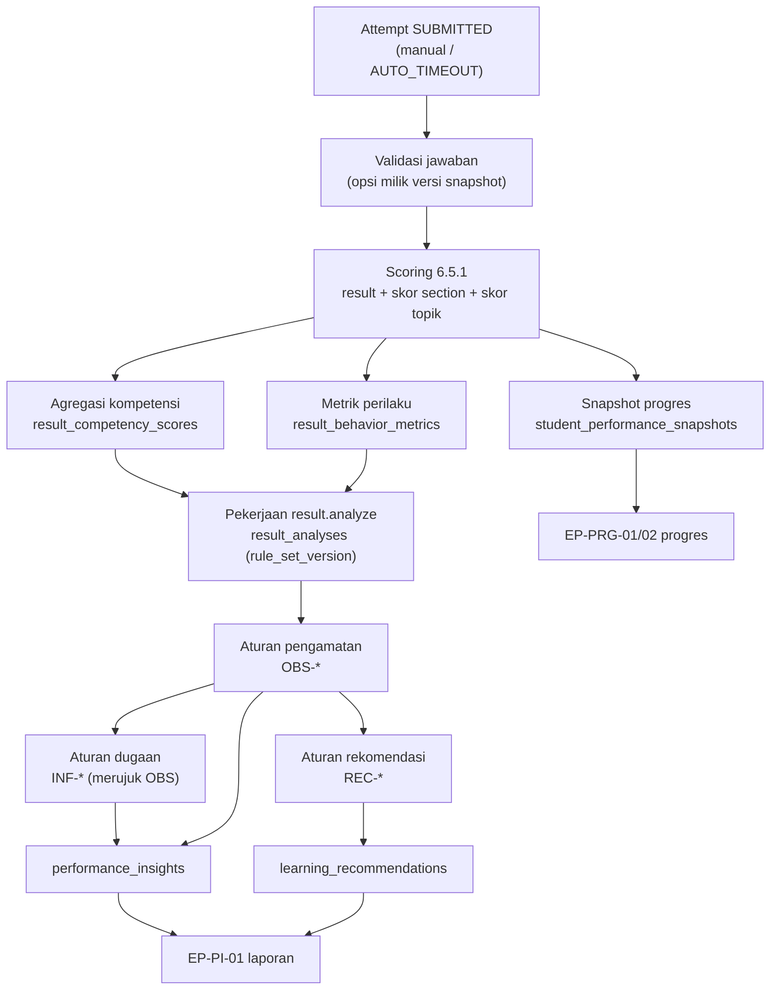

| Tahap | Transaksi | Pemicu | Idempotensi |
|---|---|---|---|
| Scoring + agregasi kompetensi + metrik perilaku + snapshot | **Satu transaksi** bersama pembuatan result (6.5.1) | Pekerjaan `attempt.score` | Unique `(result_id, …)` pada setiap tabel turunan; scoring ulang tanpa perubahan angka tidak membuat result baru |
| Analisis aturan | Transaksi terpisah | Pekerjaan `result.analyze` dijadwalkan setelah commit scoring; sweeper 30 detik atas `result_analyses_due_idx` | Unique `(result_id, rule_set_version)`; status `COMPLETED` dilewati |

Memisahkan analisis aturan dari scoring menjamin skor tetap terbit walau analisis gagal (EC-21), dan memungkinkan versi aturan baru dijalankan ulang tanpa menyentuh result.

#### 6.6.2 Data Mentah yang Dikumpulkan

| Data | Sumber | Ditulis oleh | Catatan |
|---|---|---|---|
| Jawaban terakhir per soal | `attempt_answers.selected_option_id` | EP-ANS-01 | Otoritatif |
| Opsi pertama dan jumlah penggantian | `first_selected_option_id`, `answer_change_count` | EP-ANS-01 (6.2) | Indikatif bila ada permintaan yang hilang |
| Waktu per soal | `attempt_answers.time_spent_ms` | Klien, kumulatif, nilai terbesar | Indikatif (BR-PI-09) |
| Penanda ragu-ragu | `attempt_answers.is_flagged` | EP-ANS-01 | — |
| Waktu section | `attempt_sections.started_at`, `ended_at`, `duration_seconds` | Engine | Otoritatif |
| Tag soal | `question_versions` (subject, topic, difficulty, cognitive) dan `question_competencies` versi snapshot | Konten | BR-PI-01 |

Soal yang tidak pernah dibuka tidak memiliki baris `attempt_answers`; ia dihitung `UNANSWERED` dengan waktu 0.

#### 6.6.3 Perhitungan Metrik

Seluruh rasio dihitung dengan `NUMERIC` di PostgreSQL. `o` adalah CTE hasil per soal dari 6.5.1 (diperluas dengan `difficulty`, `time_spent_ms`, `answer_change_count`, `first_key`, `position_in_section`, `section_question_count`).

| Metrik | Rumus |
|---|---|
| Akurasi kompetensi | `correct ÷ question_count` per `competency_id` (soal dengan beberapa kompetensi dihitung di setiap kompetensinya) |
| Kuartil soal kosong | Untuk setiap soal `UNANSWERED`: `q = ceil(position_in_section × 4 ÷ section_question_count)`; `unanswered_by_quartile[q]++` |
| Waktu section | `usedSeconds = extract(epoch FROM ended_at - started_at)`; `allottedSeconds = duration_seconds` (pada `TOTAL`: alokasi = durasi exam, waktu section = Σ `time_spent_ms` soal section ÷ 1000, ditandai indikatif) |
| Median waktu per soal | `percentile_cont(0.5) WITHIN GROUP (ORDER BY time_spent_ms)` atas soal dengan `time_spent_ms > 0` |
| Soal lambat | Jumlah soal dengan `time_spent_ms > 3 × median` dan `time_spent_ms ≥ 60 000` |
| Akurasi per kesulitan | `{EASY: {n, correct}, MEDIUM: …, HARD: …}` |
| Arah perubahan jawaban | Untuk soal dengan `answer_change_count > 0`: `first_key ≠ correct_key ∧ selected_key = correct_key` → salah→benar; kebalikannya → benar→salah |

#### 6.6.4 Katalog Aturan (`pi-rules-2026.11`)

> **Catatan v3.0.** Kolom tingkat minimum (BASIC/COMPLETE) tidak lagi membedakan isi: semua laporan `COMPLETE` (6.6.7).

Aturan adalah fungsi murni `(metrics, settings) → insight[]` di modul `PerformanceIntelligence/rules/2026.11`. Kode aturan, ambang, dan kunci templat tidak berubah dalam satu versi; perubahan apa pun menaikkan `rule_set_version`.

| Kode | Dimensi | Jenis | Tier minimum | Kondisi (default ambang dari `system_settings`) | Bukti yang disimpan |
|---|---|---|---|---|---|
| OBS-OVR-01 | OVERVIEW | OBSERVATION | BASIC | Selalu: ringkasan skor, akurasi, penyelesaian | angka result |
| OBS-OVR-02 | OVERVIEW | OBSERVATION | BASIC | `completion_rate < 0.8` | jumlah dan ID soal kosong |
| OBS-CAP-01 | CAPABILITY | OBSERVATION | BASIC | Topik dengan `n ≥ min_q` dan `accuracy < weak` | ID soal topik, benar/n |
| OBS-CAP-02 | CAPABILITY | OBSERVATION | COMPLETE | Topik dengan `n ≥ min_q` dan `accuracy ≥ strong` | idem |
| OBS-CAP-03 | CAPABILITY | OBSERVATION | BASIC | Selisih skor section tertinggi dan terendah ≥ 200 | dua section dan skornya |
| OBS-CAP-04 | CAPABILITY | OBSERVATION | COMPLETE | Kompetensi dengan `n ≥ min_q` dan `accuracy < weak` (P1) | ID soal kompetensi |
| OBS-BEH-01 | BEHAVIOR | OBSERVATION | BASIC | Σ soal kosong ≥ 3 dan ≥ 60% berada di kuartil 4 suatu section | kuartil per section |
| INF-BEH-01 | BEHAVIOR | INFERENCE | COMPLETE | OBS-BEH-01 ada dan waktu section terpakai ≥ 95% alokasi | rujukan OBS-BEH-01, waktu section |
| OBS-BEH-02 | BEHAVIOR | OBSERVATION | COMPLETE | Soal `EASY` salah ≥ 3 dan akurasi `EASY` < akurasi `HARD` (masing-masing n ≥ 3) | akurasi per kesulitan, ID soal |
| INF-BEH-02 | BEHAVIOR | INFERENCE | COMPLETE | OBS-BEH-02 ada dan median waktu soal `EASY` < 50% median keseluruhan | rujukan, waktu (P1, memakai data waktu) |
| OBS-BEH-03 | BEHAVIOR | OBSERVATION | COMPLETE | `changes_right_to_wrong ≥ 2` dan `> changes_wrong_to_right` (P1) | ID soal berubah |
| OBS-BEH-04 | BEHAVIOR | OBSERVATION | COMPLETE | `slow_question_count ≥ 2` (P1) | ID soal, waktu |
| REC-PRI-01 | RECOMMENDATION | — | BASIC (3) / COMPLETE (5) | Area dari OBS-CAP-01 (dan OBS-CAP-04 bila P1 aktif), urut akurasi naik lalu n turun; bila kosong, topik `ADEQUATE` terendah | `rationale_insight_id` |
| REC-ACT-01 | RECOMMENDATION | — | BASIC | Untuk tiap area REC-PRI-01: pelajari pembahasan soal salah/kosong di area itu | ID soal |
| REC-NXT-01 | RECOMMENDATION | — | COMPLETE (P1) | ≤ 2 exam `PUBLISHED` yang memuat ≥ `min_q` soal pada area prioritas teratas atau exam berikutnya dalam seri yang sama; tanpa exam yang kuotanya habis | ID exam, alasan |

**Contoh templat** (`message_key` → teks; diperiksa Content Editor, FR-PI-12):

| Kunci | Teks |
|---|---|
| `cap.topic.needs_improvement` | "Di topik **{topic}**, {correct} dari {n} soal sudah benar ({accuracy})." |
| `beh.unanswered.end_of_section` | "{count} dari {total} soal yang belum dijawab berada di bagian akhir subtes {section}." |
| `beh.time_pressure.inference` | "Pola ini **dapat** berarti waktumu habis sebelum mencapai soal-soal terakhir di {section}. Ini dugaan berdasarkan pengamatan di atas, bukan kesimpulan pasti." |
| `rec.priority_area` | "Prioritaskan **{area}**: akurasimu {accuracy} dari {n} soal." |

Templat dilarang memuat kata yang menilai kemampuan atau sifat ("lemah", "tidak berbakat", "kurang cerdas"); daftar kata terlarang diperiksa uji otomatis TC-PI-06.

#### 6.6.5 Prosedur `analyzeResult`

```text
analyzeResult(resultId):
  version := setting('analytics.rule_set_version')
  BEGIN
    r := SELECT * FROM exam_results WHERE id = :resultId AND is_current FOR SHARE
    jika r tidak ada atau attempt VOIDED: COMMIT; return          -- BR-PI-07
    a := INSERT result_analyses (result_id, user_id, rule_set_version, report_tier, status='RUNNING', run_count=1)
         ON CONFLICT (result_id, rule_set_version) DO UPDATE SET status='RUNNING', run_count = run_count + 1
           WHERE result_analyses.status IN ('PENDING','FAILED')
         RETURNING *                                               -- tidak ada baris = sudah COMPLETED/RUNNING
    jika tidak ada baris: COMMIT; return
    report_tier := 'COMPLETE'  -- v3.0: satu tingkat laporan (FR-PI-11 dihapus)
    m := muat metrik (skor section/topik/kompetensi, result_behavior_metrics, settings)
    obs := rules.observations(m); inf := rules.inferences(m, obs); rec := rules.recommendations(m, obs)
    INSERT performance_insights (obs, lalu inf dengan based_on_insight_id)
    INSERT learning_recommendations (rec)
    UPDATE result_analyses SET is_current = FALSE WHERE result_id = r.id AND is_current
    UPDATE result_analyses SET status='COMPLETED', is_current=TRUE, completed_at=now() WHERE id = a.id
    UPDATE learning_recommendations SET status='SUPERSEDED'
      WHERE user_id = r.user_id AND status = 'ACTIVE' AND analysis_id IN
        (SELECT id FROM result_analyses WHERE result_id IN
           (SELECT id FROM exam_results WHERE attempt_id = r.attempt_id) AND id <> a.id)
  COMMIT
  gagal → status 'FAILED', error_message; sweeper mencoba ulang hingga 5 kali lalu memicu peringatan (NFR-12)
```

Rekomendasi dari attempt lain tetap `ACTIVE` agar riwayat rekomendasi per attempt utuh; laporan selalu membaca rekomendasi dari analisis terkini attempt yang dibuka.

#### 6.6.6 Snapshot dan Perbandingan Progres

Snapshot ditulis dalam transaksi scoring (6.5.1) untuk result revisi terkini: satu baris `OVERALL` (`scope_key = 'total'`), satu per section (`scope_key` = posisi section), satu per topik dan kompetensi (`scope_key` = id). Saat revisi baru dibuat, snapshot revisi lama di-`UPDATE … SET is_current = FALSE` (satu-satunya perubahan yang diizinkan trigger). Attempt `VOIDED` menandai snapshotnya tidak terkini (FR-ADM-08).

**Query tren (EP-PRG-01):**

```sql
SELECT s.scope_type, s.scope_key, s.scope_label, s.score, s.accuracy, s.question_count,
       s.taken_at, s.attempt_id
FROM student_performance_snapshots s
WHERE s.user_id = :userId
  AND s.series_id = :seriesId
  AND s.scoring_scheme = 'PROPORTIONAL_V1'
  AND s.is_current
  AND s.scope_type IN ('OVERALL','SECTION')
ORDER BY s.scope_type, s.scope_key, s.taken_at;
```

**Perbandingan dua attempt (EP-PRG-02):** server memverifikasi BR-PRG-01 (seri dan skema sama, keduanya pemilik, keduanya terkini) lalu menghitung `delta = b - a` per `(scope_type, scope_key)` yang ada di kedua sisi; topik/kompetensi hanya bila `question_count ≥ min_q` di kedua sisi (BR-PRG-04); label `SAME` bila `|delta_score| < progress.same_score_delta` dan `|delta_accuracy| < progress.same_accuracy_delta`, selain itu `UP`/`DOWN`.

#### 6.6.7 Penyajian Laporan

Sejak v3.0 semua analisis berstatus `report_tier = COMPLETE`; kolom `min_report_tier` pada katalog aturan (6.6.4) dipertahankan sebagai titik ekstensi bila perbedaan paket (OQ-22) kelak membedakan isi laporan. Teks insight dirender di server dari `message_key` + `params` dengan templat ber-versi (FR-PI-12). Setelah analisis `COMPLETED`, StudyPlanner membangun roadmap (6.7.4).

#### 6.6.8 Titik Ekstensi AI (masa depan, FR-PI-14)

Bila kelak diaktifkan: layanan `InsightExplainerPort` menerima **hanya** insight yang sudah ada (kode, params, bukti agregat tanpa identitas) dan mengembalikan teks penjelasan yang disimpan terpisah dengan label "dibuat AI". Port ini tidak memiliki akses tulis ke `exam_results`, skor turunan, klasifikasi, atau urutan rekomendasi (BR-PI-08). Tidak diimplementasikan di MVP.

---

### 6.7 Paket, Referral, dan Roadmap (v3.0)

#### 6.7.1 Order Paket dan Package Grant

`POST /orders` (EP-ORD-01) dalam satu transaksi: kunci product (`FOR SHARE`), tolak bila bukan `is_package` atau tidak `ACTIVE`; tolak Lifetime bila sudah ada `SEASON_PASS` aktif untuk musimnya (`SEASON_PASS_EXISTS`); kembalikan order `PENDING` yang sama bila ada (FR-PAY-12); bila `voucherId` diisi, kunci voucher `FOR UPDATE`, wajib `AVAILABLE` dan belum kedaluwarsa, hitung `discount = floor(subtotal × percent_off / 100)`, ubah voucher menjadi `RESERVED` dengan `reserved_order_id`.

Saat pembayaran `SETTLED` (webhook atau EP-PAY-04 di pengembangan) — satu fungsi `applyPaid(orderId)` yang idempotent:

```text
BEGIN
  order ← SELECT … FOR UPDATE; jika status = PAID → selesai (idempotent)
  UPDATE orders SET status = PAID, paid_at = now()
  untuk setiap order_item (MVP: satu):
    jika LIFETIME → INSERT package_grants(kind=SEASON_PASS, series_id, valid_until = exam_date − lifetime.days_before_exam hari, 23:59:59 WIB)
    selain itu   → INSERT package_grants(kind=CREDITS, credits_total = tryout_credits, valid_until = exam_date 23:59:59 WIB)
    (ON CONFLICT (order_item_id) DO NOTHING)
  jika orders.voucher_id → UPDATE vouchers SET status = USED, used_order_id, used_at
  qualifyReferral(order.user_id, order.id)      -- 6.7.3
COMMIT
```

Bila `exam_date` musim belum ditetapkan, order paket ditolak `NO_ACTIVE_SEASON` karena masa berlaku tidak dapat dihitung (OQ-25). Order `EXPIRED`/`CANCELLED` mengembalikan voucher `RESERVED` menjadi `AVAILABLE` (sweeper 6.4.3).

#### 6.7.2 Penukaran (EP-PKG-03)

```text
BEGIN
  exam ← exam PUBLISHED dalam musim aktif dan now() ∈ [available_from, available_until]; selain itu EXAM_NOT_AVAILABLE
  jika entitlement PACKAGE (user, exam) ada → kembalikan (200), tanpa memakai kredit
  pass ← package_grants SEASON_PASS ACTIVE, series = exam.series, valid_until ≥ now(), exam.available_from ≤ valid_until
  jika pass → INSERT entitlement(source = PACKAGE, package_grant_id = pass.id, valid_until = min(exam.available_until, pass.valid_until))
  selain itu:
    jika !useCredit → 409 CREDIT_CONFIRMATION_REQUIRED (klien menampilkan konfirmasi FR-PKG-04)
    grant ← package_grants CREDITS ACTIVE, series = exam.series, credits_used < credits_total, valid_until ≥ now()
            ORDER BY valid_until, created_at LIMIT 1 FOR UPDATE   -- kredit yang paling cepat berakhir dahulu
    jika tidak ada → 402 NO_ACCESS
    UPDATE package_grants SET credits_used = credits_used + 1
    INSERT entitlement(source = PACKAGE, package_grant_id = grant.id, max_attempts = exam.max_attempts,
                       valid_until = min(exam.available_until, grant.valid_until))
COMMIT
```

`entitlements_package_user_exam_key` menjamin dua permintaan bersamaan tidak memakai dua kredit: permintaan kedua gagal unik, transaksinya di-rollback (kredit tidak terpakai), lalu klien menerima entitlement yang sudah ada.

#### 6.7.3 Referral dan Voucher

- **Registrasi:** kode dinormalisasi huruf kapital; pemilik kode ≠ akun baru; `INSERT referrals … ON CONFLICT (referred_id) DO NOTHING`.
- **Kode:** dibuat saat registrasi, 8 karakter dari alfabet tanpa huruf/angka mirip (`23456789ABCDEFGHJKMNPQRSTUVWXYZ`); diulang bila bentrok unik.
- **`qualifyReferral(userId, orderId)`** dalam transaksi `applyPaid`: `UPDATE referrals SET qualified_at = now(), qualifying_order_id = orderId WHERE referred_id = userId AND qualified_at IS NULL RETURNING referrer_id`. Bila ada, hitung `q = count(qualified, tidak disqualified)` milik pengajak; untuk `batch = 1..floor(q / threshold)` lakukan `INSERT vouchers (user_id, source, batch_no, percent_off, expires_at) … ON CONFLICT DO NOTHING` — idempotent dan aman terhadap webhook ganda.
- **Refund** (FR-PAY-09, P1): set `disqualified_at`; voucher yang sudah `USED` tidak ditarik (BR-REF-05).

#### 6.7.4 Roadmap dan Plan Harian (`rmp-2026.11`)

Dipicu setelah `analyzeResult` (6.6.5) berstatus `COMPLETED`, dan oleh EP-RMP-04. Deterministik untuk masukan yang sama.

| Langkah | Aturan |
|---|---|
| Masukan | Result terkini; topik dan klasifikasi (6.6.3); rekomendasi `PRIORITY_AREA`; target pribadi prioritas 1; `exam_date` musim; `daily_study_minutes` |
| Horizon | `start = hari ini (WIB)`; `end = exam_date − 1` bila diketahui, selain itu `start + roadmap.default_horizon_weeks × 7 − 1`; maksimal 16 minggu ditampilkan |
| Urutan topik | Perlu ditingkatkan (akurasi naik, soal turun) → Cukup → topik tanpa klasifikasi → Kuat (BR-RMP-02) |
| Fase | Minggu ke-1..n. Topik per minggu `k = 2`, `k = 3` bila `target − skor > 150`. Topik dibagikan berurutan; setelah semua topik mendapat giliran, minggu berikutnya menjadi "Pemantapan & simulasi" (ulang topik perlu ditingkatkan + try out periode berikutnya) |
| Target akurasi topik | `max(akurasi saat ini + 0.2, 0.6)`, dibatasi 0.9, dibulatkan 5% |
| Plan harian (7 hari) | Topik minggu berjalan diputar per hari. Tugas per hari: `GUIDE` (15 mnt) bila topik punya panduan, `REVIEW` pembahasan soal topik dari result (menit = 3 × soal belum benar, 10–30), `PRACTICE` (sisa waktu, minimal 10 mnt). Hari Sabtu: `TRYOUT` bila ada periode terbuka yang dapat diakses. Total ≤ `daily_study_minutes` (BR-RMP-03) |
| Penyimpanan | Plan aktif lama → `SUPERSEDED`; plan baru + item dalam satu transaksi; item `DONE` milik plan lama tetap ada (FR-RMP-07) |

#### 6.7.5 Simulator Pembayaran (pengembangan)

`DEV_SIMULATED` hanya aktif bila `NODE_ENV ≠ production` **dan** `payments.dev_simulator_enabled = true`. Saat order dibuat, payment `DEV_SIMULATED` mendapat `checkout_url` ke halaman checkout aplikasi; EP-PAY-04 memanggil `applyPaid` yang sama dengan webhook. Health check produksi gagal bila pengaturan ini `true` (TD-12).

## 7. Performance & Scalability


### 7.1 Profil Beban yang Dirancang

Angka berikut adalah **perkiraan perancangan** dari NFR-01 (1.000 attempt serentak), bukan hasil pengukuran; uji beban 7.7 yang memvalidasinya.

| Besaran | Perkiraan | Dasar |
|---|---|---|
| Permintaan simpan jawaban | 30–70/detik rata-rata; puncak ±150/detik | 1.000 peserta, satu perubahan tiap 15–30 detik, ditambah pengosongan antrean |
| Mulai attempt di awal session | ±1.000 dalam 1–3 menit (puncak ±20/detik) | Peserta masuk bersamaan pada `start_at` |
| Baris per start | ±1 attempt + 7 section + 160 soal snapshot | Struktur try out SNBT tipikal |
| Baris `attempt_answers` per session | ≤ 160.000 | 1.000 × 160 |
| Ukuran payload soal per section | Puluhan hingga ratusan KB terkompresi | HTML soal; gambar dimuat terpisah dari CDN |

Beban ini berada jauh di dalam kemampuan satu instance PostgreSQL berukuran menengah. Risiko nyata bukan pada volume, melainkan pada **lonjakan serentak** (start) dan **antrean koneksi**; rancangan di bawah berfokus pada keduanya.

### 7.2 Database Indexing

- Setiap FK yang dipakai untuk join atau pencarian memiliki index (3.6).
- **Index parsial** untuk antrean kerja agar tetap kecil berapa pun ukuran tabel: `exam_attempts_timeout_due_idx`, `exam_attempts_scoring_due_idx`, `orders_expiry_due_idx`, `notifications_dispatch_idx`, `exam_sessions_publish_due_idx`, `exam_sessions_no_show_due_idx`.
- Jalur simpan jawaban hanya menyentuh primary key dan satu unique index (`attempt_answers_one_per_question`).
- Pencarian teks soal dan nama pengguna memakai GIN trigram.
- Tinjauan index dilakukan setelah uji beban dengan `pg_stat_statements`; index yang tidak terpakai dihapus.

### 7.3 Query Optimization

| Jalur | Optimasi |
|---|---|
| Simpan jawaban | Satu pernyataan, satu round trip (6.2); *prepared statement* |
| Muat attempt (EP-ATT-03) | Tiga query: attempt + section; soal section aktif (dari cache DTO exam); jawaban attempt. Tanpa N+1 |
| Start attempt | `INSERT … SELECT` massal untuk snapshot soal; satu transaksi singkat |
| Scoring | Satu query agregasi per attempt (6.5.1); rescoring dalam batch 200 |
| Daftar admin | Paginasi berbasis index; `COUNT` total dibatasi atau diperkirakan untuk daftar sangat besar; ekspor CSV di-*stream* |
| Katalog | Satu query gabungan product + exam; di-cache |
| Umum | `statement_timeout` 5 detik untuk `api` (lebih longgar untuk `worker`); log query lambat > 200 ms |

**Connection pooling.** Pool per instance aplikasi dibatasi sehingga total koneksi tetap di bawah batas database; bila jumlah instance `api` bertambah, PgBouncer mode *transaction* ditempatkan di depan database. Transaksi dijaga singkat dan **tidak pernah** mencakup panggilan jaringan ke layanan eksternal (panggilan Status API gateway dilakukan sebelum `BEGIN`, lihat 6.4.2).

### 7.4 Caching

| Data | Tempat | TTL / invalidasi | Catatan |
|---|---|---|---|
| DTO soal siswa per exam (tanpa kunci) | Redis | Tanpa TTL untuk exam `PUBLISHED`; kunci cache memuat `exam_id` + cap waktu koreksi terakhir | Exam terkunci setelah publish (FR-EXM-09), sehingga aman di-cache; ini memangkas beban terbesar saat lonjakan start |
| Katalog product | Redis + `Cache-Control` 60 detik | Invalidasi saat publish/unpublish/harga berubah | Sisa kursi **tidak** di-cache lebih dari 5 detik |
| Daftar subject/topic | Memori proses | 5 menit | Jarang berubah |
| Daftar cabut token, rate limit | Redis | Sesuai jendela | — |
| Gambar soal, aset statis | CDN | Lama (nama berkas ber-hash) | Aset tidak pernah ditimpa (FR-QB-07) |

**Yang sengaja tidak di-cache:** status attempt, tenggat, jawaban, entitlement, status order, status publikasi hasil. Data ini menentukan kebenaran dan selalu dibaca dari database.

### 7.5 Background Job Processing

| Pekerjaan | Pemicu | Sweeper (jaring pengaman) | Idempotency | PRD |
|---|---|---|---|---|
| `attempt.timeout` | Tertunda pada `expires_at + grace` | Tiap 15 detik | Transisi bersyarat status | FR-TMR-06 |
| `attempt.score` | Setelah submit | Tiap 30 detik atas attempt `SUBMITTED` | Revisi hanya bila berubah | FR-SCR-01 |
| `result.analyze` (v2.0) | Setelah commit scoring dan setelah rescoring | Tiap 30 detik atas `result_analyses_due_idx`; maks. 5 percobaan | Unique (`result_id`, `rule_set_version`); status `COMPLETED` dilewati | FR-PI-07 |
| `data.export` (v2.0, P1) | Setelah EP-USR-12 | Tiap 5 menit atas `PENDING` | Status bersyarat | FR-PROF-06 |
| `order.expire` | Tertunda pada `expires_at` | Tiap 60 detik | `UPDATE` bersyarat | FR-PAY-05 |
| `payment.reconcile` | Order `PENDING` berumur > 10 menit dengan payment aktif | Tiap 5 menit | `applyGatewayStatus` | BR-PAY-03, UJ-05 E5 |
| `session.markNoShow` | Tertunda pada `entry_close_at` | Tiap 60 detik (`no_show_processed_at IS NULL`) | `UPDATE … WHERE status = 'CONFIRMED'` | FR-SES-11 |
| `session.publishResults` | Tertunda pada `result_publish_at` | Tiap 60 detik | `UPDATE` bersyarat | FR-RES-02 |
| `session.remind` | Terjadwal H-24 jam dan H-1 jam | Tiap 5 menit | `dedupe_key` notifikasi | FR-SES-12 |
| `notification.dispatch` | Setelah baris `notifications` dibuat | Tiap 30 detik atas `PENDING` jatuh tempo | Klaim baris dengan `FOR UPDATE SKIP LOCKED`; status `SENDING` | FR-NTF-01 |
| `scoring.rescore` | Setelah koreksi kunci | Manual (EP-RES-06 memantau) | Bagian 6.5.3 | FR-SCR-05 |
| `session.reconcileSeats` | Harian | — | Membandingkan `seats_taken` dengan hitungan enrollment; hanya melaporkan selisih | BR-CAP-01 |

Aturan umum: pekerjaan memuat **hanya ID**; keadaan selalu dibaca ulang dari database di dalam transaksi. Dengan demikian pekerjaan yang terlambat, terduplikasi, atau dijalankan dua worker sekaligus tetap menghasilkan keadaan yang benar. Retry otomatis dengan backoff; pekerjaan yang gagal permanen masuk antrean gagal dan memicu peringatan.

### 7.6 Concurrent Examination Handling dan Autosave Optimization

| Tantangan | Penanganan |
|---|---|
| Lonjakan start pada `start_at` | DTO exam sudah di-cache sebelum sesi (pemanasan cache 10 menit sebelum `start_at`); transaksi start singkat; instance `api` dinaikkan terjadwal sebelum sesi; entry window (default 30 menit) menyebar beban secara alami |
| Banyak tulisan kecil | Satu pernyataan per simpan; debounce 300 ms dan penggabungan per soal di klien; endpoint batch untuk antrean offline |
| Kontensi kunci | Simpan jawaban **tidak** mengunci baris attempt (hanya membaca); kunci baris hanya pada start, submit, dan pergantian section |
| Polling | Tidak ada polling per soal. Sinkronisasi status tiap 60 detik (EP-ATT-04) — ±17 permintaan/detik untuk 1.000 peserta |
| Kegagalan sebagian | Bila `api` lambat, klien tetap menerima jawaban ke antrean lokal dan menampilkan status; tidak ada kehilangan data selama koneksi pulih sebelum tenggat |
| Skala ke 5.000 | Menambah instance `api`, PgBouncer, dan ukuran database; tidak ada perubahan arsitektur. Bila tabel `attempt_answers` kelak sangat besar, partisi berdasarkan waktu dapat ditambahkan tanpa mengubah kontrak API |

### 7.7 Load Testing

Perkakas: k6, dijalankan terhadap **staging berukuran setara produksi** dengan data sintetis. Wajib lulus sebelum session scheduled berbayar pertama.

| ID | Skenario | Profil | Kriteria lulus |
|---|---|---|---|
| TC-LOAD-01 | Ujian serentak | 1.000 pengguna virtual, masing-masing: start → muat attempt → simpan jawaban tiap 15–30 detik selama 30 menit → submit | p95 simpan ≤ 500 ms (NFR-02); error < 0,1%; tidak ada jawaban terkonfirmasi yang hilang (diverifikasi dengan membandingkan log klien uji dan database) |
| TC-LOAD-02 | Lonjakan start | 1.000 permintaan `POST /attempts` dalam 60 detik pada satu session | p95 ≤ 2 detik; tepat satu attempt per pengguna; tidak ada deadlock |
| TC-LOAD-03 | Checkout dan webhook | 200 order/menit dengan webhook duplikat dan tidak berurutan; perebutan kursi pada session berkapasitas kecil | Tidak ada order `PAID` tanpa entitlement; `seats_taken` ≤ `capacity`; tidak ada entitlement ganda |
| (lanjutan) | Uji ketahanan | TC-LOAD-01 pada 1,5× beban selama 2 jam; mematikan satu instance `api` dan Redis di tengah uji | Tidak ada kehilangan data; auto-submit tetap terjadi lewat sweeper |

Hasil uji beban dicatat sebagai lampiran rilis; kapasitas session pertama ditetapkan berdasarkan hasil ini, bukan sebaliknya.

### 7.8 Backup dan Recovery

| Aspek | Rancangan |
|---|---|
| Database | Backup otomatis harian + *point-in-time recovery* (arsip WAL) dari layanan terkelola; retensi minimal 14 hari |
| Target | RPO ≤ 5 menit; RTO ≤ 2 jam *(usulan)* |
| Object storage | Versioning aktif; aset tidak pernah ditimpa |
| Redis | Tidak dianggap penyimpanan permanen; kehilangan Redis tidak menghilangkan data bisnis (pekerjaan dibangun ulang oleh sweeper) |
| Uji pemulihan | Latihan pemulihan ke lingkungan terpisah minimal sekali sebelum rilis dan tiap kuartal; hasil dan durasi dicatat |
| Prosedur insiden saat sesi | Runbook: pembekuan deploy, pemulihan layanan, lalu keputusan kompensasi (void + attempt pengganti lewat EP-ADM-01) berdasarkan data dampak |

### 7.9 Monitoring dan Observability

**Log.** JSON terstruktur per request: `requestId`, `userId`, route, status, durasi. Tanpa data pribadi, token, isi jawaban, atau kunci.

**Metrik dan ambang peringatan (NFR-12)**

| Metrik | Peringatan bila |
|---|---|
| Rasio keberhasilan simpan jawaban | < 99,5% dalam 5 menit |
| p95 latensi simpan jawaban | > 500 ms dalam 5 menit |
| Attempt `IN_PROGRESS` melewati `expires_at` + 60 detik | > 0 |
| Attempt `SUBMITTED` belum dinilai > 2 menit | > 0 |
| Order `PAID` tanpa entitlement (query pemeriksa tiap 5 menit) | > 0 — **kritis** |
| Webhook: `REJECTED_SIGNATURE`, `REJECTED_MISMATCH`, `ERROR` | > 0 |
| Selisih waktu webhook diterima → entitlement aktif (p95) | > 10 detik |
| Kedalaman dan umur antrean BullMQ; pekerjaan gagal | Melewati ambang per antrean |
| Notifikasi `FAILED` | > 0 |
| Selisih `seats_taken` terhadap hitungan enrollment | ≠ 0 |
| Koneksi database terpakai, replikasi/penyimpanan, CPU | > 80% |
| Rasio error HTTP 5xx | > 1% dalam 5 menit |

**Tracing.** OpenTelemetry dari `api` dan `worker` ke database, Redis, dan layanan eksternal, dengan `requestId` sebagai penghubung.

**Dashboard operasional sesi.** Satu dashboard untuk hari-H: peserta masuk, attempt berjalan, laju simpan, latensi, error — dipantau selama session scheduled.

**KPI produk** (PRD Bagian 3): dihitung dari tabel bisnis lewat role `cv_readonly`; event kunjungan berasal dari alat analitik web.

---

## 8. Testing Strategy

### 8.1 Piramida dan Lingkup

| Jenis | Lingkup | Perkakas | Dijalankan |
|---|---|---|---|
| **Unit** | Fungsi murni: perhitungan skor, klasifikasi topik, mesin status, pemetaan status gateway, perhitungan tenggat dan rekonsiliasi section, validator Zod, sanitasi HTML | Vitest/Jest | Setiap commit |
| **Integrasi** | Service + PostgreSQL nyata: transaksi, constraint, trigger, pernyataan SQL kritis | Testcontainers | Setiap commit |
| **API** | Kontrak endpoint: skema request/respons, kode status, format error, paginasi | Supertest + skema `contracts` | Setiap commit |
| **Otorisasi** | Matriks endpoint × role; kepemilikan; isolasi kontributor; proteksi kunci | Generator uji dari metadata route | Setiap commit |
| **Pembayaran** | Adapter gateway dengan *fake* yang mensimulasikan seluruh status, duplikasi, urutan terbalik; uji sandbox gateway | Fake + sandbox | Commit; sandbox sebelum rilis |
| **Exam engine** | Start, snapshot, resume, takeover, section, submit | Integrasi + jam terkontrol | Setiap commit |
| **Timer** | Tenggat, grace, auto-submit, rekonsiliasi — dengan waktu database yang dimajukan | Integrasi | Setiap commit |
| **Konkurensi** | Permintaan paralel nyata terhadap PostgreSQL | Integrasi dengan N koneksi | Setiap commit (N kecil), malam (N besar) |
| **End-to-end** | Alur pengguna utama di browser, termasuk viewport mobile dan mode offline | Playwright | Sebelum merge ke main; staging |
| **Beban** | Bagian 7.7 | k6 | Sebelum rilis dan sebelum sesi besar |

**Waktu dalam pengujian.** Karena jam acuan adalah `now()` database (AD-12), uji timer membungkus akses waktu dalam satu fungsi SQL (`app_now()`) yang pada lingkungan uji dapat digeser; di produksi fungsi itu hanya memanggil `now()`. Ini adalah satu-satunya penyesuaian skema demi keterujian: fungsi dibuat pada migrasi pertama dan dipakai oleh seluruh query aplikasi yang membandingkan atau menulis tenggat (pseudocode dan SQL di Bagian 6 menulis `now()` demi keterbacaan). Default kolom `created_at`/`updated_at` pada DDL 3.5 tetap memakai `now()` karena tidak memengaruhi logika tenggat.

**Aturan konkurensi.** Uji konkurensi tidak boleh memakai *mock* database: tujuannya membuktikan constraint dan penguncian nyata.

### 8.2 Test Matrix untuk Alur Kritis

| ID | Skenario | Jenis | Hasil yang diharapkan | PRD |
|---|---|---|---|---|
| TC-AUTH-01 | Registrasi, lalu klaim sebelum verifikasi email | API | Akun dibuat; klaim → 403 `EMAIL_NOT_VERIFIED`; setelah verifikasi berhasil | FR-AUTH-01/02 |
| TC-AUTH-02 | 6 kali login gagal; pesan untuk email tidak terdaftar | API | Jeda diberlakukan; pesan identik | FR-AUTH-03/09 |
| TC-AUTH-03 | Refresh token dipakai dua kali | Integrasi | Pemakaian kedua mencabut seluruh keluarga token | FR-AUTH-03 |
| TC-AUTH-04 | Reset password; undangan staf kedaluwarsa | API | Sesi lain berakhir; token lama 410 | FR-AUTH-04/06 |
| TC-AUTH-05 | Suspend saat sesi aktif | Integrasi | Permintaan berikutnya ditolak dalam ≤ 1 detik | FR-AUTH-07 |
| TC-SEC-01 | Setiap endpoint dipanggil oleh setiap role | Otorisasi | Sesuai kolom Role Bagian 4; tanpa pengecualian | FR-AUTH-05 |
| TC-SEC-02 | Pengguna B mengakses attempt, order, result, entitlement milik A | Otorisasi | 404 | FR-AUTH-05 |
| TC-SEC-03 | Kontributor mengakses soal orang lain, exam, antrean review | Otorisasi | 403/404; pencarian hanya miliknya | FR-CTR-05 |
| TC-SEC-04 | Pindai semua respons siswa selama attempt `IN_PROGRESS` | Otorisasi | Tidak ada `isCorrect`, `correctOptionKey`, `explanationHtml` | FR-ENG-11 |
| TC-SEC-05 | Simpan soal berisi `<script>`, `onerror`, `javascript:` | Unit + API | Dibuang oleh sanitasi; tidak tereksekusi di pratinjau | 5.11, 5.13 |
| TC-SEC-06 | `POST` tanpa header `X-CV-Client` / dari origin asing | API | Ditolak | 5.13 |
| TC-QB-01 | Ajukan review soal tanpa kunci / 3 opsi / tanpa penjelasan | API | 422 dengan daftar kekurangan; status tetap `DRAFT` | FR-REV-01, BR-QV-08 |
| TC-QB-02 | Ubah versi `APPROVED` lewat API dan lewat SQL langsung | Integrasi | API 409; SQL ditolak trigger | FR-QV-02, BR-QV-01 |
| TC-QB-03 | Buat versi baru saat ada versi terbuka | Integrasi | 409 `OPEN_VERSION_EXISTS` | FR-QV-01 |
| TC-QB-04 | Penulis (termasuk Super Admin) memutuskan versinya; dua reviewer bersamaan | Integrasi | 403 `SELF_REVIEW_FORBIDDEN`; hanya keputusan pertama berlaku | FR-REV-03/04 |
| TC-QB-05 | Unggah 3 MB / SVG; approve dengan topic nonaktif | API | Ditolak dengan pesan spesifik | FR-QB-01/07 |
| TC-QB-06 | Retire soal; cari dan filter | API | Tidak dapat ditambahkan ke exam; exam lama utuh | FR-QB-05/11 |
| TC-EXM-01 | Publish exam dengan setiap jenis cacat | API | 422 mendaftar seluruh masalah | FR-EXM-06 |
| TC-EXM-02 | Terbitkan versi soal baru setelah exam `PUBLISHED` | Integrasi | Exam tetap menunjuk versi lama | FR-QV-05, BR-QV-05 |
| TC-EXM-03 | Ubah section/soal/durasi pada exam `PUBLISHED` | API | 409 `EXAM_STRUCTURE_LOCKED` | FR-EXM-09 |
| TC-EXM-04 | Aktifkan bundle dengan exam `DRAFT`; ubah isi setelah order `PAID` | API | Ditolak | FR-EXM-05 |
| TC-EXM-05 | Unpublish dengan entitlement aktif; archive saat ada attempt berjalan | API | Entitlement tetap dapat dipakai; archive 409 | FR-EXM-07, EC-15 |
| TC-SES-01 | Simpan session dengan setiap pelanggaran urutan waktu | Integrasi | Ditolak API dan `CHECK` | FR-SES-01/02 |
| TC-SES-02 | 50 permintaan paralel memperebutkan 5 kursi | Konkurensi | Tepat 5 berhasil; `seats_taken = 5` | BR-CAP-02, EC-07 |
| TC-SES-03 | Order dengan seat hold kedaluwarsa | Integrasi | Enrollment `EXPIRED`; kursi kembali | FR-SES-09 |
| TC-SES-04 | Enrollment Jalur B dan C; enrollment kedua untuk exam sama | API | `CONFIRMED`; yang kedua 409 `ALREADY_ENROLLED` | FR-SES-08/10 |
| TC-SES-05 | Batalkan dan jadwal ulang session; batalkan saat sudah ada attempt | Integrasi | Enrollment `CANCELLED`, entitlement utuh, email terkirim; kasus kedua 409 | FR-SES-05/06 |
| TC-SES-06 | Lewati `entry_close_at` tanpa masuk; daftar ulang ke session lain | Integrasi | `NO_SHOW`; kuota utuh; daftar ulang berhasil | FR-SES-11 |
| TC-SES-07 | Pengingat dijalankan dua kali; setelah reschedule | Integrasi | Satu email per pengingat; mengikuti jadwal baru | FR-SES-12 |
| TC-PAY-01 | Webhook `settlement` valid | Integrasi | Dalam satu transaksi: payment `SETTLED`, order `PAID`, entitlement, enrollment `CONFIRMED`, notifikasi | FR-PAY-03, FR-ENT-01 |
| TC-PAY-02 | Webhook yang sama dikirim 10× paralel | Konkurensi | Satu entitlement, satu email | BR-PAY-04, EC-03 |
| TC-PAY-03 | Signature salah; nominal berbeda | API | 401 / tidak ada perubahan + peringatan | BR-PAY-03/06 |
| TC-PAY-04 | `pending` tiba setelah `settlement`; `expire` setelah `settlement` | Integrasi | Status tidak turun | EC-03 |
| TC-PAY-05 | Order kedaluwarsa; lalu pembayaran sukses; session sudah penuh | Integrasi | Order `PAID`, entitlement ada, tanpa enrollment, notifikasi pilih sesi | BR-PAY-07, EC-14 |
| TC-PAY-06 | Rekonsiliasi manual; gateway tidak merespons | API | Status diterapkan lewat jalur yang sama; 502 tanpa perubahan | FR-PAY-08 |
| TC-PAY-07 | Buat order dua kali; beli single yang sudah dimiliki; bundle tumpang tindih | API | Order yang sama; 409 `ALREADY_ENTITLED`; perlu konfirmasi | FR-PAY-12 |
| TC-PAY-08 | Buka halaman status dengan parameter "sukses" palsu | E2E | Status tetap dari server; tanpa akses | FR-PAY-04, BR-PAY-03 |
| TC-ENT-01 | ~~Klaim exam gratis 10× paralel~~ **[Dihapus v3.0]** — digantikan TC-PKG-02 | — | — | — |
| TC-ENT-02 | Order bundle 3 exam dibayar | Integrasi | 3 entitlement; `valid_until` sesuai BR-OND-02 | FR-ENT-06 |
| TC-ENT-03 | Grant, revoke, attempt tambahan tanpa alasan / dengan alasan | API | Tanpa alasan 400; dengan alasan berhasil + audit log | FR-ENT-03 |
| TC-ENG-01 | Setiap cabang penolakan diagram PRD 5.5, untuk on-demand dan scheduled | Integrasi | Kode error spesifik per cabang | FR-ENG-01 |
| TC-ENG-02 | 10 permintaan start paralel (exam sama; dua exam berbeda) | Konkurensi | Satu attempt; kuota berkurang 1 | FR-ENG-03, EC-05 |
| TC-ENG-03 | Setelah start: ubah harga, unpublish, terbitkan versi soal baru | Integrasi | Isi dan durasi attempt tidak berubah | BR-LIF-02 |
| TC-ENG-04 | Refresh; buka di perangkat kedua | E2E + integrasi | Jawaban utuh; perangkat lama 423 | FR-ENG-07/08 |
| TC-ENG-05 | `PER_SECTION`: simpan ke section `PENDING`/`ENDED`; akhiri lebih awal | Integrasi | 409 `SECTION_NOT_ACTIVE`; `expires_at` menyusut | FR-ENG-10 |
| TC-ENG-06 | Submit dua kali; simpan jawaban setelah submit | Integrasi | Respons identik; simpan ditolak (API dan trigger) | FR-ENG-09, BR-LIF-05 |
| TC-TMR-01 | Kirim ulang permintaan simpan; kirim `clientSeq` lebih rendah | Integrasi | 200; jawaban lebih baru tidak tertimpa | FR-TMR-09 |
| TC-TMR-02 | Simpan pada tenggat + 3 detik dan + 6 detik | Integrasi | Diterima; ditolak `ATTEMPT_EXPIRED` | FR-TMR-07, BR-TMO-03 |
| TC-TMR-03 | Lewati tenggat tanpa klien; ulangi dengan Redis dimatikan | Integrasi | `SUBMITTED` + `AUTO_TIMEOUT` ≤ 60 detik dalam kedua kasus | FR-TMR-06 |
| TC-TMR-04 | Siswa "offline" melewati dua tenggat section | Integrasi | Section berakhir berurutan dengan waktu mulai = tenggat sebelumnya | BR-TMO-05 |
| TC-TMR-05 | Submit manual tepat pada tenggat, bersamaan dengan pekerjaan timeout | Konkurensi | Satu transisi; satu result | EC-10/11 |
| TC-TMR-06 | Jam perangkat dimajukan/dimundurkan | E2E | Countdown tetap benar | FR-TMR-02, EC-16 |
| TC-TMR-07 | Jawab saat offline, refresh, lalu online | E2E | Antrean bertahan dan terkirim; status berubah benar | FR-TMR-04/05 |
| TC-SCR-01 | Contoh PRD 8.12 | Unit + integrasi | 700; 600; total 650; akurasi 0,6667; penyelesaian 0,96 | BR-SCR-02..05 |
| TC-SCR-02 | Semua kosong; semua benar; pembulatan | Unit | 0 tanpa pembagian nol; 1000; dua desimal stabil | FR-SCR-03 |
| TC-SCR-03 | Ubah/hapus baris result lewat SQL | Integrasi | Ditolak trigger | FR-SCR-04 |
| TC-SCR-04 | Koreksi kunci, rescoring dijalankan dua kali | Integrasi | Revisi baru hanya untuk attempt yang berubah; tidak ada revisi ganda; notifikasi satu kali | FR-SCR-05, EC-13 |
| TC-SCR-05 | Ubah tag topik di versi baru setelah attempt | Integrasi | Agregasi memakai tag versi snapshot | FR-SCR-08 |
| TC-SCR-06 | Scoring attempt dengan soal tanpa kunci (data dirusak) | Integrasi | Scoring berhenti; attempt tetap `SUBMITTED`; peringatan | EC-12 |
| TC-RES-01 | Buka hasil sebelum dan sesudah `result_publish_at` | Integrasi | Sebelum: 409 tanpa angka; sesudah: terbit otomatis | FR-RES-02, BR-PUB-03 |
| TC-RES-02 | Buka pembahasan sebelum `hard_end_at` pada mode `IMMEDIATE` | Integrasi | 409 `REVIEW_NOT_AVAILABLE_YET` | BR-PUB-04 |
| TC-RES-03 | Riwayat setelah exam diarsipkan; topik dengan 2 soal | API | Tetap tampil; klasifikasi `null` | FR-RES-04, FR-PI-03 |
| TC-ADM-01 | Void attempt; ekspor peserta | API | `VOIDED`, skor tidak tampil; audit log tertulis | FR-ADM-04/08 |
| TC-NTF-01 | Penyedia email gagal 3 kali lalu pulih; peristiwa terulang | Integrasi | Terkirim sekali; proses bisnis tidak batal | FR-NTF-01 |
| TC-E2E-01 | Registrasi (dengan kode referral) → pilih target → pilih paket → bayar (simulator) → tukar kredit → kerjakan → hasil → laporan PI → roadmap & plan harian | E2E | Seluruh langkah berhasil di desktop dan mobile | UJ-01, 02, 06–10, 18 |
| TC-E2E-02 | Beli try out on-demand (gateway sandbox) → kerjakan → pembahasan | E2E | Akses aktif hanya setelah webhook | UJ-03, 05 |
| TC-E2E-03 | Daftar session → bayar → ruang tunggu → ujian `PER_SECTION` → hasil `AT_TIME` | E2E | Tombol mulai aktif pada `start_at`; hasil terbit sesuai jadwal | UJ-04, 06, 08 |
| TC-E2E-04 | Kontributor membuat soal → editor meminta revisi → disetujui → admin merakit dan publish | E2E | Soal tampil di exam | UJ-12, 13, 14 |
| TC-E2E-05 | Ujian pada viewport 360 px dengan jaringan diputus-sambung | E2E | Semua fungsi dapat dipakai; tidak ada jawaban hilang | FR-ENG-13, EC-01 |
| TC-LOAD-01 | Lihat 7.7 | Beban | Lihat 7.7 | NFR-01/02 |
| TC-LOAD-02 | Lihat 7.7 | Beban | Lihat 7.7 | NFR-01 |
| TC-LOAD-03 | Lihat 7.7 | Beban | Lihat 7.7 | BR-CAP-02, BR-PAY-04 |
| TC-FRE-01 | ~~Buat exam `FREE_TRYOUT` dengan `delivery_mode = SCHEDULED`~~ **[Dihapus v3.0]** — Free Try Out dihapus | — | — | — |
| TC-FRE-02 | ~~Publikasi Free Try Out 40 soal tanpa dan dengan `confirmWarnings`~~ **[Dihapus v3.0]** — Free Try Out dihapus | — | — | — |
| TC-FRE-03 | ~~Ubah `tryout.free.question_count_range` lalu validasi ulang exam~~ **[Dihapus v3.0]** — Free Try Out dihapus | — | — | — |
| TC-FRE-04 | ~~Laporan Free Try Out~~ **[Dihapus v3.0]** — Free Try Out dihapus | — | — | — |
| TC-SER-01 | ~~Masukkan exam `MINI_TRYOUT` ke seri `FULL_TRYOUT`~~ **[Dihapus v3.0]** — satu tipe exam; FK komposit tetap diuji oleh TC-PRG | — | — | — |
| TC-SER-02 | Ubah seri exam yang sudah memiliki attempt | API | 409 `SERIES_LOCKED` | BR-PRG-05 |
| TC-PI-01 | Pipeline lengkap setelah submit | Integrasi | Dalam satu transaksi: result, skor section/topik/kompetensi, metrik perilaku, snapshot; lalu `result_analyses` `COMPLETED` dengan insight dan rekomendasi | FR-PI-07, FR-PRG-01 |
| TC-PI-02 | Analisis dijalankan dua kali untuk result dan versi aturan yang sama | Integrasi | Tidak ada insight ganda; `run_count` tidak bertambah setelah `COMPLETED` | BR-PI-05 |
| TC-PI-03 | Topik dengan 2 soal salah semua | Unit | Tidak ada klasifikasi dan tidak masuk REC-PRI-01 | BR-PI-02, EC-24 |
| TC-PI-04 | Insight `INFERENCE` tanpa `based_on_insight_id` | DB | Ditolak `performance_insights_inference_check` | BR-PI-03 |
| TC-PI-05 | Contoh kanonik kuartil: 5 soal kosong, 4 di kuartil terakhir section, waktu section 98% | Unit | OBS-BEH-01 dan INF-BEH-01 terbentuk; INF merujuk OBS | 6.6.4 |
| TC-PI-06 | Seluruh templat versi aktif | Unit | Tidak memuat kata terlarang; setiap templat `INFERENCE` memuat kata kemungkinan | FR-PI-12, BR-PI-04 |
| TC-PI-07 | Analisis gagal (aturan melempar error) | Integrasi | Result tetap `PUBLISHED`; EP-PI-01 mengirim overview dengan `analysisStatus = FAILED`; sweeper mencoba ulang | EC-21, TO-10 |
| TC-PI-08 | Rescoring mengubah skor topik | Integrasi | Analisis baru untuk revisi baru `is_current`; snapshot revisi lama `is_current = FALSE`; insight lama tidak tampil | BR-PI-06, EC-22 |
| TC-PI-09 | Attempt di-void | Integrasi | EP-PI-01 → 409 `ATTEMPT_VOIDED`; snapshot tidak terkini | BR-PI-07 |
| TC-PI-10 | Respons EP-PI-01 dan EP-PI-02 | API | Tidak memuat `isCorrect`, `correctOptionKey`, atau `explanationHtml` | 5.3a, FR-ENG-11 |
| TC-PI-11 | Perubahan jawaban A→C→B pada soal berkunci B | API | `first_selected_option_id = A`, `answer_change_count = 2`; metrik salah→benar = 1 | FR-ENG-17, FR-PI-06 |
| TC-PRG-01 | Dua attempt pada seri sama | API | EP-PRG-02 `comparable = true`; label `SAME` bila selisih di bawah ambang | BR-PRG-01, BR-PRG-03 |
| TC-PRG-02 | Dua attempt pada seri berbeda / tanpa seri | API | `comparable = false` dengan alasan | BR-PRG-02, EC-23 |
| TC-PRG-03 | Snapshot diubah langsung di database | DB | Ditolak trigger kecuali `is_current` TRUE → FALSE | FR-PRG-01 |
| TC-CAT-01 | Katalog tanpa login dengan filter `examType` dan `price` | API | Hanya product aktif dan exam tersedia; `reportTier` benar per tipe | FR-CAT-01..03 |
| TC-AUTHZ-01 | Siswa B membuka laporan, insight, dan rekomendasi siswa A | API | 404 untuk semua | BR-PRV-02, 5.3a |
| TC-AUTHZ-02 | Siswa B meminta perbandingan progres atas attempt siswa A | API | 404 | BR-PRV-02 |
| TC-AUTHZ-03 | Kontributor dan Content Editor memanggil endpoint data siswa | API | 403 | BR-PRV-02 |
| TC-AUTHZ-04 | Exam Admin membaca kunci versi `DRAFT` | API | 404 | 5.3a |
| TC-PKG-01 | Bayar paket Bundle; webhook dikirim dua kali | Integrasi | Satu grant `CREDITS` (4); order `PAID` sekali | FR-PKG-03 |
| TC-PKG-02 | Tukar kredit dua permintaan bersamaan untuk exam yang sama | Konkurensi | Satu entitlement; `credits_used` naik 1 | FR-ENT-02 |
| TC-PKG-03 | Tukar tanpa `useCredit` | API | 409 `CREDIT_CONFIRMATION_REQUIRED`; kredit tidak berubah | FR-PKG-04 |
| TC-PKG-04 | Lifetime: exam yang terbuka setelah H-7 | API | Tidak tercakup akses musim; `NO_ACCESS` bila tanpa kredit | BR-PKG-04 |
| TC-PKG-05 | Beli Lifetime kedua untuk musim yang sama | API | 409 `SEASON_PASS_EXISTS` | BR-PKG-05 |
| TC-PKG-06 | EP-PAY-04 dengan `NODE_ENV=production` | API | 404; tidak ada perubahan order | TD-12 |
| TC-REF-01 | Registrasi dengan kode sendiri / kode tidak valid | API | Akun dibuat; tidak ada baris `referrals` | BR-REF-01 |
| TC-REF-02 | 3 teman mendaftar tetapi baru 2 yang membeli | Integrasi | Belum ada voucher; setelah pembeli ke-3: satu voucher 20% | BR-REF-02/03 |
| TC-REF-03 | Voucher dipakai, order kedaluwarsa | Integrasi | Voucher kembali `AVAILABLE` | FR-REF-05 |
| TC-REF-04 | EP-REF-01 tidak membocorkan identitas teman | Keamanan | Respons hanya hitungan | FR-REF-06 |
| TC-TGT-01 | Simpan skor acuan tanpa sumber | API/DB | 400 `REFERENCE_SOURCE_REQUIRED`; constraint DB menolak | BR-TGT-02 |
| TC-TGT-02 | Target 655 | API | 400 validasi (kelipatan 10) | FR-TGT-02 |
| TC-TGT-03 | Order sebelum target diisi | API | 403 `TARGET_REQUIRED` | FR-PAY-01 |
| TC-RMP-01 | Analisis selesai → roadmap | Integrasi | Satu plan `ACTIVE`; topik "perlu ditingkatkan" di minggu 1; total menit per hari ≤ preferensi | FR-RMP-01/04, BR-RMP-03 |
| TC-RMP-02 | Masukan sama dibangun dua kali | Unit | Fase dan item identik | FR-RMP-01 |
| TC-RMP-03 | Ubah waktu belajar setelah mencentang tugas | Integrasi | Plan baru; item `DONE` lama tetap tercatat | FR-RMP-07 |

### 8.3 Kriteria Kelulusan Rilis

1. Seluruh uji unit, integrasi, API, otorisasi, dan konkurensi lulus di CI.
2. Seluruh TC-E2E lulus di staging pada Chrome desktop, Chrome Android, dan Safari iOS.
3. TC-LOAD-01 s.d. 03 lulus pada staging setara produksi.
4. Uji pembayaran end-to-end di sandbox gateway untuk setiap metode yang diaktifkan.
5. Latihan pemulihan backup berhasil.
6. Tidak ada temuan terbuka berprioritas tinggi dari tinjauan keamanan internal (checklist Bagian 5).

---

## 9. Deployment Architecture

### 9.1 Lingkungan

| Lingkungan | Tujuan | Data | Layanan eksternal |
|---|---|---|---|
| **Development (lokal)** | Pengembangan harian | Seed 3.8 | PostgreSQL dan Redis lewat Docker Compose; gateway *fake*; email ditangkap alat lokal; object storage emulasi S3 |
| **Preview (per pull request)** | Tinjauan perubahan UI | Database sementara + seed | *Fake* |
| **Staging** | Uji integrasi, E2E, beban, UAT | Sintetis; tidak pernah salinan data produksi yang memuat data pribadi | Sandbox gateway; penyedia email mode uji; bucket terpisah |
| **Production** | Layanan nyata | Nyata | Produksi |

Staging memakai topologi yang sama dengan produksi dan dapat dinaikkan ke ukuran setara produksi untuk uji beban.

### 9.2 Topologi Produksi

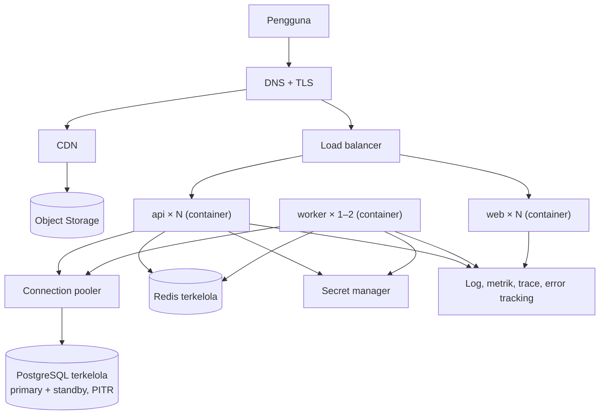

**Platform (usulan, OQ-T2).** Platform container terkelola di region Indonesia (Jakarta) dengan PostgreSQL dan Redis terkelola di region yang sama — demi latensi pengguna dan lokasi data pribadi (TC-4). Rancangan ini tidak bergantung pada penyedia tertentu: yang disyaratkan adalah (a) menjalankan container, (b) PostgreSQL 16 terkelola dengan PITR, (c) Redis terkelola, (d) object storage S3-compatible + CDN, (e) secret manager. `web` dapat pula di-host pada platform khusus Next.js selama berada pada domain induk yang sama dengan `api` (syarat cookie, 5.1).

### 9.3 Environment Variables

Dikelompokkan per proses; nilai rahasia (🔒) hanya berasal dari secret manager dan tidak pernah berada di repositori atau image.

| Variabel | Proses | Keterangan |
|---|---|---|
| `NODE_ENV`, `APP_ENV` | semua | `development` / `staging` / `production` |
| `WEB_ORIGIN`, `API_BASE_URL`, `COOKIE_DOMAIN` | api, web | Origin untuk CORS dan cookie |
| `DATABASE_URL` 🔒 | api, worker | Role `cv_app` melalui pooler |
| `DATABASE_MIGRATION_URL` 🔒 | CI saja | Role `cv_migrator`, koneksi langsung |
| `REDIS_URL` 🔒 | api, worker | — |
| `JWT_PRIVATE_KEY` 🔒, `JWT_PUBLIC_KEY`, `JWT_ACCESS_TTL` | api | Tanda tangan access token |
| `REFRESH_TTL_STUDENT`, `REFRESH_TTL_STAFF` | api | 5.2 |
| `PAYMENT_PROVIDER` | api, worker | `midtrans` / `fake` |
| `MIDTRANS_SERVER_KEY` 🔒, `MIDTRANS_CLIENT_KEY`, `MIDTRANS_IS_PRODUCTION` | api, worker, web (client key) | — |
| `MAIL_PROVIDER`, `MAIL_API_KEY` 🔒, `MAIL_FROM` | worker | — |
| `STORAGE_ENDPOINT`, `STORAGE_BUCKET`, `STORAGE_ACCESS_KEY` 🔒, `STORAGE_SECRET_KEY` 🔒, `CDN_BASE_URL` | api | — |
| `ORDER_EXPIRY_MINUTES` (1440), `SEAT_HOLD_MINUTES` (60) | api | BR-PAY-02 |
| `ANSWER_GRACE_SECONDS` (5) | api, worker | BR-TMO-03 |
| `ENTRY_WINDOW_DEFAULT_MINUTES` (30) | api | PRD 5.4 (v2.0: `WAITING_ROOM_MINUTES` dihapus, AU-02) |
| *(v2.0: ambang analitik dipindahkan ke `system_settings`, AD-15; tidak lagi variabel lingkungan)* | — | FR-PI-03, BR-PI-02 |
| `REMINDER_OFFSETS_MINUTES` (1440,60) | worker | FR-SES-12 |
| `TERMS_VERSION`, `PRIVACY_VERSION`, `CONTRIBUTOR_AGREEMENT_VERSION` | api | FR-PROF-04, FR-CTR-08 |
| `SENTRY_DSN` 🔒, `OTEL_EXPORTER_OTLP_ENDPOINT` | semua | Observabilitas |
| `RATE_LIMIT_*` | api | 5.10 |

Konfigurasi divalidasi dengan Zod saat proses dimulai; proses gagal start bila ada variabel wajib yang hilang atau tidak valid. Nilai default bisnis di atas adalah wujud "konfigurasi deployment" yang dimaksud FR-ADM-07 untuk MVP.

### 9.4 CI/CD

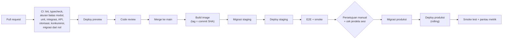

- **Satu image per aplikasi**, dipromosikan dari staging ke produksi tanpa build ulang.
- **Migrasi** adalah langkah tersendiri sebelum deploy (3.10); karena migrasi kompatibel mundur, versi lama dan baru dapat berjalan bersamaan selama rolling deploy.
- **Rolling deploy** dengan health check `ready`; instance lama menyelesaikan permintaan berjalan sebelum berhenti (*graceful shutdown*); worker menyelesaikan pekerjaan aktif.
- **Rollback**: deploy ulang image sebelumnya (selalu mungkin karena migrasi kompatibel mundur).
- **Pembekuan deploy**: gerbang otomatis menolak deploy produksi bila ada session `PUBLISHED` dalam rentang 2 jam sebelum `start_at` hingga `hard_end_at` (NFR-04), kecuali di-override Super Admin teknis untuk perbaikan darurat.
- Pemindaian dependensi dan secret di CI.

### 9.5 Secrets Management

- Semua rahasia di secret manager platform; disuntikkan saat runtime.
- Rahasia berbeda per lingkungan; kunci gateway sandbox tidak pernah dipakai di produksi dan sebaliknya.
- Akses dibatasi per layanan (prinsip hak minimum) dan tercatat.
- Rotasi: kunci JWT mendukung dua kunci publik aktif untuk rotasi tanpa memutus sesi; password database dan kunci API dirotasi terjadwal dan saat ada perubahan personel.
- `.env` lokal hanya untuk development dan tercantum di `.gitignore`; pemindai secret di CI menggagalkan commit yang memuat rahasia.

### 9.6 Logging, Monitoring, dan Backup

Rancangan ada di 7.8 dan 7.9. Di tingkat deployment:

- Log semua container dikirim ke satu agregator dengan retensi 30 hari (lebih lama untuk log keamanan).
- Peringatan dikirim ke kanal on-call; jadwal on-call wajib ada pada hari session scheduled.
- Backup database dan konfigurasi PITR diaktifkan sebelum data produksi pertama masuk; pemulihan diuji (7.8).
- Health check: `GET /health/live` (proses hidup) dan `GET /health/ready` (database dan Redis terjangkau).

---

## 10. Penajaman terhadap PRD

**Status v2.0:** seluruh butir P-01 s.d. P-11 di bawah ini **telah diserap ke PRD v2.0** (PRD D-26) dan dipertahankan di sini sebagai catatan asal-usul.

| # | Butir PRD | Temuan teknis | Penajaman di TDD |
|---|---|---|---|
| P-01 | BR-SCH-04 "paling banyak satu enrollment per session" | Bila diterapkan mutlak, siswa yang seat hold-nya kedaluwarsa tidak dapat mendaftar lagi ke session yang sama | Keunikan per session berlaku untuk enrollment berstatus selain `EXPIRED`/`CANCELLED` |
| P-02 | BR-DUR-03 `expires_at` sebagai "batas atas" | Jika siswa mengakhiri section lebih awal, batas atas awal menjadi tidak akurat dan auto-submit akan terlambat | `expires_at` diperbarui (hanya menyusut) saat section diakhiri lebih awal |
| P-03 | BR-QV-07 koreksi kunci lewat versi baru | Jawaban lama menunjuk opsi milik versi lama | Perbandingan memakai `option_key`; versi koreksi wajib memiliki himpunan `option_key` yang sama (`CORRECTION_INCOMPATIBLE` bila tidak). Koreksi yang mengubah jumlah opsi harus ditangani sebagai anulir (P1) |
| P-04 | BR-TMO-03 grace 5 detik | Bila auto-submit berjalan tepat pada tenggat, jawaban dalam grace akan ditolak | Auto-submit baru memproses attempt pada `expires_at + grace`; `submitted_at` tetap dicatat sebagai `expires_at` |
| P-05 | ~~D-04 exam gratis tanpa order~~ **[Tidak berlaku v3.0]** | — | Tidak ada exam gratis; akses lewat paket (TD-13) |
| P-06 | FR-QB-07 gambar yang dirujuk versi `APPROVED` tidak dapat dihapus | Melacak rujukan gambar per versi memerlukan tabel tambahan | Di MVP **tidak ada** operasi hapus/timpa aset sama sekali; kebutuhan terpenuhi tanpa tabel rujukan |
| P-07 | BR-PAY-07 pembayaran terlambat | PRD menyebut order `EXPIRED`; kasus order `CANCELLED` (session dibatalkan saat pembayaran berjalan) tidak disebut | Diperlakukan sama: order menjadi `PAID`, entitlement dibuat, tanpa enrollment, siswa diberi tahu |
| P-08 | FR-ENG-14 waktu per soal | Akurasi bergantung pada pelaporan klien | Nilai dilaporkan kumulatif oleh klien dan disimpan sebagai nilai terbesar; dinyatakan sebagai data indikatif, tidak dipakai untuk scoring |
| P-09 | FR-TMR-02 sinkronisasi berkala | Interval tidak ditetapkan | 60 detik, ditambah saat muat, tab aktif kembali, dan koneksi pulih |
| P-10 | PRD Lampiran B status enrollment | — | Diadopsi tanpa perubahan; ditambah status `users` (`INVITED`, `ACTIVE`, `SUSPENDED`, `DELETED`), `products` (`DRAFT`, `ACTIVE`, `INACTIVE`), `attempt_sections` (`PENDING`, `ACTIVE`, `ENDED`), dan `notifications` yang tidak diatur PRD |
| P-11 | FR-AUTH-03 AC (4) masa tidak aktif | Nilai tidak ditetapkan | Student 30 hari; staf dan kontributor 8 jam |

---

## 11. Traceability Matrix

Lapisan kedua dari matriks STEP 6: **PRD Requirement → Technical Module → Database Entity → API Endpoint → UI Screen → Test Case**. Kolom "UI Screen" memakai nama layar dari sitemap master prompt; ID layar final ditetapkan di DOCUMENT 03, dan matriks gabungan diterbitkan setelah dokumen itu selesai.

Mencakup seluruh 117 requirement P0. Requirement P1/P2 dirangkum di 11.2.

### 11.1 Requirement P0

| FR | Modul | Entitas utama | Endpoint | UI Screen | Test case |
|---|---|---|---|---|---|
| FR-AUTH-01 | Identity | `users`, `user_roles`, `user_consents` | EP-AUTH-01 | Registration | TC-AUTH-01 |
| FR-AUTH-02 | Identity | `auth_tokens`, `users` | EP-AUTH-02/03 | Registration | TC-AUTH-01 |
| FR-AUTH-03 | Identity | `auth_sessions` | EP-AUTH-04/05/06 | Login | TC-AUTH-02/03 |
| FR-AUTH-04 | Identity | `auth_tokens`, `auth_sessions` | EP-AUTH-07/08 | Login | TC-AUTH-04 |
| FR-AUTH-05 | Identity (guard) | `roles`, `user_roles` | Semua | Semua | TC-SEC-01/02 |
| FR-AUTH-06 | Identity | `users`, `auth_tokens`, `user_roles` | EP-USR-08/09, EP-AUTH-09 | User Management | TC-AUTH-04 |
| FR-AUTH-07 | Identity | `users`, `auth_sessions` | EP-USR-10/11 | User Management | TC-AUTH-05 |
| FR-AUTH-09 | Identity | `users` + Redis | EP-AUTH-01/03/04/07 | Login, Registration | TC-AUTH-02 |
| FR-PROF-01 | Identity | `student_profiles` | EP-USR-01/03 | Profile | TC-E2E-01 |
| FR-PROF-03 | Identity | `student_profiles` | EP-USR-03 | Registration (onboarding) | TC-E2E-01 |
| FR-PROF-04 | Identity | `user_consents` | EP-AUTH-01, EP-USR-05 | Registration | TC-AUTH-01 |
| FR-PROF-05 | Identity | `users`, `auth_tokens` | EP-USR-02/04 | Profile | TC-AUTH-04 |
| FR-QB-01 | QuestionBank | `subjects`, `topics` | EP-QST-01..05 | Settings (taksonomi) | TC-QB-05 |
| FR-QB-02 | QuestionBank | `questions`, `question_versions`, `question_options` | EP-QST-07/10 | Question Editor, Create Question | TC-QB-01 |
| FR-QB-03 | QuestionBank | `question_versions` | EP-QST-10 | Question Editor | TC-QB-01 |
| FR-QB-04 | QuestionBank | `question_versions` | EP-QST-10 | Question Editor | TC-QB-01, TC-SEC-04 |
| FR-QB-05 | QuestionBank | `question_versions` | EP-QST-06 | Question Bank | TC-QB-06 |
| FR-QB-06 | QuestionBank | `question_versions`, `question_options` | EP-QST-16 | Question Editor | TC-E2E-04 |
| FR-QB-07 | QuestionBank | `media_assets` | EP-QST-14/15 | Question Editor | TC-QB-05 |
| FR-QB-11 | QuestionBank | `questions` | EP-QST-13 | Question Bank | TC-QB-06 |
| FR-QV-01 | QuestionBank | `question_versions` | EP-QST-11 | Question Editor | TC-QB-03 |
| FR-QV-02 | QuestionBank | `question_versions`, `question_options` (trigger) | EP-QST-10 | Question Editor | TC-QB-02 |
| FR-QV-03 | QuestionBank | `question_versions` | EP-QST-08/09 | Question Bank | TC-QB-03 |
| FR-QV-05 | ExamManagement | `exam_questions` | EP-EXM-08/14 | Exam Builder | TC-EXM-02 |
| FR-QV-06 | Scoring | `exam_key_corrections`, `exam_questions` | EP-QST-11, EP-RES-05/06 | Result Management | TC-SCR-04 |
| FR-REV-01 | Review | `question_versions` | EP-REV-01/02 | Create Question, Submission Status | TC-QB-01 |
| FR-REV-02 | Review | `question_versions` | EP-REV-03 | Question Review | TC-E2E-04 |
| FR-REV-03 | Review | `question_reviews`, `question_versions` | EP-REV-04 | Question Review | TC-QB-04 |
| FR-REV-04 | Review | `question_versions` (`CHECK`) | EP-REV-04 | Question Review | TC-QB-04 |
| FR-REV-05 | Review | `question_reviews` | EP-REV-05 | Question Review, Review Feedback | TC-QB-04 |
| FR-REV-06 | Review, Notification | `notifications` | (proses) | Review Feedback | TC-NTF-01 |
| FR-EXM-01 | ExamManagement | `exams`, `products`, `product_exams` | EP-EXM-04 | Exam Management | TC-EXM-01, TC-FRE-01 |
| FR-EXM-02 | ExamManagement | `exam_sections` | EP-EXM-07 | Exam Builder | TC-EXM-01 |
| FR-EXM-03 | ExamManagement | `exam_questions` | EP-EXM-08 | Exam Builder | TC-EXM-01 |
| FR-EXM-04 | **[Dihapus v3.0]** | — | — | — | — |
| FR-EXM-05 | **[Dihapus v3.0]** | — | — | — | — |
| FR-EXM-06 | ExamManagement | `exams` dan anak | EP-EXM-09 | Exam Builder | TC-EXM-01 |
| FR-EXM-07 | ExamManagement | `exams` | EP-EXM-10/11 | Exam Management | TC-EXM-05 |
| FR-EXM-09 | ExamManagement | `exams`, `exam_sections`, `exam_questions` | EP-EXM-06/07/08 | Exam Builder | TC-EXM-03 |
| FR-EXM-10 | ExamManagement | `exams` | EP-EXM-06 | Exam Builder | TC-EXM-01 |
| FR-EXM-11 | ExamManagement | — (baca) | EP-EXM-12 | Exam Builder | TC-E2E-04 |
| FR-EXM-12 | ExamManagement | `exams` | EP-EXM-03/05 | Exam Management | TC-SEC-01 |
| FR-SES-01 | Sessions | `exam_sessions` | EP-SES-03 | Exam Sessions | TC-SES-01 |
| FR-SES-02 | Sessions | `exam_sessions` | EP-SES-05 | Exam Sessions | TC-SES-01 |
| FR-SES-03 | Sessions | `exam_sessions` | EP-SES-04 | Exam Sessions | TC-SES-02 |
| FR-SES-04 | Sessions | `exam_sessions` | EP-SES-01 | Exam Details | TC-E2E-03 |
| FR-SES-05 | Sessions | `exam_sessions`, `notifications` | EP-SES-06 | Exam Sessions | TC-SES-05 |
| FR-SES-06 | Sessions | `exam_sessions`, `exam_enrollments` | EP-SES-07 | Exam Sessions | TC-SES-05 |
| FR-SES-07 | Sessions | `exam_enrollments` | EP-SES-08 | Participant Management | TC-ADM-01 |
| FR-SES-08 | Sessions | `exam_enrollments`, `exam_sessions` | EP-ENR-01/02 | Exam Details, My Exams | TC-SES-04 |
| FR-SES-09 | Sessions, Commerce | `exam_enrollments`, `orders`, `exam_sessions` | EP-ORD-01 | Payment Checkout | TC-SES-02/03 |
| FR-SES-10 | **[Dihapus v3.0]** | — | — | — | — |
| FR-SES-11 | Sessions | `exam_enrollments` | (proses) + EP-ATT-02 | My Exams | TC-SES-06 |
| FR-SES-12 | Sessions, Notification | `notifications` | (proses) | — (email) | TC-SES-07 |
| FR-ENG-01 | ExamEngine | `exam_attempts`, `entitlements`, `exam_enrollments` | EP-ATT-01/02 | Exam Instructions | TC-ENG-01 |
| FR-ENG-02 | ExamEngine | — (baca) | EP-ATT-01 | Exam Instructions | TC-E2E-03 |
| FR-ENG-03 | ExamEngine | `exam_attempts`, `attempt_sections`, `attempt_questions` | EP-ATT-02 | Exam Instructions | TC-ENG-02/03 |
| FR-ENG-04 | ExamEngine | `attempt_questions`, `question_versions`, `question_options` | EP-ATT-03 | Active Examination | TC-E2E-01 |
| FR-ENG-05 | ExamEngine (klien) | `attempt_answers` | EP-ATT-03 | Active Examination | TC-E2E-05 |
| FR-ENG-06 | ExamEngine | `attempt_answers` | EP-ANS-01 | Active Examination | TC-TMR-01 |
| FR-ENG-07 | ExamEngine | `exam_attempts`, `attempt_answers` | EP-ATT-02/03 | Active Examination | TC-ENG-04 |
| FR-ENG-08 | ExamEngine | `exam_attempts` | EP-ATT-02, EP-ANS-01 | Active Examination | TC-ENG-04 |
| FR-ENG-09 | ExamEngine | `exam_attempts` | EP-ATT-06 | Active Examination | TC-ENG-06 |
| FR-ENG-10 | ExamEngine | `attempt_sections` | EP-ATT-05, EP-ANS-01 | Active Examination | TC-ENG-05, TC-TMR-04 |
| FR-ENG-11 | ExamEngine, Scoring | — (serializer) | EP-ATT-03, EP-RES-02 | Active Examination | TC-SEC-04 |
| FR-ENG-12 | ExamEngine | `attempt_answers` | EP-ANS-01 | Active Examination | TC-TMR-01 |
| FR-ENG-13 | ExamEngine (klien) | — | EP-ATT-03, EP-ANS-01/02 | Active Examination | TC-E2E-05 |
| FR-ENG-14 | ExamEngine | `attempt_answers` | EP-ANS-01 | Active Examination | TC-TMR-01, TC-PI-05 |
| FR-TMR-01 | ExamEngine | `exam_attempts`, `attempt_sections` | EP-ATT-02 | Active Examination | TC-TMR-02 |
| FR-TMR-02 | ExamEngine (klien) | — | EP-ATT-03/04 | Active Examination | TC-TMR-06 |
| FR-TMR-03 | ExamEngine | `attempt_answers` | EP-ANS-01 | Active Examination | TC-TMR-01 |
| FR-TMR-04 | ExamEngine (klien) | — | EP-ANS-01 | Active Examination | TC-TMR-07 |
| FR-TMR-05 | ExamEngine (klien) | — (IndexedDB) | EP-ANS-02 | Active Examination | TC-TMR-07 |
| FR-TMR-06 | ExamEngine (worker) | `exam_attempts`, `attempt_sections` | (proses) | Active Examination | TC-TMR-03 |
| FR-TMR-07 | ExamEngine | `attempt_answers`, `attempt_sections` | EP-ANS-01/02 | Active Examination | TC-TMR-02 |
| FR-TMR-08 | ExamEngine (klien) | — | EP-ATT-04 | Active Examination | TC-E2E-03 |
| FR-TMR-09 | ExamEngine | `attempt_answers` | EP-ANS-01/02 | Active Examination | TC-TMR-01 |
| FR-PAY-01 | Commerce | `orders`, `order_items`, `order_item_exams` | EP-ORD-01 | Payment Checkout | TC-PAY-07 |
| FR-PAY-02 | Commerce | `payments` | EP-PAY-01 | Payment Checkout | TC-PAY-06 |
| FR-PAY-03 | Commerce | `payments`, `payment_webhook_events`, `orders` | EP-PAY-02 | — (sistem) | TC-PAY-01..04 |
| FR-PAY-04 | Commerce | `orders`, `payments` | EP-ORD-03 | Payment Checkout | TC-PAY-08 |
| FR-PAY-05 | Commerce (worker) | `orders`, `payments`, `exam_enrollments` | (proses) | Transaction History | TC-PAY-05, TC-SES-03 |
| FR-PAY-06 | Commerce | `orders` | EP-ORD-02 | Transaction History | TC-SEC-02 |
| FR-PAY-07 | Commerce | `orders`, `payments`, `payment_webhook_events` | EP-ORD-04/05 | Payment Management | TC-SEC-01 |
| FR-PAY-08 | Commerce | `payments`, `audit_logs` | EP-PAY-03 | Payment Management | TC-PAY-06 |
| FR-PAY-11 | Commerce, Notification | `notifications` | (proses) | — (email) | TC-PAY-02 |
| FR-PAY-12 | Commerce | `orders`, `entitlements` | EP-ORD-01 | Exam Details, Payment Checkout | TC-PAY-07 |
| FR-ENT-01 | Packages, Commerce | `package_grants`, `orders` | EP-PAY-02/04 | Checkout | TC-PKG-01 |
| FR-ENT-02 | Packages, Entitlement | `entitlements`, `package_grants` | EP-PKG-03 | Detail Try Out Periode | TC-PKG-02/03 |
| FR-ENT-03 | Entitlement, AdminOps | `entitlements`, `audit_logs` | EP-ENT-03/04/05 | User Management | TC-ENT-03 |
| FR-ENT-04 | Entitlement | `entitlements` | EP-ATT-01/02 | Exam Instructions | TC-ENG-01 |
| FR-ENT-05 | Entitlement | `entitlements`, `exam_enrollments`, `exam_attempts` | EP-ENT-01 | My Exams | TC-E2E-02 |
| FR-ENT-06 | **[Dihapus v3.0]** | — | — | — | — |
| FR-SCR-01 | Scoring (worker) | `exam_results` | (proses) | Exam Results | TC-SCR-01 |
| FR-SCR-02 | Scoring | `result_section_scores` | EP-RES-01 | Exam Results | TC-SCR-01 |
| FR-SCR-03 | Scoring | `exam_results` | EP-RES-01 | Exam Results | TC-SCR-02 |
| FR-SCR-04 | Scoring | `exam_results` (trigger) | EP-RES-04 | Result Management | TC-SCR-03 |
| FR-SCR-05 | Scoring (worker) | `exam_key_corrections`, `exam_results` | EP-RES-05/06 | Result Management | TC-SCR-04 |
| FR-SCR-08 | Scoring | `result_topic_scores` | EP-RES-01 | Performance Report | TC-SCR-05 |
| FR-RES-01 | Scoring | `exam_results` | EP-RES-01 | Exam Results | TC-E2E-01 |
| FR-RES-02 | Scoring (worker), Sessions | `exam_results`, `exam_sessions` | EP-RES-01, EP-SES-09 | Exam Results, Exam Sessions | TC-RES-01 |
| FR-RES-03 | Scoring | `attempt_questions`, `attempt_answers`, `question_options` | EP-RES-02 | Exam Results | TC-RES-02 |
| FR-RES-04 | PerformanceIntelligence | `exam_attempts`, `exam_results` | EP-ATT-07 | Exam History | TC-RES-03 |
| FR-RES-05 | Scoring, Notification | `notifications` | (proses) | — (email) | TC-NTF-01 |
| FR-PI-02 | PerformanceIntelligence | `result_section_scores` | EP-PI-01 | Performance Report | TC-SCR-01, TC-FRE-04 |
| FR-PI-03 | PerformanceIntelligence | `result_topic_scores`, `performance_insights` | EP-PI-01 | Performance Report | TC-RES-03, TC-PI-03 |
| FR-ADM-02 | AdminOps, Identity | `users`, `user_roles` | EP-USR-06/07/09 | User Management | TC-SEC-01 |
| FR-ADM-03 | AdminOps, Scoring | `exam_results` | EP-RES-03/04 | Result Management | TC-ADM-01 |
| FR-ADM-04 | Audit | `audit_logs` | (lintas endpoint) | — | TC-ADM-01, TC-ENT-03 |
| FR-ADM-08 | AdminOps | `exam_attempts`, `entitlements`, `audit_logs` | EP-ADM-01, EP-ENT-05 | Result Management | TC-ADM-01 |
| FR-CTR-01 | QuestionBank | `questions`, `question_versions` | EP-QST-06 | My Questions | TC-SEC-03 |
| FR-CTR-02 | QuestionBank | `question_versions`, `question_options` | EP-QST-07/10/12 | Create Question | TC-QB-02 |
| FR-CTR-03 | Review | `question_reviews` | EP-REV-05, EP-QST-08 | Submission Status, Review Feedback | TC-E2E-04 |
| FR-CTR-04 | Review | `question_versions` | EP-QST-10, EP-REV-01 | Review Feedback | TC-E2E-04 |
| FR-CTR-05 | Identity (guard), QuestionBank | `questions` | EP-QST-06..12 | Dashboard kontributor | TC-SEC-03 |
| FR-CTR-08 | Identity | `user_consents` | EP-USR-05, EP-QST-07 | Create Question | TC-SEC-03 |
| FR-NTF-01 | Notification (worker) | `notifications` | (proses) | — (email) | TC-NTF-01 |
| FR-EXM-13 | ExamManagement, Configuration | `system_settings`, `exams` | EP-EXM-09, EP-SET-02 | Exam Builder | TC-FRE-02, TC-FRE-03 |
| FR-EXM-14 | ExamManagement | `exam_series`, `exams` | EP-SER-01..03, EP-EXM-06 | Exam Builder | TC-SER-01, TC-SER-02 |
| FR-ENG-17 | ExamEngine | `attempt_answers` | EP-ANS-01/02 | Active Examination | TC-PI-11 |
| FR-PI-01 | PerformanceIntelligence | `exam_results`, `result_section_scores` | EP-PI-01 | Exam Results | TC-SCR-01, TC-FRE-04 |
| FR-PI-05 | PerformanceIntelligence | `result_behavior_metrics`, `attempt_sections` | EP-PI-01 | Performance Report | TC-PI-05 |
| FR-PI-07 | PerformanceIntelligence | `result_analyses`, `performance_insights` | (proses `result.analyze`), EP-PI-05/06 | — | TC-PI-01, TC-PI-02, TC-PI-04, TC-PI-07, TC-PI-08 |
| FR-PI-08 | PerformanceIntelligence | `learning_recommendations` | EP-PI-01 | Performance Report | TC-PI-03 |
| FR-PI-10 | PerformanceIntelligence, Scoring | `learning_recommendations`, `attempt_questions` | EP-PI-01, EP-RES-02 (`topicId`) | Pembahasan | TC-FRE-04 |
| FR-PI-11 | **[Dihapus v3.0]** | — | — | — | — |
| FR-PI-12 | PerformanceIntelligence | (templat ber-versi di kode) | EP-PI-01/02 | Performance Report | TC-PI-06 |
| FR-PRG-01 | PerformanceIntelligence | `student_performance_snapshots` | (transaksi scoring) | — | TC-PI-01, TC-PI-08, TC-PRG-03 |
| FR-PRG-06 | PerformanceIntelligence | `exam_attempts`, `exams`, `exam_series` | EP-ATT-07 | Exam History | TC-PRG-02 |
| FR-CAT-01 | ExamManagement | `products`, `exams`, `exam_series` | EP-EXM-01 | Exam Catalog | TC-CAT-01 |
| FR-CAT-02 | ExamManagement | `products`, `exams`, `exam_sections`, `exam_sessions` | EP-EXM-02, EP-SES-01 | Exam Details | TC-CAT-01 |
| FR-CAT-03 | ExamManagement | — (isi statis + `reportTier`) | EP-EXM-02 | Exam Details | TC-CAT-01 |
| FR-CAT-04 | — (web) | — | — (halaman statis) | Home, About | TC-E2E-01 |
| FR-CAT-05 | — (web) | — | Format error 4.1 | Halaman sistem | TC-E2E-01 |
| FR-PKG-01 | Packages | `products` | EP-PKG-01/04/05/06 | Paket & Harga, Admin Paket | TC-PKG-05 |
| FR-PKG-02 | Packages | `products`, `vouchers` | EP-PKG-01, EP-VOU-01 | Paket & Harga | TC-REF-03 |
| FR-PKG-03 | Packages, Commerce | `package_grants` | EP-PAY-02/04 | Checkout | TC-PKG-01 |
| FR-PKG-04 | Packages | `package_grants`, `entitlements` | EP-PKG-03 | Detail Try Out Periode | TC-PKG-02/03 |
| FR-PKG-05 | Packages | `package_grants` | EP-PKG-02, EP-ENT-01 | Ringkasan, Asesmen Saya | TC-PKG-01 |
| FR-PKG-06 | Packages | `package_grants` | EP-PKG-03 | Asesmen Saya | TC-PKG-04 |
| FR-REF-01 | Referral | `users.referral_code` | EP-REF-01 | Referral | TC-REF-04 |
| FR-REF-02 | Referral | `referrals` | EP-AUTH-01, EP-REF-02 | Registrasi | TC-REF-01 |
| FR-REF-03 | Referral | `referrals` | EP-PAY-02/04 | — | TC-REF-02 |
| FR-REF-04 | Referral | `vouchers` | — (6.7.3) | Referral | TC-REF-02 |
| FR-REF-05 | Referral, Commerce | `vouchers`, `orders` | EP-ORD-01 | Checkout | TC-REF-03 |
| FR-REF-06 | Referral | `referrals`, `vouchers` | EP-REF-01 | Referral | TC-REF-04 |
| FR-TGT-01 | Targets | `student_targets`, `study_programs` | EP-TGT-01/02/04 | Onboarding | TC-TGT-03 |
| FR-TGT-02 | Targets | `student_targets` | EP-TGT-04 | Onboarding, Progres | TC-TGT-02 |
| FR-TGT-03 | Targets | `universities`, `study_programs` | EP-TGT-05/06/07 | Admin Data Kampus | TC-TGT-01 |
| FR-TGT-04 | Targets | `student_targets`, snapshot | EP-TGT-03 | Ringkasan, Progres | TC-TGT-02 |
| FR-TGT-05 | Targets | `study_programs` | EP-TGT-02/03 | Onboarding, Progres | TC-TGT-01 |
| FR-TGT-06 | StudyPlanner | `study_plans` | — (6.7.4) | Roadmap | TC-RMP-01 |
| FR-RMP-01 | StudyPlanner | `study_plans` | — (6.7.4) | Roadmap | TC-RMP-01/02 |
| FR-RMP-02 | StudyPlanner | `study_plans.phases` | EP-RMP-01 | Roadmap | TC-RMP-01 |
| FR-RMP-03 | StudyPlanner | `exam_series.exam_date` | EP-RMP-01 | Roadmap | TC-RMP-01 |
| FR-RMP-04 | StudyPlanner | `study_plan_items` | EP-RMP-02/03 | Ringkasan, Roadmap | TC-RMP-01 |
| FR-RMP-05 | StudyPlanner | `topic_guides` | EP-RMP-05/06 | Panduan Materi, Admin Panduan | TC-RMP-01 |
| FR-RMP-06 | StudyPlanner | `study_plans`, `study_plan_items` | EP-RMP-01/02 | Ringkasan, Roadmap | TC-RMP-01 |
| FR-RMP-07 | StudyPlanner | `student_profiles`, `study_plans` | EP-RMP-04 | Roadmap | TC-RMP-03 |
| FR-RMP-08 | — (web) | — | — | Beranda | TC-E2E-01 |
| FR-PRG-02 | PerformanceIntelligence | snapshot | EP-PRG-01 | Progres | TC-PRG-01 |
| FR-PRG-03 | PerformanceIntelligence | snapshot | EP-PRG-02 | Progres | TC-PRG-02 |
| FR-PRG-04 | PerformanceIntelligence | snapshot | EP-PRG-02 | Progres | TC-PRG-02 |
| FR-PRG-05 | PerformanceIntelligence | snapshot | EP-PRG-02 | Progres | TC-PRG-02 |

### 11.2 Requirement P1 dan P2

Tidak diimplementasikan di MVP; dicantumkan agar jalur perluasannya jelas dan tidak ada yang "unresolved" tanpa disadari.

| FR | Jalur perluasan | Perubahan skema yang diperkirakan |
|---|---|---|
| FR-AUTH-08 (Google) | Strategi OAuth di Identity | Tabel identitas eksternal |
| FR-AUTH-10 (hapus akun) | Proses anonimisasi | Status `DELETED` sudah ada |
| FR-PROF-02 (target PTN) | Identity | Tabel rujukan + pilihan |
| FR-QB-08/09/10/12 | QuestionBank | Nilai `question_type` baru; tabel stimulus; tanpa perubahan untuk impor dan info pemakaian |
| FR-QV-04, FR-REV-07 | QuestionBank, Review | Tanpa perubahan |
| FR-QV-07, FR-SCR-06 (anulir) | Scoring | `exam_questions.is_annulled`; penyesuaian query 6.5.1 |
| FR-EXM-08 (duplikasi) | ExamManagement | Tanpa perubahan |
| FR-SES-13/14/15 | Sessions | Tanpa perubahan |
| FR-PAY-09 (refund) | Commerce | Kolom refund sudah ada di `orders` |
| FR-PAY-10 (promo) | Commerce | Tabel promo; `orders.discount_amount` sudah ada |
| FR-SCR-07, FR-PI-13 (ranking) | Scoring, PerformanceIntelligence | Kolom ranking/percentile di `exam_results` |
| FR-PI-04, FR-PI-06, FR-PI-09, FR-PI-16 | PerformanceIntelligence | Tanpa perubahan skema (tabel v2.0 sudah ada); aturan OBS-CAP-04, OBS-BEH-03/04, INF-BEH-02, REC-NXT-01 diaktifkan |
| FR-PRG-02..05 | PerformanceIntelligence | Tanpa perubahan skema; EP-PRG-01/02 |
| FR-QB-13/14 | QuestionBank | `competencies`, `question_competencies` sudah ada; EP-CMP-01..03 |
| FR-PROF-06, FR-FUT-01 | Identity, Programs | `data_export_requests`, `program_interests` sudah ada |
| FR-PI-14 (LLM, P2) | PerformanceIntelligence | Tabel penjelasan terpisah; `InsightExplainerPort` (6.6.8) |
| FR-FUT-02..07 (P2) | Modul baru tahap 3–4 | Tabel baru yang merujuk `users`, `learning_recommendations`, snapshot (3.4a) |
| FR-ADM-01/05/06/07 | AdminOps, Configuration | `system_settings` sudah ada (v2.0); EP-SET-03 untuk FR-ADM-07 |
| FR-CTR-06, FR-NTF-02 | QuestionBank, Notification | `notifications` sudah memuat `user_id`; tambah penanda dibaca |
| FR-ENG-15/16, FR-ENT-07, FR-RES-06/07, FR-PI-15, FR-CTR-07 | P2 | Ditentukan saat dijadwalkan |

### 11.3 Pemeriksaan Balik

| Pemeriksaan | Hasil |
|---|---|
| FR P0 tanpa modul, entitas, endpoint/proses, atau test case | Tidak ada |
| Tabel tanpa justifikasi PRD | Tidak ada (kolom "Justifikasi PRD" pada 3.4) |
| Endpoint tanpa journey atau proses | Tidak ada (4.16). EP-ADM-02 ditandai P1; EP-ADM-03 adalah kebutuhan operasional platform |
| Modul tanpa FR | Tidak ada (2.6) |
| Komponen teknis yang ditantang | **Redis**: dijustifikasi oleh pekerjaan tertunda, rate limit, pencabutan token, dan cache DTO exam. **Tabel idempotency generik**: ditolak (AD-09). **WebSocket**: ditolak (AD-02). **RLS**: tidak diaktifkan (5.15). **Tabel rujukan aset**: ditolak (P-06). **Kolom P1 di skema MVP**: ditunda (3.10) |

---

## 12. Asumsi, Keputusan, dan Open Questions

### 12.1 Asumsi Teknis

| ID | Asumsi | Memengaruhi |
|---|---|---|
| TA-01 | Posisi default OQ-01 s.d. OQ-05 PRD diterima | Seluruh dokumen |
| TA-02 | Payment gateway menyediakan notifikasi bertanda tangan, API cek status, dan batas waktu transaksi yang dapat disetel | 6.4 |
| TA-03 | `web` dan `api` dapat ditempatkan di bawah satu domain terdaftar | 5.1 |
| TA-04 | Tersedia PostgreSQL 16 terkelola dengan PITR dan ekstensi `citext`, `pg_trgm` di platform pilihan | 3, 7.8 |
| TA-05 | Try out tipikal ±160 soal dalam ±7 section; satu session awal ≤ 1.000 peserta | 7.1 |
| TA-06 | Target RPO 5 menit dan RTO 2 jam dapat diterima bisnis | 7.8 |
| TA-07 | Tim memiliki kemampuan TypeScript full-stack dan dasar operasional container | 1.4 |
| TA-08 | Skema signature dan nama field Midtrans pada dokumen ini berasal dari pengetahuan umum penulis dan **belum diverifikasi** terhadap dokumentasi terkini | 5.9, 6.4 |
| TA-09 | Volume analitik MVP (≤ 50 attempt per siswa per musim; ±40 snapshot per result) dapat dilayani PostgreSQL tanpa warehouse | 1.4a, 6.6.6 |
| TA-10 | Templat bahasa insight ditinjau Content Editor sebelum rilis setiap versi aturan | 6.6.4, FR-PI-12 |
| TA-11 | Exam dalam satu seri dirancang setara oleh tim akademik; sistem tidak melakukan equating statistik | BR-PRG-01, OQ-16 PRD |

### 12.2 Keputusan Teknis

Keputusan arsitektur AD-01 s.d. AD-12 tercantum di 1.6. Keputusan tambahan:

| ID | Keputusan | Rationale |
|---|---|---|
| TD-01 | Satu endpoint `POST /attempts` untuk mulai, lanjut, dan ambil alih sesi | Memenuhi "satu pintu" FR-ENG-01 dan menyederhanakan klien |
| TD-02 | Sesi perangkat ujian memakai token tersendiri (`X-Attempt-Session`), terpisah dari sesi login | Memungkinkan BR-LIF-04 tanpa mengganggu login di perangkat lain |
| TD-03 | Status API gateway dipanggil di luar transaksi database | Transaksi tetap singkat; tidak menahan kunci selama panggilan jaringan |
| TD-04 | Sweeper berbasis database mendampingi setiap pekerjaan tertunda | Prinsip arsitektur 6 |
| TD-05 | Fungsi `app_now()` membungkus waktu database | Keterujian timer (8.1) |
| TD-06 | Role database terpisah untuk migrasi, aplikasi, dan baca-saja | 5.15 |
| TD-07 | Gerbang deploy otomatis berdasarkan jadwal session | NFR-04 |
| TD-08 | Kolom untuk fitur P1 tidak dibuat di skema MVP | Aturan konsistensi no. 10 |
| TD-09 | Pipeline PI dua tahap: agregat deterministik dalam transaksi scoring, aturan dalam pekerjaan terpisah | Skor tidak tertahan oleh analisis; aturan dapat dijalankan ulang (AD-13, AD-14) |
| TD-10 | Teks insight dirender di server dari templat ber-versi | Bahasa konsisten dan dapat ditinjau; klien tidak menyusun kalimat analitik |
| TD-11 | Tidak ada backfill perubahan jawaban untuk attempt v1.0 | Riwayat tidak dapat direkonstruksi; nilai NULL/0 dinyatakan "tidak tersedia" pada laporan |
| TD-12 *(v3.0)* | Simulator pembayaran `DEV_SIMULATED` hanya di non-produksi dan dijaga dua kunci (env + pengaturan) | Alur ujung ke ujung dapat diuji sebelum gateway dipilih (OQ-T1) tanpa risiko pembayaran palsu di produksi |
| TD-13 *(v3.0)* | Paket menghasilkan `package_grants`; entitlement dibuat saat penukaran | Siswa memilih periode sendiri; Lifetime mencakup periode yang belum terbit |
| TD-14 *(v3.0)* | Kualifikasi referral di transaksi `applyPaid` dan voucher idempotent per batch | Tidak ada voucher ganda pada webhook berulang |
| TD-15 *(v3.0)* | Roadmap dibangun di proses yang sama dengan analisis (setelah `COMPLETED`), bukan cron harian | Plan selalu konsisten dengan result terkini; cron hanya diperlukan untuk pengingat (P1) |

### 12.3 Open Questions Teknis

| ID | Pertanyaan | Posisi default TDD | Dampak bila berubah | Prioritas |
|---|---|---|---|---|
| OQ-T1 | Payment gateway: Midtrans atau Xendit? (biaya, metode, proses onboarding merchant) | Midtrans Snap | Hanya adapter `PaymentGatewayPort` dan pemetaan status 6.4.2 | **Tinggi** — onboarding merchant memakan waktu |
| OQ-T2 | Platform hosting dan region | Container terkelola di region Jakarta | Detail 9.2; tidak mengubah arsitektur | **Tinggi** |
| OQ-T3 | Penyedia email transaksional dan domain pengirim | Melalui `MailerPort`; penyedia belum dipilih | Hanya adapter; konfigurasi DNS (SPF/DKIM) perlu waktu | Sedang |
| OQ-T4 *(diputuskan v2.0: SQL berparameter, AD-17)* | ORM: Prisma (usulan) atau query builder lain? | Prisma + SQL mentah untuk jalur kritis | Lapisan akses data; DDL tidak berubah | Sedang |
| OQ-T5 | Apakah 2FA untuk staf wajib sebelum rilis? | Direkomendasikan, tidak dimasukkan P0 | Menambah cakupan Identity | Sedang |
| OQ-T6 | Apakah gambar soal perlu URL bertanda tangan berumur pendek, bukan kunci acak permanen? | Kunci acak permanen | Menambah beban API dan kompleksitas cache CDN | Rendah |
| OQ-T7 | Alat analitik web untuk event kunjungan (PRD 3.4) | Belum dipilih | Tidak memengaruhi backend | Rendah |
| OQ-T8 | Retensi data: berapa lama `payment_webhook_events`, `audit_logs`, dan jawaban disimpan? | Tanpa batas di MVP | Kebutuhan partisi/arsip kelak; terkait OQ-08 PRD | Rendah |
| OQ-T9 | Apakah analisis aturan cukup cepat dijalankan di proses `worker` yang sama dengan scoring saat lonjakan akhir session? | Ya, dengan antrean terpisah berprioritas lebih rendah dari `attempt.score` | Bila tidak: worker khusus analitik; tanpa perubahan skema | Sedang |
| OQ-T10 | Retensi snapshot dan insight versi aturan lama | Disimpan tanpa batas di MVP | Partisi atau arsip kelak; terkait OQ-T8 | Rendah |
| OQ-T11 *(v3.0)* | Format impor data acuan kampus (CSV per musim?) setelah sumber ditetapkan (OQ-20) | Input manual admin (EP-TGT-05/06) | Menambah endpoint impor | Sedang |
| OQ-T12 *(v3.0)* | Zona waktu batas akses Lifetime dan kredit | 23.59 WIB pada tanggal batas | Hanya perhitungan `valid_until` | Rendah |

---

## 13. Catatan Self-Review

| # | Pemeriksaan | Hasil |
|---|---|---|
| 1 | Subbagian 5.1–5.9 master prompt tercakup | Ya: 5.1→Bagian 1; 5.2→2; 5.3→3; 5.4→4; 5.5→5; 5.6→6; 5.7→7; 5.8→8; 5.9→9 |
| 2 | Seluruh domain tabel minimal master prompt ada | Ya; ditambah 13 tabel berjustifikasi (bertanda ★ di 3.4) |
| 3 | Setiap kolom pada ERD 3.3 ada di DDL 3.5 | Diverifikasi dengan pemeriksaan otomatis atas berkas |
| 4 | Setiap tabel pada ERD 3.2 ada di DDL dan sebaliknya | Diverifikasi dengan pemeriksaan otomatis |
| 5 | UUID primary key, `TIMESTAMPTZ`, `NUMERIC` untuk uang, FK eksplisit | Ya. Catatan: `user_roles` memakai PK komposit dari dua UUID |
| 6 | Pencegahan duplikasi enrollment, jawaban, dan pemrosesan pembayaran | Ya (3.9) |
| 7 | Setiap rujukan `EP-…` dan `TC-…` menunjuk ID terdefinisi; tidak ada ID ganda | Diverifikasi dengan pemeriksaan otomatis |
| 8 | Setiap rujukan `FR-…`/`BR-…`/`EC-…` ada di PRD | Diverifikasi dengan pemeriksaan otomatis terhadap berkas PRD |
| 9 | Seluruh 117 FR P0 ada pada matriks 11.1 | Diverifikasi dengan pemeriksaan otomatis |
| 10 | Kunci jawaban tidak ada pada skema respons siswa sebelum ujian selesai | Ya (4.9, 5.8); dijaga TC-SEC-04 |
| 11 | Pembayaran tidak mengaktifkan akses lewat frontend | Ya (6.4.2); dijaga TC-PAY-08 |
| 12 | Kedua mode ujian memakai satu engine | Ya: satu endpoint, satu set tabel eksekusi, satu jalur scoring |
| 13 | Fakta dan usulan dibedakan | Ya: status dokumen, TA-08, catatan pada 3.5, 5.9, 6.4.2 |
| 14 | (v2.0) DDL 3.5–3.8 dapat dieksekusi | **Terverifikasi**: dijalankan pada PostgreSQL 16 lewat `scripts/verify-tdd-ddl.mjs` — 50 tabel, 43 trigger, seed lolos |
| 15 | (v2.0) Migrasi v1→v2 dapat dieksekusi pada data tonggak 1 | **Terverifikasi**: `scripts/verify-migration-v2.mjs` |
| 16 | (v2.0) ERD mendukung riwayat asesmen dan Performance Intelligence | Ya: 3.3 (diagram PI), 3.4, 6.6 |
| 17 | (v2.0) Kontrak API sesuai skema | Setiap properti respons PI bersumber dari kolom 3.5 (6.6.7); diperiksa manual |
| 18 | (v2.0) RBAC dan entitlement eksplisit | Ya: 5.3a, TC-AUTHZ |
| 19 | (v2.0) Seluruh 134 FR P0 PRD v2.0 ada di 11.1 | Diverifikasi dengan pemeriksaan otomatis |

**Keterbatasan yang diketahui**

- ~~DDL belum dieksekusi~~ — **tertutup pada v2.0**: DDL v1.0 berjalan tanpa perubahan saat tonggak 1; DDL v2.0 dan migrasi v1→v2 dijalankan (14, 15). Yang belum: uji integrasi pipeline PI karena kodenya belum ada. Kesalahan sintaks atau interaksi trigger yang tidak terduga mungkin baru terlihat saat migrasi pertama dijalankan di CI.
- **Detail Midtrans belum diverifikasi** terhadap dokumentasi resmi terkini (TA-08).
- **Angka beban adalah perkiraan**; hanya uji beban yang dapat mengonfirmasinya.
- **Kolom "UI Screen"** memakai nama layar; ID layar final ada di matriks UI/UX Bagian 11.
- **Templat insight dan ambang** adalah usulan awal; belum diuji dengan siswa (OQ-13, OQ-15 PRD).
- **Aspek hukum** (UU PDP, retensi data, pajak) tidak diselesaikan dokumen ini.

---

*Akhir DOCUMENT 02 v2.0. Turunan antarmuka: UI/UX Specification v2.0; ringkasan perubahan: Cogniverse Revision Summary.*
