# DOCUMENT 03 — Cogniverse UI/UX Specification

| Atribut | Nilai |
|---|---|
| Produk | Cogniverse — persiapan SNBT untuk siswa kelas 12, dari try out ke rencana belajar |
| Versi dokumen | **3.0** (Draft untuk persetujuan) — reposisi: Full Try Out berbayar, paket 1x/Bundle/Lifetime, target kampus & jurusan, roadmap & plan harian, referral |
| Tanggal | 13 November 2026 |
| Status | **Proposed** — rancangan antarmuka; belum ada desain visual final atau uji kegunaan. Status implementasi dicatat di Revision Summary Bagian 10 |
| Dokumen induk | DOCUMENT 01 — PRD v3.0; DOCUMENT 02 — TDD v3.0 |
| Bahasa | Bahasa Indonesia; nama komponen, token, dan identifier dalam bahasa Inggris |

> **Dasar penurunan.** Setiap layar diturunkan dari journey dan requirement PRD v3.0 serta memakai endpoint TDD v3.0. Rujukan `FR-…`, `BR-…`, `EC-…`, `UJ-…` menunjuk ke PRD; `EP-…`, `TC-…` ke TDD. Arah visual bergaya Apple dan design system (Bagian 6) **tidak berubah** dari v2.0.

### Riwayat Versi

| Versi | Perubahan utama |
|---|---|
| 1.0 | 43 layar, 10 flow, 15 wireframe, design system awal (biru tua + teal) |
| 1.1 | Arah visual mengikuti referensi gaya marketplace kursus (violet bergaris tepi) |
| 2.0 | Positioning *Try Out as Gateway*; arah visual bergaya Apple; 50 layar; 14 flow; 18 wireframe; Performance Intelligence UX; redaksi berbasis copywriting |
| **3.0** | Reposisi produk (PRD v3.0). **Dihapus:** PUB-12 Detail Free Try Out, varian laporan BASIC, perbandingan Free vs Premium. **Diubah:** PUB-01, PUB-03, PUB-04 (Detail Try Out Periode), PUB-05 (Paket & Harga, `/paket`), STU-01 (+ target), STU-02 (+ Hari Ini, jarak target), STU-04 (+ voucher), STU-13 (Progres & Target, kini P0), STU-14 (Roadmap & Hari Ini, `/app/roadmap`), ADM-14 (Musim). **Baru:** STU-17 Referral, STU-18 Panduan Materi, ADM-15 Paket, ADM-16 Data Kampus & Jurusan, ADM-17 Panduan Materi. 54 layar aktif; flow 3.2, 3.12, 3.15 ditulis ulang/baru; wireframe 5.1, 5.16, 5.18, 5.19, 5.20; redaksi 9.0 ditulis ulang |

---

## Ringkasan Eksekutif

Antarmuka Cogniverse v3.0 melayani satu perjalanan siswa kelas 12: **daftar dan pilih target → pilih paket → kerjakan Full Try Out → pahami diagnosis → ikuti roadmap dan plan harian → lihat jarak ke target mengecil.** Empat momen memikul perjalanan itu:

1. **Antarmuka ujian (STU-06)** — tidak berubah: tenang, timer selalu terlihat, jawaban tidak pernah hilang.
2. **Laporan Performance Intelligence (STU-08)** — enam bagian yang sama dengan v2.0, satu tingkat untuk semua paket; bagian 6 kini berujung pada roadmap.
3. **Roadmap & Hari Ini (STU-14)** — alasan untuk kembali setiap hari: tugas hari ini dengan perkiraan menit, fase per minggu sampai SNBT, dan panduan materi per topik.
4. **Progres & Target (STU-13)** — jarak skor ke target pribadi dan tren antar periode dalam satu musim, dengan skor acuan kampus hanya bila bersumber.

**Redaksi:** prinsip copywriting v2.0 tetap berlaku (jelas, spesifik, jujur, tanpa tanda seru). Hal yang wajib jujur di v3.0: harga per periode, cakupan dan tanggal berakhir paket Lifetime, syarat referral, sumber skor acuan, dan larangan klaim "soal asli" sebelum OQ-19 terjawab.

**Cakupan:** 54 layar aktif, flow utama v3.0, wireframe beranda, paket, progres & target, roadmap, onboarding target; design system v2.0; microcopy; matriks keterlacakan untuk requirement P0 PRD v3.0.

---

## Daftar Isi

1. [Design Direction](#1-design-direction)
2. [Information Architecture & Sitemap](#2-information-architecture--sitemap)
3. [User Flow](#3-user-flow)
4. [Screen Inventory](#4-screen-inventory)
5. [Wireframe Specification](#5-wireframe-specification)
6. [Design System](#6-design-system)
7. [Responsive Design](#7-responsive-design)
8. [Accessibility](#8-accessibility)
9. [Konten, Microcopy, dan Pemetaan Pesan Error](#9-konten-microcopy-dan-pemetaan-pesan-error)
10. [Asumsi, Keputusan, dan Open Questions](#10-asumsi-keputusan-dan-open-questions)
11. [Cross-Document Traceability Matrix](#11-cross-document-traceability-matrix)
12. [Consistency Audit](#12-consistency-audit)
13. [Unresolved Decisions dan Rekomendasi](#13-unresolved-decisions-dan-rekomendasi)
14. [Catatan Self-Review](#14-catatan-self-review)

---

## 1. Design Direction

### 1.1 Brand Positioning

Cogniverse adalah platform Full Try Out SNBT untuk siswa kelas 12 yang berlanjut menjadi rencana belajar menuju kampus dan jurusan tujuan (PRD v3.0 2.3). Antarmuka harus terasa:

| Kualitas yang diminta | Artinya di layar | Yang dihindari |
|---|---|---|
| **Akademis, tetapi tidak kaku** | Tipografi tegas, data rapi, bahasa sehari-hari | Tabel padat ala rapor, istilah psikometri |
| **Modern dan mudah didekati** | Ruang putih lapang, sudut membulat, satu warna aksen | Dekorasi, gradien ramai, maskot |
| **Berbasis data, tetapi mudah dipahami** | Satu angka utama per kartu, kalimat penjelas di bawah setiap grafik | Grafik tanpa label, persentase tanpa jumlah soal |
| **Menyemangati, tetapi tidak kekanak-kanakan** | Kalimat yang mengarahkan ke langkah berikutnya | Konfeti, lencana, "Hebat!!!", label "lemah" |
| **Berfokus pada progres siswa** | Setiap halaman hasil berakhir dengan langkah berikutnya | Ranking publik, perbandingan dengan siswa lain di luar sesi |

**Urutan prioritas desain v3.0:** STU-06 Ujian → STU-08 Laporan → STU-14 Roadmap & Hari Ini → PUB-01/PUB-05 Penemuan dan Paket → STU-13 Progres & Target → layar lain. Karena tidak ada try out gratis, halaman publik wajib memperlihatkan nilai produk lewat **contoh laporan dan contoh roadmap** berlabel "Contoh".

### 1.2 Prinsip Desain

Tiga prinsip pertama diadaptasi dari Human Interface Guidelines Apple; lima berikutnya khusus Cogniverse.

| # | Prinsip | Konsekuensi praktis |
|---|---|---|
| DP-1 | **Clarity — kejelasan** | Teks terbaca di ukuran apa pun (isi siswa minimal 17 px); satu tujuan utama per layar; ikon selalu berlabel; angka penting tampil besar |
| DP-2 | **Deference — antarmuka mengalah pada konten** | Soal, skor, dan insight adalah elemen visual terkuat. Krom antarmuka (navigasi, garis tepi) tipis dan netral. Di STU-06 tidak ada header aplikasi, notifikasi, atau promosi |
| DP-3 | **Depth — kedalaman yang bermakna** | Lapisan (lembar bawah, dialog, navigasi tembus pandang) menunjukkan hierarki dan konteks; transisi menjelaskan asal dan tujuan, bukan hiasan |
| DP-4 | **Sistem selalu memberi tahu keadaannya** | Setiap aksi asinkron memiliki keadaan memuat, berhasil, gagal. Status simpan jawaban selalu terlihat |
| DP-5 | **Tidak ada jalan buntu** | Setiap error, empty state, dan akhir laporan menyertakan langkah berikutnya |
| DP-6 | **Bukti sebelum kesimpulan** | Insight dapat dibuka untuk melihat soal yang mendasarinya; dugaan diberi label "Dugaan" dan ditulis dengan kata kemungkinan (BR-PI-03) |
| DP-7 | **Jujur tentang angka** | Skor disertai skala dan disclaimer; grafik dimulai dari nol; perbandingan hanya bila sebanding (BR-PRG-01); topik dengan data sedikit tidak diberi label |
| DP-8 | **Mobile dan aksesibel sejak awal** | Alur siswa dirancang dari 360 px; WCAG 2.2 AA adalah definisi selesai setiap komponen |

### 1.3 Yang Dihindari

- Gamifikasi: lencana, poin, *streak*, konfeti, maskot, papan peringkat publik.
- Gradien dekoratif, bayangan tebal, dan warna aksen lebih dari satu (warna semantik dikecualikan, 6.2).
- Desakan palsu: hitung mundur pembelian, "tinggal 2 kursi!", diskon yang selalu "berakhir hari ini".
- Menyamarkan isi laporan untuk memaksa pembelian paket lebih mahal. Selama perbedaan paket belum diputuskan (OQ-22), semua paket menampilkan laporan yang sama.
- Label yang menilai pribadi: "lemah", "kurang pintar", "tidak berbakat" (BR-PI-04).
- Testimoni, logo sekolah, atau angka pengguna sebelum datanya nyata dan diizinkan.

### 1.4 Voice & Tone

| Aspek | Pedoman |
|---|---|
| Sapaan | "kamu" untuk siswa; "Anda" untuk staf dan kontributor |
| Formalitas | Profesional tetapi bersahabat — seperti kakak tingkat yang paham materi, bukan guru yang menilai |
| Kepribadian | Tenang, jujur, spesifik; tidak menggurui, tidak heboh |
| Kalimat | Pendek, kata kerja aktif, satu gagasan per kalimat; tanpa tanda seru |
| Angka | Selalu dengan konteks: "6 dari 10 soal", bukan "60%" saja |
| Saat ada masalah | Apa yang terjadi → dampaknya → yang bisa dilakukan |
| Intensitas | Judul boleh tegas; isi harus jelas; tombol harus menyebut tindakannya |

Rincian redaksi dan pustaka kalimat ada di Bagian 9.

### 1.5 Referensi Gaya Visual — Bergaya Apple

**Sumber arah.** Permintaan pemangku kepentingan (11 November 2026): "gunakan style Apple design". Arah ini **menggantikan** referensi gaya v1.1 (violet bergaris tepi). Yang dirujuk adalah **prinsip dan bahasa visual** yang dikenal dari situs dan Human Interface Guidelines Apple, bukan asetnya.

| Unsur gaya | Penerapan di Cogniverse | Rujukan |
|---|---|---|
| Tipografi sistem besar dengan *tracking* rapat pada judul | Tumpukan font sistem; judul tebal dengan `letter-spacing` negatif | 6.4 |
| Ruang putih lapang dan ritme vertikal yang longgar | Jarak antar bagian halaman publik 96–120 px; kolom bacaan maks. 980 px | 6.5, 6.6 |
| Latar putih dan abu-abu sangat terang bergantian | `neutral-0` dan `neutral-50` untuk pita bagian | 6.2 |
| Satu warna aksen biru untuk tindakan dan tautan | `primary-600` untuk tombol; `link` untuk tautan | 6.1 |
| Tombol berbentuk pil, berisi warna | Varian `primary` berisi biru; `secondary` abu-abu | 6.7.1 |
| Tautan teks dengan *chevron* ("Selengkapnya ›") | Varian `link` | 6.7.1 |
| Kartu bersudut besar tanpa garis tepi | `radius-lg` 18 px, latar kontras dengan pita | 6.7.3 |
| Navigasi tembus pandang dengan blur | Header lekat `rgba(255,255,255,0.72)` + `backdrop-filter` | 6.7.6 |
| Lembar bawah (*sheet*) dan dialog berlapis | Dialog di desktop, lembar bawah di mobile | 6.7.5 |
| Gerak halus dan berpegas, singkat | 200–350 ms, kurva *ease-out*; mati pada `prefers-reduced-motion` | 6.8 |
| Kontrol bersegmen (*segmented control*) | Filter laporan, pembahasan, dan progres | 6.7.11 |

### 1.6 Batasan Penggunaan Gaya

| Tidak dipakai | Alasan | Pengganti |
|---|---|---|
| Logo, nama, dan merek dagang Apple | Mencegah kesan afiliasi atau peniruan | Wordmark Cogniverse (OQ-U1) |
| Berkas font SF Pro | Lisensinya terbatas pada platform Apple | Tumpukan font sistem (`-apple-system` memakai font bawaan perangkat Apple) dan **Inter** di-*host* sendiri untuk perangkat lain |
| SF Symbols | Lisensinya terbatas pada aplikasi di platform Apple | Set ikon garis berlisensi terbuka dengan ketebalan setara (mis. Lucide) |
| Foto produk, perangkat, dan materi pemasaran Apple | Hak cipta | Ilustrasi dan foto milik Cogniverse |
| Salinan tata letak halaman Apple tertentu secara utuh | Menghindari kemiripan yang membingungkan | Prinsip dan token yang sama, komposisi milik Cogniverse |

**Penyesuaian terhadap gaya acuan demi aksesibilitas:** biru tombol `#0071E3` dipertahankan karena kontrasnya 4,70 : 1 terhadap putih (lolos AA), tetapi warna *hover* dibuat lebih gelap (`#0058B0`, 6,95 : 1) — bukan lebih terang — agar teks putih tetap terbaca. Tautan di atas latar abu-abu memakai `#0066CC` (5,11 : 1) karena `#0071E3` hanya 4,31 : 1 di sana. Abu-abu tersier `#86868B` (3,62 : 1) tidak dipakai untuk teks ukuran normal.

---

## 2. Information Architecture & Sitemap

### 2.1 Struktur Area

| Area | Awalan ID | Pengguna | Shell (kerangka halaman) |
|---|---|---|---|
| Situs publik | `PUB-` | Guest, semua | Header tembus pandang + footer |
| Aplikasi siswa | `STU-` | Student | Header tembus pandang + bilah tab bawah (mobile) / navigasi atas (desktop) |
| Antarmuka ujian | `STU-06` | Student | **Tanpa shell** — kerangka ujian tersendiri |
| Dashboard admin | `ADM-` | Super Admin, Exam Admin, Content Editor | Sidebar + header; menu mengikuti role |
| Dashboard kontributor | `CTR-` | Contributor | Sidebar ringkas + header |
| Sistem | `SYS-` | Semua | Minimal |

### 2.2 Sitemap

```mermaid
flowchart TB
    root(["Cogniverse"])

    root --> pub["Situs Publik"]
    pub --> PUB01["PUB-01 Beranda"]
    pub --> PUB03["PUB-03 Try Out (periode)"]
    PUB03 --> PUB04["PUB-04 Detail Try Out Periode"]
    pub --> PUB05["PUB-05 Paket & Harga"]
    pub --> PUB02["PUB-02 Tentang Cogniverse"]
    pub --> PUB06["PUB-06 Masuk"]
    PUB06 --> PUB09["PUB-09 Lupa & Atur Ulang Kata Sandi"]
    pub --> PUB07["PUB-07 Daftar"]
    PUB07 --> PUB08["PUB-08 Verifikasi Email"]
    pub --> PUB10["PUB-10 Terima Undangan"]
    pub --> PUB11["PUB-11 Syarat & Ketentuan, Kebijakan Privasi"]

    root --> stu["Aplikasi Siswa"]
    stu --> STU01["STU-01 Onboarding (profil + target)"]
    stu --> STU02["STU-02 Ringkasan"]
    stu --> STU15["STU-15 Try Out Tersedia"]
    STU15 --> STU05["STU-05 Instruksi Ujian"]
    STU05 --> STU06["STU-06 Antarmuka Ujian"]
    STU06 --> STU07["STU-07 Hasil"]
    STU07 --> STU08["STU-08 Performance Intelligence"]
    STU07 --> STU09["STU-09 Pembahasan"]
    stu --> STU14["STU-14 Roadmap & Hari Ini"]
    STU14 --> STU18["STU-18 Panduan Materi"]
    stu --> STU13["STU-13 Progres & Target"]
    stu --> STU03["STU-03 Asesmen Saya"]
    stu --> STU04["STU-04 Checkout"]
    stu --> STU17["STU-17 Referral"]
    stu --> STU10["STU-10 Riwayat Asesmen"]
    stu --> STU11["STU-11 Profil"]
    stu --> STU12["STU-12 Riwayat Transaksi"]
    stu --> STU16["STU-16 Learning & Mentoring (P1)"]

    root --> adm["Dashboard Admin"]
    adm --> ADM03["ADM-03 Bank Soal"]
    ADM03 --> ADM04["ADM-04 Editor Soal"]
    adm --> ADM05["ADM-05 Review Soal"]
    adm --> ADM17["ADM-17 Panduan Materi"]
    adm --> ADM06["ADM-06 Daftar Ujian"]
    ADM06 --> ADM07["ADM-07 Exam Builder"]
    ADM06 --> ADM08["ADM-08 Penjadwalan Sesi"]
    ADM08 --> ADM09["ADM-09 Peserta Sesi"]
    adm --> ADM14["ADM-14 Musim Try Out"]
    adm --> ADM15["ADM-15 Paket"]
    adm --> ADM16["ADM-16 Data Kampus & Jurusan"]
    adm --> ADM02["ADM-02 Manajemen Siswa & Pengguna"]
    adm --> ADM10["ADM-10 Pesanan & Pembayaran"]
    adm --> ADM11["ADM-11 Manajemen Hasil"]
    adm --> ADM13["ADM-13 Pengaturan"]

    root --> ctr["Dashboard Kontributor"]
    ctr --> CTR01["CTR-01 Soal yang Diajukan"]
    ctr --> CTR02["CTR-02 Pengajuan Soal"]
    ctr --> CTR03["CTR-03 Status Review"]
    CTR03 --> CTR04["CTR-04 Catatan Review"]

    root --> sys["Sistem"]
    sys --> SYS01["SYS-01 Tidak Ditemukan"]
    sys --> SYS02["SYS-02 Terjadi Kesalahan"]
    sys --> SYS03["SYS-03 Akses Ditolak / Akun Ditangguhkan"]
```

Layar P1 (ADM-01, ADM-12, STU-16, CTR-05) tidak digambar kecuali STU-16 sebagai penanda.

### 2.3 Daftar Layar dan Rute

| ID | Nama | Rute | Role | Prioritas | Journey |
|---|---|---|---|---|---|
| PUB-01 | Beranda | `/` | Semua | P0 | UJ-15 |
| PUB-02 | Tentang Cogniverse | `/tentang` | Semua | P0 | UJ-15 |
| PUB-03 | Try Out (katalog periode) | `/katalog` | Semua | P0 | UJ-15 |
| PUB-04 | Detail Try Out Periode | `/katalog/{slug}` | Semua | P0 | UJ-02, UJ-06 |
| PUB-05 | Paket & Harga | `/paket` (`/bandingkan` dialihkan) | Semua | P0 | UJ-02, UJ-15 |
| PUB-06 | Masuk | `/masuk` | Guest | P0 | UJ-01 |
| PUB-07 | Daftar | `/daftar?ref={kode}` | Guest | P0 | UJ-01, UJ-19 |
| PUB-08 | Verifikasi Email | `/verifikasi-email` | Guest, Student | P0 | UJ-01 |
| PUB-09 | Lupa & Atur Ulang Kata Sandi | `/lupa-kata-sandi`, `/atur-ulang-kata-sandi` | Guest | P0 | UJ-01 |
| PUB-10 | Terima Undangan | `/undangan` | Guest (staf baru) | P0 | UJ-12 |
| PUB-11 | Syarat & Ketentuan, Kebijakan Privasi | `/syarat-ketentuan`, `/kebijakan-privasi` | Semua | P0 | UJ-01 |
| ~~PUB-12~~ | ~~Detail Free Try Out~~ **[Dihapus v3.0]** | — | — | — | — |
| STU-01 | Onboarding (profil + target) | `/app/onboarding` | Student | P0 | UJ-01 |
| STU-02 | Ringkasan | `/app` | Student | P0 | UJ-18, UJ-20 |
| STU-03 | Asesmen Saya | `/app/asesmen` | Student | P0 | UJ-06 |
| STU-04 | Checkout | `/app/pesanan/{orderId}` | Student | P0 | UJ-02, UJ-05 |
| STU-05 | Instruksi Ujian | `/app/ujian/{examId}/instruksi` | Student | P0 | UJ-06 |
| STU-06 | Antarmuka Ujian | `/ujian/{attemptId}` | Student | P0 | UJ-06..08 |
| STU-07 | Hasil | `/app/hasil/{attemptId}` | Student | P0 | UJ-09 |
| STU-08 | Performance Intelligence | `/app/hasil/{attemptId}/laporan` | Student | P0 | UJ-10, UJ-16 |
| STU-09 | Pembahasan | `/app/hasil/{attemptId}/pembahasan` | Student | P0 | UJ-10 |
| STU-10 | Riwayat Asesmen | `/app/riwayat` | Student | P0 | UJ-11 |
| STU-11 | Profil | `/app/profil` | Student | P0 | UJ-01 |
| STU-12 | Riwayat Transaksi | `/app/transaksi` | Student | P0 | UJ-05 |
| STU-13 | Progres & Target | `/app/progres` | Student | **P0** | UJ-17, UJ-20 |
| STU-14 | Roadmap & Hari Ini | `/app/roadmap` (`/app/rekomendasi` dialihkan) | Student | P0 | UJ-18 |
| STU-15 | Try Out Tersedia | `/app/tryout` | Student | P0 | UJ-02, UJ-06 |
| STU-16 | Learning & Mentoring | `/app/program` | Student | P1 | — |
| STU-17 | Referral | `/app/referral` | Student | P0 | UJ-19 |
| STU-18 | Panduan Materi | `/app/materi/{topicId}` | Student | P0 | UJ-18 |
| ADM-01 | Overview | `/admin` | EA, SA | P1 | — |
| ADM-02 | Manajemen Siswa & Pengguna | `/admin/pengguna` | SA; EA (terbatas) | P0 | — |
| ADM-03 | Bank Soal | `/admin/soal` | CE; EA (baca) | P0 | UJ-13, UJ-14 |
| ADM-04 | Editor Soal | `/admin/soal/{questionId}/versi/{versionId}` | CE | P0 | UJ-13 |
| ADM-05 | Review Soal | `/admin/review` | CE, SA | P0 | UJ-13 |
| ADM-06 | Daftar Ujian | `/admin/exam` | EA | P0 | UJ-14 |
| ADM-07 | Exam Builder | `/admin/exam/{examId}` | EA | P0 | UJ-14 |
| ADM-08 | Penjadwalan Sesi | `/admin/exam/{examId}/sesi` | EA | P0 | UJ-14 |
| ADM-09 | Peserta Sesi | `/admin/sesi/{sessionId}/peserta` | EA | P0 | — |
| ADM-10 | Pesanan & Pembayaran | `/admin/pembayaran` | EA, SA | P0 | UJ-05 |
| ADM-11 | Manajemen Hasil | `/admin/hasil` | EA, SA | P0 | UJ-09 |
| ADM-12 | Analitik | `/admin/analitik` | EA, SA | P1 | — |
| ADM-13 | Pengaturan | `/admin/pengaturan` | CE, SA | P0 | — |
| ADM-14 | Musim Try Out | `/admin/seri` | EA | P0 | UJ-14 |
| ADM-15 | Paket | `/admin/paket` | EA | P0 | UJ-02 |
| ADM-16 | Data Kampus & Jurusan | `/admin/kampus` | EA | P0 | UJ-20 |
| ADM-17 | Panduan Materi | `/admin/materi` | CE | P0 | UJ-18 |
| CTR-01 | Soal yang Diajukan | `/kontributor` | Contributor | P0 | UJ-12 |
| CTR-02 | Pengajuan Soal | `/kontributor/soal/{questionId}` | Contributor | P0 | UJ-12 |
| CTR-03 | Status Review | `/kontributor/pengajuan` | Contributor | P0 | UJ-12 |
| CTR-04 | Catatan Review | `/kontributor/pengajuan/{versionId}` | Contributor | P0 | UJ-12 |
| CTR-05 | Riwayat Kontribusi | `/kontributor/riwayat` | Contributor | P1 | — |
| SYS-01 | Tidak Ditemukan | (404) | Semua | P0 | — |
| SYS-02 | Terjadi Kesalahan | (500 / jaringan) | Semua | P0 | — |
| SYS-03 | Akses Ditolak / Akun Ditangguhkan | (403) | Semua | P0 | — |

Catatan IA v3.0:

- **STU-06 berada di luar `/app`** dan tanpa shell (DP-2) — tidak berubah.
- **PUB-05 melayani guest dan siswa.** Guest yang memilih paket diarahkan ke PUB-07 lalu kembali; siswa membuat order dan masuk ke STU-04.
- **STU-14 menggantikan "Rekomendasi" v2.0**: rekomendasi area prioritas kini tampil sebagai fase roadmap dan tugas harian.
- **ADM-01, ADM-12, STU-16, CTR-05 adalah P1** dan disembunyikan di MVP. STU-13 naik ke P0.

### 2.4 Navigasi per Role

| Role | Navigasi utama |
|---|---|
| Guest | Try Out · Paket · Tentang · **Masuk** · tombol **Daftar Gratis** |
| Student (desktop) | Ringkasan · Try Out · Roadmap · Progres · Asesmen Saya — menu akun: Profil, Referral, Transaksi, Riwayat, Keluar |
| Student (mobile, bilah tab) | Ringkasan · Try Out · Roadmap · Progres (Asesmen Saya dan Riwayat dari menu akun) |
| Contributor | Soal yang Diajukan · Status Review — tombol tetap: **Ajukan Soal** |
| Content Editor | Review · Bank Soal · Panduan Materi · Pengaturan (Taksonomi) |
| Exam Admin | Ujian · Musim · Paket · Data Kampus · Bank Soal (baca) · Pembayaran · Hasil · Siswa |
| Super Admin | Seluruh menu Content Editor + Exam Admin + Pengguna (penuh) + Pengaturan Sistem |

Menu yang tidak diizinkan role **tidak ditampilkan**; akses langsung lewat URL ditolak server dan diarahkan ke SYS-03 (FR-AUTH-05).

---

## 3. User Flow

Konvensi diagram: kotak = layar atau langkah; belah ketupat = keputusan; kotak bersudut bulat = awal/akhir. ID layar dicantumkan pada langkah yang berupa layar.

### 3.0 Peta Flow (v3.0)

| # | Flow | Diagram | Journey |
|---|---|---|---|
| 1 | Penemuan pertama | 3.11 | UJ-15 |
| 2 | Daftar + pilih target | 3.1 | UJ-01 |
| 3 | Pilih paket dan bayar | 3.2 | UJ-02, UJ-05 |
| 4 | Tukar kredit dan kerjakan try out | 3.3 + 3.5 + 3.6 | UJ-06..08 |
| 5 | Hasil, pembahasan, diagnosis | 3.7 + 3.13 | UJ-09, UJ-10, UJ-16 |
| 6 | Roadmap dan plan harian | 3.12 | UJ-18 |
| 7 | Progres dan target | 3.14 | UJ-17, UJ-20 |
| 8 | Referral | 3.15 | UJ-19 |
| 9 | Sesi terjadwal | 3.4 | UJ-04 |

Flow 3.8–3.10 (pembuatan soal, review, publikasi exam) tetap berlaku dari v1.0.

### 3.1 Student Registration (UJ-01)

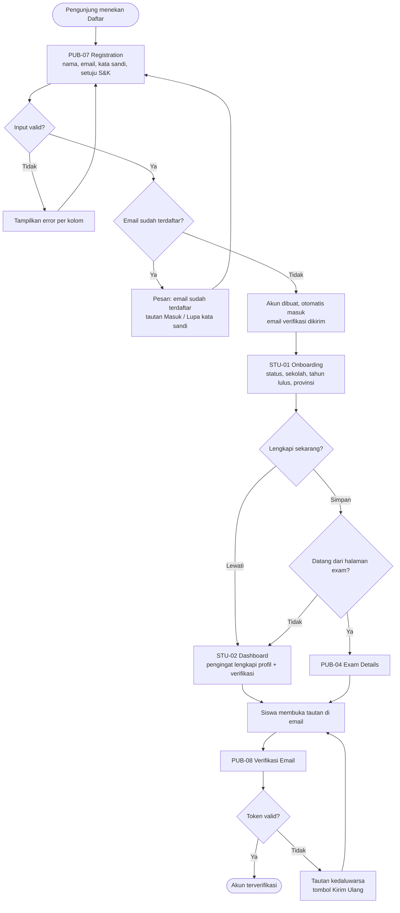

### 3.2 Pilih Paket dan Bayar (UJ-02, UJ-05)

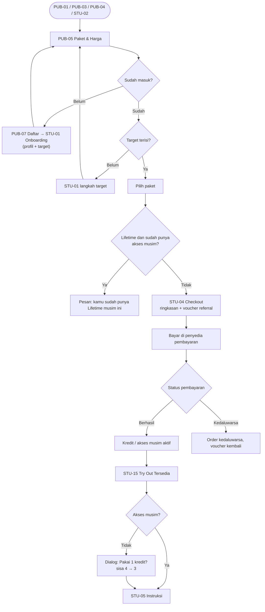

### 3.3 On-demand Purchase (UJ-03, UJ-05) — v3.0: digantikan 3.2; langkah penukaran kredit ada di 3.2

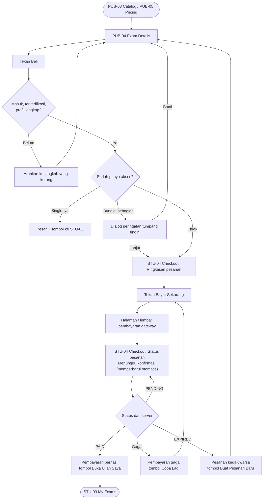

### 3.4 Scheduled Enrollment (UJ-04)

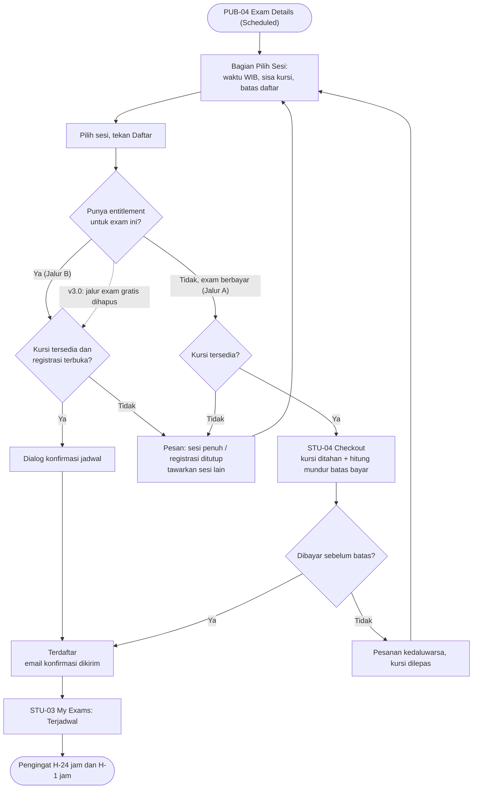

### 3.5 Examination Execution (UJ-06, UJ-08)

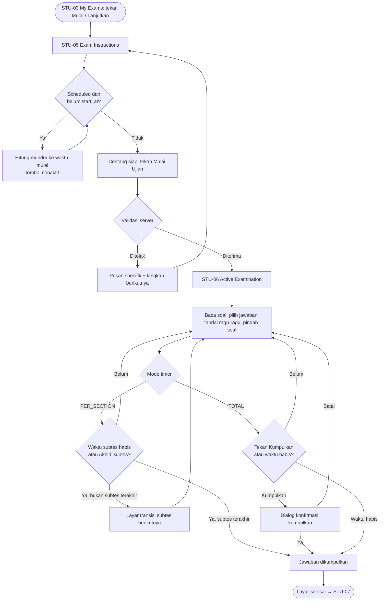

### 3.6 Answer Submission dan Autosave (UJ-07)

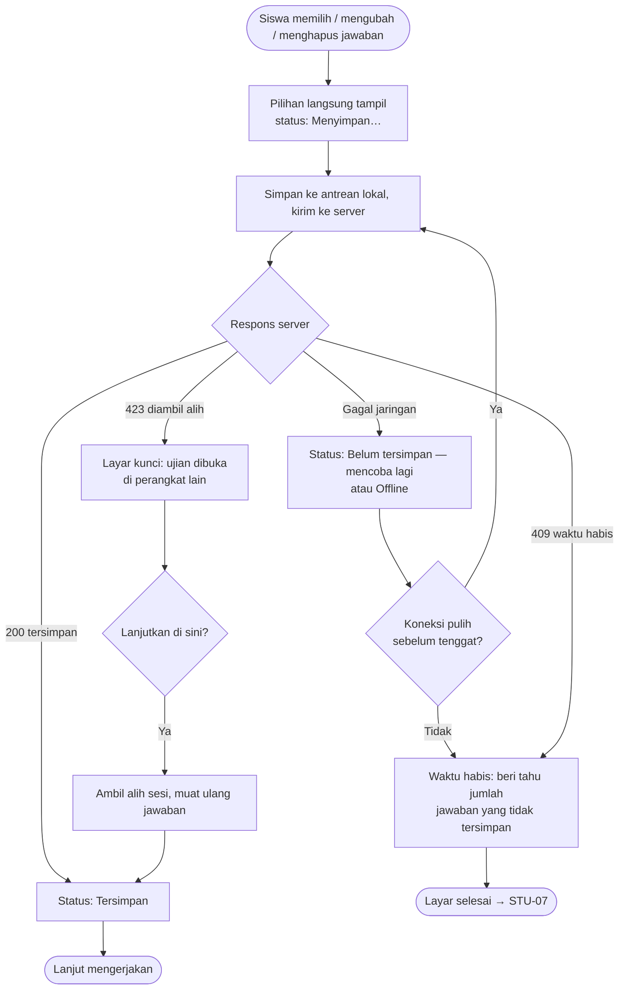

### 3.7 Result Viewing (UJ-09, UJ-10)

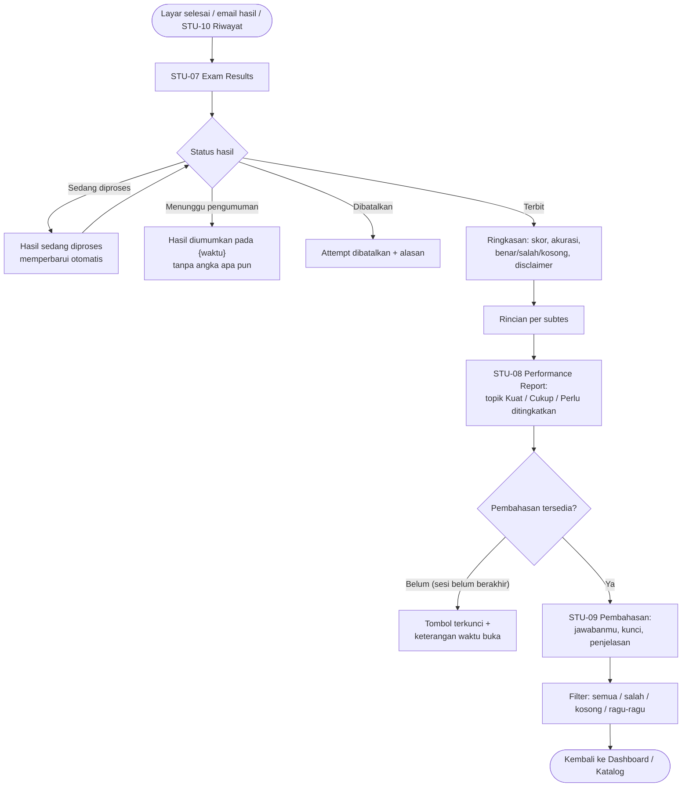

### 3.8 Admin Question Creation (UJ-12, UJ-13)

Berlaku untuk Content Editor (ADM-04) dan Contributor (CTR-02), yang memakai komponen editor yang sama.

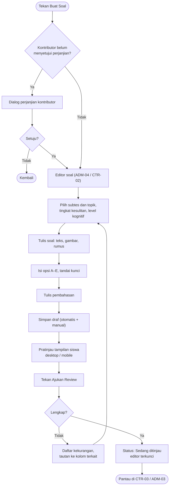

### 3.9 Question Approval (UJ-13)

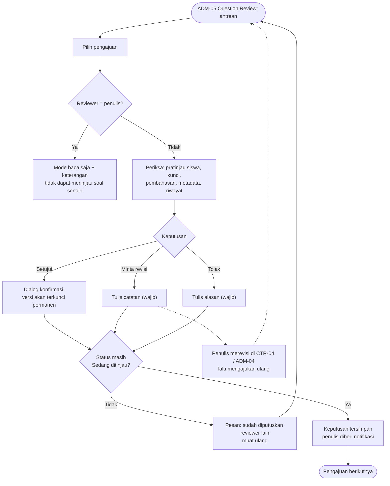

### 3.10 Exam Creation dan Publishing (UJ-14)

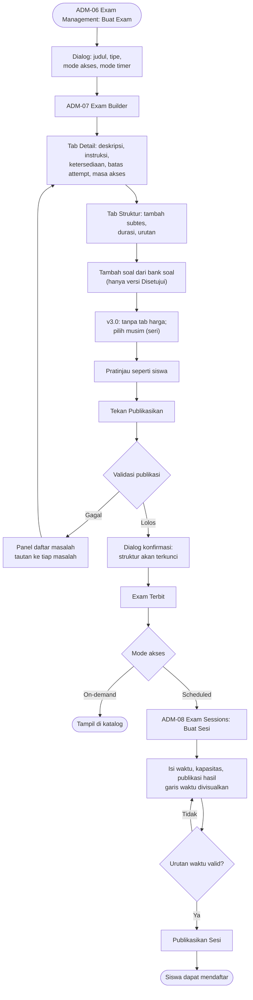

### 3.11 First-time Student Discovery (UJ-15)

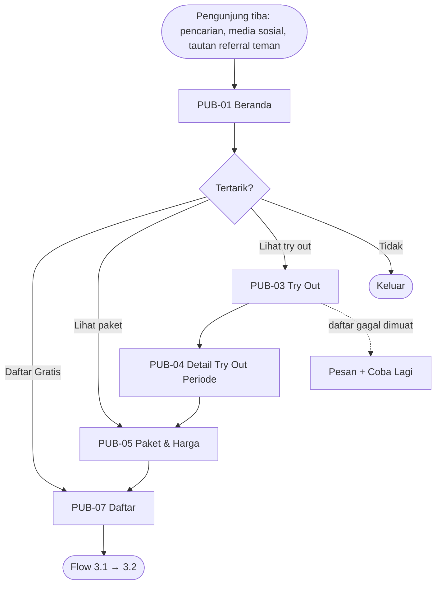

### 3.12 Roadmap dan Plan Harian (UJ-18)

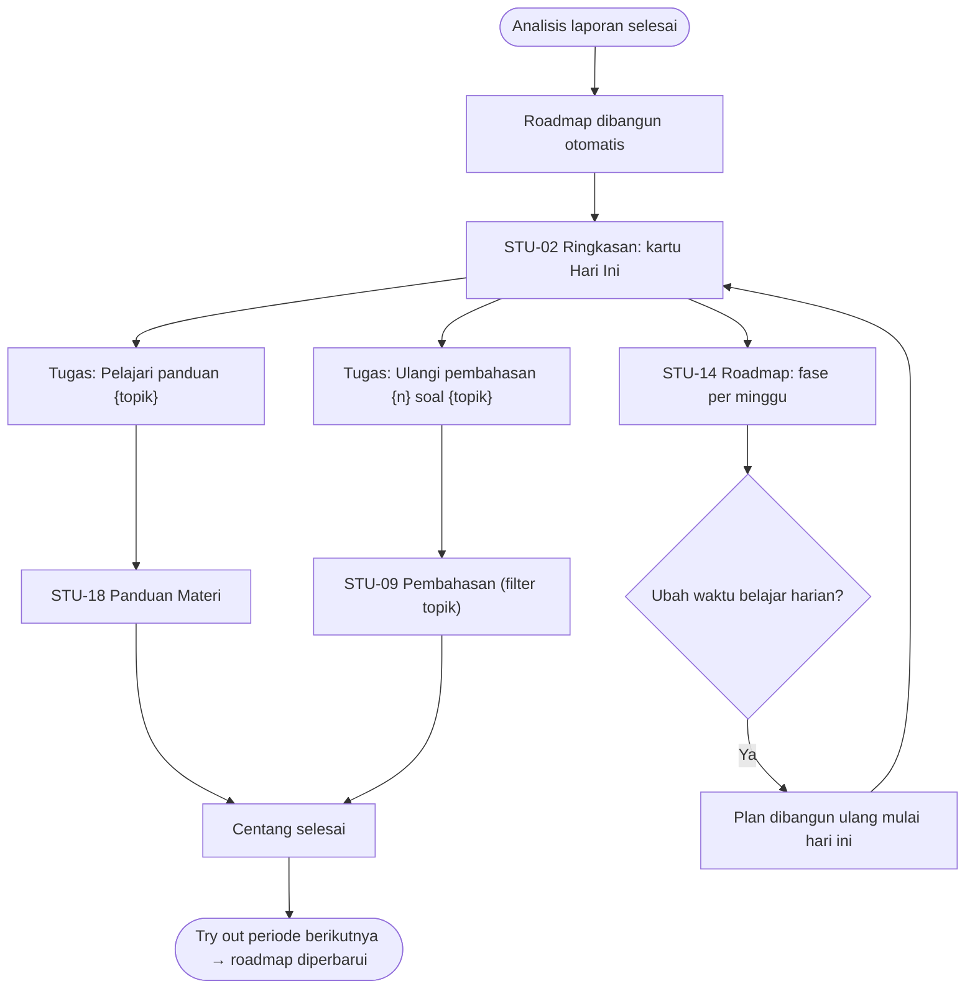

### 3.13 Performance Intelligence Exploration (UJ-16)

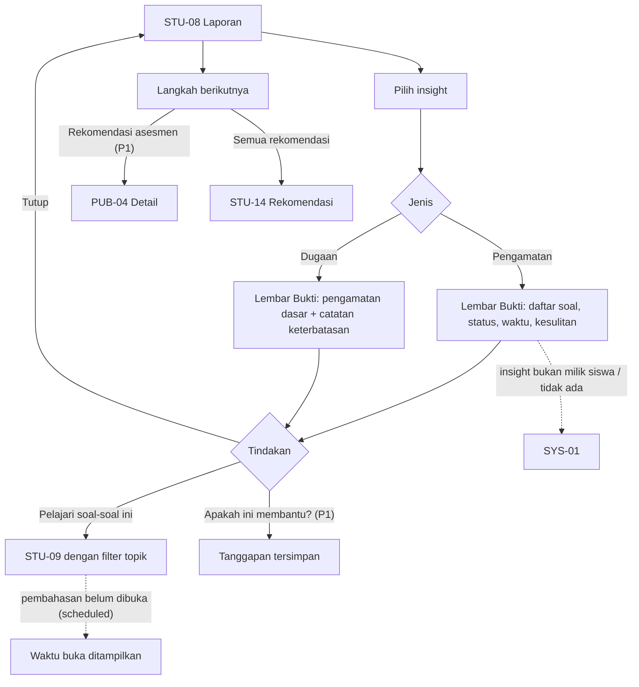

### 3.14 Progress Tracking (UJ-17)

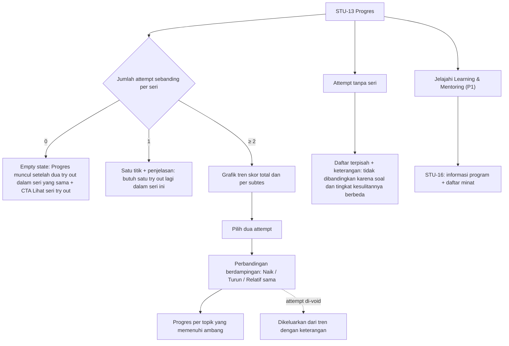

---

### 3.15 Referral (UJ-19)

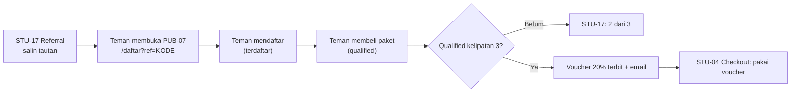

---

## 4. Screen Inventory

Setiap layar didefinisikan dengan atribut yang diminta. Pada entri v1.0, *Hierarki informasi* memuat **data yang ditampilkan**, sedangkan **interaksi** dan **perilaku responsif** mengikuti pola umum di bawah serta Bagian 7. Entri baru dan yang direvisi di v2.0 mencantumkan semua atribut secara eksplisit: tujuan pengguna, komponen, CTA primer dan sekunder, data ditampilkan, interaksi, loading, empty, error, dan responsif. Pola keadaan yang berlaku umum:

| Keadaan | Pola umum (berlaku kecuali disebut lain) |
|---|---|
| **Loading** | *Skeleton* berbentuk konten akhir untuk muat pertama; indikator kecil di tempat untuk muat ulang. Tidak ada *spinner* layar penuh kecuali STU-06 saat memuat attempt |
| **Error** | Pesan di tempat konten: apa yang terjadi + tombol **Coba Lagi**. Error validasi tampil di bawah kolom terkait dan diringkas di atas formulir |
| **Empty** | Ikon/ilustrasi sederhana + satu kalimat penjelasan + satu tombol tindakan |
| **Success** | *Toast* untuk tindakan ringan; layar atau panel konfirmasi untuk tindakan penting (bayar, daftar sesi, kumpulkan, publish) |

### 4.1 Situs Publik

#### PUB-01 — Home

| Atribut | Spesifikasi |
|---|---|
| Tujuan | Menjelaskan nilai Cogniverse bagi siswa kelas 12 dan mengarahkan ke registrasi gratis serta pilihan paket (redaksi 9.0.1) |
| Pengguna | Guest (siswa kelas 12) |
| Komponen utama | Hero (judul, subjudul, CTA); **contoh laporan** dan **contoh roadmap** berlabel "Contoh"; empat nilai unik; cara kerja 4 langkah; tiga kartu paket dengan harga per periode; ajakan referral; FAQ; penutup |
| CTA primer | **Daftar Gratis** → PUB-07 |
| CTA sekunder | **Lihat paket ›** → PUB-05 |
| Hierarki informasi | 1. Janji nilai + CTA · 2. Bukti (contoh laporan + roadmap) · 3. Empat nilai unik · 4. Cara kerja · 5. Paket · 6. Referral · 7. FAQ |
| Empty / Error | Bila paket gagal dimuat, bagian paket menampilkan "Harga sedang tidak dapat dimuat." dan halaman tetap tampil |
| Larangan | Tidak menulis "soal asli" sebelum OQ-19; tidak menampilkan skor acuan kampus; tidak ada testimoni atau jumlah pengguna |
| FR / Endpoint | FR-CAT-04, FR-RMP-08 · EP-PKG-01, EP-EXM-01 |

#### PUB-02 — About

| Atribut | Spesifikasi |
|---|---|
| Tujuan | Membangun kredibilitas: siapa Cogniverse dan bagaimana kualitas soal dijaga |
| Pengguna | Guest |
| Komponen utama | Misi; proses penjaminan soal (ditulis → ditinjau orang lain → diterbitkan); penjelasan skor dan disclaimer; kontak |
| CTA primer | **Daftar Gratis** |
| CTA sekunder | **Hubungi Kami** |
| Hierarki informasi | 1. Misi · 2. Proses kualitas soal · 3. Cara membaca skor · 4. Kontak |
| Empty / Loading / Error / Success | Halaman statis; tidak berlaku |
| FR / Endpoint | Konten statis; tidak ada FR khusus (lihat temuan AU-03 di Bagian 12) |

#### PUB-03 — Try Out (Katalog Periode)

| Atribut | Spesifikasi |
|---|---|
| Tujuan | Melihat periode Full Try Out musim berjalan dan statusnya |
| Pengguna | Guest, Student |
| Komponen utama | Judul musim ("Try Out SNBT 2027") dan tanggal SNBT bila sudah ditetapkan; kontrol bersegmen **Terbuka · Akan datang · Selesai**; kartu periode: nomor periode, judul, jadwal buka–tutup, jumlah soal, durasi; bila login: badge akses (Sudah dimiliki / Termasuk Lifetime / Bisa pakai kredit / Belum punya akses) |
| CTA primer | **Lihat detail** pada kartu |
| CTA sekunder | **Lihat paket ›** |
| Empty | "Periode berikutnya belum dibuka. Jadwalnya diumumkan di halaman ini." |
| Loading / Error | Skeleton 6 kartu / "Daftar try out gagal dimuat." + **Coba Lagi** |
| FR / Endpoint | FR-CAT-01 · EP-EXM-01 |

#### PUB-04 — Detail Try Out Periode

| Atribut | Spesifikasi |
|---|---|
| Tujuan pengguna | Mengerjakan periode ini, atau memahami cara mendapatkan aksesnya |
| Pengguna | Guest, Student |
| Komponen utama | Judul periode, musim, jadwal; ringkasan angka (soal, durasi, timer per subtes, kesempatan); struktur subtes; "Yang kamu dapat" (laporan enam bagian, roadmap, progres); panel aksi lekat |
| CTA primer | Sesuai akses: **Mulai** (akses musim atau sudah ditukar) · **Pakai 1 kredit** (dialog konfirmasi menyebut sisa kredit sebelum → sesudah) · **Lanjutkan** · **Lihat Hasil** · Guest/tanpa akses: **Pilih paket** |
| CTA sekunder | **Sudah punya akun? Masuk** · **Bandingkan paket ›** |
| Error | `NO_ACCESS` → panel "Kamu belum punya kredit atau Lifetime." + **Pilih paket**. `EXAM_NOT_AVAILABLE` → "Periode ini sedang tidak dibuka." `TARGET_REQUIRED` → **Lengkapi target** |
| Responsif | Desktop dua kolom (isi + panel aksi 360 px); mobile panel aksi menjadi bilah bawah lekat |
| FR / Endpoint | FR-CAT-02, FR-PKG-04, FR-ENT-02 · EP-EXM-02, EP-PKG-02, EP-PKG-03 |

#### PUB-05 — Paket & Harga

| Atribut | Spesifikasi |
|---|---|
| Tujuan pengguna | Memilih paket dengan tahu persis isi, masa berlaku, dan harga per periode |
| Pengguna | Guest, Student |
| Komponen utama | Judul + subjudul (9.0.2); tiga kartu: **Try Out Umum (1x)** Rp35.000 · **Bundle** Rp79.000 (4 periode, ≈Rp19.750/periode) · **Lifetime** Rp150.000 (semua periode musim {tahun}, sampai {tanggal H-7}); daftar centang "Di semua paket"; catatan "Perbedaan lain antar paket sedang disiapkan" (OQ-22); kotak referral; FAQ |
| Data ditampilkan | EP-PKG-01 (harga, kredit, tanggal berakhir), EP-VOU-01 bila login |
| CTA primer | Per kartu: **Pilih 1x — Rp35.000** · **Pilih Bundle — Rp79.000** · **Pilih Lifetime — Rp150.000**; bila punya voucher: harga coret + harga setelah diskon |
| Interaksi | Guest → PUB-07 dengan `lanjut=/paket`; siswa tanpa target → STU-01; siswa lengkap → order dibuat → STU-04 |
| Error | `SEASON_PASS_EXISTS` → kartu Lifetime berlabel "Sudah kamu miliki"; `NO_ACTIVE_SEASON` → "Penjualan musim berikutnya belum dibuka." |
| Responsif | Desktop tiga kolom; mobile kartu ditumpuk dengan Bundle di urutan pertama sebagai paket hemat per periode |
| FR / Endpoint | FR-CAT-03, FR-PKG-01/02, FR-REF-05 · EP-PKG-01, EP-VOU-01, EP-ORD-01 |

#### PUB-06 — Login

| Atribut | Spesifikasi |
|---|---|
| Tujuan | Masuk ke akun |
| Pengguna | Guest (semua role) |
| Komponen utama | Kolom email dan kata sandi (dengan tombol tampilkan); tautan lupa kata sandi; tautan daftar |
| CTA primer | **Masuk** |
| CTA sekunder | **Lupa kata sandi?** · **Daftar** |
| Hierarki informasi | 1. Formulir · 2. Bantuan |
| Empty | — |
| Loading | Tombol menampilkan indikator dan nonaktif selama proses |
| Error | Kredensial salah: satu pesan netral di atas formulir ("Email atau kata sandi tidak sesuai."). `RATE_LIMITED` / terkunci: "Terlalu banyak percobaan. Coba lagi dalam {n} menit." `ACCOUNT_SUSPENDED` → SYS-03 |
| Success | Diarahkan ke halaman asal, atau ke halaman pendaratan sesuai role |
| FR / Endpoint | FR-AUTH-03/09 · EP-AUTH-04 |

#### PUB-07 — Registration

| Atribut | Spesifikasi |
|---|---|
| Tujuan | Membuat akun siswa |
| Pengguna | Guest |
| Komponen utama | Kolom nama lengkap, email, kata sandi (dengan petunjuk syarat dan tombol tampilkan); kotak centang persetujuan S&K dan Kebijakan Privasi (tautan membuka PUB-11 di tab baru) |
| CTA primer | **Buat Akun** |
| CTA sekunder | **Sudah punya akun? Masuk** |
| Hierarki informasi | 1. Formulir · 2. Persetujuan · 3. Tautan masuk |
| Empty | — |
| Loading | Tombol dengan indikator |
| Error | Validasi per kolom saat kolom ditinggalkan dan saat kirim. `EMAIL_ALREADY_REGISTERED`: pesan pada kolom email dengan tautan **Masuk** dan **Lupa kata sandi** |
| Success | Diarahkan ke STU-01 dengan banner "Kami mengirim tautan verifikasi ke {email}" |
| FR / Endpoint | FR-AUTH-01, FR-PROF-04 · EP-AUTH-01 |

#### PUB-08 — Verifikasi Email

| Atribut | Spesifikasi |
|---|---|
| Tujuan | Mengonfirmasi kepemilikan email |
| Pengguna | Guest, Student |
| Komponen utama | Pesan status; tombol kirim ulang dengan penghitung jeda 60 detik |
| CTA primer | Berhasil: **Lanjut ke Dashboard**. Gagal: **Kirim Ulang Tautan** |
| CTA sekunder | **Ganti Email** → STU-11 |
| Hierarki informasi | 1. Status · 2. Aksi |
| Empty | — |
| Loading | "Memverifikasi…" |
| Error | Token kedaluwarsa/terpakai (410): penjelasan + kirim ulang. `RATE_LIMITED`: tombol nonaktif dengan sisa waktu |
| Success | "Email kamu sudah terverifikasi." |
| FR / Endpoint | FR-AUTH-02 · EP-AUTH-02/03 |

#### PUB-09 — Lupa & Atur Ulang Kata Sandi

| Atribut | Spesifikasi |
|---|---|
| Tujuan | Memulihkan akses akun |
| Pengguna | Guest |
| Komponen utama | Langkah 1: kolom email. Langkah 2 (dari tautan email): kolom kata sandi baru + konfirmasi |
| CTA primer | **Kirim Tautan** / **Simpan Kata Sandi** |
| CTA sekunder | **Kembali ke Masuk** |
| Hierarki informasi | 1. Instruksi singkat · 2. Formulir |
| Empty | — |
| Loading | Tombol dengan indikator |
| Error | Token kedaluwarsa: tawarkan minta tautan baru. Kata sandi tidak memenuhi syarat: pesan per kolom |
| Success | Langkah 1: selalu "Jika email terdaftar, tautan sudah kami kirim." Langkah 2: "Kata sandi diperbarui" → PUB-06 |
| FR / Endpoint | FR-AUTH-04 · EP-AUTH-07/08 |

#### PUB-10 — Terima Undangan

| Atribut | Spesifikasi |
|---|---|
| Tujuan | Mengaktifkan akun staf atau kontributor |
| Pengguna | Penerima undangan |
| Komponen utama | Email (terkunci) dan role yang diberikan; kolom nama dan kata sandi |
| CTA primer | **Aktifkan Akun** |
| CTA sekunder | — |
| Hierarki informasi | 1. Siapa yang mengundang dan sebagai apa · 2. Formulir |
| Empty / Loading | — / tombol dengan indikator |
| Error | Undangan kedaluwarsa (410): "Minta admin mengirim undangan baru." |
| Success | Masuk dan diarahkan ke dashboard sesuai role |
| FR / Endpoint | FR-AUTH-06 · EP-AUTH-09 |

#### PUB-11 — Syarat & Ketentuan, Kebijakan Privasi

| Atribut | Spesifikasi |
|---|---|
| Tujuan | Menyajikan dokumen hukum yang disetujui pengguna |
| Pengguna | Semua |
| Komponen utama | Judul, versi dan tanggal berlaku, daftar isi, isi dokumen |
| CTA primer / sekunder | — / **Kembali** |
| Hierarki informasi | 1. Versi · 2. Isi |
| Empty / Loading / Error / Success | Halaman statis |
| FR / Endpoint | FR-PROF-04 · — |

#### ~~PUB-12 — Detail Free Try Out~~ **[Dihapus v3.0]**

Digabung ke PUB-04; tidak ada try out gratis.

### 4.2 Aplikasi Siswa

#### STU-01 — Onboarding (Profil + Target)

| Atribut | Spesifikasi |
|---|---|
| Tujuan pengguna | Melengkapi profil dan memilih kampus serta jurusan tujuan |
| Pengguna | Student baru |
| Komponen utama | Dua langkah dengan penanda "1 dari 2": **(1) Tentang kamu** — status, sekolah, tahun lulus, provinsi; **(2) Target kamu** — pencarian kampus, pilihan program studi, opsi "Lainnya" (isian bebas), target kedua opsional, **target skor pribadi** (slider/isian 0–1000 kelipatan 10, opsional), waktu belajar harian (30/60/90/120 menit) |
| Data ditampilkan | Skor acuan program hanya bila tersedia: "Acuan {sumber}, {tahun}: {nilai}. Skala sumber berbeda dengan skor Cogniverse." Tanpa data: "Data acuan untuk program ini belum tersedia." |
| CTA primer | **Lanjut** (langkah 1) · **Simpan Target** (langkah 2) |
| CTA sekunder | **Isi target skor nanti** |
| Error | Validasi per kolom; target skor bukan kelipatan 10 → "Gunakan kelipatan 10, misalnya 650." |
| FR / Endpoint | FR-PROF-01, FR-TGT-01..03, FR-TGT-05 · EP-USR-03, EP-TGT-01..04, EP-RMP-04 |

#### STU-02 — Ringkasan

| Atribut | Spesifikasi |
|---|---|
| Tujuan pengguna | Tahu satu hal yang paling perlu dilakukan sekarang dan tugas belajar hari ini |
| Pengguna | Student |
| Komponen utama | Salam. **Kartu langkah utama** (prioritas: lanjutkan ujian → pilih paket bila belum punya akses → kerjakan periode yang terbuka → buka laporan yang belum dibaca → ikuti roadmap). **Hari Ini**: 2–4 tugas plan harian dengan centang dan menit. **Target**: kampus & jurusan, skor terbaru, target pribadi, selisih. **Akses**: sisa kredit atau Lifetime sampai {tanggal}. Ajakan referral kecil |
| CTA sekunder | **Lihat roadmap ›**, **Lihat progres ›** |
| Empty | Belum punya paket: kartu "Pilih paket untuk mulai" + contoh roadmap berlabel "Contoh" |
| FR / Endpoint | FR-ENT-05, FR-PKG-05, FR-RMP-06, FR-TGT-04 · EP-ENT-01, EP-PKG-02, EP-RMP-02, EP-TGT-03 |

#### STU-03 — Asesmen Saya

| Atribut | Spesifikasi |
|---|---|
| Tujuan | Mengelola semua ujian yang dimiliki dan memulai pengerjaan |
| Pengguna | Student |
| Komponen utama | Tab status: Aktif · Selesai · Kedaluwarsa. Baris/kartu ujian: judul, badge mode, **status** (Siap dikerjakan · Perlu pilih sesi · Terjadwal {tanggal} · Sedang berlangsung · Selesai · Kedaluwarsa · Dicabut), sisa attempt, batas akses |
| CTA primer | Satu per baris sesuai status: **Mulai** · **Pilih Sesi** · **Buka Instruksi** · **Lanjutkan** · **Lihat Hasil** |
| CTA sekunder | **Lihat Detail** |
| Hierarki informasi | 1. Sedang berlangsung · 2. Terjadwal terdekat · 3. Siap dikerjakan · 4. Lainnya |
| Empty | "Kamu belum punya asesmen." + **Lihat paket** dan **Lihat try out** |
| Loading | Skeleton daftar |
| Error | Pesan + **Coba Lagi** |
| Success | — |
| FR / Endpoint | FR-ENT-05, FR-SES-11 · EP-ENT-01, EP-ENR-02 |

#### STU-04 — Checkout

| Atribut | Spesifikasi |
|---|---|
| Tujuan pengguna | Membayar paket dengan total yang jelas |
| Pengguna | Student |
| Komponen utama | Langkah Ringkasan → Pembayaran → Selesai; ringkasan paket (nama, isi, masa berlaku); baris voucher referral (pakai/lepas); subtotal, diskon, total; status pembayaran yang diperbarui otomatis |
| CTA primer | **Bayar — Rp{total}** |
| CTA sekunder | **Batalkan pesanan** |
| Lingkungan pengembangan | Panel bergaris putus-putus berlabel "Simulator pembayaran — hanya pengembangan" dengan **Simulasikan berhasil** / **Simulasikan gagal**; tidak pernah tampil di produksi (TD-12) |
| Success | "Pembayaran berhasil. Kamu punya {n} kredit" / "Lifetime aktif sampai {tanggal}." + **Pilih try out** |
| Error | Order kedaluwarsa → "Waktu pembayaran habis. Voucher kamu kembali tersedia." + **Pilih paket lagi** |
| FR / Endpoint | FR-PAY-01..06, FR-PKG-03, FR-REF-05 · EP-ORD-01/03, EP-PAY-01/04 |

#### STU-05 — Exam Instructions

| Atribut | Spesifikasi |
|---|---|
| Tujuan | Memastikan siswa memahami aturan sebelum timer berjalan |
| Pengguna | Student |
| Komponen utama | Judul ujian; tabel subtes (urutan, jumlah soal, durasi); **aturan penting** dalam daftar bernomor: timer tidak dapat dihentikan; jawaban tersimpan otomatis; (mode per subtes) tidak dapat kembali ke subtes sebelumnya; waktu habis = dikumpulkan otomatis; satu perangkat pada satu waktu. Daftar periksa kesiapan (koneksi, baterai). Kotak centang "Saya sudah membaca dan siap". Untuk terjadwal: hitung mundur menuju waktu mulai dan batas masuk |
| CTA primer | **Mulai Ujian** (aktif setelah dicentang dan, untuk terjadwal, setelah `start_at`) |
| CTA sekunder | **Kembali ke Ujian Saya** |
| Hierarki informasi | 1. Kapan dapat mulai (terjadwal) · 2. Struktur dan durasi · 3. Aturan · 4. Konfirmasi siap |
| Empty | — |
| Loading | Skeleton; tombol nonaktif sampai kelayakan diketahui |
| Error | Pesan spesifik per kode: `SESSION_NOT_STARTED`, `ENTRY_WINDOW_CLOSED` (+ tawaran sesi lain), `ATTEMPT_LIMIT_REACHED`, `ENTITLEMENT_EXPIRED`, `ANOTHER_ATTEMPT_IN_PROGRESS` (+ tombol ke ujian yang berjalan), `EXAM_NOT_AVAILABLE` |
| Success | Diarahkan ke STU-06 |
| FR / Endpoint | FR-ENG-01/02, FR-ENT-04 · EP-ATT-01/02 |

#### STU-06 — Active Examination

Layar terpenting; spesifikasi lengkap di 5.7.

| Atribut | Spesifikasi |
|---|---|
| Tujuan | Mengerjakan ujian tanpa gangguan dan tanpa kehilangan jawaban |
| Pengguna | Student |
| Komponen utama | Bilah atas: nama subtes, **timer**, **status simpan**. Area soal: nomor, teks soal, opsi A–E. Bilah bawah: Sebelumnya · Ragu-ragu · Berikutnya. Panel navigasi nomor soal (samping pada desktop, lembar bawah pada mobile). Tombol Kumpulkan / Akhiri Subtes |
| CTA primer | **Berikutnya**; pada soal terakhir: **Kumpulkan** (mode total) atau **Akhiri Subtes** (mode per subtes) |
| CTA sekunder | **Sebelumnya**; **Ragu-ragu**; **Hapus Jawaban**; **Daftar Soal** |
| Hierarki informasi | 1. Soal dan opsi · 2. Timer · 3. Status simpan · 4. Navigasi |
| Empty | Tidak berlaku |
| Loading | Satu-satunya layar dengan indikator muat penuh: "Menyiapkan ujian…". Timer **tidak ditampilkan** sampai waktu server diterima |
| Error | Gagal muat attempt: pesan + **Coba Lagi** (timer tetap berjalan di server — dinyatakan). Gambar gagal: placeholder + **Muat Ulang Gambar**. Offline: banner. Simpan gagal: status berubah. Diambil alih: layar kunci. Waktu habis: layar selesai |
| Success | Jawaban tersimpan: status "Tersimpan". Kumpulkan: layar "Jawabanmu sudah dikumpulkan" → STU-07 |
| FR / Endpoint | FR-ENG-04..14, FR-TMR-01..09 · EP-ATT-02..06, EP-ANS-01/02 |

#### STU-07 — Hasil

| Atribut | Spesifikasi |
|---|---|
| Tujuan pengguna | Melihat hasil dengan cepat dan jujur, lalu masuk ke analisis |
| Pengguna | Student (pemilik attempt) |
| Komponen utama | Judul ujian, tanggal, cara pengumpulan. **Skor total** besar (0–1000) + "dari 1000" + disclaimer. Empat angka: akurasi, benar, salah, kosong. Durasi. Bilah skor per subtes. Kartu ajakan ke laporan |
| Data ditampilkan | EP-RES-01 |
| CTA primer | **Lihat analisis lengkap** → STU-08 |
| CTA sekunder | **Buka pembahasan ›** (atau waktu buka); **Ke Ringkasan ›** |
| Interaksi | Muat ulang otomatis saat `RESULT_PROCESSING` |
| Empty | — |
| Loading | `RESULT_PROCESSING`: "Hasilmu sedang dihitung. Biasanya kurang dari satu menit." |
| Error | `RESULT_NOT_PUBLISHED`: "Hasil diumumkan {hari, tanggal, jam} WIB. Kami kirim email saat hasilnya siap." — tanpa angka (BR-PUB-03). `ATTEMPT_VOIDED`: status dibatalkan + alasan |
| Responsif | Desktop: skor dan empat angka berdampingan; mobile: ditumpuk |
| FR / Endpoint | FR-RES-01/02, FR-PI-01/02 · EP-RES-01 |

#### STU-08 — Performance Intelligence

| Atribut | Spesifikasi |
|---|---|
| Tujuan pengguna | Memahami arti hasil dan tahu langkah berikutnya beserta alasannya |
| Pengguna | Student |
| Komponen utama | Enam bagian berurutan (wireframe 5.9): **1** Performa keseluruhan · **2** Per subtes · **3** Kemampuan (topik; kompetensi P1) · **4** Cara mengerjakan · **5** Kekuatan dan area perbaikan (kartu insight) · **6** Langkah berikutnya. Navigasi bagian lekat (desktop) / kontrol bersegmen (mobile). Lembar Bukti (6.7.13) |
| Data ditampilkan | EP-PI-01; EP-PI-02 untuk lembar bukti |
| CTA primer | **Pelajari soal-soal ini** (pada area prioritas teratas) |
| CTA sekunder | **Lihat bukti ›** per insight; **Buka roadmap ›**; **Asesmen berikutnya ›** (COMPLETE, P1) |
| Interaksi | Membuka bukti tidak meninggalkan halaman; posisi gulir dipertahankan; umpan balik insight (P1) satu ketukan |
| Empty | Ujian terlalu singkat untuk analisis topik: "Try out ini terlalu singkat untuk mengelompokkan topik. Lihat hasil per soal di pembahasan." |
| Loading | Bagian 1–3 dari data hasil; bagian 4–6 menampilkan "Menyiapkan analisismu…" dan memuat ulang tiap 3 detik (maks. 60 detik) |
| Error | `analysisStatus = FAILED`: "Analisis belum tersedia. Kami mencoba lagi otomatis — skor dan pembahasanmu sudah bisa dibuka." |
| Responsif | Desktop: kolom bacaan 980 px + navigasi bagian di kiri; mobile: satu kolom, kontrol bersegmen lekat di bawah header |
| FR / Endpoint | FR-PI-01..12 (P0: 01–03, 05, 07, 08, 10–12) · EP-PI-01, EP-PI-02, EP-PI-03 |

#### STU-09 — Pembahasan

| Atribut | Spesifikasi |
|---|---|
| Tujuan | Belajar dari setiap soal |
| Pengguna | Student |
| Komponen utama | Filter: Semua · Salah · Kosong · Ragu-ragu; pemilih subtes; navigasi nomor berstatus (benar/salah/kosong dengan ikon). Per soal: teks soal, opsi dengan penanda **"Jawabanmu"** dan **"Kunci"** (ikon + teks), hasil, pembahasan. Penanda "Soal ini telah dikoreksi" bila berlaku |
| CTA primer | **Soal Berikutnya** |
| CTA sekunder | **Sebelumnya**; **Kembali ke Hasil** |
| Hierarki informasi | 1. Soal · 2. Jawabanmu vs kunci · 3. Pembahasan |
| Empty | Filter tanpa hasil: "Tidak ada soal pada kategori ini." |
| Loading | Skeleton soal |
| Error | `REVIEW_NOT_AVAILABLE_YET`: "Pembahasan dibuka pada {waktu} WIB, setelah sesi berakhir untuk semua peserta." `RESULT_NOT_PUBLISHED`: arahkan ke STU-07 |
| Success | — |
| FR / Endpoint | FR-RES-03, BR-PUB-04 · EP-RES-02 |

#### STU-10 — Riwayat Asesmen

| Atribut | Spesifikasi |
|---|---|
| Tujuan | Menemukan kembali setiap ujian yang pernah dikerjakan |
| Pengguna | Student |
| Komponen utama | Filter status dan jenis; daftar: judul, mode, tanggal, status (Sedang berlangsung · Menunggu pengumuman · Selesai · Dibatalkan), skor bila terbit |
| CTA primer | Per baris: **Lihat Hasil** / **Lanjutkan** |
| CTA sekunder | — |
| Hierarki informasi | Terbaru di atas |
| Empty | "Belum ada riwayat asesmen." + **Lihat try out** |
| Loading | Skeleton daftar |
| Error | Pesan + **Coba Lagi** |
| Success | — |
| FR / Endpoint | FR-RES-04 · EP-ATT-07 |

#### STU-11 — Profile

| Atribut | Spesifikasi |
|---|---|
| Tujuan | Mengelola data diri dan keamanan akun |
| Pengguna | Student (staf dan kontributor memakai varian tanpa bagian profil siswa) |
| Komponen utama | Bagian: Data diri · Profil siswa · Email (status verifikasi + ganti email) · Kata sandi · Persetujuan (versi yang disetujui) |
| CTA primer | **Simpan** per bagian |
| CTA sekunder | **Kirim Ulang Verifikasi**; **Keluar** |
| Hierarki informasi | 1. Hal yang perlu ditindak (belum verifikasi) · 2. Data diri · 3. Keamanan |
| Empty | — |
| Loading | Skeleton formulir |
| Error | Validasi per kolom; kata sandi lama salah |
| Success | Toast "Perubahan disimpan"; ganti email: "Tautan verifikasi dikirim ke email baru" |
| FR / Endpoint | FR-PROF-01/04/05 · EP-USR-01..05 |

#### STU-12 — Transaction History

| Atribut | Spesifikasi |
|---|---|
| Tujuan | Melihat pesanan dan melanjutkan pembayaran tertunda |
| Pengguna | Student |
| Komponen utama | Daftar pesanan: nomor, product, tanggal, total, status (Menunggu pembayaran · Berhasil · Kedaluwarsa · Dibatalkan · Dikembalikan) |
| CTA primer | Per baris menunggu: **Lanjutkan Pembayaran** → STU-04 |
| CTA sekunder | **Lihat Detail** |
| Hierarki informasi | Pesanan menunggu pembayaran di atas, lalu terbaru |
| Empty | "Belum ada transaksi." + **Lihat Katalog** |
| Loading / Error | Pola umum |
| Success | — |
| FR / Endpoint | FR-PAY-06 · EP-ORD-02/03 |

#### STU-13 — Progres & Target

| Atribut | Spesifikasi |
|---|---|
| Tujuan pengguna | Melihat apakah skor mendekati target dan membaik antar periode |
| Pengguna | Student |
| Komponen utama | Kartu target (kampus, jurusan, target pribadi, **ubah**); grafik tren skor total per periode dalam musim dengan **garis target**; selisih ke target; grafik kecil per subtes; perbandingan dua periode (Naik / Turun / Relatif sama); skor acuan kampus bila bersumber (dengan sumber, tahun, dan catatan skala); daftar "Tidak dibandingkan" |
| Empty | Belum ada try out: "Progres muncul setelah try out pertamamu." Satu try out: titik tunggal + "Kerjakan periode berikutnya untuk melihat tren." |
| FR / Endpoint | FR-PRG-02..06, FR-TGT-01/02/04/05 · EP-PRG-01/02, EP-TGT-03/04 |

#### STU-14 — Roadmap & Hari Ini

| Atribut | Spesifikasi |
|---|---|
| Tujuan pengguna | Tahu apa yang dipelajari hari ini dan minggu ini sampai hari SNBT |
| Pengguna | Student |
| Komponen utama | Header: sisa hari sampai SNBT (atau "Tanggal SNBT belum diumumkan — roadmap 8 minggu"), waktu belajar harian (kontrol bersegmen 30/60/90/120). **Hari Ini** dan 6 hari berikutnya: tugas dengan jenis (Pelajari materi · Ulangi pembahasan · Latihan · Try out), topik, menit, centang. **Fase per minggu**: topik fokus, alasan ("Di Statistika, 0 dari 3 benar"), target akurasi, persentase tugas selesai. Kalimat BR-RMP-04 |
| Interaksi | Centang tersimpan langsung (optimistik dengan pembatalan bila gagal); mengubah waktu harian membangun ulang plan mulai hari ini |
| Empty | Belum ada laporan: contoh roadmap berlabel "Contoh" + **Pilih paket** atau **Kerjakan try out** |
| FR / Endpoint | FR-RMP-01..07 · EP-RMP-01..04 |

#### STU-15 — Try Out Tersedia

| Atribut | Spesifikasi |
|---|---|
| Tujuan pengguna | Memilih periode yang akan dikerjakan dan tahu akses yang dimiliki |
| Pengguna | Student |
| Komponen utama | Ringkasan akses (kredit tersisa / Lifetime sampai); kontrol bersegmen Terbuka · Akan datang · Selesai; kartu periode dengan badge akses dan aksi |
| CTA primer | Per kartu: **Mulai** / **Pakai 1 kredit** / **Lanjutkan** / **Lihat Hasil** / **Pilih paket** |
| FR / Endpoint | FR-CAT-01, FR-PKG-04/05 · EP-EXM-01, EP-PKG-02/03 |

#### STU-16 — Learning & Mentoring *(P1)*

| Atribut | Spesifikasi |
|---|---|
| Tujuan pengguna | Mengetahui program berikutnya dan menyatakan minat |
| Pengguna | Student |
| Komponen utama | Pernyataan jujur "Sedang kami siapkan"; tiga kartu program (Personalized Learning, Mentoring, Persiapan Kuliah) dengan deskripsi satu kalimat; tombol minat per program |
| Data ditampilkan | EP-INT-01 |
| CTA primer | **Kabari aku** (per program) |
| CTA sekunder | **Batalkan** (bila sudah mendaftar) |
| Interaksi | Toggle minat tersimpan langsung |
| Empty | — |
| Loading / Error | Standar |
| Responsif | Kartu 3 / 1 kolom |
| FR / Endpoint | FR-FUT-01 · EP-INT-01..03 |

#### STU-17 — Referral

| Atribut | Spesifikasi |
|---|---|
| Tujuan pengguna | Mengajak teman dan memantau voucher |
| Pengguna | Student |
| Komponen utama | Kode dan tautan (salin, bagikan); aturan dalam satu kalimat: "Setiap 3 teman yang membeli paket dengan kodemu memberimu voucher diskon 20%."; progres "2 dari 3"; hitungan terdaftar vs sudah membeli (tanpa nama teman); daftar voucher dengan status dan tanggal berakhir |
| CTA primer | **Salin tautan** |
| FR / Endpoint | FR-REF-01..06 · EP-REF-01, EP-VOU-01 |

#### STU-18 — Panduan Materi

| Atribut | Spesifikasi |
|---|---|
| Tujuan pengguna | Memahami poin materi topik prioritas sebelum mengulang soal |
| Pengguna | Student |
| Komponen utama | Judul topik dan subtes; ringkasan; daftar poin yang perlu dipahami; tautan **Ulangi pembahasan soal topik ini** (STU-09 dengan filter topik); tombol **Tandai tugas selesai** bila dibuka dari plan harian |
| Empty | "Panduan untuk topik ini sedang disiapkan. Mulai dari pembahasan soalnya." |
| FR / Endpoint | FR-RMP-05 · EP-RMP-05 |

### 4.3 Dashboard Admin

#### ADM-01 — Overview *(P1)*

| Atribut | Spesifikasi |
|---|---|
| Tujuan | Ringkasan operasional harian |
| Pengguna | EA, SA |
| Komponen utama | Kartu angka (registrasi, pesanan berhasil, pendapatan, attempt mulai/selesai) per periode; sesi mendatang; panjang antrean review |
| CTA primer / sekunder | **Buat Exam** / pemilih periode |
| Hierarki informasi | 1. Sesi hari ini · 2. Angka kunci · 3. Antrean |
| Empty / Loading / Error / Success | Pola umum; kartu tanpa data menampilkan "—" |
| FR / Endpoint | FR-ADM-01 (P1) · endpoint ditetapkan saat fitur dijadwalkan |

#### ADM-02 — User Management

| Atribut | Spesifikasi |
|---|---|
| Tujuan | Mencari pengguna, mengelola role dan status, membantu kasus siswa |
| Pengguna | SA (penuh); EA (baca + suspend Student) |
| Komponen utama | Pencarian nama/email; filter role dan status; tabel pengguna. Panel detail: data akun, role, dan untuk siswa: tab Ujian (entitlement), Sesi, Attempt, Pesanan. Aksi entitlement: beri akses, cabut, tambah attempt |
| CTA primer | **Undang Pengguna** (SA) |
| CTA sekunder | **Ubah Role**; **Tangguhkan / Aktifkan**; **Beri Akses**; **Tambah Attempt** |
| Hierarki informasi | 1. Pencarian · 2. Tabel · 3. Detail |
| Empty | "Tidak ada pengguna yang cocok." |
| Loading | Skeleton tabel |
| Error | `LAST_SUPER_ADMIN`, `ROLE_COMBINATION_INVALID`, 403 untuk aksi di luar wewenang — pesan di dialog |
| Success | Toast; baris diperbarui |
| Catatan | Tangguhkan, cabut akses, tambah attempt, dan ubah role memakai dialog dengan kolom **alasan wajib** |
| FR / Endpoint | FR-AUTH-06/07, FR-ADM-02, FR-ENT-03, FR-ADM-08 · EP-USR-06..11, EP-ENT-03..05 |

#### ADM-03 — Question Bank

| Atribut | Spesifikasi |
|---|---|
| Tujuan | Menemukan dan mengelola soal |
| Pengguna | CE (penuh); EA (baca, hanya Disetujui) |
| Komponen utama | Pencarian teks; filter subtes, topik, kesulitan, status versi, penulis, tanggal; tabel: cuplikan soal, subtes/topik, kesulitan, versi terakhir + status, penulis, diperbarui. Panel pratinjau samping dengan riwayat versi |
| CTA primer | **Buat Soal** (CE) |
| CTA sekunder | **Buat Versi Baru**; **Retire**; **Lihat Riwayat Versi** |
| Hierarki informasi | 1. Filter · 2. Tabel · 3. Pratinjau |
| Empty | Bank kosong: "Belum ada soal." + **Buat Soal**. Filter kosong: **Hapus Filter** |
| Loading | Skeleton tabel |
| Error | `OPEN_VERSION_EXISTS`: "Soal ini masih memiliki versi yang belum diputuskan." + tautan ke versi itu |
| Success | Toast |
| FR / Endpoint | FR-QB-05/11, FR-QV-01/03 · EP-QST-06/08/09/11/13 |

#### ADM-04 — Question Editor

Dipakai juga sebagai CTR-02 dengan hak berbeda. Wireframe di 5.12.

| Atribut | Spesifikasi |
|---|---|
| Tujuan | Menulis soal lengkap dan benar |
| Pengguna | CE; Contributor (CTR-02) |
| Komponen utama | Kepala: nomor versi + badge status + status simpan draf. Metadata: subtes, topik, kesulitan, level kognitif. Editor soal (format dasar, gambar, rumus). Opsi A–E, tiap opsi editor + radio "Kunci". Editor pembahasan. Panel pratinjau (desktop/mobile). Panel catatan reviewer (bila ada) |
| CTA primer | **Ajukan Review** |
| CTA sekunder | **Simpan Draf**; **Pratinjau**; **Hapus Draf** |
| Hierarki informasi | 1. Status versi · 2. Metadata · 3. Soal · 4. Opsi + kunci · 5. Pembahasan |
| Empty | Draf baru: kolom kosong dengan teks petunjuk |
| Loading | Skeleton; unggah gambar menampilkan progres di tempat |
| Error | Pengajuan tidak lengkap (422): daftar kekurangan di atas, tiap butir menautkan ke kolomnya. Unggah gagal: pesan tipe/ukuran. `VERSION_NOT_EDITABLE`: editor berubah baca-saja + keterangan |
| Success | Draf: "Tersimpan {jam}". Ajukan: status "Sedang ditinjau", editor terkunci |
| FR / Endpoint | FR-QB-02..04/06/07, FR-QV-02, FR-REV-01 · EP-QST-07/09/10/12/14/15/16, EP-REV-01/02 |

#### ADM-05 — Question Review

Wireframe di 5.13.

| Atribut | Spesifikasi |
|---|---|
| Tujuan | Memutuskan pengajuan soal dengan cepat dan teliti |
| Pengguna | CE, SA |
| Komponen utama | Antrean (kiri): cuplikan, subtes/topik, penulis, umur pengajuan, penanda "Soal Anda". Detail (kanan): pratinjau siswa, kunci, pembahasan, metadata, riwayat review, pembanding dengan versi sebelumnya (bila versi > 1). Bilah keputusan |
| CTA primer | **Setujui** |
| CTA sekunder | **Minta Revisi**; **Tolak** |
| Hierarki informasi | 1. Soal seperti dilihat siswa · 2. Kunci dan pembahasan · 3. Metadata · 4. Riwayat · 5. Keputusan |
| Empty | "Tidak ada soal yang menunggu ditinjau." |
| Loading | Skeleton antrean dan detail |
| Error | `SELF_REVIEW_FORBIDDEN`: bilah keputusan diganti keterangan. `VERSION_STATUS_CHANGED`: "Pengajuan ini sudah diputuskan" + **Muat Ulang Antrean** |
| Success | Toast keputusan; otomatis membuka pengajuan berikutnya |
| FR / Endpoint | FR-REV-02..05 · EP-REV-03/04/05, EP-QST-09/16 |

#### ADM-06 — Exam Management

| Atribut | Spesifikasi |
|---|---|
| Tujuan | Melihat dan mengelola semua exam dan paket |
| Pengguna | EA |
| Komponen utama | Tab: Exam · Paket. Filter status, tipe, mode. Tabel exam: judul, tipe, mode akses, mode timer, status, ketersediaan, jumlah akses/attempt/sesi. Tabel paket: nama, isi, harga, status |
| CTA primer | **Buat Exam** / **Buat Paket** |
| CTA sekunder | **Buka**; **Kelola Sesi**; **Tarik dari Katalog**; **Arsipkan** |
| Hierarki informasi | 1. Exam terbit dan terjadwal · 2. Draf · 3. Arsip |
| Empty | "Belum ada exam." + **Buat Exam** |
| Loading | Skeleton tabel |
| Error | `EXAM_HAS_IN_PROGRESS_ATTEMPTS`; tarik dari katalog dengan akses berbayar belum terpakai → dialog menampilkan jumlah terdampak dan meminta konfirmasi (BR-CXL-05) |
| Success | Toast |
| FR / Endpoint | FR-EXM-01/05/07/12 · EP-EXM-03/04/10/11/15/16/17 |

#### ADM-07 — Exam Builder

Wireframe di 5.14.

| Atribut | Spesifikasi |
|---|---|
| Tujuan | Merakit exam dan memublikasikannya tanpa cacat |
| Pengguna | EA |
| Komponen utama | Kepala: judul, badge status, tombol aksi. Tab **Detail** (deskripsi, instruksi, ketersediaan, batas attempt, masa akses). Tab **Struktur** (daftar subtes dapat diurutkan; tiap subtes: durasi, daftar soal dapat diurutkan; ringkasan komposisi per topik dan kesulitan; pemilih soal dari bank). Tab **Harga**. Panel **Kesiapan publikasi** (daftar periksa hidup). Penanda versi soal lebih baru |
| CTA primer | **Publikasikan** |
| CTA sekunder | **Simpan**; **Pratinjau**; **Periksa Kesiapan**; **Perbarui ke Versi Terbaru** |
| Hierarki informasi | 1. Status dan kesiapan · 2. Struktur · 3. Detail · 4. Harga |
| Empty | Struktur kosong: "Tambahkan subtes pertama." Subtes kosong: "Tambahkan soal dari bank soal." |
| Loading | Skeleton; simpan menampilkan status di kepala |
| Error | `PUBLISH_VALIDATION_FAILED`: panel kesiapan menampilkan setiap masalah dengan tautan ke lokasinya. `EXAM_STRUCTURE_LOCKED`: tab Struktur baca-saja dengan penjelasan dan saran menduplikasi |
| Success | "Exam terbit" + (terjadwal) ajakan **Buat Sesi** |
| FR / Endpoint | FR-EXM-01..04/06/09..11, FR-QV-05 · EP-EXM-05..09/12..14, EP-QST-06 |

#### ADM-08 — Exam Sessions

Wireframe di 5.15.

| Atribut | Spesifikasi |
|---|---|
| Tujuan | Menjadwalkan sesi dan mengendalikan kapasitas serta publikasi hasil |
| Pengguna | EA |
| Komponen utama | Daftar sesi: nama, waktu mulai (WIB), fase, kursi terisi/kapasitas (bilah), mode publikasi hasil. Formulir sesi dengan **visual garis waktu** (registrasi buka → tutup → mulai → batas masuk → berakhir → hasil) yang memperbarui saat diisi dan menandai urutan tidak valid; "berakhir" dihitung otomatis |
| CTA primer | **Buat Sesi**; pada draf: **Publikasikan Sesi** |
| CTA sekunder | **Lihat Peserta**; **Ubah Kapasitas**; **Jadwal Ulang**; **Batalkan Sesi**; **Atur Publikasi Hasil** |
| Hierarki informasi | 1. Sesi berlangsung/terdekat · 2. Mendatang · 3. Selesai/dibatalkan |
| Empty | "Belum ada sesi untuk exam ini." + **Buat Sesi** |
| Loading | Skeleton |
| Error | Validasi urutan waktu di garis waktu dan per kolom. `CAPACITY_BELOW_SEATS_TAKEN`. `SESSION_HAS_ATTEMPTS` saat membatalkan. Exam belum terbit: tombol publikasi nonaktif + keterangan |
| Success | Toast; jadwal ulang/batal menampilkan jumlah peserta yang diberi tahu |
| Catatan | Jadwal ulang dan batal memakai dialog dengan **alasan wajib** dan ringkasan dampak (jumlah peserta) |
| FR / Endpoint | FR-SES-01..06, FR-RES-02 · EP-SES-02..07/09 |

#### ADM-09 — Participant Management

| Atribut | Spesifikasi |
|---|---|
| Tujuan | Mengetahui siapa yang terdaftar, hadir, dan selesai pada sebuah sesi |
| Pengguna | EA |
| Komponen utama | Ringkasan hitungan per status; pencarian; filter status; tabel: nama, email, status pendaftaran (Menunggu bayar · Terdaftar · Hadir · Tidak hadir · Kedaluwarsa · Dibatalkan), status attempt |
| CTA primer | **Ekspor CSV** |
| CTA sekunder | **Buka Pengguna** → ADM-02; **Buka Attempt** → ADM-11 |
| Hierarki informasi | 1. Hitungan · 2. Tabel |
| Empty | "Belum ada peserta." |
| Loading / Error | Pola umum |
| Success | Berkas terunduh; toast |
| FR / Endpoint | FR-SES-07 · EP-SES-08 |

#### ADM-10 — Payment Management

| Atribut | Spesifikasi |
|---|---|
| Tujuan | Memantau pesanan dan menyelesaikan pembayaran yang tersangkut |
| Pengguna | EA, SA |
| Komponen utama | Filter status, tanggal, product; pencarian email/nomor pesanan; tabel pesanan. Detail: item, **linimasa status**, daftar percobaan pembayaran, notifikasi gateway yang diterima (hasil pemrosesan), akses yang dibuat, pendaftaran sesi terkait |
| CTA primer | Pada pesanan menunggu: **Periksa ke Gateway** |
| CTA sekunder | **Ekspor CSV**; **Buka Pengguna** |
| Hierarki informasi | 1. Pesanan bermasalah (ditandai) · 2. Daftar · 3. Detail |
| Empty | "Tidak ada pesanan pada filter ini." |
| Loading | Skeleton; pemeriksaan gateway menampilkan indikator pada tombol |
| Error | `PAYMENT_GATEWAY_UNAVAILABLE`: pesan + coba lagi |
| Success | "Status diperbarui: Berhasil. Akses dibuat." atau "Tidak ada perubahan: gateway melaporkan {status}." |
| Catatan | **Tidak ada** tombol untuk menandai lunas secara manual (FR-PAY-08) |
| FR / Endpoint | FR-PAY-07/08 · EP-ORD-04/05, EP-PAY-03 |

#### ADM-11 — Result Management

| Atribut | Spesifikasi |
|---|---|
| Tujuan | Melihat hasil, menangani kasus attempt, dan menjalankan koreksi kunci |
| Pengguna | EA, SA |
| Komponen utama | Pemilih exam atau sesi (wajib); filter status publikasi; tabel hasil. Detail attempt: status, waktu, subtes, **seluruh revisi hasil**. Tab **Koreksi Kunci**: daftar soal exam, versi yang dipakai menilai, riwayat koreksi dan status penilaian ulang |
| CTA primer | **Ekspor CSV** |
| CTA sekunder | **Batalkan Attempt**; **Terapkan Koreksi Kunci** |
| Hierarki informasi | 1. Konteks (exam/sesi) · 2. Tabel · 3. Detail |
| Empty | Belum memilih: "Pilih exam atau sesi." Tanpa hasil: "Belum ada hasil." |
| Loading | Skeleton; penilaian ulang menampilkan progres dan dapat ditinggal |
| Error | `CORRECTION_INCOMPATIBLE`: penjelasan bahwa versi koreksi harus memiliki label opsi yang sama |
| Success | Batalkan attempt: toast. Koreksi: "Penilaian ulang selesai: {n} attempt diperiksa, {m} hasil diperbarui." |
| Catatan | Batalkan attempt: dialog dengan **alasan wajib** + pilihan "Beri attempt pengganti". Koreksi kunci: dialog dua langkah — pratinjau jumlah attempt terdampak, lalu konfirmasi dengan alasan |
| FR / Endpoint | FR-ADM-03/08, FR-SCR-04/05, FR-QV-06 · EP-RES-03..06, EP-ADM-01 |

#### ADM-12 — Analytics *(P1)*

| Atribut | Spesifikasi |
|---|---|
| Tujuan | Memantau funnel dan pendapatan |
| Pengguna | EA, SA |
| Komponen utama | Diagram funnel; pendapatan per periode; KPI PRD 3.5 yang dapat dihitung dari sistem |
| CTA / keadaan | Ditetapkan saat fitur dijadwalkan |
| FR / Endpoint | FR-ADM-06 (P1) |

#### ADM-13 — Settings

| Atribut | Spesifikasi |
|---|---|
| Tujuan | Mengelola taksonomi soal (MVP); pengaturan sistem (P1) |
| Pengguna | CE (taksonomi); SA |
| Komponen utama | Daftar subtes yang dapat dibuka menjadi topik; kode, nama, status aktif, jumlah soal pemakai. Bagian "Sistem" (P1) disembunyikan di MVP |
| CTA primer | **Tambah Subtes** / **Tambah Topik** |
| CTA sekunder | **Ubah**; **Nonaktifkan / Aktifkan** |
| Hierarki informasi | Subtes → topik |
| Empty | "Belum ada subtes." + **Tambah Subtes** |
| Loading / Error | Pola umum; kode duplikat → pesan pada kolom; `TAXONOMY_IN_USE` saat mencoba menghapus → tawarkan nonaktifkan |
| Success | Toast |
| FR / Endpoint | FR-QB-01 · EP-QST-01..05 |

#### ADM-14 — Musim Try Out

| Atribut | Spesifikasi |
|---|---|
| Tujuan | Mengelola musim (seri) dan tanggal SNBT |
| Pengguna | Exam Admin |
| Komponen utama | Tabel musim (nama, kode, tanggal SNBT, jumlah periode, status); dialog buat/ubah dengan **tanggal SNBT**; peringatan bila tanggal kosong ("Paket tidak dapat dijual dan roadmap memakai 8 minggu") |
| FR / Endpoint | FR-EXM-14 · EP-SER-01..03 |

#### ADM-15 — Paket

| Atribut | Spesifikasi |
|---|---|
| Tujuan | Mengelola tiga paket per musim |
| Pengguna | Exam Admin |
| Komponen utama | Tabel paket per musim (jenis, nama, harga, kredit, status, jumlah terjual); dialog ubah harga dengan catatan "Berlaku untuk pesanan baru" |
| FR / Endpoint | FR-PKG-01 · EP-PKG-04..06 |

#### ADM-16 — Data Kampus & Jurusan

| Atribut | Spesifikasi |
|---|---|
| Tujuan | Mengelola daftar kampus dan program studi serta skor acuan bersumber |
| Pengguna | Exam Admin |
| Komponen utama | Daftar kampus; daftar program per kampus; formulir acuan: nilai, **sumber (wajib)**, **tahun (wajib)**; jumlah siswa yang menargetkan program |
| Error | `REFERENCE_SOURCE_REQUIRED` → "Isi sumber dan tahun data sebelum menyimpan skor acuan." |
| FR / Endpoint | FR-TGT-03 · EP-TGT-05..07 |

#### ADM-17 — Panduan Materi

| Atribut | Spesifikasi |
|---|---|
| Tujuan | Menulis ringkasan dan poin materi per topik |
| Pengguna | Content Editor |
| Komponen utama | Daftar topik per subtes dengan status (ada/belum ada panduan); editor teks polos ringkasan + daftar poin (maks. 12); pratinjau tampilan siswa |
| FR / Endpoint | FR-RMP-05 · EP-RMP-06 |

### 4.4 Dashboard Kontributor

#### CTR-01 — My Questions

| Atribut | Spesifikasi |
|---|---|
| Tujuan | Melihat semua soal milik sendiri dan statusnya |
| Pengguna | Contributor |
| Komponen utama | Hitungan per status (Draf · Sedang ditinjau · Perlu revisi · Disetujui · Ditolak); filter status dan subtes; daftar: cuplikan, subtes/topik, versi, status, diperbarui |
| CTA primer | **Buat Soal** |
| CTA sekunder | **Lanjutkan Draf**; **Lihat Catatan** |
| Hierarki informasi | 1. Perlu revisi · 2. Draf · 3. Sedang ditinjau · 4. Selesai |
| Empty | "Anda belum membuat soal." + **Buat Soal** |
| Loading / Error | Pola umum |
| Success | — |
| FR / Endpoint | FR-CTR-01/05 · EP-QST-06/08 |

#### CTR-02 — Create Question

Sama dengan ADM-04 (komponen editor yang sama), dengan perbedaan: hanya soal milik sendiri; dialog perjanjian kontributor pada pemakaian pertama (FR-CTR-08, `CONSENT_REQUIRED`); tanpa aksi Retire. FR / Endpoint: FR-CTR-02/08, FR-QB-02..04/06/07 · EP-QST-07/09/10/12/14/15/16, EP-REV-01/02, EP-USR-05.

#### CTR-03 — Submission Status

| Atribut | Spesifikasi |
|---|---|
| Tujuan | Memantau pengajuan yang sedang dan sudah ditinjau |
| Pengguna | Contributor |
| Komponen utama | Daftar pengajuan: cuplikan, tanggal diajukan, status, tanggal keputusan; penanda "ada catatan baru" |
| CTA primer | Per baris: **Lihat Catatan** / **Revisi** |
| CTA sekunder | **Tarik Pengajuan** (selama sedang ditinjau) |
| Hierarki informasi | 1. Perlu revisi · 2. Sedang ditinjau · 3. Diputuskan |
| Empty | "Belum ada pengajuan." |
| Loading / Error | Pola umum |
| Success | Tarik: toast "Pengajuan ditarik, soal kembali menjadi draf" |
| FR / Endpoint | FR-CTR-03, FR-REV-01 · EP-QST-06, EP-REV-02 |

#### CTR-04 — Review Feedback

| Atribut | Spesifikasi |
|---|---|
| Tujuan | Memahami catatan reviewer dan menindaklanjutinya |
| Pengguna | Contributor |
| Komponen utama | Status keputusan; linimasa catatan (reviewer ditampilkan sebagai "Reviewer", tanpa nama); isi soal versi terkait |
| CTA primer | Perlu revisi: **Revisi Soal** → CTR-02. Disetujui/ditolak: — |
| CTA sekunder | **Kembali** |
| Hierarki informasi | 1. Keputusan terbaru + catatan · 2. Riwayat · 3. Soal |
| Empty | Disetujui tanpa catatan: "Disetujui tanpa catatan." |
| Loading / Error | Pola umum |
| Success | — |
| FR / Endpoint | FR-CTR-03/04, FR-REV-05 · EP-REV-05, EP-QST-09 |

#### CTR-05 — Riwayat Kontribusi *(P1)*

| Atribut | Spesifikasi |
|---|---|
| Tujuan pengguna | Melihat jumlah soal diajukan, disetujui, direvisi, ditolak per periode |
| Pengguna | Contributor |
| Komponen utama | Pemilih periode; empat angka; grafik batang per bulan |
| CTA primer | **Ajukan Soal** |
| Empty | "Riwayat muncul setelah soal pertamamu diputuskan." |
| Responsif | Standar |
| FR / Endpoint | FR-CTR-06 · EP-QST-06 (agregasi klien) |

### 4.5 Sistem

| ID | Tujuan | Isi | CTA |
|---|---|---|---|
| SYS-01 Tidak Ditemukan | Menangani 404, termasuk resource bukan milik pengguna | "Halaman tidak ditemukan." Tanpa rincian teknis | **Ke Dashboard** / **Ke Beranda** |
| SYS-02 Terjadi Kesalahan | Menangani 500 dan kegagalan jaringan di luar ujian | "Terjadi kesalahan di pihak kami." + kode rujukan (`requestId`) untuk dilaporkan | **Coba Lagi**; **Hubungi Bantuan** |
| SYS-03 Akses Ditolak / Akun Ditangguhkan | Menangani 403 role dan `ACCOUNT_SUSPENDED` | Akses: "Kamu tidak memiliki akses ke halaman ini." Suspend: "Akun ini ditangguhkan." + kontak | **Kembali** / **Hubungi Bantuan** |

---

## 5. Wireframe Specification

Wireframe *low-fidelity*: menunjukkan susunan, hierarki, dan perilaku — bukan tampilan visual akhir. Lebar acuan: desktop 1280 px, mobile 360 px. Notasi: `[ Tombol ]` tombol; `[●]` terpilih; `( )` radio; `▢` kotak centang; `▓` bilah terisi; `░` bilah kosong/skeleton.

### 5.1 Beranda (PUB-01)

Redaksi final ada di 9.0.1.

```text
┌──────────────────────────────────────────────────────────────────────────┐
│ Cogniverse         Try Out   Paket   Tentang          Masuk (Daftar Gratis)│  ← material-bar
├──────────────────────────────────────────────────────────────────────────┤
│                     Persiapan SNBT untuk kelas 12                         │  ← headline biru 17
│          Try out SNBT yang berubah jadi rencana belajar.                  │  ← display 56/60
│   Kerjakan Full Try Out, lalu dapatkan analisis kelemahan dan kelebihanmu,│
│   roadmap belajar sampai hari ujian, plan harian, dan jarak skormu ke     │
│   target kampus dan jurusan.                                              │
│              ( Daftar Gratis )        Lihat paket ›                       │
│   ┌ CONTOH LAPORAN ───────────────┐  ┌ CONTOH ROADMAP ────────────────┐   │
│   │ 612 dari 1000 · target 700    │  │ Minggu 1 · Statistika, Aljabar  │   │
│   │ PU ▓▓▓▓▓▓▓░░  640             │  │ Hari ini · 60 menit             │   │
│   │ PK ▓▓▓▓░░░░░  480             │  │ ☐ Pelajari ukuran pemusatan 15m │   │
│   │ PENGAMATAN: Di Statistika,    │  │ ☐ Ulangi 4 soal Statistika 12m  │   │
│   │ 1 dari 4 soal benar.          │  │ ☐ Latihan Aljabar          33m  │   │
│   └───────────────────────────────┘  └─────────────────────────────────┘   │
├───────────────────────────────── pita abu-abu ───────────────────────────┤
│   Empat hal yang kamu dapat setelah setiap try out                        │
│   [Kelemahan & kelebihan] [Roadmap & plan harian] [Progres vs target]     │
│   [Pola soal SNBT 2023–2026*]       * redaksi menunggu OQ-19              │
├──────────────────────────────────────────────────────────────────────────┤
│   Cara kerjanya  1 Daftar & pilih target  2 Pilih paket                   │
│                  3 Kerjakan try out        4 Ikuti roadmap                │
├───────────────────────────────── pita abu-abu ───────────────────────────┤
│   Pilih paketmu                                                           │
│   ┌ Try Out Umum ─┐ ┌ Bundle  HEMAT ─┐ ┌ Lifetime ─────────────┐           │
│   │ Rp35.000      │ │ Rp79.000       │ │ Rp150.000              │           │
│   │ 1 periode     │ │ 4 periode      │ │ Semua periode SNBT 2027│           │
│   │               │ │ ≈Rp19.750/per. │ │ sampai {tanggal H-7}   │           │
│   └───────────────┘ └────────────────┘ └────────────────────────┘           │
│   Ajak 3 teman, dapat diskon 20%.  Cara kerjanya ›                        │
├──────────────────────────────────────────────────────────────────────────┤
│   FAQ · Penutup: "Mulai dari target, bukan dari tebakan." (Daftar Gratis) │
└──────────────────────────────────────────────────────────────────────────┘
```

- Contoh laporan dan roadmap memakai komponen asli dengan data ilustrasi dan label "Contoh" (6.8); angka di dalamnya bukan data siswa.
- Kartu paket membaca EP-PKG-01; tanggal H-7 dihitung dari tanggal SNBT musim; bila belum ditetapkan, kartu Lifetime menulis "sampai H-7 SNBT {tahun}" tanpa tanggal.
- Mobile: hero rata kiri 36/40; dua contoh ditumpuk; kartu paket ditumpuk dengan Bundle pertama.

### 5.2 Ringkasan Siswa (STU-02)

```text
┌──────────────────────────────────────────────────────────────────────────┐
│ Cogniverse  Ringkasan  Try Out  Roadmap  Progres  Asesmen Saya  (Nadia ▾)│
├──────────────────────────────────────────────────────────────────────────┤
│  Halo, Nadia                                                             │
│  ┌── LANGKAH UTAMA ──────────────────────────────────────────────────┐   │
│  │ Periode 3 sudah dibuka · Try Out SNBT 2027 Periode 3              │   │
│  │ Sudah termasuk Lifetime-mu.                          ( Mulai )    │   │
│  └───────────────────────────────────────────────────────────────────┘   │
│  ┌── HARI INI · 60 MENIT ──────────┐  ┌── TARGET ──────────────────────┐ │
│  │ ☐ Pelajari Statistika   15 mnt  │  │ Teknik Informatika · ITB       │ │
│  │ ☐ Ulangi 3 soal         9 mnt   │  │ Skor 612 · Target 700          │ │
│  │ ☐ Latihan Statistika   36 mnt   │  │ Kurang 88 poin                 │ │
│  │ Lihat roadmap ›                 │  │ Lihat progres ›                │ │
│  └─────────────────────────────────┘  └────────────────────────────────┘ │
│  Akses: Lifetime sampai 8 Jun 2027 · Ajak 3 teman, dapat diskon 20% ›    │
└──────────────────────────────────────────────────────────────────────────┘
```

Aturan: hanya **satu** tombol `primary` pada satu waktu (prioritas STU-02, 4.2); tindakan lain berupa `link` dengan chevron. Mobile: kartu ditumpuk (Langkah utama → Hari Ini → Target); bilah bawah Ringkasan · Try Out · Roadmap · Progres.

### 5.3 Try Out — Katalog Periode (PUB-03)

```text
┌──────────────────────────────────────────────────────────────────────────┐
│ Try Out SNBT 2027                        SNBT: {tanggal} · {n} hari lagi │
│ [● Terbuka] ( Akan datang ) ( Selesai )                                   │
├──────────────────────────────────────────────────────────────────────────┤
│ ┌───────────────────────┐ ┌───────────────────────┐ ┌──────────────────┐ │
│ │ Periode 2             │ │ Periode 3             │ │ Periode 4        │ │
│ │ Try Out SNBT 2027 #2  │ │ Try Out SNBT 2027 #3  │ │ Dibuka 10 Jan    │ │
│ │ 160 soal · 195 menit  │ │ 160 soal · 195 menit  │ │                  │ │
│ │ ✓ Sudah dimiliki      │ │ Termasuk Lifetime     │ │ Akan datang      │ │
│ │       Lihat detail ›  │ │       Lihat detail ›  │ │   Lihat detail › │ │
│ └───────────────────────┘ └───────────────────────┘ └──────────────────┘ │
│ Belum punya akses? Lihat paket ›                                         │
└──────────────────────────────────────────────────────────────────────────┘
```

### 5.4 Exam Details (PUB-04)

```text
┌──────────────────────────────────────────────────────────────────────────┐
│ ← Katalog                                                                │
│                                                                          │
│ [Terjadwal] [Try Out]                          ┌─ PANEL AKSI (lekat) ──┐ │
│ Try Out SNBT #1                                │ Rp …                  │ │
│                                                │ 1× pengerjaan         │ │
│ 160 soal · 195 menit · Timer per subtes        │ Akses s.d. 30 Apr 2027│ │
│                                                │ [ Daftar Sesi ]       │ │
│ ── Struktur ujian ─────────────────────────    │ Tidak ada refund atas │ │
│  #  Subtes                    Soal   Durasi    │ pembatalan pribadi.   │ │
│  1  Penalaran Umum             30    30 mnt    └───────────────────────┘ │
│  2  Pengetahuan Kuantitatif    20    20 mnt                              │
│  …                                                                       │
│                                                                          │
│ ── Pilih sesi ─────────────────────────────                              │
│ ( ) Minggu, 14 Feb 2027 · 09.00 WIB                                      │
│     Masuk paling lambat 09.30 · Daftar s.d. 09.00 · Sisa 212 kursi       │
│ ( ) Sabtu, 20 Feb 2027 · 19.00 WIB                                       │
│     Masuk paling lambat 19.30 · Daftar s.d. 19.00 · Sisa 37 kursi        │
│ ( ) Minggu, 21 Feb 2027 · 09.00 WIB                         [Penuh]      │
│                                                                          │
│ ── Yang kamu dapatkan ─────────────────────                              │
│  ✓ Skor per subtes   ✓ Analisis per topik   ✓ Pembahasan setiap soal     │
│  Hasil diumumkan: Minggu, 14 Feb 2027 · 19.00 WIB                        │
│                                                                          │
│ ── Tentang ujian ini ──────────────────────                              │
│  Deskripsi …                                                             │
└──────────────────────────────────────────────────────────────────────────┘
```

- Panel aksi lekat di kanan (desktop) dan menjadi **bilah bawah lekat** berisi harga + tombol (mobile).
- Tombol **Daftar Sesi** nonaktif sampai satu sesi dipilih; menekannya saat nonaktif menggulir ke "Pilih sesi" dan mengumumkan "Pilih sesi terlebih dahulu".
- Semua waktu menampilkan hari, tanggal, jam, dan label **WIB** (BR-AVL-05).
- Kebijakan refund ditampilkan sebelum pembelian (BR-CXL-06).
- v3.0: tanpa harga per exam. Tombol mengikuti akses (PUB-04): **Mulai**, **Pakai 1 kredit**, atau **Pilih paket**.

### 5.5 Payment Checkout (STU-04)

```text
(a) RINGKASAN                               (c) STATUS — menunggu
┌────────────────────────────────────┐      ┌────────────────────────────────────┐
│ Ringkasan Pesanan                  │      │        ◷                           │
│                                    │      │ Menunggu konfirmasi pembayaran     │
│ Try Out SNBT #1              Rp …  │      │ Halaman ini memperbarui otomatis.  │
│ Sesi: Min, 14 Feb 2027 09.00 WIB   │      │                                    │
│ ───────────────────────────────    │      │ Pesanan  CV-20270201-7K3QX9        │
│ Total                        Rp …  │      │ Total    Rp …                      │
│                                    │      │ Bayar sebelum 13.20 WIB (00:52:14) │
│ ⚠ Kursimu ditahan selama 60 menit. │      │                                    │
│   Selesaikan sebelum 13.20 WIB.    │      │ [ Periksa Status ]  Lihat instruksi│
│                                    │      └────────────────────────────────────┘
│ Tidak ada refund atas pembatalan   │
│ pribadi. Lihat ketentuan.          │      (c) STATUS — berhasil
│                                    │      ┌────────────────────────────────────┐
│ [ Bayar Sekarang ]        Kembali  │      │        ✓                           │
└────────────────────────────────────┘      │ Pembayaran berhasil                │
                                            │ Try Out SNBT #1 sudah ada di       │
                                            │ Ujian Saya.                        │
                                            │ Sesi: Min, 14 Feb 2027 09.00 WIB   │
                                            │ [ Buka Ujian Saya ]                │
                                            └────────────────────────────────────┘
```

Aturan: keadaan "berhasil" **hanya** ditampilkan setelah server melaporkan `PAID`. Kembali dari halaman gateway selalu mendarat di keadaan "menunggu". Keadaan lain: **Pembayaran gagal** (`[ Coba Lagi ]`), **Pesanan kedaluwarsa** ("Kursi yang ditahan sudah dilepas." `[ Buat Pesanan Baru ]`), **Berhasil, tetapi sesi penuh** ("Pembayaranmu kami terima setelah batas waktu dan sesi pilihanmu sudah penuh." `[ Pilih Sesi Lain ]` · tautan "Ajukan refund", EC-14).

### 5.6 Exam Instruction Page (STU-05)

```text
┌──────────────────────────────────────────────────────────────────────────┐
│ ← Ujian Saya                                                             │
│ Try Out SNBT #1                                                          │
│                                                                          │
│ ┌──────────────────────────────────────────────────────────────────────┐ │
│ │ Ujian dapat dimulai dalam   00:12:47                                 │ │
│ │ Mulai 09.00 WIB · Masuk paling lambat 09.30 WIB                      │ │
│ └──────────────────────────────────────────────────────────────────────┘ │
│                                                                          │
│ 7 subtes · 160 soal · 195 menit                                          │
│  1 Penalaran Umum · 30 soal · 30 menit                                   │
│  2 Pengetahuan Kuantitatif · 20 soal · 20 menit      …                   │
│                                                                          │
│ Aturan penting                                                           │
│  1. Timer mulai berjalan saat kamu menekan Mulai dan tidak dapat         │
│     dihentikan, termasuk jika koneksi terputus atau browser ditutup.     │
│  2. Jawaban tersimpan otomatis. Perhatikan tanda "Tersimpan".            │
│  3. Setiap subtes punya waktunya sendiri. Setelah subtes berakhir,       │
│     kamu tidak dapat kembali ke subtes itu.                              │
│  4. Saat waktu habis, jawaban dikumpulkan otomatis.                      │
│  5. Kerjakan di satu perangkat. Membuka di perangkat lain akan           │
│     mengunci perangkat ini.                                              │
│                                                                          │
│ Sebelum mulai:  ▢ Koneksi stabil   ▢ Baterai cukup   ▢ Tempat tenang     │
│                                                                          │
│ ▢ Saya sudah membaca aturan di atas dan siap memulai.                    │
│                                                                          │
│ [ Mulai Ujian ]  (aktif pukul 09.00 WIB)              Kembali            │
└──────────────────────────────────────────────────────────────────────────┘
```

- Aturan nomor 3 dan penyebutan "subtes" hanya tampil untuk mode `PER_SECTION`; untuk `TOTAL` diganti "Kamu bebas berpindah antar soal selama waktu masih ada."
- Daftar periksa "Sebelum mulai" bersifat pengingat; tidak wajib dicentang. Hanya pernyataan siap yang wajib.
- Hitung mundur memakai waktu server. Saat mencapai nol, tombol menjadi aktif **tanpa** memuat ulang halaman dan perubahan diumumkan ke pembaca layar.
- Setelah batas masuk lewat: panel berubah menjadi "Waktu masuk sudah ditutup" dengan tombol **Lihat Sesi Lain**.

### 5.7 Active Examination Interface (STU-06)

**Gaya visual v2.0 untuk STU-06.** Latar putih penuh; bilah atas dan bilah bawah memakai `material-bar`; teks soal `body-lg` 19/30 px; opsi jawaban berupa kartu `radius-md` 12 px dengan garis tepi `neutral-200`, terpilih = garis tepi 2 px `primary-600` + latar `primary-50` + centang; timer `timer` tabular; tombol **Berikutnya** dan **Kumpulkan** berbentuk pil. Tidak ada warna aksen lain di layar ini selain biru (pilihan, tombol) dan warna semantik timer.

#### 5.7.1 Desktop (≥ 1024 px)

```text
┌──────────────────────────────────────────────────────────────────────────────┐
│ Try Out SNBT #1 · Subtes 1/7: Penalaran Umum    ✓ Tersimpan     ◷ 24:38      │
├───────────────────────────────────────────────────────┬──────────────────────┤
│                                                       │ Daftar soal          │
│  Soal 12 dari 30                    ⚑ Ragu-ragu  A− A+│ Terjawab 11 dari 30  │
│                                                       │                      │
│  Perhatikan pernyataan berikut.                       │ [ 1][ 2][ 3][ 4][ 5] │
│  …teks soal, lebar baris maksimal ±72 karakter…       │ [ 6][ 7][ 8][ 9][10] │
│                                                       │ [11][12][13][14][15] │
│  [gambar — klik untuk memperbesar]                    │ [16][17][18][19][20] │
│                                                       │ [21][22][23][24][25] │
│  ┌─────────────────────────────────────────────────┐  │ [26][27][28][29][30] │
│  │ ( ) A   Opsi pertama                            │  │                      │
│  └─────────────────────────────────────────────────┘  │ Keterangan           │
│  ┌─────────────────────────────────────────────────┐  │ ▣ Terjawab           │
│  │ (●) B   Opsi kedua                    ✓ dipilih │  │ ▢ Belum dijawab      │
│  └─────────────────────────────────────────────────┘  │ ⚑ Ragu-ragu          │
│  ┌─────────────────────────────────────────────────┐  │ ◉ Sedang dibuka      │
│  │ ( ) C   Opsi ketiga                             │  │                      │
│  └─────────────────────────────────────────────────┘  │                      │
│  ( ) D …    ( ) E …                                   │ [ Akhiri Subtes ]    │
│                                                       │                      │
│  Hapus jawaban                                        │                      │
├───────────────────────────────────────────────────────┴──────────────────────┤
│  [ ← Sebelumnya ]                                         [ Berikutnya → ]   │
└──────────────────────────────────────────────────────────────────────────────┘
```

#### 5.7.2 Mobile (360 px)

```text
┌────────────────────────────────────┐      Lembar "Daftar Soal" (dibuka dari ▦)
│ Penalaran Umum · 1/7     ◷ 24:38   │      ┌────────────────────────────────────┐
│ ✓ Tersimpan                        │      │ Daftar soal                    ✕   │
├────────────────────────────────────┤      │ Terjawab 11 dari 30                │
│ Soal 12 dari 30         ⚑   A− A+  │      │ [ 1][ 2][ 3][ 4][ 5][ 6]           │
│                                    │      │ [ 7][ 8][ 9][10][11][12]           │
│ Perhatikan pernyataan berikut.     │      │ [13][14][15][16][17][18]           │
│ …teks soal…                        │      │ [19][20][21][22][23][24]           │
│                                    │      │ [25][26][27][28][29][30]           │
│ [gambar — ketuk untuk memperbesar] │      │ ▣ Terjawab  ▢ Belum  ⚑ Ragu-ragu   │
│                                    │      │                                    │
│ ┌────────────────────────────────┐ │      │ [ Akhiri Subtes ]                  │
│ │ ( ) A  Opsi pertama            │ │      └────────────────────────────────────┘
│ └────────────────────────────────┘ │
│ ┌────────────────────────────────┐ │
│ │ (●) B  Opsi kedua            ✓ │ │
│ └────────────────────────────────┘ │
│ ┌────────────────────────────────┐ │
│ │ ( ) C  Opsi ketiga             │ │
│ └────────────────────────────────┘ │
│ ( ) D …                            │
│ ( ) E …                            │
│ Hapus jawaban                      │
├────────────────────────────────────┤
│ [ ← ]   [ ▦ 12/30 ]   [ Berikut → ]│
└────────────────────────────────────┘
```

#### 5.7.3 Anatomi dan Aturan

| Area | Aturan |
|---|---|
| **Bilah atas** | Selalu lekat. Berisi konteks (subtes ke-n dari total), status simpan, dan timer. Tidak ada logo yang dapat diklik, menu, maupun tautan keluar. Pada mode `TOTAL`, konteks menampilkan nama ujian saja |
| **Timer** | Format `MM:SS` (atau `H:MM:SS` bila ≥ 1 jam), angka *tabular* agar tidak bergeser. Pada `PER_SECTION` menampilkan sisa waktu **subtes aktif**. Tidak dapat disembunyikan |
| **Status simpan** | Empat keadaan (5.7.4). Selalu berupa ikon **dan** teks |
| **Area soal** | Lebar baris teks maksimal ±72 karakter; ukuran teks soal 18 px (desktop) / 17 px (mobile), tinggi baris 1,65. Kontrol A−/A+ mengubah ukuran teks soal dan opsi dalam tiga langkah (100%, 115%, 130%); pilihan diingat di perangkat |
| **Opsi jawaban** | Seluruh kotak opsi adalah target klik/sentuh (tinggi minimal 48 px, jarak antar opsi 8 px). Terpilih = garis tepi tebal warna primer + latar tipis + ikon centang + teks "dipilih" untuk pembaca layar. Memilih opsi lain langsung mengganti; tidak ada konfirmasi |
| **Hapus jawaban** | Tautan teks di bawah opsi; hanya tampil bila ada jawaban (FR-ENG-12) |
| **Ragu-ragu** | Tombol *toggle* dengan ikon bendera dan teks; tidak bergantung pada ada-tidaknya jawaban (FR-ENG-06) |
| **Navigasi nomor** | Kotak 40×40 px (desktop) / 44×44 px (mobile). Empat status dibedakan **bentuk + warna**: terjawab (terisi), belum (garis tepi), ragu-ragu (ikon bendera di sudut — dapat berdampingan dengan terjawab), sedang dibuka (cincin tebal). Pada `PER_SECTION` hanya soal subtes aktif |
| **Bilah bawah** | Lekat. "Sebelumnya" nonaktif pada soal pertama. Pada soal terakhir, "Berikutnya" diganti **Kumpulkan** (`TOTAL`) atau **Akhiri Subtes** (`PER_SECTION`) |
| **Gambar** | Dapat diperbesar dalam *lightbox* yang mendukung cubit-untuk-perbesar; menutup lightbox mengembalikan fokus ke gambar |
| **Perpindahan soal** | Instan, tanpa muat (soal subtes sudah dimuat). Posisi gulir kembali ke atas; fokus berpindah ke judul "Soal n dari N" |
| **Yang tidak ada** | Navigasi aplikasi, notifikasi, obrolan bantuan mengambang, iklan, animasi dekoratif, suara |

#### 5.7.4 Keadaan Status Simpan dan Timer

| Komponen | Keadaan | Tampilan | Pengumuman pembaca layar |
|---|---|---|---|
| Status simpan | Menyimpan | Ikon putar kecil + "Menyimpan…" (warna netral) | — |
| | Tersimpan | Ikon centang + "Tersimpan" (netral; bukan hijau mencolok) | — |
| | Gagal, mencoba lagi | Ikon peringatan + "Belum tersimpan — mencoba lagi" (warna peringatan) | "Jawaban belum tersimpan. Mencoba lagi." (*polite*) |
| | Offline | Ikon awan dicoret + "Offline" + **banner** di bawah bilah atas: "Koneksi terputus. Jawabanmu disimpan di perangkat ini dan akan dikirim saat koneksi kembali. Waktu tetap berjalan." | Isi banner (*assertive*, sekali) |
| Timer | Normal (> 5 menit) | Teks netral | — |
| | Peringatan (≤ 5 menit) | Teks dan ikon warna peringatan + toast sekali: "Sisa 5 menit" | "Sisa waktu 5 menit" (*polite*) |
| | Kritis (≤ 1 menit) | Teks warna bahaya, tebal + toast sekali: "Sisa 1 menit" | "Sisa waktu 1 menit" (*assertive*) |
| | Habis | Input terkunci; layar selesai | "Waktu habis. Jawaban dikumpulkan." |

Timer **tidak** diumumkan tiap detik dan tidak berkedip. Toast peringatan tidak menutupi soal, menghilang sendiri dalam 5 detik, dan tidak memerlukan tindakan (FR-TMR-08).

#### 5.7.5 Dialog dan Layar Khusus

```text
KUMPULKAN (mode TOTAL)                       AKHIRI SUBTES (mode PER_SECTION)
┌────────────────────────────────────┐      ┌────────────────────────────────────┐
│ Kumpulkan ujian?                   │      │ Akhiri subtes Penalaran Umum?      │
│                                    │      │                                    │
│ Terjawab        148 dari 160       │      │ Terjawab         27 dari 30        │
│ Belum dijawab    12                │      │ Belum dijawab     3                │
│ Ragu-ragu         5                │      │ Ragu-ragu         2                │
│ Sisa waktu     00:14:22            │      │ Sisa waktu subtes 04:10            │
│                                    │      │                                    │
│ Setelah dikumpulkan, jawaban tidak │      │ Kamu tidak dapat kembali ke subtes │
│ dapat diubah lagi.                 │      │ ini, dan sisa waktunya tidak       │
│                                    │      │ ditambahkan ke subtes berikutnya.  │
│ [ Kembali ke Soal ] [ Ya, Kumpulkan]│     │ [ Kembali ke Soal ] [ Ya, Akhiri ] │
└────────────────────────────────────┘      └────────────────────────────────────┘

TRANSISI SUBTES                              DIAMBIL ALIH PERANGKAT LAIN
┌────────────────────────────────────┐      ┌────────────────────────────────────┐
│ Subtes 1 selesai.                  │      │ Ujian ini sedang dibuka di         │
│                                    │      │ perangkat lain.                    │
│ Berikutnya — Subtes 2 dari 7       │      │                                    │
│ Pengetahuan Kuantitatif            │      │ Jawaban yang sudah tersimpan aman. │
│ 20 soal · 20 menit                 │      │ Waktu tetap berjalan.              │
│                                    │      │                                    │
│ Waktu subtes ini sudah berjalan.   │      │ [ Lanjutkan di Perangkat Ini ]     │
│ ◷ 19:54                            │      │                                    │
│ [ Mulai Mengerjakan ]              │      └────────────────────────────────────┘
└────────────────────────────────────┘
```

| Dialog / layar | Aturan |
|---|---|
| **Kumpulkan / Akhiri Subtes** | Fokus awal pada **Kembali ke Soal** (tindakan aman). Tombol konfirmasi di kanan. `Esc` = kembali. Bila masih ada jawaban di antrean lokal: baris tambahan "3 jawaban belum tersinkron — sedang dikirim…" dan tombol konfirmasi menunggu hingga 5 detik sebelum mengizinkan lanjut dengan peringatan (UJ-07 A4) |
| **Transisi subtes** | Timer subtes berikutnya **sudah berjalan** (BR-TMO-05) — dinyatakan jelas dan timer ditampilkan. Layar ini otomatis tertutup setelah 10 detik atau saat tombol ditekan. Tidak ada jeda istirahat |
| **Diambil alih** | Menutupi seluruh antarmuka; soal tidak terlihat di belakangnya. Tombol mengambil alih kembali (EP-ATT-02) lalu memuat ulang jawaban dari server |
| **Waktu habis** | "Waktu habis — jawabanmu sudah dikumpulkan otomatis." Jika ada jawaban yang tidak sempat terkirim: "{n} jawaban terakhir tidak sempat tersimpan karena koneksi terputus." `[ Lihat Hasil ]` |
| **Selesai (submit manual)** | "Jawabanmu sudah dikumpulkan." + status hasil: tersedia sekarang / sedang diproses / diumumkan pada {waktu}. `[ Lihat Hasil ]` atau `[ Kembali ke Dashboard ]` |
| **Meninggalkan halaman** | Peringatan bawaan browser saat menutup tab selama attempt berjalan. Tombol kembali browser tidak mengeluarkan siswa tanpa peringatan |

#### 5.7.6 Keyboard (desktop)

| Tombol | Aksi |
|---|---|
| `Tab` / `Shift+Tab` | Berpindah antar kontrol dalam urutan: soal → opsi → hapus jawaban → ragu-ragu → sebelumnya/berikutnya → daftar soal |
| `↑` `↓` dalam grup opsi | Berpindah antar opsi (pola *radio group*); `Spasi` memilih |
| `A`–`E` | Memilih opsi terkait |
| `→` / `N` · `←` / `P` | Soal berikutnya · sebelumnya |
| `R` | Ragu-ragu hidup/mati |
| `Esc` | Menutup dialog, lightbox, atau lembar daftar soal |

Pintasan huruf hanya aktif saat fokus tidak berada pada kolom teks dan dapat dimatikan dari menu bantuan ujian (WCAG 2.1.4). Daftar pintasan tersedia lewat ikon "?" di bilah atas.

### 5.8 Exam Result Dashboard (STU-07)

```text
┌──────────────────────────────────────────────────────────────────────────┐
│ ← Riwayat                                                                │
│ Try Out SNBT #1 · Minggu, 14 Feb 2027 · Dikumpulkan sendiri              │
│                                                                          │
│ ┌──────────────────────────────┐  ┌──────────┬──────────┬──────────────┐ │
│ │ Skor total                   │  │ Akurasi  │ Benar    │ Salah │Kosong│ │
│ │        650                   │  │  67%     │  32      │  16   │  2   │ │
│ │     dari 1000                │  └──────────┴──────────┴───────┴──────┘ │
│ └──────────────────────────────┘   Waktu pengerjaan 2 j 59 m             │
│ ⓘ Skor ini estimasi internal Cogniverse, tidak memakai metode penilaian  │
│   resmi SNBT, dan bukan prediksi kelulusan.                              │
│                                                                          │
│ Skor per subtes                                                          │
│  Penalaran Umum              ▓▓▓▓▓▓▓▓▓▓▓▓▓▓░░░░░░  700   14/20 benar      │
│  Pengetahuan Kuantitatif     ▓▓▓▓▓▓▓▓▓▓▓▓░░░░░░░░  600   18/30 benar      │
│  …                                                                       │
│                                                                          │
│ [ Lihat Analisis per Topik ]      Buka Pembahasan                        │
└──────────────────────────────────────────────────────────────────────────┘

Varian: menunggu pengumuman                  Varian: skor diperbarui
┌────────────────────────────────────┐      ┌────────────────────────────────────┐
│        ◷                           │      │ ⓘ Skor ini diperbarui pada 16 Feb  │
│ Hasil akan diumumkan pada          │      │   2027 karena koreksi kunci jawaban│
│ Minggu, 14 Feb 2027 · 19.00 WIB    │      │   pada 1 soal. Skor sebelumnya 640.│
│ Kami akan mengirim email saat      │      └────────────────────────────────────┘
│ hasil tersedia.                    │
│ [ Kembali ke Dashboard ]           │
└────────────────────────────────────┘
```

- Skor total adalah elemen terbesar di layar; ditampilkan sebagai bilangan bulat (BR-SCR-03).
- Bilah subtes selalu disertai angka; panjang bilah = skor ÷ 1000.
- Tidak ada warna "lulus/gagal", tidak ada ranking di MVP, tidak ada animasi perayaan.
- Tombol pembahasan saat terkunci: nonaktif + teks "Dibuka {hari, jam} WIB" di sebelahnya.

### 5.9 Performance Intelligence Report (STU-08)

#### 5.9.1 Hierarki Informasi

Urutan bagian tetap dan tidak dapat diubah pengguna — mengikuti cara siswa bertanya setelah ujian:

| # | Bagian | Pertanyaan siswa | Isi | Semua paket (v3.0) |
|---|---|---|---|---|
| 1 | Performa keseluruhan | "Bagaimana hasilku?" | Skor, akurasi, benar/salah/kosong, durasi | ✓ |
| 2 | Per subtes | "Subtes mana yang paling kuat dan lemah?" | Bilah skor per subtes + angka | ✓ |
| 3 | Kemampuan | "Topik apa yang perlu dikejar?" | Topik dikelompokkan; kompetensi (P1) | Semua |
| 4 | Cara mengerjakan | "Apakah caraku mengerjakan berpengaruh?" | Waktu per subtes, soal kosong dan posisinya, akurasi per kesulitan, perubahan jawaban | Semua |
| 5 | Kekuatan dan area perbaikan | "Jadi apa artinya?" | Kartu insight berlabel Pengamatan/Dugaan, dengan bukti | Semua |
| 6 | Langkah berikutnya | "Apa yang kulakukan sekarang?" | Area prioritas + tindakan; asesmen berikutnya (P1) | 5 area + asesmen |

#### 5.9.2 Wireframe (COMPLETE, desktop)

```text
┌──────────────────────────────────────────────────────────────────────────┐
│ ‹ Hasil                                                                  │
│ Analisis Full Try Out SNBT #1                                            │
│ Minggu, 14 Feb 2027 · Dikumpulkan sendiri                                │
├───────────────┬──────────────────────────────────────────────────────────┤
│ Keseluruhan   │ 1  PERFORMA KESELURUHAN                                  │
│ Per subtes    │    650 dari 1000        Akurasi 67%   Benar 32           │
│ Kemampuan     │                         Salah 16      Kosong 2           │
│ Cara mengerja…│    Waktu pengerjaan 2 j 59 m                             │
│ Area perbaikan│    ⓘ Skor ini estimasi internal Cogniverse, …            │
│ Langkah       │                                                          │
│  berikutnya   │ 2  PER SUBTES                                            │
│               │    Penalaran Umum           ▓▓▓▓▓▓▓▓▓▓▓▓▓▓░░░░░░  700    │
│ (navigasi     │    Pengetahuan Kuantitatif  ▓▓▓▓▓▓▓▓▓▓▓▓░░░░░░░░  600    │
│  bagian       │    …                         0          500        1000  │
│  lekat)       │                                                          │
│               │ 3  KEMAMPUAN PER TOPIK                                   │
│               │    Perlu ditingkatkan · 2 topik                          │
│               │    Geometri      PK   2 dari 6 benar   ▓▓▓░░░░░  33%     │
│               │    Peluang       PM   1 dari 4 benar   ▓▓░░░░░░  25%     │
│               │    Cukup · 5 topik                       Tampilkan ⌄     │
│               │    Kuat · 6 topik                        Tampilkan ⌄     │
│               │    Data belum cukup · 3 topik            Tampilkan ⌄     │
│               │                                                          │
│               │ 4  CARA MENGERJAKAN                                      │
│               │    Waktu per subtes      dipakai / tersedia              │
│               │    Penalaran Umum        29:40 / 30:00   ▓▓▓▓▓▓▓▓▓▓      │
│               │    Soal kosong           2 — keduanya di akhir subtes PU │
│               │    Akurasi per kesulitan Mudah 82% · Sedang 64% · Sulit 41%│
│               │    Perubahan jawaban     5 · 3 menjadi benar · 2 menjadi │
│               │                          salah                           │
│               │                                                          │
│               │ 5  KEKUATAN DAN AREA PERBAIKAN                           │
│               │    ┌ PENGAMATAN ─────────────────────────────────────┐   │
│               │    │ Di Geometri, 2 dari 6 soal sudah benar (33%).   │   │
│               │    │                                  Lihat bukti ›  │   │
│               │    └─────────────────────────────────────────────────┘   │
│               │    ┌ DUGAAN ┄┄┄┄┄┄┄┄┄┄┄┄┄┄┄┄┄┄┄┄┄┄┄┄┄┄┄┄┄┄┄┄┄┄┄┄┄┄┄┄┄┐   │
│               │    ┆ Pola ini dapat berarti waktumu habis sebelum     ┆   │
│               │    ┆ mencapai soal terakhir Penalaran Umum.           ┆   │
│               │    ┆ Berdasarkan: 2 soal kosong di akhir subtes,      ┆   │
│               │    ┆ waktu terpakai 99%.             Lihat bukti ›    ┆   │
│               │    └┄┄┄┄┄┄┄┄┄┄┄┄┄┄┄┄┄┄┄┄┄┄┄┄┄┄┄┄┄┄┄┄┄┄┄┄┄┄┄┄┄┄┄┄┄┄┄┄┄┘   │
│               │                                                          │
│               │ 6  LANGKAH BERIKUTNYA                                    │
│               │    1. Geometri — 2 dari 6 benar                          │
│               │       ( Pelajari soal-soal ini )                         │
│               │    2. Peluang — 1 dari 4 benar   Pelajari soal-soal ini ›│
│               │    Asesmen berikutnya (P1)                               │
│               │    Full Try Out SNBT #2 · seri yang sama   Lihat detail ›│
│               │                                                          │
│               │    Analisis ini berdasarkan satu try out dan tidak       │
│               │    menggambarkan kemampuanmu secara utuh.                │
└───────────────┴──────────────────────────────────────────────────────────┘
```

#### ~~5.9.3 Varian BASIC (Free Try Out)~~ **[Dihapus v3.0]**

Semua laporan memakai wireframe 5.9.2. Bagian 6 "Langkah berikutnya" diakhiri tautan **Buka roadmap ›** (STU-14).

#### 5.9.4 Lembar Bukti

Dibuka dari "Lihat bukti ›". Desktop: panel samping 420 px; mobile: lembar bawah.

```text
┌ Bukti ──────────────────────────────── ✕ ┐
│ PENGAMATAN                               │
│ Di Geometri, 2 dari 6 soal sudah benar.  │
│                                          │
│ No  Subtes  Kesulitan  Hasil     Waktu   │
│ 14  PK      Sedang     ✕ Salah   2:10    │
│ 15  PK      Mudah      ✓ Benar   0:48    │
│ 18  PK      Sulit      – Kosong  0:00    │
│ …                                        │
│ ( Pelajari soal-soal ini )               │
│ Apakah ini membantu?  Ya · Tidak  (P1)   │
└──────────────────────────────────────────┘
```

Lembar bukti tidak memuat kunci jawaban (TC-PI-10); kunci hanya ada di pembahasan setelah gerbang BR-PUB-04.

#### 5.9.5 Aturan Performance Intelligence UX

| Aturan | Rincian |
|---|---|
| Satu pernyataan, satu bukti | Setiap kartu insight memuat angka dasarnya ("2 dari 6"), bukan hanya persentase |
| Pengamatan vs dugaan terlihat | Pengamatan: kartu bergaris tepi penuh + label **PENGAMATAN** + ikon mata. Dugaan: garis tepi putus-putus + label **DUGAAN** + ikon tanda tanya + baris "Berdasarkan: …". Pembeda tidak hanya warna |
| Bahasa | Templat TDD 6.6.4; tidak ada label pribadi; "perlu ditingkatkan", bukan "lemah" |
| Grafik jujur | Sumbu mulai 0; skala 0–1000 penuh; tanpa 3D; nilai angka di ujung bilah; tidak memotong sumbu untuk membesarkan selisih (6.7.12) |
| Data sedikit | Kelompok "Data belum cukup" selalu ada bila relevan, dengan penjelasan ambang |
| Keterbatasan | Kalimat keterbatasan dan disclaimer skor selalu di akhir bagian 1 dan 6 |
| Tidak ada perbandingan sosial | Tidak ada "lebih baik dari 70% peserta" kecuali ranking sesi terjadwal (P1, FR-PI-13) |
| Mudah dipahami siswa SMA | Setiap istilah teknis punya penjelasan satu kalimat lewat ikon ⓘ yang juga dapat difokus keyboard |

#### 5.9.6 Responsif

Mobile: navigasi bagian menjadi kontrol bersegmen gulir horizontal lekat di bawah header; tabel topik menjadi kartu; bilah subtes mempertahankan angka di kanan.

### 5.10 Admin Dashboard (kerangka admin; ADM-01 adalah P1)

```text
┌───────────────┬──────────────────────────────────────────────────────────┐
│ COGNIVERSE    │ Exam                                   (Dimas · EA ▾)    │
│ Admin         ├──────────────────────────────────────────────────────────┤
│               │ ┌─ SESI HARI INI ──────────────────────────────────────┐ │
│ ▸ Exam        │ │ Try Out SNBT #1 · 09.00 WIB · 788/1000 kursi         │ │
│ ▸ Bank Soal   │ │ Berlangsung · 612 mengerjakan · 140 selesai   [Buka] │ │
│ ▸ Review  (7) │ └──────────────────────────────────────────────────────┘ │
│ ▸ Pembayaran  │                                                          │
│ ▸ Hasil       │ ┌ Registrasi ┐ ┌ Pesanan berhasil ┐ ┌ Attempt selesai ┐  │
│ ▸ Pengguna    │ │   124      │ │   38             │ │   752           │  │
│ ▸ Pengaturan  │ └────────────┘ └──────────────────┘ └─────────────────┘  │
│               │                                                          │
│               │ Perlu perhatian                                          │
│               │  • 3 pesanan menunggu > 30 menit        [ Pembayaran ]   │
│               │  • 7 soal menunggu ditinjau             [ Review ]       │
│ ─────────     │                                                          │
│ Keluar        │ [ Buat Exam ]                                            │
└───────────────┴──────────────────────────────────────────────────────────┘
```

Kerangka (sidebar + kepala halaman) berlaku untuk seluruh layar `ADM-`. Isi di atas adalah ADM-01 (**P1**); kartu angka "mengerjakan/selesai" bergantung pada FR-SES-14 (P1). Di MVP sidebar yang sama membuka ADM-06 sebagai halaman pertama. Menu difilter per role; angka di samping "Review" adalah panjang antrean. Sidebar menciut menjadi ikon pada lebar 768–1023 px dan menjadi laci pada < 768 px.

### 5.11 Question Bank (ADM-03)

```text
┌───────────────┬──────────────────────────────────────────────────────────┐
│ (sidebar)     │ Bank Soal                                 [ Buat Soal ]  │
│               ├──────────────────────────────────────────────────────────┤
│               │ [ Cari teks soal…            ]                           │
│               │ Subtes ▾  Topik ▾  Kesulitan ▾  Status ▾  Penulis ▾      │
│               │ Filter aktif: PK · Aljabar ✕             Hapus semua     │
│               ├──────────────────────────────────┬───────────────────────┤
│               │ Soal            Topik    Ksl  Versi│ PRATINJAU           │
│               │ ─────────────────────────────────│ v2 · Disetujui        │
│               │ Jika 2x+3=11…   Aljabar  Mdh  v2 ✓│ Jika 2x + 3 = 11, …  │
│               │ Diketahui f(x)… Aljabar  Sdg  v1 ◷│ A 2  B 3  C 4 (kunci)│
│               │ Sebuah segitiga… Geometri Slt v3 ✎│ D 5  E 7             │
│               │ …                                │ Pembahasan: …         │
│               │                                  │ Riwayat versi         │
│               │                                  │  v2 Disetujui 1 Des   │
│               │                                  │  v1 Disetujui 20 Nov  │
│               │ ‹ 1 2 3 … 12 ›   20 per halaman  │ [Buat Versi Baru]     │
│               │                                  │  Retire               │
└───────────────┴──────────────────────────────────┴───────────────────────┘
```

Status versi memakai badge ikon + teks: Draf ✎, Sedang ditinjau ◷, Perlu revisi ↺, Disetujui ✓, Ditolak ✕; soal `RETIRED` diberi badge "Retire" dan teks diredupkan. Untuk Exam Admin: tanpa tombol Buat Soal / Buat Versi Baru / Retire, dan hanya versi Disetujui yang tampil. Kunci hanya terlihat di panel pratinjau authoring, tidak pernah di pratinjau "tampilan siswa".

### 5.12 Question Editor (ADM-04 / CTR-02)

```text
┌──────────────────────────────────────────────────────────────────────────┐
│ ← Bank Soal    Soal #Q-1042 · Versi 2 · [Draf]      Tersimpan 10.42      │
│                                   [ Pratinjau ] [ Simpan Draf ] [ Ajukan Review ]
├──────────────────────────────────────────┬───────────────────────────────┤
│ ⚠ 2 hal perlu dilengkapi sebelum diajukan│ PRATINJAU  (Desktop | Mobile) │
│   • Pembahasan belum diisi               │ ┌───────────────────────────┐ │
│   • Kunci jawaban belum dipilih          │ │ Soal 1                    │ │
│                                          │ │ Jika 2x + 3 = 11, nilai x │ │
│ Subtes*  [Pengetahuan Kuantitatif ▾]     │ │ adalah …                  │ │
│ Topik*   [Aljabar ▾]                     │ │ ( ) A 2                   │ │
│ Kesulitan* (●) Mudah ( ) Sedang ( ) Sulit│ │ ( ) B 3                   │ │
│ Level kognitif* [Menerapkan ▾]           │ │ ( ) C 4                   │ │
│                                          │ │ ( ) D 5                   │ │
│ Soal*                                    │ │ ( ) E 7                   │ │
│ ┌ B  I  U  x²  x₂  ∑ Rumus  🖼 Gambar ─┐ │ └───────────────────────────┘ │
│ │ Jika $2x + 3 = 11$, nilai $x$ …      │ │                               │
│ └──────────────────────────────────────┘ │ CATATAN REVIEWER              │
│                                          │ "Opsi B dan D sama-sama dapat │
│ Opsi jawaban*            Kunci           │  dibenarkan…" — Reviewer,     │
│ A [ 2                  ]  ( )            │  1 Des 2026                   │
│ B [ 3                  ]  ( )            │                               │
│ C [ 4                  ]  ( )            │                               │
│ D [ 5                  ]  ( )            │                               │
│ E [ 7                  ]  ( )            │                               │
│ Jumlah opsi: (●) 5  ( ) 4                │                               │
│                                          │                               │
│ Pembahasan*                              │                               │
│ ┌──────────────────────────────────────┐ │                               │
│ │                                      │ │                               │
│ └──────────────────────────────────────┘ │                               │
└──────────────────────────────────────────┴───────────────────────────────┘
```

- Draf tersimpan otomatis 2 detik setelah berhenti mengetik; status di kepala ("Menyimpan…" / "Tersimpan 10.42" / "Gagal menyimpan — Coba lagi").
- Panel kekurangan diperbarui langsung; tiap butir memindahkan fokus ke kolomnya. **Ajukan Review** tetap dapat ditekan dan, bila belum lengkap, menampilkan panel ini (bukan tombol mati tanpa penjelasan).
- Tombol rumus membuka dialog input LaTeX dengan pratinjau langsung; rumus tampil sebagai elemen yang dapat diklik untuk diedit.
- Unggah gambar: seret-lepas atau pilih berkas; progres di tempat; teks alternatif **wajib** diisi untuk setiap gambar (Bagian 8).
- Pratinjau memakai komponen yang sama dengan STU-06 (FR-QB-06) dan tidak menampilkan kunci.
- Status selain Draf / Perlu revisi: seluruh kolom baca-saja dengan banner penjelasan; untuk versi Disetujui tersedia **Buat Versi Baru**.
- Mobile: pratinjau menjadi tab; editor tetap dapat dipakai tetapi layar ini dioptimalkan untuk ≥ 768 px.

### 5.13 Question Review (ADM-05)

```text
┌───────────────┬───────────────────────┬──────────────────────────────────┐
│ (sidebar)     │ ANTREAN (7)           │ Soal #Q-1042 · Versi 2           │
│               │ Subtes ▾  Penulis ▾   │ Penulis: Sinta Tutor · diajukan  │
│               │ ─────────────────────│ 2 hari lalu                      │
│               │ ▌Jika 2x+3=11…        │ [Tampilan siswa] [Detail] [Perubahan dari v1]
│               │  PK · Aljabar · 2 hr  │ ┌──────────────────────────────┐ │
│               │ ─────────────────────│ │ Jika 2x + 3 = 11, nilai x … │ │
│               │  Diketahui f(x)…      │ │ ( ) A 2  ( ) B 3  ( ) C 4   │ │
│               │  PK · Aljabar · 1 hr  │ │ ( ) D 5  ( ) E 7            │ │
│               │ ─────────────────────│ └──────────────────────────────┘ │
│               │  Bacalah teks…        │ Kunci: C                         │
│               │  LBI · Ide pokok      │ Pembahasan: 2x = 8 sehingga x=4  │
│               │  [Soal Anda]          │ Subtes PK · Topik Aljabar ·      │
│               │ ─────────────────────│ Mudah · Menerapkan               │
│               │  …                    │                                  │
│               │                       │ Riwayat review                   │
│               │                       │  1 Des · Minta revisi · "Opsi B  │
│               │                       │  dan D sama-sama dapat…"         │
│               │                       ├──────────────────────────────────┤
│               │                       │ [ Tolak ] [ Minta Revisi ]  [ Setujui ]
└───────────────┴───────────────────────┴──────────────────────────────────┘
```

- Tab "Tampilan siswa" terbuka lebih dulu: reviewer melihat soal sebagaimana siswa melihatnya **sebelum** melihat kunci (kunci dan pembahasan berada di bawah lipatan).
- **Minta Revisi** dan **Tolak** membuka dialog dengan kolom catatan wajib (minimal 10 karakter); **Setujui** membuka konfirmasi: "Versi ini akan terkunci dan dapat dipakai dalam exam."
- Pengajuan milik reviewer sendiri ditandai "Soal Anda"; bilah keputusan diganti teks "Anda tidak dapat meninjau soal yang Anda tulis" (BR-QV-04).
- Setelah memutuskan, pengajuan berikutnya terbuka otomatis; pintasan `J`/`K` berpindah antar pengajuan.
- Tab "Perubahan dari v1" hanya menampilkan dua versi berdampingan di MVP; penandaan perbedaan otomatis adalah P1 (FR-QV-04).

### 5.14 Exam Builder (ADM-07)

```text
┌───────────────┬──────────────────────────────────────────────────────────┐
│ (sidebar)     │ ← Exam   Try Out SNBT #1  [Draf]   Tersimpan 11.05       │
│               │                    [ Pratinjau ] [ Simpan ] [ Publikasikan ]
│               ├──────────────────────────────────────────────────────────┤
│               │ [Detail]  [Struktur]  [Harga]                            │
│               ├───────────────────────────────────────┬──────────────────┤
│               │ STRUKTUR · Timer per subtes           │ KESIAPAN PUBLIKASI│
│               │ Total 160 soal · 195 menit            │ ✓ Detail lengkap  │
│               │                                       │ ✓ 7 subtes        │
│               │ ≡ 1 Penalaran Umum       30 mnt   30 soal ▾│ ✕ Subtes 7 kosong │
│               │   ≡ 1  Jika semua A adalah B…  v2  Mudah  ✕│ ✕ Soal 14 di-retire│
│               │   ≡ 2  Perhatikan pola…        v1  Sedang ✕│ ✕ Harga belum ada │
│               │   ≡ 3  Tiga orang sahabat…  v1 ⟳v2 Sulit  ✕│ ✓ Ketersediaan    │
│               │   [ + Tambah Soal ]                   │                   │
│               │                                       │ KOMPOSISI SUBTES 1│
│               │ ≡ 2 Pengetahuan Kuantitatif 20 mnt 20 soal ▸│ Mudah   10        │
│               │ ≡ 3 …                                 │ Sedang  14        │
│               │ ≡ 7 Penalaran Matematika  43 mnt   0 soal ▸│ Sulit    6        │
│               │                                       │ Topik: Induktif 12│
│               │ [ + Tambah Subtes ]                   │        Deduktif 18│
└───────────────┴───────────────────────────────────────┴──────────────────┘

Pemilih soal (dialog lebar / laci)
┌──────────────────────────────────────────────────────────────────────────┐
│ Tambah soal ke: Penalaran Umum                          Dipilih: 3   ✕   │
│ [ Cari… ]  Subtes: PU  Topik ▾  Kesulitan ▾   ▢ Sembunyikan yang sudah dipakai
│ ▢ Jika semua A adalah B…      Deduktif   Mudah   v2   [Pratinjau]        │
│ ▣ Semua dokter adalah…        Deduktif   Sedang  v1   [Pratinjau]        │
│ ─ Tiga orang sahabat…  (sudah ada di exam ini)                           │
│                                              [ Batal ] [ Tambahkan 3 Soal ]
└──────────────────────────────────────────────────────────────────────────┘
```

- Pegangan `≡` untuk mengurutkan dengan seret-lepas; **alternatif keyboard wajib**: menu "Pindah ke atas / ke bawah / ke posisi…" pada tiap baris (WCAG 2.5.7).
- Penanda `⟳v2` = tersedia versi Disetujui yang lebih baru; klik membuka pembanding dan tombol **Perbarui ke v2** (FR-QV-05).
- Pemilih soal hanya menampilkan versi Disetujui dari soal aktif; soal yang sudah ada di exam ditampilkan nonaktif dengan keterangan.
- Panel kesiapan diperbarui langsung; tiap butir ✕ menautkan ke lokasi masalah. **Publikasikan** selalu dapat ditekan; bila belum siap, membuka panel ini.
- Konfirmasi publikasi: "Setelah terbit, subtes, soal, durasi, dan mode ujian tidak dapat diubah. Judul, deskripsi, harga, dan batas akhir ketersediaan masih dapat diubah."
- Exam terbit: tab Struktur baca-saja dengan banner "Struktur terkunci karena exam sudah terbit."
- Tab **Detail**: judul, deskripsi, instruksi, tipe, mode akses, mode timer (dua terakhir terkunci setelah dibuat), tersedia dari–sampai (WIB), jumlah pengerjaan (1–5; terkunci 1 untuk terjadwal; Free Try Out 1–3), masa akses (hari, opsional), durasi total (mode `TOTAL`).
- ~~Tab **Harga**~~ **[Dihapus v3.0]** — harga ada pada paket (ADM-15).
- **Tipe dan musim (v3.0):** tipe selalu Full Try Out (tidak ditampilkan sebagai pilihan); pemilih musim wajib; terkunci setelah ada attempt (ADM-14).
- **(v2.0) Peringatan parameter produk:** panel kesiapan memisahkan **Masalah** (✕, menghalangi) dan **Peringatan** (△, mis. "Full Try Out berisi 40 soal; disarankan 60–160"). Publikasi dengan peringatan membuka dialog konfirmasi yang mencantumkan setiap peringatan; konfirmasi tercatat di audit log (FR-EXM-13).

### 5.15 Exam Session Management (ADM-08)

```text
┌───────────────┬──────────────────────────────────────────────────────────┐
│ (sidebar)     │ ← Try Out SNBT #1   Sesi                  [ Buat Sesi ]  │
│               ├──────────────────────────────────────────────────────────┤
│               │ Nama            Mulai (WIB)        Fase         Kursi    │
│               │ Sesi Minggu Pagi 14 Feb 09.00  Registrasi buka           │
│               │                                  ▓▓▓▓▓▓▓▓░░ 788/1000  ⋯  │
│               │ Sesi Sabtu Malam 20 Feb 19.00  Draf        —/500      ⋯  │
└───────────────┴──────────────────────────────────────────────────────────┘

Formulir sesi
┌──────────────────────────────────────────────────────────────────────────┐
│ Buat Sesi · Try Out SNBT #1 (durasi ujian 195 menit)                     │
│                                                                          │
│ Nama sesi*            [ Sesi Minggu Pagi                 ]               │
│ Registrasi dibuka*    [ 01 Feb 2027 ] [ 08.00 ] WIB                      │
│ Registrasi ditutup*   [ 14 Feb 2027 ] [ 09.00 ] WIB                      │
│ Ujian dimulai*        [ 14 Feb 2027 ] [ 09.00 ] WIB                      │
│ Batas masuk*          [ 14 Feb 2027 ] [ 09.30 ] WIB                      │
│ Sesi berakhir         14 Feb 2027 · 12.45 WIB   (dihitung otomatis)      │
│ Kapasitas*            [ 1000 ]                                           │
│ Publikasi hasil*      ( ) Segera setelah dinilai                         │
│                       (●) Pada waktu tertentu [ 14 Feb 2027 ] [ 19.00 ]  │
│                                                                          │
│ Garis waktu                                                              │
│  Registrasi ├────────────────────────┤                                   │
│  Masuk                               ├──┤                                │
│  Pengerjaan                          ├────────────┤                      │
│  Hasil                                                  ●                │
│            1 Feb                  14 Feb 09.00  12.45  19.00             │
│                                                                          │
│ ✕ Publikasi hasil harus setelah sesi berakhir (12.45 WIB).               │
│                                                                          │
│                              [ Batal ] [ Simpan Draf ] [ Publikasikan ]  │
└──────────────────────────────────────────────────────────────────────────┘
```

- "Sesi berakhir" = batas masuk + durasi ujian; tidak dapat diisi (BR-SCH-02).
- Nilai default saat formulir dibuka: registrasi ditutup = ujian dimulai; batas masuk = mulai + 30 menit (PRD 5.4).
- Validasi urutan waktu berjalan saat diisi; pesan menyebut aturan yang dilanggar dan nilai pembandingnya.
- Menu `⋯` per sesi: Lihat Peserta · Ubah Kapasitas · Jadwal Ulang · Atur Publikasi Hasil · Batalkan Sesi.
- **Jadwal Ulang** dan **Batalkan** membuka dialog berisi jumlah peserta terdampak, kolom alasan wajib, dan pernyataan akibat ("788 peserta akan menerima email. Akses mereka tetap berlaku untuk sesi lain."). Batalkan tidak tersedia setelah ada peserta yang mulai mengerjakan.
- Publikasi hasil pada mode "Segera": keterangan "Skor tampil segera; pembahasan baru dibuka setelah sesi berakhir (12.45 WIB)" (BR-PUB-04).

### 5.16 Paket & Harga (PUB-05)

```text
┌──────────────────────────────────────────────────────────────────────────┐
│                      Pilih paket sesuai rencanamu                         │
│      Semua paket memberi Full Try Out yang sama, laporan lengkap,         │
│      roadmap belajar, dan progres. Bedanya di jumlah periode.             │
│                                                                           │
│  ┌ Try Out Umum (1x) ┐  ┌ Bundle          HEMAT ┐  ┌ Lifetime ──────────┐ │
│  │ Rp35.000           │  │ Rp79.000              │  │ Rp150.000           │ │
│  │ 1 periode pilihan  │  │ 4 periode pilihan     │  │ Semua periode       │ │
│  │                    │  │ ≈Rp19.750 per periode │  │ SNBT 2027 sampai    │ │
│  │ Berlaku sampai     │  │ Berlaku sampai        │  │ {tanggal H-7}       │ │
│  │ {tanggal SNBT}     │  │ {tanggal SNBT}        │  │                     │ │
│  │ (Pilih 1x)         │  │ (Pilih Bundle)        │  │ (Pilih Lifetime)    │ │
│  └────────────────────┘  └───────────────────────┘  └─────────────────────┘ │
│  Di semua paket: ✓ laporan 6 bagian ✓ pembahasan ✓ roadmap & plan harian  │
│                  ✓ progres vs target ✓ timer per subtes                   │
│  Perbedaan lain antar paket sedang kami siapkan.                          │
│  ┌ Punya voucher referral 20%? Dipakai otomatis di checkout. ┐           │
│  FAQ: Apa itu periode? · Kapan kredit berakhir? · Apa arti Lifetime?      │
└──────────────────────────────────────────────────────────────────────────┘
```

- "Lifetime" selalu diikuti cakupan dan tanggal berakhir (BR-PKG-04); tidak boleh berdiri sendiri di judul kartu tanpa baris cakupan.
- Harga per periode Bundle dihitung dari data (`priceAmount / tryoutCredits`), dibulatkan ke rupiah terdekat dan diberi tanda "≈".

### 5.17 Daftar (PUB-07)

```text
┌──────────────────────────────────────┐
│ Cogniverse                           │
│                                      │
│ Daftar gratis                        │  ← title2
│ Satu menit, lalu kamu bisa langsung  │
│ memilih target kampusmu.             │
│                                      │
│ Nama lengkap                         │
│ [                                  ] │
│ Email                                │
│ [                                  ] │
│ Kata sandi                           │
│ [                         Tampilkan] │
│ ○ Minimal 8 karakter                 │  ← berubah ✓ saat terpenuhi
│                                      │
│ ☐ Saya menyetujui Syarat & Ketentuan │
│   dan Kebijakan Privasi.             │
│                                      │
│ (          Daftar Gratis           ) │  ← pil biru selebar kolom
│                                      │
│ Sudah punya akun? Masuk ›            │
└──────────────────────────────────────┘
```

- Satu kolom selebar maks. 420 px di tengah, di atas latar `neutral-50`; kartu putih `radius-lg`.
- Validasi saat kolom ditinggalkan dan saat kirim; ringkasan error di atas formulir menerima fokus (8.5).
- Bila datang dari tautan referral (`?ref=`), kolom **Kode referral (opsional)** terisi otomatis dan dapat dikosongkan; bila datang dari PUB-05, setelah onboarding siswa kembali ke PUB-05.
- Profil siswa diminta **setelah** registrasi (STU-01), bukan di formulir ini, agar registrasi singkat.

### 5.18 Progres & Target (STU-13)

```text
┌──────────────────────────────────────────────────────────────────────────┐
│ Progres                                                                   │
│ ┌ Target ────────────────────────────────────────────────── Ubah ┐       │
│ │ Teknik Informatika · Institut Teknologi Bandung                 │       │
│ │ Target pribadi 700 · Skor terbaru 612 · Kurang 88 poin          │       │
│ │ Acuan: data belum tersedia                                      │       │
│ └─────────────────────────────────────────────────────────────────┘       │
│ ┌ SNBT 2027 — skor total per periode ─────────────────────────────┐       │
│ │ 1000                                                             │       │
│ │  700 - - - - - - - - - - - - - - - - - - - - - - target          │       │
│ │  612            ●                                                │       │
│ │  548   ●                                                         │       │
│ │    0   P1       P2                                               │       │
│ └─────────────────────────────────────────────────────────────────┘       │
│ Per subtes · Bandingkan dua periode · Tidak dibandingkan                  │
└──────────────────────────────────────────────────────────────────────────┘
```

- Garis target putus-putus `neutral-400` berlabel teks; tidak memakai warna sebagai satu-satunya pembeda.
- Skor acuan kampus tidak digambar di grafik skala Cogniverse (BR-TGT-03); hanya ditulis di kartu target dengan sumber dan tahun.

### 5.19 Roadmap & Hari Ini (STU-14)

```text
┌──────────────────────────────────────────────────────────────────────────┐
│ Roadmap belajar                       112 hari lagi menuju SNBT          │
│ Waktu belajar per hari  [30] [60] [90] [120] menit                       │
│ ┌ Hari ini · Kamis, 14 Nov ── 60 menit ─────────────────────────┐        │
│ │ ☐ Pelajari materi · Statistika: ukuran pemusatan      15 mnt  │        │
│ │ ☐ Ulangi pembahasan · 3 soal Statistika               9 mnt   │        │
│ │ ☐ Latihan · Statistika                                36 mnt  │        │
│ └───────────────────────────────────────────────────────────────┘        │
│ 6 hari berikutnya ⌄                                                       │
│ Minggu 1 (14–20 Nov) · Statistika, Main Idea and Details     0%          │
│   Alasan: Di Statistika, 0 dari 3 soal benar. Target akurasi 60%.       │
│ Minggu 2 (21–27 Nov) · Penalaran Deduktif, Aljabar                       │
│ …                                                                         │
│ Minggu 16 · Pemantapan & simulasi                                         │
│ Roadmap ini saran belajar berdasarkan hasil try out-mu, bukan jaminan    │
│ kelulusan.                                                                │
└──────────────────────────────────────────────────────────────────────────┘
```

### 5.20 Onboarding Target (STU-01 langkah 2)

```text
┌────────────────────────────────────────────┐
│ 2 dari 2 · Target kamu                      │
│ Kampus tujuan     [ Cari kampus…        ]   │
│ Jurusan           [ Pilih program studi ▾]   │
│   Acuan untuk program ini belum tersedia.   │
│ + Tambah pilihan kedua                       │
│ Target skor (skala Cogniverse 0–1000)        │
│   [ 650 ]  Isi nanti                         │
│ Waktu belajar per hari [30][60][90][120]     │
│                    ( Simpan Target )         │
└────────────────────────────────────────────┘
```

---

## 6. Design System

Seluruh nilai adalah usulan yang mengikuti arah bergaya Apple (1.5) dan diimplementasikan sebagai token Tailwind CSS (TDD 1.4). Rasio kontras **dihitung**. Token v1.1 (violet) tidak berlaku lagi.

### 6.1 Warna Aksen

Satu warna aksen, biru, untuk tindakan, tautan, dan pilihan terpilih (1.5). Nama token semantik dipertahankan dari v1.x sehingga komponen tidak perlu diganti; **nilainya** berubah.

| Token | Hex | Pemakaian |
|---|---|---|
| `primary-50` | `#E8F2FC` | Latar opsi terpilih, latar info, baris terpilih, item navigasi aktif |
| `primary-100` | `#D6E8FA` | Latar tekan (*pressed*) pada elemen terang |
| `primary-500` | `#2997FF` | Tautan dan fokus **di atas latar gelap** |
| `primary-600` | `#0071E3` | **Isian tombol utama**, garis tepi opsi terpilih, tab aktif, cincin fokus, grafik utama |
| `primary-700` | `#0058B0` | Hover dan tekan tombol utama |
| `primary-800` | `#1D4E89` | Teks di atas `primary-50` |
| `link` | `#0066CC` | Teks tautan dan tombol `link` di atas putih maupun `neutral-50` |

Larangan: tidak ada warna aksen kedua. Warna semantik (6.2) hanya untuk makna status.

### 6.2 Netral dan Semantik

| Token | Hex | Pemakaian |
|---|---|---|
| `neutral-0` | `#FFFFFF` | Latar utama, kartu di atas pita abu-abu, area soal STU-06 |
| `neutral-50` | `#F5F5F7` | Pita bagian bergantian, latar halaman aplikasi, kartu di atas putih |
| `neutral-100` | `#E8E8ED` | Tombol `secondary`, skeleton, latar nonaktif |
| `neutral-200` | `#D2D2D7` | Garis pemisah dan garis tepi kartu (dekoratif) |
| `neutral-400` | `#86868B` | **Garis tepi kontrol formulir**, ikon nonaktif — bukan untuk teks ukuran normal |
| `neutral-600` | `#6E6E73` | Teks sekunder, keterangan, *placeholder* |
| `neutral-700` | `#424245` | Teks isi pada tabel admin padat |
| `neutral-900` | `#1D1D1F` | Teks utama, judul, teks soal; latar bagian gelap |

| Semantik | Teks/ikon | Latar lembut | Pemakaian |
|---|---|---|---|
| Success | `#1A7F37` | `#EAF6EC` | Benar, tersimpan dengan masalah teratasi, pembayaran berhasil |
| Warning | `#B25000` | `#FDF1E6` | Sisa waktu ≤ 5 menit, perlu tindakan, belum tersimpan |
| Danger | `#D70015` | `#FDECEE` | Salah, sisa waktu ≤ 1 menit, error, tindakan merusak |
| Info | `primary-800` | `primary-50` | Keterangan, disclaimer |

### 6.3 Kontras Terhitung

Dihitung dengan rumus luminans relatif WCAG atas nilai heksadesimal di atas.

| Pasangan | Rasio | Memenuhi |
|---|---|---|
| `neutral-900` di atas putih / di atas `neutral-50` | 16,83 / 15,46 : 1 | AAA |
| `neutral-700` di atas putih | 10,01 : 1 | AAA |
| `neutral-600` di atas putih / di atas `neutral-50` | 5,07 / 4,66 : 1 | AA |
| `neutral-400` di atas putih (garis tepi kontrol) | 3,62 : 1 | ≥ 3 : 1 non-teks; **tidak** untuk teks normal |
| `neutral-200` di atas putih | 1,51 : 1 | Dekoratif saja |
| Putih di atas `primary-600` (tombol) / `primary-600` di atas putih | 4,70 : 1 | AA |
| Putih di atas `primary-700` (hover) | 6,95 : 1 | AA |
| `primary-600` di atas `neutral-50` | 4,31 : 1 | **Tidak** untuk teks normal → pakai `link` |
| `link` di atas putih / di atas `neutral-50` | 5,57 / 5,11 : 1 | AA |
| `primary-800` di atas `primary-50` | 7,41 : 1 | AAA |
| `neutral-900` di atas `primary-50` (opsi terpilih) | 14,86 : 1 | AAA |
| `primary-500` di atas `neutral-900` | 5,58 : 1 | AA |
| Success `#1A7F37` di atas putih / `neutral-50` / latar lembut | 5,08 / 4,66 / 4,57 : 1 | AA |
| Warning `#B25000` di atas putih / `neutral-50` / latar lembut | 5,20 / 4,77 / 4,68 : 1 | AA |
| Danger `#D70015` di atas putih / `neutral-50` / latar lembut; putih di atas danger | 5,38 / 4,94 / 4,72 / 5,38 : 1 | AA |

Aturan turunan: (1) teks normal tidak memakai `neutral-400` atau lebih terang; (2) tautan di atas abu-abu memakai `link`; (3) hijau acuan `#248A3D` (4,40 : 1) diganti `#1A7F37`; (4) hover tombol menggelap, tidak menerang.

### 6.4 Typography

| Peran | Font | Catatan |
|---|---|---|
| Seluruh antarmuka | Tumpukan sistem: `-apple-system, BlinkMacSystemFont, "Inter", "Segoe UI", Roboto, "Helvetica Neue", Arial, sans-serif` | Di perangkat Apple memakai font sistem bawaan; di perangkat lain **Inter** di-*host* sendiri (bobot 400/500/600/700). Berkas SF Pro tidak didistribusikan (1.6) |
| Angka | Sama, dengan `font-variant-numeric: tabular-nums` | Timer, skor, tabel |
| Rumus | KaTeX | — |

| Token | Ukuran / tinggi baris | Bobot | *Letter-spacing* | Pemakaian |
|---|---|---|---|---|
| `display` | 56 / 60 px (mobile 36 / 40) | 700 | −0,015 em | Judul hero halaman publik |
| `title-1` | 40 / 44 px (mobile 28 / 32) | 700 | −0,01 em | Judul halaman; skor total |
| `title-2` | 28 / 32 px (mobile 22 / 28) | 700 | −0,005 em | Judul bagian |
| `title-3` | 21 / 26 px | 600 | 0 | Judul kartu |
| `headline` | 17 / 22 px | 600 | 0 | Label kelompok, judul baris |
| `body-lg` | 19 / 30 px (mobile 17 / 28) | 400 | 0 | **Teks soal dan opsi** |
| `body` | 17 / 25 px | 400 | 0 | Teks isi siswa |
| `callout` | 15 / 22 px | 400 | 0 | Teks sekunder, tabel admin |
| `footnote` | 13 / 18 px | 400 | 0 | Keterangan grafik, disclaimer |
| `caption` | 12 / 16 px | 600 | +0,02 em, huruf kapital | Label kecil (mis. PENGAMATAN) — bukan untuk informasi penting saja |
| `timer` | 21 / 26 px (mobile 19 / 24) | 600, tabular | 0 | Timer ujian |

Aturan: teks isi siswa minimal 17 px; panjang baris bacaan 45–75 karakter; judul dibiarkan pendek (≤ 8 kata) agar tetap satu-dua baris.

### 6.5 Spacing, Radius, Elevasi

**Spacing** (basis 4 px): `4, 8, 12, 16, 20, 24, 32, 40, 48, 64, 80, 96, 120`.

| Pemakaian | Nilai |
|---|---|
| Jarak antar pita bagian halaman publik | 96–120 px (desktop), 64 px (mobile) |
| Jarak antar kartu / bagian dalam aplikasi | 24 px / 48 px |
| Padding kartu | 24 px (mobile 20 px); kartu besar 32–40 px |
| Jarak antar opsi jawaban | 12 px |
| Padding horizontal halaman | 20 px (mobile), 32 px (tablet), auto dengan kolom maksimum (desktop) |

| Token | Nilai | Pemakaian |
|---|---|---|
| `radius-sm` | 8 px | Badge persegi, kotak centang |
| `radius-md` | 12 px | Input, opsi jawaban, kotak nomor soal |
| `radius-lg` | 18 px | Kartu, dialog |
| `radius-xl` | 28 px | Kartu fitur halaman publik, lembar bawah (sudut atas) |
| `radius-full` | 980 px | Tombol (pil), badge pil, kontrol bersegmen, kotak pencarian |

| Token | Nilai | Pemakaian |
|---|---|---|
| `shadow-none` | — | Default: kartu dibedakan dengan latar, bukan bayangan |
| `shadow-sm` | `0 2px 12px rgba(0,0,0,0.08)` | Kartu interaktif saat hover |
| `shadow-md` | `0 8px 24px rgba(0,0,0,0.12)` | Menu, popover |
| `shadow-lg` | `0 20px 60px rgba(0,0,0,0.18)` | Dialog, lembar bawah |
| `material-bar` | `background: rgba(255,255,255,0.72); backdrop-filter: saturate(180%) blur(20px)` | Header lekat, bilah tab, bilah bawah STU-06. Bila `backdrop-filter` tidak didukung: putih 96% |

### 6.6 Grid dan Breakpoints

| Breakpoint | Rentang | Kolom | Gutter | Lebar konten maks. |
|---|---|---|---|---|
| `base` | 360–733 px | 4 | 16 px | 100% − 40 px |
| `md` | 734–1068 px | 8 | 24 px | 692 px |
| `lg` | 1069–1440 px | 12 | 24 px | **980 px** (bacaan, laporan, form) / 1200 px (katalog, admin) |
| `xl` | ≥ 1441 px | 12 | 24 px | 980 / 1200 px; admin 1440 px |

Lebar minimum yang didukung: 360 px; pada 320 px tetap tanpa gulir horizontal (WCAG 1.4.10).

### 6.7 Komponen

Setiap komponen memiliki keadaan **default · hover · focus-visible · pressed · disabled · loading** dan, untuk input, **error**. Cincin fokus: garis luar 3 px `primary-600` dengan jarak 2 px (di latar gelap `primary-500`). Target sentuh minimal 44×44 px.

#### 6.7.1 Buttons

| Varian | Tampilan | Pemakaian |
|---|---|---|
| `primary` | Pil `radius-full`, isian `primary-600`, teks putih 17 px / 400 | Satu tindakan utama per tampilan |
| `secondary` | Pil, isian `neutral-100`, teks `neutral-900` | Tindakan pendamping |
| `link` | Teks `link` dengan *chevron* "›" di akhir, tanpa latar | Navigasi sekunder ("Lihat semua try out ›") |
| `plain` | Teks `link` tanpa chevron | Tindakan tersier di tabel dan kartu |
| `danger` | Pil, isian `#D70015`, teks putih | Tindakan merusak yang sudah dikonfirmasi |

| Ukuran | Tinggi | Padding horizontal | Teks |
|---|---|---|---|
| `sm` | 32 px | 14 px | 15 px — tabel admin |
| `md` | 40 px | 20 px | 17 px |
| `lg` | 48 px | 24 px | 17 px — default area siswa dan STU-06 |

| Keadaan | Aturan |
|---|---|
| Hover | `primary`: `primary-700`. `secondary`: `neutral-200`. `link`: garis bawah |
| Pressed | Skala 0,98 selama ditekan (dimatikan pada *reduced motion*) + warna hover |
| Disabled | Opasitas 0,4; **alasan nonaktif tampil sebagai teks di dekat tombol** |
| Loading | Indikator putar menggantikan label sebagian; lebar tetap; tidak dapat ditekan ulang |

Label tombol menyebut tindakan dan, bila berguna, hasilnya: **Daftar Gratis**, **Pilih Bundle — Rp79.000**, **Ya, Kumpulkan** — bukan "OK", "Submit", atau "Klik di sini" (9.0).

#### 6.7.2 Inputs

| Aspek | Aturan |
|---|---|
| Anatomi | Label di atas (selalu terlihat) · kolom · teks bantuan · pesan error |
| Ukuran | Tinggi 48 px; teks 17 px (mencegah zoom otomatis iOS); `radius-md` |
| Garis tepi | 1 px `neutral-400`; hover `neutral-600`; fokus 2 px `primary-600` + cincin fokus; error 2 px danger |
| Placeholder | Hanya contoh format; warna `neutral-600` |
| Error | Ikon + teks di bawah kolom, `aria-describedby`, `aria-invalid` |
| Kotak pencarian | Pil `radius-full`, latar `neutral-100` tanpa garis tepi, ikon kaca pembesar; saat fokus latar putih + garis tepi `neutral-400` |
| Radio / checkbox | 22 px dalam target 44 px; terpilih berisi `primary-600` |

#### 6.7.3 Cards

| Varian | Tampilan | Pemakaian |
|---|---|---|
| `default` | Latar kontras dengan pita (putih di atas `neutral-50`, `neutral-50` di atas putih), `radius-lg`, tanpa garis tepi, tanpa bayangan | Pengelompokan |
| `interactive` | + hover `shadow-sm` dan skala 1,01; seluruh kartu satu target fokus | Kartu try out, kartu asesmen |
| `feature` | `radius-xl`, padding 40 px, judul `title-3` | Halaman publik |
| `highlight` | Garis tepi 2 px `primary-600` | Kartu langkah utama STU-02 |
| `stat` | Angka `title-1` + label `footnote` | Skor, hitungan |

#### 6.7.4 Tables

| Aspek | Aturan |
|---|---|
| Struktur | Kepala lekat; baris 48 px (admin padat: 40 px); garis pemisah `neutral-200`; tanpa garis vertikal |
| Perataan | Teks rata kiri; angka rata kanan dengan angka tabular; aksi di kolom terakhir |
| Interaksi | Hover baris `neutral-50`; baris terpilih `primary-50`; pengurutan lewat tombol di kepala kolom dengan `aria-sort` |
| Aksi baris | Maksimal satu tombol terlihat; sisanya dalam menu `⋯` |
| Paginasi | Di bawah tabel: rentang ("1–20 dari 134"), sebelumnya/berikutnya, pilihan ukuran halaman |
| Keadaan | Skeleton baris saat memuat; empty state di dalam badan tabel; error dengan **Coba Lagi** |
| Mobile | Tabel siswa berubah menjadi daftar kartu. Tabel admin dapat digulir horizontal dengan kolom pertama lekat |

#### 6.7.5 Modals (Dialog) dan Lembar Bawah

| Aspek | Aturan |
|---|---|
| Ukuran | `sm` 400 px (konfirmasi), `md` 560 px (formulir), `lg` 800 px (pemilih soal); mobile: lembar bawah atau layar penuh |
| Anatomi | Judul · isi · kaki dengan tombol (tindakan utama di kanan) |
| Perilaku | Fokus terperangkap di dalam; `Esc` dan tombol tutup menutup; fokus kembali ke pemicu; latar belakang tidak dapat digulir |
| Tindakan merusak | Fokus awal pada tombol aman; klik di luar **tidak** menutup; tombol konfirmasi menyebut tindakannya |
| Dengan alasan wajib | Kolom alasan (minimal 10 karakter) + ringkasan dampak di atas tombol |
| Larangan | Tidak ada dialog bertumpuk; tidak ada dialog yang muncul sendiri tanpa tindakan pengguna, kecuali layar kunci dan waktu habis pada STU-06 |

#### 6.7.6 Navigation

| Komponen | Aturan |
|---|---|
| Header publik | Lekat, `material-bar`, tinggi 48 px (desktop) / 52 px (mobile); wordmark kiri; tautan teks 13–15 px; **Daftar Gratis** sebagai pil `primary` kecil; mobile: menu laci layar penuh |
| Navigasi siswa | Desktop: header `material-bar` dengan 5 tautan + menu akun. Mobile: **bilah tab bawah** 4 item (ikon + label), `material-bar`, tinggi 50 px + *safe area* |
| Sidebar admin/kontributor | 240 px, latar `neutral-50`; item aktif: latar `primary-50`, teks `primary-800`; menciut ke 64 px pada `md` |
| Navigasi bagian laporan | Daftar teks lekat (desktop) / kontrol bersegmen (mobile), menandai bagian yang sedang terlihat |
| Tautan kembali | "‹ {Tujuan}" berwarna `link` di atas judul |
| Tautan lewati | "Lewati ke konten utama" sebagai elemen fokus pertama |
| Item aktif | `aria-current="page"` + bobot 600 (bukan hanya warna) |

#### 6.7.7 Badges

Selalu **teks** (ikon opsional); pil, tinggi 24 px, `caption` 12 px.

| Kelompok | Nilai → gaya |
|---|---|
| Paket | Try Out Umum (1x) → netral · Bundle → `primary-50` + teks `primary-800` ("Hemat") · Lifetime → netral tebal · Sudah dimiliki → success lembut |
| Mode | Kapan saja → netral · Terjadwal → info dengan ikon jam |
| Jenis insight | PENGAMATAN → netral, ikon mata · DUGAAN → garis tepi putus-putus, ikon tanda tanya |
| Klasifikasi topik | Perlu ditingkatkan → danger lembut · Cukup → netral · Kuat → success lembut · Data belum cukup → netral dengan ikon info |
| Status asesmen | Siap dikerjakan → info · Sedang berlangsung → primary · Selesai → success · Kedaluwarsa/Dicabut → netral · Perlu pilih sesi → warning |
| Status pesanan, versi soal, exam/sesi | Seperti v1.0 dengan warna semantik baru |

#### 6.7.8 Alerts dan Toast

| Komponen | Pemakaian | Aturan |
|---|---|---|
| **Banner** (lebar penuh, di bawah header) | Keadaan yang berlaku untuk seluruh halaman: offline, email belum terverifikasi | Ikon + teks + (opsional) satu tindakan; menetap sampai keadaan berakhir |
| **Alert sebaris** | Informasi terkait satu bagian: disclaimer skor, ringkasan error formulir, struktur terkunci | Empat nada: info, success, warning, danger; latar lembut + garis tepi kiri 4 px + ikon |
| **Toast** | Konfirmasi tindakan ringan; peringatan sisa waktu | Pojok kanan bawah (desktop) / atas (mobile, agar tidak menutupi bilah bawah); 5 detik; dapat ditutup; maksimal satu terlihat; `role="status"`. Error **tidak** memakai toast bila pengguna perlu bertindak |

#### 6.7.9 Progress Indicators

| Komponen | Pemakaian | Aturan |
|---|---|---|
| Bilah progres (determinate) | Kursi terisi, skor subtes, akurasi topik, unggah gambar | Tinggi 8 px, `radius-full`, isian `primary-600` di atas jalur `neutral-200`, selalu disertai nilai angka; `role="progressbar"` hanya bila menggambarkan proses |
| Indikator putar | Tombol memuat, status "Menyimpan…" | 16–20 px; tidak pernah menjadi satu-satunya isi layar kecuali saat menyiapkan ujian |
| Skeleton | Muat pertama halaman | Bentuk menyerupai konten akhir; tanpa kilau bila pengguna meminta *reduced motion* |
| Hitungan pengerjaan | "Terjawab 11 dari 30" | Teks, bukan hanya bilah |
| Langkah (stepper) | Checkout: Ringkasan → Pembayaran → Selesai | Maksimal 3–4 langkah; langkah aktif ber-`aria-current="step"` |

#### 6.7.10 Komponen Khusus Ujian

| Komponen | Varian / keadaan | Rujukan |
|---|---|---|
| `ExamTimer` | normal · warning (≤ 5 menit) · critical (≤ 1 menit) · menyinkronkan (strip "—:—" sampai waktu server diterima) | 5.7.4 |
| `SaveStatus` | saving · saved · retrying · offline | 5.7.4 |
| `AnswerOption` | default · hover · focus · selected · disabled (waktu habis) — dan pada pembahasan: jawabanmu-benar · jawabanmu-salah · kunci · netral | 5.7.3, STU-09 |
| `QuestionNavigator` | Item: unanswered · answered · flagged · answered+flagged · current; wadah: panel samping (desktop) / lembar bawah (mobile) | 5.7.3 |
| `FlagToggle` | off · on | FR-ENG-06 |
| `RichContent` | Merender HTML soal yang telah disanitasi + rumus KaTeX + gambar dapat diperbesar; satu-satunya komponen yang merender HTML mentah | TDD 5.13 |
| `SectionTransition` | Layar antar subtes dengan timer berjalan | 5.7.5 |
| `ExamLockScreen` | diambil alih · waktu habis · selesai | 5.7.5 |

#### 6.7.11 Komponen Pendukung

| Komponen | Aturan |
|---|---|
| **Kontrol bersegmen** | Pil `neutral-100` berisi 2–5 segmen; segmen terpilih berlatar putih + `shadow-sm`; pola ARIA *tablist* atau *radio group* sesuai fungsi. Dipakai untuk filter pembahasan, tipe try out, bagian laporan (mobile) |
| *Disclosure* | Baris dengan judul dan *chevron* ⌄; untuk FAQ dan kelompok topik |
| Empty state | Ilustrasi garis ≤ 96 px, judul satu kalimat, satu tombol |
| Tooltip / ⓘ | Muncul pada hover **dan** fokus; dapat ditutup `Esc`; bukan satu-satunya tempat informasi penting |
| Avatar | Lingkaran inisial `primary-50` / `primary-800` |

#### 6.7.12 Charts

| Aturan | Rincian |
|---|---|
| Jenis yang dipakai | Bilah horizontal (skor subtes, akurasi topik), garis dengan titik (tren progres), bilah bertumpuk 100% (distribusi benar/salah/kosong). Tidak ada pai, 3D, atau radar |
| Sumbu | Selalu mulai dari 0; skor 0–1000 penuh; akurasi 0–100% |
| Label | Nilai angka di ujung bilah atau di atas titik; label kategori di kiri; tanpa legenda bila label langsung cukup |
| Warna | Satu seri = `primary-600`; jalur = `neutral-100`; pembanding = `neutral-400`. Benar/salah/kosong memakai success/danger/neutral **ditambah** pola atau label |
| Garis tren | Hanya menghubungkan attempt sebanding (BR-PRG-01); titik dapat difokus dan mengumumkan "Try out #2, 7 Maret, skor 650" |
| Aksesibilitas | Setiap grafik memiliki tabel padanan (visual tersembunyi atau "Tampilkan sebagai tabel") |
| Gerak | Bilah tumbuh 300 ms saat pertama terlihat; dimatikan pada *reduced motion* |

#### 6.7.13 Insight Card dan Lembar Bukti

| Bagian | Aturan |
|---|---|
| Label | `caption`: **PENGAMATAN** (ikon mata) atau **DUGAAN** (ikon tanda tanya) |
| Garis tepi | Pengamatan: 1 px `neutral-200` penuh. Dugaan: 1,5 px `neutral-400` **putus-putus** |
| Isi | Satu kalimat dari templat (`body`), angka dasar ditebalkan |
| Dasar (dugaan) | Baris `footnote` "Berdasarkan: …" yang merangkum pengamatan acuan |
| Tindakan | "Lihat bukti ›" membuka lembar bukti; (P1) "Membantu? Ya · Tidak" |
| Lembar bukti | Panel samping 420 px (desktop) / lembar bawah (mobile); tabel soal tanpa kunci; tombol **Pelajari soal-soal ini** |
| Daftar "Yang kamu dapat" | Butir dengan centang `primary-600` + teks; dipakai di PUB-01/PUB-04/PUB-05 |

### 6.8 Ikonografi, Ilustrasi, dan Gerak

- **Ikon:** set ikon garis berlisensi terbuka (mis. Lucide), ketebalan 1,5 px, ukuran 17/20/24 px, warna `neutral-900`; aktif `primary-600`. SF Symbols tidak dipakai (1.6). Ikon bermakna selalu berlabel.
- **Ilustrasi:** minimal; garis tipis monokrom dengan aksen biru, hanya untuk empty state dan halaman publik. Contoh laporan di halaman publik memakai komponen UI asli dengan data contoh berlabel "Contoh", bukan tangkapan layar palsu.
- **Gerak:** 200–350 ms, kurva `cubic-bezier(0.25, 0.1, 0.25, 1)`; lembar bawah dan dialog masuk dari asalnya. `prefers-reduced-motion` mematikan transisi non-esensial. Di STU-06 tidak ada animasi perpindahan soal.
- **Mode gelap:** tidak termasuk MVP (OQ-U3); token semantik siap untuk set gelap (`neutral-900` latar, `primary-500` aksen).

---

## 7. Responsive Design

### 7.1 Prinsip

Alur siswa dirancang dari mobile; layar admin dan kontributor dioptimalkan untuk ≥ 768 px tetapi tetap dapat dibuka dan dibaca di mobile. Tidak ada fungsi siswa yang hanya tersedia di desktop.

### 7.2 Perilaku per Kelas Perangkat

| Area | Mobile (360–767 px) | Tablet (768–1023 px) | Desktop (≥ 1024 px) |
|---|---|---|---|
| Navigasi publik | Logo + menu laci; CTA "Daftar" tetap terlihat | Tautan penuh | Tautan penuh |
| Navigasi siswa | Bilah bawah 4 item; menu akun di kepala | Bilah atas | Bilah atas |
| Katalog | 1 kolom kartu | 2 kolom | 3 kolom |
| Detail exam | 1 kolom; panel aksi menjadi bilah bawah lekat | 1 kolom + panel aksi lekat di bawah | 2 kolom; panel aksi lekat di kanan |
| Checkout | 1 kolom | 1 kolom terpusat (maks. 560 px) | 1 kolom terpusat |
| Instruksi | 1 kolom; tombol mulai lekat di bawah | 1 kolom | 1 kolom terpusat (maks. 720 px) |
| **Ujian** | Lihat 7.3 | Lihat 7.3 | Lihat 7.3 |
| Hasil | Skor di atas; empat angka dalam grid 2×2; subtes sebagai daftar | Skor + angka sebaris | Skor + angka sebaris; subtes sebagai tabel |
| Laporan topik | Daftar kartu per topik | Tabel | Tabel |
| Pembahasan | Soal 1 kolom; navigasi nomor dalam lembar bawah | Panel nomor di samping | Panel nomor di samping |
| Tabel siswa (riwayat, transaksi) | Daftar kartu | Tabel | Tabel |
| Admin: kerangka | Sidebar menjadi laci | Sidebar ikon 64 px | Sidebar 240 px |
| Admin: tabel | Gulir horizontal, kolom pertama lekat | Kolom sekunder disembunyikan | Semua kolom |
| Admin: editor & builder | Pratinjau/panel samping menjadi tab; pengurutan lewat menu | Panel samping di bawah | Dua kolom |
| Dialog | Lembar bawah / layar penuh | Dialog terpusat | Dialog terpusat |

### 7.3 Antarmuka Ujian pada Berbagai Ukuran

| Aspek | Mobile (360–767 px) | Tablet (768–1023 px) | Desktop (≥ 1024 px) |
|---|---|---|---|
| Tata letak | 1 kolom | 1 kolom; daftar soal sebagai laci kanan | 2 kolom: soal + panel daftar soal 280 px |
| Bilah atas | 2 baris: (subtes + timer) dan (status simpan); tinggi ≤ 72 px | 1 baris | 1 baris |
| Timer | Pojok kanan atas, 18 px tabular, selalu terlihat | 20 px | 20 px |
| Teks soal | 17 px / 28 px | 18 px / 30 px | 18 px / 30 px; kolom maks. 720 px |
| Opsi | Lebar penuh, tinggi min. 48 px | Sama | Sama |
| Daftar soal | Tombol `▦ 12/30` di bilah bawah membuka lembar bawah (grid 6 kolom, kotak 44 px) | Laci | Panel tetap (grid 5 kolom, kotak 40 px) |
| Bilah bawah | Lekat: ← · daftar soal · Berikut → ; menghormati *safe area* | Lekat | Lekat |
| Ragu-ragu | Ikon + label di baris judul soal | Sama | Sama |
| Gambar | Lebar penuh; ketuk untuk memperbesar dengan cubit | Sama | Klik untuk memperbesar |
| Tabel dalam soal | Gulir horizontal **di dalam** wadah tabel dengan bayangan penanda | Sama | Tanpa gulir bila muat |
| Rumus panjang | Gulir horizontal di dalam wadah rumus | Sama | Sama |
| Keyboard layar | Tidak relevan di MVP (pilihan ganda) | — | — |
| Orientasi | Potret dan lanskap didukung; pada lanskap pendek bilah atas menciut menjadi 1 baris | — | — |

Ketentuan tambahan untuk mobile:

- **Tidak ada gulir horizontal halaman** pada 360 px (FR-ENG-13); hanya wadah tabel/rumus yang boleh bergulir sendiri.
- **Bilah lekat total ≤ 128 px** (atas + bawah) agar area soal tetap dominan pada layar setinggi 640 px.
- **Zoom browser tidak dimatikan** (`user-scalable` tidak dibatasi).
- **Tarik-untuk-muat-ulang** dinonaktifkan di STU-06 agar tidak memicu muat ulang tak sengaja.
- **Layar tetap menyala** bila API *wake lock* tersedia; bila tidak, tidak ada dampak fungsional.
- **Ketuk ganda** pada opsi tidak menimbulkan efek tambahan (pilihan idempotent).
- **Perangkat kelas bawah:** antarmuka ujian tidak memuat pustaka analitik maupun font di luar yang dipakai; gambar soal dimuat malas untuk soal yang belum dibuka tetapi di-*prefetch* untuk soal berikutnya.

---

## 8. Accessibility

Target: **WCAG 2.2 tingkat AA sejauh praktis**, dengan prioritas tertinggi pada STU-05 sampai STU-09. Kriteria yang dirujuk memakai penomoran WCAG.

### 8.1 Keyboard Navigation

| Ketentuan | Rincian |
|---|---|
| Semua fungsi dapat dioperasikan keyboard (2.1.1) | Termasuk memilih jawaban, navigasi nomor soal, dialog, pemilih tanggal, dan pengurutan di Exam Builder (lewat menu "Pindah ke…") |
| Tidak ada jebakan fokus (2.1.2) | Kecuali perangkap fokus yang disengaja di dalam dialog, yang selalu dapat ditutup dengan `Esc` |
| Urutan fokus logis (2.4.3) | Mengikuti urutan visual; di STU-06: bilah atas → soal → opsi → kontrol soal → bilah bawah → daftar soal |
| Tautan lewati (2.4.1) | "Lewati ke konten utama" di semua halaman; di STU-06: "Lewati ke soal" |
| Pintasan satu huruf (2.1.4) | Hanya aktif di luar kolom teks; dapat dimatikan (5.7.6) |
| Pengelolaan fokus | Pindah soal → fokus ke judul soal; buka dialog → fokus ke elemen pertama yang aman; tutup dialog → kembali ke pemicu; error formulir → fokus ke ringkasan error |
| Grup opsi jawaban | Pola *radio group*: satu perhentian `Tab`, panah untuk berpindah, `Spasi` untuk memilih |
| Alternatif seret-lepas (2.5.7) | Setiap interaksi seret memiliki padanan klik/keyboard |

### 8.2 Color Contrast

- Teks normal ≥ 4,5 : 1; teks besar (≥ 24 px, atau ≥ 18,66 px tebal) ≥ 3 : 1 (1.4.3).
- Komponen antarmuka dan grafik bermakna ≥ 3 : 1 terhadap sekitarnya (1.4.11): garis tepi input, cincin fokus, garis tepi opsi terpilih, bilah progres.
- Nilai terhitung ada di 6.3; pasangan yang tidak memenuhi dilarang untuk teks dan kontrol.
- **Informasi tidak disampaikan lewat warna saja** (1.4.1): benar/salah memakai ikon + kata; status nomor soal memakai bentuk; badge memakai teks; timer kritis memakai bobot tebal + pengumuman.
- Konten soal buatan penulis: panduan editor melarang soal yang bergantung pada pembedaan warna tanpa keterangan lain.

### 8.3 Focus Indicators

- Cincin fokus 3 px `primary-600` + jarak 2 px pada **semua** elemen interaktif (2.4.7); kontras 4,70 : 1 terhadap putih dan 4,31 : 1 terhadap `neutral-50` (keduanya ≥ 3 : 1 untuk indikator non-teks). Di latar gelap memakai `primary-500` (5,58 : 1).
- Memakai `:focus-visible` sehingga tampil untuk keyboard dan tidak mengganggu pengguna sentuh.
- Elemen terfokus tidak tertutup bilah lekat (2.4.11): halaman memakai `scroll-padding` setinggi bilah atas dan bawah.
- `outline: none` tanpa pengganti dilarang (diperiksa lint).

### 8.4 Screen-Reader Labels

| Elemen | Ketentuan |
|---|---|
| Struktur halaman | *Landmark* `header`, `nav`, `main`, `footer`; satu `h1` per halaman; hierarki judul tidak melompat |
| Judul halaman (`<title>`) | Spesifik: "Soal 12 dari 30 — Penalaran Umum — Try Out SNBT #1" |
| Timer | `role="timer"` dengan `aria-live="off"`; pengumuman hanya pada ambang 5 menit dan 1 menit lewat wilayah *live* terpisah; tombol "Baca sisa waktu" tersedia bagi pembaca layar |
| Status simpan | Wilayah *live* `polite`; hanya mengumumkan perubahan menjadi gagal/offline dan pulih, tidak setiap "Tersimpan" |
| Opsi jawaban | `radiogroup` berlabel "Pilihan jawaban soal 12"; tiap opsi: "A. {isi}" |
| Navigasi nomor | Tiap tombol: "Soal 12, terjawab, ragu-ragu" / "Soal 13, belum dijawab"; soal aktif ber-`aria-current` |
| Ragu-ragu | Tombol *toggle* dengan `aria-pressed` |
| Gambar soal | Teks alternatif **wajib** diisi penulis (ditegakkan di editor); gambar dekoratif ber-`alt=""` |
| Rumus | KaTeX menghasilkan MathML untuk pembaca layar; sumber LaTeX tersedia sebagai cadangan |
| Bilah dan grafik | Nilai tersedia sebagai teks; diagram memiliki tabel data padanan |
| Ikon | Bermakna → berlabel; dekoratif → `aria-hidden` |
| Dialog | `role="dialog"`, `aria-modal`, berlabel judulnya |
| Tabel | `th` dengan `scope`; `caption` atau label; `aria-sort` pada kolom terurut |
| Perubahan dinamis | Hasil pencarian/filter mengumumkan jumlah hasil; toast ber-`role="status"`; error kritis ber-`role="alert"` |
| Bahasa | `lang="id"` pada dokumen; soal berbahasa Inggris ditandai `lang="en"` pada wadahnya |

### 8.5 Accessible Form Validation

| Ketentuan | Rincian |
|---|---|
| Label terlihat dan terprogram (1.3.1, 3.3.2) | Setiap kolom memiliki `<label>`; placeholder bukan label |
| Waktu validasi | Saat kolom ditinggalkan (bukan tiap ketikan) dan saat kirim |
| Identifikasi error (3.3.1) | Pesan teks di bawah kolom + ikon; `aria-invalid`; `aria-describedby` |
| Ringkasan error | Di atas formulir saat kirim gagal: daftar tautan ke tiap kolom bermasalah; menerima fokus |
| Saran perbaikan (3.3.3) | Pesan menyebut cara memperbaiki |
| Pencegahan kesalahan (3.3.4) | Tindakan finansial dan final (bayar, kumpulkan, publish, batalkan) memiliki langkah tinjau/konfirmasi |
| Tidak mengulang isian (3.3.7) | Data yang sudah diberikan tidak diminta lagi; isian formulir dipertahankan setelah error |
| Autentikasi (3.3.8) | Tempel dan pengelola kata sandi diizinkan; tidak ada teka-teki kognitif |
| Atribut `autocomplete` (1.3.5) | `name`, `email`, `new-password`, `current-password`, `tel` |

### 8.6 Clear Error Messaging

Setiap pesan error memuat tiga hal: **apa yang terjadi**, **dampaknya**, **apa yang dapat dilakukan**. Bahasa sehari-hari, tanpa kode teknis di kalimat utama (kode rujukan `requestId` ditampilkan kecil untuk dilaporkan). Tidak menyalahkan pengguna. Daftar pesan baku ada di 9.4.

### 8.7 Ketentuan Lain

| Kriteria | Penerapan |
|---|---|
| Ukuran target (2.5.8) | Minimal 24×24 px; di area siswa dan STU-06 minimal 44×44 px |
| Ubah ukuran teks (1.4.4) | Tata letak tetap berfungsi pada zoom 200%; kontrol A−/A+ di ujian |
| Reflow (1.4.10) | Tanpa gulir dua arah pada lebar 320 px, kecuali tabel dan rumus |
| Jarak teks (1.4.12) | Tidak ada konten terpotong saat jarak baris/huruf dinaikkan pengguna |
| Gerak (2.3.3) | Menghormati `prefers-reduced-motion`; tidak ada kedipan |
| Batas waktu (2.2.1) | Timer ujian adalah **batas waktu esensial** bagi keabsahan asesmen sehingga tidak dapat diperpanjang oleh siswa — pengecualian yang diizinkan WCAG. Akomodasi waktu tambahan bagi peserta berkebutuhan khusus belum tersedia di MVP (OQ-U4). Sesi login tidak berakhir selama attempt berjalan (TDD 5.2) |
| Bantuan konsisten (3.2.6) | Tautan bantuan/kontak berada di tempat yang sama di setiap halaman |
| Pengujian | Pemeriksaan otomatis (axe) di CI untuk setiap layar; uji manual keyboard dan pembaca layar (NVDA + Chrome, TalkBack + Chrome Android, VoiceOver + Safari iOS) untuk STU-05 s.d. STU-09 sebelum rilis |

**Keterbatasan yang diketahui:** aksesibilitas isi soal (kualitas teks alternatif, rumus kompleks, soal berbasis gambar) bergantung pada penulis dan reviewer; panduan penulisan menjadi bagian dari pedoman kontributor.

---

## 9. Konten, Microcopy, dan Pemetaan Pesan Error

### 9.0 Redaksi Inti (v3.0)

Prinsip copywriting v2.0 tetap: **jelas di atas cerdik**, **manfaat di atas fitur**, **spesifik di atas umum**, **bahasa siswa**, **satu gagasan per bagian**, **jujur di atas sensasional**. Konteks: PRD v3.0 (target siswa kelas 12, SNBT, empat nilai unik, paket 1x/Bundle/Lifetime). Belum ada data voice-of-customer; pilihan kata adalah hipotesis yang perlu diuji (OQ-U8, OQ-13 PRD).

**Yang tidak boleh ada di redaksi mana pun:** testimoni, jumlah pengguna, persentase kelulusan, logo sekolah/PTN, klaim "terbukti"; **"soal asli"** sebelum OQ-19 terjawab; skor acuan kampus tanpa sumber; kata "Lifetime" tanpa cakupan dan tanggal berakhir; tanda seru; kata "lemah", "gagal", "bodoh"; hitung mundur atau desakan palsu.

#### 9.0.1 Beranda (PUB-01)

| Elemen | Redaksi | Catatan |
|---|---|---|
| Eyebrow | Persiapan SNBT untuk kelas 12 | Menyebut target market secara eksplisit |
| Judul | **Try out SNBT yang berubah jadi rencana belajar.** | Satu janji: hasil try out berlanjut menjadi tindakan |
| Subjudul | Kerjakan Full Try Out, lalu dapatkan analisis kelemahan dan kelebihanmu, roadmap belajar sampai hari ujian, plan harian, dan jarak skormu ke target kampus dan jurusan. | Empat nilai unik dalam satu kalimat |
| CTA utama | **Daftar Gratis** | Yang gratis adalah akun, bukan try out — jujur |
| CTA sekunder | Lihat paket › | — |
| Bagian nilai — judul | **Empat hal yang kamu dapat setelah setiap try out** | — |
| Nilai 1 | **Tahu kelemahan dan kelebihanmu.** Topik yang kuat, cukup, dan perlu ditingkatkan — lengkap dengan soal yang jadi buktinya dan ringkasan materi yang perlu kamu pahami. | UV-1 |
| Nilai 2 | **Tahu yang harus dipelajari hari ini.** Roadmap per minggu sampai hari SNBT dan daftar tugas harian sesuai waktu belajarmu. | UV-2 |
| Nilai 3 | **Lihat jarakmu ke target.** Pilih kampus dan jurusan tujuan, tetapkan target skor, lalu pantau apakah jaraknya mengecil di setiap periode. | UV-3 |
| Nilai 4 | **Latihan dengan pola soal SNBT 2023–2026.** | UV-4; kata "asli" baru dipakai setelah OQ-19 |
| Cara kerja | 1 **Daftar dan pilih target** · 2 **Pilih paket** · 3 **Kerjakan try out** · 4 **Ikuti roadmap** | Sama dengan journey PRD |
| Bagian paket — judul | **Pilih paketmu** | — |
| Kartu 1x | Try Out Umum · **Rp35.000** · 1 periode pilihan | — |
| Kartu Bundle | Bundle · **Rp79.000** · 4 periode pilihan · ≈Rp19.750 per periode | Label "Hemat" dihitung dari data |
| Kartu Lifetime | Lifetime · **Rp150.000** · Semua periode SNBT {tahun}, berlaku sampai {tanggal H-7} | BR-PKG-04 |
| Referral | **Ajak 3 teman, dapat diskon 20%.** Voucher terbit setelah ketiga temanmu membeli paket dengan kodemu. | Syarat ditulis di kalimat yang sama |
| FAQ 1 | **Apakah skor ini sama dengan skor SNBT?** Tidak. Skor Cogniverse adalah estimasi internal pada skala 0–1000, tidak memakai metode penilaian resmi SNBT, dan bukan prediksi kelulusan. | BR-SCR-08 |
| FAQ 2 | **Ada try out gratis?** Tidak. Daftar, memilih target, contoh laporan, dan kode referral gratis. Try out mulai Rp35.000. | Jujur tentang model bisnis |
| FAQ 3 | **Apa bedanya paket 1x, Bundle, dan Lifetime?** Isi setiap try out sama. Bedanya jumlah periode yang bisa kamu kerjakan dan masa aksesnya. | OQ-22 |
| FAQ 4 | **Dari mana target skor kampus?** Target skor kamu tentukan sendiri. Skor acuan kampus hanya kami tampilkan bila ada sumber datanya, dan skalanya berbeda dengan skor Cogniverse. | BR-TGT |
| Penutup | **Mulai dari target, bukan dari tebakan.** + **Daftar Gratis** | — |

**Alternatif judul:** A (dipilih) *Try out SNBT yang berubah jadi rencana belajar.* · B *Tahu jarakmu ke jurusan impian. Tahu yang dipelajari hari ini.* — lebih emosional, lebih panjang · C *Bukan cuma skor. Ini rencana belajarmu sampai hari SNBT.*

**Alternatif CTA:** A (dipilih) **Daftar Gratis** · B **Pilih Target Kampusmu** — menonjolkan langkah pertama journey · C **Lihat Paket** — untuk lalu lintas yang sudah siap membeli.

**Meta:** judul "Cogniverse — Try out SNBT kelas 12 dengan roadmap belajar"; deskripsi "Full Try Out SNBT dengan analisis kelemahan, roadmap belajar, plan harian, dan progres menuju target kampus. Mulai Rp35.000."

#### 9.0.2 Paket & Harga (PUB-05)

| Elemen | Redaksi |
|---|---|
| Judul | **Pilih paket sesuai rencanamu** |
| Subjudul | Semua paket memberi Full Try Out yang sama, laporan lengkap, roadmap belajar, dan progres. Bedanya di jumlah periode. |
| Catatan | Perbedaan lain antar paket sedang kami siapkan. |
| Tombol | **Pilih 1x — Rp35.000** · **Pilih Bundle — Rp79.000** · **Pilih Lifetime — Rp150.000** |
| FAQ | **Apa itu periode?** Satu Full Try Out yang dibuka pada jadwal tertentu. · **Kapan kredit berakhir?** Pada tanggal SNBT musim ini. · **Apa arti Lifetime?** Akses semua periode SNBT {tahun} yang dibuka sampai {tanggal H-7}. |

#### 9.0.3 Aplikasi Siswa

| Layar / keadaan | Redaksi |
|---|---|
| STU-01 langkah 2 | Judul **Target kamu** · "Pilih kampus dan jurusan tujuan. Kamu bisa mengubahnya kapan saja." · **Simpan Target** |
| STU-02 belum punya paket | **Pilih paket untuk mulai** · Try out mulai Rp35.000. Laporan, roadmap, dan progres termasuk di semua paket. · **Lihat paket** |
| STU-02 ujian berjalan | **Ujianmu masih berjalan** · Waktu tersisa {hh:mm}. Timer tidak berhenti. · **Lanjutkan Ujian** |
| STU-02 periode terbuka | **Periode {n} sudah dibuka** · {judul}. {Lifetime: Sudah termasuk Lifetime-mu. / Kredit: Pakai 1 dari {k} kreditmu.} · **Mulai** |
| STU-02 Hari Ini | **Hari ini · {menit} menit** · daftar tugas · Lihat roadmap › |
| STU-02 target | **{Jurusan}, {Kampus}** · Skor terbaru {skor} · Target {target} · Kurang {selisih} poin |
| Dialog kredit | Judul **Pakai 1 kredit?** · "Kreditmu {k} → {k−1}. Kredit yang sudah dipakai tidak bisa dikembalikan." · **Batal** / **Ya, Pakai Kredit** |
| STU-04 sukses | **Pembayaran berhasil.** Kamu punya {n} kredit. / Lifetime aktif sampai {tanggal}. · **Pilih try out** |
| STU-07 ajakan | **Apa artinya skor ini?** Lihat subtes dan topik yang paling memengaruhi hasilmu. · **Lihat analisis lengkap** |
| STU-08 penutup | "Analisis ini berdasarkan satu try out dan tidak menggambarkan kemampuanmu secara utuh." · **Buka roadmap ›** |
| STU-14 kosong | **Roadmap muncul setelah try out pertamamu.** · Ini contohnya. · **Lihat try out** |
| STU-14 penafian | Roadmap ini saran belajar berdasarkan hasil try out-mu, bukan jaminan kelulusan. |
| STU-13 acuan kosong | Data acuan untuk program ini belum tersedia. |
| STU-17 aturan | Setiap 3 teman yang membeli paket dengan kodemu memberimu voucher diskon 20%. |
| STU-17 progres | {q} dari 3 teman sudah membeli. {3−q} lagi untuk voucher berikutnya. |

#### 9.0.4 Kamus Tombol

| Hindari | Gunakan |
|---|---|
| Submit, Kirim | **Simpan Profil**, **Simpan Target**, **Ya, Kumpulkan** |
| Sign up, Daftar Sekarang, Coba Gratis | **Daftar Gratis** |
| Klaim | ~~Klaim dan Mulai~~ — tidak ada klaim; gunakan **Mulai** atau **Pakai 1 kredit** |
| Beli Sekarang | **Pilih {paket} — Rp{harga}**, **Bayar — Rp{total}** |
| Learn more, Selengkapnya | Sebutkan tujuannya: **Lihat bukti ›**, **Lihat paket ›**, **Buka roadmap ›** |
| OK | Kata kerja tindakannya |

#### 9.0.5 Subjek Email

| Email | Subjek |
|---|---|
| Verifikasi | Satu langkah lagi untuk memilih target kampusmu |
| Pembayaran berhasil | Pembayaran diterima: {nama paket} |
| Hasil terbit | Laporan {judul try out} sudah siap |
| Hasil diperbarui | Skor {judul try out} diperbarui — ini alasannya |
| Voucher referral | Voucher diskon 20% kamu sudah aktif |
| Periode baru | Periode {n} Try Out SNBT sudah dibuka |
| Pengingat sesi | Besok {jam} WIB: {judul try out} |

### 9.1 Pedoman Penulisan

| Aturan | Contoh benar | Hindari |
|---|---|---|
| Sapaan "kamu" untuk siswa; "Anda" untuk staf/kontributor | "Jawabanmu sudah dikumpulkan." | "Jawaban Anda telah berhasil disubmit." |
| Kata kerja pada tombol | "Mulai Ujian", "Bayar Sekarang" | "OK", "Submit", "Lanjut" tanpa konteks |
| Istilah Indonesia yang lazim | "Kumpulkan", "Subtes", "Pembahasan", "Ragu-ragu" | "Submit", "Section", "Review jawaban" |
| Waktu lengkap dengan zona | "Minggu, 14 Feb 2027 · 09.00 WIB" | "14/02 09:00" |
| Uang | "Rp49.000" (tanpa desimal, pemisah ribuan titik) | "IDR 49000.00" |
| Angka | Desimal dengan koma ("66,7%") | "66.7%" |
| Jujur tentang ketidakpastian | "Menunggu konfirmasi pembayaran" | "Pembayaran berhasil" sebelum terkonfirmasi |
| Tanpa desakan | "Sisa 37 kursi" | "Buruan! Tinggal sedikit!" |

### 9.2 Glosarium Antarmuka

| Istilah teknis (PRD/TDD) | Label di antarmuka siswa | Label di antarmuka admin |
|---|---|---|
| Exam | Ujian / Try Out | Exam |
| Section | Subtes | Subtes |
| Attempt | Pengerjaan | Attempt |
| Entitlement | Akses | Akses |
| Enrollment | Pendaftaran sesi | Pendaftaran |
| Session | Sesi | Sesi |
| Entry window | Waktu masuk | Batas masuk |
| Bundle | Paket | Paket |
| On-demand / Scheduled | Kapan saja / Terjadwal | Kapan saja / Terjadwal |
| `TOTAL` / `PER_SECTION` | (dijelaskan di instruksi) | Timer total / Timer per subtes |
| Flag | Ragu-ragu | — |
| Submit | Kumpulkan | — |
| Review (hasil) | Pembahasan | — |
| Review (soal) | — | Review |
| Void | Dibatalkan | Batalkan attempt |

### 9.3 Label Status

| Objek | Nilai enum | Label |
|---|---|---|
| State entitlement (EP-ENT-01) | `READY` · `NEEDS_SESSION` · `SCHEDULED` · `IN_PROGRESS` · `COMPLETED` · `EXPIRED` · `REVOKED` | Siap dikerjakan · Perlu pilih sesi · Terjadwal · Sedang berlangsung · Selesai · Kedaluwarsa · Dicabut |
| Attempt | `IN_PROGRESS` · `SUBMITTED` · `SCORED` · `VOIDED` | Sedang berlangsung · Sedang diproses · Selesai · Dibatalkan |
| Cara pengumpulan | `MANUAL` · `AUTO_TIMEOUT` | Dikumpulkan sendiri · Dikumpulkan otomatis (waktu habis) |
| Tipe try out | `FULL_TRYOUT` | Full Try Out |
| Paket | `SINGLE` · `BUNDLE` · `LIFETIME` | Try Out Umum (1x) · Bundle · Lifetime |
| Akses | `CREDITS` · `SEASON_PASS` | Kredit · Lifetime |
| ~~Tingkatan laporan~~ | **[Dihapus v3.0]** | Satu tingkat laporan |
| Jenis insight | `OBSERVATION` · `INFERENCE` | Pengamatan · Dugaan |
| Klasifikasi topik | `STRONG` · `ADEQUATE` · `NEEDS_IMPROVEMENT` · `null` | Kuat · Cukup · Perlu ditingkatkan · Data belum cukup |
| Perbandingan progres | `UP` · `DOWN` · `SAME` | Naik · Turun · Relatif sama |
| Status analisis | `PENDING`/`RUNNING` · `COMPLETED` · `FAILED` | Menyiapkan analisis · — · Analisis belum tersedia |
| Program (P1) | `PERSONALIZED_LEARNING` · `MENTORING` · `UNIVERSITY_PREPARATION` | Belajar Terarah · Mentoring · Persiapan Kuliah |
| Result | `PENDING_PUBLICATION` · `PUBLISHED` | Menunggu pengumuman · (skor ditampilkan) |
| Order | `PENDING` · `PAID` · `EXPIRED` · `CANCELLED` · `REFUNDED` | Menunggu pembayaran · Berhasil · Kedaluwarsa · Dibatalkan · Dikembalikan |
| Enrollment | `PENDING_PAYMENT` · `CONFIRMED` · `ATTENDED` · `NO_SHOW` · `EXPIRED` · `CANCELLED` | Menunggu bayar · Terdaftar · Hadir · Tidak hadir · Kedaluwarsa · Dibatalkan |
| Versi soal | `DRAFT` · `IN_REVIEW` · `CHANGES_REQUESTED` · `APPROVED` · `REJECTED` | Draf · Sedang ditinjau · Perlu revisi · Disetujui · Ditolak |
| Soal | `ACTIVE` · `RETIRED` | Aktif · Retire |
| Exam | `DRAFT` · `PUBLISHED` · `UNPUBLISHED` · `ARCHIVED` | Draf · Terbit · Ditarik · Diarsipkan |
| Session | `DRAFT` · `PUBLISHED` · `CANCELLED` (+ fase) | Draf · Terbit · Dibatalkan (Belum buka · Registrasi buka · Registrasi tutup · Berlangsung · Selesai) |
| Klasifikasi topik | `STRONG` · (di antara) · `NEEDS_IMPROVEMENT` · `null` | Kuat · Cukup · Perlu ditingkatkan · Data belum cukup |
| Kesulitan | `EASY` · `MEDIUM` · `HARD` | Mudah · Sedang · Sulit |
| Level kognitif | `REMEMBER` · `UNDERSTAND` · `APPLY` · `ANALYZE` · `EVALUATE` · `CREATE` | Mengingat · Memahami · Menerapkan · Menganalisis · Mengevaluasi · Mencipta |

### 9.4 Pemetaan Kode Error API ke Pesan dan Tindakan

Kode berasal dari TDD 4.1. Pesan di bawah ini menjadi sumber untuk properti `message` di server sekaligus perilaku klien.

| Kode | Layar | Pesan | Tindakan yang ditawarkan |
|---|---|---|---|
| `VALIDATION_FAILED` | Semua formulir | Per kolom, dari `details` | Perbaiki kolom |
| `UNAUTHENTICATED` / `SESSION_EXPIRED` | Semua | "Sesi kamu berakhir. Silakan masuk lagi." | Ke PUB-06 lalu kembali. Di STU-06: perbarui sesi di latar tanpa meninggalkan ujian |
| `INVALID_CREDENTIALS` | PUB-06 | "Email atau kata sandi tidak sesuai." | Coba lagi · Lupa kata sandi |
| `RATE_LIMITED` | Semua | "Terlalu banyak percobaan. Coba lagi dalam {n} menit." | Tunggu |
| `EMAIL_ALREADY_REGISTERED` | PUB-07 | "Email ini sudah terdaftar." | Masuk · Lupa kata sandi |
| `TOKEN_EXPIRED_OR_USED` | PUB-08/09/10 | "Tautan ini sudah tidak berlaku." | Kirim ulang / minta tautan baru |
| `EMAIL_NOT_VERIFIED` | PUB-04, STU-04 | "Verifikasi email kamu dulu untuk melanjutkan." | Kirim Ulang Verifikasi |
| `PROFILE_INCOMPLETE` | PUB-04, STU-04 | "Lengkapi profil kamu dulu — hanya sebentar." | Lengkapi Profil → STU-01 |
| `CONSENT_REQUIRED` | PUB-04, CTR-02 | "Ada pembaruan ketentuan yang perlu kamu setujui." | Tampilkan dialog persetujuan |
| `ACCOUNT_SUSPENDED` | Semua | "Akun ini ditangguhkan." | SYS-03 |
| `FORBIDDEN` | Semua | "Kamu tidak memiliki akses ke halaman ini." | SYS-03 |
| `NOT_FOUND` | Semua | "Halaman tidak ditemukan." | SYS-01 |
| `EXAM_NOT_AVAILABLE` | PUB-04, STU-05 | "Ujian ini sedang tidak tersedia." | Kembali ke Katalog |
| `NO_ENTITLEMENT` | STU-05 | "Kamu belum memiliki akses ke ujian ini." | Lihat Detail Ujian |
| `ENTITLEMENT_EXPIRED` | STU-03, STU-05 | "Masa akses ujian ini sudah berakhir pada {tanggal}." | Lihat Katalog |
| `ATTEMPT_LIMIT_REACHED` | STU-05 | "Kamu sudah memakai semua kesempatan pengerjaan." | Lihat Hasil |
| `ANOTHER_ATTEMPT_IN_PROGRESS` | STU-05 | "Kamu masih mengerjakan {ujian lain}. Selesaikan dulu sebelum memulai yang ini." | Lanjutkan {ujian lain} |
| `ALREADY_ENTITLED` | PUB-04 | "Kamu sudah memiliki ujian ini." | Buka Ujian Saya |
| `NOT_ENROLLED` | STU-05 | "Kamu belum terdaftar di sesi mana pun." | Pilih Sesi |
| `SESSION_NOT_STARTED` | STU-05 | "Sesi dimulai {hari, jam} WIB." | (hitung mundur) |
| `ENTRY_WINDOW_CLOSED` | STU-05 | "Waktu masuk sesi ini sudah ditutup pada {jam} WIB." | Lihat Sesi Lain |
| `REGISTRATION_CLOSED` | PUB-04 | "Pendaftaran sesi ini sudah ditutup." | Lihat Sesi Lain |
| `SESSION_FULL` | PUB-04, STU-04 | "Sesi ini sudah penuh." | Pilih Sesi Lain |
| `ALREADY_ENROLLED` | PUB-04 | "Kamu sudah terdaftar di sesi {nama} untuk ujian ini." | Buka Ujian Saya |
| `SESSION_CANCELLED` | PUB-04, STU-05 | "Sesi ini dibatalkan. Aksesmu tetap berlaku untuk sesi lain." | Pilih Sesi Lain |
| `ATTEMPT_NOT_IN_PROGRESS` | STU-06 | "Ujian ini sudah dikumpulkan." | Lihat Hasil |
| `ATTEMPT_EXPIRED` | STU-06 | "Waktu ujian telah habis. Jawabanmu sudah dikumpulkan." | Lihat Hasil |
| `SECTION_NOT_ACTIVE` | STU-06 | "Subtes ini sudah berakhir." | Muat subtes aktif |
| `ATTEMPT_SESSION_TAKEN_OVER` | STU-06 | "Ujian ini sedang dibuka di perangkat lain." | Lanjutkan di Perangkat Ini |
| `QUESTION_NOT_IN_ATTEMPT` / `INVALID_OPTION` | STU-06 | "Terjadi ketidaksesuaian data. Kami memuat ulang ujianmu." | Muat ulang attempt otomatis |
| `RESULT_PROCESSING` | STU-07 | "Hasilmu sedang diproses." | (memperbarui otomatis) |
| `RESULT_NOT_PUBLISHED` | STU-07 | "Hasil akan diumumkan pada {hari, tanggal, jam} WIB." | Kembali ke Dashboard |
| `REVIEW_NOT_AVAILABLE_YET` | STU-09 | "Pembahasan dibuka pada {jam} WIB, setelah sesi berakhir untuk semua peserta." | Kembali ke Hasil |
| `ATTEMPT_VOIDED` | STU-07 | "Pengerjaan ini dibatalkan. {alasan}" | Hubungi Bantuan |
| `PRODUCT_NOT_PURCHASABLE` | PUB-04 | "Produk ini sedang tidak dijual." | Kembali ke Katalog |
| `BUNDLE_OVERLAP_CONFIRMATION_REQUIRED` | PUB-04 | "Kamu sudah memiliki {n} dari {m} try out dalam paket ini. Harga paket tidak berubah." | Tetap Beli · Batal |
| `ORDER_NOT_PAYABLE` / `ORDER_EXPIRED` | STU-04 | "Pesanan ini sudah kedaluwarsa." | Buat Pesanan Baru |
| `PAYMENT_GATEWAY_UNAVAILABLE` | STU-04, ADM-10 | "Layanan pembayaran sedang bermasalah. Pesananmu aman." | Coba Lagi |
| `VERSION_NOT_EDITABLE` | ADM-04, CTR-02 | "Versi ini sedang ditinjau atau sudah diputuskan sehingga tidak dapat diubah." | Buat Versi Baru (bila disetujui) |
| `VERSION_STATUS_CHANGED` | ADM-05 | "Pengajuan ini sudah diputuskan reviewer lain." | Muat Ulang Antrean |
| `OPEN_VERSION_EXISTS` | ADM-03 | "Soal ini masih memiliki versi yang belum diputuskan." | Buka Versi Itu |
| `SELF_REVIEW_FORBIDDEN` | ADM-05 | "Anda tidak dapat meninjau soal yang Anda tulis sendiri." | — |
| `QUESTION_RETIRED` | ADM-07 | "Soal ini sudah di-retire dan tidak dapat ditambahkan." | Pilih soal lain |
| `TAXONOMY_IN_USE` | ADM-13 | "Subtes/topik ini dipakai {n} soal sehingga tidak dapat dihapus." | Nonaktifkan |
| `SUBMISSION_INCOMPLETE` | ADM-04, CTR-02 | Daftar kekurangan dari `details` | Lengkapi |
| `PUBLISH_VALIDATION_FAILED` | ADM-07, ADM-08 | Daftar masalah dari `details` | Perbaiki tiap butir |
| `EXAM_STRUCTURE_LOCKED` | ADM-07 | "Struktur terkunci karena exam sudah terbit." | Duplikasi (P1) |
| `EXAM_HAS_IN_PROGRESS_ATTEMPTS` | ADM-06 | "Masih ada {n} peserta yang sedang mengerjakan." | Coba lagi nanti |
| `CAPACITY_BELOW_SEATS_TAKEN` | ADM-08 | "Kapasitas tidak boleh di bawah kursi terisi ({n})." | Ubah nilai |
| `SESSION_HAS_ATTEMPTS` | ADM-08 | "Sesi tidak dapat dibatalkan karena sudah ada peserta yang mulai mengerjakan." | — |
| `CORRECTION_INCOMPATIBLE` | ADM-11 | "Versi koreksi harus memiliki label opsi (A–E) yang sama dengan versi asal." | Perbaiki versi koreksi |
| `PUBLISH_WARNINGS_UNCONFIRMED` | ADM-07 | "Ada peringatan yang perlu Anda konfirmasi sebelum menerbitkan." | Dialog daftar peringatan + **Terbitkan dengan Peringatan** |
| `SERIES_LOCKED` | ADM-07, ADM-14 | "Seri tidak dapat diubah karena try out ini sudah dikerjakan siswa." | — |
| `SERIES_TYPE_MISMATCH` | ADM-07 | "Seri ini untuk tipe try out lain." | Pilih seri lain |
| `EXPORT_ALREADY_PENDING` | STU-11 | "Ekspor datamu masih diproses. Kami kirim tautannya lewat email." | — |
| `ROLE_COMBINATION_INVALID` / `LAST_SUPER_ADMIN` | ADM-02 | "Kombinasi role tidak diizinkan." / "Harus ada minimal satu Super Admin." | Ubah pilihan |
| `INTERNAL_ERROR` / `SERVICE_UNAVAILABLE` | Semua | "Terjadi kesalahan di pihak kami. Coba lagi sebentar lagi." + kode rujukan | Coba Lagi. Di STU-06: jawaban tetap di antrean lokal |

Catatan: `SUBMISSION_INCOMPLETE` dan beberapa kode pada tabel ini dipakai TDD di kelompok status 422/409; seluruh kode di atas ada pada katalog TDD 4.1.

### 9.5 Email Transaksional (FR-NTF-01)

Setiap email: satu tujuan, satu tombol, teks polos sebagai cadangan, tanpa skor di badan email (FR-RES-05).

| Templat | Subjek | Tombol |
|---|---|---|
| Verifikasi email | "Verifikasi email kamu di Cogniverse" | Verifikasi Email |
| Reset kata sandi | "Atur ulang kata sandi Cogniverse" | Atur Ulang Kata Sandi |
| Undangan | "Anda diundang sebagai {role} di Cogniverse" | Aktifkan Akun |
| Bukti pembayaran | "Pembayaran diterima — {produk}" | Buka Ujian Saya |
| Konfirmasi sesi | "Kamu terdaftar: {ujian}, {hari tanggal jam} WIB" | Lihat Detail |
| Pengingat sesi | "Besok / 1 jam lagi: {ujian} pukul {jam} WIB" | Buka Instruksi |
| Jadwal berubah | "Jadwal {ujian} berubah" | Lihat Jadwal Baru |
| Sesi dibatalkan | "Sesi {ujian} dibatalkan" | Pilih Sesi Lain |
| Pembayaran diterima, perlu pilih sesi | "Pembayaran diterima — pilih sesi untuk {ujian}" | Pilih Sesi |
| Hasil tersedia | "Hasil {ujian} sudah tersedia" | Lihat Hasil |
| Hasil diperbarui | "Skor {ujian} kamu diperbarui" | Lihat Hasil |
| Keputusan review | "Soal Anda: {Disetujui / Perlu revisi / Ditolak}" | Lihat Catatan |

---

## 10. Asumsi, Keputusan, dan Open Questions

### 10.1 Asumsi

| ID | Asumsi | Memengaruhi |
|---|---|---|
| UA-01 | Arah visual bergaya Apple (1.5) disetujui sebagai arah; logo dan ilustrasi Cogniverse belum ada; token di Bagian 6 adalah usulan | Bagian 1.5, 6 |
| UA-02 | Mayoritas siswa mengakses lewat ponsel Android dengan layar 360–412 px | Bagian 5.7, 7 |
| UA-03 | Staf dan kontributor bekerja terutama di laptop/desktop | Bagian 7.2 |
| UA-04 | Halaman pembayaran memakai tampilan bawaan gateway (lembar/halaman terpisah); Cogniverse hanya merancang ringkasan dan status | 5.5 |
| UA-05 | Antarmuka hanya berbahasa Indonesia (NFR-11) | Bagian 9 |
| UA-06 | Soal MVP hanya pilihan ganda satu jawaban; tidak ada input teks di antarmuka ujian | 5.7 |
| UA-07 | Tidak ada mode gelap dan tidak ada aplikasi native di MVP | 6.8 |
| UA-08 | Rute pada 2.3 memakai kata Indonesia; penamaan akhir dapat disesuaikan tanpa mengubah struktur | 2.3 |
| UA-09 | Redaksi Bagian 9.0 belum diuji dengan siswa; pilihan kata adalah hipotesis | 9.0 |
| UA-10 | ~~Free Try Out aktif berisi ±21 soal / 30 menit~~ **Tidak berlaku v3.0**; harga dan isi paket diambil dari data (EP-PKG-01), bukan teks statis | 9.0.1 |

### 10.2 Keputusan Desain

| ID | Keputusan | Alasan |
|---|---|---|
| UD-01 | STU-06 tanpa shell aplikasi dan di luar `/app` | Mencegah keluar tak sengaja; fokus (DP-2) |
| UD-02 | Timer selalu terlihat dan tidak dapat disembunyikan | Prioritas visibilitas timer; konsistensi dengan ujian sebenarnya |
| UD-03 | Status simpan "Tersimpan" berwarna netral, bukan hijau | Mengurangi kebisingan visual; hanya keadaan bermasalah yang menonjol |
| UD-04 | Pemilihan sesi berada di dalam PUB-04, bukan layar tersendiri | Keputusan beli dan pilih jadwal terjadi bersamaan (Jalur A) |
| UD-05 | Checkout memakai satu URL dengan tiga keadaan | Halaman status selalu sama, sehingga kembali dari gateway dan membuka dari riwayat berperilaku identik |
| UD-06 | Pembahasan (STU-09) dipisah dari ringkasan hasil | Gerbang akses berbeda (BR-PUB-04) dan tujuan pemakaian berbeda |
| UD-07 | Laporan menempatkan "Perlu ditingkatkan" paling atas | Laporan harus berujung pada tindakan |
| UD-08 | Tombol yang tidak dapat dipakai tetap menjelaskan alasannya; tombol validasi (Ajukan, Publikasikan) tetap dapat ditekan dan menampilkan daftar kekurangan | Menghindari tombol mati tanpa penjelasan (DP-4) |
| UD-09 | Kontributor dan Content Editor memakai komponen editor yang sama | Konsistensi dan satu basis kode; perbedaan hanya hak akses |
| UD-10 | Reviewer melihat tampilan siswa sebelum kunci | Mendorong reviewer mengerjakan soal lebih dulu |
| UD-11 | "Penuh" ditampilkan netral, bukan merah; tidak ada bahasa desakan | Menghindari pola manipulatif (1.3) |
| UD-12 | Kontrol ukuran teks (A−/A+) di antarmuka ujian | Keterbacaan pada layar kecil dan kebutuhan penglihatan |
| UD-13 | Layar transisi subtes menyatakan bahwa timer sudah berjalan | Konsekuensi BR-TMO-05 harus terlihat, bukan tersembunyi |
| UD-14 | *(v1.1, digantikan v2.0)* Tombol utama bergaris tepi violet → v2.0: pil biru berisi (UD-18) | — |
| UD-15 | Warna semantik hijau/oranye/merah dipertahankan di luar aturan satu aksen, khusus makna status | Benar/salah, timer, error harus dikenali seketika |
| UD-16 | Garis tepi input memakai `neutral-400` (3,62 : 1) | Memenuhi WCAG 1.4.11; `neutral-200` acuan terlalu pucat |
| UD-17 | Tumpukan font sistem + Inter, tanpa mendistribusikan SF Pro | Lisensi (1.6) |
| UD-18 | Arah visual bergaya Apple menggantikan referensi v1.1 | Permintaan pemangku kepentingan 11 Nov 2026 |
| UD-19 | Hover tombol menggelap (`#0058B0`) | Hover yang menerang (acuan) menurunkan kontras di bawah AA |
| UD-20 | Laporan PI dengan urutan enam bagian tetap dan navigasi bagian | Mengikuti urutan pertanyaan siswa; mencegah insight dibaca tanpa konteks |
| UD-21 | Dugaan dibedakan dengan garis putus-putus + label + baris "Berdasarkan" | BR-PI-03; pembeda tidak hanya warna |
| UD-22 | ~~Ajakan Premium di laporan BASIC~~ **[Dihapus v3.0]**; bagian 6 laporan berujung pada roadmap | — |
| UD-23 | Contoh laporan di halaman publik memakai komponen asli berlabel "Contoh" | Jujur; tidak ada tangkapan layar yang dikarang |

### 10.3 Open Questions

| ID | Pertanyaan | Posisi default | Dampak | Prioritas |
|---|---|---|---|---|
| OQ-U1 | Logo dan aset ilustrasi Cogniverse | Arah visual bergaya Apple ditetapkan (1.5); wordmark sementara | Aset halaman publik; token tidak berubah | **Tinggi** |
| OQ-U2 | Konfirmasi lisensi Inter (SIL OFL) untuk *self-hosting* dan set ikon terbuka | Diasumsikan terbuka | Ganti font/ikon | Sedang |
| OQ-U3 | Apakah mode gelap diperlukan? | Tidak di MVP | Menambah satu set token dan pengujian kontras | Rendah |
| OQ-U4 | Apakah diperlukan akomodasi waktu tambahan untuk peserta berkebutuhan khusus? | Tidak di MVP | Menyentuh PRD (BR-DUR) dan TDD (durasi per attempt) | Sedang |
| OQ-U5 | Apakah pintasan huruf A–E di ujian diinginkan, mengingat risiko salah tekan? | Ya, dapat dimatikan | Hanya STU-06 | Rendah |
| OQ-U6 | Apakah layar transisi subtes boleh memberi jeda (misalnya 30 detik) sebelum timer berjalan? | Tidak; mengikuti BR-TMO-05 | Mengubah BR-TMO-05 dan rekonsiliasi section di TDD | Sedang |
| OQ-U7 | Kanal bantuan untuk siswa saat ujian (email, WhatsApp, formulir)? | Tautan kontak di luar STU-06 | Konten SYS-02 dan halaman bantuan | Sedang |
| OQ-U8 | Apakah diperlukan uji kegunaan dengan siswa sebelum pengembangan STU-06? | Direkomendasikan: 5–8 siswa dengan prototipe mobile | Jadwal | **Tinggi** |
| OQ-U9 | Seberapa dekat tampilan boleh menyerupai situs Apple (biru `#0071E3`, tombol pil, tipografi sistem)? | Prinsip dan token dipakai; logo, ikon, font, foto, dan tata letak spesifik tidak (1.6) | Mengganti nilai `primary-*` bila perlu pembeda | Sedang |
| OQ-U10 | Apakah redaksi beranda (9.0.1) dan judul alternatifnya perlu diuji A/B setelah rilis? | Ya, judul A vs C dan CTA A vs C | Hanya konten | Rendah |
| OQ-U11 | Kapan bagian testimoni ditampilkan? | Setelah ada ≥ 10 testimoni nyata dengan izin tertulis | Konten PUB-01 | Rendah |
| OQ-U12 *(v3.0)* | Bagaimana kartu paket menonjolkan Bundle tanpa desakan palsu? | Label "Hemat" hanya bila harga per periode memang lebih rendah, dihitung dari data | Konten PUB-05 | Rendah |
| OQ-U13 *(v3.0)* | Apakah tugas plan harian perlu pengingat (notifikasi/email)? | P1; MVP tanpa pengingat | Retensi harian | Sedang |

---

## 11. Cross-Document Traceability Matrix

Metodologi: **PRD Requirement ID → Technical Module → Database Entity → API Endpoint → UI Screen → Test Case**.

### 11.1 Matriks Requirement P0

Dibangkitkan otomatis dari PRD v3.0 (daftar P0, tanpa requirement bertanda Dihapus), TDD v3.0 11.1 (modul, entitas, endpoint, test case), dan pemetaan layar dokumen ini. Seluruh 159 FR P0 tercakup; FR tanpa layar: tidak ada.

| FR | Modul | Entitas utama | Endpoint | UI Screen | Test case |
|---|---|---|---|---|---|
| FR-AUTH-01 | Identity | `users`, `user_roles`, `user_consents` | EP-AUTH-01 | PUB-07 | TC-AUTH-01 |
| FR-AUTH-02 | Identity | `auth_tokens`, `users` | EP-AUTH-02/03 | PUB-08 | TC-AUTH-01 |
| FR-AUTH-03 | Identity | `auth_sessions` | EP-AUTH-04/05/06 | PUB-06 | TC-AUTH-02/03 |
| FR-AUTH-04 | Identity | `auth_tokens`, `auth_sessions` | EP-AUTH-07/08 | PUB-09 | TC-AUTH-04 |
| FR-AUTH-05 | Identity (guard) | `roles`, `user_roles` | Semua | Semua layar; SYS-01, SYS-03 | TC-SEC-01/02 |
| FR-AUTH-06 | Identity | `users`, `auth_tokens`, `user_roles` | EP-USR-08/09, EP-AUTH-09 | ADM-02, PUB-10 | TC-AUTH-04 |
| FR-AUTH-07 | Identity | `users`, `auth_sessions` | EP-USR-10/11 | ADM-02, SYS-03 | TC-AUTH-05 |
| FR-AUTH-09 | Identity | `users` + Redis | EP-AUTH-01/03/04/07 | PUB-06, PUB-07, PUB-09 | TC-AUTH-02 |
| FR-PROF-01 | Identity | `student_profiles` | EP-USR-01/03 | STU-01, STU-11 | TC-E2E-01 |
| FR-PROF-03 | Identity | `student_profiles` | EP-USR-03 | STU-01 | TC-E2E-01 |
| FR-PROF-04 | Identity | `user_consents` | EP-AUTH-01, EP-USR-05 | PUB-07, PUB-11, STU-11 | TC-AUTH-01 |
| FR-PROF-05 | Identity | `users`, `auth_tokens` | EP-USR-02/04 | STU-11 | TC-AUTH-04 |
| FR-QB-01 | QuestionBank | `subjects`, `topics` | EP-QST-01..05 | ADM-13 | TC-QB-05 |
| FR-QB-02 | QuestionBank | `questions`, `question_versions`, `question_options` | EP-QST-07/10 | ADM-04, CTR-02 | TC-QB-01 |
| FR-QB-03 | QuestionBank | `question_versions` | EP-QST-10 | ADM-04, CTR-02 | TC-QB-01 |
| FR-QB-04 | QuestionBank | `question_versions` | EP-QST-10 | ADM-04, CTR-02 | TC-QB-01, TC-SEC-04 |
| FR-QB-05 | QuestionBank | `question_versions` | EP-QST-06 | ADM-03 | TC-QB-06 |
| FR-QB-06 | QuestionBank | `question_versions`, `question_options` | EP-QST-16 | ADM-04, CTR-02, ADM-05 | TC-E2E-04 |
| FR-QB-07 | QuestionBank | `media_assets` | EP-QST-14/15 | ADM-04, CTR-02 | TC-QB-05 |
| FR-QB-11 | QuestionBank | `questions` | EP-QST-13 | ADM-03 | TC-QB-06 |
| FR-QV-01 | QuestionBank | `question_versions` | EP-QST-11 | ADM-03, ADM-04 | TC-QB-03 |
| FR-QV-02 | QuestionBank | `question_versions`, `question_options` (trigger) | EP-QST-10 | ADM-04, CTR-02 | TC-QB-02 |
| FR-QV-03 | QuestionBank | `question_versions` | EP-QST-08/09 | ADM-03 | TC-QB-03 |
| FR-QV-05 | ExamManagement | `exam_questions` | EP-EXM-08/14 | ADM-07 | TC-EXM-02 |
| FR-QV-06 | Scoring | `exam_key_corrections`, `exam_questions` | EP-QST-11, EP-RES-05/06 | ADM-11, ADM-04 | TC-SCR-04 |
| FR-REV-01 | Review | `question_versions` | EP-REV-01/02 | ADM-04, CTR-02, CTR-03 | TC-QB-01 |
| FR-REV-02 | Review | `question_versions` | EP-REV-03 | ADM-05 | TC-E2E-04 |
| FR-REV-03 | Review | `question_reviews`, `question_versions` | EP-REV-04 | ADM-05 | TC-QB-04 |
| FR-REV-04 | Review | `question_versions` (`CHECK`) | EP-REV-04 | ADM-05 | TC-QB-04 |
| FR-REV-05 | Review | `question_reviews` | EP-REV-05 | ADM-05, CTR-04 | TC-QB-04 |
| FR-REV-06 | Review, Notification | `notifications` | (proses) | CTR-03, CTR-04 (+ email) | TC-NTF-01 |
| FR-EXM-01 | ExamManagement | `exams`, `products`, `product_exams` | EP-EXM-04 | ADM-06, ADM-07 | TC-EXM-01, TC-FRE-01 |
| FR-EXM-02 | ExamManagement | `exam_sections` | EP-EXM-07 | ADM-07 | TC-EXM-01 |
| FR-EXM-03 | ExamManagement | `exam_questions` | EP-EXM-08 | ADM-07 | TC-EXM-01 |
| FR-EXM-06 | ExamManagement | `exams` dan anak | EP-EXM-09 | ADM-07 | TC-EXM-01 |
| FR-EXM-07 | ExamManagement | `exams` | EP-EXM-10/11 | ADM-06 | TC-EXM-05 |
| FR-EXM-09 | ExamManagement | `exams`, `exam_sections`, `exam_questions` | EP-EXM-06/07/08 | ADM-07 | TC-EXM-03 |
| FR-EXM-10 | ExamManagement | `exams` | EP-EXM-06 | ADM-07 | TC-EXM-01 |
| FR-EXM-11 | ExamManagement | — (baca) | EP-EXM-12 | ADM-07 | TC-E2E-04 |
| FR-EXM-12 | ExamManagement | `exams` | EP-EXM-03/05 | ADM-06 | TC-SEC-01 |
| FR-EXM-13 | ExamManagement, Configuration | `system_settings`, `exams` | EP-EXM-09, EP-SET-02 | ADM-07, ADM-13 | TC-FRE-02, TC-FRE-03 |
| FR-EXM-14 | ExamManagement | `exam_series`, `exams` | EP-SER-01..03, EP-EXM-06 | ADM-14, ADM-07 | TC-SER-01, TC-SER-02 |
| FR-SES-01 | Sessions | `exam_sessions` | EP-SES-03 | ADM-08 | TC-SES-01 |
| FR-SES-02 | Sessions | `exam_sessions` | EP-SES-05 | ADM-08 | TC-SES-01 |
| FR-SES-03 | Sessions | `exam_sessions` | EP-SES-04 | ADM-08 | TC-SES-02 |
| FR-SES-04 | Sessions | `exam_sessions` | EP-SES-01 | PUB-04 | TC-E2E-03 |
| FR-SES-05 | Sessions | `exam_sessions`, `notifications` | EP-SES-06 | ADM-08 | TC-SES-05 |
| FR-SES-06 | Sessions | `exam_sessions`, `exam_enrollments` | EP-SES-07 | ADM-08 | TC-SES-05 |
| FR-SES-07 | Sessions | `exam_enrollments` | EP-SES-08 | ADM-09 | TC-ADM-01 |
| FR-SES-08 | Sessions | `exam_enrollments`, `exam_sessions` | EP-ENR-01/02 | PUB-04, STU-03 | TC-SES-04 |
| FR-SES-09 | Sessions, Commerce | `exam_enrollments`, `orders`, `exam_sessions` | EP-ORD-01 | PUB-04, STU-04 | TC-SES-02/03 |
| FR-SES-11 | Sessions | `exam_enrollments` | (proses) + EP-ATT-02 | STU-03, ADM-09 | TC-SES-06 |
| FR-SES-12 | Sessions, Notification | `notifications` | (proses) | — (email) | TC-SES-07 |
| FR-ENG-01 | ExamEngine | `exam_attempts`, `entitlements`, `exam_enrollments` | EP-ATT-01/02 | STU-05 | TC-ENG-01 |
| FR-ENG-02 | ExamEngine | — (baca) | EP-ATT-01 | STU-05 | TC-E2E-03 |
| FR-ENG-03 | ExamEngine | `exam_attempts`, `attempt_sections`, `attempt_questions` | EP-ATT-02 | STU-05, STU-06 | TC-ENG-02/03 |
| FR-ENG-04 | ExamEngine | `attempt_questions`, `question_versions`, `question_options` | EP-ATT-03 | STU-06 | TC-E2E-01 |
| FR-ENG-05 | ExamEngine (klien) | `attempt_answers` | EP-ATT-03 | STU-06 | TC-E2E-05 |
| FR-ENG-06 | ExamEngine | `attempt_answers` | EP-ANS-01 | STU-06 | TC-TMR-01 |
| FR-ENG-07 | ExamEngine | `exam_attempts`, `attempt_answers` | EP-ATT-02/03 | STU-06 | TC-ENG-04 |
| FR-ENG-08 | ExamEngine | `exam_attempts` | EP-ATT-02, EP-ANS-01 | STU-06 | TC-ENG-04 |
| FR-ENG-09 | ExamEngine | `exam_attempts` | EP-ATT-06 | STU-06 | TC-ENG-06 |
| FR-ENG-10 | ExamEngine | `attempt_sections` | EP-ATT-05, EP-ANS-01 | STU-06 | TC-ENG-05, TC-TMR-04 |
| FR-ENG-11 | ExamEngine, Scoring | — (serializer) | EP-ATT-03, EP-RES-02 | STU-06 | TC-SEC-04 |
| FR-ENG-12 | ExamEngine | `attempt_answers` | EP-ANS-01 | STU-06 | TC-TMR-01 |
| FR-ENG-13 | ExamEngine (klien) | — | EP-ATT-03, EP-ANS-01/02 | STU-06 | TC-E2E-05 |
| FR-ENG-14 | ExamEngine | `attempt_answers` | EP-ANS-01 | STU-06 | TC-TMR-01, TC-PI-05 |
| FR-ENG-17 | ExamEngine | `attempt_answers` | EP-ANS-01/02 | STU-06 | TC-PI-11 |
| FR-TMR-01 | ExamEngine | `exam_attempts`, `attempt_sections` | EP-ATT-02 | STU-06 | TC-TMR-02 |
| FR-TMR-02 | ExamEngine (klien) | — | EP-ATT-03/04 | STU-06 | TC-TMR-06 |
| FR-TMR-03 | ExamEngine | `attempt_answers` | EP-ANS-01 | STU-06 | TC-TMR-01 |
| FR-TMR-04 | ExamEngine (klien) | — | EP-ANS-01 | STU-06 | TC-TMR-07 |
| FR-TMR-05 | ExamEngine (klien) | — (IndexedDB) | EP-ANS-02 | STU-06 | TC-TMR-07 |
| FR-TMR-06 | ExamEngine (worker) | `exam_attempts`, `attempt_sections` | (proses) | STU-06 | TC-TMR-03 |
| FR-TMR-07 | ExamEngine | `attempt_answers`, `attempt_sections` | EP-ANS-01/02 | STU-06 | TC-TMR-02 |
| FR-TMR-08 | ExamEngine (klien) | — | EP-ATT-04 | STU-06 | TC-E2E-03 |
| FR-TMR-09 | ExamEngine | `attempt_answers` | EP-ANS-01/02 | STU-06 | TC-TMR-01 |
| FR-PAY-01 | Commerce | `orders`, `order_items`, `order_item_exams` | EP-ORD-01 | STU-04 | TC-PAY-07 |
| FR-PAY-02 | Commerce | `payments` | EP-PAY-01 | STU-04 | TC-PAY-06 |
| FR-PAY-03 | Commerce | `payments`, `payment_webhook_events`, `orders` | EP-PAY-02 | — (sistem); ADM-10 | TC-PAY-01..04 |
| FR-PAY-04 | Commerce | `orders`, `payments` | EP-ORD-03 | STU-04 | TC-PAY-08 |
| FR-PAY-05 | Commerce (worker) | `orders`, `payments`, `exam_enrollments` | (proses) | STU-04, STU-12 | TC-PAY-05, TC-SES-03 |
| FR-PAY-06 | Commerce | `orders` | EP-ORD-02 | STU-12 | TC-SEC-02 |
| FR-PAY-07 | Commerce | `orders`, `payments`, `payment_webhook_events` | EP-ORD-04/05 | ADM-10 | TC-SEC-01 |
| FR-PAY-08 | Commerce | `payments`, `audit_logs` | EP-PAY-03 | ADM-10 | TC-PAY-06 |
| FR-PAY-11 | Commerce, Notification | `notifications` | (proses) | — (email) | TC-PAY-02 |
| FR-PAY-12 | Commerce | `orders`, `entitlements` | EP-ORD-01 | PUB-04, STU-04 | TC-PAY-07 |
| FR-ENT-01 | Packages, Commerce | `package_grants`, `orders` | EP-PAY-02/04 | STU-04 | TC-PKG-01 |
| FR-ENT-02 | Packages, Entitlement | `entitlements`, `package_grants` | EP-PKG-03 | PUB-04, STU-15 | TC-PKG-02/03 |
| FR-ENT-03 | Entitlement, AdminOps | `entitlements`, `audit_logs` | EP-ENT-03/04/05 | ADM-02 | TC-ENT-03 |
| FR-ENT-04 | Entitlement | `entitlements` | EP-ATT-01/02 | STU-05 | TC-ENG-01 |
| FR-ENT-05 | Entitlement | `entitlements`, `exam_enrollments`, `exam_attempts` | EP-ENT-01 | STU-03 | TC-E2E-02 |
| FR-SCR-01 | Scoring (worker) | `exam_results` | (proses) | STU-07 | TC-SCR-01 |
| FR-SCR-02 | Scoring | `result_section_scores` | EP-RES-01 | STU-07 | TC-SCR-01 |
| FR-SCR-03 | Scoring | `exam_results` | EP-RES-01 | STU-07 | TC-SCR-02 |
| FR-SCR-04 | Scoring | `exam_results` (trigger) | EP-RES-04 | ADM-11 | TC-SCR-03 |
| FR-SCR-05 | Scoring (worker) | `exam_key_corrections`, `exam_results` | EP-RES-05/06 | ADM-11, STU-07 | TC-SCR-04 |
| FR-SCR-08 | Scoring | `result_topic_scores` | EP-RES-01 | STU-08 | TC-SCR-05 |
| FR-RES-01 | Scoring | `exam_results` | EP-RES-01 | STU-07 | TC-E2E-01 |
| FR-RES-02 | Scoring (worker), Sessions | `exam_results`, `exam_sessions` | EP-RES-01, EP-SES-09 | STU-07, ADM-08 | TC-RES-01 |
| FR-RES-03 | Scoring | `attempt_questions`, `attempt_answers`, `question_options` | EP-RES-02 | STU-09 | TC-RES-02 |
| FR-RES-04 | PerformanceIntelligence | `exam_attempts`, `exam_results` | EP-ATT-07 | STU-10, STU-02 | TC-RES-03 |
| FR-RES-05 | Scoring, Notification | `notifications` | (proses) | — (email) | TC-NTF-01 |
| FR-PI-01 | PerformanceIntelligence | `exam_results`, `result_section_scores` | EP-PI-01 | STU-07, STU-08 | TC-SCR-01, TC-FRE-04 |
| FR-PI-02 | PerformanceIntelligence | `result_section_scores` | EP-PI-01 | STU-07, STU-08 | TC-SCR-01, TC-FRE-04 |
| FR-PI-03 | PerformanceIntelligence | `result_topic_scores`, `performance_insights` | EP-PI-01 | STU-08 | TC-RES-03, TC-PI-03 |
| FR-PI-05 | PerformanceIntelligence | `result_behavior_metrics`, `attempt_sections` | EP-PI-01 | STU-08 | TC-PI-05 |
| FR-PI-07 | PerformanceIntelligence | `result_analyses`, `performance_insights` | (proses `result.analyze`), EP-PI-05/06 | — (proses); STU-08 | TC-PI-01, TC-PI-02, TC-PI-04, TC-PI-07, TC-PI-08 |
| FR-PI-08 | PerformanceIntelligence | `learning_recommendations` | EP-PI-01 | STU-08, STU-14, STU-02 | TC-PI-03 |
| FR-PI-10 | PerformanceIntelligence, Scoring | `learning_recommendations`, `attempt_questions` | EP-PI-01, EP-RES-02 (`topicId`) | STU-08, STU-09, STU-14 | TC-FRE-04 |
| FR-PI-12 | PerformanceIntelligence | (templat ber-versi di kode) | EP-PI-01/02 | STU-08, STU-14 | TC-PI-06 |
| FR-PRG-01 | PerformanceIntelligence | `student_performance_snapshots` | (transaksi scoring) | — (proses) | TC-PI-01, TC-PI-08, TC-PRG-03 |
| FR-PRG-02 | PerformanceIntelligence | snapshot | EP-PRG-01 | STU-13 | TC-PRG-01 |
| FR-PRG-03 | PerformanceIntelligence | snapshot | EP-PRG-02 | STU-13 | TC-PRG-02 |
| FR-PRG-04 | PerformanceIntelligence | snapshot | EP-PRG-02 | STU-13 | TC-PRG-02 |
| FR-PRG-05 | PerformanceIntelligence | snapshot | EP-PRG-02 | STU-13 | TC-PRG-02 |
| FR-PRG-06 | PerformanceIntelligence | `exam_attempts`, `exams`, `exam_series` | EP-ATT-07 | STU-10 | TC-PRG-02 |
| FR-CAT-01 | ExamManagement | `products`, `exams`, `exam_series` | EP-EXM-01 | PUB-03, STU-15 | TC-CAT-01 |
| FR-CAT-02 | ExamManagement | `products`, `exams`, `exam_sections`, `exam_sessions` | EP-EXM-02, EP-SES-01 | PUB-04 | TC-CAT-01 |
| FR-CAT-03 | ExamManagement | — (isi statis + `reportTier`) | EP-EXM-02 | PUB-05 | TC-CAT-01 |
| FR-CAT-04 | — (web) | — | — (halaman statis) | PUB-01, PUB-02 | TC-E2E-01 |
| FR-CAT-05 | — (web) | — | Format error 4.1 | SYS-01, SYS-02, SYS-03 | TC-E2E-01 |
| FR-PKG-01 | Packages | `products` | EP-PKG-01/04/05/06 | PUB-05, PUB-01, ADM-15 | TC-PKG-05 |
| FR-PKG-02 | Packages | `products`, `vouchers` | EP-PKG-01, EP-VOU-01 | PUB-05 | TC-REF-03 |
| FR-PKG-03 | Packages, Commerce | `package_grants` | EP-PAY-02/04 | STU-04 | TC-PKG-01 |
| FR-PKG-04 | Packages | `package_grants`, `entitlements` | EP-PKG-03 | PUB-04, STU-15 | TC-PKG-02/03 |
| FR-PKG-05 | Packages | `package_grants` | EP-PKG-02, EP-ENT-01 | STU-02, STU-03, STU-15 | TC-PKG-01 |
| FR-PKG-06 | Packages | `package_grants` | EP-PKG-03 | STU-03, STU-15 | TC-PKG-04 |
| FR-REF-01 | Referral | `users.referral_code` | EP-REF-01 | STU-17 | TC-REF-04 |
| FR-REF-02 | Referral | `referrals` | EP-AUTH-01, EP-REF-02 | PUB-07 | TC-REF-01 |
| FR-REF-03 | Referral | `referrals` | EP-PAY-02/04 | STU-17 | TC-REF-02 |
| FR-REF-04 | Referral | `vouchers` | — (6.7.3) | STU-17 | TC-REF-02 |
| FR-REF-05 | Referral, Commerce | `vouchers`, `orders` | EP-ORD-01 | STU-04, PUB-05 | TC-REF-03 |
| FR-REF-06 | Referral | `referrals`, `vouchers` | EP-REF-01 | STU-17 | TC-REF-04 |
| FR-TGT-01 | Targets | `student_targets`, `study_programs` | EP-TGT-01/02/04 | STU-01, STU-13 | TC-TGT-03 |
| FR-TGT-02 | Targets | `student_targets` | EP-TGT-04 | STU-01, STU-13 | TC-TGT-02 |
| FR-TGT-03 | Targets | `universities`, `study_programs` | EP-TGT-05/06/07 | ADM-16 | TC-TGT-01 |
| FR-TGT-04 | Targets | `student_targets`, snapshot | EP-TGT-03 | STU-02, STU-13 | TC-TGT-02 |
| FR-TGT-05 | Targets | `study_programs` | EP-TGT-02/03 | STU-01, STU-13 | TC-TGT-01 |
| FR-TGT-06 | StudyPlanner | `study_plans` | — (6.7.4) | STU-14 | TC-RMP-01 |
| FR-RMP-01 | StudyPlanner | `study_plans` | — (6.7.4) | STU-14 | TC-RMP-01/02 |
| FR-RMP-02 | StudyPlanner | `study_plans.phases` | EP-RMP-01 | STU-14 | TC-RMP-01 |
| FR-RMP-03 | StudyPlanner | `exam_series.exam_date` | EP-RMP-01 | STU-14 | TC-RMP-01 |
| FR-RMP-04 | StudyPlanner | `study_plan_items` | EP-RMP-02/03 | STU-02, STU-14 | TC-RMP-01 |
| FR-RMP-05 | StudyPlanner | `topic_guides` | EP-RMP-05/06 | STU-18, ADM-17 | TC-RMP-01 |
| FR-RMP-06 | StudyPlanner | `study_plans`, `study_plan_items` | EP-RMP-01/02 | STU-02, STU-14 | TC-RMP-01 |
| FR-RMP-07 | StudyPlanner | `student_profiles`, `study_plans` | EP-RMP-04 | STU-14 | TC-RMP-03 |
| FR-RMP-08 | — (web) | — | — | PUB-01 | TC-E2E-01 |
| FR-ADM-02 | AdminOps, Identity | `users`, `user_roles` | EP-USR-06/07/09 | ADM-02 | TC-SEC-01 |
| FR-ADM-03 | AdminOps, Scoring | `exam_results` | EP-RES-03/04 | ADM-11 | TC-ADM-01 |
| FR-ADM-04 | Audit | `audit_logs` | (lintas endpoint) | — (lintas layar admin) | TC-ADM-01, TC-ENT-03 |
| FR-ADM-08 | AdminOps | `exam_attempts`, `entitlements`, `audit_logs` | EP-ADM-01, EP-ENT-05 | ADM-11, ADM-02 | TC-ADM-01 |
| FR-CTR-01 | QuestionBank | `questions`, `question_versions` | EP-QST-06 | CTR-01 | TC-SEC-03 |
| FR-CTR-02 | QuestionBank | `question_versions`, `question_options` | EP-QST-07/10/12 | CTR-02 | TC-QB-02 |
| FR-CTR-03 | Review | `question_reviews` | EP-REV-05, EP-QST-08 | CTR-03, CTR-04 | TC-E2E-04 |
| FR-CTR-04 | Review | `question_versions` | EP-QST-10, EP-REV-01 | CTR-04, CTR-02 | TC-E2E-04 |
| FR-CTR-05 | Identity (guard), QuestionBank | `questions` | EP-QST-06..12 | CTR-01, CTR-02, CTR-03, CTR-04 | TC-SEC-03 |
| FR-CTR-08 | Identity | `user_consents` | EP-USR-05, EP-QST-07 | CTR-02 | TC-SEC-03 |
| FR-NTF-01 | Notification (worker) | `notifications` | (proses) | — (email; Bagian 9.5) | TC-NTF-01 |

### 11.2 Pemetaan Layar ke Role dan Requirement

Arah sebaliknya, dibangkitkan dari 2.3 dan 11.1. Layar P0 tanpa requirement P0: tidak ada.

| ID | Nama | Role | Prioritas | Requirement P0 terkait |
|---|---|---|---|---|
| PUB-01 | Beranda | Semua | P0 | FR-CAT-04; FR-PKG-01; FR-RMP-08 |
| PUB-02 | Tentang Cogniverse | Semua | P0 | FR-CAT-04 |
| PUB-03 | Try Out (katalog periode) | Semua | P0 | FR-CAT-01 |
| PUB-04 | Detail Try Out Periode | Semua | P0 | FR-SES-04; FR-SES-08; FR-SES-09; FR-PAY-12; FR-ENT-02; FR-CAT-02; FR-PKG-04 |
| PUB-05 | Paket & Harga | Semua | P0 | FR-CAT-03; FR-PKG-01; FR-PKG-02; FR-REF-05 |
| PUB-06 | Masuk | Guest | P0 | FR-AUTH-03; FR-AUTH-09 |
| PUB-07 | Daftar | Guest | P0 | FR-AUTH-01; FR-AUTH-09; FR-PROF-04; FR-REF-02 |
| PUB-08 | Verifikasi Email | Guest, Student | P0 | FR-AUTH-02 |
| PUB-09 | Lupa & Atur Ulang Kata Sandi | Guest | P0 | FR-AUTH-04; FR-AUTH-09 |
| PUB-10 | Terima Undangan | Guest (staf baru) | P0 | FR-AUTH-06 |
| PUB-11 | Syarat & Ketentuan, Kebijakan Privasi | Semua | P0 | FR-PROF-04 |
| STU-01 | Onboarding (profil + target) | Student | P0 | FR-PROF-01; FR-PROF-03; FR-TGT-01; FR-TGT-02; FR-TGT-05 |
| STU-02 | Ringkasan | Student | P0 | FR-RES-04; FR-PI-08; FR-PKG-05; FR-TGT-04; FR-RMP-04; FR-RMP-06 |
| STU-03 | Asesmen Saya | Student | P0 | FR-SES-08; FR-SES-11; FR-ENT-05; FR-PKG-05; FR-PKG-06 |
| STU-04 | Checkout | Student | P0 | FR-SES-09; FR-PAY-01; FR-PAY-02; FR-PAY-04; FR-PAY-05; FR-PAY-12; FR-ENT-01; FR-PKG-03; FR-REF-05 |
| STU-05 | Instruksi Ujian | Student | P0 | FR-ENG-01; FR-ENG-02; FR-ENG-03; FR-ENT-04 |
| STU-06 | Antarmuka Ujian | Student | P0 | FR-ENG-03; FR-ENG-04; FR-ENG-05; FR-ENG-06; FR-ENG-07; FR-ENG-08; FR-ENG-09; FR-ENG-10; FR-ENG-11; FR-ENG-12; FR-ENG-13; FR-ENG-14; FR-ENG-17; FR-TMR-01; FR-TMR-02; FR-TMR-03; FR-TMR-04; FR-TMR-05; FR-TMR-06; FR-TMR-07; FR-TMR-08; FR-TMR-09 |
| STU-07 | Hasil | Student | P0 | FR-SCR-01; FR-SCR-02; FR-SCR-03; FR-SCR-05; FR-RES-01; FR-RES-02; FR-PI-01; FR-PI-02 |
| STU-08 | Performance Intelligence | Student | P0 | FR-SCR-08; FR-PI-01; FR-PI-02; FR-PI-03; FR-PI-05; FR-PI-08; FR-PI-10; FR-PI-12 |
| STU-09 | Pembahasan | Student | P0 | FR-RES-03; FR-PI-10 |
| STU-10 | Riwayat Asesmen | Student | P0 | FR-RES-04; FR-PRG-06 |
| STU-11 | Profil | Student | P0 | FR-PROF-01; FR-PROF-04; FR-PROF-05 |
| STU-12 | Riwayat Transaksi | Student | P0 | FR-PAY-05; FR-PAY-06 |
| STU-13 | Progres & Target | Student | **P0** | FR-PRG-02; FR-PRG-03; FR-PRG-04; FR-PRG-05; FR-TGT-01; FR-TGT-02; FR-TGT-04; FR-TGT-05 |
| STU-14 | Roadmap & Hari Ini | Student | P0 | FR-PI-08; FR-PI-10; FR-PI-12; FR-TGT-06; FR-RMP-01; FR-RMP-02; FR-RMP-03; FR-RMP-04; FR-RMP-06; FR-RMP-07 |
| STU-15 | Try Out Tersedia | Student | P0 | FR-ENT-02; FR-CAT-01; FR-PKG-04; FR-PKG-05; FR-PKG-06 |
| STU-16 | Learning & Mentoring | Student | P1 | — |
| STU-17 | Referral | Student | P0 | FR-REF-01; FR-REF-03; FR-REF-04; FR-REF-06 |
| STU-18 | Panduan Materi | Student | P0 | FR-RMP-05 |
| ADM-01 | Overview | EA, SA | P1 | — |
| ADM-02 | Manajemen Siswa & Pengguna | SA; EA (terbatas) | P0 | FR-AUTH-06; FR-AUTH-07; FR-ENT-03; FR-ADM-02; FR-ADM-08 |
| ADM-03 | Bank Soal | CE; EA (baca) | P0 | FR-QB-05; FR-QB-11; FR-QV-01; FR-QV-03 |
| ADM-04 | Editor Soal | CE | P0 | FR-QB-02; FR-QB-03; FR-QB-04; FR-QB-06; FR-QB-07; FR-QV-01; FR-QV-02; FR-QV-06; FR-REV-01 |
| ADM-05 | Review Soal | CE, SA | P0 | FR-QB-06; FR-REV-02; FR-REV-03; FR-REV-04; FR-REV-05 |
| ADM-06 | Daftar Ujian | EA | P0 | FR-EXM-01; FR-EXM-07; FR-EXM-12 |
| ADM-07 | Exam Builder | EA | P0 | FR-QV-05; FR-EXM-01; FR-EXM-02; FR-EXM-03; FR-EXM-06; FR-EXM-09; FR-EXM-10; FR-EXM-11; FR-EXM-13; FR-EXM-14 |
| ADM-08 | Penjadwalan Sesi | EA | P0 | FR-SES-01; FR-SES-02; FR-SES-03; FR-SES-05; FR-SES-06; FR-RES-02 |
| ADM-09 | Peserta Sesi | EA | P0 | FR-SES-07; FR-SES-11 |
| ADM-10 | Pesanan & Pembayaran | EA, SA | P0 | FR-PAY-07; FR-PAY-08 |
| ADM-11 | Manajemen Hasil | EA, SA | P0 | FR-QV-06; FR-SCR-04; FR-SCR-05; FR-ADM-03; FR-ADM-08 |
| ADM-12 | Analitik | EA, SA | P1 | — |
| ADM-13 | Pengaturan | CE, SA | P0 | FR-QB-01; FR-EXM-13 |
| ADM-14 | Musim Try Out | EA | P0 | FR-EXM-14 |
| ADM-15 | Paket | EA | P0 | FR-PKG-01 |
| ADM-16 | Data Kampus & Jurusan | EA | P0 | FR-TGT-03 |
| ADM-17 | Panduan Materi | CE | P0 | FR-RMP-05 |
| CTR-01 | Soal yang Diajukan | Contributor | P0 | FR-CTR-01; FR-CTR-05 |
| CTR-02 | Pengajuan Soal | Contributor | P0 | FR-QB-02; FR-QB-03; FR-QB-04; FR-QB-06; FR-QB-07; FR-QV-02; FR-REV-01; FR-CTR-02; FR-CTR-04; FR-CTR-05; FR-CTR-08 |
| CTR-03 | Status Review | Contributor | P0 | FR-REV-01; FR-REV-06; FR-CTR-03; FR-CTR-05 |
| CTR-04 | Catatan Review | Contributor | P0 | FR-REV-05; FR-CTR-03; FR-CTR-04; FR-CTR-05 |
| CTR-05 | Riwayat Kontribusi | Contributor | P1 | — |
| SYS-01 | Tidak Ditemukan | Semua | P0 | FR-CAT-05 |
| SYS-02 | Terjadi Kesalahan | Semua | P0 | FR-CAT-05 |
| SYS-03 | Akses Ditolak / Akun Ditangguhkan | Semua | P0 | FR-AUTH-05; FR-AUTH-07; FR-CAT-05 |

### 11.3 Requirement P1/P2 dan Layar Terkait

| FR (P1/P2) | Layar yang akan terdampak |
|---|---|
| FR-AUTH-08 (Google) | PUB-06, PUB-07 |
| FR-AUTH-10 (hapus akun), FR-PROF-02 (target PTN) | STU-11, STU-01 |
| FR-QB-08/09 (tipe soal, stimulus) | ADM-04, CTR-02, STU-06, STU-09 |
| FR-QB-10 (impor), FR-QB-12 (pemakaian), FR-QV-04 (diff) | ADM-03, ADM-05 |
| FR-QV-07, FR-SCR-06 (anulir) | ADM-11, STU-09 |
| FR-REV-07 | ADM-05 |
| FR-EXM-08 (duplikasi) | ADM-06, ADM-07 |
| FR-SES-13 (pindah sesi) | STU-03, PUB-04 |
| FR-SES-14 (pemantauan), FR-SES-15 (tambah peserta) | ADM-08, ADM-09, ADM-01 |
| FR-PAY-09 (refund), FR-PAY-10 (promo) | ADM-10, STU-04 |
| FR-SCR-07, FR-PI-13 (ranking) | STU-07, STU-08 |
| FR-PI-04, FR-PI-06, FR-PI-09, FR-PI-16 (kompetensi, perilaku lanjutan, asesmen berikutnya, umpan balik) | STU-08, STU-14 |
| FR-PRG-02..05 (progres) | STU-13 |
| FR-FUT-01 (minat program), FR-PROF-06 (ekspor data) | STU-16, STU-11 |
| FR-QB-13/14 (kompetensi) | ADM-13, ADM-04, CTR-02 |
| FR-PI-14 (LLM, P2), FR-FUT-02..07 (P2) | Layar baru tahap 3–4 |
| FR-ADM-01, FR-ADM-06 | ADM-01, ADM-12 |
| FR-ADM-05, FR-ADM-07 | ADM-13 (bagian Sistem) + layar audit log baru |
| FR-CTR-06, FR-NTF-02 | CTR-05; pusat notifikasi di kepala aplikasi |
| FR-ENG-15/16, FR-ENT-07, FR-RES-06/07, FR-PI-15, FR-CTR-07 | Ditentukan saat dijadwalkan |

---

## 12. Consistency Audit (v3.0)

Dijalankan dengan skrip terhadap PRD v3.0, TDD v3.0, dan dokumen ini. Audit v2.0 (AV-01..AV-10) tidak berlaku lagi; temuan yang masih relevan dipindahkan ke 12.2.

### 12.1 Final Quality Gate

| # | Pemeriksaan | Hasil | Bukti |
|---|---|---|---|
| 1 | Setiap FR P0 PRD v3.0 memiliki modul, entitas, endpoint, layar, dan test case | Lolos | 11.1: 159 FR P0 |
| 2 | Setiap layar P0 memiliki minimal satu requirement P0 | Lolos | 11.2 |
| 3 | Setiap endpoint yang dirujuk dokumen ini terdefinisi di TDD | Lolos | 133 rujukan EP |
| 4 | Setiap FR yang dirujuk dokumen ini terdefinisi di PRD | Lolos | 197 rujukan FR |
| 5 | Tidak ada klaim "soal asli" di layar dan wireframe sebelum OQ-19 | Lolos | Bagian 4–9: 0 kemunculan |
| 6 | Tidak ada CTA try out gratis tersisa di layar dan wireframe | Lolos | Bagian 4–9: 0 kemunculan |
| 7 | "Lifetime" selalu disertai cakupan dan tanggal berakhir | Lolos | PUB-05, 5.1, 5.16, 9.0.1, 9.0.2 |
| 8 | Skor acuan kampus hanya dengan sumber dan tahun | Lolos | STU-01, STU-13, ADM-16, 5.18; constraint `study_programs_reference_check` |
| 9 | Journey 8 langkah PRD tercermin di flow dan layar | Lolos | 3.0, 3.1, 3.2, 3.5–3.7, 3.12 |

### 12.2 Temuan Audit

| ID | Temuan | Dokumen | Dampak | Tindakan |
|---|---|---|---|---|
| AV3-01 | Perbedaan fitur antar paket belum ditetapkan (OQ-22); UI menulis "Perbedaan lain antar paket sedang kami siapkan" | PRD, UI | Sedang | Putuskan di fase berikutnya; perbarui PUB-05 dan BR-PKG-06 |
| AV3-02 | UV-4 "soal asli 2023–2026" belum dapat diklaim (OQ-19) | PRD, UI | Tinggi | Redaksi sementara "pola soal SNBT 2023–2026" |
| AV3-03 | Data acuan kampus belum bersumber (OQ-20); UV-3 hanya memakai target pribadi | PRD, TDD, UI | Tinggi | ADM-16 siap menerima data bersumber |
| AV3-04 | Wireframe v2.0 untuk layar yang tidak berubah (5.4–5.15) masih memakai contoh Mini/Full dan harga per exam di beberapa kotak teks | UI | Rendah | Diperbarui saat desain visual; spesifikasi layar Bagian 4 yang berlaku |
| AV3-05 | Contoh JSON EP-PI-01 di TDD 4.18 masih format v2.0 (BASIC) | TDD | Rendah | Sudah diberi catatan; perbarui saat dokumen API dibangkitkan dari kode |

### 12.3 Daftar Perubahan yang Direkomendasikan

1. Putuskan OQ-22 (perbedaan paket) sebelum harga dipasarkan.
2. Tetapkan tanggal SNBT 2027 dan jadwal periode (OQ-25) — tanpa itu paket tidak dapat dijual (TDD 6.7.1).
3. Pilih payment gateway (OQ-T1); simulator pengembangan tidak boleh aktif di produksi.

## 13. Unresolved Decisions dan Rekomendasi

STEP 8 metodologi: seluruh keputusan terbuka dari ketiga dokumen, diurutkan menurut kapan harus diputuskan.

### 13.1 Harus Diputuskan Sebelum Pengembangan Dimulai

| ID | Keputusan | Rekomendasi | Mengapa sekarang |
|---|---|---|---|
| OQ-22 (PRD) *(v3.0)* | Perbedaan fitur antar paket | Putuskan sebelum harga dipasarkan; sampai saat itu semua paket sama | Menentukan PUB-05 dan BR-PKG-06 |
| OQ-19 / OQ-20 (PRD) *(v3.0)* | Sumber soal "asli" dan data acuan kampus | Kumpulkan bukti sumber dan izin; tanpa itu UV-3/UV-4 tampil terbatas | Klaim pemasaran utama bergantung padanya |
| OQ-25 (PRD) *(v3.0)* | Tanggal SNBT 2027 dan jadwal periode | Tetapkan per musim di ADM-14 | Paket tidak dapat dijual tanpa tanggal SNBT |
| OQ-10 (PRD) | Tanggal target rilis dan ukuran tim | Tetapkan; bila ketat, pangkas bundle lebih dulu, lalu pertimbangkan menunda sesi terjadwal ke rilis kedua | 117 requirement P0 besar untuk tim kecil; menentukan seluruh rencana |
| OQ-T1 (TDD) | Payment gateway | Midtrans Snap, setelah membandingkan biaya dengan Xendit | Onboarding merchant memerlukan waktu di luar kendali tim |
| OQ-T2 (TDD) | Platform hosting dan region | Container terkelola + PostgreSQL terkelola di region Jakarta | Menentukan penyiapan CI/CD dan lingkungan |
| OQ-U1 (UI/UX) | Logo dan aset ilustrasi | Arah visual bergaya Apple sudah ditetapkan (1.5); buat wordmark dan ilustrasi garis milik Cogniverse | Halaman publik bergantung pada aset ini |
| OQ-08 (PRD) | Kewajiban UU PDP untuk pengguna di bawah 18 tahun | Konsultasi hukum; siapkan kemungkinan langkah persetujuan wali di UJ-01 | Dapat mengubah alur registrasi dan data profil; pemblokir rilis |
| OQ-U8 (UI/UX) | Uji kegunaan antarmuka ujian | Uji prototipe mobile STU-05/06/07 dengan 5–8 siswa | Layar paling berisiko; murah diperbaiki sebelum dibangun |

### 13.2 Harus Diputuskan Sebelum Modul Terkait Dibangun

| ID | Keputusan | Rekomendasi | Modul |
|---|---|---|---|
| OQ-U4, OQ-U6 | Akomodasi waktu tambahan; jeda antar subtes | Tidak ada di MVP; nyatakan di S&K dan halaman instruksi | Exam engine |
| OQ-T4 | ORM | Prisma + SQL mentah untuk jalur kritis | Seluruh backend |
| OQ-T5 | 2FA untuk staf | Wajibkan untuk Super Admin sebelum rilis | Identity |
| OQ-T3 | Penyedia email dan domain pengirim | Pilih lebih awal; penyiapan SPF/DKIM perlu waktu | Notification |
| OQ-06 (PRD) | Kebijakan refund resmi | Sahkan BR-CXL-03, BR-CXL-06, BR-PAY-08 bersama penasihat hukum | Commerce, S&K |
| OQ-07 (PRD) | Kompensasi dan hak cipta kontributor | Tetapkan isi perjanjian kontributor | FR-CTR-08 |
| OQ-09 (PRD) | Harga dan pembebanan biaya pembayaran | Tetapkan sebelum konten katalog dibuat | Katalog, checkout |
| OQ-U7 | Kanal bantuan siswa | Minimal alamat email bantuan dengan target waktu jawab pada hari sesi | SYS-02, operasi |
| OQ-U9 | Kemiripan dengan gaya Apple | Pertahankan prinsip dan token; jangan menyalin tata letak halaman tertentu; bedakan lewat wordmark dan ilustrasi | Halaman publik, sebelum rilis |

### 13.3 Dapat Diputuskan Setelah MVP Berjalan

OQ-11 (diagnostic berbayar/berulang), OQ-12 (pengingat WhatsApp), OQ-T6 (URL gambar bertanda tangan), OQ-T7 (alat analitik web), OQ-T8 (retensi data), OQ-U2 (konfirmasi lisensi font — rendah risiko tetapi wajib sebelum rilis), OQ-U3 (mode gelap), OQ-U5 (pintasan huruf).

### 13.4 Pekerjaan Verifikasi yang Masih Terbuka

Hal-hal berikut **belum dilakukan** dan tidak dapat diselesaikan dengan menulis dokumen:

| # | Pekerjaan | Risiko bila dilewati |
|---|---|---|
| 1 | Menjalankan DDL TDD 3.5–3.8 pada PostgreSQL 16 dan memperbaiki kesalahan yang muncul | Migrasi pertama gagal; interaksi trigger tak terduga |
| 2 | Memverifikasi skema signature, nama field, dan pemetaan status Midtrans terhadap dokumentasi resmi | Webhook ditolak atau salah diproses |
| 3 | Memverifikasi struktur SNBT tahun berjalan (subtes, jumlah soal, durasi) terhadap publikasi resmi | Simulasi tidak sesuai ujian sebenarnya |
| 4 | Uji beban TC-LOAD-01 s.d. 03 pada staging setara produksi | Kegagalan pada sesi terjadwal pertama |
| 5 | Merender seluruh diagram Mermaid di ketiga dokumen dan memeriksa tampilannya | Diagram tidak tampil di alat dokumentasi yang dipakai |
| 6 | Tinjauan visual token warna dan tipografi oleh desainer; uji pembaca layar pada STU-05 s.d. STU-09 | Aksesibilitas hanya benar di atas kertas |
| 7 | Tinjauan hukum: UU PDP, pajak, ketentuan refund, perjanjian kontributor | Risiko kepatuhan |
| 8 | Kalibrasi target KPI dan NFR setelah ada data nyata | Target tidak realistis |

### 13.5 Urutan Pengerjaan yang Disarankan

1. **Fondasi** — repositori, CI/CD, migrasi database (sekaligus menuntaskan verifikasi #1), Identity, kerangka UI dan token.
2. **Konten** — bank soal, versioning, review, dashboard kontributor. Tim akademik dapat mulai mengisi soal sementara engine dibangun.
3. **Exam dan engine** — exam builder, start attempt, antarmuka ujian mode `TOTAL`, autosave, submit, scoring, hasil. Pada titik ini **(v3.0) try out berbayar baru dapat dirilis setelah paket dan pembayaran siap** sebagai tonggak pertama.
4. **Commerce** — product, order, pembayaran, entitlement, checkout. Tonggak kedua: try out on-demand berbayar.
5. **`PER_SECTION` dan sesi terjadwal** — timer per subtes, session, enrollment, seat hold, publikasi hasil terjadwal, pengingat. Tonggak ketiga: try out terjadwal pertama, didahului uji beban.
6. **Penguatan** — koreksi kunci dan rescoring, intervensi attempt, rekonsiliasi, audit, ekspor.

Urutan ini membuat nilai terlihat sejak tonggak pertama dan menempatkan bagian paling berisiko (sesi serentak) setelah engine terbukti di produksi dengan beban rendah.

---

## 14. Catatan Self-Review

| # | Pemeriksaan | Hasil |
|---|---|---|
| 1 | Delapan bagian dokumen UI/UX yang diminta master prompt v2.0 tercakup | Ya: UX principles → 1.1–1.4; sitemap → 2; user flow → 3 (peta 3.0); screen inventory → 4; wireframe → 5; design system → 6; exam experience → 5.7; Performance Intelligence UX → 5.9 |
| 2 | Sembilan flow yang diminta ada sebagai diagram Mermaid | Ya (3.0) |
| 3 | Tiga belas wireframe yang diminta ada | Ya: Beranda 5.1, Katalog 5.3, Detail 5.4/5.16, Registrasi 5.17, Dashboard 5.2, Instruksi 5.6, Ujian 5.7, Hasil 5.8, Laporan PI 5.9, Progres 5.18, Checkout 5.5, Bank Soal 5.11, Exam Builder 5.14 |
| 4 | Design system memuat warna, tipografi, spacing, grid, tombol, kartu, input, navigasi, badge, tabel, progres, grafik, modal, umpan balik | Ya (6.1–6.8) |
| 5 | Kontras dihitung, bukan diperkirakan | Ya (6.3) |
| 6 | Gaya Apple dipakai tanpa aset atau merek Apple | Ya (1.6) |
| 7 | Redaksi mengikuti prinsip copywriting dan tidak mengarang bukti sosial | Ya (9.0); alternatif judul dan CTA disertakan |
| 8 | Rujukan ID, kode error, dan cakupan P0 | Diverifikasi terprogram (12.1 #1–6, v3.0) |

**Keterbatasan yang diketahui**

- Wireframe berupa teks; belum ada desain visual atau prototipe interaktif bergaya Apple.
- Diagram Mermaid belum dirender untuk diperiksa tampilannya.
- Redaksi 9.0 dan persona belum diuji dengan siswa (AV-04).
- Nilai token v2.0 belum ditinjau desainer visual; kontras dihitung, keselarasan estetisnya belum dinilai.
- Status implementasi v3.0 dicatat di Revision Summary Bagian 10.
- Wireframe layar yang tidak berubah sejak v2.0 masih memuat contoh lama di beberapa kotak teks (AV3-04).
- Aksesibilitas baru dirancang, belum diuji dengan teknologi asistif.

---

*Akhir DOCUMENT 03 v2.0. Ringkasan perubahan lintas dokumen: Cogniverse Revision Summary.*
